# Environment Inspector

A bookmarklet for Microsoft Dataverse (Dynamics 365 and Power Apps) with three tools. **Unmanaged layers** finds the
components of managed solutions that have an unmanaged (Active) layer on top: the changes made directly in an
environment, which hide what later deployments of the managed solutions bring. It shows what each layer changes,
comparing any two layers property by property, and deletes the unmanaged layer when asked, one component at a time,
checked before and after. **Compare environments** compares two environments: the components of the solutions you
choose, managed or unmanaged, with a snapshot saved in the other environment. **Compare data** compares the records of
the tables you choose, such as the reference data a configuration depends on (countries, currencies, codes, rates),
with a data snapshot saved in the other environment.

Environment Inspector was called Unmanaged Layer Scanner up to version 1.0.0.


The same demo as a [video (MP4)](docs/gallery/EnvironmentInspector-demo.mp4).

| Item | Value |
| --- | --- |
| Tool | A bookmarklet: a favourite whose address is a small program. On the favourites bar it is named *Environment Inspector*. Version 2.0.0 |
| Runs on | Any page of a Dataverse environment (`https://<org>.crm.dynamics.com`, for example a model-driven app), or the environment's pages in the maker portal ([make.powerapps.com](https://make.powerapps.com)), with your own sign-in. See [Open it](#open-it) |
| Browser | Microsoft Edge, the supported and tested browser. The link unpacks itself with the browser's `DecompressionStream` |
| Link size | About 297,700 characters: the code is compressed inside the link and unpacked by the browser |
| Installs in the environment | Nothing: no solution, no app registration, no server code. The scan and the comparisons only read; see [Safety](#safety) |
| Documentation | [Technical reference (Word)](docs/Environment%20Inspector%20-%20Technical%20Reference.docx)<br>[Developer guide: how Environment Inspector is built and how to change it](docs/developer-guide.md) (also as [Word](docs/Environment%20Inspector%20-%20Developer%20Guide.docx)) |
| License | [MIT](LICENSE) |

**Why.** Solution Layers Explorer reads the layers of every component of a solution one by one, so checking a whole
environment means tens of thousands of lookups and takes hours. The scan asks Dataverse, in bulk, for the managed
components whose top layer is unmanaged, and then reads the layers of those components only: for your own solutions,
only what they hold; with one of Microsoft's solutions chosen, the whole environment, once per component type. In a
test environment with about 950 tables, 37,000 columns and 520 managed solutions, a scan of one solution took about 2
seconds and 51 requests, and a full scan 10 to 16 seconds and about 460 requests; Solution Layers Explorer's way,
about 83,000 lookups, was estimated at 1.7 to 3.5 hours.

> **Deleting cannot be undone.** Deleting an unmanaged layer is the same as **Remove active customizations** on the
> Solution layers page: the component goes back to what its managed solutions define, and the changes made directly
> in the environment are gone. Try Environment Inspector in a test environment first, and download the
> [deletion log](#the-deletion-log) after each run.

## Contents

* [Features](#features)
* [Screenshots](#screenshots): [Choosing what to check](#choosing-what-to-check),
  [Results and filters](#results-and-filters), [Details of a component](#details-of-a-component),
  [Another managed solution on top](#another-managed-solution-on-top),
  [Comparing environments](#comparing-environments), [Comparing data](#comparing-data),
  [Deleting layers](#deleting-layers), [Narrow window](#narrow-window)
* [Download](#download)
* [Install](#install): [Drag the button](#drag-the-button),
  [Create the favourite by hand](#create-the-favourite-by-hand), [Run it from the console](#run-it-from-the-console),
  [When bookmarklets are blocked](#when-bookmarklets-are-blocked), [Update to a new version](#update-to-a-new-version)
* [Use](#use)
  * [Open it](#open-it)
  * [Choose what to check](#choose-what-to-check)
  * [Scan and stop](#scan-and-stop)
  * [The results](#the-results): [Type bubbles](#type-bubbles), [Column menus](#column-menus),
    [Which page a row opens](#which-page-a-row-opens), [Banners](#banners)
  * [The details](#the-details): [What changed](#what-changed), [Layers](#layers), [JSON](#json)
  * [Managed layers on top](#managed-layers-on-top)
  * [Compare environments](#compare-environments): [Save a snapshot](#save-a-snapshot), [Compare](#compare),
    [The overview](#the-overview), [The lists](#the-lists),
    [Details of a compared component](#details-of-a-compared-component),
    [What counts as different](#what-counts-as-different), [Snapshot files](#snapshot-files)
  * [Compare data](#compare-data): [Choose the tables](#choose-the-tables), [A table's settings](#a-tables-settings),
    [Save a data snapshot](#save-a-data-snapshot), [Compare with a data snapshot](#compare-with-a-data-snapshot),
    [Long runs and very large tables](#long-runs-and-very-large-tables),
    [The overview of tables](#the-overview-of-tables), [A table's records](#a-tables-records),
    [A record's details](#a-records-details), [How records are matched](#how-records-are-matched),
    [What counts as different in records](#what-counts-as-different-in-records),
    [Data snapshot files](#data-snapshot-files)
  * [The results of a comparison](#the-results-of-a-comparison): [Three levels](#three-levels),
    [The header and Back](#the-header-and-back), [Two lanes, and Swap](#two-lanes-and-swap),
    [Connectors](#connectors), [Statuses](#statuses), [Good to know](#good-to-know),
    [Keys in the results](#keys-in-the-results)
  * [Export](#export)
  * [Deleting](#deleting): [Outcomes](#outcomes), [The deletion log](#the-deletion-log)
  * [Keyboard](#keyboard)
* [Environment rules (optional)](#environment-rules-optional)
* [Safety](#safety)
* [Messages](#messages): [Starting](#starting), [Choosing](#choosing), [Scanning and results](#scanning-and-results),
  [Details](#details), [Comparing](#comparing), [Comparing data](#comparing-data-1), [Deleting](#deleting-1)
* [Troubleshooting](#troubleshooting)
* [Limitations](#limitations)
* [How it works](#how-it-works)
* [Comparison with Solution Layers Explorer](#comparison-with-solution-layers-explorer)
* [Repository layout](#repository-layout)
* [Build](#build)
* [License](#license)
* [Developer guide](docs/developer-guide.md): how Environment Inspector is built and how to change it (also as a
  [Word document](docs/Environment%20Inspector%20-%20Developer%20Guide.docx))

## Features

| Screen | What you see |
| --- | --- |
| Choose what to check | Every managed solution of the environment, with a search box and a switch for Microsoft and hidden solutions; the object types, grouped as in the maker portal; an optional limit to some tables; an optional switch for managed layers on top; saved selections; **Scan** |
| Choose tables | The environment's tables (display and logical names), searchable, with *Selected only* |
| Scanning | The step being worked on with a percentage and the time since the scan started, a progress bar, placeholder rows the size of the final ones, and **Stop scan** |
| Results | The scope and the time above the title, the number of unmanaged layers, a search box, type bubbles, and a grid of five columns (Type, Name, Table, Managed solution, What changed), each with an Excel-like menu; **Export**. When the scan finds both unmanaged layers and managed layers on top, a switch between the two lists |
| Details of a component | **Back** to the list, the pager, **Solution layers** and **Delete unmanaged layer** in the header; three tabs: **What changed** (any two layers side by side, property by property, each layer in a lane with its picker), **Layers** (every layer, as on the Solution layers page) and **JSON** (each layer's Changes, All properties and Children) |
| Compare environments | The environment's solutions, managed and unmanaged, each with its version here and in the snapshot; **Compare with** a snapshot file; the object types and tables, as for a scan; *Unmanaged changes*; saved selections; **Save snapshot** and **Compare**. The results, in [three levels](#the-results-of-a-comparison), each environment in a lane of its own: an overview (Dataverse's version and the languages, the compared solutions with their versions side by side and how many of their components differ, all their components, the unmanaged layers on top, every other solution installed in either environment); a list of components per solution, by type, with status tabs and a line per component that says what differs; and each component side by side: where it is in each environment, then the properties that differ |
| Compare data | The environment's tables, each with its number of records here and in the data snapshot, and a tag when it is large; **Compare with** a data snapshot file; the chosen tables, each with how its records are matched and how many of its columns are compared, and its settings; saved selections; **Save snapshot** and **Compare**. The results, in [three levels](#the-results-of-a-comparison), each environment in a lane of its own: an overview of the tables, each with its records on each side and how many records differ; each table's records, a line each that says what differs, with **Open** in both environments; and each record side by side, column by column |
| Delete confirmation | One dialog listing every ticked component, in the order they will be deleted |
| Deleting | The row being deleted, how many are done, the time left and **Stop deleting**; when the window is closed, a pill in the corner of the page |
| After deleting | The deleted rows struck through with a green check, a message with the counts and **Download log** |

* **Only what matters.** The scan lists a component when it belongs to a managed solution you chose and has an
  unmanaged layer on top. Unmanaged solutions, and components that exist only unmanaged, are never listed or checked
  by the scan (comparing environments covers them).
* **Managed layers on top (optional).** When another managed solution, installed after yours, ships the same
  component, its managed layer is on top of yours, and importing your solution again, even as an upgrade, does not
  move yours up: the later solution's version is the one in effect. With *Managed layers on top* turned on, the scan also lists those
  components, in a list of their own, with the solution on top and what it changes. They are listed only: a managed
  layer can't be deleted here.
* **Compare two environments.** Save a snapshot of the chosen solutions in one environment, open it in the other and
  select **Compare**: every component of those solutions, managed or unmanaged, is compared by its definition, by the
  solution of its top layer and by the solutions that hold it, read in bulk. An overview shows each solution's version
  in both environments, side by side, and how many of its components differ, and every other solution installed in
  either environment; a row opens a list of its components, grouped by type, each with what differs in words and a link
  to its solution layers page in both environments. A component opens side by side: where it is in each environment,
  then the properties that differ. **Back** goes up a level. *Unmanaged changes* adds every component changed or created
  in either environment itself, outside the chosen solutions too. Nothing is changed in either environment. See [Compare
  environments](#compare-environments).
* **Compare the data of two environments.** Save a data snapshot of the chosen tables in one environment, open it in
  the other and select **Compare**: each record is matched with its counterpart, by its id, a key, its name or columns
  you choose (never by guess), and compared value by value, by the column's type. An overview says, for each table,
  how many records differ, and what kind; a table opens its records, a line each that says what differs, with a link
  to the record in both environments; a record opens side by side, its two values in each column. Any table of up
  to 5,000,000 records can be chosen: one too large to keep whole is counted rather than kept, so the browser tab
  stays within its memory. Nothing is changed in either environment. See [Compare data](#compare-data).
* **Choose the scope.** Any number of managed solutions (Microsoft's hidden base solutions too, such as System, which
  holds the standard tables), some object types only (for example Forms and Views), and optionally some tables only.
  Fewer solutions, types or tables make the scan faster. A scan of your own solutions reads only what they hold; with
  one of Microsoft's solutions chosen, it reads the whole environment.
* **Saved selections.** In each tab, name a choice (solutions, types and tables; in *Compare data*, tables with their
  settings) and pick it again from a menu. The last choice is remembered for each environment.
* **Works on the maker portal too.** Started on an environment's Solutions pages in the maker portal, it uses the
  portal's own sign-in; started on a solution's page, that solution is selected.
* **Results you can work with.** A search box, type bubbles (*All*, then each type with its count; types that do not
  fit go under **More**), and on every column an Excel-like menu: sort, search the column's values, tick the values
  to show, each with how many rows have it. Columns can be resized, or fitted to their contents.
* **One click to the Solution layers page.** A click on a row opens the component's solution layers in a new tab, in
  the managed solution it was found in.
* **What changed, in detail.** Any two layers of a component compared property by property: XML laid out level by
  level, an element with several attributes one attribute per line, JSON indented, web resource content decoded and images shown as images, side by side with the
  lines of both layers kept level, and unchanged lines folded; properties named in words, a label in each language
  shown as text. The layout never changes a value: two values that
  differ never look the same. Every value has **Copy**, which copies it exactly as stored.
* **Exports.** The rows shown (CSV), every layer of each component (CSV), everything the scan found (JSON), and the
  deletion log (CSV); for a comparison, its differences (CSV; on a list, also every component or record, and for
  records every compared column), the whole comparison (JSON) and a snapshot of this environment as read.
* **Careful deleting.** One confirmation for the ticked components; then one component at a time, top to bottom in
  the order shown. Right before each one its layers are read again; right after, the unmanaged layer must be gone and
  every managed layer as before (the same solution, order, publisher and values). Deleting can be stopped, and
  continues when the window is closed.
* **A window that stays out of the way.** It floats over the page: move it by its title bar, resize it from any edge
  or corner, maximize it. Its place and size are remembered. The page around it stays usable.
* **Easy to get back.** On every page below a comparison's overview, and in a component's details after a scan, a
  **Back** button with its word sits at the left of the title, in the same place every time; Alt+Left, the mouse's back
  button and Esc go up a level too, and the page comes back as you left it. See
  [The results of a comparison](#the-results-of-a-comparison).
* **Statuses you can tell apart.** Each status has its own colour, its own shape and its word: *Couldn't compare* is a
  grey dashed ring with a question mark, never a colour close to *Different*'s orange. See [Statuses](#statuses).
* **Keyboard and screen readers.** Every control works from the keyboard, with menus, lists and tabs that behave as
  in Fluent (Microsoft's design system, which the window follows); progress and results are announced. The keyboard
  focus always shows, also in Windows contrast themes, and with reduced motion turned on nothing spins or slides.
* **Read-only scan and comparisons.** Every request of the scan, the comparisons, the details and the deletion goes
  through one function, which refuses anything but a read unless a confirmed deletion is running. See [Safety](#safety).
* **Your own sign-in, nothing installed.** Environment Inspector runs in your browser with your own privileges. It
  installs nothing in the environment and sends requests to Dataverse's Web API only (on the maker portal, before it
  starts, it asks the Dataverse addresses the portal holds a sign-in for which one is the open environment).

## Screenshots

The screenshots show a fictitious environment, *contoso*.

### Choosing what to check

**Choose what to check.** A sentence above the three tabs says what this tab does; **Saved selections** is on the
right. Five managed solutions are selected, with *Show Microsoft and hidden solutions* on (System, which holds the
standard tables, is ticked at the bottom), every object type, every table, and *Managed layers on top* off. The bottom
bar sums up the choice (*5 solutions · All object types*) next to **Save selection** and **Scan**. The other tabs
switch to [comparing environments](#comparing-environments) and [comparing data](#comparing-data).

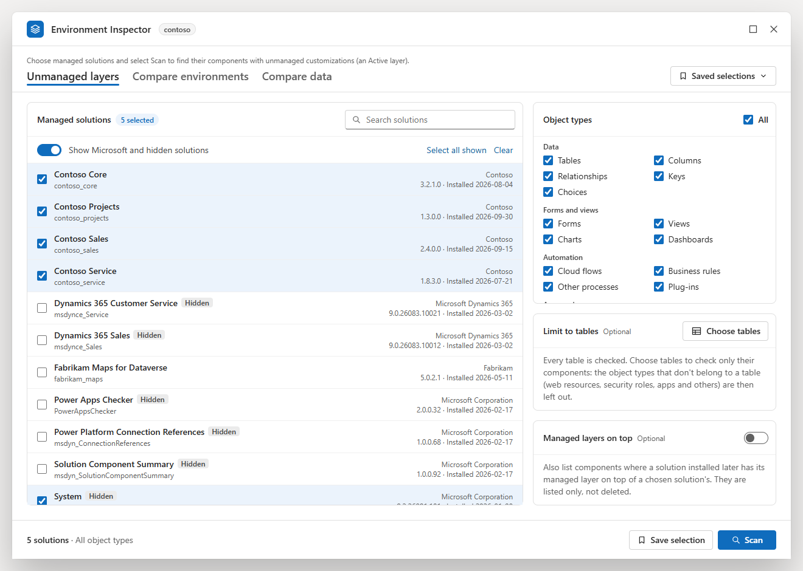

**Choose tables.** The search *contoso* finds four tables (Invoice, Milestone, Project and Time entry), and *Project*
is ticked (*1 table selected*): only the components of that table are then checked.

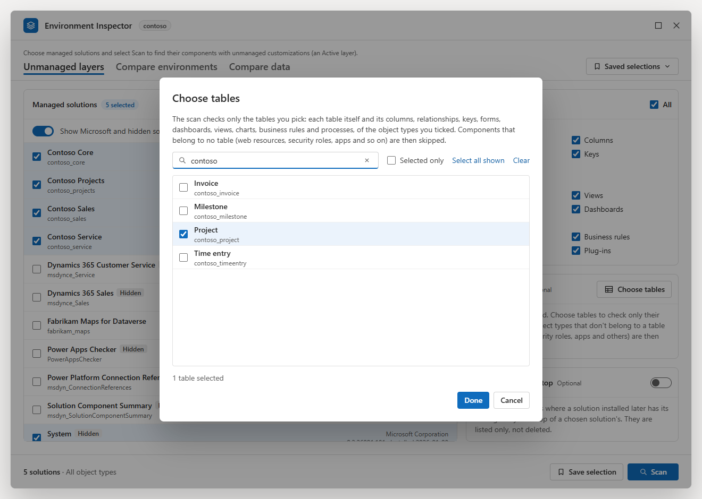

**Scanning.** Above the title, what is scanned (*Unmanaged layers · 5 managed solutions · All object types*); under the
header, the progress line. The step being worked on (*Reading the solution summary*), how far the scan is and the time
since it started, placeholder rows, and **Stop scan**; **Scan again** and **Export** are off until it ends.

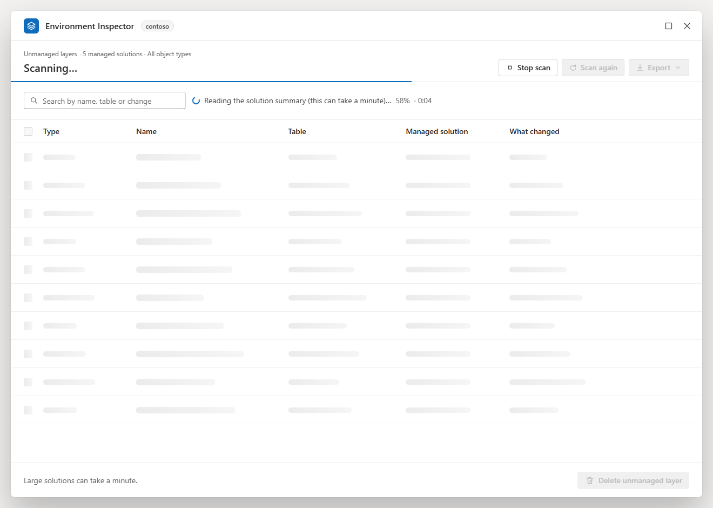

### Results and filters

**The results.** The count is the title, *23 unmanaged layers*, with the scope and the time above it (*5 managed
solutions · All object types*, scanned in about 6 seconds), and **Change selection**, **Scan again** and **Export**
on the right. The type bubbles show the most common types first, and the nine others are under **More**. Each row
shows the type, the name with the schema name under it, the table, the managed solution and the properties the
unmanaged layer changes, then two icons: its details and its solution layers page. The email template has an info
icon instead of a tick box: Dataverse does not allow deleting its unmanaged layer.

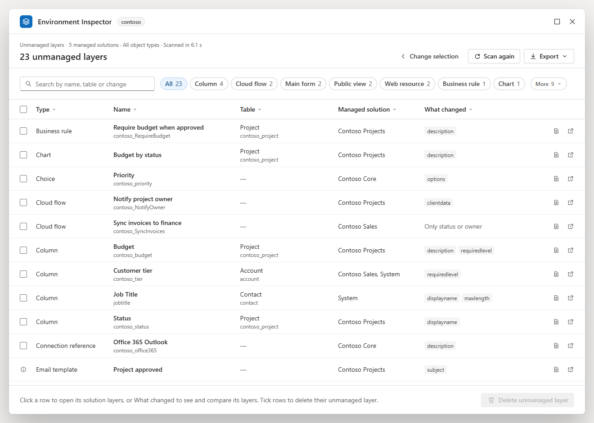

**A column's menu**, here *What changed*: sort, a search box, and every property name with the number of rows that
change it, all ticked.

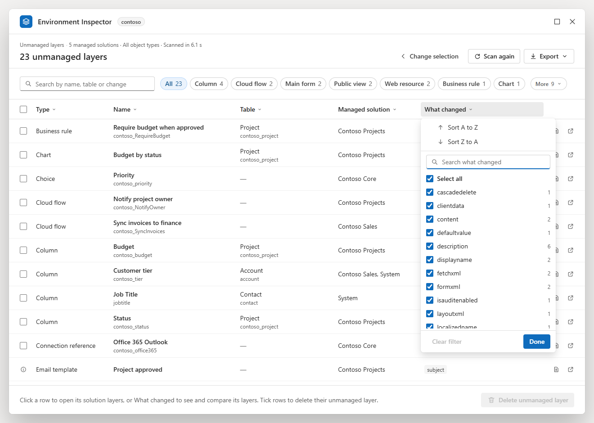

**Export**: *Excel (CSV)*, the rows shown; *All layers (CSV)*, every layer of each component shown, with its publisher
and time; *Full details (JSON)*, everything the scan found.

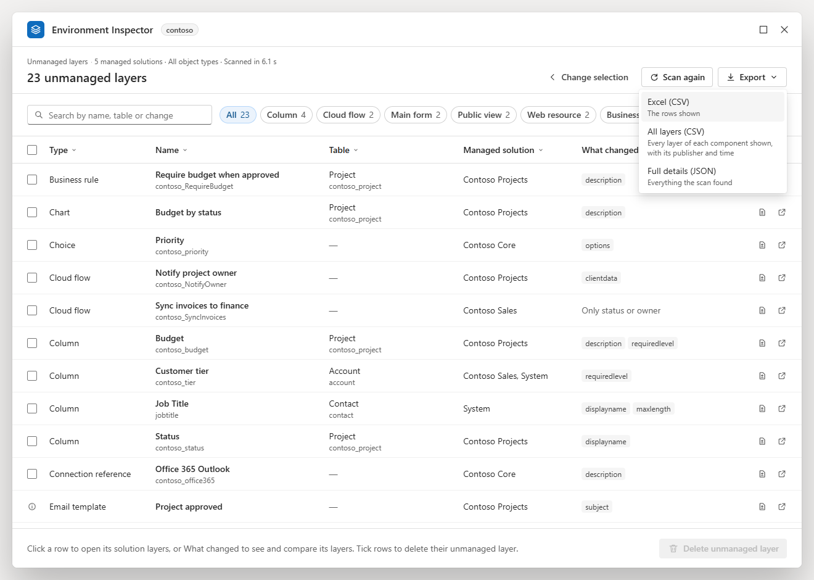

### Details of a component

**What changed** for the main form *Information*, 14 of the 23. The header has **Back** and *All unmanaged layers ›*
at the left, the title with its teal *Unmanaged layer* tag, then the pager, **Solution layers** and **Delete unmanaged
layer**. Below the tabs, the two layers side by side, each in its lane: *Contoso Projects 1.3.0.0*, the managed layer
(grey, *Layer 1 of 2*), against *Active*, the unmanaged layer on top (teal, *Layer 2 of 2*), with **Swap** between
them. *2 properties differ*; each has its name in words, then Dataverse's name (*Description* `description`, *Layout*
`formxml`), with the orange not-equal connector between its two values. The description is short, so its two values
face each other. The form's XML is laid out level by level, each attribute on a line of its own and each `>` or `/>`
on its own line (*XML laid out, one attribute per line*: the Active layer adds `locklevel="1"` to a cell that has one
attribute in the managed layer), and compared line by line (*20 lines differ*): the lines of both layers are kept
level, the changed part of a line is marked, the lines the Active layer alone has are tinted opposite a hatched gap,
and the unchanged lines are folded (*7 unchanged lines*, *51 unchanged lines*, *5 unchanged lines*).

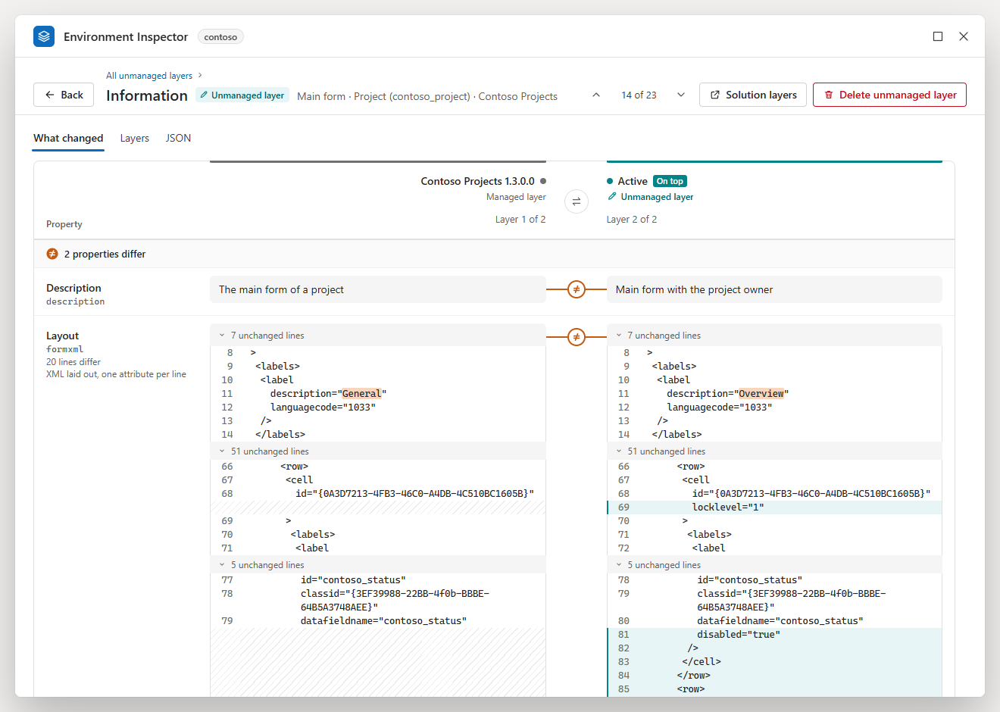

**A JavaScript web resource**, *project.js*: its content is decoded from base64 and compared line by line (*2 lines
differ*): `setRequiredLevel('none')` became `'required'`, and the Active layer adds an `addOnChange` line. Under the
property, **Show the 2 properties that are the same** and **Show the 3 system values that also differ** (*such as
Modified on, which Dataverse sets itself*) are folded.

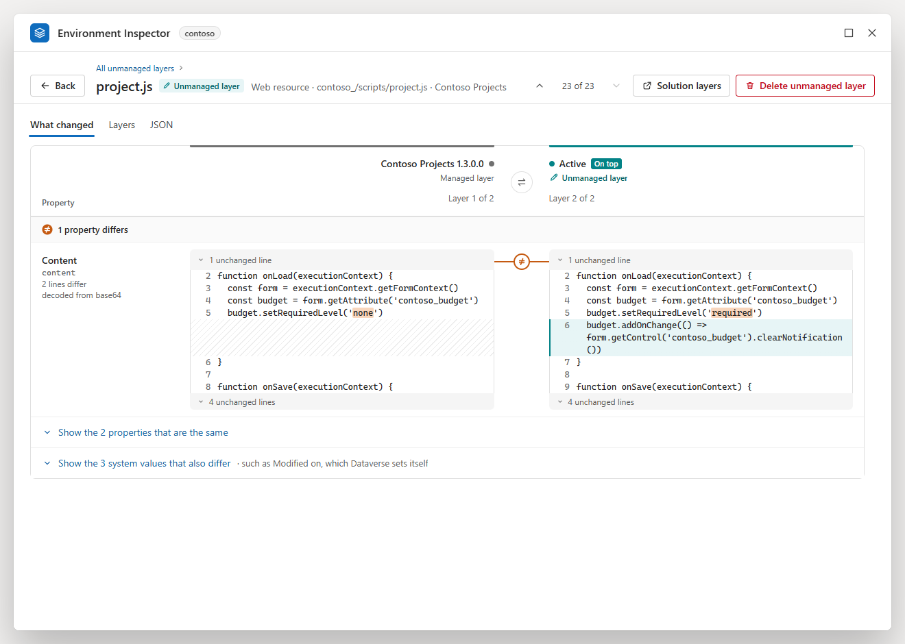

**An image web resource**, *logo.png*: both images are shown, a blue one in *Contoso Core 3.2.1.0* (192 bytes) and a
green one in the Active layer (201 bytes).

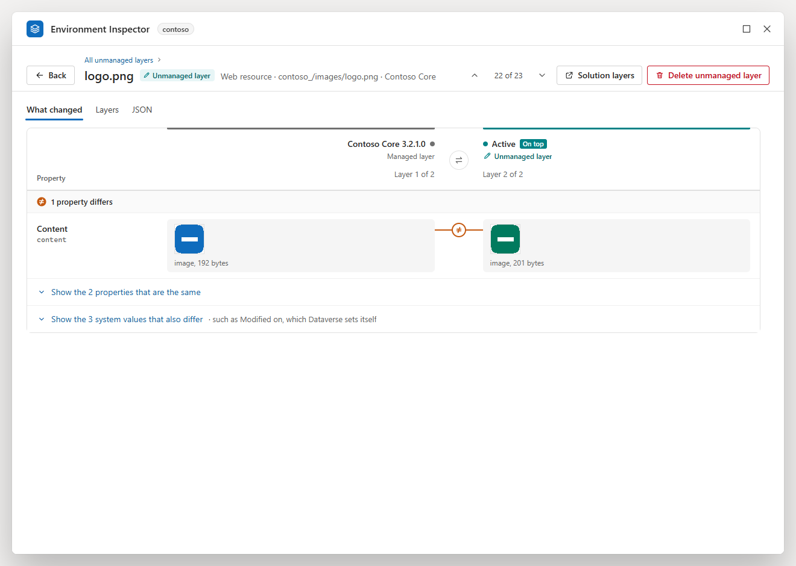

**A web resource whose content is kept as a file**: the content is one row, *Content* (`content`). Dataverse gives
out only the file in effect, here the Active layer's, so the Active layer's content is shown, decoded, each line at its
own indent; the two lines too long for the lane wrap after an opening bracket (`getControl(`) and before a dot
(`.setSubmitMode`), their wrapped part 2 characters further in. The managed layer's file can't be read: its side has a
dashed box that says why, the grey dashed question mark sits between the two, and a sentence under the row's name
says so: *The content of Contoso Projects can't be read here, so the two can't be compared line by line. The content
of the Active layer is shown below.* Its content is not guessed (see [What changed](#what-changed)).

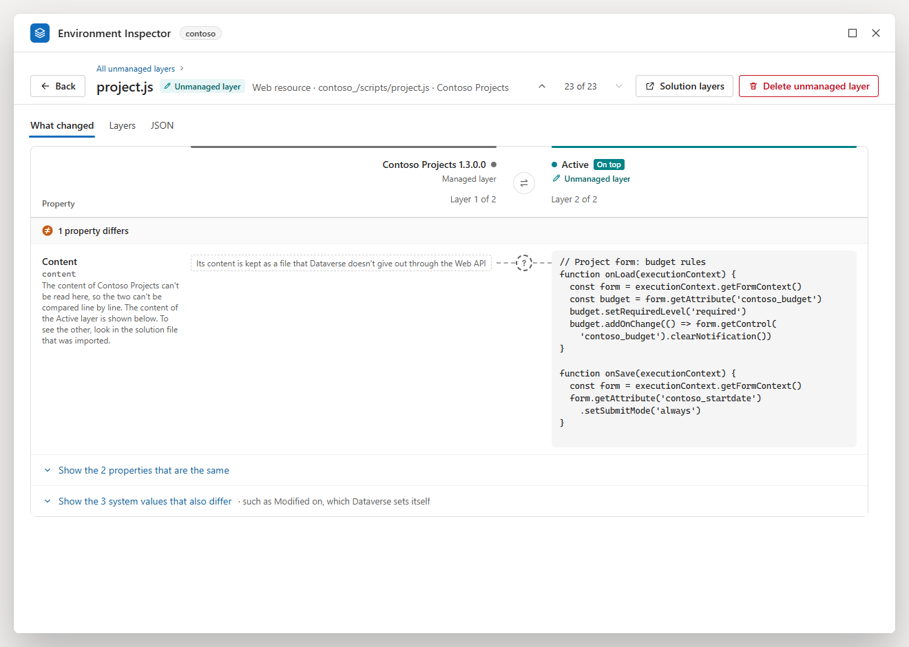

**The Layers tab**: every layer of the component, top first, with its order, solution, publisher, kind, version,
overwrite time and number of changed properties. Dataverse gives the unmanaged layer no overwrite time, so the Active
row shows when the form was last published instead (*Last published*); its *Unmanaged* tag is teal, with a pencil.
**Compare with Active** and **JSON** open the other tabs on that layer.

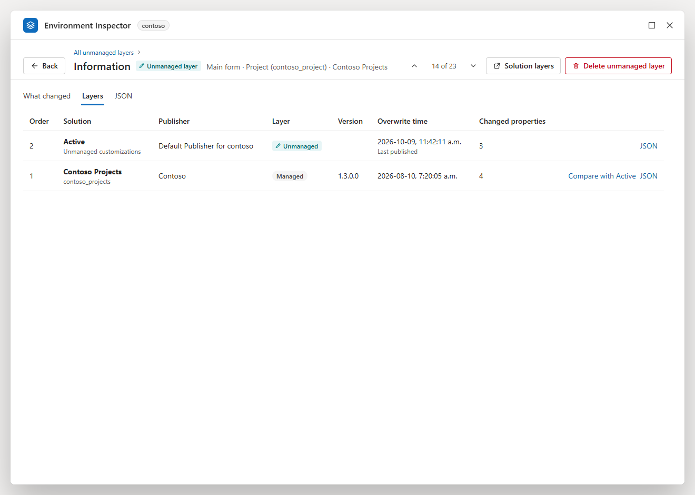

**The JSON tab**: the Active layer's *Changes* (`description`, `formxml` and `publishedon`), indented and coloured,
with **Copy** and **Download**.

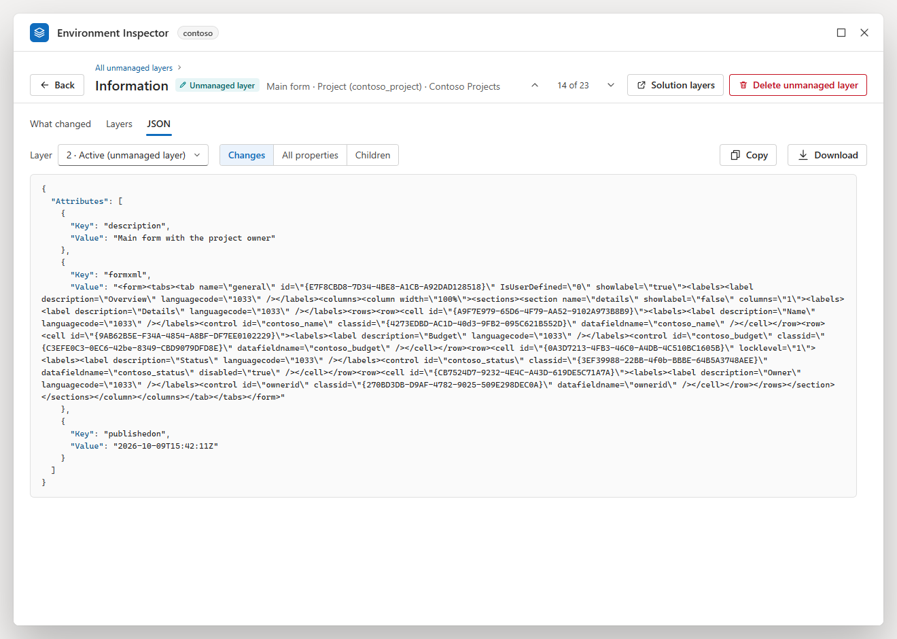

**Children as a table**: the Active layer of the security role *Project Manager*, its four privileges with their depth
named (Organization, Business unit, Parent: child business units), above the JSON they come from.

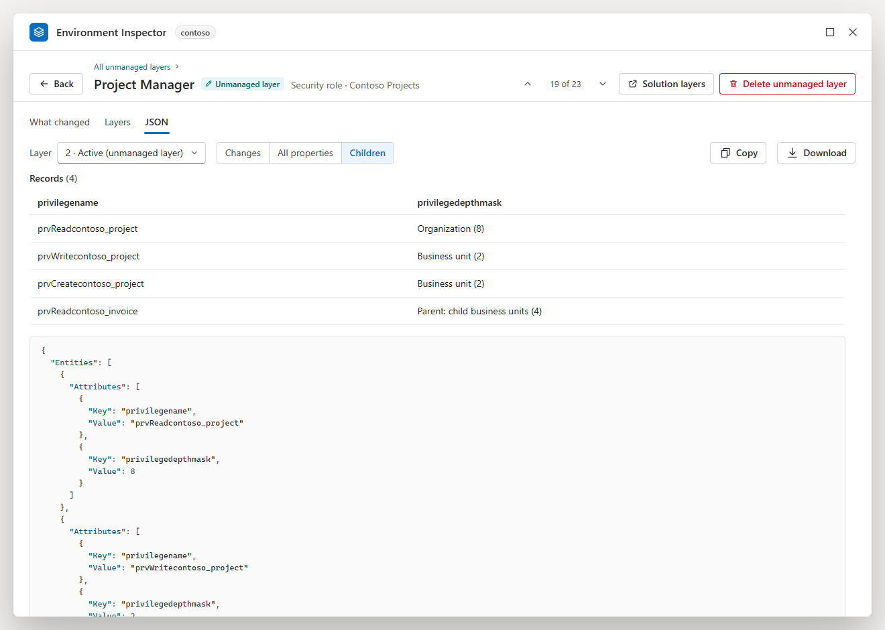

### Another managed solution on top

**Managed layers on top**, the second list of a scan made with the option on: the title counts *20 unmanaged layers ·
5 managed layers on top*. Five components of the Contoso solutions are covered by a solution installed later: four by
*Contoso Sales*, one by *Contoso Projects*. Each row names the solution on top in teal (*Overridden by Contoso Sales*)
under the solution it covers, and has a teal layers outline instead of a tick box: a managed layer can't be deleted
here (so the header has no tick box either). The switch next to the search (*Unmanaged 20*, *Managed on top 5*) goes back to the 20 unmanaged layers.

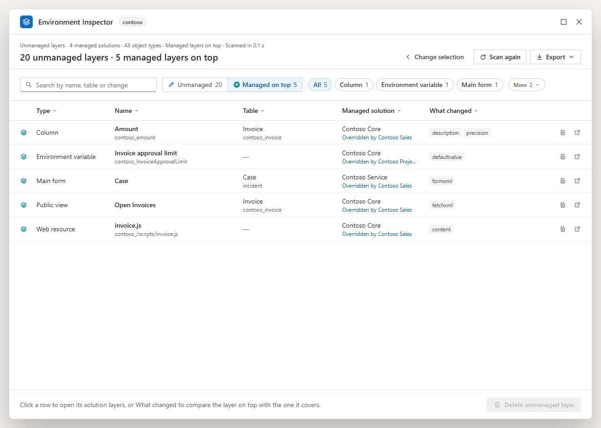

**What changed** for one of them, *invoice.js*, with the teal *Managed layer on top* tag and only **Solution layers**
in the header (no delete for a managed layer). *Contoso Sales 2.4.0.0*, installed after *Contoso Core*, ships an older
copy of a script that *Contoso Core* has since updated, so the older copy is the one in effect. The teal note across
both lanes says why, and what to do for the component to work as *Contoso Core* sets it; the comparison (*6 lines
differ*) shows
*Contoso Core 3.2.1.0* on the left, its lines that the layer on top doesn't have tinted opposite a hatched gap, and
*Contoso Sales* on the right.

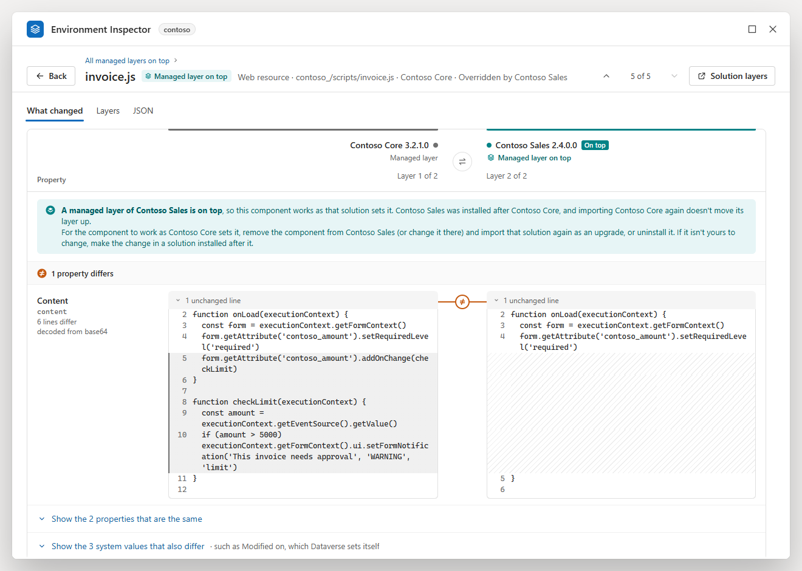

**Choosing the two layers.** The main form *Case* has four layers, so *Layer 3 of 4* and *Layer 4 of 4* in the lane
heads are pickers. The left one is open: the four layers, top first, each numbered by its place from the bottom
(*4 · Contoso Sales 2.4.0.0*, *3 · Contoso Service 1.8.3.0*, *2 · Dynamics 365 Customer Servi…*, *1 · System
9.2.26091.181*); *Contoso Service*, ticked, is the one shown, and *Contoso Sales*, in the other lane, can't be chosen
(*On the right*).

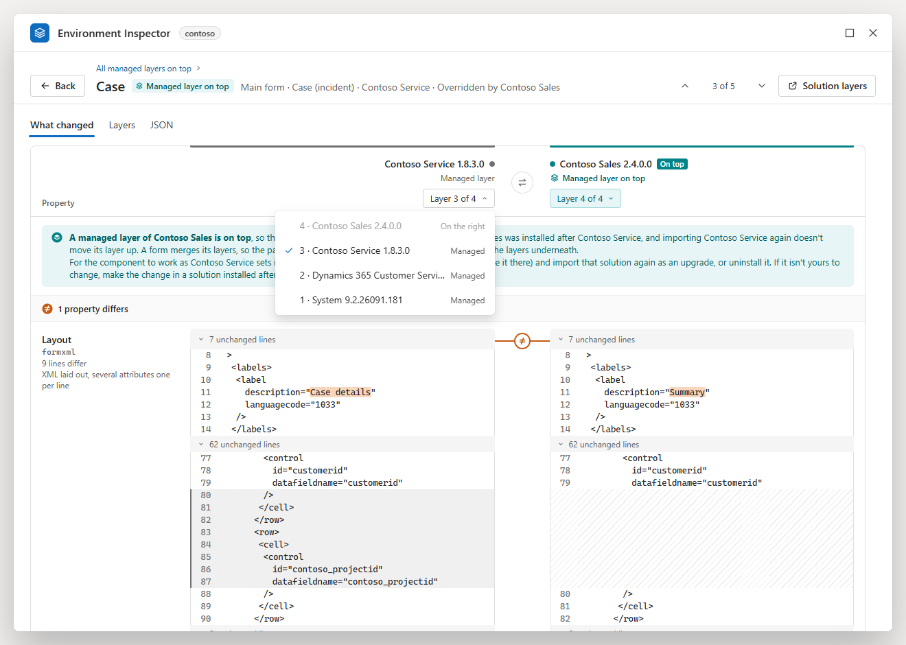

### Comparing environments

**Compare with a snapshot.** Under *Compare environments*, the snapshot of *Contoso Test* is open in the strip above the
lists. Each solution shows its version here and in the snapshot: *Contoso Sales* is developed here (unmanaged 2.5.0.0)
and installed in *Contoso Test* (managed 2.4.0.0); *Contoso Service* is in *Contoso Test* only; *Contoso Fixes* and
*Contoso Sandbox* are greyed out, because the snapshot doesn't hold them. *Unmanaged changes* is on. The **Saved
selections** menu (top right) is open: this tab's own saved selections, *Forms and views* and *Release check*, each
with what it holds. *Release check*, just saved, is ticked, and its name starts the bottom bar.

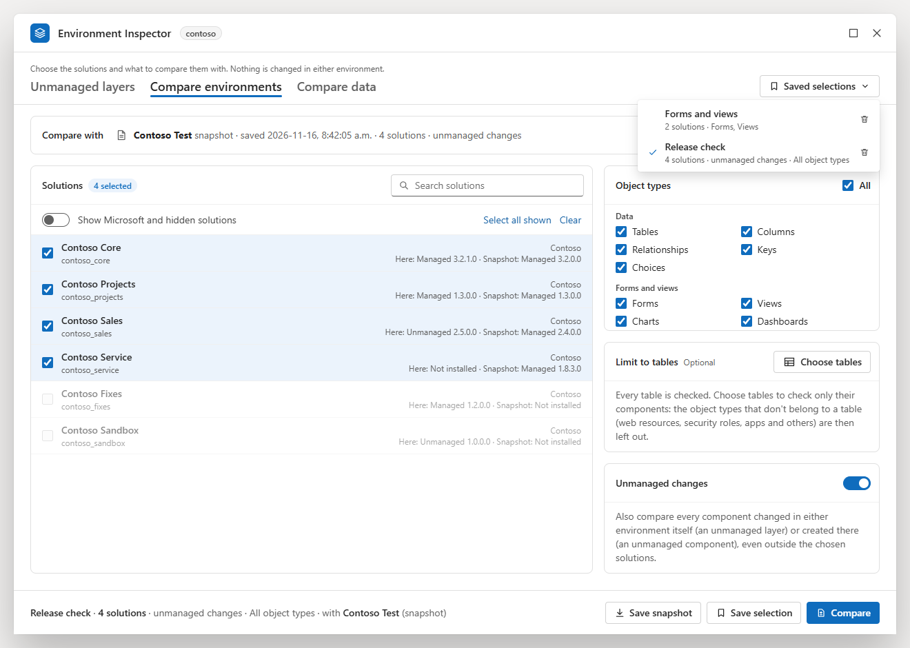

**The overview** of *Contoso Dev* (this environment, blue) against the snapshot of *Contoso Test* (purple, *1 day
old*): the title says *4 solutions and 10 components differ*. The two environments head their lanes, with **Swap**
between them. Dataverse's version and the languages are the same, with the grey equals connector. Each compared
solution shows its version in each environment, the newest install first: *Contoso Service* is not installed in
*Contoso Dev*; *Contoso Core* and *Contoso Sales* are newer in *Contoso Dev* (the orange not-equal connector and a
*Newer* tag; *Contoso Sales* is developed in *Contoso Dev*, unmanaged there, so its components there are made there, not
unmanaged layers); *Contoso Projects* is at the same version in both, but 4 of its components differ, and 2 of its
components have an unmanaged layer on top in *Contoso Test*. The *Unmanaged changes* row counts one change outside
these solutions, in *Contoso Dev* only. On the right, each row says how many components differ and what kind, after
the status icons (*2 different*, *1 only in Test*, *1 layer differs*). *All components*, 12 in each environment,
starts the next group: 9 of them differ.

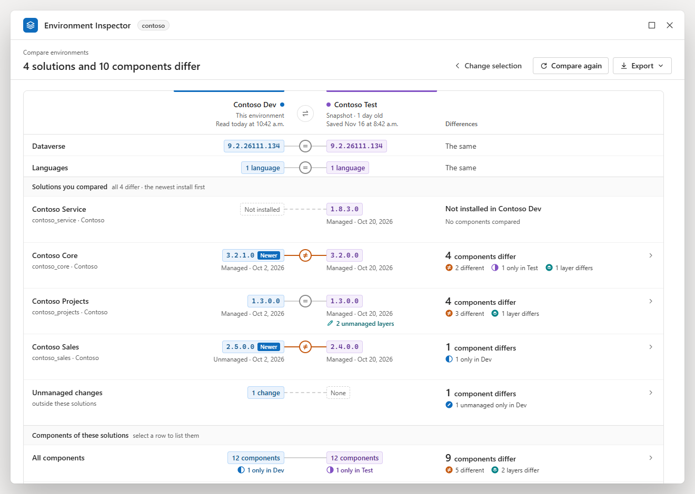

**One solution's list**, *Contoso Projects*, opened from the overview, with **Back** and *All solutions ›* at the
left of its title. The first sheet says, in words, that the version is the same in both environments, yet 4 of its 6
components differ, and that 2 of them have an unmanaged layer on top in *Contoso Test*. Then the status tabs (those with
nothing in them are greyed), **Filter** and a search. The four differences are grouped by type, each with what differs
in words: a column's display name, a form's layout, and a flow that is on in *Contoso Dev* and off in *Contoso Test*.
The form and the view have an unmanaged layer on top in *Contoso Test* (the teal tag); for the view, that is the only
difference (*Only the layer on top differs*, *Layers differ*). Each line has a **Layers** link for each environment;
the 2 components that are the same are behind **Show them**.

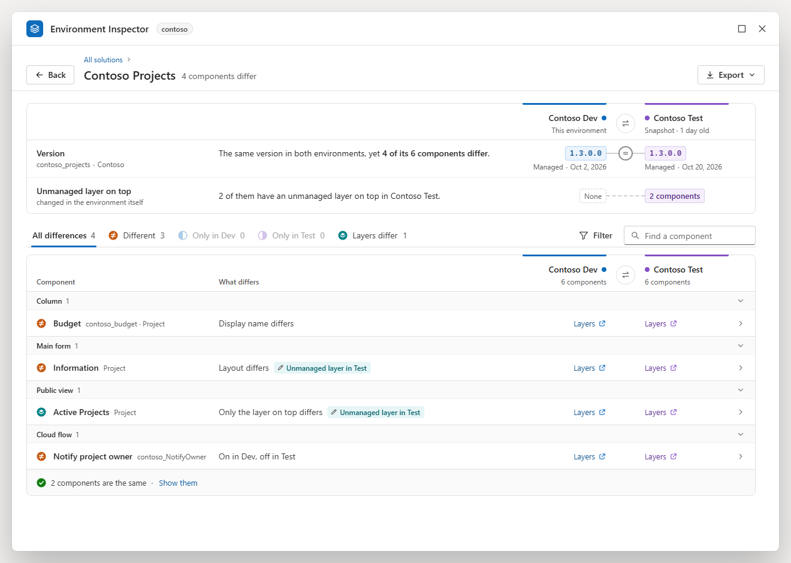

**The details** of the form *Information*, 2 of 4, under *All solutions › Contoso Projects ›*. Each lane head has its
link to the solution layers page (**Solution layers in Dev**, **Solution layers in Test**). *Where it is*: the same
solution and version in both, and, after the teal layers connector, an unmanaged layer on top in *Contoso Test* (the
teal *Unmanaged layer* tag, "over Contoso Projects 1.3.0.0"), with a teal note that says what that means. Then *1
property differs*: the layout (`formxml`, *14 lines differ*, *XML laid out, several attributes one per line*) side by
side, nested level by level, each environment in its colour: *Contoso Dev* has a new row with a cell, its label
*Status* and the `contoso_status` control, opposite a hatched gap.

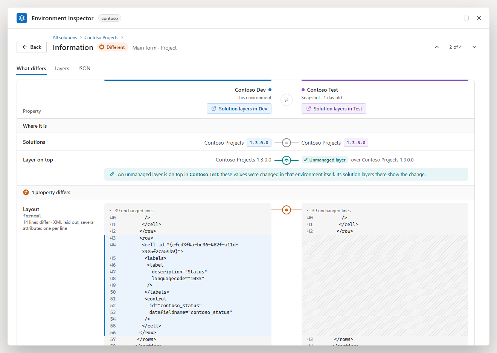

### Comparing data

**Choose the tables.** Under *Compare data*, the data snapshot of *Contoso Test* is open in the strip above the cards: 7
tables, 1,355 records. The *Tables* card lists this environment's tables, each with its number of records here and in
the snapshot. *Account* (*Very large*), *Contact*, *Denied* and *Feed* (a virtual table) are greyed out, because the
snapshot doesn't hold them; Dataverse gave no count of *Denied* and *Feed* (*Here: not counted yet*), and the snapshot
couldn't read *Big* (*Snapshot: —*). Six tables are ticked. The *Chosen tables* card says how each one's records are
matched and how many of its columns are compared: *Exchange rate* by *Code* and *Valid from*, *Currency* by its name,
the others by id, then their code or name. *Legacy code* is only in the snapshot, so its records will be *Only in Test*.

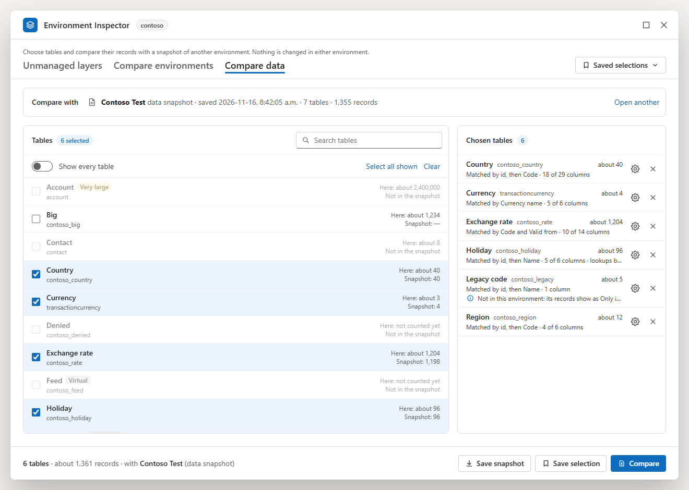

**A table's settings**, here *Exchange rate*'s: its records are matched by two columns, *Code* and *Valid from*,
whatever their ids; its lookups to tables outside the comparison are compared by name; 10 of its 14 columns are compared
(*Note* is unticked, and *Code*, used to match, stays ticked). Each column of the first group, *Compared by default*,
says its type and, when there is one, why it is compared, such as *used to match*.

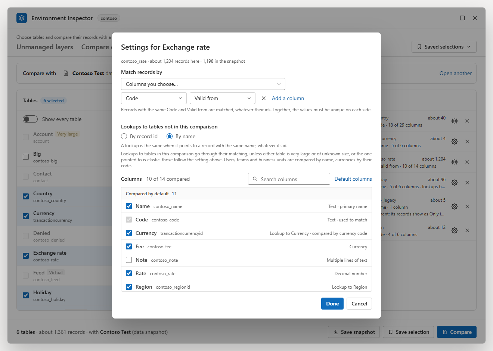

**Saved selections**: the menu lists this tab's saved selections, *Currencies* and *Reference data*, each with its
tables and how many of them have settings of their own. *Reference data*, just saved, is ticked, and its name starts
the bottom bar.

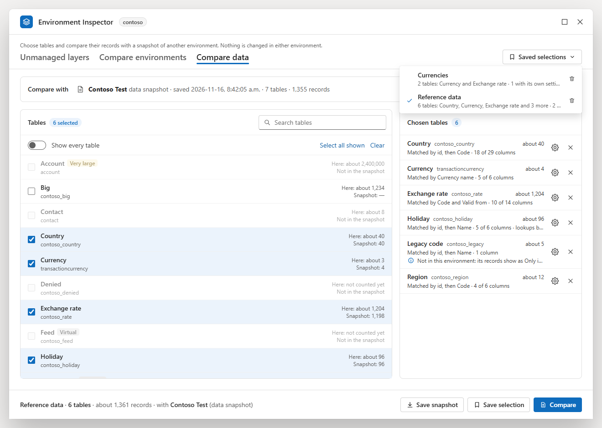

**A long read is confirmed first.** No snapshot is open, and five tables are ticked, among them *Account* (*Very
large*). **Save snapshot** asks first: reading at least 2,582,508 records takes about 16 minutes and much of the tab's
memory, *Account* holds about 2,400,000 and *Postal code* about 182,400, and the size of *Feed* isn't known; the file
will be about 94 MB. The bottom bar warns of the same. **Go back** has the focus.

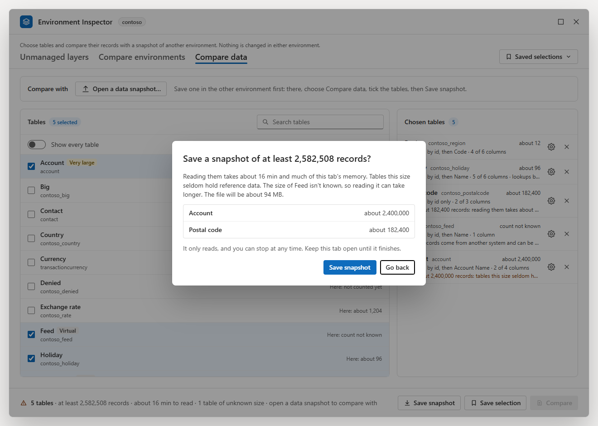

**Comparing.** The title says *Comparing data*, *2 of 10 tables done*, with **Stop** on the right and the progress
line under the header. Each chosen table has its row from the start, and says how far it is: *Contact*, *Currency* and
*Reading* are read; *Country*, *Exchange rate* and *Holiday* are being read here, each with a bar; *Legacy code*
waits. *Big* and *Denied* won't be compared, and their rows say why: the snapshot couldn't read *Big*, and your
security role can't read *Denied* in *Contoso Dev*. The step line names the table being read, with its records and the
percentage.

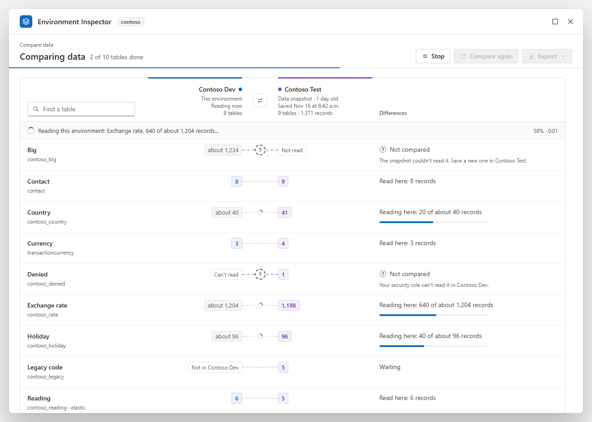

**The overview** of *Contoso Dev* against the data snapshot of *Contoso Test*: the title says *53 records differ in 6
of 10 tables*. Each lane head counts the tables and records read. The tables that differ come first, the most first:
each row has its records in each environment, then on the right how many records differ and what kind. In *Exchange
rate*, 34 records differ: 6 only in Dev, and 28 different, in *Rate* and *Valid to*; *Country* has records only on
each side and 3 that couldn't be compared; *Legacy code* isn't in *Contoso Dev*, so its 5 records are only in Test;
in *Currency*, *Pound Sterling* isn't in *Contoso Dev*. Then the 2 tables with no differences: *Contact*, with 1
record that couldn't be compared, and *Holiday*, whose 96 records are all the same. The link at the top right,
*2 tables and 4 records couldn't be compared*, goes to the group below that lists them.

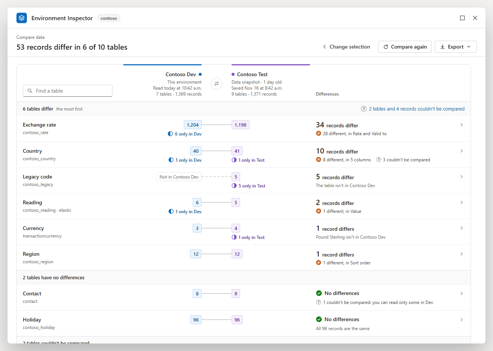

**A table's records**, *Country*'s: 10 records differ. The status tabs have a number each (*Different 8*, *Only in Dev
1*, *Only in Test 1*, *Couldn't compare 3*); under them, the columns that differ as chips, each with how many records
differ in it, and the line that says how the records were matched (*matched by their id, then Code*; its tooltip gives
how many each way) and how many columns were compared. Each line says what differs in words (*Population differs*, *Name: only letter case differs*,
*Member: Yes in Dev, No in Test*), with **Open** for each environment; *Peru* is only in *Contoso Dev* and *Egypt* only
in *Contoso Test*, so each has one **Open** and a dash on the other side. The 30 records that are the same are behind
**Show them**.

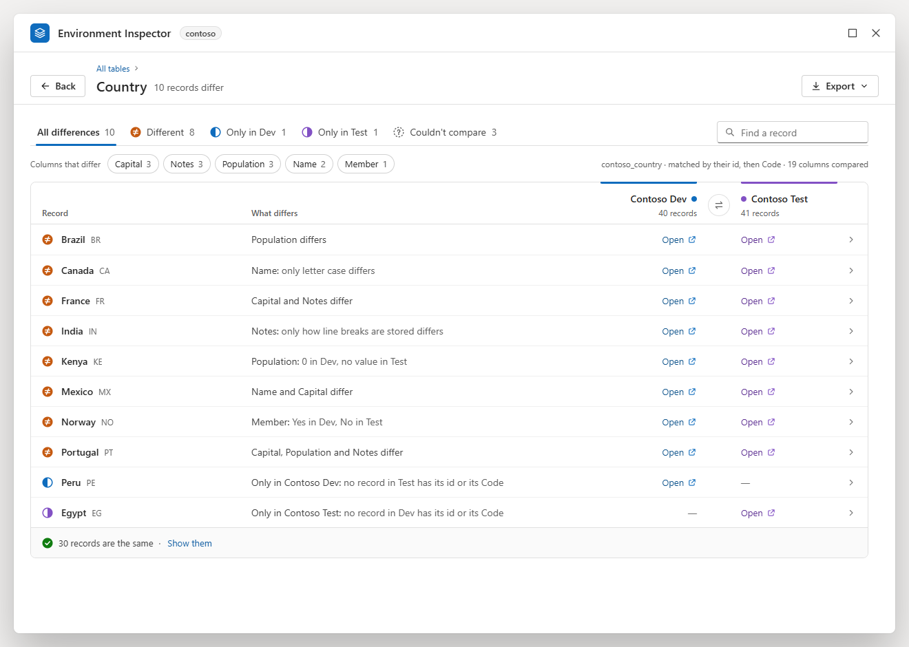

**A record's details**, *Portugal* (*PT*), 8 of 10, with **Open in Contoso Dev** and **Open in Contoso Test** in the
lane heads. *3 columns differ*: *Capital*, *Lisboa* against *lisboa*, with the note *Only letter case differs*;
*Population*, its differing digits marked; and *Notes*, where *Contoso Test*'s extra line is tinted opposite a hatched
gap. The 16 columns that are the same are behind **Show the 16 columns that are the same**. *About this record*: when
it was last changed on each side (shown, not compared; *Later* on the newer one), the record id, the same on both
sides, and how it was matched (*Its id, the same in both environments*).

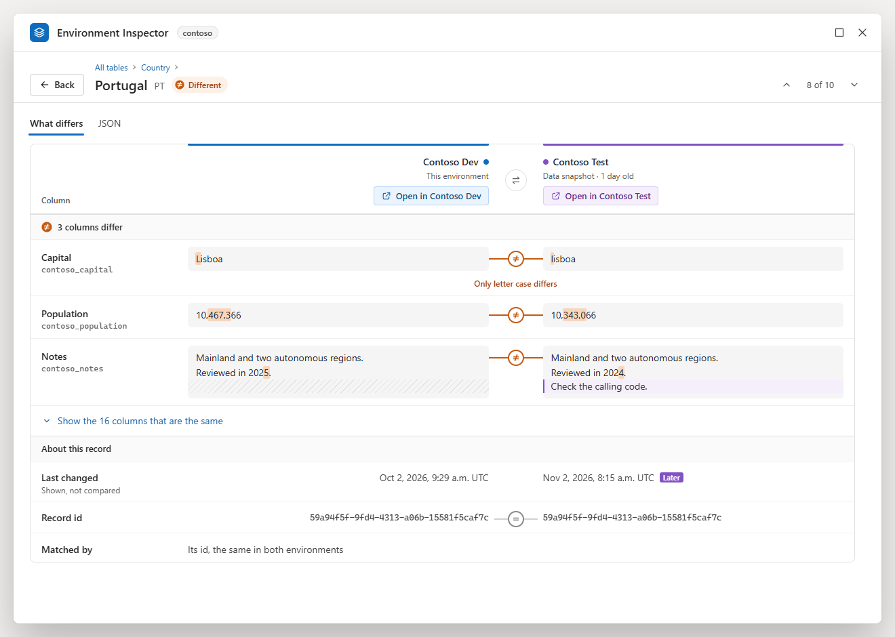

**A narrow window** (720 pixels wide): the *Tables* and *Chosen tables* cards stack, each with its own list; **Saved
selections** keeps only its icon; the *Compare with* line and the bottom bar's text are cut short.

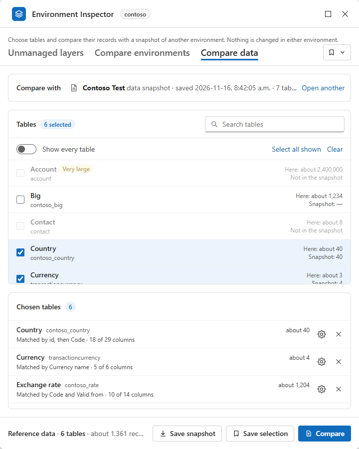

### Deleting layers

**One confirmation** for three ticked components, listed in the order they will be deleted: the column *Budget*, the
environment variable *API base address* and the public view *Active Projects*. It says that this is the same as
**Remove active customizations** on the Solution layers page and can't be undone. **Cancel** has the focus.

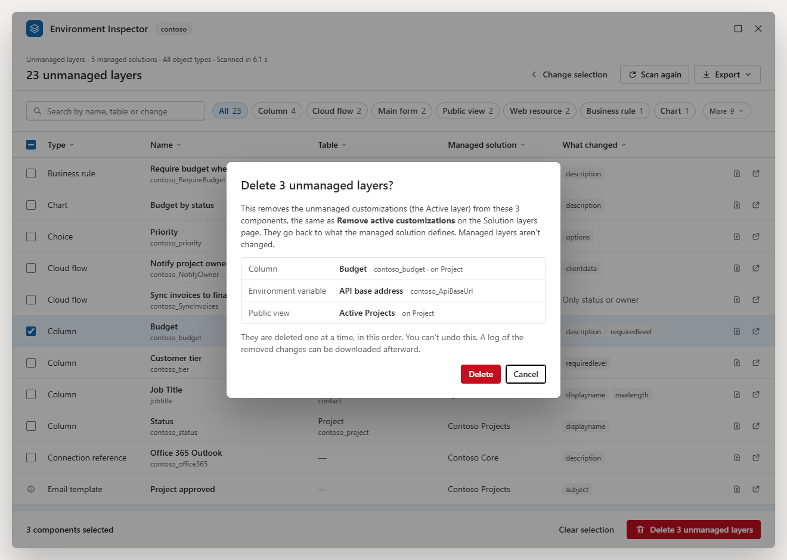

**Deleting.** *Budget* is done, struck through with a green check; *API base address* is being deleted, its row
highlighted. The header buttons and the type bubbles are off; the bottom bar shows the progress (*Deleting 2 of 3*),
the time left and **Stop deleting**.

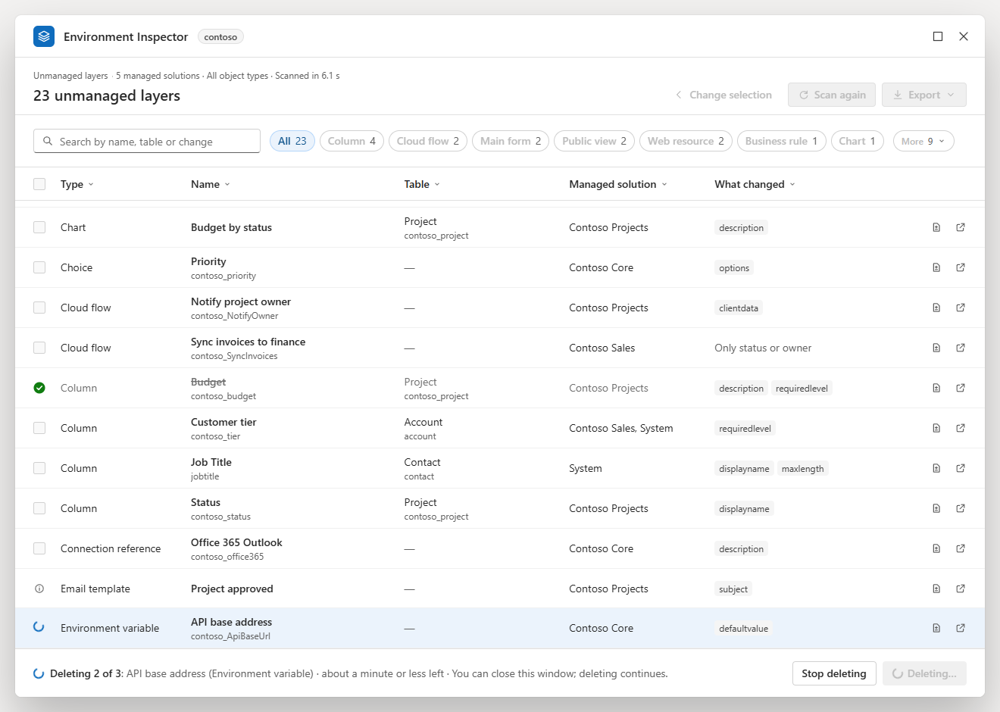

**After deleting.** The three rows are struck through with a green check, the title counts 20 (*3 deleted* above it),
and the message *Deleted 3 unmanaged layers.* offers the deletion log (**Download log**).

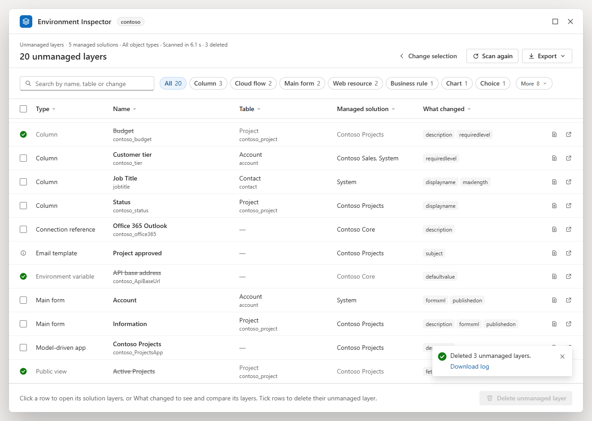

### Narrow window

**A narrow window** (820 pixels wide), opened with **Change selection** from the results. The object types go to one
column and the cards make room; **Saved selections** keeps only its icon, and long solution names are cut short.
**Back to results** returns to the last scan's results.

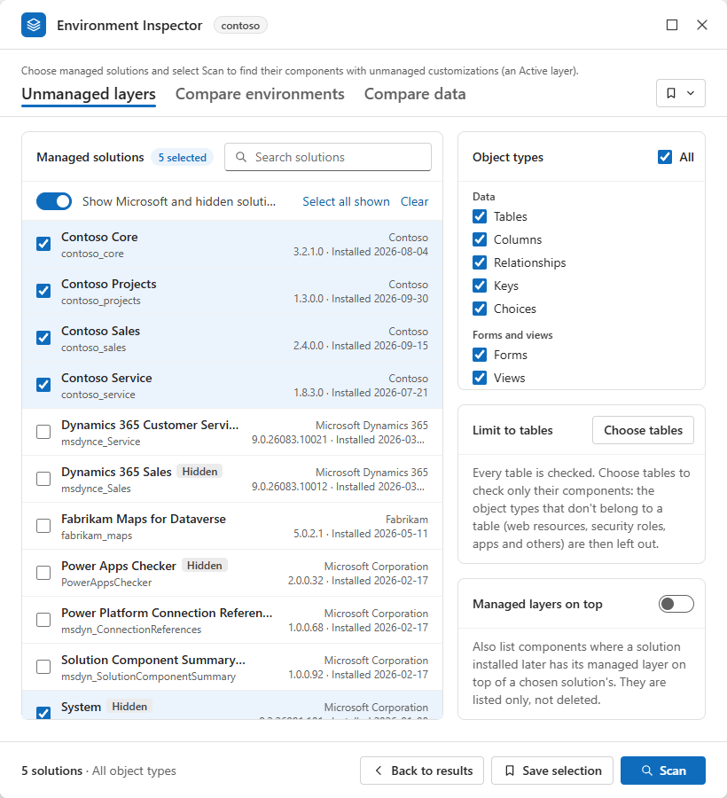

## Download

The files are attached to each release on the [Releases](../../releases) page:

| File | Use |
| --- | --- |
| `Install-Environment-Inspector.html` | The install page: open it in Edge and drag the **Environment Inspector** button to the favourites bar. It also holds the link in a box with **Copy**. Most people need only this file (in the repository it is `Install Environment Inspector.html`) |
| `environment-inspector.bookmarklet.txt` | The link itself (it starts with `javascript:`), to paste as the address of a favourite |
| `environment-inspector.min.js` | The code, minified, to paste into the browser's console where bookmarklets are blocked |
| `EnvironmentInspector-Technical-Reference.docx` | This README as a Word document: installing and using Environment Inspector, step by step with screenshots |
| `EnvironmentInspector-Developer-Guide.docx` | The developer guide as a Word document: how Environment Inspector is built and how to change it |
| `README.txt` | The package in short: what each file is, how to install, and the checksums |
| `SHA256SUMS.txt` | The SHA-256 checksums of the release's files, one line per file |

To check a file against its checksum in PowerShell:
`Get-FileHash -Algorithm SHA256 .\environment-inspector.bookmarklet.txt`, then compare the hash with the line for that
file in `SHA256SUMS.txt` (PowerShell prints it in capitals). On macOS or Linux, `sha256sum -c SHA256SUMS.txt` checks
every file it lists at once.

The released files are built from this repository without [environment rules](#environment-rules-optional). To build
them yourself, see [Build](#build).

## Install

### Drag the button

1. Download `Install-Environment-Inspector.html` from the [Releases](../../releases) page and open it in Edge
   (double-click it, or drag it onto an Edge window). GitHub shows the copy in the repository as source text, so use
   the downloaded file.
2. Show the favourites bar: Ctrl+Shift+B.
3. Drag the blue **Environment Inspector** button onto the favourites bar.

### Create the favourite by hand

When dragging does not work:

1. Copy the link: **Copy** on the install page, or the whole content of `environment-inspector.bookmarklet.txt`.
2. Add any page to the favourites bar (Ctrl+D, folder *Favourites bar*).
3. Right-click the new favourite, select **Edit**, name it *Environment Inspector*, replace its URL with the link, then
   **Save**.

Pasting the link into the address bar does not run it: the browser removes the `javascript:` part of pasted text.

### Run it from the console

Without a favourite, the same code runs from the browser's developer tools:

1. Open a page of the environment, or its Solutions page in the maker portal.
2. Press F12 and open **Console**.
3. Paste the whole content of `environment-inspector.min.js` and press Enter. If the console warns about pasting code,
   follow the instruction it gives to allow pasting (in Edge, type *allow pasting*, then paste again).

### When bookmarklets are blocked

Some organizations block bookmarklets with a browser policy: clicking the favourite then does nothing. Use the
console (above), or ask the people who manage your browser.

The link runs the unpacked code with `eval`. If a page forbids that, the link loads the code as a script instead; if
that is refused too, it says "This page does not allow Environment Inspector to run." Environment pages and the maker
portal allow it.

### Update to a new version

1. Replace the favourite's URL with the new link (right-click it, **Edit**), or drag the new button from the new
   install page and delete the old favourite.
2. Reload the pages where the window is open. On a page where a window is already open, the favourite shows that
   window again instead of starting the new version.

Saved selections, the last choice, the column widths and the window's place and size are kept. To see which version
runs, point at *Environment Inspector* in the window's title bar: the tooltip reads "Environment Inspector 2.0.0".

## Use

### Open it

Click **Environment Inspector** on the favourites bar:

* **On a page of the environment**: any address ending in `.dynamics.com`, for example
  `https://contoso.crm.dynamics.com/main.aspx`. It uses your browser's session with the environment.
* **In the maker portal**: `make.powerapps.com` with an environment open (the address contains
  `/environments/<id>/`), for example its Solutions page. Wait until the Solutions list has loaded: it uses the
  portal's own sign-in to the environment (see [Safety](#safety)). Started on a solution's page, that solution is
  selected, with every object type and every table, and the bottom bar says "selected because it's open in the maker
  portal".

The window opens over the page. Its title bar shows the environment's name (point at it to see the address) and, with
[environment rules](#environment-rules-optional), a *Production* or *Development* badge.

There is one window per page. Clicking the favourite again shows the same window as you left it; in the maker
portal, on the page of another managed solution, it goes back to the choice with that solution selected. When you
switch to another environment in the maker portal, the next click closes the old window and starts one for the new
environment (not while it is scanning, comparing, saving a snapshot or deleting); download the
[deletion log](#the-deletion-log) and the exports you need first, because the results go with the old window. To close
the window, select × or press Esc.

### Choose what to check

The tabs at the top of the window, *Unmanaged layers*, *Compare environments* and *Compare data*, switch between the
scan described here, [comparing environments](#compare-environments) and [comparing data](#compare-data). Each tab
keeps its own choice and its own saved selections.

**Managed solutions.** Every managed solution of the environment, with its display name, unique name, publisher,
version and installed date; hidden solutions carry a *Hidden* tag. Unmanaged solutions are not listed. Search by name,
unique name or publisher. **Select all shown** ticks the solutions in the list, **Clear** unticks them all.

*Show Microsoft and hidden solutions* is off by default: the list then leaves out hidden solutions and solutions whose
publisher's name contains "Microsoft" or "Dynamics 365", except those already ticked.

**Why System matters.** Standard tables such as Account and Contact, with their standard columns, forms and views,
belong to Microsoft's hidden base solutions, mainly *System*. A standard component changed directly in the
environment has its unmanaged layer on top of System's layer. If you tick only your own solutions, such changes are
not listed. To include them, turn on *Show Microsoft and hidden solutions* and tick *System* too (or select all). In
the [results screenshot](#results-and-filters), the changed column *Job Title* of Contact is found through System.
With one of Microsoft's solutions chosen, the scan reads the whole environment, so it takes as long as a scan of every
solution (see [Scan and stop](#scan-and-stop)).

**Object types.** The types to check, grouped as in the maker portal:

| Group | Types |
| --- | --- |
| Data | Tables, Columns, Relationships, Keys, Choices |
| Forms and views | Forms, Views, Charts, Dashboards |
| Automation | Cloud flows, Business rules, Other processes, Plug-ins |
| Apps and resources | Apps, Site maps, Web resources, Email templates, Reports, Display strings |
| Security and settings | Security roles, Column security profiles, Environment variables, Connection references |
| Everything else | Other: every other component type, for example ribbon customizations, duplicate detection rules and component types added by newer solutions |

**All** ticks or clears every type listed. With some types only, the scan reads only the component types they need,
which is faster.

**Limit to tables (optional).** By default every table is checked. **Choose tables** opens the environment's tables
(display and logical names; private tables are not listed), with a search box, *Selected only*, **Select all shown**
and **Clear**. With tables chosen, only their components are checked: the tables themselves and their columns,
relationships (on either side), keys, forms, dashboards, views, charts, business rules and other processes, of the
object types ticked (under *Other*, only their ribbon customizations). Object types that are not offered for a table
(choices, cloud flows, plug-ins, apps, web resources, security roles and others) are then no longer listed, with a
note; they come back with their ticks when you select **Check all tables**. This is also faster: in a test, one table
of a solution took 29 requests, against 51 for the same solution with every table (read from the whole environment,
as a scan with a Microsoft solution is: 32 requests and about 3 seconds, against about 330 requests and 5 to 9
seconds).

**Managed layers on top (optional).** Off by default. Turned on, the scan also lists the components of the chosen
solutions whose layer is covered by another managed solution's layer, installed later: see
[Managed layers on top](#managed-layers-on-top). Microsoft's solutions are not looked under.

In a short window, *Limit to tables* and *Managed layers on top* keep only their title and control (with tables
chosen, one line says how many, with **Check all tables**), so the object types keep room.

**Saved selections.** **Save selection** (bottom) names the current choice of solutions, types, tables and the
managed layers option; the name
can be up to 60 characters long, and saving under an existing name replaces it (the button then says **Replace**). The
**Saved selections** menu (top right) lists them with what each holds; pick one to fill in the choice (then select
**Scan**), or select its bin icon to remove it (**Undo** in the message puts it back). Applied in an environment that
lacks some of its solutions, a saved selection says which; saving it again there keeps them in it.

Saved selections are kept in this browser: on the maker portal they are shared by every environment, on an
environment's own pages they belong to that environment. The last choice you scanned is remembered for each
environment and filled in next time.

The bottom bar sums up the choice, for example "5 solutions · All object types" (with "· Managed layers on top" when
that option is on), and **Scan** starts.

### Scan and stop

While scanning, the title says *Scanning…*, and next to the search box a line names the step, the percentage and the
time since the scan started, in minutes and seconds, for example "Reading the solution summary (this can take a
minute)… 58% · 0:04". The time goes on every second from the start of the scan to its end, so a long wait shows that
the scan is still working. While Dataverse asks Environment Inspector to slow down, or while a step that has waited
3 seconds or more waits for a request that has to be sent again, the line says so, with when the scan goes on in the
time's place, for example "Dataverse is busy (HTTP 503)… 58% · trying again in 4 s" ([Safety](#safety) says when that
happens). In a narrow window the text gives way, never the time; point at it to read all of it.

**What the scan reads.** When none of the chosen solutions is Microsoft's, the scan reads only what they hold: their
component lists, then the components they list, the parts of the tables they hold (forms, views, charts and others)
and the parts no list names (such as plug-in step images, through their step), asking each time for the ones whose top
layer is unmanaged. When one of them is Microsoft's (System, for example), it reads the whole environment, one query
per component type, and keeps what the chosen solutions hold: Microsoft's solutions hold some components that no
component list names, which only a look at every component finds. Either way, the same unmanaged layers are found in
your solutions. The steps:

| Step | What it reads |
| --- | --- |
| Reading the component lists of the chosen solutions (n of m)… | Your solutions only: the component list of each chosen solution |
| Reading the tables and the component types… | The tables, which of the columns the scan needs each table has, and the component type definitions |
| Checking the components of the chosen solutions (n of m)… | Your solutions only: the components their lists name, 200 per request, keeping those whose top layer is unmanaged |
| Checking the parts of their components (n of m)… | Your solutions only: the parts with no list row of their own, through the component they belong to: plug-in step images and types, field permissions, rule items, a custom control's files |
| Checking the parts of their tables (n of m)… | Your solutions only: the forms, views, charts, ribbons, mappings and other parts of the tables they list |
| Checking component types (n of m)… | With a Microsoft solution chosen: one query per component type, for every managed component of the environment whose top layer is unmanaged |
| Reading the definitions of tables and columns (n of m)…, then of relationships… | The definitions of the tables, columns, keys and relationships, to keep the managed ones |
| Checking the columns, keys and relationships of their tables (n of m)… | Your solutions only: the tables, columns, keys and relationships they list, and those of the tables they list |
| Reading the solution summary (this can take a minute)… | The maker portal's *Customized* flag, for the types the reads above cannot read (global choices and others): each chosen solution's, or the whole environment's |
| Finding which solutions the components are in… | The solution memberships of the components found, 200 per request (50 for the whole environment), 8 requests at a time |
| Checking the remaining components (n of m)… | The layers of components that have no solution membership row, to place them in a solution |
| Checking managed layers on top: … | With [Managed layers on top](#managed-layers-on-top) on: the component lists of the chosen solutions, and the solution of each of their components' top layers |
| Reading what changed (n of m)… | The layers of the components found: the managed layers underneath and what the unmanaged layer changes (for a managed layer on top, what that layer changes) |

The solution summary doesn't depend on the other reads, so the scan asks for it at the start and Dataverse prepares it
meanwhile; reading the whole environment, so are the definitions. The steps that need them usually find them ready.
Reading your solutions, several parts are read at once: the line names the first one still reading, and the bar never
goes back.

**Stop scan** ends the scan: the reads waiting or on their way end at once, the window goes back to the choice, and
a message says "Scan stopped." Nothing partial is shown.

In a test environment, a scan of one solution of its own with every object type took 1.6 to 2.7 seconds and 51
requests (read from the whole environment, 5 to 9 seconds and about 330 requests), and a scan of every managed
solution, which includes Microsoft's, 10 to 16 seconds and about 460 requests. Reading your solutions, the time follows
what they hold; reading the whole environment, the number of component types read, not the number of solutions. A few
object types or one table take less (Forms, Views and Columns of that solution: 17 requests; Forms and Views only, in
every managed solution: about 5 seconds). See
[Safety](#safety) for the load a scan puts on the environment, and
[Performance and scale](docs/developer-guide.md#610-performance-and-scale) in the developer guide for where the
requests go.

### The results

The header has the look of the comparisons' results (the same height, type and buttons, so switching tabs moves
nothing). Its first line, above the title, says *Unmanaged layers*, then the scope and the time the scan took, for
example "Unmanaged layers · 4 managed solutions · All object types · Managed layers on top · Scanned in 8.1 s"; after a
filter or a search, "showing *x* of *y*"; after a deletion, how many were deleted. The title gives the number of
unmanaged layers and, with [Managed layers on top](#managed-layers-on-top) on, the number of managed layers on top, for
example "20 unmanaged layers · 5 managed layers on top" (in a narrow window with both lists, the switch above the grid
gives the second number). **Change selection** goes back to the choice, **Scan again** runs the same scope again,
**Export** is described [below](#export). At 1,000 pixels and less the three buttons keep only their icons (their names
in their tooltips); while the scan runs, the 2 px line on the header's bottom edge shows how far it is.

The grid has one row per component:

| Column | Shows |
| --- | --- |
| Type | The type as the maker portal's Objects list names it: *Column*, *Main form*, *Public view*, *Cloud flow*, *Business rule*, *Security role* ... |
| Name | The display name, with the schema or unique name under it. The name is a link to the solution layers page |
| Table | The table's display name with its logical name under it, or "—" for a component without a table |
| Managed solution | The chosen managed solutions that hold the component. Point at it to see the managed layers underneath, top first |
| What changed | The properties the unmanaged layer sets, as many as fit, then *+N* for the others; or *Only status or owner* (a process only switched on or off, or given a new owner), *Only system values* (only values Dataverse sets itself, such as Modified on), *Not read yet* or *Layers could not be read* (after a grey dashed question mark) |

At the end of each row, a document icon opens the [details](#the-details) and an arrow icon opens the solution layers
page. The tick box column shows, instead of a tick box, a teal layers outline for a
[managed layer on top](#managed-layers-on-top), an info icon for a type Dataverse doesn't delete, and a green check
disc for a row deleted in this session. The rows come in the scan's order (by type, then name) until you sort a
column. The grid draws up to 2,000 rows; filter to see others (the line above the title says so).

**Search.** The search box finds rows by type, name, schema name, table, managed solution or changed property, ignoring
case.

#### Type bubbles

Above the grid, *All* and one bubble per type with its count, the most common types first; a pressed bubble is light
blue with a blue border, as a pressed chip in the comparisons' results. A click shows only that type; a second click on
it shows all again; Ctrl+click adds or removes a type. Bubbles that do not fit on the row go under **More (n)**, right
after the last one, so the row never runs off the window; a type picked there comes into view next to *All*. A type
whose rows have all been deleted stays pressed, with 0. The bubbles are the Type column's filter: ticking types in the
Type column's menu presses the same bubbles.

#### Column menus

Every column header opens a menu, as in Excel or Dynamics:

* **Sort A to Z** and **Sort Z to A**. The same sort again goes back to the scan's order.
* **Fit to contents** makes the column as wide as its longest value shown (Type, Name, Table and Managed solution).
* **Reset column widths** (shown once widths were changed) puts every column back.
* A **search** of the column's values, then the values, each with how many rows have it, counted among the rows the
  other filters and the search leave. Ticking or clearing a value filters at once; there is no Apply. **Select all**
  ticks or clears every value (while searching, **Select all search results** does the same for every value found,
  also those not listed). Enter in the search keeps only the values found that are ticked, as in Excel, and closes the
  menu. Up to 300 values are listed; search to find the others.
* **Clear filter** and **Done**.

*What changed* lists one value per property, so its menu answers questions such as "which components changed
`formxml`". *Managed solution* lists each solution on its own.

A filtered column shows a filter mark in its header. **Clear filters (n)**, next to the bubbles, clears the column
filters other than the type; the bubbles keep theirs.

**Column widths.** Drag the right edge of the Type, Name, Table or Managed solution header (the edges show when you
point at the headers); double-click an edge to fit the column to its contents. *What changed* takes the room the
others leave, at least 150 pixels; the names it shows are counted again when the window or a column is resized. In a
window too narrow for all columns, the grid scrolls sideways rather than squeezing a column. The widths are
remembered in this browser.

#### Which page a row opens

A click on a row (anywhere but its tick box, *What changed*, a link or a button), on its name or on its arrow icon
opens the component's solution layers page in a new tab. Point at the name to see which solution it opens in.

| Component | Page |
| --- | --- |
| Table | Maker portal: `.../environments/<environment id>/solutions/<solution id>/entities/<table id>/layers` |
| Column, relationship, key, form, view, chart, business rule | Maker portal: `.../solutions/<solution id>/objects/entities/<table id>/<fields, relationships, keys, forms, views, charts or business rules>/<id>/layers` |
| Any other type | Maker portal: `.../solutions/<solution id>/objects/all/<id>/layers` |
| Display strings, plug-in types, plug-in step images, record filters, channel access profiles, and a relationship whose unmanaged layer is only on its cascade settings | The classic Solution layers page of the environment: `https://<org>.crm.dynamics.com/WebResources/msdyn_/solutionlayers/index.html#/componentlayers/<layer name>/<id>` |

The solution in the address is the managed solution the component was found in: one of the chosen solutions whose
component list holds it, or else one that holds its table with all its objects (the first by name). The maker portal
shows a component only in a solution that holds it in one of those two ways. A component found through its layers only
(no solution component row, which happens for a few parts of standard tables) opens in the *Default Solution*, which
holds every component.

A maker portal page takes a few seconds to load. The maker portal shows a relationship's definition only, not its
cascade settings; once the details show that the unmanaged layer is on the cascade settings only, the row opens the
classic page instead. If the environment's id could not be read, every row opens the classic page.
[Links to the solution layers pages](docs/developer-guide.md#7-links-to-the-solution-layers-pages) in the developer
guide explains each address.

#### Banners

Above the grid, when they apply:

* **Some parts couldn't be read, so this list might be incomplete.** (amber) A component type, a step or some
  components could not be read; **Details** lists them. The list might miss components; scan again in a moment. See
  [Messages](#messages).
* **Not checked: &lt;types&gt;.** (with the grey dashed question mark of *Couldn't compare*) Your security role cannot
  read those types (the privileges are named), so they were
  skipped. Everything else was checked. Reading your own solutions, only the types read for them can be named; reading
  the whole environment, every type your role can't read. Column and table image configurations are the exception: in
  some environments Dataverse refuses them even to System Administrators who hold the privileges it names, with its own
  security error (0x80040256). That refusal is skipped without a note (and the note then leaves out "Everything else
  was checked"). A role that really lacks those privileges is still told.
* **What changed is shown for &lt;n&gt; components.** The others are not read yet; **Read &lt;n&gt; more** reads the
  next 500. Components flagged only by the solution summary are read first, and the banner says when some of them
  might have no unmanaged layer of their own.
* **&lt;n&gt; possible managed layers on top weren't checked** (amber). More than 1,000 candidates were found; the
  first 1,000 were checked (see [Managed layers on top](#managed-layers-on-top)) and the others are not listed.
  Choose fewer object types or tables. Without "because there were more than 1,000 to check": the solution summary
  also flagged them, and that flag could not be settled in this scan (more than 1,000 components flagged only by the
  summary, or their layers could not be read).
* **Managed layers on top weren't looked for under &lt;solutions&gt;.** With
  [Managed layers on top](#managed-layers-on-top) on, Microsoft's chosen solutions are left out: Microsoft layers its
  solutions on each other by design.

Without rows, the grid says *Nothing to clean up* (no component of the chosen solutions has unmanaged
customizations, and with managed layers on top asked for, no other solution's managed layer covers theirs),
*No components match* (with **Clear filters** when a column is filtered) or *All unmanaged layers deleted*.

### The details

**What changed**, or the document icon at the end of a row, opens the component's details inside the window, with the
header of the comparisons' pages:

* **Where you are**, above the title: *All unmanaged layers ›* (or *All managed layers on top ›*), a link back to the
  list.
* **Back**, at the left of the title: a button with an arrow and its word ("Back to all unmanaged layers (Alt+Left)").
  It returns to the grid as you left it (its search, filters, sort and scroll), the focus on the document icon of the
  component's row.
  Alt+Left, the mouse's back button and Esc do the same (see [Keyboard](#keyboard)).
* **The title**: the component's name, a teal tag (*Unmanaged layer* with a pencil, or *Managed layer on top* with a
  layers outline; none for a component deleted in this session), then in grey its type, schema name, table and
  solutions.
* **On the right**: the pager, whose arrows (Alt+Up and Alt+Down: "Previous component (Alt+Up)", "Next component
  (Alt+Down)") go to the previous and next component of the grid, in its current order, with "14 of 23" between them
  ("14 of 23, Information" is announced); **Solution layers**, which opens the solution layers page; and **Delete unmanaged layer** (red), which deletes this
  component's unmanaged layer after the usual [confirmation](#deleting). Delete isn't there for a managed layer on top,
  a type Dataverse doesn't delete, a component already deleted or a development environment, and is off while another
  action runs.

The tabs *What changed*, *Layers* and *JSON* come next. For a relationship, a switch at the right end of the tabs
chooses between its *Definition* and its *Cascade settings*, which have layers of their own.

The details read every layer of the component with all its data when you open them. The last 20 read are kept (each
part of a relationship counts as one), so going back to them reads nothing (except the current content of a web
resource whose content is kept as a file, see [What changed](#what-changed)); after the component's unmanaged layer
is deleted, or after a new scan, they are read again.

#### What changed

Two layers side by side, property by property, in the same form as a compared component (see
[The results of a comparison](#the-results-of-a-comparison)). Each layer has a lane, headed by its name (*On top* on
the component's top layer), its kind (*Unmanaged layer* with a pencil, *Managed layer on top* with a layers outline, or
*Managed layer*) and its place in the stack, counted from the bottom: *Layer 2 of 3*. The layer the row is about (the
Active layer, or the managed layer on top) is teal, the other grey; the environments' blue and purple, and red and
green, aren't used here. By default the Active layer is on the right and the managed layer right under it on the left.

* **The pickers.** With more than two layers, *Layer 2 of 3* in each lane head is a button that opens the list of
  layers, top first, each numbered by its place from the bottom (*3 · Contoso Projects 1.3.0.0*); the layer in the
  other lane is listed but can't be chosen (*On the right*). With two layers it is plain text. Choosing a layer closes
  the folds below.
* **Swap** (the round button between the lane heads, "Swap the two layers") puts each layer in the other lane; each
  keeps its colour, and "The Active layer is now on the left" (or the other layer's name) is announced.
* **The properties that differ** come first, under *N properties differ* (or *No property differs*). Each has its name
  in words, as the comparisons name it in that kind of component (a form's `type` is *Form type*; see [Details of a
  compared component](#details-of-a-compared-component)), then Dataverse's name (*Layout* `formxml`, *Description*
  `description`, *Layout changes (managed)* `formxmlmanaged`, *Layout (JSON)* `formjson`, *Content file*
  `contentfileref`, *Name in each language* `name - LocalizedLabel`); its tooltip holds both, whole when a narrow
  column cuts the name with "…". In grey under them, how many lines differ and how the value is laid out (*XML laid
  out, several attributes one per line*). Between the two values, the orange not-equal connector; a property one layer
  doesn't have shows a dashed *Not in this layer* box on that side.
* **A label in each language** shows as text: its text alone for one language, or *English (1033): Labels form ·
  French (1036): Formulaire* for several. Each layer lists every language either layer has, with nothing after the
  colon where it has none (*French (1036):* in the layer without the French label), so a translation added in one layer
  is the only change. **Copy**
  and the JSON tab keep the value as Dataverse stores it.
* **The same properties** are folded behind **Show the N properties that are the same**; the same system values are
  among them, marked *System value*.
* **System values** that differ, values Dataverse keeps up to date itself (Modified on, Modified by, Created on,
  Created by, version number, overwrite time, solution ids, component state, managed state, Published on,
  organization and the `...idunique` values), are folded behind **Show the N system values that also differ** (*· such
  as Modified on, which Dataverse sets itself*) and aren't counted.
* **Short values** (one line, up to 200 characters): a box on each side, the characters that differ marked in orange.
* **Longer values** are compared line by line, the lines of both layers kept level: a line that one layer alone has is
  tinted in its lane's colour with a 2 px edge, and the other side shows a hatched gap of the same height; the changed
  part of a line in both is marked; lines are numbered and long lines wrap, each row as tall as its taller side. Three
  lines of context stay around each change, and longer unchanged stretches are folded ("36 unchanged lines"; select to
  unfold). A long value in one layer only shows its lines in that lane, each at its own indent, with a dashed box in
  the other; a line too long for the lane wraps, its wrapped rows 2 characters further in than its first so they can't
  be taken for lines of their own, breaking at a space, before a dot, or after an opening bracket or a comma where it
  can, and only then inside a word. Two stretches with no line in common are counted as removed and added lines, at any
  size (*1,500 lines differ*). When a stretch of more than about 1,000 changed lines has lines in common but still can't
  be lined up, its lines are shown as they are, one layer's then the other's, each opposite a hatched gap, and the grey
  line under the name says so, counting the lines of that part in each layer, in the lanes' order: *12 lines differ; a
  part with too many changes isn't lined up (900 lines in Contoso Projects, 3,400 in Active)* when lines that
  differ were lined up elsewhere in the value, *A part with too many changes isn't lined up (…)* when the lines lined up
  are all the same, and *Too many changes to line them up (…)* when no line of the value could be lined up.
* **XML** values are indented, one element per line, each nesting level one step further in (the deepest never more
  than a fifth of the lane). An element with several attributes has its name on a line, then one attribute per line,
  then `>` or `/>` on a line of its own at the element's indent, so a change to one attribute is one changed line. When
  an element has one attribute on one side and several on the other, and that gives fewer changed lines, both are laid
  out one attribute per line (*XML laid out, one attribute per line*). Only the spacing between elements changes: text, text
  mixed with elements, `xml:space="preserve"` and the XML declaration are kept exactly; XML with a DOCTYPE is shown as
  stored.
* **JSON** values are indented without being read and written again, so large numbers and the order of keys stay
  exactly as stored.
* **Numbers are kept as written.** A number in layer data that JavaScript cannot hold exactly as written (a whole
  number above 2^53, as in a relationship's cascade settings; a long fraction; an exponent such as `1e2`; or `1.0`)
  keeps its digits as stored, so it is shown, copied and compared exactly. A number and a text with the same digits
  are never taken for the same value.
* **Web resources**: the content is decoded from base64; XML, XSL, SVG and RESX content is laid out as XML, and images
  (PNG, JPG, GIF, ICO) are shown as images with their sizes. For a web resource whose content Dataverse keeps as a
  file, see below.
* When two different values look the same once laid out, both are shown as stored, with a note. When they differ only
  in type (a number and a text with the same digits), both are shown as JSON, so the text has its quotes. Carriage
  returns are shown (␍), so a difference in line endings alone can be seen.
* **Every value has Copy**: a copy icon at the top right of each value, shown when you point at the value or the
  keyboard focus is on it ("Copy the value in &lt;layer&gt;", "Copy the value in the Active layer"). It copies the value exactly as
  stored (a text web resource's content decoded from base64; an image's as
  base64; a number as written), so it can be pasted back to redo a change by hand.

Lookups are shown as table, id and name; choices as their value; managed properties with "can be changed". A value
above 1,000,000 characters is not compared on the screen, and a difference longer than 3,000 lines shows the first
3,000: copy the values to compare them in another tool.

**Web resources whose content is kept as a file.** A layer can hold a web resource's content in two ways: in the
layer itself (`content`, base64), or as a file of its own, when its data holds `contentfileref`, a reference to that
file, instead. The two layers compared can hold it in different ways: in tests, right after a web resource's content
was saved through the Web API, the Active layer held the content itself while the managed layer held only a file
reference; later, Dataverse kept both as files. The Web API gives out only the file in effect now, through the web
resource itself; the files of the other layers cannot be read. So, when the details of a web resource with a file
reference open, they read its current content once
(`webresourceset(<id>)?$select=content,contentfileref`).

Whichever way each layer holds it, the content is one property row, `content` (there is no `contentfileref` row). The
top layer, when its file is the one in effect now, gets that file's content (the content in effect is always the top
layer's); a file of any other layer cannot be read.

* **When both layers' content can be read** (held in the layer, or in the top layer's file in effect), it is compared
  like any other web resource content: decoded, XML types laid out, images shown, short values with **Copy** on each,
  longer ones line by line. The same content held in different ways is the same, and its row says so across both
  lanes, with the grey equals connector.
* **When a layer's content is in a file that cannot be read**, the two are never compared line by line, and no
  content is guessed. Under the row's name, a sentence says which layer's content can't be read (the texts are under
  [Details](#details)); between the lanes, the grey dashed question mark. A layer that can be read shows its content
  with **Copy**: the image, the text, or a note that it is too large to show. A layer that cannot be read shows a dashed
  box that says why: "Its content is kept as a file that Dataverse doesn't give out through the Web API", or, when the
  content in effect could not be read, "Its content is kept as a file, and the content in effect couldn't be read
  (&lt;reason&gt;)".
* **When both layers name the same file**, and its content cannot be read, the row has the equals connector: "Both
  layers use the same file, so their content is the same."

**Copy** on these rows copies the content as for any web resource: decoded from base64, an image as base64.

#### Layers

Every layer of the component, top first, as on the Solution layers page: order, solution (name and unique name; *Active*
for the unmanaged layer), publisher, *Managed* or *Unmanaged*, the solution's version, the overwrite time and how many
properties the layer changes. The unmanaged layer has no overwrite time: its row shows the last time the component
was saved (*Last changed*; for a form, the last publish, *Last published*), usually the unmanaged change, though a
later import or publish also sets it. For most components (views, charts, processes, web resources, templates,
environment variables, roles and others) it also names the user who saved it last (*Last changed by &lt;name&gt;*; a
long name takes two lines at most, the whole name is in the tooltip); forms, tables, columns and relationships record
no user. Relationships record no date, so theirs shows a
dash. The Active layer's tag is teal with a pencil (*Unmanaged*), a managed layer on top's teal with a layers outline
(*Managed, on top*). **Compare with Active** opens *What changed* with that layer against the Active layer;
**JSON** opens the layer's data. Either way the keyboard focus moves to that tab.

#### JSON

The data of one layer, as Dataverse stores it: **Changes** (what the layer sets), **All properties** (the component
as that layer defines it) or **Children** (records inside the component, such as a security role's privileges or a
choice's options). The JSON is indented and coloured in neutral colours (keys dark blue, texts black, numbers, true,
false and null grey), as in a comparison's JSON tab. Lists of records in *Children* are also shown as tables, with a
privilege's depth named (User, Business unit, Parent: child business units, Organization). **Copy** copies the text
shown and **Download** saves it as a `.json` file.

### Managed layers on top

Dataverse orders a component's managed layers by when each solution was first installed: a solution installed later
sits above the ones installed before, and importing an earlier solution again, even as an upgrade, does not move its
layer up. So when two managed solutions ship the same component, the later one's layer is the one in effect: what the
earlier one brings doesn't show (forms, site maps and model-driven apps merge their layers, so for them only the parts
the later one changes are hidden). A common case: a solution that once shipped a copy of another solution's
component, and was installed after it, keeps that old copy on top of every later version.

Turn on **Managed layers on top** before scanning to find those components. A component is listed when:

* it belongs to a chosen solution (in its component list, or a part of a table the solution holds with all its
  objects), with a layer of that solution;
* its top layer belongs to another managed solution, chosen or not. A solution, its patches and its pending upgrade
  (`<name>_Upgrade`) are one family, whichever of them are chosen: a layer of the family on top of another layer of
  the same family (a patch on top of its solution, for example) is not listed.

Components with an unmanaged layer on top are in the unmanaged list, as always. A component that the solution summary
flags (for example a table one of whose parts is customized) is looked at once its own layers show it has no unmanaged
layer. Microsoft's solutions are not looked under: Microsoft layers its solutions on each other by design, so nearly
every standard component would be listed. A banner names the chosen solutions left out.

**Two lists.** When the scan finds both unmanaged layers and managed layers on top, a switch above the grid shows the
**Unmanaged** layers (first, after a teal pencil) or the **Managed on top** ones (after a teal layers disc), each with
its count; when it finds only one kind, there is
one list and no switch. The type bubbles, the column menus, the search, the header's tick box (the Managed on top list
has none: its rows can't be ticked) and the two CSV exports work on the list shown, and each list keeps its own search, filters and sort; **Full details (JSON)** holds both. Ticks stay on the Unmanaged list while the other is shown,
and **Delete** goes back to it first, so the confirmation and the order are those of the Unmanaged list. A managed layer
on top:

* shows *Overridden by &lt;solution&gt;*, in teal, under the solutions it covers (the search finds the solution on top
  too);
* has a teal layers outline instead of a tick box ("Managed layer on top: can't be deleted here"; its tooltip says why
  and what to do), and its details have no **Delete** button: Dataverse removes a managed layer only with its solution;
* lists under *What changed* the properties the layer on top changes.

**Its details** carry the teal *Managed layer on top* tag in their title, and *Overridden by &lt;solution&gt;* in its
grey text. They open on the highest layer of the covered solutions (left, grey) against the layer on top (right, teal,
*Managed layer on top*), under a teal note across both lanes that names both solutions and says what to do for the
component to work as the covered solution sets it: remove the component from the solution on top (or change it there) and import that
solution again as an upgrade, or uninstall it; if it isn't yours to change, make the change in a solution installed
after it. Forms, site maps and model-driven apps merge their layers, so for those the note adds that what the solution
on top doesn't change still comes from the layers underneath. In the Layers tab, the layer on top is marked *Managed, on
top*, and **Compare with top layer** compares any other layer with it. When the layers read for the details have an
unmanaged layer on top (a change made since the scan), the details show it as any unmanaged layer, without the note.

**Only confirmed ones are listed.** Every candidate's layers are read before it is listed: a part of a table held with
all its objects often has no layer of the solution that holds it (only the layers of the solutions that define it),
and is then not covered. Up to 1,000 candidates are checked per scan: the components the chosen solutions list first,
then the parts of their tables, the types with fewer candidates first. Any others are not listed, and an amber banner
counts them; choose fewer object types or tables to check them. Each part of the check is read on its own: a part that
can't be read is named in the *Some parts couldn't be read* banner, and the others are still listed. A type your
security role can't read is skipped, as in the rest of the scan (the *Not checked* note names it).

**What it costs.** One step more:

* the component lists of the chosen solutions, with their patches and pending upgrade (reading your own solutions,
  the scan has read these lists already, once, at its start);
* the solution of each listed component's top layer: one request per type for every 50 components;
* for the tables they hold with all their objects: the forms, views and charts (20 tables per request and type), and
  every column, key and relationship (the table definitions first, 100 tables per request, unless the scan already
  read them; then 50 columns or keys per request, and relationships by name, 25 per request);
* the layers of each candidate, up to 1,000: one request each (two for a relationship).

A solution that holds a standard table with all its objects can make many of that table's columns and relationships
candidates, and most of them turn out not to be covered.

### Compare environments

**Compare environments**, the second tab at the top of the choice screen, compares the components of the solutions you
choose in this environment with those of another environment, saved there as a snapshot file. It answers questions
such as: is test the same as development, what was changed directly in production, which solution versions differ. It
only reads: nothing is changed in either environment.

An *unmanaged change* is a component someone changed or created in the environment itself, instead of a component
that arrived in a managed solution. Changed there, a managed component has an *unmanaged layer* on top of its managed
solution's layer, as the scan finds it (also when it was changed through an unmanaged solution it was added to).
Created there (in an unmanaged solution there, such as one developed in that environment, or in none), it is an
*unmanaged component*: Dataverse marks it unmanaged, and the unmanaged (Active) layer is its only layer, so it is not
counted as an unmanaged layer; it shows as *Unmanaged: made in Dev*. The same rule holds on every screen and in every
export. The option **Unmanaged changes** adds both to the comparison, outside the chosen solutions too.

#### Save a snapshot

In the other environment (for example *Contoso Test*), open Environment Inspector, select **Compare environments**,
tick the solutions and select **Save snapshot**. It reads those solutions' components and downloads one file,
`snapshot-<org>-<time>.json.gz` (`<time>` in UTC, as for the exports); the message names it, with its size and how
many components it holds. In a test environment, a solution of 115 components took about 5 to 9 seconds and made a
file of 0.1 MB; about 19,600 components, with *Unmanaged changes*, took about 32 to 47 seconds and made about 13 MB.

The object types, the tables and *Unmanaged changes* chosen when saving decide what the snapshot holds: a comparison
can't look at more than the snapshot holds. Save a new snapshot whenever you want an up-to-date comparison.

#### Compare

In this environment (for example *Contoso Dev*), select **Compare environments**:

1. Under **Compare with**, select **Open a snapshot…** and choose the file. The strip names the environment it was
   saved in, when, and what it holds. Its solutions, object types, tables and *Unmanaged changes* are chosen. A
   comparison needs a snapshot: until one is open, the bottom bar says "open a snapshot to compare with". A data
   snapshot opened here says so, with **Open it there**, which opens it under [Compare data](#compare-data).
2. The list shows this environment's solutions, managed and unmanaged, and the snapshot's, each with its version in
   both (*Here: Managed 3.2.1.0 · Snapshot: Managed 3.2.0.0*, or *Not installed*). Solutions the snapshot doesn't hold
   are greyed out. Microsoft's and hidden solutions show with *Show Microsoft and hidden solutions*.
3. Choose the object types and, if you like, tables, as for a scan.
4. **Unmanaged changes** (on by default) also compares every component changed or created in either environment
   itself, outside the chosen solutions too. In a development environment, where everything is made unmanaged, that
   is everything made there.
5. Select **Compare**. The overview opens at once, laid out as it will end: the two environments' lane heads (this one
   *Reading now*), Dataverse's and the languages' rows, a placeholder row for each solution compared (with its version
   in the snapshot already) and for the components, and, in the place of the solutions' heading, the step line, which
   names what is being read, with the time since the comparison started. A 2 px line on the header's bottom edge grows
   with it. **Stop** ends it and goes back to the choice. A comparison reads this environment as **Save snapshot**
   does, so it takes about as long.
   **Compare again**, on the results, repeats the same comparison.

Each tool keeps its own object types and tables: those chosen for a comparison don't change the scan's.

**Saved selections** (top right) work as for a scan (see [Choose what to check](#choose-what-to-check)), with this
tab's own list: a saved selection holds the solutions, the object types, the tables and *Unmanaged changes*. Applied
with a snapshot open, it ticks only the solutions the snapshot holds; a warning names the solutions it couldn't tick
(not installed here, or not in the snapshot), and saving the selection again keeps them in it.

The comparison reads this environment's components the same way as the snapshot did, with every solution that holds
each component, chosen or not, so that a layer of any installed solution shows. It also looks here for every
component the snapshot holds (first whether it is here, then its definition), so a component outside the chosen
solutions here is found rather than reported missing. Layers are read only for the layer on top of each global choice
(one request each) and for a component's Layers tab.

#### The overview

The results open on an overview, the first of [three levels](#the-results-of-a-comparison). *Compare environments*
stands above the title; **Change selection**, **Compare again** and **Export** are at the right. The title counts the
compared solutions that differ and the components that differ (those of the compared solutions, and the unmanaged
changes outside them), for example "4 solutions and 10 components differ", "1 solution differs", "3 components
differ", or says "No differences". It names no environment: the lanes do. The other installed solutions are counted
under their own heading.

The overview is one sheet, [two lanes](#two-lanes-and-swap) wide: the lane heads name the two environments (this one
*This environment*, *Read today at 10:42 a.m.*; the other *Snapshot · 1 day old* (or *less than a day old*, *N days
old*), *Saved Nov 16 at 8:42 a.m.* (*Saved at an unknown time* when the file's date can't be read); their tooltips
hold the name and these lines whole, then the address and the snapshot file's name), with **Swap** between them and
*Differences* over the last column. The overview's lane heads never wrap: below 1,280 px wide they cut a very long
environment name with "…", at 1,120 px and less a long line under it too (*Saved Sep 30, 2025 at 8:42 a.m.*), and at
800 px and less they show only the first line under the name; the tooltip holds them whole. On the lists and a
component's page a long name or line wraps instead. In short labels, two names that share words keep only what sets
them apart: *Contoso Dev* and *Contoso Test* become *Dev* and *Test*. Then, a row each:

* **The environments**: *Dataverse*, the version in each lane with *Newer* on the newer one, and *The same* or
  *Another version* (*Not known* when one environment didn't say); *Languages*, how many each has, and *The same*,
  *Labels are compared in the languages both have* or *No language in common: labels aren't compared*. These rows
  open nothing.
* **Solutions you compared**, the newest install first, under a heading that counts those that differ (*all 4 differ*,
  *3 of 4 differ*, *none differ*): a solution differs when it is missing in one environment, at another version or
  patch, or when one of its components differs. Each row names the solution (its unique name and publisher under it)
  and shows its version in each lane, with *Newer* on the newer one (by version, then by latest patch); under it,
  managed or unmanaged and when it was installed, then how many of its components have an unmanaged layer on top
  there, after a teal pencil (*2 unmanaged layers*; an unmanaged component isn't counted), or else its latest patch
  (*Patch 3.2.1.1*). Where it isn't installed, a dashed box says *Not installed*. Between the two versions, the grey
  equals sign when the version and the patch are the same, the orange not-equal sign when they aren't, a dashed line
  when it is in one environment only. In the last column, the answer: the number of its components that differ, in
  large figures (*4 components differ*), and under it one line of kinds, each with its status icon (*2 different*,
  *1 only in Test*, *1 layer differs*, *1 couldn't be compared*; kinds that don't fit its two lines end with *+N more*,
  and its tooltip holds them all); or *No differences*, *No component differences* (at another version, its components
  the same), *No components compared*, or *Not installed in Contoso Dev* (with *Its 3 components are only in Test*
  when they are, or *None of its 3 components differ*, *Its one component doesn't differ* when they are in both
  environments all the same). With *Unmanaged changes*, a last row, *Unmanaged changes* (*outside these solutions*), counts the
  unmanaged changes in each environment (*1 change*, or a dashed *None*) and how many of them differ.
* **Components of these solutions** (*select a row to list them*): *All components*, the components of the compared
  solutions each environment has (*51 components*), with what is only there under each (*1 only in Dev*), joined by a
  plain line, and how many differ, with their kinds; *Unmanaged layer on top* (*changed in the environment itself*),
  how many components have one in each environment (a dashed *None* where none has), and in all (*2 components have
  one*, then *All in Contoso Test*, or *1 only in Dev, 2 only in Test, 1 in both*), or *No component has one*.
* **Other solutions** (*not compared: their versions, and their layers on the compared components · 3 of 4 differ*):
  every other solution installed in either environment, with its version in each lane and its latest patch, and what
  differs (*Not installed in Contoso Test*, *Another version*, *Another patch*, *Another publisher*, *The same version*,
  or *The same*), then how many of the compared components it holds, after a teal layers icon when its layer is on some
  of them in one environment only (*Its layer is on 1 compared component, in Dev only*; else *Holds 2 compared
  components*, *Holds no compared component*). A solution differs when it is missing in one environment, at another
  version, patch or publisher, or with its layer on a compared component in one environment only. Microsoft's
  solutions that differ, and the solutions that are the same, start folded, each group behind a button (*Show the 1
  that is the same*, *Show the 12 Microsoft solutions that differ*). A solution that holds compared components opens
  their list.

Under the sheet, [Good to know](#good-to-know) is folded: its first note says what was compared, with what and how
long it took ("Compared 4 solutions and the unmanaged changes with Contoso Test (snapshot) in 2.2 s"), then the object
types, then what wasn't compared or matched, and why. At the top, in amber, only what changes the whole result: what
couldn't be read in either environment (with **Details**), which solutions hold each component when that couldn't be
read, and a snapshot more than 7 days old. The notes' texts are under [Messages](#comparing).

A row with a chevron at its right opens a list: a solution's row, *Unmanaged changes* and *All components* open their
list on *All differences* (one without differences opens with its same components shown); *Unmanaged layer on top*
opens *All components* filtered to the components with an unmanaged layer on top in either environment, whatever their
status. When only *Unmanaged changes* are compared (no solution), the overview has the environments' rows, the
*Unmanaged changes you compared* row and the other solutions.

#### The lists

A row of the overview opens a list, the second of [three levels](#the-results-of-a-comparison): the components of one
compared solution, of all of them (*All components*), of the unmanaged changes outside them (*Unmanaged changes*), or,
for another solution, the compared components it holds. Its header has **Back** ("Back to all solutions (Alt+Left)"),
*All solutions ›* above the title, the list's name as the title, with in grey how many of its components differ
(*4 components differ*, or *No differences*; with a Filter on, *2 components differ with this filter*, *No differences
with this filter*, or *No component matches these filters* when the filters leave nothing), and **Export** at the
right.

* **What the list is, side by side.** A first sheet, on the list's lanes (the snapshot's head says how old it is:
  *Snapshot · less than a day old*, *Snapshot · 3 days old*; a name or line too long for its lane wraps, both colour
  bars kept level). For a solution: *Version*, with the solution's unique name and publisher under it
  (*contoso_projects · Contoso*; in a narrow window they wrap between the two, never leaving a "·" at the start or end
  of a line), a sentence in words ("The same
  version in both environments, yet **4 of its 6 components differ**." or "... yet **all 6 of its components
  differ**.", "Contoso Dev has the newer version, 3.2.1.0. 4 of its 18 components differ.", "... None of its 18
  components differ.", "Not installed in Contoso Dev: its 3 components are only in Contoso Test."), then its version
  in each lane as on the overview (managed or not and when installed, *Managed · Oct 2, 2026*, its latest patch; in a
  narrow lane the line wraps between its parts in the same way). The two versions and the connector between them stay
  level at every width, whatever wraps under them. For *All components*:
  *Components*, how many each environment has. For *Unmanaged changes*: how many changes each environment has. Then,
  but for the unmanaged changes, *Unmanaged layer on top* (*changed in the environment itself*): how many of the list's
  components have one in each environment (*2 components*, or a dashed *None*; read as "2 of them have an unmanaged
  layer on top in Contoso Test."); each count is a button that sets the Filter to them ("Show these 2 components: sets
  the Filter to Unmanaged layer on top in Contoso Test").
* **Status tabs**, in this order: *All differences* (every status but *Same* and *Couldn't compare*), *Different*,
  *Only in Dev*, *Only in Test*, *Unmanaged only in Dev* (on the unmanaged changes' list, when the comparison has
  any), *Layers differ*, *Couldn't compare* (when the comparison has any), each with its icon and its count. They keep
  their places; one with nothing in it is greyed. Left and Right move between them, and Enter or Space chooses one, so
  the list isn't drawn again at each arrow. Tabs that don't fit the window's width go, from the last, under **More**;
  the chosen one always shows.
* **Filter** (at the right) chooses a type (with how many components each has) and where an unmanaged layer is on top
  (*Any*, *In either*, *In Dev*, *In Test*, *Only in Dev*, *Only in Test*, *In both*, *None*). A filter chosen shows as
  a chip under the tabs (*Type: Main form*), with an × that removes it; beside the chips, a grey line says what the
  list holds (*The components of Contoso Projects, by type*). **Find a component** finds lines by name, schema name,
  table, type, solution, status, what differs or the unmanaged-layer tag, ignoring case. After a tab, a filter or a
  search, "8 components shown" is announced, and the header's grey text and the tabs' counts follow the Filter. When
  the Filter leaves no line, the list says so, with a link that clears it: "No component matches these filters ·
  **Clear filters**" (one filter: "No component matches this filter · **Clear filter**"); when only the tab chosen is
  empty, "None here with this filter · **Clear filter**".
* **The lines**, under the lane heads *Component* · *What differs* · each environment with its number of components,
  **Swap** between them. They are grouped by type as in the maker portal, under a heading with its count that folds
  and unfolds the group (a click, or Enter), each group sorted by name. A group of more than 300 lines starts folded
  when there are other groups, and a group shows 100 lines, then **Show N more** (500 at most at a time). A line has its
  status icon (its word is read out), the component's name, in grey its schema name when it isn't its name, its table
  and, on a list that spans solutions, its solutions; then what differs in words (*Layout and description differ*, *On
  in Dev, off in Test*, *In Contoso Fixes in Dev only*), a teal tag after a pencil when an unmanaged layer is on top
  (*Unmanaged layer in Test*, *Unmanaged layer in both*), and in each lane **Layers**, its solution layers page in that
  environment, in a new tab (a dash where it isn't there; off and grey, with why in its tooltip, when the page can't be
  made: "Can't be opened from here: the snapshot doesn't hold its environment's address").
* **The end of every list**: after the green check disc of *Same*, "21 components are the same · **Show them**".
  **Show them** adds them under the list, by type, with **Hide them**; the line keeps its place.
* **A line opens its component** [side by side](#details-of-a-compared-component) (a click, or Enter). The list is one
  Tab stop: Up and Down move between its lines and headings, Page Up, Page Down, Home and End jump, Right and Left go
  from a line to its **Layers** links and back.

Each component has one status, and each status one name (its icon and colour are under [Statuses](#statuses)):

| Status | Meaning, and what its line says |
| --- | --- |
| *Different* | In both environments, and the definitions differ. The line names the properties in words, by the names a component's page gives them (*Layout and description differ*; one property: *Runs as differs*, *Privileges differ*, as its name says one thing or several; a view's two forms of its columns: *Columns (JSON) and columns differ*), or says it plainly (*On in Dev, off in Test*) |
| *Only in Dev*, *Only in Test* | Known to be missing in the other environment. The line says where it is (*In Contoso Core 3.2.0.0 in Test*), or why the other environment doesn't have it (*Contoso Service isn't installed in Contoso Dev*) |
| *Unmanaged only in Dev* | An unmanaged change in this environment, in none of the compared solutions, and the snapshot has no unmanaged change on it (*Test has no unmanaged change on it*). A snapshot holds only its solutions and its own unmanaged changes, so whether *Contoso Test* has the component from another solution can't be told |
| *Layers differ* | The same definition, but an unmanaged layer or another solution is on top in one environment (*Only the layer on top differs*, with the teal tag), it is an unmanaged component in one environment only (*Contoso Dev has it as an unmanaged component (made there)*), or a solution holds it in one environment only: another compared solution, or a managed solution that isn't compared (*In Contoso Fixes in Dev only*) |
| *Couldn't compare* | It couldn't be read (the line gives the reason), or it couldn't be matched for certain: its ids differ, and more than one component looks the same (*2 in Dev and 2 in Test look the same, so they can't be matched for certain*). Not counted as a difference |
| *Same* | Nothing differs, or only values that are set per environment (*The same, apart from values set per environment: value*) |

The teal tag says where an unmanaged layer is on top, whatever the status: a *Same* component can have one in both
environments. An unmanaged component, made in an environment itself, has no tag: its details say *Unmanaged: made in
Dev*.

A solution developed in one environment (unmanaged there, so the unmanaged layer is its components' top layer) and
installed in the other (managed) is the normal case: that alone is not a difference. A solution at another version
doesn't make each of its components a difference either: the overview shows the two versions.

**Export** offers the list's lines, every component of the list, the whole comparison and a snapshot of this
environment: see [Export](#export).

#### Details of a compared component

A line of a list opens its component side by side, the third of [three levels](#the-results-of-a-comparison), as a
page of its own. Its header has **Back** ("Back to Contoso Projects (Alt+Left)", named after the list it was opened
from), *All solutions › Contoso Projects ›* above the title, the component's name as the title, its status as a tinted
label with its icon (*Different*), and in grey what it is (*Main form · Project*: its type, its table, and its schema
name when it isn't its name). At the right, the pager: its arrows ("Previous component (Alt+Up)", "Next component
(Alt+Down)") go to the previous and next component of the list it was opened from, with "2 of 4" between them, and
"2 of 4, Budget" is announced. Three tabs follow: *What differs*, *Layers* and *JSON*.

**What differs** is one sheet. Its lane heads name the two environments (*This environment*; *Snapshot · 1 day old*,
or *less than a day old*, *N days old*, as on the overview; the tooltip adds the address, when it was saved, *Saved
Nov 16 at 8:42 a.m.*, and the file's name; a long name wraps), each with a tinted button, **Solution layers in Dev** and **Solution layers in Test**, which opens the component's
solution layers page in that environment, in a new tab. A button that can't open is off, with why in its tooltip
(*Not in Contoso Test*; "Can't be opened from here: the snapshot doesn't hold its environment's address"), and, when the
component is there, the same words in grey under it. **Swap** sits between the heads.

* **Where it is**, first. *Solutions*: every solution that holds it in each environment, lined up from one lane to the
  other by solution, the oldest install first (those that hold only its table with all its objects after them, marked
  *holds its table*), each with its version (*Newer* on the newer one; *unmanaged* after an unmanaged solution), and a
  dashed box in the lane of an environment where that solution doesn't hold it (*Not in Test*; *Not known* when that
  side's solutions aren't known). Between the lanes, the grey equals sign when the same solutions hold it at the same
  versions, the orange not-equal sign when a version differs, and the teal layers sign when one environment has a
  solution the other hasn't. *Layer on top*: the solution on top and its version; the teal *Unmanaged layer* tag for a
  managed component changed there (also through an unmanaged solution), "over Contoso Sales 2.4.0.0" when one managed
  solution holds it there; or *Unmanaged: made in Dev* for a component made in that environment (an unmanaged
  component, such as one of a solution developed there and installed in the other). With a snapshot saved by an
  earlier version, which doesn't say whether a component is managed, a component of a solution developed there counts
  as made there. Between them, the teal layers
  sign when the layers on top differ, else the equals sign: a different layer on top is a matter of layers, never the
  orange not-equal sign. A component in no solution says *No solution: made in Dev itself*. A snapshot saved by an
  earlier version adds *Other solutions not known* on its side. A side without the component shows a dashed box that
  says why: not in that environment, not in the snapshot (which holds only its solutions and its own unmanaged changes),
  couldn't be read, or couldn't be matched for certain.
* **When an unmanaged layer is on top**, a teal note across both lanes, after a pencil: "An unmanaged layer is on top in
  **Contoso Test**: these values were changed in that environment itself. Its solution layers there show the change."
  (in both: "... in both environments: these values were changed in each environment itself. Their solution layers show
  the changes.").
* **Its status in a sentence**, after its icon, for a component that isn't *Different*, unless it is plainly the same
  (*Layers differ: Unmanaged layer on top in Test. No property differs: only the layers do.*; *The same, apart from
  values set per environment: value.*). **The same solution and version on top in both, with no unmanaged layer, and
  still different**: a note says how that happens. Another solution's layer underneath can differ (forms, site maps,
  apps and choices combine their layers), the same version number can have been imported again with other content, or
  something was set once, when the component was first made in each environment (such as how its schema name is
  capitalized). Its layers in each environment show which layer sets each value.
* **The properties that differ**, under *N properties differ*: each with its name in words, then Dataverse's name
  (*Layout* `formxml`, *Description* `description`, *Table* `objecttypecode`, *Can be deleted* `canbedeleted`, *Shown
  on tablets* `istabletenabled`; see *Names and values in words* below), the name's tooltip holding both, whole when a
  narrow column cuts the name with "…"; some values are in words, with the stored number in their tooltip (*Main
  form*, *Stored as 2*). A display label shows as its text (*Customer
  tier*; *(empty)* for a blank one; with several languages, *English (1033): … · French (1036): …*), while **Copy** and
  the JSON tab keep it as stored. Each environment's value is in a box in its lane, with the orange not-equal sign between them. A short
  value (one line, up to 200 characters) has the characters that differ marked in orange in both boxes. A long value
  is compared line by line, the lines of both sides kept level: a line one side alone has is tinted in its
  environment's colour with a 2 px edge, opposite a hatched gap of the same height; the changed part of a line in both
  is marked; lines are numbered and long lines wrap; three lines of context stay around each change, and longer
  unchanged stretches are folded ("26 unchanged lines"; select to unfold). XML is laid out as in a scan's
  [details](#what-changed): level by level, an element with several attributes one attribute per line, its `>` or `/>`
  on a line of its own. Under its name, how many lines differ and how it is laid out (*XML laid out, several attributes
  one per line*, *decoded from base64*); when a stretch of more than about 1,000 changed lines can't be lined up, its
  lines are shown one side's then the other's, and the grey line says so, as in a scan's [details](#what-changed)
  (*12 lines differ; a part with too many changes isn't lined up (900 lines in Contoso Dev, 3,400 in Contoso Test)*, or
  *Too many changes to line them up (…)* when no line of the value is lined up). The first three long values are
  open; the others show **Show the differences**. Images are shown on each side; a value above 1,000,000 characters
  isn't compared on the screen ("Too large to compare here").
* **Show the N properties that are the same** (folded): each in grey, its value once on each side (a long one by its
  first line and how many lines it has), the grey equals sign between them.
* **Values set per environment** (an environment variable's value, a connection reference's connection and others,
  see [What counts as different](#what-counts-as-different)), when there are some, are folded behind a button that
  counts them ("1 value is set per environment, so it isn't counted"); opened, *Set per environment, not counted* lists
  both values, with the equals or not-equal sign.
* **A component in one environment only** shows its definition there, property by property (*Its definition in
  Contoso Test*, with how many properties; values in words keep the *Stored as* tooltip); the other lane holds one
  dashed box that says why it isn't there.
* **Copy** shows at the top right of a value when you point at it or the keyboard focus is on it ("Copy the value in
  Contoso Dev"). It copies the value as stored (a web resource's content decoded from base64), and "Copied" is
  announced.

**Names and values in words.** A property's name in words is the name Microsoft's table reference gives that column,
in plain words; a column that means something else in another kind of component has a name in each (a form's `type`
is *Form type*, a process's *Type*; a view's `statecode` is *Status*, a process's *On or off*). A form's *Form state*
`formactivationstate`, *Presentation* `formpresentation`, *Merged with updated layout* `isairmerged` and
*Form type* `type`; a view's *View type* `querytype`, *Status* `statecode`, *Status reason* `statuscode`, *Columns*
`layoutxml`, *Columns (JSON)* `layoutjson` and *Quick Find view* `isquickfindquery`; a
process's *On or off* `statecode`, *Type* `type`, *Runs as* `runas`, *Execution order* `rank`, *Language*
`languagecode`, *Definition* `definition`, *Definition (client data)* `clientdata`, *Definition (XAML)* `xaml` and
*Allows other publishers' steps* `iscustomprocessingstepallowedforotherpublishers`; a plug-in step's *Execution
stage* `stage`, *Execution mode* `mode`, *Execution order* `rank`, *Deployment* `supporteddeployment`, *Invocation
source* `invocationsource`, *Columns that start it* `filteringattributes`, *Status* `statecode`, *Status reason*
`statuscode`, *Message* `sdkmessageid` and *Impersonating user* `impersonatinguserid`; a web resource's *File type*
`webresourcetype`, *Language* `languagecode`, *Hidden* `ishidden`, *Offline on mobile* `isavailableformobileoffline`
and *Silverlight version* `silverlightversion`. A list's lines, the CSV's *What differs* and a scan's details use the
same names (*Columns (JSON) and columns differ*; *Changed: columns (JSON), columns*).

The choice values whose meaning Microsoft documents show in words, the stored number in their tooltip (*Stored as 1*):
a form's *Form state* (*Active*, *Inactive*), *Presentation* (*Classic layout*, *Updated layout*) and *Form type* (*Main
form*, …); a view's *View type* (*Public*, *Advanced Find*, *Associated*, *Quick Find*, *Lookup*), *Status* and
*Status reason* (*Active*, *Inactive*); a process's *On or off* (*On*, *Off*, *Suspended*), *Category* (*Cloud flow*,
*Business rule*, …), *Mode* (*Background*, *Real-time*), *Scope* (*User*, *Business unit*, *Parent: child business
units*, *Organization*), *Runs as* (*Owner*, *Calling user*), *Type* (*Definition*, *Activation*, *Template*) and
*Business process type* (*Business flow*, *Task flow*); a web resource's *File type* (*Script (JScript)*, *Style sheet
(CSS)*, *Vector format (SVG)*, …); a plug-in step's *Execution stage* (*Pre-validation*, *Pre-operation*,
*Post-operation*), *Execution mode* (*Synchronous*, *Asynchronous*), *Deployment* (*Server only*, *Client for Outlook
only*, *Both*), *Invocation source* (*Internal*, *Parent*, *Child*), *Status* and *Status reason* (*Enabled*,
*Disabled*); and any component's *Language* by its name (*English*, stored as 1033). A view's type is said the same
way in its page's header, the list's type headings, **Filter**, the CSV's *Type* and the scan's *Type* column
(*Advanced Find view*, *Quick Find view*). **Copy** and the JSON tab keep the number.

**Layers**: the component's layers in this environment, read when the tab opens ("Reading the layers in Contoso Dev…"),
with their order, solution and version, kind (the Active layer a teal *Unmanaged* tag) and overwrite time; for the
snapshot, the layer on top it recorded (a snapshot keeps no layers: *Unmanaged layer*, *the Active layer (Unmanaged:
made in Test)* for a component made there, or the solution and its version), with a link to all its layers in that
environment.

**JSON**: each environment's definition *As compared* (see below) and *As stored*, with **Copy** and **Download**.

#### What counts as different

Each component is compared by its definition as Dataverse stores it: its own row (every column that defines it) or,
for tables, columns, keys, relationships and global choices, their metadata; also a security role's privileges, a
model-driven app's parts, and a plug-in assembly's content by its fingerprint. Before comparing, Environment Inspector
sets aside what differs between environments without being a change:

* values Dataverse sets itself: created and modified on and by, version numbers, overwrite times, owners;
* a managed property's *can be changed* setting, which follows whether the solution is managed (it is on where the
  solution is developed);
* a property only one environment has: one a newer Dataverse version added, or that an older snapshot lacks;
* a value that isn't set: no value, a blank, false and 0 count as the same (one environment may never have set a
  column that the other holds at its default);
* the type codes of custom tables, which differ by environment: in view layouts and other XML or JSON they are
  compared as table names; ids are compared in lower case;
* JSON held in text is compared without the order of its keys, XML without the spaces between its tags;
* labels: compared in the languages both environments have (none in common: not compared);
* lookups: compared by the name of what they point to; a lookup or id that points to a component matched by its name
  (a column mapping's table mapping, a step image's step) is compared through that match;
* a component matched by its name: its own id, which its definition may name (a view's query does);
* a choice column that uses a global choice compared too: only which choice it uses; the options are compared once,
  on the choice.

Values set per environment by design are shown in a fold of their own, *Set per environment, not counted*, and not
counted: with only those, the component is *Same*. They are an environment variable's value, a connection reference's
connection, a plug-in step's user, a role's business unit, business hours, a canvas app's ids, an agent's publishing
state and its Microsoft 365 app ids, the configuration of a real-time workflow's step (the activation it runs, which
each environment makes itself), and lookups to an environment's own users, teams, business units, queues, calendars or
currencies.

**Matching.** Solutions are matched by unique name; tables, columns, keys, relationships and global choices by name;
every other component by its id (a solution keeps it from one environment to the next) and, when the id isn't in the
other environment, by its name (a unique, schema or other name, or else its table's primary name column), which must
match exactly one component on each side. Components that Dataverse makes in each environment with ids of their own
are matched by what they are: a table mapping by its two tables, a column mapping by its tables and columns, a plug-in
step by its plug-in type, message, table, stage, mode, rank, name and filtering columns (the step of a real-time
workflow also by the workflow behind it), a step image by its step. Components of the newer types, which each
environment numbers itself (one table can be type 11658 in one environment and 11684 in the other), are matched by
their table name. When more than one component looks the same on a side, none of them is matched by guess: they are
*Couldn't compare*. A component without a name gets a short one that says what it is (a table mapping's two tables, a
plug-in step's message and table) or one of its own texts, such as its title.

**Solutions and layers.** A solution differs when it is missing in one environment, or at another version or patch.
Managed in one environment and unmanaged in the other at the same version is not a difference: the solution is
developed in one and installed in the other. The layer on top differs (*Layers differ*) when an unmanaged layer is on
top in one environment only, or another solution is on top. It doesn't when the same solution is on top at another
version (that is the solution's difference), nor when a chosen solution is developed in one environment and installed
in the other: there its layer is on top, while in the developing environment the unmanaged layer is. With an unmanaged
layer on top in both, it counts where the solution is installed: there the unmanaged layer is a change on top of it.

Every solution that holds a component is read in both environments, so a layer underneath shows too: a managed
solution that isn't compared but holds the component in one environment only makes it *Layers differ* (*In Contoso
Fixes in Dev only*), even when its layer isn't on top; when the definitions differ too, the component is *Different*,
with that line added. An unmanaged solution holds no layer of its own, and a solution that holds only the component's
table with all its objects usually holds no layer of it, so neither counts. A snapshot saved by an earlier version
doesn't say which solutions hold each component: the layers of the solutions that aren't compared are then compared
on top only, and a note says so.

Not compared: layers below the one on top, other than which solutions hold them (open a row's Layers tab); records
(see [Compare data](#compare-data)); secrets, and columns whose name suggests one (see below); the calculated and
rollup columns of a component's row, which Dataverse works out from other columns; columns that Dataverse lists but
doesn't return (*Good to know* names them). Microsoft's components are compared when Microsoft's solutions are chosen:
*System* alone holds tens of thousands of components, so choose some object types or tables with it.

#### Snapshot files

A snapshot is a compressed JSON file: the environment's name and address, when it was saved, what it holds, every
solution of the environment (name, version, managed or not, publisher, when it was installed) and, for each component,
its names, the solution of its top layer, every solution that holds it and its definition as read. So it holds the
environment's configuration (scripts, flow definitions, environment variable values, plug-in step settings, endpoint
addresses), but never a token, password, key or secure configuration: those are never read, nor any column whose name
suggests a secret (a Power Pages site setting that may hold one is kept as its fingerprint). A secret typed into an
ordinary value, such as an environment variable of type Text or a flow's or plug-in step's settings, is saved as it
is: keep secrets in environment variables of type Secret (Azure Key Vault). Keep snapshots where you keep solution
files. A value over 1,000,000 characters, and a web resource's content over 500,000, is kept as its
fingerprint only, and compared so on both sides.

Opening a file treats it as untrusted: a file that isn't a snapshot, that is over 500 MB packed or unpacked, or that holds more than 10,000,000 values, is
refused, every value is checked, and everything is shown as text. The links to the snapshot's environment (its
solution layers pages) are made only from ids checked in the file and from a Dataverse address (`https://`, on a
Dataverse domain); without them, the details say the page can't be opened from here. A snapshot saved by a newer
version of Environment Inspector is refused with a message to update. One saved by an earlier version opens, and is
compared on its own terms. When it lacks a few things this version keeps (the solutions that hold its components, the
layer on top of its global choices, the workflows behind plug-in steps, some names), a note says so, and the details
say *Other solutions not known* on its side: save a new one for the most complete results. A data snapshot opened here
is recognized, with **Open it there**.

### Compare data

**Compare data**, the third tab at the top of the choice screen, compares the records of the tables you choose in this
environment with those of another environment, saved there as a data snapshot file. It answers questions such as: is
the reference data a configuration depends on (countries, currencies, codes, rates) the same in test as in
development, which records are missing on one side, and which values differ. Any table of up to 5,000,000 records
can be chosen. It only reads: nothing is changed in either environment.

Each table's records are matched between the two environments, by their id or by a value you choose, and compared
value by value. Each record then has one status: *Different*, *Only in Dev*, *Only in Test*, *Couldn't compare* or
*Same*.

#### Choose the tables

The choice screen has two cards: *Tables*, to tick them, and *Chosen tables*, which says what will be compared.

**Tables.** This environment's tables by display name, with their logical names, and, with a data snapshot open, the
tables only the snapshot holds. By default the list holds the tables that Advanced Find offers, which leaves out most
of the tables Dataverse keeps for itself; *Show every table* lists the others too. A ticked table is always listed,
and the search (display or logical name, so `contoso_` finds every Contoso table) looks through every table. Private
tables and the tables behind many-to-many relationships are never listed. **Select all shown** ticks the tables
listed, **Clear** unticks them all.

On the right of each row: how many records the table has here and, with a snapshot open, how many the snapshot holds
(*Snapshot: 1,198*; *Snapshot: —* when it couldn't read the table; *Not in the snapshot*). The count here is
Dataverse's, made within the last day (*Here: about 1,204*); a grey bar keeps its place until it arrives, so no row
moves. Dataverse keeps no count of virtual and elastic tables, which aren't asked, and some environments keep none at
all: such a table, like one whose count Dataverse refused, reads *Here: not counted yet*. Ticking it counts its records
(a grey bar meanwhile), exactly up to 50,000: *Here: 4,174*; *Here: more than 50,000*, as Dataverse counts no further
(the table is then *Large*); *Here: 5,000 or more*, when Dataverse counted no further (it won't count some tables, such
as some virtual ones, past that); or *Here: count not known*, the tooltip saying why. That count stays until the window
is opened again; one that failed is made again when the table is ticked again. Each count's tooltip says how it was
made. The counts give the size: the comparison reads every record. A table's size is the larger of the two. Tags say
what to know about a table:

| Tag | When | What it means |
| --- | --- | --- |
| *Large* | Over 50,000 records | Reading them takes a while: the tooltip says about how long (for a table counted as more than 50,000, how many isn't known, so neither is how long) |
| *Very large* (amber) | Over 1,000,000 records | Tables this size seldom hold reference data. It can be compared, after a confirmation, and takes much of the tab's memory |
| *Too large* | Over 5,000,000 records | Too many to compare in a browser tab: it can't be ticked |
| *Elastic* | An elastic table | Its records are matched by their id and partition |
| *Virtual* | A virtual table, whose records come from another system | Reading them can be slow, and some such tables can't be read in full |
| *Some records only* (amber) | Ticked, and your security role lets you read only some of its records here | The records you can't read are never reported as missing: they show as *Couldn't compare* |
| *Can't read* | Ticked, and your security role can't read its records here | It can't be compared with your security role |
| *Not here* | Only the snapshot holds it | Its records show as *Only in Test* |

With a snapshot open, a table it doesn't hold is greyed out: its tooltip says to save a new snapshot there with it.

**Chosen tables.** A block for each ticked table, in the order ticked (a table ticked later goes at the bottom). Its
first line names it, with its size (*about 1,204*; *4,174* or *more than 50,000* once counted; *count not known*), its
tooltip giving the counts here and in the snapshot; the second says how its records are matched and how many of its
columns are compared, for example *Matched by id, then Code · 18 of 29 columns*, and *lookups by name* (or *by id*) when
it has lookups to tables outside the comparison. A third line comes when there is something to know: a very large table,
records your security role can't read or reads only in part, a table that isn't here, how long a large table takes
(*More than 50,000 records: how long reading them takes isn't known.* for one counted as more), a virtual table, chosen
columns the snapshot doesn't hold, or settings of a saved selection that name columns or keys this table doesn't have
here. While its columns are read, the second line says *Reading its columns…* and a large table's size is already said,
so the block keeps its height. A size known only from the count made when the table was ticked arrives after the block
is drawn: so that the block doesn't grow, its note then shows only in the tooltip of an info icon at the end of the
second line (another note, such as a virtual table's, keeps the third line). When its columns couldn't be read, the
second line says so, with the reason. **Settings** (the gear) opens the table's [settings](#a-tables-settings),
**Remove** (×) unticks it.

The bottom bar sums up the choice: the tables, their records, how long reading them takes (from a minute), the tables of
unknown size, and the snapshot to compare with, for example "6 tables · about 1,361 records · with Contoso Test (data
snapshot)". The records are added up as the [confirmation](#long-runs-and-very-large-tables) adds them: *about 1,361
records* when every size is known; *at least 62,006 records* when a table's size isn't known, one known only to have
more than 50,000 records adding 50,000; *no records* for tables counted empty. When comparing, a table whose count here
isn't known takes its count in the snapshot, which is exact. While a chosen table's count is on its way, the bar says
*counting their records…* in their place. One comparison holds at most 5,000,000 records (the larger side of each table,
added up): above that, **Compare** is off and the bar says so ("About 6,100,000 records: more than one comparison can
hold (5,000,000). Compare fewer tables at a time."). The bar's tooltip is its whole text, which a narrow window cuts.

**Compare** and **Save snapshot** first wait for the chosen tables' counts still on their way, 10 seconds at most: the
bar says "Counting the chosen tables' records…", with a spinner, and both buttons are off. Nothing starts if, meanwhile,
another tab is chosen, a dialog is opened (a table's settings, **Save selection**), another snapshot is opened, the
window is closed, or the choice can no longer be compared or saved. A count still missing after the wait is done without: when comparing, the
snapshot's count stands in for it.

**Saved selections.** They work as for a scan (see [Choose what to check](#choose-what-to-check)), with this tab's own
list. A saved selection holds the tables with each one's settings; the menu shows its tables and how many of them have
settings of their own. Applying one ticks its tables, with their settings, and unticks the others. A warning names
what couldn't be applied: a table that isn't here (nor in the snapshot open), one the snapshot doesn't hold, one too
large, or a setting that names a column or key the table doesn't have here (its default is used). A saved selection
holds up to 500 tables. The last choice is remembered for each environment.

#### A table's settings

**Settings** opens one table's settings: how its records are matched, how its lookups are compared, and which of its
columns are compared. **Done** keeps them; **Cancel** or Esc leaves them as they were. Changing them clears the name
of the saved selection applied, as any change of the choice does.

**Match records by** one of these ways:

| Way | Records are matched |
| --- | --- |
| *Automatic: id, then &lt;key or name&gt;* (the default) | By their id first: data moved with the Configuration Migration Tool or a package keeps its ids. Then the records left by the table's alternate key (when it has exactly one that is active), or else by its primary name column, where exactly one record on each side has the value. With a key, a record whose key isn't filled is matched by its primary name instead, against the records that lack the key too ("A record that has no Code is matched by its Name instead.") |
| *Id only* | By their id only: choose it when the data was moved with its ids |
| *Key: &lt;key&gt;* | By one of the table's alternate keys, whatever their ids. Letter case and spaces at the ends don't count. A key that isn't active in an environment says so: its values may repeat there |
| *Name (&lt;column&gt;)* | By the primary name column, whatever their ids. A name that more than one record has can't be used to match |
| *Columns you choose…* | By up to three columns (**Add a column**), whatever their ids: together, their values must be unique on each side. The columns offered are those of the *Compared by default* group, or left out and ticked, of a type a key can be made of: text, whole numbers, choices, Yes/No, dates, lookups and unique identifiers |

A table with neither a single active key nor a primary name column is matched by id only, unless you choose a key or
columns. An elastic table's records are always matched by their id and partition. Whatever the setting, the two
environments' root business units (in the Business Unit table) and their default teams (in the Team table), each named
after its environment, are matched with each other, and their names aren't compared. The steps are under
[How records are matched](#how-records-are-matched).

**Lookups to tables not in this comparison**: *By record id* (a lookup is the same when it points to the same record) or
*By name* (when it points to a record with the same name, whatever its id). The default is by record id when the records
are matched by their ids (*Automatic*, *Id only*), and by name otherwise: records matched by a value usually have other
ids in each environment, and so do the records their lookups point to. Under it, the dialog says: "Lookups to tables in
this comparison go through their matching, unless either table is very large or of unknown size, or the one pointed to
is elastic: those follow the setting above. Users, teams and business units are compared by name, currencies by their
code."

**Columns**: how many are compared, a search, and **Default columns**, which puts the default ticks back. The columns
are in three groups. A column of the first group shows its type in words (a *User local* date shown as a date only is
*Date (user local)*) and, when there is one, why it is compared (*primary name*, *used to match*); a column of the other
two shows why it is in its group:

* **Compared by default**: the record's own values, the primary name first. A column used to match records stays ticked.
* **Left out unless you tick them**: values Dataverse sets itself, or that differ between environments by design
  (created and modified on and by, the owner, import and business process flow values, a record's exchange rate,
  solution values, time zone values); a currency amount's copy in the base currency; columns Dataverse works out from
  others (calculated, rollup and formula columns); secured columns (a value you can't read looks empty); and file
  columns, compared by their file name. The Currency table's own exchange rate, which an administrator sets, is compared
  by default.
* **Never compared**, folded under **Show**: columns whose name suggests a secret, which are never read (*Never read: it
  may hold a secret*); columns Dataverse doesn't return; the record's id, and an elastic table's partition (*Used to
  match records*); other ids Dataverse sets (*An id Dataverse sets*); attachment content; images (*Images can't be
  compared here*); parts of another column (an owner's user or team, an image's address); the version number and the
  organization; anything that isn't a value of the record.

With a snapshot open, a column the snapshot doesn't hold is greyed out (*not in the snapshot*): ticked, it isn't
compared until a new snapshot holds it.

#### Save a data snapshot

In the other environment (for example *Contoso Test*), open Environment Inspector, select **Compare data**, tick the
tables and select **Save snapshot**. It reads every record of the chosen tables there and downloads one file,
`data-snapshot-<org>-<time>.jsonl.gz` (`<time>` in UTC, as for the exports). While it runs, the window shows each
table's row with how many of its records are read, then *Writing the file…*. The message at the end names the file, with
its size (in KB, MB or GB), its tables and records, and the tables that couldn't be read ("Denied couldn't be read.",
"Denied and Big couldn't be read.", or "3 tables couldn't be read."), with the reasons in a fold right under that
sentence (**Why**, or **Why, for each**): each table's name in bold and its full reason ("Dataverse refused to read it
(HTTP 400):"), Dataverse's own message on quieter lines under it, nothing cut; a long list scrolls and can be reached
from the keyboard. The rest of the message follows under a line. Such a table is in the file without records. It is a
warning then, and also when a virtual table returned exactly 5,000 records, where some virtual
tables stop: the snapshot may not hold them all. When Dataverse gives a record of a virtual or elastic table twice while
paging, the record is saved once, and the message says so.

When none of the chosen tables could be read (or found), nothing is saved, and the window says why: *Couldn't read the
chosen tables*, then the reason, for example "None of the chosen tables could be read: Denied (your security role
doesn't allow it (HTTP 403: it lacks prvReadcontoso_denied))." **Try again** comes only when the reason can pass
(Dataverse busy or slowed down, a server error, no answer, no connection); otherwise **Change selection** is the only
button.

The snapshot holds what a comparison needs: the columns each table's settings choose, the primary name, and the columns
of the tables' active keys, so that the matching can be changed when comparing; and the tables' settings, so that
opening it ticks the same tables with the same settings. A column left out when saving can't be compared with that
snapshot. Save a new snapshot whenever you want an up-to-date comparison. A data snapshot holds at most 25,000,000
records, 20 GB of records unpacked and 2,000 tables. More tables, or a header too large to be read back, are refused
before any record is read ("Too many tables for one data snapshot. Save them in two or more snapshots."); a table that
would take the file past 20 GB fails alone ("A data snapshot can hold at most 20 GB of records. Save the largest tables
in another snapshot."), and the others are saved.

It holds the records' values, which can be personal data: keep it as you keep exports of your data (see
[Data snapshot files](#data-snapshot-files)).

#### Compare with a data snapshot

In this environment (for example *Contoso Dev*), select **Compare data**:

1. Under **Compare with**, select **Open a data snapshot…** and choose the file. Only its first line is read when it is
   opened, so even a large file opens at once. The strip names the environment it was saved in, when, its tables and
   records; its tooltip holds that line whole, then the file's name, its size and the environment's address. The tables
   it was saved with are ticked, with their settings. A snapshot of components opened here says so, with **Open it
   there**, which opens it under [Compare environments](#compare-environments).
2. Each table shows its count here and in the snapshot. Tables the snapshot doesn't hold are greyed out; those it
   holds that aren't here have a *Not here* tag. Change the tables or their settings if you like.
3. Select **Compare**. A long read is confirmed first (see below). The results open at once: each table has its row
   in the overview, which says how far it is, and its result shows as soon as it is compared. **Compare again**, on
   the results, repeats the same comparison (the same tables, settings and file, read again), without the
   confirmation.

The comparison first reads the snapshot file through, checking every line: a file that isn't valid stops it before any
record is read here. Then it reads this environment's records, three tables at a time, each table's pages one after the
other (the largest table first, then the others from the smallest). The step line names the table being read and how
many of its records are read, and, during a long read, about how long is left, for example "Reading this environment:
Exchange rate, 0 of about 1,204 records… 15% · 0:01" (for a table whose size isn't known, the records read only:
"Reading this environment: Solution History, 2,000 records…").

**Stop** ends a comparison: the tables already compared are shown, the others are *Not compared: stopped*, and the
title says how many were compared. When none was, the window goes back to the choice. **Stop** while saving a snapshot
saves nothing. **Change selection** goes back to the choice, and **Back to results** returns to the results.

#### Long runs and very large tables

**A confirmation** comes first, before **Compare** or **Save snapshot**, when a chosen table is *Very large* or has more
than 50,000 records of unknown number, or when reading is estimated at 5 minutes or more. It says how many records (*at
least* when a size isn't known), how long reading them takes, which tables' sizes aren't known, and, for a snapshot, how
large the file will be, and it lists the tables over 50,000 records (*more than 50,000* for one counted as more). On the
maker portal, it is also asked when the portal's sign-in ends less than 2 minutes after the read is estimated to end,
and says so ("The maker portal's sign-in ends in about 3 minutes: this read may not finish in time. Start Environment
Inspector from a page of the environment instead."); otherwise, for a read of 20 minutes or more, it adds that the
portal's sign-in can end during a long read. **Go back** has the focus.

**The run goes on with the window closed.** × or Esc leaves a pill in the corner of the page, which says how far it is
("Comparing data · 45% · about 3 min left"), then that it is done; select it to open the window again. After 10 seconds,
leaving or reloading the page asks for confirmation first. Keep the tab open, and in front during long runs: Edge can
freeze a tab kept behind others, and the overview then says how long it was asleep (a long read of the snapshot file
isn't taken for sleep).

**Very large tables are counted, not kept.** A browser tab can hold only so much. Before reading, the comparison decides
which tables it keeps whole (every record in memory: the usual case) and which it counts. Taken from the smallest,
tables are kept while their records, on both sides, stay within about 400 million characters; the larger ones past that
are counted. A counted table's records are matched and compared as they are read, by a fingerprint of their values, then
let go: every record is compared and counted, and the first 50,000 that aren't the same are listed with their values.
Its row says *very large: differences listed up to 50,000*, and a note says so too. A table whose size here isn't known
is never kept whole: it is counted too, and its row says *size not known: differences listed up to 50,000*. A counted
table's same records are counted, not listed, and its lookups to other tables are compared by record id or by name (its
setting), never through another table's matching. A data snapshot of this environment can't be exported from such a
comparison: use **Save snapshot**.

**The memory guard.** When the tab still comes close to its memory limit (70% of what Edge allows a page), the run
stops as **Stop** does: the tables already compared are shown (a snapshot being saved isn't saved), and a note says
why. Compare fewer or smaller tables at a time. A table found to have more than 5,000,000 records here when it is read
isn't compared.

#### The overview of tables

The results open on an overview, the first of [three levels](#the-results-of-a-comparison). *Compare data* stands above
the title; **Change selection**, **Compare again** and **Export** are at the right. The title counts the records that
differ (*Different*, or *Only in* either environment) and the tables they are in, among the tables chosen: "53 records
differ in 6 of 10 tables" (*in all 3 tables*, *in both tables*; with one table, "4 records differ in Account"); or "No
differences in the 10 tables" ("in the 8 tables compared" when some weren't), adding how many records couldn't be
compared when there are some ("No differences in the 10 tables · 4 records couldn't be compared"); or "No table could
be compared". After a stop: "2 records differ in 2 of the 3 tables compared". It names no environment: the lanes do.

The overview is one sheet, [two lanes](#two-lanes-and-swap) wide. Its lane heads name the two environments, with what
each is, when it was read or saved, and what was read in full: *This environment*, *Read today at 10:42 a.m.*, *7 tables
· 1,369 records*; *Data snapshot · 1 day old*, *Saved Nov 16 at 8:42 a.m.*, *9 tables · 1,371 records* (*No table read*
when none was). Their tooltips hold the name and the first two lines whole, then the address and the snapshot file's
name, and last the third line with what it counts (*9 tables · 1,371 records: the chosen tables the snapshot holds in
full, and their records*): as on [the overview](#the-overview) of *Compare environments*, the lane heads never wrap, a
narrower window cuts a long name or line (*Data snapshot · less than a day old*) with "…", and at 800 px and less only
the first line under the name shows. **Swap** sits between them, **Find a table** (by display or logical name) at the
left, *Differences* over the last column. Then the tables, in three groups:

* *6 tables differ* (*the most first*), or *No table differs*. At the right of this heading, when something
  couldn't be compared, a link, *2 tables and 4 records couldn't be compared*, goes to the third group.
* *2 tables have no differences*.
* *2 tables couldn't be compared*.

A table's row has its name, and under it its logical name, with *· elastic*, *· very large* or *· size not known* when
it is. Each lane has its records in that environment, in a pill in the environment's tint, and under it what is only
there, after the half-filled ring of *Only in* (*6 only in Dev*); the two counts are joined by a plain line (a count is
not a value to compare). Where there is no count, a dashed box says why (*Not in Contoso Dev*, *Can't read*, *Not
read*, *Not in the snapshot*, *Not valid*), or a grey pill gives Dataverse's estimate (*about 312*); a table in one
environment only has a dashed line, a table not compared the grey dashed question mark. In the last column, the answer:

* **A table that differs**: the number of records that differ, in large figures (*34 records differ*), and under it one
  line of kinds, each after its icon: *28 different, in Rate and Valid to* (the columns that differ, up to two named,
  else *in 5 columns*), *3 couldn't be compared*, and for a counted table *differences listed up to 50,000*. When the
  table is in one environment only, *The table isn't in Contoso Dev*; when its one difference is a record on one side
  only, that record's name: *Pound Sterling isn't in Contoso Dev*.
* **A table without differences**: *No differences*, after the green check disc, then *All 96 records are the same*
  (*Its 1 record is the same*), or *1 couldn't be compared* with why when its records could be read only in part (*: you
  can read only some in Dev*). A table with no records in either environment says *No records in either environment*.
* **A table not compared**: *Not compared*, and why in one sentence: "Your security role can't read it in Contoso
  Dev.", "Dataverse is busy. Compare again in a moment.", "The snapshot couldn't read it. Save a new one in Contoso
  Test.", "Not in the snapshot of Contoso Test.", "More than 5,000,000 records in Contoso Dev.", "The data snapshot's
  records of it aren't valid. Save a new snapshot there.", "Not compared: stopped". Its row doesn't open a list: a click
  or Enter shows its full reason under it (how many records were read before it failed, the reason Dataverse gave, the
  privilege it named), and again hides it; the chevron points down, and up while the reason shows.

Under the groups, when records couldn't be compared, a line names them by table: "4 records couldn't be compared in the
tables above: **3 in Country**, **1 in Contact**"; each opens that table's *Couldn't compare* tab.

Under the sheet, [Good to know](#good-to-know) is folded. Its first note says what was compared, with what and how long
it took ("Compared 10 tables with Contoso Test (data snapshot) in 2.2 s"; "Compared 8 of the 10 tables chosen with
..."), then what wasn't compared or matched, and why: tables that couldn't be read in either environment (with the
reasons), tables whose records you (or whoever saved the snapshot) can read only in part, records matched by their key
or name where the ids differ, records that couldn't be matched for certain, columns only one environment has or that the
snapshot didn't save, the columns left out, how lookups to users and currencies were compared, and more. At the top, in
amber, only a snapshot more than 7 days old, a run that stopped (by **Stop**, or by the memory guard), and a snapshot
file that can't be read any more. The notes' texts are under [Messages](#comparing-data-1).

A row of a table that was compared opens its records on *All differences* (a table without differences, with its same
records shown); Back returns to the overview as you left it. The search keeps each heading's counts and adds in grey how
many of its tables match ("1 matches the search"); at 800 pixels and less it is a button in the first heading, which
opens the search field over it. At 800 pixels and less each row takes two lines: the name and the answer, then the two
counts, without the line of kinds.

**While the comparison runs**, the overview is laid out as it will end. The title says *Comparing data*, with in grey
how many tables are done (*6 of 10 tables done*); **Stop** is at the right, **Compare again** and **Export** are off,
and a 2 px line on the header's bottom edge grows with the run. This environment's lane head says *Reading now*, with
the tables to read here and about how many records. The first heading holds a spinner and the step line, with its
percentage and the time since the start at its right ("53% · 0:04"). Every chosen table has
its row from the start, by name, at its final height, and fills in place: *Waiting*; *Reading the snapshot*; *Reading
here: 640 of about 1,204 records*, with a thin bar and a spinner on its connector; *Read here: 1,204 records*;
*Comparing…*; *Finding the differences…*; then its result, as above. Until it is read, this environment's side shows
Dataverse's estimate in grey (*about 1,204*), or a dashed *Not counted*. A table already compared opens at once (Back
returns to the overview, still running); another row says "Opens once it is compared", and a table that couldn't be
compared shows its full reason once the run ends. **Find a table** waits for the end. When the run ends, the rows are
grouped once, the focus stays where it was (on the same table's row, if a row had it), and "Comparison finished: 53
records differ in 6 of 10 tables · Contoso Dev and Contoso Test." is announced. After **Stop**, the tables already
compared keep their results, the others say *Not compared: stopped*, and the note at the top says "Stopped after 0:12.
Compared: ... Not compared: ...". When no table was compared, the window goes back to the choice.

#### A table's records

A table's row opens its records, the second level. Its header has **Back** ("Back to all tables (Alt+Left)"), *All
tables ›* above the title, the table's name as the title, with in grey how many of its records differ (*10 records
differ*; *No differences*; *Not compared*), and **Export** at the right.

* **Status tabs**, in this order: *All differences* (*Different*, and *Only in* either environment), *Different*, *Only
  in Dev*, *Only in Test*, *Couldn't compare*, each with its icon and its count. They keep their places; one with
  nothing in it is greyed. Left and Right move between them, and Enter or Space chooses one. Tabs that don't fit go
  under **More**. The records that are the same are at the end of the list (see below).
* **Columns that differ**: a chip per column with how many records differ in it, the most first (*Name 4*, *Notes 2*);
  those that don't fit go under **+N more**. A chip shows only the records that differ in that column; one chip at a
  time (another replaces it; pressed again, it is released). With a chip pressed, the tabs count the records that differ
  in that column, and the header's grey text says so (*3 records differ in Capital*). The chips are off on the *Only
  in* and *Couldn't compare* tabs. The chips are one Tab stop: Left and Right move, Space or Enter presses.
* At the right of the chips, in grey: the table's logical name, how its records were matched (*matched by their id,
  then Code*; *the root business unit as one*) and how many columns were compared; its tooltip gives how many records
  were matched each way ("contoso_country · 37 records matched by their id, 1 by Code · 18 columns compared").
* **Find a record** finds records by their name, match value, ids and values in either environment, ignoring case; a
  number also without its thousands separators, and a choice or Yes/No by its label. After a tab, a chip or a search,
  "8 records shown" is announced.
* **The list**, under the lane heads *Record* · *What differs* · each environment with its number of records, **Swap**
  between them: one line per record, by status, then by name. A line has its status icon (its word is read out), the
  record's name, in grey its match value (and *matched by Team Name* or *matched as the root business unit* when it was
  matched that way), then what differs in words: one column, its note when the difference isn't plain (*Name: only
  letter case differs*, *Population: 0 in Dev, no value in Test*, *Member: Member in Dev, Not a member in Test*), else
  *Population differs*; two, *Capital and Notes differ*; more, *Capital, Population and Notes differ*. A record in one
  environment only says so, and why (*Only in Contoso Dev: no record in Test has its id or Code*); one that couldn't be
  compared, why (*Code KR is used by 2 records in Test*). Two lines with the same name and match value show the start
  of their record id after it (*C24 · id 1a2b3c4d*; its tooltip, the whole id), so they can be told apart. In each lane, **Open** opens the record's form in that
  environment, in a new tab; a dash where the record isn't there. Open is off and grey, with why in its tooltip, for a
  record of an elastic table kept in a partition other than its id ("Can't be opened from here: an elastic table's
  record needs its partition") or when the snapshot doesn't hold its environment's address.
* **The end of the list**: after the green check disc of *Same*, "30 records are the same · **Show them**". **Show
  them** adds them under the list, with **Hide them**; the line keeps its place. A counted table's same records are
  counted only: "· not listed for a table this large".

A line opens its record (a click, or Enter). The list is one Tab stop: Up and Down move from record to record, Page Up,
Page Down, Home and End jump, Right and Left go from a line to its **Open** links and back. It lists up to 500,000
records, and draws only those on screen: filter or search to see the others. Past 100,000 records they are listed by
status in the order they were read, not by name, and a line under the tabs says so. A counted table's page says how
many of its records are listed ("Showing the first 50,000 of 61,204 differing records. The others are counted only.").
When a table is matched by id only and none of its records has the same id in both environments, a note says they were
probably made in each environment separately: match them by their name, a key or columns in the table's settings. At
800 pixels and less, a line takes two lines: the name, then what differs.

Values are shown on the record's page and in the exports as each environment has them: a choice by its label and number
(*Republic (1)*), Yes/No by its label and value (*Not a member (false)*), decimal numbers and amounts with their digits
grouped at the column's precision (an amount with its record's currency code, and at the currency's precision when the
column follows it and this environment knows the currency: *300,000.00 CAD*; a digit past the precision that isn't 0 is
kept), a date as its day when the column's behaviour is *Date only*, else as a date and time in UTC (as written when the
column is time zone independent), a lookup by the name of what it points to and its table. **Copy** and the exports
keep each value as stored. What can't be seen is marked, so two values that differ never look the same: a space at the
start or end (·), a line break (↵), a carriage return (␍), a tab or another kind of space (⍽), an invisible character
(*U+…*); a line under the record's sheet says what each mark means when one is shown.

#### A record's details

A line opens its record side by side, the third level, as a page of its own. Its header has **Back** ("Back to Country
(Alt+Left)"), *All tables › Country ›* above the title, the record's name as the title, its match value in grey (when it
isn't its name) and its status as a tinted label with its icon (*Different*). At the right, the pager: its arrows
("Previous record (Alt+Up)", "Next record (Alt+Down)") go to the previous and next record of the list it was opened
from, as filtered, with "8 of 10" between them, and "8 of 10, Portugal" is announced. Two tabs follow: *What differs*
and *JSON*.

**What differs** is one sheet. Its lane heads name the two environments (*This environment*; *Data snapshot · 1 day
old*, or *less than a day old*, *N days old*, as on the overview; the tooltip adds the address, when it was saved and
the file's name; a long name wraps), each with a tinted button, **Open in Contoso Dev** and **Open in Contoso Test**, which opens the record's form in
that environment, in a new tab (in the snapshot's environment, only from a Dataverse address the file holds). A button
that can't open is off, with why in its tooltip and in grey under it ("Can't be opened from here: an elastic table's
record needs its partition"; "Can't be opened from here: the snapshot doesn't hold its environment's address"; *Not in
Contoso Test*). **Swap** sits between the heads.

* **The columns that differ**, under *N columns differ*: each with its name and logical name, each environment's value
  in a box in its lane, the orange not-equal sign between them, and the characters that differ marked in orange in both
  boxes. When the difference isn't plain, a line under the pair says what it is: *Only letter case differs*, *Only
  spaces at the ends differ*, *Only how line breaks are stored differs*, *Only the kind of spaces differs (looks the
  same)*, *Only invisible characters differ (looks the same)*, *Only how accented letters are stored differs (looks the
  same)*, *No value in Dev, 0 in Test*, *Kingdom in both, but another option (2 in Dev, 3 in Test)* (a choice
  with the same label on another option), *Points to another
  record named Lisboa (its id differs)*. A text of several lines has its lines kept level on both sides: shown whole up
  to 20 lines, else three lines around each change, with longer unchanged stretches folded and the lines numbered; a
  line one side alone has is tinted in its environment's colour, opposite a hatched gap.
* **Columns that couldn't be compared** (a lookup to a record that couldn't be matched for certain) come next, under
  their own heading, with the grey dashed question mark between the values.
* **Show the N columns that are the same** (folded): each in grey, its value once on each side, the grey equals sign
  between them. A record that is *Same* shows them at once, under *The same in both*.
* **About this record**: *Last changed* (*Shown, not compared*), both dates in UTC, with *Later* on the later one;
  *Record id*, both ids, with the equals sign, or the not-equal sign and *Another id*; *Matched by*: "Its id, the same
  in both environments" (for an elastic table, "Its id and partition, ..."), its key or name and its value, "unique in
  both environments" (then "(the ids differ)" when *Automatic*, or the name, matched it because its ids differ), or "The
  root business unit in both environments"; for the root business unit or its default team, *Name*: "Its name isn't
  compared: each environment names it after itself."
* **A record in one environment only** shows its values there (*Its values in Contoso Dev*, with how many columns); the
  other lane holds one dashed box that says why it is alone (*No record in Test has its id or its Code*; for an elastic
  table, *No record in Test has its id and partition*); the connectors are dashed lines and the other lane's button is
  off.
* **A record that couldn't be compared** says why first. When its value is used by more than one record, *The other
  records with the same Code* lists them in each environment (up to 10 a side), each with its id and a link to open it.
* **Copy** shows at the top right of a value when you point at it or the keyboard focus is on it ("Copy the value in
  Contoso Dev"); it copies the value as stored (for a lookup, the id of the record it points to; for choices, their
  numbers), and "Copied" is announced.

**JSON**: each environment's record *As compared* (each value as it was compared) and *As stored*, with **Copy** and
**Download**.

#### How records are matched

Records are matched in up to three steps, never by guess:

1. **The same id.** Records with the same id in both environments are the same record (*Automatic* and *Id only*; for an
   elastic table, the same id and partition). Then, whatever the setting, the two environments' root business units,
   each named after its environment, are one pair, and so are their default teams in the Team table. Their names aren't
   compared, and *Good to know* says so.
2. **The same value.** *Automatic* matches the records left by the table's key or name (with a key, a record whose key
   isn't filled by its name, among the records that lack the key too); *Key*, *Name* and *Columns you choose* match
   every record by it. A value pairs two records only when exactly one record on each side has it, counted over all the
   records of a side. When both sides have records left with a value that more than one record has, none of them is
   matched: they are *Couldn't compare*. Values are matched as Dataverse's keys compare them: text trimmed and ignoring
   letter case (accents count). A lookup in a key or in chosen columns is matched as it is compared: to users, teams,
   business units, queues and calendars by name (the root business unit and its default team as one), to currencies by
   their code when both environments' codes are known (else by name), to any other table by record id, or by name with
   the table's lookups setting. A key with a part not filled gives no value.
3. **Alone.** A record left is *Only in* its environment. It is *Couldn't compare* instead when it has no value to be
   matched by (with *Automatic*, only when records of the other environment have none either), or when the other
   environment's reader couldn't read every record of the table: it may be there, unseen.

Each record has one status, and each status one name:

| Status | Meaning |
| --- | --- |
| *Different* | In both environments, and a compared column differs |
| *Only in Dev*, *Only in Test* | In one environment only. Its details say why: no record in the other environment has its id, its value, or either |
| *Couldn't compare* | It couldn't be matched for certain (its value is used by more than one record, or it has none), the other environment's reader may not see it, or, with nothing else different, a lookup in it points to a record that couldn't be matched for certain. Not counted as a difference |
| *Same* | Every compared column is the same |

#### What counts as different in records

Each compared column's two values are compared exactly, by the column's type. Values are shown, copied and exported as
each environment has them: these rules only decide what is the same.

* **Text** exactly: a difference in letter case, spaces, line breaks or invisible characters counts, and the details
  say which it is (*only letter case differs*, *only spaces at the ends differ*, *only how line breaks are stored
  differs*, *only the kind of spaces differs*, *only invisible characters differ*, *only how accented letters are
  stored differs*). A text over 1,000,000 characters is compared by its fingerprint.
* **Numbers**: whole numbers as numbers; decimal numbers, currency amounts and big whole numbers by their digits (1.50
  and 1.5 are the same); floating point numbers rounded to the column's precision (the smaller of the two).
* **Yes/No**, and **a choice** by its number; several choices as a set, in any order. When a choice's labels differ
  between the environments, a note says so: the values are still compared by number.
* **Dates**: by the day when the column's behaviour is *Date only*; any other to the second.
* **No value** is never the same as 0 or No (*no value in Dev, 0 in Test*); a choice's option 0 is named by its label
  (*no value in Dev, Standard in Test*).
* **A unique identifier**, ignoring letter case.
* **Lookups**, by what they point to: to a table in the comparison, through that table's matching (the same when the two
  records pointed to are matched with each other; not when either table is counted, or the one pointed to is elastic);
  to users, teams, business units, queues and calendars by name (the root business unit, named after each environment,
  counts as the same, and so does its default team when both sides know it); to currencies by their code; to the
  organization, never a difference; to any other table by record id, or by name with the table's setting. A lookup to
  another record with the same name differs, and says so: a note suggests comparing the lookups by name, or adding that
  table to the comparison when it isn't in it.

Not compared: the columns left out by default (unless ticked) and those never compared (see
[A table's settings](#a-tables-settings)); a column only one environment has, of another type or date behaviour in
each, that the snapshot didn't save, or that Dataverse doesn't return (*Good to know* names them); and when each record
was last changed (shown, not compared). A record's related records, such as its notes and its audit history, aren't
part of it.

#### Data snapshot files

A data snapshot is a compressed file of JSON lines. Its first line names the environment (its name, address and
Dataverse version), when the snapshot was saved, the tables with their settings, and each table's definition as far as a
comparison needs it (its columns, their types and choices' labels, its keys) with its exact number of records. Then come
each table's records, a line each: the record's id, the values of the columns saved, and when it was last changed. When
a lookup points to them, it also holds the currencies' codes and the ids of the root business unit and its default team
(with a snapshot saved before the team was kept, lookups to teams are compared by name). It never holds a token or a
password, nor a column whose name suggests a secret, file content or images; a text over 1,000,000 characters is kept as
its fingerprint only. So is the value of a Power Pages site setting or component (`adx_sitesetting`, `mspp_sitesetting`,
`powerpagecomponent`) whose name suggests a secret, or that has no name: it is compared by its fingerprint, and shown as
*(a text of 120 characters)*. A secret typed into an ordinary column (an environment variable's value of type Text, for
example) is saved as it is.

**It holds the records' values**, which can be personal data, such as people's names and contact details, when the
tables hold some: keep it as you keep exports of your data, and choose only the tables you need. The message at the
end of **Save snapshot** says so too.

A data snapshot is treated as untrusted. Opening it reads its first line only, checked field by field; a comparison then
reads the whole file, checking every line: the sections in order, each record's id (once in its table), its number of
values, and each value against its column's type. A file that isn't a data snapshot, that ends early, or that is over 4
GB packed (20 GB unpacked) is refused; so is a table's section that holds more records or more text than the first line
says, and more than two blank lines after the last line. A first line whose tables add up to more than 20 GB is refused
when the file is opened. A table whose records aren't valid isn't compared, and the others are. Every name in the file
stays a value, and everything is shown as text. The links to records in the snapshot's environment (**Open**, **Open in Contoso Test**)
are made only from a checked Dataverse address and record ids. The file must stay as it was when opened: moved or
changed since, it can't be read any more. A data snapshot saved by a newer version of Environment Inspector is refused
with a message to update.

### The results of a comparison

*Compare environments* and *Compare data* show their results the same way: the answer first, in words; the two
environments side by side all the way down; a way back that is always in the same place.

#### Three levels

| Level | Compare environments | Compare data |
| --- | --- | --- |
| 1. The overview | The environments, the solutions compared and every other solution, side by side: [The overview](#the-overview) | The tables, each with how many of its records differ: [The overview of tables](#the-overview-of-tables) |
| 2. A list | A solution's components (or *All components*, *Unmanaged changes*, another solution's), a line each that says what differs: [The lists](#the-lists) | A table's records, a line each that says what differs: [A table's records](#a-tables-records) |
| 3. Side by side | One component: [Details of a compared component](#details-of-a-compared-component) | One record: [A record's details](#a-records-details) |

A row opens the next level down, which takes the focus on its title. A level stays as you left it while a deeper one is
open: going back shows it without reading or drawing it again, with the same tab, column chip, Filter, search, folds,
*Show them* and scroll position, and the focus on the row or line you opened (after the pager, on the line of the record
or component shown last, the list scrolled only as far as it needs to show it). **Change selection** and then **Back to
results** bring the overview back as you left it too. Nothing moves when a page opens or a run ends: the header keeps
its height, the rows have fixed heights from the first moment, and a tab with nothing in it is greyed in its place.

#### The header and Back

The header is 76 pixels tall on every level, with two lines:

* **Where you are**, above the title: on an overview, the tab's name (*Compare data*, *Compare environments*); below it,
  the way back up, each level a link named for what it opens, with a chevron after it: *All tables ›*, *All tables ›
  Country ›*, *All solutions ›*, *All solutions › Contoso Projects ›*. Its first link goes from a record or a component
  straight to the overview, two levels up.
* **Back**, on every page below an overview, at the left of the title, always in the same place: a button with a left
  arrow and the word **Back**, which keeps its word at every width. It goes one level up: a record to its table's
  records, a table's records to all tables, a component to the list it was opened from, a list to all solutions. Its
  tooltip and name say where: "Back to all tables (Alt+Left)", "Back to Country (Alt+Left)", "Back to all solutions
  (Alt+Left)", "Back to Contoso Projects (Alt+Left)". An overview has no Back: pressing Back again and again stops at
  the overview and never leaves the results. Alt+Left, the mouse's back button and Esc go up a level too (see
  [Keys in the results](#keys-in-the-results)).
* **The title**, the answer in words, with a short grey text after it, read with it ("Country, 10 records differ"):
  a list says how many of its records or components differ; a record its match value and its status, a component its
  status and what it is.
* **On the right**: on an overview **Change selection**, **Compare again** and **Export**; on a list **Export**; on a
  record or a component the pager (Alt+Up, Alt+Down), with "8 of 10" between its arrows. While a data comparison runs,
  **Stop**, with **Compare again** and **Export** off. At 1,000 pixels and less these buttons keep only their icons,
  their names in their tooltips.
* While a comparison runs, a 2 px line on the header's bottom edge grows with it (*Comparison progress*).

#### Two lanes, and Swap

Every sheet of the results starts with the two environments as its column heads: a 3 px bar in the environment's colour
on the sheet's top edge (blue for this environment, purple for the snapshot's), its name with a dot in that colour (in
Windows contrast themes, the theme's text colour), then one to three grey lines (what it is, when it was read or saved,
what it holds). The snapshot's line reads the same on every page (*Snapshot · 1 day old*, *Data snapshot · less than a
day old*); a name or line too long for its lane wraps rather than being cut, and the two bars stay level (only the
overviews, which never wrap, cut a long name or line with "…" in a narrower window, whole in the tooltip). Each
environment's values sit in its own
lane under its head, mirrored around the middle column: the left lane's values against the middle from the left, the
right lane's from the right, so the two values of a row face each other across one connector. This environment is on
the left until you swap them. A side with nothing to show
has a dashed box that says why (*Not installed*, *Not in Contoso Dev*, *None*, *Can't read*, *Not read*). The lane heads
stay in view while the page scrolls.

**Swap**, the round button between the lane heads ("Swap the two sides"), puts each environment in the other lane, in
the whole window: every level of both comparison tabs. Each environment keeps its colour, the half-filled ring of *Only
in* turns with its side, "Contoso Test is now on the left" is announced, and the order is remembered in this browser
for both tabs.

#### Connectors

What sits between the two sides of a row, in the middle column:

| Connector | Drawn | When | Screen readers hear |
| --- | --- | --- | --- |
| Not equal | A white circle with an orange ring and an orange not-equal sign, on an orange line | Two values differ: versions, a record's values, a property | "differs from" |
| Equal | A grey ring with an equals sign, on a grey line | Two values are the same | "the same as" |
| Layers | A teal ring with a layers sign, on a teal line | Another layer is on top in one environment (a component's *Where it is*) | "another layer on top than" |
| Question mark | A grey dashed ring with a question mark, on a dashed line | It couldn't be compared | "couldn't be compared with" |
| Dashed line | A grey dashed line, no circle | On one side only (the other side is a dashed box) | "on one side only" |
| Plain line | A grey line, no circle | Two counts (records, components, unmanaged layers on top): a count isn't a value to compare, and the answer beside it says what differs | nothing |
| Dotted line | A dotted line, with a turning spinner while that table is read | Not read yet, or being read (while a data comparison runs) | "not read yet", "being read"; then, for a table read here, "not compared yet" and "being compared" |

#### Statuses

Each status has its own icon, its own colour and always its word, next to the icon or read out for it. *Couldn't
compare* is a grey dashed ring, so it is never taken for *Different*; red is not a status colour: it is kept for
deleting and errors.

| Status | Icon | Colour |
| --- | --- | --- |
| *Different* | A filled disc with a white not-equal sign | Orange |
| *Only in Dev* | A ring, filled on the half on Dev's side | Blue, Dev's colour |
| *Only in Test* | A ring, filled on the half on Test's side | Purple, Test's colour |
| *Unmanaged only in Dev* (components) | A filled disc with a white pencil | Blue |
| *Layers differ* (components) | A filled disc with a white layers sign | Teal |
| *Couldn't compare* | A dashed ring with a question mark; not counted as a difference | Grey |
| *Same* | A filled disc with a white check | Green |
| The unmanaged-layer tag (not a status) | An outline pencil before its words (*Unmanaged layer in Test*) | Teal |

The pencil always means changed in that environment itself; the layers sign always means layers. In Windows contrast
themes the icons take the theme's colours and keep their shapes. Which records or components have each status is under
[How records are matched](#how-records-are-matched) and [The lists](#the-lists).

#### Good to know

Under each overview's sheet, one folded line: an info icon, **Good to know**, its first note (what was compared, with
what, and how long it took), and "· 3 more notes". Select it to list the notes: what wasn't compared or matched, and
why. Only what concerns the whole result stays at the top of the overview, in amber: a snapshot more than 7 days old;
for data, a run that stopped and a snapshot file that can't be read any more; for components, what couldn't be read in
either environment. A note about one table is said in that table's row too.

#### Keys in the results

| Key | Where | What it does |
| --- | --- | --- |
| Alt+Left | A list, a record or a component, the focus anywhere in the window (in a search box too) | Up one level, as **Back**; an open menu closes. On an overview, nothing |
| The mouse's back button | The pointer over the window | As Alt+Left, once per press |
| Alt+Right, the mouse's forward button | The window | Nothing (Alt+Right closes an open menu) |
| Esc | A list, a record or a component | Clears a search that has text, then closes an open menu; otherwise goes up one level. On an overview, it closes the window (or shrinks it to the pill while a data comparison runs) |
| Alt+Up, Alt+Down | A record or a component | Previous and next, in the list it was opened from |
| Up, Down, Page Up, Page Down, Home, End | An overview's rows, a list's lines | Move; the rows are one Tab stop |
| Enter | A row or a line | Opens the next level (a table not compared: shows or hides its reason; a type heading: folds or unfolds it) |
| Right, Left | A list's line | From the line to its **Open** or **Layers** links and back |
| Left, Right, then Enter or Space | Status tabs | Move between the tabs, then choose one |
| Left, Right, Space | Column chips | Move, press or release |
| Left, Right, Home, End | The tabs of a record or a component | Move to the tab and show it |

None of these keys reaches the Dataverse page under the window: Alt+Left and the mouse's back button never send it back
(which would close the window). The full list is under [Keyboard](#keyboard).

### Export

**Export** (top right) offers, after a scan:

| Option | File | Contents |
| --- | --- | --- |
| Excel (CSV) | `unmanaged-layers-<org>-<time>.csv` | The rows shown (after the search and filters, deleted rows left out, also the rows beyond the 2,000 drawn): type, display name, schema name, table, managed solution, managed layers (top first), what changed, component id, the solution layers page and the layer on top (*Active (unmanaged layer)*, or for a managed layer on top the solution on top) |
| All layers (CSV) | `unmanaged-layers-all-layers-<org>-<time>.csv` | Every layer of each component shown, one line per layer: the component's columns, then the layer's component name, order, solution (unique name and name), publisher, overwrite time, number of changed properties and layer id. A component whose layers were not read has one line, "(layers not read)" |
| Full details (JSON) | `unmanaged-layers-<org>-<time>.json` | Everything the scan found: the scope, the way it read (`path`: `solutions` for your solutions only, `environment` for the whole environment), the time and number of requests, every component listed with its managed layers and changed properties, the components with an unmanaged layer in solutions you did not choose (`outOfScope`; reading your own solutions, only those it met on the way), the parts that could not be read (`typesFailed`), the types not checked (`noAccess`) and the components that turned out to have no unmanaged layer (`cleared`). With managed layers on top asked for, `managed` says which chosen solutions were looked under and which were left out, how many candidates were found, how many turned out not to be covered (`notOnTop`), how many were not checked (`notChecked`, over the limit) and how many could not be decided because a solution summary flag on them was not settled (`notDecided`); each managed layer on top has `managedTop`, the solution on top (`onTop`) and the solutions it covers (`holderUniques`) |
| Deletion log (CSV) | `unmanaged-layers-deleted-<org>-<time>.csv` | After a deletion: every deletion of this session, see [The deletion log](#the-deletion-log) |

Each item of the menu says, in grey under its name, what it holds on the page shown. On a comparison's overview and
lists, **Export** offers its own files; a record's or a component's page has the pager in its place (go back to export).
When comparing environments:

| Option | File | Contents |
| --- | --- | --- |
| Excel (CSV) | `compare-<org>-<time>.csv` | On the overview, every solution and component that isn't the same. On a list, the components listed, as the tab, the Filter and the search leave them (also those in folded groups or not shown yet), and the same ones while **Show them** is open. The columns: type, display name, schema name, table, status, what differs (in words: *Changed: layout, description*, *Unmanaged layer on top in Test*), solutions, and in each environment the layer on top (the solution and its version, *Unmanaged layer*, or *Unmanaged: made in Dev* for a component made there), every solution that holds it, the id and the solution layers page |
| Excel (CSV), every component | `compare-<org>-<time>.csv` | On a list only: every component of the list, whatever its status, the same ones too (as the Filter and the search keep them, when one is set) |
| Full details (JSON) | `compare-<org>-<time>.json` | The whole comparison: every row, with the definitions of those that aren't the same (and, for those with the Active layer on top in either environment, whether it is an unmanaged layer there: `unmanagedLayerA`, `unmanagedLayerB`), what couldn't be read and what wasn't compared |
| Snapshot of this environment | `snapshot-<org>-<time>.json.gz` | This environment as read for the comparison, to compare with later |

When comparing data:

| Option | File | Contents |
| --- | --- | --- |
| Excel (CSV), on the overview | `data-compare-<org>-<time>.csv` | Every difference, one line per value: the table (its name and logical name), the result, the record and its match value, the column (its name and logical name), the value and the record id in each environment, and a note. A *Different* record has a line for each column that differs, its note saying how when the change isn't plain; an *Only in* or *Couldn't compare* record has one line, with its reason; a table not compared has one line that says why |
| Excel (CSV), on a table's page | `data-compare-<org>-<table>-<time>.csv` | The records listed, as the status tab, the column chip and the search leave them (also those not drawn), and the same ones while **Show them** is open: the result, the record and its match value, the record id in each environment, both values of each column that differs among them (the chip's column first; when none differs, the first six columns), and a note |
| Excel (CSV), every compared column | `data-compare-<org>-<table>-<time>.csv` | On a table's page only: the same records, with both values of every compared column |
| Excel (CSV), every record | `data-compare-<org>-<table>-<time>.csv` | On a table's page only: every record of the table, whatever its status, the same ones too (as the search and the column chip keep them, when one is set; for a counted table, the records it lists) |
| Full details (JSON) | `data-compare-<org>-<time>.json` | The whole comparison: the two environments; each table with how its records were matched, the columns compared (each with how many records differ in it), the columns not compared and why, its counts, and every record that isn't the same, with its values in each environment; then the notes |
| Data snapshot of this environment | `data-snapshot-<org>-<time>.jsonl.gz` | This environment's tables as read for the comparison (`<time>`: when it was read), to compare with later. Not when a table was counted (the menu says *Not for very large tables*, or *Not for tables whose size wasn't known*): use **Save snapshot** |

In these CSV files a value is written as the window shows it, except numbers (without separators or currency code), a
date and time (as stored) and a lookup (the name of what it points to, then its table's logical name in brackets). A
counted table's exports hold the records it lists, and a message says how many more were counted only. Excel opens the
first 1,048,576 lines of a file only: the menu says when a CSV has more. A data comparison's exports hold the records'
values: keep them as you keep the data snapshot. They are made in slices, so the window keeps answering while a large
one is made. An export asked for while another is being made is never dropped: a message says "Another export is being
made: this one follows when it is done.", and it is made next, holding what the page showed when it was asked for (the
same file asked for twice is made once).

When comparing environments, the overview's **Excel (CSV)** and **Full details (JSON)** list their rows in the
overview's order: the compared solutions newest
install first, then the other solutions as the overview and its folds list them, then the components by type (in the
maker portal's order) and name.

`<org>` is the environment's name and `<time>` the time of the export (UTC, year to minute, digits only, for example
`202610151432`). The exports send no request: they use what the scan, the comparison and the details have already
read. The CSV files open in Excel (UTF-8) with a double-click. A value that starts with `=`, `+`, `-`, `@`, a tab or a
carriage return gets a leading apostrophe, so a spreadsheet program does not run it as a formula.
[Exports](docs/developer-guide.md#13-exports) in the developer guide lists every column.

### Deleting

1. **Tick the components** whose unmanaged layer should go, or open a component's details and select
   **Delete unmanaged layer**. The tick box in the header ticks or clears every row shown that can be ticked (of the
   2,000 drawn at most). Ticks stay when the search or a filter hides a row; the bottom bar counts the ticked rows and
   how many of them the search or filters hide ("under Unmanaged" while the managed list is shown).
   [Managed layers on top](#managed-layers-on-top) can't be ticked.
2. Select **Delete unmanaged layer** (or **Delete &lt;n&gt; unmanaged layers**) at the bottom right.
3. **One confirmation** lists every component, also those hidden by the search or filters (marked so), in the order
   they will be deleted: top to bottom in the order shown, whatever the sort, then the ticked rows that are hidden, in
   the scan's order. **Cancel** has the focus. In a production environment (see
   [Environment rules](#environment-rules-optional)) the dialog says so in red; on the maker portal it warns when the
   portal's sign-in might end before the last component.
4. **Delete** starts the run. The components are deleted one at a time, and the grid scrolls to follow the one being
   deleted. The bottom bar shows "Deleting 2 of 3: &lt;name&gt; (&lt;type&gt;)", the time left and
   **Stop deleting**.

Up to 100 components can be deleted in one run; above that, the button is disabled and the bar says "You can delete
up to 100 at a time." Dataverse takes about 7 to 9 seconds per component (about 25 seconds for a relationship, which
has two places to clean), measured in a test environment, so a run of 100 takes about 15 minutes.

**For each component**, Environment Inspector:

1. reads its layers again, right before: only a place whose top layer is the Active layer **on top of at least one
   managed layer** is touched. A component with no managed layer underneath is never touched, because removing its
   only layer would delete the component;
2. calls Dataverse's `RemoveActiveCustomizations`, which removes the Active layer only, as **Remove active
   customizations** does on the Solution layers page. When another import or publish holds the lock, it waits 10
   seconds and tries again, up to 5 times;
3. reads the layers again, right after: the Active layer must be gone, and every managed layer must be the same as
   before: the same solution, order and publisher, and the same values (values Dataverse keeps up to date itself, such
   as the overwrite time, are left out of the comparison).

Nothing is published: removing the layer takes effect without it. [Deleting](docs/developer-guide.md#10-deleting) in
the developer guide follows a run step by step.

**While it runs.** **Stop deleting** stops after the component being deleted at that moment; the others are marked
*Not tried* and stay ticked, so one click goes on. Closing the window (× or Esc) only hides it: deleting goes on, and a
pill in the corner of the page shows how far it is ("Deleting unmanaged layers · 5 of 17 · about 1 min left"), then
how it ended: "Deleting finished · Select to see the results" with a green check, "Deleting finished with problems"
with a red disc when a component ended other than deleted or skipped (or the run stopped on an error or an expired
sign-in), or "Deleting stopped" after **Stop deleting**; select it to open the
window again. Leaving or reloading the page asks for confirmation first. The details, the column menus,
the bubbles, the search and the exports wait until the run ends.

**Types Dataverse does not delete.** Dataverse does not allow removing the unmanaged layer of an email template. Such
rows have an info icon instead of a tick box, which says to undo the change by hand, or to import the managed solution
again with *Overwrite unmanaged customizations*. They stay in the list and the exports. A type that Dataverse refuses
the same way during a run loses its tick box for the rest of the session.

#### Outcomes

At the end, a message gives the counts, with **Download log**. Each row shows its outcome:

| In the row | In the log | Meaning |
| --- | --- | --- |
| Struck through, green check | Deleted | The Active layer is gone, and every managed layer is as before |
| Deleted (not checked) | Deleted, not verified | Dataverse accepted the removal, but the layers could not be read again to check it |
| Partly deleted | Partly deleted | A relationship: one of its two places (definition, cascade settings) was deleted, the other not |
| Not deleted | Failed | The layers could not be read before (nothing was deleted), the Active layer is still there (with Dataverse's reason), or the managed layers changed (the row lists them before and after) |
| Result unknown | Unknown | The call returned an error and the layers could not be read again; or the Active layer is gone but a managed layer's values changed at the same time (another import?); or the run stopped on an error or an expired sign-in during this component. Check its layers |
| Skipped | Skipped | It no longer has an unmanaged layer on top of a managed layer; nothing was called |
| Not tried | Not attempted | You stopped the run (the row stays ticked), or the sign-in expired before it was reached |

The row gives the reason next to its outcome; for a relationship, it names the place ("Definition: ..." or "Cascade
settings: ..."). Deleted rows stay in the grid, struck through, until the next search or filter change; the title
counts the rest. A row with any other outcome can be ticked again. [Outcomes](docs/developer-guide.md#107-outcomes) in
the developer guide shows how each outcome is decided.

#### The deletion log

A CSV file with one line per component of the run, those not tried included: result, type, display name, schema name,
table, managed solution, component id, detail, the unmanaged changes per place (the Active layer's changes as read
right before the removal, as JSON, with each place's result) and the time the run started. Each line is kept as soon
as its component is done, so the log is complete even when a run ends early. The message at the end of a run
downloads that run's log; **Export** → **Deletion log (CSV)** downloads every deletion of the session. Keep it: it is
the only record of what the unmanaged layers held, and it lets you redo a change by hand (it is not an import file:
set the properties again in the maker portal).

**Web resources whose content is kept as a file.** The unmanaged layer's changes then name only its file
(`contentfileref`), which goes with the removal. So, right before the removal, Environment Inspector reads the web
resource's current content (one extra read per such component). When the current file is the unmanaged layer's, the
content is kept in that place's entry of the log as `content` (base64, as Dataverse stores it); otherwise the entry
gets `contentNote`: "the content of the unmanaged layer could not be read before the removal". When the unmanaged
layer holds the content itself, its changes already contain it, and nothing more is read.

The log is kept only in the page's memory, not in the browser's storage. Reloading the page, or clicking the favourite
in another environment of the maker portal, loses it, so download it before you do.

### Keyboard

| Key | Where | What it does |
| --- | --- | --- |
| Esc | Anywhere in the window | Clears a search box that has text; otherwise closes the column menu, an open menu, the layer picker, a dialog or a component's details after a scan; otherwise, on a comparison's list, record or component, goes up one level, as **Back**; otherwise closes the window (while deleting, or while a data comparison or a data snapshot runs, it shrinks to the pill). Esc acts on the window only when the focus is in it. On a comparison's list, record or component, the window's × says "Close" rather than "Close (Esc)" |
| Alt+Left | Anywhere in the window, a search box included | Up one level, as **Back**: from a component's details after a scan to the grid, from a comparison's record or component to its list, from a list to the overview; an open menu or pop-up closes. Where there is no level above (an overview, the grid, the choice screens) it only closes an open menu or pop-up. Either way, Edge's own Back doesn't act on it, so the Dataverse page under the window doesn't go back |
| The mouse's back button | The pointer over the window | As Alt+Left, once per press (when the button is let go) |
| Alt+Right, the mouse's forward button | In the window | Nothing, but Alt+Right closes an open menu or pop-up (taken, so the Dataverse page doesn't go forward) |
| Alt+Up, Alt+Down | Details after a scan; a comparison's record or component | Previous and next component (after a scan, in the grid's order; for a comparison, in the list the page was opened from); for Compare data, previous and next record |
| Left, Right, Home, End | Details tabs (a scan's, a record's, a component's) | Move to the tab and show it |
| Enter, Space, Down | A layer picker (*Layer 2 of 3*) | Opens its list; there, Up, Down, Home and End move (the other lane's layer skipped), Enter or Space chooses, Esc or Tab closes it |
| Up, Down, Home, End | Solution list, table lists, chosen tables, a table's columns (in its settings), menus | Move |
| Up, Down, Page Up, Page Down, Home, End | A comparison's overview, a list of records or components | Move from row to row; the rows are one Tab stop, which keeps its place |
| Enter | A comparison's row or line | Opens the next level; on a table that wasn't compared, shows or hides its reason; on a type heading, folds or unfolds it; on *Show N more*, shows them |
| Right, Left | A line of a list (Compare data, Compare environments) | From the line to its **Open** or **Layers** links and back |
| Left, Right, Home, End, then Enter or Space | Status tabs of a list | Move between the tabs, then choose one (the list isn't drawn again at each arrow) |
| Left, Right, Home, End, Space, Enter | Column chips of a table's records (one Tab stop) | Move; Space or Enter presses or releases a chip |
| Space, Enter | Solution list, table lists, a table's columns | Tick or untick |
| Enter, Delete | Chosen tables (Compare data) | Enter opens the table's settings; Delete removes the table |
| Enter | A column menu's search | Keeps only the values found |
| Enter | Save selection | Saves |
| Tab, Shift+Tab | The window | Move through the controls; the focus stays inside the window, and inside a dialog while one is open. In a menu, Tab closes it. Shift+Tab from a page's title reaches **Back** first |
| Ctrl+click | A type bubble | Adds or removes the type |
| Double-click | Title bar; a column's edge | Maximizes or restores the window; fits the column to its contents |

Keys pressed in the window do not reach the page, so the app's own shortcuts do not fire. The window never adds an entry
to the browser's history: Edge's Back button in its toolbar stays the page's own. For screen readers, the progress bar,
named *Scan progress*, *Comparison progress* or *Snapshot progress*, reports how far the run is; the end of a scan
("Scan finished: 23 unmanaged layers."), of a comparison ("Comparison finished: 4 solutions and 10 components differ ·
Contoso Dev and Contoso Test.", or for data "Comparison finished: 53 records differ in 6 of 10 tables · Contoso Dev and
Contoso Test.") and of a deletion run ("Deleted 3 of 3.") are announced, as are the number of records or components
shown after a tab, a chip, the Filter or a search ("8 records shown"), the pager ("8 of 10, Portugal"; after a scan,
"14 of 23, Information"), Swap ("Contoso Test is now on the left"; after a scan, "The Active layer is now on the left")
and Copy ("Copied", in a comparison). Going back announces nothing more: the focus lands on
the row or line you came from, which is read. An overview's row is read as one sentence ("Exchange rate. 1,204 records
in Contoso Dev, 1,198 in Contoso Test. 34 records differ: 28 different, in Rate and Valid to; 6 only in Contoso Dev.");
its lane heads are its column headers, each read by its name and lines, then only what its tooltip adds (the address,
the snapshot file's name and, on *Compare data*, what the third line counts). A side-by-side page is a table, the two
environments its column headers (after a scan, the two layers: the table is
named "Information: Contoso Projects 1.3.0.0 and the Active layer, side by side", the Active layer called so on either
side); lists, menus, tabs, dialogs and grids have their usual roles. A message's fold, such as **Why, for each** when a
data snapshot couldn't read some tables, opens with Enter or Space; its list, named like the fold, is reached with Tab
and scrolls with the arrow keys.

**The keyboard focus** shows as a 2 px ring: on a menu item, inside it; on a page's title, around its words when the
page was opened from the keyboard (Enter on a row, Alt+Left), not after a click. In Windows contrast themes
the rows, lines, headings, buttons and search boxes take the theme's own focus colour, and the dialog, menus, pop-ups
and messages have a 1 px edge. With reduced motion turned on in Windows, the spinners stand still, a message goes
without fading, and the layer picker opens without moving.

**The window.** Move it by its title bar; resize it from any edge or corner (never smaller than 720 × 560 pixels, or
the page if that is smaller); maximize it with the button or a double-click on the title bar. Dragging a maximized
window restores it under the pointer. Its place and size are remembered in this browser; it is pulled back into view
when the page is resized or the window is opened again.

## Environment rules (optional)

Two rules can be built into your own copy of Environment Inspector, for your own environments:

| Setting | Effect |
| --- | --- |
| `developmentEnvironments` | Deleting is turned off: no **Delete** buttons (in the bottom bar and in the details), the tick boxes are turned off, an amber *Development* badge is in the title bar, and the bottom bar says "Deleting is turned off in development environments." |
| `productionEnvironments` | A red *Production* badge in the title bar, and the delete confirmation says, in red, "You're deleting in the production environment &lt;name&gt;." |

Each value is a regular expression, matched (ignoring case) against the environment's name: the first part of its
Dataverse address, for example `contoso-dev` for `https://contoso-dev.crm.dynamics.com`. The same name is used on the
maker portal. There are no rules by default.

1. Copy `inspector.settings.example.json` to `inspector.settings.json`, next to `build-bookmarklet.mjs`, and change
   the patterns:

   ```json
   {
     "developmentEnvironments": "^contoso-dev\\d*$",
     "productionEnvironments": "^contoso(-preprod)?$"
   }
   ```

   Here `contoso-dev`, `contoso-dev1`, `contoso-dev2` ... are development environments, `contoso` and
   `contoso-preprod` production ones, and `contoso-test` neither. Leave a setting out, or empty, to have no rule. The
   values are JSON strings, so a backslash is written twice (`\d` becomes `\\d`). Anchor the patterns with `^` and `$`:
   without them, `contoso` also matches `contoso-dev` and `contoso-test`. An environment that matches both rules has
   deleting turned off and a *Production* badge.
2. Run `npm run build` (after `npm ci`, see [Build](#build)). It prints the rules it applied, for example "Built with
   your environment rules from inspector.settings.json (developmentEnvironments /^contoso-dev\d*$/i;
   productionEnvironments /^contoso(-preprod)?$/i): for your organization only, do not publish this build." A file
   that names no environment builds without rules and prints "inspector.settings.json names no environment: built
   without environment rules."

   The build stops when the file is not a JSON object ("inspector.settings.json must be a JSON object, as in
   inspector.settings.example.json"), when it holds a setting it does not know ("inspector.settings.json: unknown
   setting &lt;name&gt;. The settings are: developmentEnvironments, productionEnvironments.", or "unknown settings"
   with several names), when a value is not a string ("inspector.settings.json: &lt;setting&gt; must be a regular
   expression written as a string") and when a pattern is not a valid regular expression. A misspelled setting name
   therefore stops the build instead of being ignored, which could leave deleting allowed in a development environment.
3. Install the new link: the old favourite keeps the old code.

Up to version 1.0.0 the file was named `scanner.settings.json`. The build no longer reads that name: rename your file,
or the build has none of your rules, and deleting is allowed in your development environments.

`inspector.settings.json` is never published (`.gitignore` leaves it out), and a build made with it is for your own
organization only: do not attach it to a public release. Build your organization's copy in a separate copy of the
folder, so that the files you commit are never built with your rules; the developer guide explains how, in
[Name your development and production environments](docs/developer-guide.md#151-name-your-development-and-production-environments)
and [Environment rules](docs/developer-guide.md#145-environment-rules-inspectorsettingsjson).

## Safety

**The scan only reads.** Every request to the environment goes through one function, `requestOnce`. It refuses an
address outside the environment's Web API, and anything but a read, and the removal call even as a read, unless a
confirmed deletion is running (`armed` is set only inside `removeLayers`, after the confirmation):

```js
// requestOnce, in environment-inspector.js
const u = new URL(path, API), url = u.href
if (u.origin !== ORIGIN || !u.pathname.startsWith('/api/data/v9.2/')) throw new Error(`Blocked: ${url.slice(0, 80)} is not this environment's Web API.`)
let all
try { all = decodeURIComponent(u.pathname + u.search) } catch { throw new Error(`Blocked: ${url.slice(0, 80)} is not a valid address.`) }
if (u.pathname.includes('//')) throw new Error(`Blocked: ${url.slice(0, 80)} is not a valid address.`)
if ((method !== 'GET' || /RemoveActiveCustomization/i.test(all)) && !(write && armed)) throw new Error('Blocked: Environment Inspector is read-only outside a confirmed removal.')
```

Component ids and layer names are checked before they go into an address. The only requests that do not go through
`requestOnce` are made on the maker portal before Environment Inspector starts: `connectMaker` reads the environment
id of the Dataverse addresses the portal holds a token for, until it finds the open environment (see below). The
details read only layers (and, for a web resource with a layer whose content Dataverse keeps as a file, its current
content; and the full name of the user who saved a component last, when its unmanaged layer names one, once per user),
and the exports read nothing: they use what was already read. In the developer guide,
[The request layer](docs/developer-guide.md#5-the-request-layer) explains every check, and
[Web API requests](docs/developer-guide.md#a2-web-api-requests) lists every request Environment Inspector can send.

**Comparing environments only reads.** Its requests go through the same `requestOnce` and are all reads. A snapshot
is saved by the browser as a download; opening one reads the file in the page only, as untrusted data (see
[Snapshot files](#snapshot-files)). A snapshot holds configuration, never a token, a password or a column made for a
secret; a secret typed into an ordinary value (an environment variable of type Text, say) is saved as it is. The links to the other
environment's solution layers pages are made only from ids checked in the file and from a Dataverse address; no
request is sent there.

**Comparing data only reads.** Its requests go through the same `requestOnce` and are all reads: this environment's
name, the table list, the record counts (and, for a ticked table Dataverse gave no count of, its records counted: one
record with `$count`, then a FetchXML count), the chosen tables' definitions, your own user id and your Read privilege
on those tables, the currencies, the root business unit and its default team when a lookup points to them, and the
records, page by page (each next page's address that Dataverse gives goes through the same checks). Columns whose name
suggests a secret, images and file content are never read, whatever a table's settings say; a secret-named column's
values in a data snapshot are dropped when it is read. A Power Pages site setting's or component's value whose name
suggests a secret, or that has no name, is kept and compared as its fingerprint only. A data snapshot is saved by the
browser as a download; opening one reads the file in the page only, as untrusted data, checked line by line (see
[Data snapshot files](#data-snapshot-files)). The links to records in the other environment are made only from a checked
Dataverse address and record ids; no request is sent there.

**Data snapshots and data exports hold records.** Unlike a snapshot of components, they hold the values of the
records you chose, which can be personal data. Choose only the tables you need, and keep these files as you keep
exports of your data. Environment Inspector stores no record itself: the records it reads are held in the page's
memory only (a reload of the page lets them go), never in the browser's storage, and only the files you save leave
the page.

**What it shows is treated as text.** Everything read from Dataverse is escaped before it is put on the page. XML is
parsed as XML (which runs no scripts) and only its text is shown; the JSON colouring only colours text that
Environment Inspector indented itself; an image web resource is shown only from its base64 content with a fixed image
type. Copy and Download act on a click only. Large values are bounded, so a huge form cannot freeze the page.

**Deleting** is described [above](#deleting): one confirmation, at most 100 components, one at a time, only the Active
layer, never a component without a managed layer underneath, and checks right before and right after each one. It
needs Dataverse privileges that allow customizing the environment; Dataverse refuses the call otherwise.

**The maker portal's sign-in.** On `make.powerapps.com` the page has no session with the environment. The maker
portal keeps its own sign-in to Dataverse, an access token, in the browser's local storage, and renews it while the
portal is used. Environment Inspector borrows that token:

* It first confirms the environment: it asks each Dataverse address the portal holds a token for (the most recently
  used first) for its environment id, and uses only the one whose id is the id in the page address.
* It uses the token of one signed-in account only. When the browser holds tokens of several accounts for the
  environment and none is marked active, it refuses to start.
* It reads the token again for each request, so a token the portal renews is picked up, and sends it only to the
  confirmed environment's Web API.
* The token is never stored, shown, logged or put in an export or the deletion log.
* When the token has less than 30 seconds left, the request stops with "The maker portal's sign-in to this
  environment has expired. Reload the page, then click the bookmark again."

The token is renewed only while the portal page itself is used, so a long deletion run can outlast it: the components
not reached are then left as they are (*Not tried*). The confirmation warns when the sign-in might be too short. Run
large deletions from a page of the environment.
[The maker portal sign-in](docs/developer-guide.md#57-the-maker-portal-sign-in) in the developer guide shows the code.

**Load on the environment.** The scan is designed to be safe in production and in very large environments:

* At most 8 requests at once (Dataverse allows 52 per user), and the layers of 6 components at a time.
* Dataverse's page size of 5,000 rows, at most 2,000 pages per query.
* On HTTP 429 (service protection limits), every request pauses for the time Dataverse gives in *Retry-After*.
* Reads are tried again after HTTP 502 and 503 and network errors; after HTTP 500 and 504, usually a server timeout
  on a heavy query, only once, so a heavy query does not load the server again and again. A read with no full answer
  within 5 minutes ends, so a stalled answer cannot keep the scan waiting forever, and it is not sent again, so a
  heavy query does not load the server twice (`CONFIG.readTimeout`). The scan is then incomplete, or, for the first
  reads of a scan (the tables and the component type definitions), ends with "Scan didn't finish". Writes have no time
  limit: their result is checked by reading the layers again.
* Writes are never sent again after a server error or a lost connection: the layers are read instead to see what
  happened.
* Dataverse's service protection limits count per user: if they are reached, only you are throttled, not other
  users.
* Comparing data reads three tables at a time, each table's pages one after the other, 500 to 5,000 records a page
  (fewer when many columns are read; at most 1,000 when a column of multiple lines of text is read, and 500 for an
  elastic table). A page that still fails after the retries above is tried twice more, 30 seconds apart, except after
  HTTP 504 or no answer within 5 minutes (not sent again) and after HTTP 500 (once more only). The record counts are
  read 100 tables per request, two requests at a time, and the counts made when tables are ticked two tables at a time.

**Recommendation.** Run the first scans and deletions in a test environment, compare the results with the Solution
layers page for a few components, and keep the deletion logs.

## Messages

The texts below are the ones Environment Inspector shows; &lt;...&gt; marks a value it fills in.
[Messages](docs/developer-guide.md#a5-messages) in the developer guide also lists the messages of the requests
themselves, with their causes.

### Starting

These appear in a browser alert when you click the favourite.

| Message | Meaning and what to do |
| --- | --- |
| "Open the environment (https://&lt;org&gt;.crm.dynamics.com) or its Solutions page in the maker portal (make.powerapps.com) first, then click the bookmark again." | The page is neither a page of a Dataverse environment nor the maker portal |
| "Open an environment in the maker portal (for example its Solutions page), then click the bookmark again." | The maker portal page has no environment in its address, for example its home page |
| "The maker portal has no current sign-in to this environment's data. Wait until the Solutions list has loaded (or reload the page), then click the bookmark again." | No token of the portal fits the environment, or the one found ends within 2 minutes |
| "This browser holds the maker portal sign-in of more than one account for this environment, and Environment Inspector cannot tell which one you are using. ..." | Sign out of the other account, or use a separate browser profile, then reload |
| "The maker portal moved to another environment while Environment Inspector was starting. Click the bookmark again." | You switched environments while it connected |
| "Environment Inspector is still starting. Wait a moment." | A second click while the first one connects |
| "Environment Inspector is still working. Wait until it has finished, then click the bookmark again." | A click in another environment while a scan, a comparison, a snapshot or a deletion runs, or a click while the window is still loading its managed solutions |
| "An older version of Environment Inspector is open on this page. Reload the page, then click the bookmark again." | A window of a much older version is open |
| "This page does not allow Environment Inspector to run." | The page's security policy refuses both ways of running the code. Use a page of the environment |
| "Environment Inspector could not start: &lt;reason&gt;" | The link could not unpack the code, for example in a browser without `DecompressionStream`. Use Edge |

### Choosing

| Message | Meaning and what to do |
| --- | --- |
| "Couldn't load the managed solutions" | The solution list could not be read; the reason is under it. **Try again** |
| "No managed solutions" | The environment has no managed solution to check |
| "No solutions found" | Nothing matches the search; try another, or show Microsoft and hidden solutions too |
| "Select at least one managed solution to scan." / "Select at least one object type." | **Scan** is available once something is chosen |
| "The solution open in the maker portal isn't managed. Select managed solutions to scan." | Started on the page of an unmanaged solution: unmanaged solutions are not checked |
| "Couldn't load the tables" | In **Choose tables**: the table list could not be read; the reason is under it |
| "&lt;n&gt; solutions in “&lt;name&gt;” aren't installed here: &lt;unique names&gt;." | A saved selection names solutions this environment does not have; the others are applied |
| "This browser didn't allow saving it." | The browser's storage is full or turned off for the site |

### Scanning and results

| Message | Meaning and what to do |
| --- | --- |
| "Scan stopped." | You selected **Stop scan**; nothing partial is shown |
| "Scan didn't finish" with "Your sign-in has expired" | The session ended: "Your session has expired. Reload the page, sign in again and click the bookmark." or, on the maker portal, "The maker portal's sign-in to this environment has expired. Reload the page, then click the bookmark again." |
| "Scan didn't finish" with "Couldn't read the environment" | "Dataverse didn't respond to one of the requests. This is usually temporary, so try again in a moment." **Details** gives the request and the error. **Try again** |
| "Some parts couldn't be read, so this list might be incomplete. Scan again in a moment." | The scan is incomplete; **Details** lists the parts (below). Scan again; if a part keeps failing, its reason says why |
| "Not checked: &lt;types&gt;. Your security role can't read these types (&lt;privileges&gt;), so they were skipped. Everything else was checked." | Dataverse refused to read those component types to your security role. Scanning again does not help; a role with those privileges would. Reading your own solutions, only the types read for them are named (a type they hold none of has nothing to check); reading the whole environment, every type your role can't read. Column and table image configurations refused with Dataverse's own security error (0x80040256, seen in some environments even for System Administrators) are not named here, and the last sentence is then left out |
| "What changed is shown for &lt;n&gt; components. &lt;m&gt; more aren’t read yet." | The layers of the others were not read; **Read &lt;n&gt; more** |
| "...; they were flagged only by the solution summary and might have no unmanaged layer of their own." | Part of the banner above: those rows come from the maker portal's *Customized* flag and are not confirmed yet. Reading them drops the ones without an unmanaged layer |
| "&lt;n&gt; possible managed layers on top weren't checked, because there were more than 1,000 to check. Choose fewer object types or tables to check them." | With the option on: only the candidates confirmed by their layers are listed, up to 1,000 per scan. Choose fewer object types or tables. Without the "because" part: candidates that the solution summary also flagged, whose flag could not be settled in this scan |
| "Managed layers on top weren't looked for under &lt;solutions&gt;: Microsoft layers its solutions on each other by design." | With the option on, Microsoft's chosen solutions are left out ("under the chosen solutions" when all of them are Microsoft's). Their unmanaged layers are checked as usual |
| "Nothing to clean up" | No component of the chosen solutions (and types and tables) has an unmanaged layer; with managed layers on top asked for, the text adds "and no other managed solution's layer is on top of theirs" |
| "&lt;n&gt; unmanaged layers · &lt;n&gt; managed layers on top" (title) | With the option on, both counts (only the unmanaged one when every chosen solution is Microsoft's). "No unmanaged layers" and "no managed layers on top" when there are none; when only managed layers on top are found, they come first ("1 managed layer on top · no unmanaged layers"). In a narrow window with both lists, the title keeps the first and the switch gives the second |
| "Click a row to open its solution layers, or What changed to compare the layer on top with the one it covers." | The bottom bar, for the list of managed layers on top |
| *Overridden by &lt;solution&gt;* (Managed solution) | A managed layer on top: that solution's layer covers the chosen solution's |
| Teal layers outline on a row ("Managed layer on top: can't be deleted here"), its tooltip: "A managed layer of &lt;solution&gt; is on top. It isn't an unmanaged layer, so it can't be deleted here. Open What changed to see what it changes and how to fix it." | A managed layer on top: see [Managed layers on top](#managed-layers-on-top) |
| "No components match" | The search or filters hide every row; **Clear filters** |
| *Not read yet* (What changed) | The component's layers are not read yet: **Read &lt;n&gt; more**, or open its details to see its layers |
| *Only system values* (What changed) | The unmanaged layer changes only values Dataverse sets itself, such as Modified on (for example after a save without a change; in tests, also a security role whose privileges were changed, because the privileges were not in its layer data) |
| *Only status or owner* (What changed) | A process that was only switched on or off, or given a new owner |
| *Layers could not be read* | The component's layers could not be read; "(no layers under the name &lt;name&gt;)" when Dataverse has no layers under the layer name used for its type |
| "&lt;n&gt; selected · You can delete up to 100 at a time." | Untick some rows, or filter, and delete in several runs |

The parts listed under **Details** of the incomplete banner include:

| Part | Meaning |
| --- | --- |
| "The component list of &lt;unique name&gt;: &lt;reason&gt;" | Reading your own solutions: that solution's component list could not be read, so its components were not checked; the other solutions' are listed |
| "&lt;component type&gt;: GET ...: HTTP &lt;status&gt; ..." | One component type could not be read |
| "... no answer within 5 minutes" | A read took longer than 5 minutes and was ended |
| "Solution summary: it returned nothing although it should list the customized components, so global option sets and other types without a table were not checked" | The maker portal's *Customized* data answered nothing |
| "Solutions of &lt;n&gt; components with an unmanaged layer that are in no solution's component list: there are more than 1,000, so they were not checked: ..." | Too many components to place by their layers in one scan; choose fewer types or tables |
| "Solutions of &lt;n&gt; components with an unmanaged layer: they are in no solution's component list and their layers could not be read, so it is not known whether they are in the chosen solutions: ..." | Those components could not be placed in a solution |
| "&lt;n&gt; components flagged only by the solution summary could not be confirmed, because their layers could not be read: ..." | Those rows might not have an unmanaged layer |
| "Managed layers on top, &lt;part&gt;: &lt;reason&gt;" | A part of the [managed layers on top](#managed-layers-on-top) check could not be read (a solution's component list, a type, the table definitions or the relationships); the candidates the other parts found are listed |
| "&lt;n&gt; possible managed layers on top could not be confirmed, because their layers could not be read: ..." | Those candidates are not listed |
| "&lt;n&gt; table, column, relationship or key rows with an unmanaged top layer have no matching definition: ..." | Metadata rows that could not be matched to a table, column, relationship or key |

### Details

| Message | Meaning and what to do |
| --- | --- |
| "Couldn't read the layers" (with the red error disc) | The reason is under it; **Try again** |
| "A managed layer of &lt;solution on top&gt; is on top, so this component works as that solution sets it. ... For the component to work as &lt;covered solution&gt; sets it, remove the component from &lt;solution on top&gt; ..." | Above the comparison of a managed layer on top: why it is in effect, and what to do for the component to work as the covered solution sets it (see [Managed layers on top](#managed-layers-on-top)). Not shown when, read again, the covered solution's layer is on top after all |
| "No layers" | "Dataverse has no layers for this component under the name &lt;name&gt;." |
| "Only one layer" | The component has one layer, so there is nothing to compare; its data is under **JSON** |
| "Choose two different layers" | The two lanes show the same layer: choose another in one of the pickers |
| "No property differs" | No property differs between the two layers chosen, apart from system values (their fold, if any, shows them) |
| "&lt;n&gt; properties differ" | The heading over the properties that differ |
| "Show the &lt;n&gt; properties that are the same" / "Hide ..." | The same properties, folded; the same system values among them, marked *System value* |
| "Show the &lt;n&gt; system values that also differ · such as Modified on, which Dataverse sets itself" / "Hide ..." | The system values that differ, folded, under *System values · not counted* ("that differ" when no other property differs) |
| "Not in this layer" | A dashed box: the property isn't in that layer's data |
| "&lt;n&gt; lines differ" / "The text is the same" | Under a long value's name: how many of its lines differ, or that none does |
| "XML laid out, several attributes one per line" / "XML laid out, one attribute per line" | Under an XML value's name: how it is laid out (the second when an element has one attribute on one side and several on the other, and laying out every attribute on its own line gives fewer changed lines) |
| "&lt;k&gt; lines differ; a part with too many changes isn't lined up (&lt;n&gt; lines in &lt;layer&gt;, &lt;m&gt; in &lt;layer&gt;)" / "A part with too many changes isn't lined up (...)" / "Too many changes to line them up (...)" | Under a long value's name: a stretch of more than about 1,000 changed lines couldn't be lined up, so its lines are shown one side's, then the other's; the counts are that part's lines in each layer, in the lanes' order. The first when lines that differ were lined up in the rest of the value, the second when the lines lined up are all the same, the third when no line of the value could be lined up. Copy the values to compare them in another tool |
| "&lt;language&gt; (&lt;code&gt;): ... · &lt;language&gt; (&lt;code&gt;): ..." | A label in each language (*Name in each language*, `name - LocalizedLabel`): each language's text; a language only the other layer has shows empty after its colon. **Copy** and the JSON tab keep the value as stored |
| "Layer &lt;n&gt; of &lt;m&gt;" | In a lane head: the layer's place in the stack, from the bottom; with more than two layers, its picker |
| "This value couldn't be shown (&lt;reason&gt;). It is in the JSON tab." | A value the details couldn't lay out; open **JSON** to see it |
| "This value is too large to compare here (&lt;n&gt; characters). Copy it to compare it in another tool." | The value has more than 1,000,000 characters |
| "&lt;n&gt; more lines of this difference aren't shown. Copy the values to compare them in another tool." | The difference has more than 3,000 lines |
| "shown as stored: laid out, the two look the same" / "only the line endings differ (CR shows a Windows line ending)" | Two different values that looked the same once laid out are shown as stored |
| "The content of &lt;layer&gt; can't be read here, so the two can't be compared line by line. The content of &lt;other layer&gt; is shown below. To see the other, look in the solution file that was imported." (the Active layer is named "the Active layer"; a solution's name is shown as Dataverse gives it) | A web resource's content (row `content`): one layer's content is in a file (`contentfileref`) that is not the one in effect now; the other layer's content is held in the layer, or is in the file in effect |
| "Neither layer's content can be read here: Dataverse keeps it in files and gives out only the file in effect now, which is neither of these two." | Both layers' content is in files that are not the one in effect now. Without "which is neither of these two": the content in effect could not be read either, or a lower layer names the file in effect (its content is not shown: the content in effect belongs to the top layer) |
| "its content is kept as a file that Dataverse doesn't give out through the Web API" | Next to a layer whose file cannot be read: a lower layer's, or one that is not the file in effect now |
| "its content is kept as a file, and the content in effect couldn't be read (&lt;reason&gt;)" | Next to a layer whose content is in a file, when the details could not read the web resource's current content. Open the details again, or check the sign-in |
| "Both layers use the same file, so their content is the same." | Both layers name the same file, and its content can't be read here (among the properties that are the same) |
| "The content is the same in both layers; only the way Dataverse keeps it differs (in the layer, or as a file)." | Both layers' content can be read and is the same once decoded, but one layer holds it in the layer and the other as a file |
| "This content is too large to show here (&lt;n&gt; characters). Copy it to read it in another tool." | A layer's content that can be read has more than 1,000,000 characters (shown when the other layer's content can't be read) |
| "Copied the value in &lt;layer&gt;." (for example "Copied the value in the Active layer.") | **Copy** copied a value |
| "The browser didn't allow copying." | The browser refused the clipboard; select the text instead |

### Comparing

| Message | Meaning and what to do |
| --- | --- |
| "Select at least one solution, or turn on Unmanaged changes." | Nothing would be compared |
| "... open a snapshot to compare with" (bottom bar) | A comparison needs a snapshot: open one under **Compare with** |
| "The snapshot of &lt;environment&gt; holds none of the chosen object types." (or tables) | Choose object types and tables the snapshot holds, or save a new snapshot with them |
| "Opened the snapshot of &lt;environment&gt;, saved &lt;time&gt;." | The snapshot is open; its choice of solutions, object types and tables is taken |
| "This file isn't a snapshot saved by Environment Inspector." (or "...: it couldn't be unpacked.", "...: it isn't valid JSON.", "This file is too large to be a snapshot.") | The file chosen isn't a snapshot, or its saved time isn't a valid date. Choose the `.json.gz` file **Save snapshot** downloaded |
| "This snapshot was saved by a newer version of Environment Inspector. Install the new bookmark, then try again." | Update the favourite ([Update to a new version](#update-to-a-new-version)) |
| "This is a data snapshot. Open it under Compare data." | The file is a data snapshot: **Open it there**, in the message, opens it under [Compare data](#compare-data) |
| Tooltip: "Not in the snapshot of &lt;environment&gt;: save a new snapshot there to compare it" | A greyed-out solution: save a snapshot that holds it |
| "&lt;n&gt; solutions in “&lt;name&gt;” aren't in the snapshot of &lt;environment&gt;, so they aren't ticked: &lt;unique names&gt;." | A saved selection applied with a snapshot open names solutions the snapshot doesn't hold; the others are ticked. ("... aren't installed here: ..." names those this environment doesn't have) |
| "The snapshot of &lt;environment&gt; doesn't hold them: save it there with Unmanaged changes on." | *Unmanaged changes* can't be compared with this snapshot |
| "Saved &lt;file&gt; (&lt;size&gt;, &lt;n&gt; components). In the other environment, choose Compare environments, then open it under Compare with." | **Save snapshot** is done (the size in KB, MB or GB). Amber, with "&lt;n&gt; parts couldn't be read", when some reads failed: save it again in a moment |
| "This snapshot is too large to save. Choose fewer solutions or object types, or turn off Unmanaged changes." | The environment read is too large to keep in one file |
| "Comparison stopped." / "Stopped: the snapshot wasn't saved." | You selected **Stop** |
| "Couldn't read in &lt;environment&gt;: &lt;parts&gt;. Their differences may be missing; the components it concerns are under Couldn't compare. Compare again in a moment." | Amber, at the top of the overview: some reads in this environment failed. **Details** gives each part and the reason. If a part keeps failing, its reason says why |
| "The snapshot of &lt;environment&gt; couldn't read: &lt;parts&gt;. Their differences may be missing. Save a new snapshot there." | Amber: some reads failed when the snapshot was saved. **Details** gives each part and the reason |
| "Couldn't read which solutions hold each component in &lt;environment&gt;." (or "The snapshot of &lt;environment&gt; couldn't read which solutions hold its components.") | Amber: the layers of the solutions that aren't compared aren't compared, and an unmanaged change's solution may be empty. Compare again in a moment, or save a new snapshot there |
| "The snapshot of &lt;environment&gt; doesn't say which solutions hold each component. It was saved by an earlier version, so the layers of solutions that aren't compared are compared only on top. Save a new one there to compare them all." | Under **Good to know** |
| "The snapshot of &lt;environment&gt; is &lt;n&gt; days old. Save a new one there for an up-to-date comparison." | Amber, after 7 days. The overview also shows how old the snapshot is |
| "Snapshot · less than a day old" / "Snapshot · &lt;n&gt; days old" / "Snapshot · age not known" | The snapshot's lane head, the same on every page (on a data comparison's pages, "Data snapshot · ..."): how old it is. When it was saved ("Saved Nov 16 at 8:42 a.m.") is on the overview's next line, and in the lane-head tooltips of the overview, a component and a record (the overview's tooltip holds every line of its lane head whole, as a narrower window cuts a long one with "…"). "Saved at an unknown time", and "—" for its date, when the file's time can't be read |
| "The snapshot of &lt;environment&gt; was saved by an earlier version. It doesn't keep the solutions that hold its components, the layer on top of its global choices, the workflows behind plug-in steps, or some names. Save a new one there for the most complete results." | Under **Good to know**. With ", so &lt;n&gt; components couldn't be matched for certain" when that is why some rows are *Couldn't compare* |
| "&lt;n&gt; components couldn't be matched for certain: their ids differ, and more than one looks the same. They are under Couldn't compare." | Under **Good to know**. Compare those rows by hand |
| "Not compared: &lt;n&gt; columns that Dataverse lists but doesn't return. There is nothing in them to compare." | Under **Good to know**. **Details** names each one ("&lt;environment&gt;: &lt;type&gt;: the column &lt;name&gt;, which Dataverse doesn't return"). Not a failure: comparing again doesn't change it |
| "Not compared: &lt;types&gt;. Your security role can't read these types (&lt;privileges&gt;)." | Under **Good to know**. A role with those privileges would compare them |
| "Labels are compared in the languages both environments have. Only in one of them: &lt;codes&gt;." | The environments have different languages |
| "The two environments have no language in common, so labels aren't compared." | Their languages don't overlap |
| "Compared &lt;n&gt; solutions and the unmanaged changes with &lt;environment&gt; (snapshot) in &lt;time&gt;. Object types: ..." (or "Compared &lt;n&gt; of the &lt;m&gt; solutions chosen ...", "Couldn't compare the &lt;m&gt; solutions chosen with ... · &lt;time&gt;") | The first note of **Good to know**: what was compared, with what, and how long it took |
| "Not installed in &lt;environment&gt;" | On the overview, a solution installed in one environment only; with "Its &lt;n&gt; components are only in &lt;environment&gt;" when every one of them is, "None of its &lt;n&gt; components differ" (one component: "Its one component doesn't differ"), or "No components compared" |
| "No component differences" | A compared solution at another version or patch whose components are all the same |
| "Another version" / "Another patch" / "Another publisher" / "The same version" / "The same" | What differs in another solution, not compared ("The same version": only its layer on compared components differs) |
| "Its layer is on &lt;n&gt; compared components, in &lt;environment&gt; only" / "Holds &lt;n&gt; compared components" / "Holds no compared component" | Another solution's layers on the compared components |
| "Labels are compared in the languages both have" / "No language in common: labels aren't compared" | The *Languages* row: the environments' languages differ (**Good to know** names them) |
| "Not known" | The *Dataverse* row: an environment didn't give its version |
| "&lt;n&gt; components have one" / "All in &lt;environment&gt;" / "&lt;n&gt; only in Dev, &lt;n&gt; only in Test, &lt;n&gt; in both" / "No component has one" | The *Unmanaged layer on top* row of the overview |
| "The same version in both environments, yet &lt;n&gt; of its &lt;m&gt; components differ." (or "yet all &lt;m&gt; of its components differ", "yet its one component differs") / "&lt;environment&gt; has the newer version, &lt;version&gt;. ..." (then "None of its &lt;m&gt; components differ.", "Its one component doesn't differ." or how many do) / "Not installed in &lt;environment&gt;: its &lt;n&gt; components are only in &lt;environment&gt;." | At the top of a solution's list: its versions in words |
| "&lt;n&gt; of them have an unmanaged layer on top in &lt;environment&gt;." / "None in either environment." | At the top of a list: its unmanaged layers on top; each count is a button that sets the Filter to them (its tooltip: "Show these &lt;n&gt; components: sets the Filter to Unmanaged layer on top in &lt;environment&gt;") |
| "&lt;n&gt; components differ with this filter" (or "with these filters") / "No differences with this filter" / "No component matches this filter" (or "these filters") | The grey text after a list's title while the Filter is on |
| "No differences in &lt;list&gt;" | In a list: nothing in it differs; the same components are under "&lt;n&gt; components are the same · Show them". "None here" or "Nothing matches the search" when a tab or the search leaves no line |
| "No component matches these filters · Clear filters" (or "this filter · Clear filter") / "None here with this filter · Clear filter" | In a list: the Filter leaves no line, or none in the tab chosen. **Clear filter** takes the Filter off |
| "Show &lt;n&gt; more" / "Show 500 more (&lt;n&gt; not shown)" | In a list: a group shows 100 lines, then 500 more at a time |
| "Unmanaged layer in &lt;environment&gt;" / "Unmanaged layer in both" | The teal tag of a line, or *Unmanaged layer* in a component's *Layer on top* ("over &lt;solution&gt; &lt;version&gt;" when one managed solution holds it there): a managed component has an unmanaged layer on top there, changed in that environment itself, also through an unmanaged solution |
| "An unmanaged layer is on top in &lt;environment&gt;: these values were changed in that environment itself. Its solution layers there show the change." | Under a component's *Where it is* (in both: "... in both environments: these values were changed in each environment itself. Their solution layers show the changes.") |
| "Unmanaged: made in &lt;environment&gt;" | In a component's *Layer on top*, and in the exports' *On top in* column: a component made in that environment (Dataverse marks it unmanaged there: in an unmanaged solution, such as one developed there, or in none). It isn't counted as an unmanaged layer |
| "&lt;environment&gt; has it as an unmanaged component (made there)" / "&lt;environment&gt; has an unmanaged layer on top" | What differs for a *Layers differ* component whose top layer is the Active layer in one environment only: made in that environment (unmanaged there; when a snapshot from an earlier version doesn't say, held by a solution developed there), or a managed component changed there. The first is on a list's line, in the CSV's *What differs*, the JSON's `why` and the note on its page; the second only in the JSON's `why` (for such a component the line says *Only the layer on top differs*, and the CSV and the note *Unmanaged layer on top in Test*) |
| "&lt;status&gt;: &lt;what differs&gt;. No property differs: only the layers do." | In the details of a *Layers differ* component |
| "The same, apart from values set per environment: &lt;values&gt;." | In the details of a component whose only differences are values set per environment |
| "The same solution is on top in both: &lt;solution&gt; &lt;version&gt;, with no unmanaged layer. Two definitions can still differ when ..." | In the details of a *Different* component: see [Details of a compared component](#details-of-a-compared-component) |
| "&lt;n&gt; properties differ" / "Show the &lt;n&gt; properties that are the same" / "Show the differences" | In a component's details: the properties that differ, the same ones folded, and a long value's lines not shown yet (the first three are) |
| "&lt;n&gt; values are set per environment, so they aren't counted" | In a component's details: those values, folded, under *Set per environment, not counted* |
| "Its definition in &lt;environment&gt;" | In the details of a component in one environment only: its definition there follows |
| "Not in the snapshot, which holds only its solutions and its own unmanaged changes" | In the details of an *Unmanaged only in* component: the snapshot can't tell whether the other environment has it |
| "Couldn't be read in &lt;environment&gt;" / "Not compared: it couldn't be read in &lt;environment&gt;" / "Couldn't be matched for certain" | In the details of a *Couldn't compare* component, on the side it concerns |
| "No solution: made in &lt;environment&gt; itself" | In the details of an unmanaged change outside the compared solutions: no other solution holds it there |
| "Other solutions not known" | In the details, on the side of a snapshot saved by an earlier version, which doesn't keep the solutions that hold its components |
| "Can't be opened from here" (or "Can't be opened from here: the snapshot doesn't hold its environment's address") | The tooltip of an off **Layers** link or **Solution layers in ...** button: the link to its solution layers page there couldn't be made (for the snapshot's environment: the file doesn't hold its id or a Dataverse address) |
| "This component's layers can't be read here." / "The snapshot keeps the layer on top only: ..." | In a component's **Layers** tab (for a component made in the snapshot's environment: "... the Active layer (Unmanaged: made in &lt;environment&gt;)") |
| "&lt;environment&gt; is now on the left" | Announced after **Swap** |
| "Customer tier" / "(empty)" / "English (1033): ... · French (1036): ..." | A display label in a component's details: its text, a blank label, or its text in each language. **Copy** and the JSON tab keep it as stored |
| Tooltip: "Stored as &lt;n&gt;" | On a choice value shown in words in a component's details (*Active*, *Main form*, *Public*, *Post-operation*, *English*, …), also for a component in one environment only: the number Dataverse stores. **Copy** and the JSON tab keep the number |
| Tooltip: "&lt;name in words&gt;" and "&lt;Dataverse's name&gt;" on two lines (for example "Merged with updated layout" and "isairmerged") | On a property's name in a component's details, and in a scan's details: both names whole, as a narrow column cuts a long one with "…" |

### Comparing data

On the choice screen:

| Message | Meaning and what to do |
| --- | --- |
| "Select at least one table to compare." | Tick a table in the *Tables* card |
| "... open a data snapshot to compare with" (bottom bar) | **Compare** needs a data snapshot: open one under **Compare with**. **Save snapshot** needs none |
| "About &lt;n&gt; records: more than one comparison can hold (5,000,000). Compare fewer tables at a time." | **Compare** is off: untick some tables, compare them, then compare the others |
| "... counting their records…" (bottom bar), then "Counting the chosen tables' records…" | A chosen table's count is on its way. **Compare** and **Save snapshot** wait for it, 10 seconds at most |
| "Here: not counted yet" (tooltip: "Dataverse gave no count of this table. Ticking it counts its records.") | Dataverse keeps no count of the table (a virtual or elastic table, or an environment that keeps none) or refused it. Tick it to count its records |
| "Here: more than 50,000" / "Here: 5,000 or more" | Counted when it was ticked: Dataverse counts no further. How many records it has isn't known, so the confirmation is asked first when there are more than 50,000 |
| "Here: count not known" (tooltip: "Its records couldn't be counted: &lt;reason&gt;. The comparison reads every record.") | The count made when it was ticked failed: the table is still compared, as a table of unknown size. Untick it and tick it again to count it again |
| "Couldn't load the tables" / "The table list couldn't be loaded." | The table list couldn't be read; the reason is under it. **Try again** |
| "Couldn't read its columns: &lt;reason&gt;." | In *Chosen tables*: the table's definition couldn't be read. Untick it and tick it again to read it again |
| Tooltip: "Not in the snapshot of &lt;environment&gt;: save a new snapshot there with this table." | A greyed-out table: the snapshot open doesn't hold it |
| Tooltip: "About &lt;n&gt; records: too many to compare in a browser tab (5,000,000 at most)." | A greyed-out *Too large* table |
| "&lt;table&gt; is too large to compare here (about &lt;n&gt; records), so it isn't ticked." | A table of the last choice, a saved selection or a snapshot turned out to be too large |
| "Opened the data snapshot of &lt;environment&gt;, saved &lt;time&gt;. Its tables and settings are chosen." | The data snapshot is open, and its choice is taken |
| "&lt;n&gt; tables in &lt;the snapshot or “name”&gt; aren't in this environment: ..." / "... aren't in the snapshot of &lt;environment&gt;, so they aren't ticked: ..." | Some tables of a snapshot's or a saved selection's choice couldn't be ticked; the others are |
| "Some settings in &lt;the snapshot or “name”&gt; name columns or keys that aren't here: ... Their defaults are used." | The table here lacks a column or key the settings name: check its settings |
| "A saved selection can hold at most 500 tables." | Untick some tables before saving |

Opening a data snapshot:

| Message | Meaning and what to do |
| --- | --- |
| "This file isn't a data snapshot saved by Environment Inspector." (or "...: it couldn't be unpacked.", "...: a line is too long.", "...: a table in it isn't valid.", "This file is too large to be a data snapshot.") | The file chosen isn't a data snapshot, or isn't a valid one. Choose the `.jsonl.gz` file **Save snapshot** downloaded, or save a new one |
| "This is a snapshot of components. Open it under Compare environments." | **Open it there**, in the message, opens it under [Compare environments](#compare-environments) |
| "This data snapshot was saved by a newer version of Environment Inspector. Install the new bookmark, then try again." | Update the favourite ([Update to a new version](#update-to-a-new-version)) |
| "This data snapshot is incomplete: the file ends early. Save it again there." | The comparison found the file cut off: save a new snapshot in the other environment |
| "The snapshot file can't be read any more. Open it again under Compare with." | The file was moved or changed since it was opened: open it again |

Saving and comparing:

| Message | Meaning and what to do |
| --- | --- |
| "Compare about &lt;n&gt; records?" / "Save a snapshot of about &lt;n&gt; records?" ("at least &lt;n&gt;" when a table's size isn't known) | The [confirmation](#long-runs-and-very-large-tables) of a long read. **Go back** changes nothing |
| "The maker portal's sign-in ends in about &lt;n&gt; minutes: this read may not finish in time. Start Environment Inspector from a page of the environment instead." | In the confirmation, on the maker portal, when the read may outlast the portal's sign-in |
| "A data snapshot can hold at most 25,000,000 records. Save the largest tables in another snapshot." | Nothing is read: save the tables in several snapshots |
| "Too many tables for one data snapshot. Save them in two or more snapshots." | More than 2,000 tables, or more than one file's first line can say: nothing is read |
| "Saved &lt;file&gt; (&lt;size&gt;, &lt;n&gt; tables, &lt;n&gt; records). It holds these records' values: keep it as you keep exports of your data. In the other environment, choose Compare data, then open it under Compare with." | **Save snapshot** is done (the size in KB, MB or GB). Amber, with "&lt;table&gt; couldn't be read." ("&lt;table&gt; and &lt;table&gt; couldn't be read.", or "&lt;n&gt; tables couldn't be read." for more), and the reasons in a fold right under that sentence, **Why** (one table) or **Why, for each** (each table's name in bold, its full reason, such as "Dataverse refused to read it (HTTP 400):", and Dataverse's message on its own lines; nothing cut), the rest of the message under a line, when some tables couldn't be read (they are in the file without records; "A data snapshot can hold at most 20 GB of records. Save the largest tables in another snapshot." for a table that would take the file past 20 GB), and with "&lt;table&gt; returned exactly 5,000 records, where some virtual tables stop: the snapshot may not hold them all." With "&lt;table&gt; was read with &lt;n&gt; records twice; each is saved once." when Dataverse gave records of a virtual or elastic table twice while paging |
| "Couldn't read the chosen tables", then "None of the chosen tables could be read: &lt;table&gt; (&lt;reason&gt;) ..." or "The chosen tables couldn't be found in this environment: ..." | After "The snapshot wasn't saved": nothing was saved. The reasons say why: a security role that can't read them, or Dataverse busy. **Try again** is there only when a reason can pass |
| "Comparison stopped." / "Stopped: the snapshot wasn't saved." | You selected **Stop** before a table was compared, or while saving |
| "Stopped to protect the browser: this tab was close to running out of memory. ..." | The memory guard stopped the run: the tables already compared are shown (a snapshot isn't saved). Compare or save fewer or smaller tables at a time |
| "Couldn't read the data snapshot" (with the file's message) | The comparison didn't finish because of the file: open it again, or save a new one |

On the overview, at the top, in amber:

| Message | Meaning and what to do |
| --- | --- |
| "The data snapshot of &lt;environment&gt; is &lt;n&gt; days old. Save a new one there for an up-to-date comparison." | After 7 days |
| "Stopped after &lt;time&gt;. Compared: &lt;tables&gt;. Not compared: &lt;tables&gt;." | You selected **Stop**: the tables compared are shown |
| "Stopped to protect the browser: this tab was close to running out of memory. The tables already compared are shown. Compare fewer or smaller tables at a time." | The memory guard stopped the run; **Details** says when, and which tables were compared |
| "The snapshot file can't be read any more. Open it again under Compare with. Not compared: &lt;tables&gt;." | The file was moved or changed during the run: the tables it concerns aren't compared |

In a table's row on the overview:

| Message | Meaning and what to do |
| --- | --- |
| "&lt;n&gt; records differ", then "&lt;n&gt; different, in &lt;column&gt; and &lt;column&gt;" (or "in &lt;n&gt; columns"), "&lt;n&gt; couldn't be compared", "differences listed up to 50,000" | The answer for a table that differs, and its kinds; what is only on a side is under that side's count ("&lt;n&gt; only in Dev") |
| "The table isn't in &lt;environment&gt;" / "&lt;record&gt; isn't in &lt;environment&gt;" | The table is in one environment only; or its one difference is a record on one side only |
| "No differences", then "All &lt;n&gt; records are the same" (or "Its 1 record is the same") | A table without differences |
| "&lt;n&gt; couldn't be compared: you can read only some in &lt;environment&gt;" (or "...: whoever saved the snapshot could read only some") | A table without differences whose records you (or whoever saved the snapshot) can read only in part: those not read are *Couldn't compare*. **Good to know** says more |
| "No records in either environment" | The table has no records on either side |
| "Not compared", then "Your security role can't read it in &lt;environment&gt;." / "Dataverse is busy. Compare again in a moment." / "Couldn't read it in &lt;environment&gt;: &lt;reason&gt;" / "The snapshot couldn't read it. Save a new one in &lt;environment&gt;." / "Not in the snapshot of &lt;environment&gt;." / "More than 5,000,000 records in &lt;environment&gt;." / "The data snapshot's records of it aren't valid. Save a new snapshot there." | Why the table wasn't compared. Select its row to show its full reason under it (the notes under **Good to know**) |
| "Not compared: stopped" | You selected **Stop** before the table was compared |
| *Not in Contoso Dev*, *Can't read*, *Not read*, *Not in the snapshot*, *Not valid*, *Not counted* (dashed boxes), *about &lt;n&gt;* (grey) | Where a side has no count: why; or Dataverse's estimate of this environment's records, not read yet |
| "&lt;n&gt; tables and &lt;n&gt; records couldn't be compared" | The link in the first heading: it goes to the tables that couldn't be compared |
| "&lt;n&gt; records couldn't be compared in the tables above: &lt;n&gt; in &lt;table&gt;, ..." | Under the tables: each link opens that table's *Couldn't compare* tab |
| "Waiting" / "Reading the snapshot" / "Reading here: &lt;n&gt; of about &lt;n&gt; records" / "Read here: &lt;n&gt; records" / "Comparing…" / "Finding the differences…" | While the comparison runs: where the table is. "Opens once it is compared" (its tooltip) until it is; a table that couldn't be compared, "Its full reason shows when the comparison ends" |

Under **Good to know**, at the bottom of the overview:

| Message | Meaning and what to do |
| --- | --- |
| "Compared &lt;n&gt; tables with &lt;environment&gt; (data snapshot) in &lt;time&gt;." (or "Compared &lt;n&gt; of the &lt;m&gt; tables chosen with ...", "Couldn't compare the &lt;m&gt; tables chosen with ... · &lt;time&gt;") | The first note: what was compared, with what, and how long it took |
| "Couldn't read in &lt;environment&gt;: &lt;tables&gt;. Its records aren't compared." | **Details** gives each table, how many records were read before it failed, and the reason, for example "your security role doesn't allow it (HTTP 403: it lacks prvRead...)" (when Dataverse names a privilege), "Dataverse refused to read it (HTTP 403)", "Dataverse is busy (HTTP 503)", "a page of its records was too large for this browser tab: leave its long text columns out in its settings" or "it has too many columns to read in one request: leave some out in its settings". It ends with "Compare again in a moment." only when a reason can pass: Dataverse busy or slowed down, a server error, no answer, no connection |
| "The data snapshot of &lt;environment&gt; couldn't read: &lt;tables&gt;. Save a new snapshot there." | Those tables couldn't be read when the snapshot was saved; **Details** gives the reasons |
| "The data snapshot's records of &lt;table&gt; aren't valid, so &lt;table&gt; couldn't be compared. Save a new snapshot there." | The file's records of that table failed the checks; the other tables are compared |
| "You can read only some records of &lt;table&gt; in &lt;environment&gt;: those you can't read show as Couldn't compare, not as only in &lt;snapshot&gt;." | Your security role's Read privilege on the table is below the organization level. A role that reads every record would compare them all |
| "The snapshot of &lt;environment&gt; was saved by someone who could read only some records of &lt;table&gt;: ..." | The same, on the snapshot's side: save it with a role that reads every record |
| "Not compared: &lt;table&gt; has more than 5,000,000 records in &lt;environment&gt;." | Too many to compare in a browser tab |
| "Matched by &lt;column&gt; where the ids differ: &lt;n&gt; records of &lt;table&gt;." | With *Automatic*, those records were matched by their key or name |
| "Matched by &lt;name&gt; where the ids differ and &lt;key&gt; has no value: &lt;n&gt; records of &lt;table&gt;." | With *Automatic* by a key, those records were matched by their name, as their key isn't filled |
| "The root business unit is named after each environment, so its name isn't compared." (or *its team*) | The two environments' root business units, or their default teams, were paired: Dataverse names each after its environment |
| "&lt;n&gt; records of &lt;table&gt; couldn't be matched for certain: a &lt;column&gt; is used by more than one record. ..." (or "... a &lt;name&gt; is used by more than one record that has no &lt;key&gt;. ...") | They are *Couldn't compare*. Match them by another key or by columns in the table's settings |
| "&lt;n&gt; records of &lt;table&gt; couldn't be matched: they have no &lt;key&gt; or &lt;name&gt;. Match them by &lt;columns you choose&gt; in the table's settings." | They are *Couldn't compare*: they have no value to be matched by. The note names the setting that can match them (the name, other columns or columns you choose) |
| "&lt;column&gt;'s lookups in &lt;table&gt; point to other records with the same names in &lt;n&gt; records (their ids differ). ..." | The records pointed to were probably made in each environment separately: compare the table's lookups by name, or add their table to the comparison (the note says so only when it isn't in it) |
| "Not compared: &lt;n&gt; columns only &lt;environment&gt; has: ..." | Those columns exist in one environment only |
| "Not compared: &lt;n&gt; chosen columns the snapshot of &lt;environment&gt; didn't save: ... Save a new snapshot there with them." | Tick them in the table's settings there, and save a new snapshot |
| "Not compared: &lt;n&gt; columns that Dataverse lists but doesn't return: ..." | Not a failure: there is nothing in them to compare |
| "Not compared: &lt;column&gt; of &lt;table&gt; is &lt;a type&gt; in &lt;environment&gt; and &lt;another type&gt; in &lt;environment&gt;." | The column has another type, or date behaviour, in each environment |
| "&lt;column&gt; of &lt;table&gt; has the same label under another value in &lt;n&gt; records ..." / "The labels of &lt;n&gt; choices differ between the environments ...: values are compared by number." | The choice's options differ between the environments: compare the column under [Compare environments](#compare-environments) |
| "&lt;column&gt; of &lt;table&gt; differs only in how line breaks are stored, in &lt;n&gt; records." / "... differs only between no value and &lt;0, No or the label of a choice's option 0&gt;, in &lt;n&gt; records." | Differences that are easy to miss: they count |
| "Left out, as Dataverse sets them or they differ per environment: &lt;columns&gt;. Tick them in a table's settings to compare them." | The columns left out by default |
| "Lookups to users, teams and business units are compared by name, currencies by their code." / "Secured columns are compared as you can read them: a value you can't read looks empty." | How those columns were compared |
| "&lt;table&gt; is very large: all its records were compared and counted, and the first 50,000 that differ are listed. ..." (or "&lt;table&gt;'s size here wasn't known: ...") | A [counted table](#long-runs-and-very-large-tables) |
| "&lt;table&gt; returned exactly 5,000 records in &lt;environment&gt;, where some virtual tables stop: records past them may show as only in one environment." | Some virtual tables' providers stop at 5,000 records: the records past them weren't read |
| "This environment was read over &lt;n&gt; min: records changed meanwhile may show their old or new values." | A long read: compare again if records were being changed |
| "&lt;table&gt; was read with &lt;n&gt; records twice; each is counted once." | Dataverse gave some records twice while paging |
| "This tab was asleep for &lt;n&gt; min. Keep it in front during long comparisons." | Edge froze the tab for a while: the comparison went on after |

On a table's page and in a record's details:

| Message | Meaning and what to do |
| --- | --- |
| "No record of &lt;table&gt; has the same id in both environments: they were probably made in each one separately. Match them by &lt;name, key or columns you choose&gt; in the table's settings." | A table matched by id only whose records were made in each environment: change its matching |
| "Showing the first &lt;n&gt; of &lt;n&gt; differing records. The others are counted only." (or "... records only in Dev", "... records that couldn't be compared", by the tab) | A counted table: only the first 50,000 records that aren't the same are listed |
| "The &lt;n&gt; same records aren't listed for a table this large." / "&lt;n&gt; records are the same · not listed for a table this large" | A counted table's same records are counted only |
| "The &lt;n&gt; differing records aren't listed: only the first 50,000 that differ are. They are counted only." | A counted table's tab whose records are all past the first 50,000 |
| "&lt;n&gt; records, of the first 50,000 listed" | A search or a column chip on a counted table looks among the records it lists |
| "Showing the first 500,000 of &lt;n&gt; records. Search or filter to see the others." | A table's records list 500,000 at most |
| "More than 100,000 records: too many to sort by name, so they are listed by status in the order they were read. Filter or search first." | Past 100,000 records, the list isn't sorted by name |
| "&lt;n&gt; records are the same · Show them" (or "Show the first &lt;n&gt;" when the 500,000 lines would be passed; "Hide them") | The end of every tab's list: the same records, added under it |
| "No differences in &lt;table&gt;" | The table's records are all the same: they are shown under it |
| "None here" / "Nothing matches the search" / "No records in either environment" | A tab, a chip or the search leaves no record; or the table has none |
| "&lt;table&gt; wasn't compared: &lt;why&gt;" | The page of a table that wasn't compared |
| "&lt;n&gt; records differ in &lt;column&gt;" | The grey text after the table's name while a column chip is pressed |
| "&lt;column&gt;: only letter case differs" (or "only spaces at the ends differ", "only how line breaks are stored differs", "only the kind of spaces differs (looks the same)", "only invisible characters differ (looks the same)", "only how accented letters are stored differs (looks the same)") | What differs in a value; the marks show it |
| "&lt;column&gt;: no value in &lt;environment&gt;, 0 in &lt;environment&gt;" (or the label of a choice's option 0: "Kind: no value in Dev, Standard in Test") / "&lt;column&gt;: &lt;label&gt; in both, but another option (2 in Dev, 3 in Test)" ("Kind: Kingdom in both, but another option ...") | No value isn't 0; a choice is compared by its number, so the same label on another option differs. On a table's records, in a record's note, in the CSV's *Note* column and in the JSON's `why` |
| "&lt;name&gt; · id 1a2b3c4d" (tooltip "Record id &lt;id&gt;") | On a table's records: two lines with the same name and match value show the start of their record id |
| "Can't be opened from here: an elastic table's record needs its partition" | Tooltip of an off **Open** link or **Open in ...** button, for a record of an elastic table kept in a partition other than its id: its form can't be opened by a link |
| "Can't be opened from here: the snapshot doesn't hold its environment's address" | Tooltip of an off **Open** link or button on the snapshot's side: the file has no Dataverse address to make the link from |
| "&lt;n&gt; columns differ" / "&lt;n&gt; columns couldn't be compared" / "Show the &lt;n&gt; columns that are the same" / "The same in both" | In a record's details: the columns that differ, those that couldn't be compared, and the same ones (folded unless the record is *Same*) |
| "Only letter case differs" (and the other notes above, starting with a capital) / "Another id" | Under a pair of values in a record's details: what differs, when it isn't plain |
| "Its values in &lt;environment&gt;" | In the details of a record in one environment only: its values there; the other side says why it is alone |
| "Its name isn't compared: each environment names it after itself." | In the details of the root business unit or its default team |
| "Marks: · a space at the start or end, ↵ a line break, ␍ a carriage return, ⍽ another kind of space, U+… an invisible character." | Under a record's or component's sheet, when a mark is shown |
| "Too large to compare here (&lt;n&gt; characters). Copy it to compare it in another tool." | A value of more than 1,000,000 characters, in a record's or a component's details |
| "&lt;column&gt;: points to another record named &lt;name&gt; (its id differs)" | A lookup compared by record id: see the lookups note above |
| "&lt;column&gt; points to &lt;name&gt;, which can't be matched for certain" | A lookup to a record that is *Couldn't compare* in its own table |
| "Its &lt;column&gt; is used by more than one record, so it can't be matched for certain. Match by another key or by columns in the table's settings." | At the top of a *Couldn't compare* record's details; *The other records with the same &lt;column&gt;* follow, up to 10 a side ("&lt;n&gt; more records not shown.") |
| "Exported the &lt;n&gt; differing records listed for &lt;table&gt;; &lt;n&gt; more were counted only." | A counted table's CSV holds the records it lists |
| "Another export is being made: this one follows when it is done." | An export asked for while another is still being made: it is made next, with what the page showed when it was asked for, never dropped |
| "No table was read in full here, so there is nothing to save." | **Data snapshot of this environment**: no table of the comparison was read here |

### Deleting

| Message | Meaning and what to do |
| --- | --- |
| "You're deleting in the production environment &lt;name&gt;." | In the confirmation, with a production [environment rule](#environment-rules-optional) |
| "The maker portal sign-in ends in about &lt;n&gt; minutes, which might not be enough. Reload the page to renew it, or delete fewer at a time." | In the confirmation on the maker portal, when the token has less than a minute plus 20 seconds per component left |
| Info icon on a row: "Dataverse does not allow deleting the unmanaged layer of this type. Undo the change by hand, or import the managed solution again with "Overwrite unmanaged customizations"." | Email templates, and any type Dataverse refused during the session |
| "Dataverse does not allow deleting the unmanaged layer of this component type. Undo the change by hand, or import its managed solution again with "Overwrite unmanaged customizations"." | *Not deleted*: Dataverse refused this type during the run. Rows of this type have no tick box for the rest of the session |
| "Deleted &lt;n&gt; unmanaged layers." / "Deleted the unmanaged layer of “&lt;name&gt;”." | Every component was deleted and checked |
| "Done: &lt;n&gt; deleted, &lt;n&gt; couldn't be deleted ... (the reasons are in the rows)." | Some components have another [outcome](#outcomes); each row gives its reason |
| "Stopped: &lt;counts&gt;. The ones not tried are still ticked." | You selected **Stop deleting** |
| "Deleted &lt;n&gt;. Your sign-in expired, so the rest weren't tried. Reload the page and scan again." | The session or the maker portal's sign-in ended during the run |
| "It has no unmanaged layer on top of a managed layer any more." | *Skipped*: someone else removed it, or it changed since the scan |
| "The managed layers changed: before ..., now ..." | *Not deleted*: another import ran at the same time. Check the component's layers and scan again |
| "The unmanaged layer is gone, but the values of a managed layer changed at the same time (another import or change?); check its layers." | *Result unknown* |
| "The layers could not be read again to check." | *Deleted (not checked)*: open the details later to check |
| "Its layers could not be read (...); nothing was deleted." | *Not deleted*: try again later |

## Troubleshooting

For developers and administrators,
[Common problems and their causes](docs/developer-guide.md#173-common-problems-and-their-causes) in the developer guide
adds the build's errors and what to look for in the browser's developer tools.

| Symptom | Cause and fix |
| --- | --- |
| Clicking the favourite does nothing | Bookmarklets are blocked by a browser policy, or the favourite's address is not the whole link (it must start with `javascript:`). Create the favourite again ([Install](#install)), or use the [console](#run-it-from-the-console) |
| An alert says to open the environment first | The page is not a Dataverse page or the maker portal. Open `https://<org>.crm.dynamics.com` or the environment's Solutions page in the maker portal |
| On the maker portal: "The maker portal has no current sign-in to this environment's data" | Wait until the Solutions list has loaded, or reload the page, then click again. Or open a page of the environment itself |
| The old version still shows after an update | A window of the old version is open on the page and the favourite shows it again. Reload the page, then click |
| A change you know of is not listed | Its solution is not chosen (for standard tables, choose *System*, see [Why System matters](#choose-what-to-check)); its object type is not ticked; tables are chosen and it belongs to another table, or to none; or the component exists only unmanaged (not a layer on a managed solution). With Microsoft's solutions chosen, the scan reads the whole environment and lists components with an unmanaged layer in solutions you did not choose as `outOfScope` in **Export** → **Full details (JSON)**; with only your own solutions chosen, it reads only those (`"path": "solutions"` there), so choose the solution the change belongs to |
| A solution's change doesn't take effect after an import, and no unmanaged layer is listed | Another managed solution, installed later, may have its layer on top: scan with [Managed layers on top](#managed-layers-on-top) turned on |
| Under *Compare environments*, **Compare** is disabled | A comparison needs a snapshot: open one under **Compare with**. Or no solution is chosen and *Unmanaged changes* is off, or no object type is ticked |
| A comparison lists a component as *Only in* one environment, although the other has it too | Its id differs between the two (it was made in each environment, not imported), and so does its name or table, so the two can't be matched: each is *Only in* its own environment. For *Only in* this environment, also check that the snapshot holds the solution it is in there: a snapshot holds only its chosen solutions and, with *Unmanaged changes*, its own unmanaged changes |
| Many components of a solution are *Different* | Open one to see what differs. If only labels differ, the environments may have other languages (*Good to know* says so). When the same solution and version are on top in both, the details' note says what else makes two definitions differ |
| A compared component is *Couldn't compare* | It couldn't be read: the note at the top of the overview names what; compare again in a moment. Or more than one component looks the same on one side, so they aren't matched by guess: compare those by hand |
| The overview says the snapshot was saved by an earlier version | Save a new snapshot in that environment: an earlier one lacks a few things this version keeps, so fewer components are matched |
| A component changed in this environment isn't counted under *Unmanaged layer on top* | It was made here, in an unmanaged solution or in none: Dataverse marks it unmanaged, so the Active layer is its only layer, and its details say *Unmanaged: made in Dev* (its line says "Contoso Dev has it as an unmanaged component (made there)" when the other environment has another layer on top). Only a managed component changed here has an unmanaged layer, as the scan finds them |
| An export of a data comparison doesn't start at once | Another export is still being made: the message "Another export is being made: this one follows when it is done." says so, and it follows on its own, holding what the page showed when you asked for it |
| A component is *Layers differ*, though the same solution is on top in both | Another solution holds it in one environment only (the line names it, *In Contoso Fixes in Dev only*): its layer is underneath. Its details list every solution that holds it in each environment |
| Under *Compare data*, **Compare** is disabled | Open a data snapshot under **Compare with**, tick a table it holds, and keep the chosen tables at 5,000,000 records or fewer in all (the bottom bar says which is missing). It is off for a few seconds too while the chosen tables' counts are on their way |
| Every table reads *Here: not counted yet* | The environment keeps no record counts (Dataverse answers 0 for every table). Tick a table to count its records |
| Under *Compare data*, a table can't be ticked | It is greyed out when the snapshot open doesn't hold it (save a new snapshot there with it) or when it has more than 5,000,000 records (*Too large*) |
| Under *Compare data*, a table isn't listed | By default only the tables Advanced Find offers are listed: search for it, or turn on *Show every table*. Private tables and the tables behind many-to-many relationships are never listed |
| Most records of a table are *Only in Dev* and *Only in Test* | Their ids differ: the records were made in each environment separately, not moved with their ids. Open the table's **Settings** and match them by a key, the name or columns you choose |
| Records are *Couldn't compare* | Open one: its value is used by more than one record (its details list them), it has none, or one side's reader can't read every record of the table (*Some records only*). Match by another key or by columns, or compare with a security role that reads every record |
| A lookup is *Different*, although it points to a record with the same name | The records pointed to have other ids in each environment. Add their table to the comparison, so lookups go through its matching, or compare the lookups by name in the table's settings |
| Two values look the same, yet the record is *Different* | Open the record: the details mark spaces at the ends, line breaks, carriage returns, other kinds of spaces and invisible characters, and say what differs (*only letter case differs*) |
| A column isn't compared | It is left out by default (tick it in the table's settings), never compared (secret-named columns, images, file content), or *Good to know* says why: only one environment has it, it has another type, or the snapshot didn't save it |
| A table says *very large: differences listed up to 50,000* | It was counted, not kept: every record was compared, and the first 50,000 that aren't the same are listed. Comparing fewer tables at a time keeps more of them whole, up to what the tab can hold |
| A table says *size not known: differences listed up to 50,000* | Its records couldn't be counted here, so it was counted rather than kept, to be safe |
| A data comparison stopped "to protect the browser" | The tab came close to its memory limit. The tables already compared are shown: compare fewer or smaller tables at a time |
| A long data comparison seems to wait | Keep its tab open and in front: Edge can freeze a tab kept behind others (the overview then says how long it slept). Closing the window doesn't stop it: the pill in the corner shows how far it is |
| **Data snapshot of this environment** is off in **Export** | A table was counted (very large, or of unknown size), so its records weren't kept: use **Save snapshot** |
| A table couldn't be read: "a page of its records was too large for this browser tab" | Its long text columns make pages too large: leave them out in the table's settings |
| **Open** (or **Open in Contoso Test**) is off for a record | An elastic table's record kept in a partition other than its id can't be opened by a link; on the snapshot's side, the file holds no Dataverse address to make the link from. Its tooltip says which |
| A table's records show what differs in words, not the values | The values are on the record's page: select its line. To see every compared column of every record listed at once, use **Export** → **Excel (CSV), every compared column** |
| The *Same* records, or every record, aren't in the status tabs | They are at the end of every tab's list: "30 records are the same · **Show them**". **Export** → **Excel (CSV), every record** holds every record of the table |
| A row can't be ticked and says a managed layer is on top | It is a managed layer on top, listed for information: change or remove the component in the solution on top, as its details say |
| The list says it might be incomplete | Open **Details** in the banner. Scan again in a moment; a part that keeps failing gives its reason |
| A type is "Not checked" | Your security role cannot read that component type. Scan with a role that can, or accept that it was skipped |
| *What changed* says *Not read yet* | The scan reads the layers of up to 500 components (besides those flagged only by the solution summary, up to 1,000). **Read &lt;n&gt; more** in the banner reads 500 more; or open the component's details to see its layers |
| A web resource shows only one layer's content, or none | The other layer's content is kept as a file (its data holds `contentfileref`), and the Web API gives out only the file in effect now, which belongs to the top layer. That content cannot be read; look in the solution file that was imported. When the line says the content in effect couldn't be read, open the details again. See [What changed](#what-changed) |
| *What changed* says *Only system values* | Only values Dataverse sets itself differ. In tests, a security role whose privileges were changed showed this too: the privileges were not in its layer data |
| A row opens the *Default Solution*, or the classic Solution layers page | Expected: see [Which page a row opens](#which-page-a-row-opens) |
| The maker portal page of a component stays empty | Maker pages take a few seconds to load. Opening many of them at once can make some fail; open it on its own and wait |
| No **Delete** button | A [development environment rule](#environment-rules-optional) matches the environment |
| **Delete** is disabled | No row is ticked, more than 100 are ticked, or a scan or a run is in progress |
| An email template cannot be ticked | Dataverse does not allow removing its unmanaged layer by any means Environment Inspector can call. Undo the change by hand, or import the managed solution again with *Overwrite unmanaged customizations* |
| A deletion ends *Not deleted* or *Result unknown* | Another import or publish ran at the same time, or a managed layer changed. Open the details, check the layers, scan again |
| The pill says "Deleting finished with problems" | Some components weren't deleted, or the run stopped on an error: select the pill and read each row's outcome and reason ([Outcomes](#outcomes)) |
| Deleting stopped with "Your sign-in expired" | The session or the maker portal's sign-in ended. Reload the page, scan again and delete the rest; run large deletions from a page of the environment |
| The window is in the way | Move it by its title bar, resize it, or close it with Esc (on a comparison's list, record or component, Esc first goes up to the overview, one level at a time); the favourite opens it again as you left it |
| Esc does nothing | Esc acts on the window only when the focus is in it. Click inside the window first |
| Esc goes back a level instead of closing the window | On a comparison's list, record or component, Esc goes up one level, as **Back**. Press it again on the overview, or select ×, to close the window |
| Alt+Left, or the mouse's back button, did nothing | There is no level above: on an overview, the scan's grid or the choice screens, they do nothing, so that the Dataverse page under the window doesn't go back. With a dialog open, they do nothing either |
| Alt+Left, or the mouse's back button, took the Dataverse page back and closed the window | The window takes Alt+Left only when the focus is in it, and the mouse's back button only when the pointer is over it; never while it is shrunk to the pill. Click inside the window first. Edge's own Back button, in its toolbar, always takes the page back |
| A compared record or component has no **Export** | Its page has the pager in Export's place: go **Back** to the list to export it |
| The columns are too wide or too narrow | Any column's menu → **Reset column widths** |
| A saved selection is missing | Each tab has its own saved selections. They are kept in one browser and profile: on the maker portal for every environment, on an environment's own pages for that environment only. The ones saved on one are not seen on the other |
| A value in the CSV starts with an apostrophe | Values that start with `=`, `+`, `-`, `@`, a tab or a carriage return get one, so the spreadsheet does not run them as formulas |
| The grid shows 2,000 rows only | Up to 2,000 rows are drawn. Filter or search to see others; the exports hold all the rows shown |
| The deletion log is gone | The log is kept only in the page's memory: a reload, or a click on the favourite in another environment of the maker portal, loses it. Download it at the end of each run |

## Limitations

* **Browser.** Microsoft Edge is the supported browser. A page whose security policy enforces Trusted Types would block
  the window; environment pages and the maker portal do not enforce them. The window is in English.
* **Bookmarklets** can be blocked by browser policy; the console is the fallback.
* **What is checked.** The scan: only components of managed solutions with an unmanaged layer on top (and, when
  asked, with another managed solution's layer on top). Unmanaged solutions and unmanaged-only components are not
  checked by the scan, on purpose; comparing environments covers them.
* **Comparing environments** is against a snapshot file: one environment is read live. Only the definition in effect,
  the solution of the top layer and the solutions that hold the component are compared, not the content of the layers
  below the top one. Records (see *Comparing data*), secrets, the calculated and rollup columns of a component's row,
  and a plug-in assembly's content (apart from its fingerprint) are not compared. A component with another id in each
  environment is matched by its name, or by what it is (table and column mappings, plug-in steps and their images);
  when more than one looks the same, it is not matched (*Couldn't compare*). An unmanaged change here that the
  snapshot doesn't hold (in none of its solutions, with no unmanaged change there) can't be compared: whether the
  other environment has the component from another solution can't be told (*Unmanaged only in ...*).
* **Comparing data** is against a data snapshot file: one environment is read live, the other as it was when the
  snapshot was saved, and a long read sees each record as it is when its page is read. At most 5,000,000 records per
  table in either environment, 5,000,000 in one comparison (the larger side of each table, added up) and 25,000,000 in a
  data snapshot. Tables too large to keep whole in the tab's memory are counted: every record is compared, but only the
  first 50,000 that aren't the same are listed, the same ones are counted only, and their lookups don't go through other
  tables' matching. A table's page lists up to 500,000 records, sorted by name up to 100,000. Never compared: images,
  file content (a file column only by its file name, when ticked), columns whose name suggests a secret, columns
  Dataverse doesn't return, and a record's related records (notes, audit history); private tables and the tables behind
  many-to-many relationships aren't offered. Records your security role can't read are *Couldn't compare*, never
  reported missing. The counts on the choice screen are Dataverse's own, from within the last day; a table without one
  (virtual and elastic tables, or every table in an environment that keeps no counts) is counted when ticked, exactly up
  to 50,000 records. A virtual table whose provider stops at 5,000 records is said to have returned exactly 5,000; one
  that stops at another number isn't noticed. A record of an elastic table kept in a partition other than its id can't
  be opened by a link. The memory guard works where the browser reports the page's memory, as Edge does.
* **Managed layers on top** are not looked for under Microsoft's solutions (a publisher whose name contains
  "Microsoft" or "Dynamics 365"). A candidate is found by the solution of its top layer and listed only once its layers
  confirm it, up to 1,000 per scan (the components the chosen solutions list first); a banner counts the others. A
  relationship is a candidate when the solution of its cascade settings' top layer is another one; its definition alone
  is not looked at. Types whose components have no row of their own with a `solutionid` (global choices and others the scan finds
  through the solution summary only) are not looked at. A managed layer on top cannot be removed here: only its
  solution can take it away.
* **Choosing only your own solutions** leaves out the standard tables, forms and views changed directly in the
  environment: they belong to Microsoft's hidden base solutions such as System.
* **Microsoft's solutions are scanned through the whole environment.** With one of them chosen, the scan reads every
  component type of the environment, so it takes as long as a scan of every solution: some of their components are in
  no component list, and only a look at every component finds those. Your own solutions alone are read from their
  component lists, which in every test led to all of their components.
* **Types the layer data cannot show.** Some component types (SDK messages and filters, knowledge article templates,
  image configurations, virtual table data providers and sources, channel access profiles and a few others) are
  found by the query of their type or by the solution summary only; their layers may not be readable, and their *What
  changed* then says *Layers could not be read* (with "no layers under the name ..." when Dataverse returns no layer at
  all). Global choices are found through the solution summary only.
* **Who changed a component** is approximate: the user who saved it last (`modifiedby`), which is usually but not always
  the author of the unmanaged change, and only for the components that record it (views, charts, processes, web
  resources, templates, environment variables, roles and others). Forms, tables, columns and relationships record no
  user. The audit log is not read: auditing cannot be turned on for forms, web resources, plug-ins, site maps or
  connection references, and it only helps where it was on when the change was made.
* **Image configurations.** Where Dataverse refuses to read column and table image configurations with its own
  security error (0x80040256, seen in some environments even for System Administrators), they are skipped without a
  note, so an unmanaged change to an image setting is
  not found there. Where they can be read, they are checked as usual.
* **The solution summary** (`msdyn_solutioncomponentsummaries`, the data behind the maker portal's *Customized* flag)
  is not documented by Microsoft. When it fails, or answers nothing where it should list something (a check query
  tells), the scan is marked incomplete. It cannot be narrowed to the chosen tables. Components it flags are confirmed
  by reading their layers, up to 1,000 per scan; the others stay *Not read yet*.
* **Components without a solution component row** (a few parts of standard tables, and parts such as plug-in step
  images and column mappings) are placed in a solution by their layers: one or two requests each, up to 1,000 per
  scan. Above that, the scan is incomplete.
* **Security roles.** In tests, a role's privilege changes were not in its layer data (no changed properties, no
  Children), so the comparison showed only system values for it. Solution Layers Explorer reads the same data.
* **The comparison** is of each layer's *All properties* data. Two long values are lined up line by line; where a
  stretch of more than about 1,000 changed lines can't be lined up, that stretch shows one side's lines, then the
  other's, and the grey line under the name says so (*12 lines differ; a part with too many changes isn't lined up
  (…)*, or *Too many changes to line them up (…)* when no line is lined up). Values above 1,000,000 characters and
  differences above 3,000 lines are not shown in full (copy them).
* **Choice values and names in words.** A component's page shows the values of the choices Microsoft documents for
  forms, views, processes, web resources and plug-in steps in words; some are still shown as their number (for example
  a form's presentation 2, a plug-in step's internal stages, a process's status reasons and its stages when created,
  updated or deleted), and a scan's details show choice values as stored. Properties are named in words for those five
  kinds of component and where Dataverse writes a name with capitals (*Display name* `DisplayName`); many of another
  kind's columns that Dataverse names in lower case only (a role's, a template's, a site map's) show Dataverse's name
  alone, and the scan's *What changed* column lists Dataverse's names. A label in a language one layer doesn't have
  shows that language with nothing after its colon. A component's page still shows a property named
  `name - LocalizedLabel` as JSON under that name (a scan's details show it as text, *Name in each language*).
* **Web resources whose content Dataverse keeps as a file** (`contentfileref`). Of the files, only the one in effect
  now can be read: the Web API gives out no other layer's file. A layer whose content is in any other file cannot be
  shown or compared line by line; layers whose content is held in the layer, or is the top layer's file in effect, are
  compared as usual. The deletion log keeps the unmanaged layer's content when the layer holds it itself, or when its file is
  the one in effect.
* **The maker portal** mode depends on how the portal keeps its sign-in in the browser, which is not a documented
  interface: a future version of the portal could keep it differently, and Environment Inspector then says it has no
  sign-in (it never guesses). The token is renewed only while the portal is used, so long deletion runs are better
  made from a page of the environment.
* **Links** to the maker portal take a few seconds to load. A relationship's maker page shows its definition only.
* **Deleting.** Email templates cannot have their unmanaged layer removed. At most 100 components per run, one at a
  time, about 8 seconds each. The deletion log holds the Active layer as read right before the removal; a change made
  to the component in the few seconds between that read and the removal is removed too and is not in the log.
* **Grid.** Up to 2,000 rows are drawn at once.
* **Going back.** Alt+Left is the window's only while the focus is in it, and the mouse's back and forward buttons only
  while the pointer is over it; elsewhere, and while the window is shrunk to the pill, they are Edge's, which takes the
  Dataverse page back (and the window with it). The window adds no history entries, so Edge's Back button in its toolbar
  always acts on the page.
* **Saved selections, column widths and the window's place** are kept in the browser's local storage: not shared
  between people, browsers or profiles.
* **The window** can be moved partly off the page while dragging (at least 160 pixels of its title bar stay
  reachable); it is pulled back fully into view when the page is resized or the window opened again.

## How it works

Environment Inspector runs in the page, with your session, and calls the environment's Web API (`/api/data/v9.2/`). A
scan has four steps, all in `scan`:

1. **The components whose top layer is unmanaged.** A managed component whose top layer is unmanaged reports the
   *Active* solution in its own `solutionid` (`fd140aae-4df4-11dd-bd17-0019b9312238`, the same in every environment),
   with `ismanaged` true. Tables, columns, relationships and keys have component tables without an `ismanaged` column;
   their rows are matched to their definitions (100 tables per request) to keep the managed ones. Only the component
   types the chosen object types and tables need are read. The scan asks for those rows one of two ways (`path` in the
   JSON export):
   * **From the chosen solutions**, when none of them is Microsoft's: their component lists (`solutioncomponents`),
     then the rows of the components they list, by id (200 per request); the forms, views, charts, ribbons, mappings
     and other parts of the tables they list, by table (20 tables per request); and the parts that no list names,
     through the component they belong to (a plug-in step image through its step, a plug-in type through its assembly,
     a custom control's files through the control). Every read keeps only the rows whose top layer is unmanaged.
   * **From the whole environment**, when one of them is Microsoft's: one query per component type for its managed
     components whose `solutionid` is the Active solution's. Microsoft's solutions hold components that no component
     list names and that nothing they list leads to (some hidden columns of System's tables, display strings): only
     their layers place them, after this query found them.
2. **The solution summary** (the maker portal's *Customized* flag) adds the types the reads above cannot read, notably
   global choices: each chosen solution's own summary, or the whole environment's.
3. **Solution membership.** The solution component rows of the components found, and of the tables their parts are
   on, are read by id, 200 per request (50 for the whole environment). A component is in a solution when the solution
   lists it, or when it is a part (column, relationship, key, form, view, chart) of a table the solution holds with all
   its objects. Components only in solutions you did not choose are counted but not listed (reading your own
   solutions, only those it met). Components in no list are placed by their managed layers.
   **Managed layers on top**, when asked (`findManagedTops`): a component's `solutionid` names the solution of its
   top layer, managed or not. So the chosen solutions' component lists are read (with their patches; reading your own
   solutions, once, at the start), then those components' own rows by id (50 per request, with
   `Microsoft.Dynamics.CRM.In`), and the forms, views and charts, columns, keys and relationships of the tables they
   hold with all their objects. A component whose top layer belongs to another managed solution is a candidate.
4. **Layers.** `loadDetails` runs `readDetails` for the components listed: every one flagged only by the solution
   summary (up to 1,000) and every candidate managed layer on top (up to 1,000; the others are not listed), then up to
   500 others; the rest are read on request. `readDetails` reads a component's layers: the managed layers underneath and the properties the unmanaged
   layer changes. A component whose layers are read and show no unmanaged layer on top of a managed layer is dropped
   (counted in `cleared`); a candidate managed layer on top is kept when its top layer belongs to another solution and
   a layer of the chosen solution is underneath (`readTop`).

Reading your own solutions, the cost follows what they hold. Reading the whole environment, it follows the number of
component types (about 110 to 250) and the number of components that have an unmanaged layer, not the size of the
environment. Deleting calls `removeLayers`, which checks each component before and after the removal call (see
[Deleting](#deleting)).

**Comparing environments** (`readSide`, `compareSides`) reads each environment in bulk: the solutions; the component
lists of the chosen solutions with their patches and pending upgrades; with *Unmanaged changes*, every component
whose own row names the Active solution; then each component's definition, by id (50 per request, fewer for large
ones such as forms and web resources) or through the metadata API for tables and their columns, keys and relationships
(10 tables per request), and the solution of its top layer from its own `solutionid` (a global choice has none: its
layers are read, one request each). This environment also reads the snapshot's components that aren't among its own:
first which of them are here (200 ids per request), then their definitions. A few more reads name the components
Dataverse makes in each environment (the tables of plug-in steps and column mappings, the workflow behind a real-time
workflow's step) and find every solution that holds each component, chosen or not (200 ids per request). The two
sides are then matched (`named`, `compareSides`) and compared in the page. Other layers are read only for a row's
details. A snapshot is one side saved to a file.

**Comparing data** (`dataCompare`, `saveDataSnapshot`) reads the chosen tables' definitions (`RetrieveMetadataChanges`,
10 tables per request), your Read privilege on the tables owned by users, teams or business units (`WhoAmI`, then
`RetrieveUserPrivilegeByPrivilegeName`), and, when a lookup points to them, the currencies' codes and precisions and the
root business unit with its default team. The counts on the choice screen come from `RetrieveTotalRecordCount`, 100
standard and activity tables per request; a ticked table without one is counted with `$count` on one record, then, from
5,000, a FetchXML count. A comparison first reads the data snapshot through, checking every line, then this
environment's records (`readDataSide`): each table with one query that names the columns to read and is ordered by the
record id (not for virtual and elastic tables), page by page through the next links Dataverse gives, three tables at a
time. Each record becomes a line: its id, its values, when it last changed. The records are matched (`dataMatch`) and
compared value by value in the page. A table too large to keep whole, or whose size here isn't known, is counted instead
(`countTable`): each record here is compared with the snapshot's by a fingerprint of its values as it is read, and a
second pass over the file fetches the snapshot's lines of the records listed. Saving a data snapshot writes each table's
records to a compressed part as they are read, then joins the parts into one file.

Environment Inspector relies on these Dataverse facts, each checked in a test environment (how each one was checked
is in [Facts the tool relies on](docs/developer-guide.md#39-facts-the-tool-relies-on-and-how-they-were-verified) in
the developer guide):

| Fact | Used for |
| --- | --- |
| A managed component with an unmanaged top layer has `solutionid` = the Active solution and `ismanaged` = true | Finding components without reading their layers |
| A solution's own component list, the parts of the tables it lists and the parts of the components it lists lead to every component of it (for your own solutions; the same findings both ways in every test of one) | Reading your own solutions only |
| Parts with no list row of their own (plug-in step images and types, field permissions, table and column mappings, custom control files) belong to a component or a table that the list names | Reaching them through their step, assembly, profile, tables or control |
| Microsoft's solutions hold some components that no component list names and that nothing they list leads to (in a test, 6 of System's 40 findings) | Reading the whole environment when one of them is chosen |
| A solution's own summary lists only its root components that are customized: not a table's views, forms, charts, columns, keys or relationships, nor a component whose unmanaged layer changes only system values; some solutions' summaries list nothing at all (113 of 415 in a test) | Checking an empty summary with the Default solution's instead of with what the scan found |
| Component lists can name a classic type by a newer number (duplicate detection rules 4414, their conditions 4416, in a test) | Reading each such component once, under its classic number |
| A component's `solutionid` names the solution of its top layer, managed too (40 of 40 sampled components, records and table definitions alike) | Finding managed layers on top without reading every component's layers |
| Managed layers are ordered by when each solution was first installed; importing a solution again, even as an upgrade, does not move its layer up | The note on a managed layer on top |
| `msdyn_solutioncomponentsummaries` filters on `msdyn_hasactivecustomization` only as text (`eq 'true'`) | The solution summary |
| `msdyn_componentlayers` needs both the component id and the layer name of its type; email templates use `Template`, newer types their definition name | Reading layers |
| A relationship's cascade settings are layered on its *Relationship* component (with the id from the `relationships` table), its definition on *EntityRelationship* (with the metadata id) | Checking both places of a relationship |
| Display strings are not in the Default solution's component list | They are found by their own query |
| `RemoveActiveCustomizations` removes only the Active layer; the managed layers stay | Deleting |
| Email templates cannot have their unmanaged layer removed (error 0x8004f059) | No tick box for them |
| Microsoft's base solutions, such as System, are hidden (`isvisible` false) | The solution list reads hidden solutions too |
| Some parts of standard tables have no solution component row in any solution; their managed layers name the solution | Placing them by their layers |
| The maker portal's layers page loads a component only in a solution that holds it; the Default solution holds every component | The links |

The developer guide explains each part down to the functions that do the work:
[The scan step by step](docs/developer-guide.md#6-the-scan-step-by-step),
[Details and comparison](docs/developer-guide.md#9-details-and-comparison),
[Deleting](docs/developer-guide.md#10-deleting),
[Comparing environments](docs/developer-guide.md#11-comparing-environments),
[Comparing data](docs/developer-guide.md#12-comparing-data) and
[Building and packaging](docs/developer-guide.md#14-building-and-packaging).

## Comparison with Solution Layers Explorer

[Solution Layers Explorer](https://www.xrmtoolbox.com/) is an XrmToolBox tool for the same job. Where each of its
features is in Environment Inspector:

| Solution Layers Explorer | Environment Inspector |
| --- | --- |
| A solution list (managed; unmanaged and hidden ones on request; filter by name) | Managed solutions with search, Microsoft and hidden solutions on request, several at once. Unmanaged solutions are left out on purpose |
| Component types of the solution with their counts | Object types chosen before the scan; after it, the type bubbles and the Type column's menu, with counts |
| Tables selection for columns, relationships, forms, views and charts | **Limit to tables**, for every type that belongs to a table |
| Items list (name, table), sorted by column | The grid: five columns, each sorted and filtered as in Excel |
| Changes tab (the Active layer's changes) | Details → **JSON** → Changes, for any layer, with Copy and Download |
| All Properties tab | Details → JSON → All properties |
| Children tab | Details → JSON → Children, with lists of records also shown as tables |
| Formatted changes: two layers and one property; XML laid out; JSON indented; web resources decoded; side-by-side line difference | Details → **What changed**: two layers, each in a lane with its picker, every differing property at once; XML laid out level by level, several attributes one per line, JSON indented exactly, numbers kept as written, web resources decoded (for content kept as a file, the content in effect now), images shown; side by side, the lines of both layers kept level; unchanged lines folded; the same properties and the system values folded; properties in one layer only shown too; Copy of every stored value |
| Role privileges and choice values | From Children, as tables |
| Compare with another environment | **Compare environments**: the chosen solutions' components, managed or unmanaged, against a snapshot file saved in the other environment, so no second sign-in is needed |
| Every layer of each component, so another solution's managed layer on top can be seen there | **Managed layers on top** (optional): the components of the chosen solutions that another managed solution's layer covers, in a list of their own |
| Layer data in the Excel export (publisher, overwrite time, order) | Details → **Layers**, and Export → All layers (CSV) |
| Remove Active layers: selected items, all items of some types, or a list; one confirmation; one at a time; Cancel between items | Tick any rows across types (to tick every row of a type, filter by it and use the header's tick box) and Delete, or Delete from a component's details; one confirmation; one at a time; **Stop deleting** between components; plus the checks before and after each one |
| Export to Excel | Export → Excel (CSV), All layers (CSV), Full details (JSON), Deletion log (CSV) |
| Cancel a running load | **Stop scan** |
| Reads the layers of each component of a solution, one by one | The chosen solutions' component lists and their components' rows in bulk (or, with a Microsoft solution chosen, one query per component type), then the layers of the components found only: about 2 seconds for a solution of your own, 10 to 16 seconds for every solution of a large environment, instead of hours |

In a test environment, the scan found the same components as reading the layers of every component one by one
(135 of 135, none wrongly). On a managed test solution with 17 changed components, it found all 17, and Solution
Layers Explorer's way of looking up layers found 14: it missed an email template, a connection reference and a
relationship's cascade settings.

## Repository layout

| Path | Contents |
| --- | --- |
| `environment-inspector.js` | Environment Inspector: the whole product, in one file (sign-in on the maker portal, the Web API client, the scan, the details, the deletion, the comparison of environments and of data, the exports and the window) |
| `build-bookmarklet.mjs` | The build: minifies the code, writes the link and the install page (see [Build](#build)) |
| `environment-inspector.bookmarklet.txt` | The built link |
| `environment-inspector.min.js` | The built, minified code, for the console |
| `Install Environment Inspector.html` | The built install page |
| `inspector.settings.example.json` | An example of the optional [environment rules](#environment-rules-optional) |
| `package.json` | The version, and terser, the minifier the build uses |
| `package-lock.json` | The exact versions of terser and its dependencies (11 packages), so `npm ci` installs exactly what built the release |
| `README.md` | This file |
| `CHANGELOG.md` | The changes of each version |
| `LICENSE` | The MIT license |
| `docs/developer-guide.md` | The [developer guide](docs/developer-guide.md): how Environment Inspector is built and how to change it |
| `docs/*.docx` | The technical reference and the developer guide as Word documents |
| `docs/images/` | The screenshots in this README |
| `docs/gallery/` | The demo animation, its video and a thumbnail |
| `.gitignore`, `.gitattributes` | Only the files above are published; `inspector.settings.json` never is |

## Build

Requirements: Node.js 14.13.1 or later (any current LTS version) with npm 7 or later, which reads the lock file's
format. Nothing else: the build runs on any operating system Node.js supports.

```
npm ci
npm run build
```

`npm ci` installs terser, the minifier, with its dependencies exactly as `package-lock.json` lists them (terser
5.51.2, 11 packages in all): what built the release. Use it for release builds; `npm install` works too, but can
update the lock file. `npm run build` runs `node build-bookmarklet.mjs`, which:

1. Writes the version from `package.json` into the code, and the [environment rules](#environment-rules-optional) of
   `inspector.settings.json` if that file exists, and prints the rules it applied.
2. Minifies the code with terser and writes `environment-inspector.min.js`.
3. Compresses it (deflate, then base64) into a short loader that unpacks it with the browser's `DecompressionStream`
   and runs it, and writes the link, `environment-inspector.bookmarklet.txt`.
4. Writes `Install Environment Inspector.html`, with the link as a button to drag, in a box with **Copy**, and the
   version, the build date and the sizes.
5. Prints the size, for example `bookmarklet 2.0.0: 297723 characters (697.6 KB unpacked)`.

**Check the size it prints.** Edge accepts a favourite's address of up to about 2 million characters. The link is
compressed to keep it short (about 297,700 characters); unpacking it when it is clicked takes a few milliseconds. The
build does not stop above that size.

The build stops with an error when `environment-inspector.js` no longer contains a line it replaces
(`const VERSION = '__VERSION__'`, and `developmentEnvironments: null,` and `productionEnvironments: null,` in
`CONFIG`), or when `inspector.settings.json` is not valid JSON, is not a JSON object, names a setting other than
`developmentEnvironments` and `productionEnvironments`, or holds a value that is not a valid regular expression
written as a string (the messages are in [Environment rules](#environment-rules-optional)).

To release a version of your own, raise `version` in `package.json` and build again with `npm ci` and
`npm run build`, in a folder without `inspector.settings.json`: the version appears in the window's tooltip and on the
install page. In the developer guide, [Getting set up](docs/developer-guide.md#2-getting-set-up) gets a build running,
[Customization recipes](docs/developer-guide.md#15-customization-recipes) shows how to change the code, and
[Releasing a new version](docs/developer-guide.md#18-releasing-a-new-version) covers the checks, the changelog and the
checksums.

## License

[MIT](LICENSE). Copyright (c) 2026 Environment Inspector contributors.

Environment Inspector is free to use, modify and share, including commercially. Keep the copyright notice and the
license text with copies of the code. It is provided as is, without warranty.
