# Environment Inspector - Developer guide

This guide explains how Environment Inspector is built and how to change it. It covers the code (one JavaScript file
that runs as a bookmarklet in Microsoft Edge), the build that turns it into a link and an install page, and the
Dataverse features it relies on, down to the functions that do the work and the reasons behind each design decision.
Its window has three tools: *Unmanaged layers* finds the managed components that have an unmanaged layer on top, shows
what that layer changes and deletes it; *Compare environments* compares the components of an environment with a
snapshot of another one; and *Compare data* compares the records of chosen tables with a data snapshot of another one.

Environment Inspector was called Unmanaged Layer Scanner up to version 1.0.0. It still recognizes a window open under
that name ([4.2](#42-start-up-and-connecting)), what the browser kept under it ([8.3](#83-the-choice-screen-and-saved-selections)) and snapshot files saved with it
([11.4](#114-snapshot-files)).

**Who it is for.** Developers who want to understand the code, fix something or adapt the tool to their own needs,
and administrators who want to know exactly what it reads and changes in an environment before they let it run
there. To install it, scan an environment, read the results, delete layers, compare environments or compare data, read
the [README](../README.md) instead.

**What you need to know.**

* Some JavaScript. The code is plain modern JavaScript (async functions, `fetch`, the DOM), with no framework and no
  library at run time.
* How to work with solutions in the maker portal ([make.powerapps.com](https://make.powerapps.com)): managed and
  unmanaged solutions, export and import.
* Nothing about solution layers or the Dataverse Web API: [chapter 3](#3-dataverse-concepts-used-by-the-tool) explains every Dataverse feature the tool uses,
  and [Appendix B](#appendix-b-glossary) has a glossary.

**How to read it.** Read chapters [1](#1-the-big-picture) and [2](#2-getting-set-up) first: they show the pieces and get a build running. Then go to the chapter
you need:

| You want to ... | Read |
| --- | --- |
| Understand what Environment Inspector is made of, where it runs and how a scan and a deletion work | [1](#1-the-big-picture) |
| Build it, install your build in Edge, set up a test solution and a development loop | [2](#2-getting-set-up) |
| Learn the Dataverse features it relies on: layers, the Active solution, component types, the layer table, the solution summary, solution components, the removal call | [3](#3-dataverse-concepts-used-by-the-tool) |
| Find where something is in `environment-inspector.js`, or what a setting or a constant does | [4](#4-code-architecture) |
| Understand every request: the read-only guard, concurrency, retries, the time limit, Stop, the maker portal sign-in | [5](#5-the-request-layer) |
| Follow a scan step by step, or find out why a component is (or is not) listed | [6](#6-the-scan-step-by-step) |
| Change where a row's link goes | [7](#7-links-to-the-solution-layers-pages) |
| Change the window: the screens, the filters, the columns, the keyboard | [8](#8-the-window) |
| Understand or change the details and the comparison of two layers | [9](#9-details-and-comparison) |
| Understand deleting and the checks around it | [10](#10-deleting) |
| Understand or change the comparison of two environments: what is read, the snapshot files, what counts as the same, the matching and the statuses, the overview, the lists and the details | [11](#11-comparing-environments) |
| Understand or change the comparison of data: the choice of tables and their settings, the data snapshot files, the reading, the matching of records, the values and lookups, very large tables and memory, the overview, a table's records and a record's details | [12](#12-comparing-data) |
| Change an export | [13](#13-exports) |
| Understand the build, the loader, the size limit and the environment rules | [14](#14-building-and-packaging) |
| Make a change: name your environments, change a limit, add a component type, change texts or the look | [15](#15-customization-recipes) |
| Check a change before you ship it | [16](#16-testing-your-changes) |
| Find out why something does not work | [17](#17-debugging-and-troubleshooting) |
| Publish a release of your own | [18](#18-releasing-a-new-version) |
| Look up a setting, a request, a component type, an outcome, a message or a term | [Appendix A](#appendix-a-reference-tables) and [Appendix B](#appendix-b-glossary) |

**Conventions.**

* Code excerpts are copied from the source files. The line above each excerpt names the file and the function or the
  constant. The guide gives no line numbers, because they move with every change: search the file for the name. A
  `// ...` line marks lines left out. The excerpts leave out the indentation that all their lines share (every line of
  `environment-inspector.js` is indented at least two spaces inside its outer function). Long lines are kept as they are in the
  source, so some excerpts scroll sideways.
* Paths are relative to the root of the repository, for example `docs/images/results.png`.
* Names in *italics* are texts as people see them on the screen, for example *Show Microsoft and hidden solutions*.
  **Bold** marks buttons and menu items, for example **Scan**.
* A **finding** is a component that the scan lists: a component of a managed solution with an unmanaged layer on top
  (with the optional *Managed layers on top*, also one with another managed solution's layer on top,
  [6.11](#611-managed-layers-on-top)). In the code a finding is an object, usually named `f` ([4.5](#45-state-and-globals)).
* The examples use a fictitious company, Contoso, with the environment `https://contoso.crm.dynamics.com` and a
  development environment `contoso-dev`. The screenshots come from such an environment. The comparisons' examples
  compare Contoso Dev, where the tool runs, with a snapshot of Contoso Test ([chapter 11](#11-comparing-environments)),
  or with a data snapshot of it, on tables such as Country and Exchange rate ([chapter 12](#12-comparing-data)).
* Measurements come from a test environment with about 950 tables, 37,000 columns and 517 managed solutions. Your
  numbers will differ.
* The guide describes version 2.0.0 (`version` in `package.json`).

## Contents

* [1. The big picture](#1-the-big-picture)
  * [1.1 What the tool consists of](#11-what-the-tool-consists-of)
  * [1.2 What runs where](#12-what-runs-where)
  * [1.3 How a scan works in one page](#13-how-a-scan-works-in-one-page)
  * [1.4 How deleting works in one page](#14-how-deleting-works-in-one-page)
  * [1.5 Repository tour](#15-repository-tour)
* [2. Getting set up](#2-getting-set-up)
  * [2.1 Tools](#21-tools)
  * [2.2 Get the code](#22-get-the-code)
  * [2.3 Install the npm packages](#23-install-the-npm-packages)
  * [2.4 Build](#24-build)
  * [2.5 Install your build in Edge](#25-install-your-build-in-edge)
  * [2.6 The development loop](#26-the-development-loop)
  * [2.7 A test environment and a test solution](#27-a-test-environment-and-a-test-solution)
  * [2.8 Checks before you commit](#28-checks-before-you-commit)
* [3. Dataverse concepts used by the tool](#3-dataverse-concepts-used-by-the-tool)
  * [3.1 Solutions and layers](#31-solutions-and-layers)
  * [3.2 The Active solution and the Default solution](#32-the-active-solution-and-the-default-solution)
  * [3.3 Managed and unmanaged components](#33-managed-and-unmanaged-components)
  * [3.4 Component types and layer names](#34-component-types-and-layer-names)
  * [3.5 `msdyn_componentlayers`](#35-msdyn_componentlayers)
  * [3.6 The solution component summary](#36-the-solution-component-summary)
  * [3.7 Solution components and "with all objects"](#37-solution-components-and-with-all-objects)
  * [3.8 `RemoveActiveCustomizations`](#38-removeactivecustomizations)
  * [3.9 Facts the tool relies on and how they were verified](#39-facts-the-tool-relies-on-and-how-they-were-verified)
* [4. Code architecture](#4-code-architecture)
  * [4.1 One file, many parts: a map of `environment-inspector.js`](#41-one-file-many-parts-a-map-of-environment-inspectorjs)
  * [4.2 Start-up and connecting](#42-start-up-and-connecting)
  * [4.3 Settings: `CONFIG`](#43-settings-config)
  * [4.4 Constant tables: `CLASSIC`, `NAMES`, `METADATA`, `GROUPS` and others](#44-constant-tables-classic-names-metadata-groups-and-others)
  * [4.5 State and globals](#45-state-and-globals)
  * [4.6 The test hooks on `window.__environmentInspector`](#46-the-test-hooks-on-window__environmentinspector)
* [5. The request layer](#5-the-request-layer)
  * [5.1 One function for every request](#51-one-function-for-every-request)
  * [5.2 Read-only by design](#52-read-only-by-design)
  * [5.3 Concurrency](#53-concurrency)
  * [5.4 Retries, throttling and the read time limit](#54-retries-throttling-and-the-read-time-limit)
  * [5.5 Stop](#55-stop)
  * [5.6 Paging and pools](#56-paging-and-pools)
  * [5.7 The maker portal sign-in](#57-the-maker-portal-sign-in)
* [6. The scan step by step](#6-the-scan-step-by-step)
  * [6.1 Inputs and the result object](#61-inputs-and-the-result-object)
  * [6.2 Step 1: from the chosen solutions or the whole environment](#62-step-1-from-the-chosen-solutions-or-the-whole-environment)
  * [6.3 Tables, columns, relationships and keys](#63-tables-columns-relationships-and-keys)
  * [6.4 Step 2: the solution summary](#64-step-2-the-solution-summary)
  * [6.5 Object types and tables](#65-object-types-and-tables)
  * [6.6 Step 3: which managed solutions hold each component](#66-step-3-which-managed-solutions-hold-each-component)
  * [6.7 Components placed by their layers](#67-components-placed-by-their-layers)
  * [6.8 Step 4: confirming and reading the details](#68-step-4-confirming-and-reading-the-details)
  * [6.9 Complete or INCOMPLETE](#69-complete-or-incomplete)
  * [6.10 Performance and scale](#610-performance-and-scale)
  * [6.11 Managed layers on top](#611-managed-layers-on-top)
* [7. Links to the solution layers pages](#7-links-to-the-solution-layers-pages)
  * [7.1 Maker portal addresses](#71-maker-portal-addresses)
  * [7.2 Which solution goes in the address](#72-which-solution-goes-in-the-address)
  * [7.3 The classic page](#73-the-classic-page)
* [8. The window](#8-the-window)
  * [8.1 Shadow DOM and styles](#81-shadow-dom-and-styles)
  * [8.2 Views and rendering](#82-views-and-rendering)
  * [8.3 The choice screen and saved selections](#83-the-choice-screen-and-saved-selections)
  * [8.4 The table picker](#84-the-table-picker)
  * [8.5 Results: search, type bubbles and column menus](#85-results-search-type-bubbles-and-column-menus)
  * [8.6 Column widths](#86-column-widths)
  * [8.7 Moving, resizing and maximizing](#87-moving-resizing-and-maximizing)
  * [8.8 Keyboard and accessibility](#88-keyboard-and-accessibility)
  * [8.9 Toasts, dialogs and the deleting pill](#89-toasts-dialogs-and-the-deleting-pill)
  * [8.10 The comparisons' pages: levels, the header and shared parts](#810-the-comparisons-pages-levels-the-header-and-shared-parts)
* [9. Details and comparison](#9-details-and-comparison)
  * [9.1 Reading every layer](#91-reading-every-layer)
  * [9.2 Comparing two layers](#92-comparing-two-layers)
  * [9.3 Showing a value: `valueView`](#93-showing-a-value-valueview)
  * [9.4 XML laid out without loss: `prettyXml`](#94-xml-laid-out-without-loss-prettyxml)
  * [9.5 JSON indented without loss: `indentJson` and exact numbers](#95-json-indented-without-loss-indentjson-and-exact-numbers)
  * [9.6 When two values look the same](#96-when-two-values-look-the-same)
  * [9.7 The line difference: `diffLines`, folds and side by side](#97-the-line-difference-difflines-folds-and-side-by-side)
  * [9.8 Layers and JSON tabs, Children tables](#98-layers-and-json-tabs-children-tables)
  * [9.9 Copy and Download](#99-copy-and-download)
  * [9.10 Limits that keep the page responsive](#910-limits-that-keep-the-page-responsive)
  * [9.11 Web resource content kept as a file: `contentfileref`](#911-web-resource-content-kept-as-a-file-contentfileref)
* [10. Deleting](#10-deleting)
  * [10.1 From ticks to a run](#101-from-ticks-to-a-run)
  * [10.2 The confirmation](#102-the-confirmation)
  * [10.3 `removeLayers`](#103-removelayers)
  * [10.4 Before each place](#104-before-each-place)
  * [10.5 The call: `removePlace`](#105-the-call-removeplace)
  * [10.6 After each place: the checks](#106-after-each-place-the-checks)
  * [10.7 Outcomes](#107-outcomes)
  * [10.8 Stop, sign-in expiry and leaving the page](#108-stop-sign-in-expiry-and-leaving-the-page)
  * [10.9 The deletion log](#109-the-deletion-log)
  * [10.10 Types Dataverse will not delete](#1010-types-dataverse-will-not-delete)
* [11. Comparing environments](#11-comparing-environments)
  * [11.1 Why definitions and not layers](#111-why-definitions-and-not-layers)
  * [11.2 The mode and the choice screen](#112-the-mode-and-the-choice-screen)
  * [11.3 Reading one side: `readSide`](#113-reading-one-side-readside)
  * [11.4 Snapshot files](#114-snapshot-files)
  * [11.5 What counts as the same: `norm`](#115-what-counts-as-the-same-norm)
  * [11.6 Running a comparison](#116-running-a-comparison)
  * [11.7 The results and the details](#117-the-results-and-the-details)
  * [11.8 Limits](#118-limits)
* [12. Comparing data](#12-comparing-data)
  * [12.1 Records, and a file of their own](#121-records-and-a-file-of-their-own)
  * [12.2 The choice screen](#122-the-choice-screen)
  * [12.3 A table's settings](#123-a-tables-settings)
  * [12.4 The columns: compared, left out, never read](#124-the-columns-compared-left-out-never-read)
  * [12.5 Saved selections and the last choice](#125-saved-selections-and-the-last-choice)
  * [12.6 Reading this environment](#126-reading-this-environment)
  * [12.7 Data snapshot files](#127-data-snapshot-files)
  * [12.8 Matching records: `dataMatch`](#128-matching-records-datamatch)
  * [12.9 Values and lookups](#129-values-and-lookups)
  * [12.10 Statuses and notes](#1210-statuses-and-notes)
  * [12.11 Kept and counted tables](#1211-kept-and-counted-tables)
  * [12.12 Memory: `dataHeapCheck`](#1212-memory-dataheapcheck)
  * [12.13 Running a comparison](#1213-running-a-comparison)
  * [12.14 Stop and failures](#1214-stop-and-failures)
  * [12.15 The results and a record's details](#1215-the-results-and-a-records-details)
  * [12.16 The exports of a data comparison](#1216-the-exports-of-a-data-comparison)
  * [12.17 Settings, storage and test hooks](#1217-settings-storage-and-test-hooks)
  * [12.18 Limits](#1218-limits)
  * [12.19 How it is tested](#1219-how-it-is-tested)
* [13. Exports](#13-exports)
  * [13.1 Excel (CSV)](#131-excel-csv)
  * [13.2 All layers (CSV)](#132-all-layers-csv)
  * [13.3 Full details (JSON)](#133-full-details-json)
  * [13.4 Deletion log (CSV)](#134-deletion-log-csv)
  * [13.5 Keeping spreadsheets safe](#135-keeping-spreadsheets-safe)
* [14. Building and packaging](#14-building-and-packaging)
  * [14.1 `build-bookmarklet.mjs` step by step](#141-build-bookmarkletmjs-step-by-step)
  * [14.2 The loader and the size limit](#142-the-loader-and-the-size-limit)
  * [14.3 eval, blob and the page's script policy](#143-eval-blob-and-the-pages-script-policy)
  * [14.4 The version](#144-the-version)
  * [14.5 Environment rules: `inspector.settings.json`](#145-environment-rules-inspectorsettingsjson)
  * [14.6 The install page](#146-the-install-page)
* [15. Customization recipes](#15-customization-recipes)
  * [15.1 Name your development and production environments](#151-name-your-development-and-production-environments)
  * [15.2 Change limits and timings](#152-change-limits-and-timings)
  * [15.3 Add a component type](#153-add-a-component-type)
  * [15.4 Change texts](#154-change-texts)
  * [15.5 Change the look](#155-change-the-look)
  * [15.6 Change which object types are offered](#156-change-which-object-types-are-offered)
* [16. Testing your changes](#16-testing-your-changes)
  * [16.1 A test solution of your own](#161-a-test-solution-of-your-own)
  * [16.2 Scan checks](#162-scan-checks)
  * [16.3 Details checks](#163-details-checks)
  * [16.4 Deleting checks](#164-deleting-checks)
  * [16.5 Window and keyboard checks](#165-window-and-keyboard-checks)
  * [16.6 The maker portal](#166-the-maker-portal)
  * [16.7 Large environments and throttling](#167-large-environments-and-throttling)
  * [16.8 Managed layers on top](#168-managed-layers-on-top)
  * [16.9 Comparing environments](#169-comparing-environments)
  * [16.10 Comparing data](#1610-comparing-data)
* [17. Debugging and troubleshooting](#17-debugging-and-troubleshooting)
  * [17.1 The browser console and `window.__environmentInspector`](#171-the-browser-console-and-window__environmentinspector)
  * [17.2 The network requests to look at](#172-the-network-requests-to-look-at)
  * [17.3 Common problems and their causes](#173-common-problems-and-their-causes)
  * [17.4 Running the code without the favourite](#174-running-the-code-without-the-favourite)
  * [17.5 Starting again](#175-starting-again)
  * [17.6 Reporting a problem](#176-reporting-a-problem)
* [18. Releasing a new version](#18-releasing-a-new-version)
  * [18.1 Version numbers](#181-version-numbers)
  * [18.2 Build and test](#182-build-and-test)
  * [18.3 Check the link size](#183-check-the-link-size)
  * [18.4 Check that no local settings were used](#184-check-that-no-local-settings-were-used)
  * [18.5 The changelog](#185-the-changelog)
  * [18.6 Tag and publish](#186-tag-and-publish)
  * [18.7 Checksums](#187-checksums)
* [Appendix A. Reference tables](#appendix-a-reference-tables)
  * [A.1 `CONFIG`](#a1-config)
  * [A.2 Web API requests](#a2-web-api-requests)
  * [A.3 Component types](#a3-component-types)
  * [A.4 Outcomes](#a4-outcomes)
  * [A.5 Messages](#a5-messages)
* [Appendix B. Glossary](#appendix-b-glossary)

---

## 1. The big picture

This chapter explains what Environment Inspector is made of, where each part runs, and how a scan and a deletion work, in one
page each. Read it first: every later chapter refers back to it.

### 1.1 What the tool consists of

**The problem it solves.** In Dataverse, the components that a managed solution installs (tables, columns, forms,
views, cloud flows, web resources and many more) can still be changed directly in the environment. Dataverse keeps
such a change in an **unmanaged layer**, also called the **Active** layer, on top of the component's managed layers,
and what the unmanaged layer sets wins: changes that a later version of the managed solution brings to the same
properties do not take effect. These layers are easy to create by accident and hard to find, because the maker portal
shows them one component at a time, on each component's *Solution layers* page. [Chapter 3](#3-dataverse-concepts-used-by-the-tool) explains layers in detail.

**What Environment Inspector does.** Its window has three tools, each on a tab of its own. *Unmanaged layers*, for the
managed solutions you choose:

1. finds every component that has an unmanaged layer on top (in the test environment, a scan of one solution of your
   own takes about 2 seconds, and a scan of every managed solution 10 to 16 seconds);
2. shows what each unmanaged layer changes, and compares any two layers of a component property by property;
3. opens each component's solution layers page in the maker portal (for a few types, the environment's classic
   *Solution layers* page);
4. exports the results as CSV or JSON;
5. deletes the unmanaged layer of the components you tick, with one confirmation, one component at a time, with a
   check before and after each one.

*Compare environments* compares two environments: the components of the solutions you choose, managed and unmanaged,
and the components changed or created in either environment itself, with a snapshot saved in the other environment
([chapter 11](#11-comparing-environments)).

*Compare data* compares the records of the tables you choose, such as the reference data a configuration depends on
(countries, currencies, codes, rates), with a data snapshot saved in the other environment: it matches the records of
each table by their id, a key, the name or columns you choose, and compares their values column by column
([chapter 12](#12-comparing-data)).

Both comparisons only read, like the scan.

**What "unmanaged layer" means here.** Always: a **managed component with an unmanaged layer on top**. Components that
exist only as unmanaged components (made in the environment, or in an unmanaged solution) are never listed or checked
by the scan, and unmanaged solutions are not offered to it. (The comparison of two environments covers them: there,
every difference counts, and a component made in an environment is an unmanaged component, not an unmanaged layer.)
Removing the only layer of such a component would delete the component.

The repository has four parts:

| Part | What it is | Source | Published? |
| --- | --- | --- | --- |
| **The code** | One JavaScript file: an `async` function that runs in the page, draws its own window, reads Dataverse through the Web API with the user's own sign-in, compares environments and data with snapshot files, and removes unmanaged layers when asked. No library, no framework | `environment-inspector.js` | Yes |
| **The build** | A Node.js script that minifies the code with terser, compresses it, and writes the link, the minified code and the install page ([chapter 14](#14-building-and-packaging)) | `build-bookmarklet.mjs`, `package.json` | Yes |
| **The built files** | `environment-inspector.bookmarklet.txt`: the `javascript:` link. `environment-inspector.min.js`: the minified code, which can also be pasted into the browser console. `Install Environment Inspector.html`: a page with the link as a button to drag to the favourites bar | Written by the build | Yes, so that people can install the tool without building it |
| **Environment rules** (optional) | `inspector.settings.json`: regular expressions that name your development environments (deleting is turned off there) and your production environments (named in red in the confirmation). Read at build time only ([14.5](#145-environment-rules-inspectorsettingsjson)) | `inspector.settings.example.json` shows the format | Only the example. Your own file is never published |

**Nothing is installed in the environment.** No solution, no web resource, no plug-in, no app registration.
Environment Inspector runs in a browser tab, as the signed-in user, with that user's privileges. Clicking the
favourite starts it; reloading the page ends it.

**Where it runs.** Microsoft Edge, on two kinds of page:

* any page of a Dataverse environment, for example `https://contoso.crm.dynamics.com/main.aspx?...` (it accepts any
  address under `.dynamics.com`);
* the environment's pages in the maker portal, `https://make.powerapps.com/environments/<environment id>/...`, for
  example its Solutions page (`make.preview.powerapps.com` works too).

Environment Inspector was built and tested in Edge only. The build compresses the code into a short link
([14.2](#142-the-loader-and-the-size-limit)); Edge accepts a favourite's address of up to about 2 million characters.

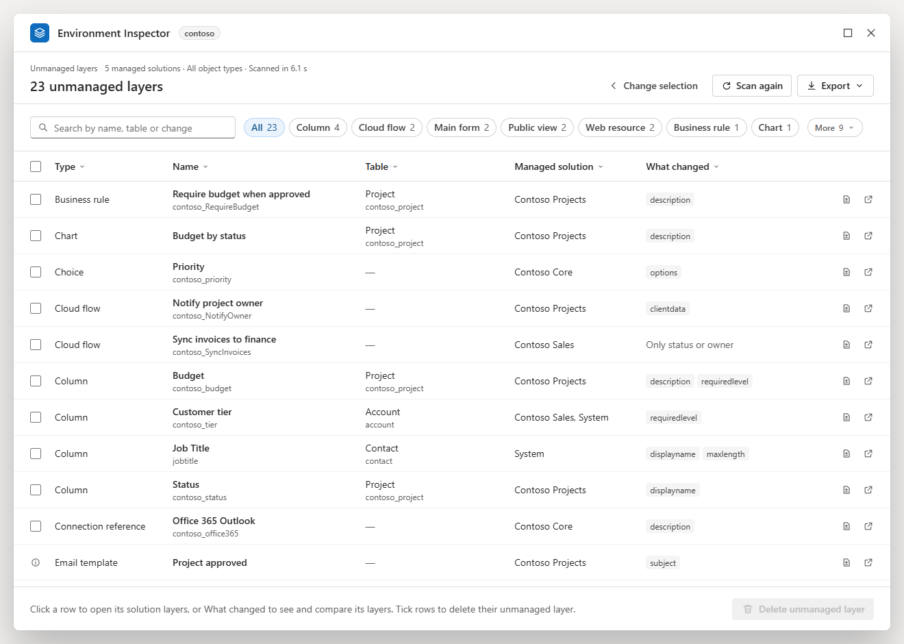

*The results of a scan of five managed solutions in the Contoso environment: 23 unmanaged layers. Above the grid, the
search box and the type bubbles (All 23, Column 4, Cloud flow 2, Main form 2, Public view 2, Web resource 2, Business
rule 1, Chart 1, and More 9 for the types that do not fit). For each component, its type, its name and schema name,
its table, the managed solution it was found in and the properties its unmanaged layer changes. The email template has
an information icon instead of a tick box: Dataverse does not delete the unmanaged layer of that type ([10.10](#1010-types-dataverse-will-not-delete)).*

A short animation of Environment Inspector at work is in [`docs/gallery/`](gallery/) (GIF and MP4).

### 1.2 What runs where

| Piece | Runs in | Talks to | Runs as |
| --- | --- | --- | --- |
| Environment Inspector, started on an environment page | The user's browser tab at `https://<org>.crm.dynamics.com` | The environment's Web API (same origin), with the browser's session cookie | The signed-in user, with that user's privileges |
| Environment Inspector, started on the maker portal | The user's browser tab at `https://make.powerapps.com` | The environment's Web API (another origin, which Dataverse allows for the maker portal), with the maker portal's own access token for that environment ([5.7](#57-the-maker-portal-sign-in)) | The account the maker portal is signed in with |
| The links of the rows | New browser tabs: the component's solution layers page in the maker portal, or the classic *Solution layers* page of the environment ([chapter 7](#7-links-to-the-solution-layers-pages)); on the comparisons' pages, **Layers** and **Solution layers in** each environment for a compared component, and **Open** and **Open in** each environment for a compared record, its form there ([11.7](#117-the-results-and-the-details), [12.15](#1215-the-results-and-a-records-details)) | The maker portal or the environment | The user |
| Snapshot files | The user's computer: saved as downloads in one environment, opened from disk in the other | Nothing: the page reads the file the user chooses | |
| The build | The developer's computer, Node.js | Local files only | |

What Environment Inspector sends and keeps:

* **Requests.** Every request to Dataverse goes through one function, `requestOnce` ([5.1](#51-one-function-for-every-request)). It accepts only addresses
  under the environment's own `/api/data/v9.2/`, and only reads (`GET`), except while a deletion the user confirmed is
  running ([5.2](#52-read-only-by-design)). On the maker portal there is one more kind of request, before anything else: to find the environment's
  address, `connectMaker` asks the Dataverse environments that the maker portal holds a sign-in for (each with its own
  token) for their environment id, starting with the one the page called last, until it finds the environment in the
  page address ([5.7](#57-the-maker-portal-sign-in)).
* **Writes.** Only `RemoveActiveCustomizations` (or `RemoveActiveCustomization` on older environments), one place of
  one component at a time, during a confirmed deletion ([chapter 10](#10-deleting)). Environment Inspector never publishes, imports or
  changes records.
* **Files.** The exports, the deletion log and the snapshots are made in the browser and saved as downloads
  ([chapter 13](#13-exports)). Nothing is uploaded: a snapshot opened in the other environment is read in the page.
* **Browser storage.** The last choice of each tool and the tab last used, each tool's saved selections, the column
  widths, the window's place and size and the order of a comparison's two sides, in the browser's local storage for the site ([8.3](#83-the-choice-screen-and-saved-selections)).
  Results, details, records and logs stay in memory and are gone when the page is reloaded. A snapshot is saved only as
  a download ([11.4](#114-snapshot-files)), and so is a data snapshot ([12.7](#127-data-snapshot-files)), which holds
  the records' values of the tables chosen.
* **Nothing else.** No telemetry, no other server, no script loaded from the internet.

### 1.3 How a scan works in one page

The obvious way to find unmanaged layers is to read the layers of every component, one by one, as Solution Layers
Explorer, a tool for XrmToolBox, does for the components of one solution. Done with the right layer names ([3.4](#34-component-types-and-layer-names)), that
is exact, but slow: in the test environment, reading the layers of all of its about 83,000 components took about 45
minutes, with four batches of 200 lookups running at a time. The scan works the other way round: it asks the component
tables for the rows whose top layer is unmanaged, and reads layers only for those. When none of the chosen solutions is
Microsoft's, it asks only for the rows of what those solutions hold; otherwise, for every component of the
environment, one kind of component at a time.

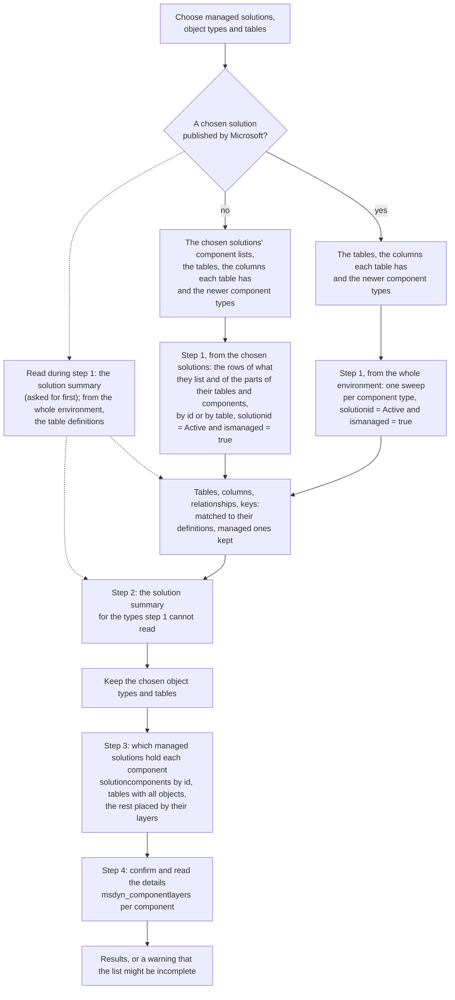

1. **Choose.** The choice screen ([8.3](#83-the-choice-screen-and-saved-selections)) lists every managed solution (`listManagedSolutions`); Microsoft's solutions and
   hidden ones are shown on request. You can also limit the scan to some object types and to some tables. **Scan**
   calls `runScan`, which calls `scan`.
2. **Read what the environment has.** Three requests at once: the tables (`EntityDefinitions`), which of 15 columns
   (`ismanaged`, `solutionid`, and the columns that give names and kinds) each table has, and the newer component types
   (`solutioncomponentdefinitions`). When none of the chosen solutions is published by Microsoft, their component lists
   (`solutioncomponents`) are asked for at the same time. Slow reads that step 1 doesn't need run during it: the
   solution summary of step 2, asked for first, and, from the whole environment, the definitions of tables, columns,
   relationships and keys, when those are checked ([6.3](#63-tables-columns-relationships-and-keys)). The steps that use
   them wait for them, while the progress line counts the time since the scan started ([8.2](#82-views-and-rendering)).
3. **Step 1: the components whose top layer is unmanaged** ([6.2](#62-step-1-from-the-chosen-solutions-or-the-whole-environment)).
   A managed component whose top layer belongs to the Active solution says so in its own row:
   `solutionid eq fd140aae-4df4-11dd-bd17-0019b9312238 and ismanaged eq true`. **From the chosen solutions** (none of
   them Microsoft's), the scan asks for the rows of the components their lists name, by id; for the parts of the tables
   they hold, such as forms, views and charts, by table; and for the parts no list names, such as plug-in step images,
   through the component they belong to. **From the whole environment** (one of them is Microsoft's), it asks each
   component type's table once, for every such row. Tables, columns, relationships and keys are read from their own
   component tables and matched to their definitions, to keep the managed ones ([6.3](#63-tables-columns-relationships-and-keys)).
4. **Step 2: the solution summary** ([6.4](#64-step-2-the-solution-summary)). Queries of `msdyn_solutioncomponentsummaries`, the table behind the maker
   portal's lists of solution objects, for the components it flags as managed and customized: each chosen solution's
   own, or the Default solution's from the whole environment. It covers the types step 1 cannot read, such as global
   choices.
5. **Object types and tables** ([6.5](#65-object-types-and-tables)). Findings of object types that were not chosen, or not on the chosen tables, are
   dropped.
6. **Step 3: which managed solutions hold each component** ([6.6](#66-step-3-which-managed-solutions-hold-each-component)). The `solutioncomponents` rows of the findings are
   read by id, 200 ids per request (50 from the whole environment). A component is in a solution when it has a row
   there, or when it is a part of a table that the solution holds "with all objects" ([3.7](#37-solution-components-and-with-all-objects)). Components that are in no solution's list are placed by
   reading their layers ([6.7](#67-components-placed-by-their-layers)). Only components in a chosen solution are kept. With the optional *Managed layers on top*,
   the component lists of the chosen solutions are read too (from the chosen solutions, they already are), and their
   components whose top layer belongs to another managed solution become candidates that step 4 confirms by their
   layers ([6.11](#611-managed-layers-on-top)).
7. **Step 4: confirm and read the details** ([6.8](#68-step-4-confirming-and-reading-the-details)). The layers of the findings are read from `msdyn_componentlayers`
   ([3.5](#35-msdyn_componentlayers)): the managed layers underneath and the properties the unmanaged layer changes.
   Components found only by the summary are read first, all of them up to 1,000, because the summary also flags a table
   when only one of its parts is customized; then up to 500 others. A component whose layers show no unmanaged layer on
   top of a managed one is dropped.
8. **Result** ([6.9](#69-complete-or-incomplete)). If any part could not be read, a warning banner says the list might be incomplete and shows what
   is missing: the scan never presents a partial list as complete. **Stop scan** ends every pending read at once and
   goes back to the choice screen; nothing partial is shown ([5.5](#55-stop)).

In the test environment, a scan of the test solution, read from its own list, took about 2 seconds and 51 requests
(from the whole environment, 5 to 9 seconds and 330 requests), and found 17 components; a scan of all 521 managed
solutions, from the whole environment, 10 to 16 seconds and about 460 requests, and found 157. From the chosen
solutions the cost follows what they hold; from the whole environment, the number of component types (about 110
sweeps there) and the number of findings, not the number of components in the environment
([6.10](#610-performance-and-scale)).

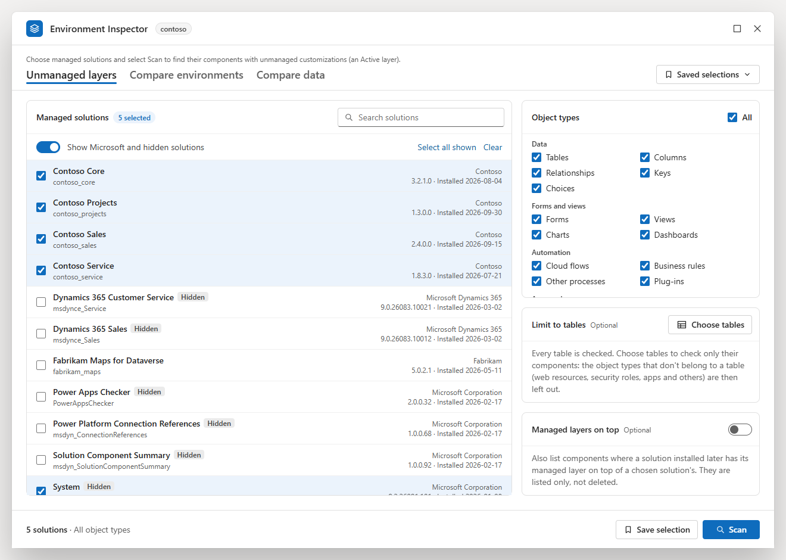

*The choice screen. Left, the managed solutions, with Show Microsoft and hidden solutions turned on: four Contoso
solutions and System (a hidden Microsoft solution that holds the standard tables) are selected. Right, the object
types, all ticked, in groups (Data, Forms and views, Automation, Apps and resources, Security and settings, and
Everything else further down), and under them the optional table limit and the *Managed layers on top* switch, off.
The bar at the bottom says what will be scanned: 5 solutions, all object types.*

### 1.4 How deleting works in one page

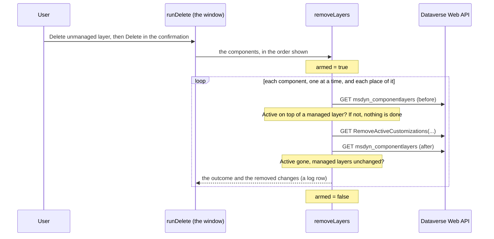

1. **Tick and confirm.** Tick rows (or open a component's details) and select **Delete unmanaged layer** (**Delete
   *n* unmanaged layers** when several rows are ticked).
   `confirmDelete` shows one confirmation that lists every component that will be deleted, in the order it will be
   deleted: top to bottom as the rows are shown, then any ticked rows that a search or a filter hides. **Cancel** has
   the focus. A run takes at most 100 components (`CONFIG.maxRemovePerRun`). With environment rules ([14.5](#145-environment-rules-inspectorsettingsjson)), deleting is
   not offered at all in development environments, and the confirmation names a production environment in red.
2. **Run.** **Delete** calls `runDelete`, which calls `removeLayers`. `removeLayers` sets `armed`, the only state in
   which `requestOnce` lets a write through ([5.2](#52-read-only-by-design)), and works through the components one at a time.
3. **Before each place.** A component has one place, or two for a relationship: its definition and its cascade
   settings ([3.4](#34-component-types-and-layer-names)). Right before a place is touched, its layers are read again. Only a place whose top layer is the
   Active layer, with at least one managed layer under it, is touched. A place without a managed layer is never
   touched, because removing its only layer would delete the component. The managed layers are recorded.
4. **The call.** `removePlace` calls `RemoveActiveCustomizations` ([3.8](#38-removeactivecustomizations)), as **Remove active customizations** on the
   maker portal's *Solution layers* page does. When another import or publish holds the lock, it waits 10 seconds and
   tries again, up to 5 times.
5. **After each place.** The layers are read again. The Active layer must be gone, and the managed layers must be
   exactly as before: the same solutions, order and publishers, and the same values (system values such as the
   overwrite time left out). The row then shows the outcome: a deleted row is struck through, with a check mark in
   place of its tick box; any other outcome is shown in its *What changed* cell, with the reason: *Not deleted*,
   *Skipped*, *Not tried*, *Deleted (not checked)*, *Partly deleted* or *Result unknown* ([10.7](#107-outcomes)).
6. **Log.** As soon as a component is done, a row goes into the deletion log with what the unmanaged layer held (its
   `msdyn_changes`), so that a change can be made again by hand if it was needed. The log can be downloaded from the
   message at the end or from **Export** ([13.4](#134-deletion-log-csv)).
7. **End.** `armed` is set back to `false` in a `finally` block, whatever happened.

Deleting does not publish: the removal took effect without publishing in every test, and publishing a table would
also publish other people's unpublished changes to it.

**Time.** Dataverse takes 7 to 9 seconds per removal (a relationship, with two places, about 25 seconds), and does the
removals one after the other even when they are sent together: for 17 test components, one at a time took 161
seconds, four at a time 147 seconds and eight at a time 136 seconds, each call waiting longer. A run sends one
at a time (`CONFIG.deleteConcurrency`), as Solution Layers Explorer does. While a run goes on, the window can be
closed: a pill in the corner of the page shows how far it is ([8.9](#89-toasts-dialogs-and-the-deleting-pill)), and leaving the page asks for a confirmation.
**Stop deleting** ends the run after the component being deleted at that moment ([10.8](#108-stop-sign-in-expiry-and-leaving-the-page)).

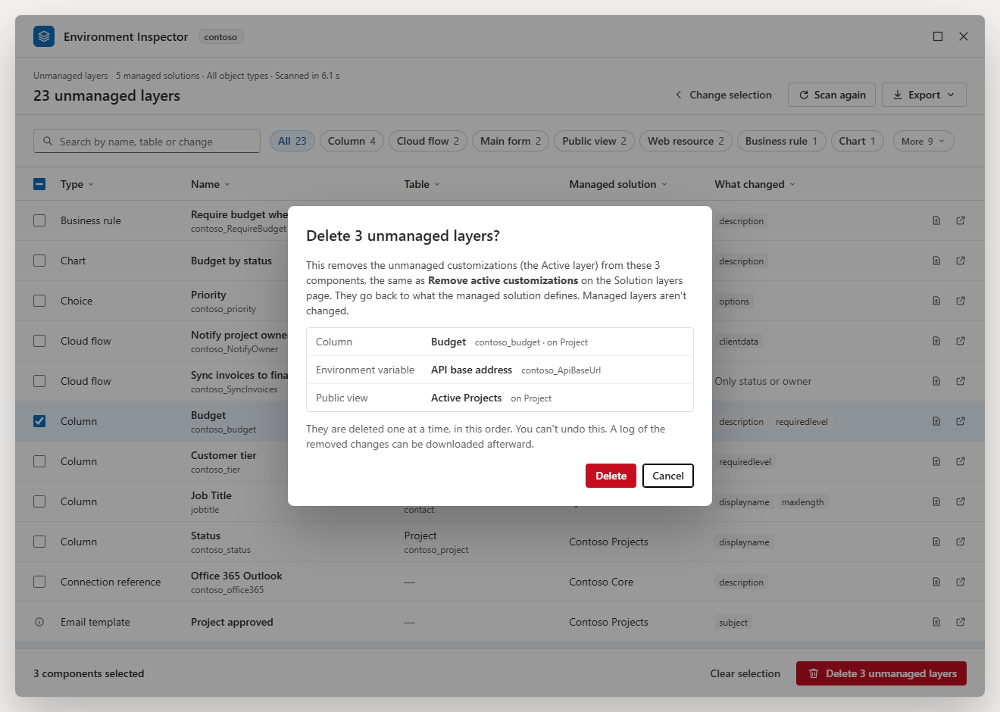

*The confirmation for three ticked components: a column (Budget, `contoso_budget`, on Project), an environment variable
(API base address, `contoso_ApiBaseUrl`) and a public view (Active Projects, on Project), listed in the order they will
be deleted. The text says what happens (the same as Remove active customizations on the Solution layers page; managed
layers are not changed) and that it cannot be undone. **Cancel** has the focus.*

### 1.5 Repository tour

Every file and folder that is published, with one line each. The repository's `.gitignore` works as a list of what is
published: its first rule, `/*`, ignores everything, and each `!` rule after it publishes one name. A new file stays
on your computer until you add it to that list. Paths marked *not committed* exist only on your computer.

| Path | What it is |
| --- | --- |
| [`.gitignore`](../.gitignore) | The list of published files (see above). Everything else in the folder, such as local settings, test results and working notes, is ignored |
| [`.gitattributes`](../.gitattributes) | LF line endings for text files; PNG, GIF and DOCX files as binary. The built link and the minified code are one long line each |
| [`LICENSE`](../LICENSE) | The MIT license |
| [`README.md`](../README.md) | The documentation for people who use the tool: install, scan, results, details, deleting, comparing environments, comparing data, exports, troubleshooting |
| [`CHANGELOG.md`](../CHANGELOG.md) | The changes in each version |
| [`package.json`](../package.json) | Name, version (the tool's version comes from here, [14.4](#144-the-version)), the `build` script and the one development package, `terser` |
| [`package-lock.json`](../package-lock.json) | The exact versions of the build's packages: terser 5.51.2 and the packages it needs, 11 in all. `npm ci` installs exactly these ([2.3](#23-install-the-npm-packages)) |
| **[`environment-inspector.js`](../environment-inspector.js)** | **The code**: the whole product in one file ([chapter 4](#4-code-architecture) has a map) |
| [`build-bookmarklet.mjs`](../build-bookmarklet.mjs) | The build: writes the version and the optional environment rules in, minifies, compresses, and writes the three built files ([chapter 14](#14-building-and-packaging)) |
| [`environment-inspector.bookmarklet.txt`](../environment-inspector.bookmarklet.txt) | Built: the `javascript:` link, one line of about 291 KB |
| [`environment-inspector.min.js`](../environment-inspector.min.js) | Built: the minified code, about 700 KB; can be pasted into the browser console |
| [`Install Environment Inspector.html`](../Install%20Environment%20Inspector.html) | Built: the install page, with the link as a button to drag to the favourites bar |
| [`inspector.settings.example.json`](../inspector.settings.example.json) | An example of the optional environment rules ([14.5](#145-environment-rules-inspectorsettingsjson)) |
| `inspector.settings.json` | *Not committed.* Your own environment rules, if you use any. A build made with it is for your organization only |
| **[`docs/`](./)** | **Documentation** |
| `docs/developer-guide.md` | This guide |
| [`docs/Environment Inspector - Technical Reference.docx`](Environment%20Inspector%20-%20Technical%20Reference.docx), [`docs/Environment Inspector - Developer Guide.docx`](Environment%20Inspector%20-%20Developer%20Guide.docx) | The README and this guide as Word documents, also attached to each release ([18.6](#186-tag-and-publish)) |
| [`docs/images/`](images/) | Screenshots used by the README and this guide |
| [`docs/gallery/`](gallery/) | The demo as GIF and MP4, and a thumbnail |
| `node_modules/` | *Not committed.* The npm packages of the build (terser and the packages it needs), installed by `npm ci` |

---

## 2. Getting set up

This chapter takes you from an empty computer to a working build, your build installed in Edge, a test solution of
your own, and a development loop.

### 2.1 Tools

| Tool | Version | What it is used for |
| --- | --- | --- |
| **Node.js** | 14.13.1 or later (any current LTS version); version 1.0.0 was built with Node.js 22 | Runs the build, `build-bookmarklet.mjs`, and npm. The build is an ES module that uses `await` at the top level (Node.js 14.8 or later) and imports Node's own modules as `node:fs`, `node:zlib` and so on (Node.js 14.13.1 or later); terser 5 itself needs Node.js 10 |
| **npm** | The one that comes with Node.js; `npm ci` needs npm 7 or later (Node.js 15 and later come with it), because the lock file has `lockfileVersion` 3 | Installs terser, the only package the build needs, and the packages terser needs |
| **Git** | Any recent version | Getting the code and keeping track of your changes |
| **An editor** | Visual Studio Code is a good choice | Editing |
| **Microsoft Edge** | A current version | Running and testing Environment Inspector, with its developer tools (F12) |
| **A Dataverse environment for testing** | One where you are System Administrator or System Customizer | Building a test solution and testing your changes ([2.7](#27-a-test-environment-and-a-test-solution)). Never test deleting in production |

The code needs no build to run: the build only minifies it, writes the version in and packs it into a link. The
repository has no bundler, no TypeScript, no test framework and no lint configuration. The build calls only Node.js,
so it runs on any operating system; the commands in this guide are written for PowerShell on Windows and are the same
in other shells.

### 2.2 Get the code

```powershell
git clone https://github.com/<owner>/EnvironmentInspector.git
cd EnvironmentInspector
```

Replace `<owner>` with the account that publishes the repository, or with your own for a fork.

### 2.3 Install the npm packages

```powershell
npm ci
```

`package.json` lists one development package, `terser` (`^5.51.2`), the minifier. `package-lock.json`, published with
it ([1.5](#15-repository-tour)), holds the exact versions: terser 5.51.2 and the packages it needs, 11 packages in all (`lockfileVersion` 3).
`npm ci` installs exactly these into `node_modules/` (it empties the folder first) and never changes the lock file, so
a build gets the same packages that built the release. Use it for every release build ([18.2](#182-build-and-test)). `npm install` works too and keeps
the locked versions while they satisfy `package.json`, but it may rewrite `package-lock.json`: commit such a change
only on purpose. Nothing from `node_modules/` ends up in the built code: terser only runs at build time.

### 2.4 Build

```powershell
npm run build
```

`npm run build` runs `node build-bookmarklet.mjs`, the `build` script of `package.json`. The script finds its files
from its own folder, so `node <path>/build-bookmarklet.mjs` works from any folder too. Without `inspector.settings.json`
it prints one line, for example:

```text
bookmarklet 2.0.0: 297723 characters (697.6 KB unpacked)
```

The first number is the length of the link; the second the size of the minified code that the link carries
compressed. Each build writes three files, all of them published:

| File | What it is |
| --- | --- |
| `environment-inspector.min.js` | The code minified with terser, with the version from `package.json` written in (about 700 KB). It can also be pasted into the browser console |
| `environment-inspector.bookmarklet.txt` | The link: `javascript:` followed by a small loader that carries the minified code compressed (deflate, then base64) and unpacks it in the browser (about 291 KB) |
| `Install Environment Inspector.html` | The install page: the link as a button to drag to the favourites bar, the same link in a text box with **Copy**, short instructions, and the version, the build date and the size |

The build stops with an error when:

* `environment-inspector.js` no longer contains a line that the build replaces. The message is
  "environment-inspector.js no longer contains: ..." followed by the line. The build always replaces
  `const VERSION = '__VERSION__'`, and, when environment rules are set, `developmentEnvironments: null,` and
  `productionEnvironments: null,` in `CONFIG`. Keep these lines exactly as they are.
* `inspector.settings.json` exists and is not valid JSON, or is not a JSON object ("inspector.settings.json must be a JSON
  object, as in inspector.settings.example.json").
* `inspector.settings.json` names a setting other than the two rules, for example a misspelled one: "inspector.settings.json:
  unknown setting developmentEnvironment. The settings are: developmentEnvironments, productionEnvironments." (with
  several, "unknown settings" and the names separated by commas). A misspelled name would otherwise be ignored and
  leave deleting allowed in a development environment.
* One of its two values is not a string ("inspector.settings.json: ... must be a regular expression written as a
  string") or not a valid regular expression. An empty or `null` value is skipped.

When `inspector.settings.json` sets at least one rule, the build also prints the rules it applied, for example "Built
with your environment rules from inspector.settings.json (developmentEnvironments /^contoso-dev\d*$/i;
productionEnvironments /^contoso(-preprod)?$/i): for your organization only, do not publish this build." A
`inspector.settings.json` that sets no rule (both values empty or `null`, or `{}`) prints "inspector.settings.json names no
environment: built without environment rules." ([14.5](#145-environment-rules-inspectorsettingsjson)). [Chapter 14](#14-building-and-packaging) explains every step of the build.

### 2.5 Install your build in Edge

1. Open `Install Environment Inspector.html` in Edge: double-click it, or drag it onto an Edge window.
2. Show the favourites bar: **Ctrl+Shift+B**.
3. Drag the **Environment Inspector** button onto the favourites bar.

If dragging does not work, create a favourite named *Environment Inspector* and paste the link from the text box on
the page as its URL (**Copy** copies it).

A favourite keeps the link it was made with. After each build, replace it: edit the favourite and paste the new link,
or delete it and drag the button again. To see which version a favourite runs, point at the window's title,
*Environment Inspector*: its tooltip adds the version, for example "Environment Inspector 2.0.0".

To use it, open a page of the environment (for example `https://contoso.crm.dynamics.com`) or the environment's
Solutions page in the maker portal, and click the favourite. Clicking it outside Dataverse only shows an alert: "Open
the environment (https://&lt;org&gt;.crm.dynamics.com) or its Solutions page in the maker portal (make.powerapps.com)
first, then click the bookmark again."

**Without the favourites bar.** `environment-inspector.min.js` is the same code without the loader. Paste it into the console
of the developer tools (F12, **Console**) on a page of the environment and press Enter: the window opens as it does
from the favourite. Use this where a browser policy blocks `javascript:` favourites.

### 2.6 The development loop

The quickest loop needs no build at all: `environment-inspector.js` is a complete script by itself.

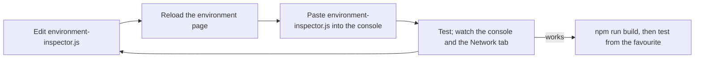

1. **Edit** `environment-inspector.js`.
2. **Reload** the environment page (F5). A window that is already open on the page would show itself again instead
   of starting your new code ([4.2](#42-start-up-and-connecting)), and a reload removes it. Without a reload, run
   `window.__environmentInspector.destroy()` in the console first. It returns `false`, and removes nothing, while the
   window is busy (loading the solutions, scanning, reading more details with **Read N more**, comparing, saving a
   snapshot, or deleting).
3. **Run** it: open the console (F12, **Console**), paste the whole of `environment-inspector.js` and press Enter. Edge may ask
   you to type *allow pasting* the first time.
4. **Test** ([chapter 16](#16-testing-your-changes)). Errors appear in the console. Its requests are in the **Network** tab: filter on
   `api/data/v9.2`.
5. **Build** when the change works (`npm run build`), replace your favourite ([2.5](#25-install-your-build-in-edge)) and test once more from the
   favourite: the loader, the minified code and the size limit only come into play there ([chapter 14](#14-building-and-packaging)).

Apart from being minified, a build differs from the source in two ways only: the source shows its version as
`__VERSION__`, and it has no environment rules, because those come from `inspector.settings.json` at build time ([14.5](#145-environment-rules-inspectorsettingsjson)).

**On the maker portal.** Test there too: open the environment's Solutions page at
[make.powerapps.com](https://make.powerapps.com), wait until the list of solutions has loaded, then paste the code or
click the favourite. On the maker portal it signs in with the maker portal's token ([5.7](#57-the-maker-portal-sign-in)), a different path
from an environment page. Started on a managed solution's own page, it selects that solution ([8.3](#83-the-choice-screen-and-saved-selections)).

### 2.7 A test environment and a test solution

Scanning only reads ([5.2](#52-read-only-by-design)). Deleting cannot be undone, so test it only on components made for testing, in an
environment where you are allowed to make changes. The other unmanaged layers in an environment may be someone's work
in progress.

The scan needs managed components with unmanaged layers. A managed solution of your own gives you both, and its
prefix makes its components easy to tell apart:

1. **Make an unmanaged solution.** In a development or trial environment, in the maker portal, go to **Solutions** >
   **New solution**. Give it a publisher of its own with a short prefix, for example `tst`, so that every component
   you create is named `tst_...`.
2. **Add components to it**, created new in that solution, of the types you want to test (the table below suggests a
   set). **Publish all customizations**.
3. **Export it as managed.** Select the solution, **Export solution**, choose **Managed**, and keep the `.zip` file.
4. **Delete the unmanaged components**, then the solution. Delete the tables first (their columns, relationships,
   keys, forms, views, charts and business rules go with them), then the other components, then the solution. Deleting
   only the solution would leave its components in the environment as unmanaged components; the managed import must
   create them afresh.
5. **Import the managed file.** **Solutions** > **Import solution** > **Browse**, select the `.zip`, **Next**,
   **Import**. The solution list now shows it as managed. Its components now have a managed layer and no unmanaged
   layer.
6. **Customize some of its components** directly in the environment, as in the table below, then **Publish all
   customizations**. Every change made in the environment goes into the Active layer, whichever unmanaged solution, if
   any, you make it in. Keep a list of what you changed.
7. **Scan** with only your test solution chosen. Every component you changed is listed; the others are not.

With a second environment you can skip step 4: import the managed file there instead, and customize it there.

| Component | A change that adds an unmanaged layer | What it lets you test |
| --- | --- | --- |
| A table with a few columns | Change a column's display name or description; make another column required | The most common case; the table limit ([8.4](#84-the-table-picker)) |
| A relationship between two of your tables | Change what happens to the related rows when a row is deleted | A component with two places: the change is on its cascade settings ([3.4](#34-component-types-and-layer-names)), and the row opens the classic page ([7.3](#73-the-classic-page)) |
| The table's main form | Move a field, or change the form's description | The XML comparison of `formxml` ([9.4](#94-xml-laid-out-without-loss-prettyxml)) |
| A view | Add a column, or change its filter | The XML comparison of `fetchxml` and `layoutxml` |
| A chart and a business rule | Change their descriptions | Types whose links go to a table's page in the maker portal ([7.1](#71-maker-portal-addresses)) |
| A global choice | Change the label of a value (adding a value adds no unmanaged layer, [3.9](#39-facts-the-tool-relies-on-and-how-they-were-verified)) | A type that only the solution summary finds ([6.4](#64-step-2-the-solution-summary)) |
| A JavaScript web resource and an image web resource | Upload new content | Decoded content and images in the comparison ([9.3](#93-showing-a-value-valueview)); content that Dataverse keeps as a file ([9.11](#911-web-resource-content-kept-as-a-file-contentfileref)) |
| An environment variable | Change its default value | |
| A cloud flow | Edit it and save it (turning it off or on adds no unmanaged layer, [3.9](#39-facts-the-tool-relies-on-and-how-they-were-verified)) | Processes, which the scan names by their kind ([6.2](#62-step-1-from-the-chosen-solutions-or-the-whole-environment)) |
| A security role | Change a privilege | A role's privileges are not in its layer data, so the comparison shows only system values ([3.9](#39-facts-the-tool-relies-on-and-how-they-were-verified)) |
| An email template | Change its subject | A type whose unmanaged layer Dataverse does not delete: the row has no tick box ([10.10](#1010-types-dataverse-will-not-delete)) |
| A model-driven app and its site map | Change the app's description; add a subarea to the site map | |

After a delete test, make the same changes again, from your list. The deletion log ([13.4](#134-deletion-log-csv)) also holds every removed
change: the Active layer's `msdyn_changes` of each component. When you no longer need the test solution, delete it
from **Solutions**: deleting a managed solution uninstalls it and removes its components.

### 2.8 Checks before you commit

```powershell
node --check environment-inspector.js
node --check build-bookmarklet.mjs
npm run build
```

* `node --check` reads a file without running it and reports syntax errors.
* `npm run build` must end with its `bookmarklet ...` line. Look at the size it prints: the link must stay under about 2
  million characters, the most an Edge favourite holds. The current build is about 297,700 characters.
* The build you commit must be made **without** environment rules: no "Built with your environment rules" line. A build
  with rules carries the names of your environments and is for your organization only ([14.5](#145-environment-rules-inspectorsettingsjson)). Move
  `inspector.settings.json` out of the folder, build, and commit that build.
* Commit the three built files together with `environment-inspector.js`, so that the published link always runs the published
  source.
* Test the change ([chapter 16](#16-testing-your-changes)), on an environment page and on the maker portal, from the built link.
* For a release, raise the version ([chapter 18](#18-releasing-a-new-version)).

---

## 3. Dataverse concepts used by the tool

This chapter explains the parts of Dataverse that the tool relies on, and shows where each one appears in the code.
Several of them are not documented, or behave in ways the documentation does not mention; [3.9](#39-facts-the-tool-relies-on-and-how-they-were-verified) lists each such fact and
how it was checked.

### 3.1 Solutions and layers

A **solution** is a package of **components** (tables, columns, forms, views, processes, web resources and so on) that
carries customizations from one environment to another. There are two kinds:

* An **unmanaged** solution is a container, used in development. Its components can be changed freely, and deleting
  the solution leaves them in place.
* A **managed** solution is what you import into test and production. Its components belong to it: they can be changed
  only as far as their managed properties allow, and uninstalling the solution removes them.

A component can be in several solutions. Dataverse keeps one **layer** of the component for each managed solution that
contains it, and stacks them: standard components that come with Dataverse have the layer of the System solution at
the bottom; above it come the layers of the managed solutions that contain the component, in the order the solutions
were installed. Each layer has a number, its **order**, higher meaning higher in the stack. The order is set when a
solution is first installed: importing it again, even as an upgrade, does not move its layer up, so when two managed
solutions contain the same component, the layer of the one installed later stays on top ([6.11](#611-managed-layers-on-top)).

When anyone changes the component in the environment itself (in the maker portal, in a designer, through the Web API,
or by importing an unmanaged solution), the change goes into none of the managed layers. It goes into a layer of its
own on top of the stack: the **unmanaged layer**, which belongs to a special solution named **Active** ([3.2](#32-the-active-solution-and-the-default-solution)). A
component has at most one unmanaged layer.

For most component types the top layer wins: the component is what its top layer defines. For a few types, such as
forms, site maps, ribbons and model-driven apps, Dataverse merges the changes of the layers instead. Either way, what
the unmanaged layer sets wins over the managed layers, including over what a later version of a managed solution
brings for the same properties. That is why unmanaged layers on managed components cause hard-to-find problems, and
why the *Unmanaged layers* tool exists.
**Removing the unmanaged layer** ([3.8](#38-removeactivecustomizations)) brings the component back to what its managed layers define, without changing
them.

The maker portal shows the stack of one component at a time on its *Solution layers* page (**See solution layers**).
Environment Inspector reads the same data from the table `msdyn_componentlayers` ([3.5](#35-msdyn_componentlayers)) and shows it in a component's details
([chapter 9](#9-details-and-comparison)).

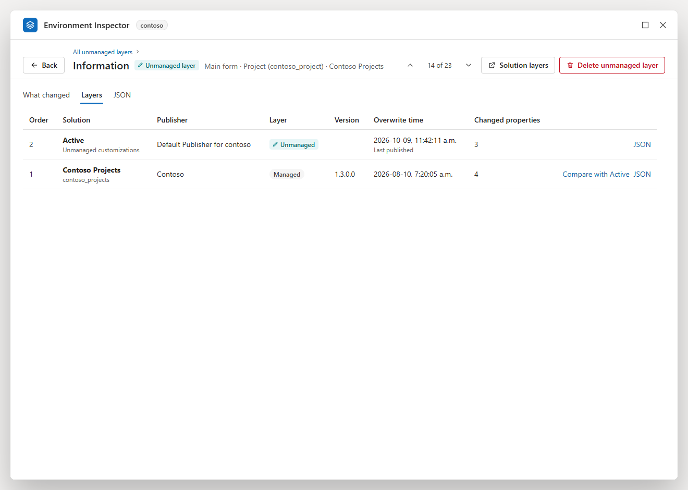

*The Layers tab of a component's details ([9.8](#98-layers-and-json-tabs-children-tables)): the main form Information of the Project table, found in Contoso
Projects. Top first: the unmanaged layer (order 2, the Active solution, publisher Default Publisher for contoso, no
overwrite time but last published on 2026-10-09, 3 changed properties), on top of the managed layer of Contoso Projects (order 1, `contoso_projects`,
publisher Contoso, version 1.3.0.0, overwritten on 2026-08-10, 4 changed properties). **Compare with Active** compares
that layer with the unmanaged one.*

### 3.2 The Active solution and the Default solution

Two solutions exist in every environment, with the same ids everywhere. Both are unmanaged.

`environment-inspector.js`, the solution ids (in the settings part):

```js
const ACTIVE = 'fd140aae-4df4-11dd-bd17-0019b9312238'    // the unmanaged ("Active") layer, same id everywhere
const DEFAULT = 'fd140aaf-4df4-11dd-bd17-0019b9312238'
```

| Solution | What it is | How the tool uses it |
| --- | --- | --- |
| **Active** (`ACTIVE`) | Owns the unmanaged layer of every component. In `msdyn_componentlayers`, the unmanaged layer is the row whose `msdyn_solutionname` is `Active` | Step 1 of the scan asks the component tables for the rows whose `solutionid` is `ACTIVE` ([3.3](#33-managed-and-unmanaged-components)). The details, the deleting checks and the exports find the unmanaged layer by the name `Active` |
| **Default Solution** (`DEFAULT`) | Lists (almost) every component of the environment, managed or not. Display strings are an exception ([3.9](#39-facts-the-tool-relies-on-and-how-they-were-verified)) | A scan of the whole environment, or of more than 20 solutions, asks the solution summary for the Default solution's components ([3.6](#36-the-solution-component-summary)), and a scan asks it for one of its tables to check a summary that answered nothing. A component that is in no solution's component list opens in the Default solution in the maker portal ([7.2](#72-which-solution-goes-in-the-address)) |

Rows of unmanaged solutions in `solutioncomponents` (the Default solution, Active, and your own unmanaged solutions)
are ignored when the scan decides which managed solutions hold a component ([3.7](#37-solution-components-and-with-all-objects)).

### 3.3 Managed and unmanaged components

Each kind of component has a table of its own, for example `systemform` for forms or `webresource` for web resources.
Its rows have two columns that matter here:

* `ismanaged`: `true` when the component came from a managed solution, so that it has at least one managed layer;
* `solutionid`: the solution of the component's **top** layer, managed or not ([3.9](#39-facts-the-tool-relies-on-and-how-they-were-verified)).

When an unmanaged layer is on top of a managed component, `solutionid` is the Active solution while `ismanaged` stays
`true`. That pair is exactly what the scan looks for:

| The component | `ismanaged` | `solutionid` | Listed? |
| --- | --- | --- | --- |
| Managed, no unmanaged layer | `true` | A managed solution | No; with *Managed layers on top*, yes when that solution's layer covers a chosen solution's ([6.11](#611-managed-layers-on-top)) |
| Managed, with an unmanaged layer on top | `true` | Active | **Yes** |
| Unmanaged only (created in the environment or in an unmanaged solution) | `false` | Active | No: its only layer is the unmanaged one, and removing it would delete the component |

`environment-inspector.js`, `scan`, the query of the sweep (step 1 from the whole environment, [6.2](#62-step-1-from-the-chosen-solutions-or-the-whole-environment); `spec` comes from `recordSpec`, and `spec.extra` is the
type's `TYPE_FILTER`, below):

```js
for (const r of await getAll(`${spec.set}?$select=${spec.sel}&$filter=solutionid eq ${ACTIVE} and ismanaged eq true${spec.extra}`)) { const f = spec.make(r); found.set(f.key, f) }
```

One query per component type therefore finds every managed component of that type with an unmanaged layer on top,
however many components the table has. Compared with reading every component's layers one by one in the test
environment, it found the same 135 components and nothing else ([3.9](#39-facts-the-tool-relies-on-and-how-they-were-verified)).
A scan from the chosen solutions asks the same question of fewer rows: the same condition, with the ids the solutions'
component lists give, or the tables they hold (`activeTop`, [6.2](#62-step-1-from-the-chosen-solutions-or-the-whole-environment)).

Two kinds of rows are not components of their own: Dataverse copies every security role into each business unit (the
copies have a parent role), and keeps an activation copy of a classic process next to its definition (`type` 1 is the
definition). An extra filter, `TYPE_FILTER`, leaves them out of step 1 ([6.2](#62-step-1-from-the-chosen-solutions-or-the-whole-environment)).

**Tables, columns, relationships and keys** are different. Their component tables (`entities`, `attributes`,
`relationships`, `entitykeys`) have a `solutionid` column but no `ismanaged`. The scan reads the rows whose
`solutionid` is Active, and takes the managed flag from the metadata: `IsManaged` of the table, column and key
definitions (`EntityDefinitions`) and of the relationship definitions (`RelationshipDefinitions`).

`environment-inspector.js`, `scan`, the metadata rows of the sweep and the managed check (`keepManaged`, [6.3](#63-tables-columns-relationships-and-keys)):

```js
for (const r of await getAll(`${set}?$select=${pk},${nm}&$filter=solutionid eq ${ACTIVE}`)) metaRows.push({ code, id: lc(r[pk]), name: r[nm] })
// ...
if (isManaged !== true) continue   // unmanaged-only components are not layers on managed solutions
```

A few metadata rows have no definition at all: hidden columns whose names end in `dsc`, and the two internal halves of
a many-to-many relationship (named like the relationship, with `One` or `Two` at the end). The scan counts them in a
note. Any other row without a definition makes the scan incomplete ([6.9](#69-complete-or-incomplete)).

### 3.4 Component types and layer names

Every component has a **type number**, the `componenttype` of `solutioncomponents`: 1 for a table, 2 for a column, 26
for a view, 60 for a form, and so on. Types come from two sources:

* **Classic types** have fixed numbers. The code has them in its table `CLASSIC` (49 types, [4.4](#44-constant-tables-classic-names-metadata-groups-and-others)): for each number,
  the component table, the layer name and the name the maker portal shows.
* **Newer types**, made with Dataverse's solution component framework (for example connection references), are
  described in the table `solutioncomponentdefinitions`: their number, their `name` and their table
  (`primaryentityname`). Each scan reads that table at its start and adds the types it does not know.

`environment-inspector.js`, `scan`, the newer types:

```js
for (const d of defs) {
  const code = d.solutioncomponenttype
  if (!kindOf.has(code)) kindOf.set(code, d.name)
  if (types.has(code) || !d.primaryentityname) continue
  if (classicOf.has(d.primaryentityname)) { same.set(code, classicOf.get(d.primaryentityname)); continue }
  const t = tables.get(d.primaryentityname)
  types.set(code, { table: d.primaryentityname, kind: d.name, label: sentence((t && label(t.DisplayName)) || d.name) })
}
```

A newer type is labelled with its table's display name in sentence case, as the maker portal writes it ("Connection
Reference" becomes "Connection reference"; `sentence` keeps acronyms). A definition whose table is a classic type's
table is not a type of its own: Dataverse also numbers duplicate detection rules 4414 and their conditions 4416 (in
the test environment, the component lists name them only by those numbers). Such a number is read as the classic one
(`same`, `codeOf`, [6.2](#62-step-1-from-the-chosen-solutions-or-the-whole-environment)), so each of those components is
read once and keyed under its classic number.

**Layer names.** `msdyn_componentlayers` does not know type numbers: it finds a component by its id and its **layer
name** (`msdyn_solutioncomponentname`). In the code the layer name is the finding's `kind`. For a classic type it is
the second entry of `CLASSIC`; for a newer type, the definition's `name`. A few examples:

| Type | Number | Layer name (`kind`) | Shown as |
| --- | --- | --- | --- |
| Table | 1 | `Entity` | Table |
| Column | 2 | `Attribute` | Column |
| Global choice | 9 | `OptionSet` | Choice |
| Relationship | 10 | `EntityRelationship`, and `Relationship` for its cascade settings | Relationship |
| Security role | 20 | `Role` | Security role |
| View | 26 | `SavedQuery` | Public view, Lookup view and so on (by its `querytype`) |
| Process | 29 | `Workflow` | Business rule, Cloud flow, Action and so on (by its `category`) |
| Email template | 36 | `Template` | Email template |
| Form | 60 | `SystemForm` | Main form, Quick create form, Dashboard and so on (by its `type`) |
| Web resource | 61 | `WebResource` | Web resource |
| Environment variable | 380 | `EnvironmentVariableDefinition` | Environment variable |
| Connection reference | read from the environment | `connectionreference` | Connection reference |

The layer names were checked one by one; two of them are not what one would guess ([3.9](#39-facts-the-tool-relies-on-and-how-they-were-verified)). An email template's layer is
named `Template`, not `EmailTemplate`. A **relationship** is two components: its definition, layer name
`EntityRelationship`, found by the relationship's metadata id; and its own settings, such as what happens to related
rows on delete (its cascade settings), layer name `Relationship`, found by the id of its row in the `relationships`
table.

The code calls each (id, layer name) pair of a component a **place**. Most components have one place; a relationship
has two, and both are checked, read and, when deleting, removed. The scan keeps a relationship's second place in the
finding's `alt` ([6.3](#63-tables-columns-relationships-and-keys)), and `places` returns every place of a finding:

`environment-inspector.js`, `places`:

```js
const places = (f) => [...(f.alt || []), { id: f.id, kind: f.kind }]
```

### 3.5 `msdyn_componentlayers`

`msdyn_componentlayers` is a virtual table: it holds no rows of its own, and returns the layers of one component when
asked for them. The query gives both the component's id, as a quoted string, and its layer name ([3.9](#39-facts-the-tool-relies-on-and-how-they-were-verified)).

`environment-inspector.js`, `getLayers`:

```js
// Layers of one component, top first. ($select is honoured by some versions only; the rest is ignored.)
// ...
async function getLayers(id, kind) {
  placeOk(id, kind)
  const rows = await getAll(`msdyn_componentlayers?$filter=(msdyn_componentid eq '${id}' and msdyn_solutioncomponentname eq '${kind}')&$select=msdyn_solutionname,msdyn_order,msdyn_name,msdyn_solutioncomponentname,msdyn_changes,msdyn_componentlayerid,msdyn_publishername,msdyn_overwritetime`)
  return rows.sort((a, b) => b.msdyn_order - a.msdyn_order)
}
```

`placeOk` first checks that the id is a GUID and the layer name a plain name, before either goes into the address
([5.2](#52-read-only-by-design)). `getLayers` serves the scan and the checks around a removal. The details of a component read every column, with
`fullLayers` ([9.1](#91-reading-every-layer)), because they also need `msdyn_componentjson` and `msdyn_children`.

| Column | Holds | Used for |
| --- | --- | --- |
| `msdyn_componentid` | The component's id | The filter |
| `msdyn_solutioncomponentname` | The layer name | The filter; a removal uses the value of the Active row ([10.5](#105-the-call-removeplace)) |
| `msdyn_solutionname` | The unique name of the layer's solution; `Active` for the unmanaged layer | Finding the unmanaged layer; the managed layers underneath |
| `msdyn_order` | The layer's place in the stack, higher on top | Sorting, top first; the checks around a removal |
| `msdyn_name` | The component's name in this layer | A name for a component that has none otherwise |
| `msdyn_changes` | JSON: the properties this layer sets | *What changed*, the **Changes** view of the JSON tab, the deletion log, the check after a removal |
| `msdyn_componentjson` | JSON: all the component's properties as this layer defines them | The comparison of two layers ([9.2](#92-comparing-two-layers)), **All properties** |
| `msdyn_children` | JSON: the component's child records in this layer, if any | **Children** ([9.8](#98-layers-and-json-tabs-children-tables)) |
| `msdyn_publishername` | The publisher of the layer's solution | The Layers tab, the all-layers export, the check after a removal |
| `msdyn_overwritetime` | When the layer was last written; 1900-01-01 for the Active layer | The Layers tab (for the Active layer, its last change instead, `activeWhen`), the all-layers export |
| `msdyn_componentlayerid` | The row's id | The all-layers export |

There is no column for the solution's version: the version in the Layers tab comes from the list of managed solutions.

`msdyn_changes` and `msdyn_componentjson` hold the component as a Dataverse entity in JSON, with an `Attributes` list of
`{ "Key": ..., "Value": ... }` pairs. A value is a string, a number, a boolean, a lookup (`Id`, `LogicalName`, `Name`),
a choice (`Value`) or a managed property (`Value`, `CanBeChanged`). Some numbers in this data cannot be held by a
JavaScript number exactly as written: whole numbers above 2^53 (such as a relationship's cascade mask), long
fractions, and numbers written with an exponent (`1e2`) or a trailing zero (`1.0`). The code parses the data with
`exactNumbers`, which keeps each such number as written ([9.5](#95-json-indented-without-loss-indentjson-and-exact-numbers)).

**A web resource's content kept as a file.** Dataverse can keep a web resource's content as a file instead of in the
layer data, and each layer holds it one way or the other. A layer that keeps it as a file has `contentfileref`, a
reference to its own file, in its `msdyn_componentjson` instead of `content`; when that layer is the unmanaged one, its
`msdyn_changes` names only its file. The two layers of one web resource can differ: in the test environment, right
after a web resource's content was saved through the Web API, the Active layer held the content in the layer while the
managed layer under it held only a file reference; Dataverse later moved both to files. The Web API gives out only the
file in effect now, through the web resource itself (`webresourceset(<id>)?$select=content,contentfileref`); the files
of the other layers cannot be read (`fileattachments` refuses Retrieve and has no readable body). [9.11](#911-web-resource-content-kept-as-a-file-contentfileref) explains what the details show for such a web resource, and [10.4](#104-before-each-place) how
deleting keeps its content in the log.

**Cost.** One request per place, more when the answer has several pages; a form's layers can reach about 0.5 MB. That
is why the scan reads layers only for the components it has already found (step 4), for the components it must
place ([6.7](#67-components-placed-by-their-layers)) and, with *Managed layers on top*, for the candidates it must confirm ([6.11](#611-managed-layers-on-top)), never for every component. Some component types have no data in this table at all (for example SDK
messages, and image configurations); for those the scan relies on step 1 and the summary, and their *What changed*
says *Layers could not be read (no layers under the name ...)*.

### 3.6 The solution component summary

`msdyn_solutioncomponentsummaries` is another virtual table: the one behind the maker portal's lists of a solution's
objects. Asked for a solution, it lists that solution's components, and for each one whether it is managed and whether
it has unmanaged customizations, the maker portal's *Customized* flag. Asked for the Default solution, it lists the
environment's components.

`environment-inspector.js`, `scan` (asked for at the start, read in step 2, [6.4](#64-step-2-the-solution-summary)):

```js
const summaryOf = (id) => getAll(`msdyn_solutioncomponentsummaries?$filter=(msdyn_solutionid eq ${id}) and (msdyn_hasactivecustomization eq 'true') and (msdyn_ismanaged eq 'true')&$select=msdyn_componenttype,msdyn_componenttypename,msdyn_objectid,msdyn_name,msdyn_displayname,msdyn_primaryentityname`)
const summaryJob = !fromLists || solutions.length > 20 ? summaryOf(DEFAULT)
  : (async () => { const each = []; await pool(solutions.map((s, i) => [s.id, i]), 4, async ([id, i]) => { each[i] = await summaryOf(id) }); return each.flat() })()
```

A scan from the chosen solutions asks each chosen solution's own summary, four at a time; with more than 20 chosen,
and from the whole environment, it asks the Default solution's.

**Why it is needed.** Some types cannot be read row by row, because their definitions are not rows of a component
table with `solutionid` and `ismanaged`. The most important are global choices (type 9): `CLASSIC` has no table for
them. The summary finds them.

**What to know about it.**

* The flags are compared as strings: `msdyn_hasactivecustomization eq 'true'`. `eq true` fails with error 0x80060888.
* It flags a table when only one of its parts (for example a form) is customized, and it lists columns only when asked
  for one table at a time. So a component that only the summary flags is not trusted as it is: its layers are read
  before it is listed, for up to 1,000 such components, whatever the details setting ([6.8](#68-step-4-confirming-and-reading-the-details)).
* It ignores a filter on `msdyn_primaryentityname`, so it cannot be narrowed to the chosen tables.
* A solution's own summary lists only that solution's root components that are customized, the same rows as the
  Default solution's for those components: not the views, forms, charts, columns, keys or relationships of a table it
  holds, and not a component whose unmanaged layer changes only system values. Some solutions' summaries list nothing
  at all (113 of the 415 managed solutions with components in the test environment). So a solution's empty summary
  says nothing about its unmanaged layers.
* It is not documented and might be missing or empty in some environment. When it answers nothing although it should
  (from the whole environment: step 1 found types that it always flags; any scan: it does not even list a table of the
  Default solution), the scan is marked incomplete ([6.4](#64-step-2-the-solution-summary)).
* `msdyn_componenttypename` gives a layer name for a type number the code does not know; such a finding is marked
  `kindGuessed`.
* It costs one query, about 4 seconds in the test environment (from the chosen solutions, one query per chosen
  solution), plus one short read for each form or process that only the summary found, to learn its kind
  ([6.4](#64-step-2-the-solution-summary)).

### 3.7 Solution components and "with all objects"

`solutioncomponents` has one row for each component that a solution lists: `objectid` (the component's id),
`componenttype`, `rootcomponentbehavior` and `_solutionid_value` (the solution). These rows are a solution's
**component list**. Step 3 of the scan reads the rows of its findings, and of the tables their parts are on, by id,
with the Web API function `Microsoft.Dynamics.CRM.In`, and keeps only rows in managed solutions.

`environment-inspector.js`, `scan`, step 3 ([6.6](#66-step-3-which-managed-solutions-hold-each-component)):

```js
for (const c of await getAll(`solutioncomponents?$select=objectid,componenttype,rootcomponentbehavior,_solutionid_value&$filter=Microsoft.Dynamics.CRM.In(PropertyName='objectid',PropertyValues=[${chunk.map((x) => `'${x}'`).join(',')}])`)) {
  const sol = lc(c._solutionid_value)
  if (!managedById.has(sol)) continue   // rows in unmanaged solutions (Default, Active and others) do not count
```

A scan from the chosen solutions sends 200 ids per request (addresses of about 8,000 characters), as the comparison of
environments does; a scan of the whole environment 50 (about 2,500 characters). Reading by id gave the same membership
as reading each solution's whole component list, and costs requests in proportion to the findings, not to the size of
the solutions. Whole component lists are read with `$filter=_solutionid_value eq <solution id>`: by step 1 from the
chosen solutions, those of the chosen solutions ([6.2](#62-step-1-from-the-chosen-solutions-or-the-whole-environment)),
and by *Managed layers on top*, those of the chosen solutions with their patches and pending upgrades
([6.11](#611-managed-layers-on-top)); each list is read once per scan.

A component list names a component by its type number as Dataverse gives it, which can be a newer number for a classic
type: in the test environment the lists name duplicate detection rules only as type 4414 and their conditions as 4416,
not 44 and 45. The scan reads each such number as the classic one (`codeOf`, [6.2](#62-step-1-from-the-chosen-solutions-or-the-whole-environment)).

**"With all objects".** A solution can hold a table in three ways, given by the table row's `rootcomponentbehavior`:

| `rootcomponentbehavior` | Meaning | What the solution holds |
| --- | --- | --- |
| 0 | Include subcomponents (*Include all objects* in the maker portal) | The table and all its parts: columns, relationships, keys, forms, views, charts |
| 1 | Do not include subcomponents | The table, and only the parts that have rows of their own |
| 2 | Include as a shell only | The table as a shell, and only the parts that have rows of their own |

So a column, relationship, key, view, chart or form (`TABLE_PARTS`, [4.4](#44-constant-tables-classic-names-metadata-groups-and-others)) belongs to a solution either through a row of
its own, or because the solution holds its table with behaviour 0. `solsOf` applies exactly this rule to each finding
([6.6](#66-step-3-which-managed-solutions-hold-each-component)).

**Parts with no row anywhere.** A few parts of standard tables, such as some hidden name columns, some display strings
and a view, are in a managed solution without a row in any solution's component list. For those, their managed layers
name their solutions (`msdyn_solutionname`), and the scan places them by reading their layers ([6.7](#67-components-placed-by-their-layers)). In the test
environment there were 12 such components with an unmanaged layer, all in System. Some types have almost no list rows
of their own: in the test environment, of their managed components, plug-in step images 165 of 165 had none, plug-in
types 1,462 of 1,462, column mappings 115 of 115, table mappings 30 of 30, field permissions 3 of 3, and most custom
control files (web resources named `cc_<control>/…`). A scan from the chosen solutions reaches them through what they
belong to: a step image through its step, a plug-in type through its assembly, a mapping through its tables, a
control's files through the control ([6.2](#62-step-1-from-the-chosen-solutions-or-the-whole-environment)).

**Hidden solutions.** Microsoft's base solutions, such as System, are hidden (`isvisible` is false): only 6 of the 517
managed solutions of the test environment are visible. Many standard tables, forms and views belong only to them, so
`listManagedSolutions` reads hidden solutions too, and the choice screen shows them on request ([8.3](#83-the-choice-screen-and-saved-selections)).

### 3.8 `RemoveActiveCustomizations`

`RemoveActiveCustomizations` is the Web API function behind **Remove active customizations** on the maker portal's
*Solution layers* page; Solution Layers Explorer calls it too. It removes the unmanaged layer of one component, given
its layer name and its id. The managed layers stay as they are, so the component goes back to what they define. There
is no bulk version: one call per place.

`environment-inspector.js`, `removePlace`, the call ([10.5](#105-the-call-removeplace) shows the whole function):

```js
await write('GET', `RemoveActiveCustomizations(SolutionComponentName='${place.name}',ComponentId=${place.id})`)
```

What to know about it:

* **It is a `GET` that changes data.** A function call in the Web API is a `GET`, so a read-only guard that looked only
  at the method would let it through. `requestOnce` blocks any request whose decoded address contains
  `RemoveActiveCustomization`, whatever its method, unless a confirmed removal is running ([5.2](#52-read-only-by-design) shows the guard).
* **Older environments** answer "Resource not found for the segment 'RemoveActiveCustomizations'". `removePlace` then
  uses the older action, `RemoveActiveCustomization` (a `POST`), with the same effect.
* **Locks.** While another import or publish runs, the call fails with a customization lock (0x8004F077). `removePlace`
  waits 10 seconds and tries again, up to 5 times.
* **Types it does not support.** For email templates the call fails with 0x8004f059 ("not supported for components of
  type"), and so does the older action. No API removes that layer: the change must be undone by hand, or the managed
  solution imported again with *Overwrite unmanaged customizations*. Such rows get no tick box ([10.10](#1010-types-dataverse-will-not-delete)).
* **No publishing.** In every test the removal took effect without publishing.
* **Time.** 7 to 9 seconds per call, done one after the other by Dataverse even when calls are sent together ([1.4](#14-how-deleting-works-in-one-page)).

### 3.9 Facts the tool relies on and how they were verified

Environment Inspector depends on the facts below. Most of them are not in Microsoft's documentation; each was checked in test
environments, mostly against a managed test solution built for the purpose ([2.7](#27-a-test-environment-and-a-test-solution)). If Dataverse changes one of them,
the part of the code named in the last column is the one to look at.

| Fact | How it was verified | Relied on by |
| --- | --- | --- |
| The Active solution is `fd140aae-4df4-11dd-bd17-0019b9312238` and the Default solution `fd140aaf-4df4-11dd-bd17-0019b9312238`, in every environment | Read in test environments | `ACTIVE`, `DEFAULT` |
| A managed component whose top layer is unmanaged has `solutionid` = Active and `ismanaged` = true | The layers of all about 83,000 components of a test environment read one by one: the same 135 components found, no other; 17 of 17 on a managed test solution | Step 1, both ways ([6.2](#62-step-1-from-the-chosen-solutions-or-the-whole-environment)) |
| From a solution of your own, its component list, the parts of the tables it lists and the parts of the components it lists lead to every component of it that has an unmanaged layer on top | Both ways of step 1 compared field by field in the test environment: 64 of 68 choices the same (the test solution in five ways, 52 Microsoft solutions alone and several together, forced through the chosen solutions' way), the other 4 all with System; samples of each route checked against the components' layers, every miss a Microsoft solution's component | Step 1 from the chosen solutions ([6.2](#62-step-1-from-the-chosen-solutions-or-the-whole-environment)) |
| Microsoft's solutions hold components that no component list names and that nothing they list leads to | System, in the test environment: 6 of its 40 findings (four hidden name columns of tables that only an unmanaged solution or no solution lists, two display strings), placed by their layers once the whole environment found them | `path`: a choice with a Microsoft solution reads the whole environment ([6.2](#62-step-1-from-the-chosen-solutions-or-the-whole-environment)) |
| Some types have (almost) no rows of their own in component lists: plug-in step images, plug-in types, field permissions, table and column mappings, most custom control files | Every managed component of those types counted against the list rows, in the test environment | `PART_OF`, `BY_TABLE` and the control files ([6.2](#62-step-1-from-the-chosen-solutions-or-the-whole-environment)) |
| Component lists can name a classic type by a newer number: duplicate detection rules 4414, their conditions 4416, which `solutioncomponentdefinitions` defines for the same tables | 8 rules and 10 conditions in the test environment's lists, none under 44 or 45 | `same`, `codeOf` ([6.2](#62-step-1-from-the-chosen-solutions-or-the-whole-environment)) |
| `Microsoft.Dynamics.CRM.In` works with `solutionid` in the same filter, on a lookup (a step image's step), on `relationships` by `name` (200 names), and `startswith` on a web resource's `name` | Probed read-only | Step 1 from the chosen solutions |
| A component's `solutionid` names the solution of its top layer when that layer is managed too, not only when it is the Active layer | 40 of 40 sampled components, records and table definitions alike, compared with their layers in `msdyn_componentlayers` | Step 3b of *Managed layers on top* ([6.11](#611-managed-layers-on-top)) |
| Managed layers are ordered by when each solution was first installed; importing a solution again, even as an upgrade, does not move its layer up | Described by Microsoft (the troubleshooting of changes that are not effective after a solution import); seen in practice, where a later solution's layer stayed the one in effect through every upgrade of an earlier one | The note on a managed layer on top (`topNote`, [9.2](#92-comparing-two-layers)) |
| A solution that holds a table "with all objects" often has no layer on the table's parts: most of them carry only the layers of the solutions that define them | A Microsoft base solution scanned with `managedMicrosoft`: the first 1,000 candidates read, columns of the tables it holds with all objects, had no layer of that solution | Listing a candidate only once its layers confirm it (`readTop`, [6.11](#611-managed-layers-on-top)) |
| `msdyn_hasactivecustomization` filters only as a string (`eq 'true'`) | `eq true` returns error 0x80060888 | The summary ([6.4](#64-step-2-the-solution-summary)) |
| The summary flags a table when one of its parts, such as a form, is customized; it lists columns only when asked per table | Tested | Confirming summary-only findings ([6.8](#68-step-4-confirming-and-reading-the-details)) |
| A solution's own summary lists only its root components that are customized (the Default solution's rows for them), not a table's views, forms, charts, columns, keys or relationships, nor a component whose unmanaged layer changes only system values; some solutions' summaries list nothing at all | 7 solutions compared with the Default solution's summary (System among them); 113 of the 415 managed solutions with components list nothing | The empty summary check from the chosen solutions ([6.4](#64-step-2-the-solution-summary)) |
| The summary ignores a filter on `msdyn_primaryentityname` | The same rows with and without it | The table limit ([6.5](#65-object-types-and-tables)) |
| `msdyn_componentlayers` needs both the component id (quoted) and the layer name | Tested | `getLayers`, `fullLayers` |
| An email template's layer name is `Template` (`EmailTemplate` returns nothing) | Tested | `CLASSIC` |
| A relationship's cascade settings are layered on `Relationship` with the id of its `relationships` row; its definition on `EntityRelationship` with its metadata id | Tested on a test relationship | `places` ([3.4](#34-component-types-and-layer-names)) |
| Newer component types are found by their definition's name, not by their number | Tested with a connection reference | `kindOf` |
| Display strings (type 22) are not in the Default solution's component list | Found by checking all 99 component types used by any solution | The sweep reads them (type 22 is in `CLASSIC`); a choice with System reads the whole environment |
| Reading `solutioncomponents` by id with `In` gives the same membership as reading each solution's whole component list | Cross-checked on 7 solutions, System among them | Step 3 ([6.6](#66-step-3-which-managed-solutions-hold-each-component)) |
| Some parts of standard tables have no `solutioncomponents` row in any solution, and their managed layers name their solution | 12 in a test environment, all in System; with all managed solutions chosen, the scan gives the same 152 components as the whole environment | Placing by layers ([6.7](#67-components-placed-by-their-layers)) |
| Microsoft's base solutions are hidden (`isvisible` false) | Only 6 of 517 managed solutions visible in a test environment | `listManagedSolutions` |
| `RemoveActiveCustomizations` removes only the Active layer; the managed layers stay | 16 of 16 components of the test solution, managed layers compared before and after | `removePlace`, the checks ([10.6](#106-after-each-place-the-checks)) |
| No API removes an email template's unmanaged layer (error 0x8004f059, from the function and from the older action) | Tested | `undeletable` ([10.10](#1010-types-dataverse-will-not-delete)) |
| Dataverse does removals one after the other, 7 to 9 seconds each | 17 components: 161 s one at a time, 147 s four at a time, 136 s eight at a time | `CONFIG.deleteConcurrency` |
| Who changed a component: a record type's unmanaged layer data holds `modifiedby` (the user's id, no name); forms, tables, columns and relationships hold none. The audit log cannot cover every type: auditing cannot be turned on for forms, web resources, plug-in assemblies and steps, site maps, ribbons, app modules or connection references | Demo: the 17 test components; the tables' audit settings (`IsAuditEnabled.CanBeChanged`); auditing is off there | *Last changed by* in the Layers tab; the audit log is not read |
| The unmanaged layer's overwrite time is always 1900-01-01. Its data (`msdyn_componentjson`) holds the component's `modifiedon`, a form's `publishedon` instead, a relationship's neither; table and column layers write these times without a zone, in UTC | 152 of 152 unmanaged layers in the demo; the zone checked against the layers' own overwrite times | `activeWhen`: the Layers tab shows the last change ([9.8](#98-layers-and-json-tabs-children-tables)) |
| After a removal, Dataverse resets the overwrite time of the layer that comes on top | Seen in removal tests | `LAYER_SYSTEM`: the check after a removal leaves system values out ([10.6](#106-after-each-place-the-checks)) |
| Turning a managed cloud flow off, or adding a value to a managed global choice, adds no unmanaged layer | Tested | Nothing: such changes are not findings |
| A security role's privilege changes are not in its layer data (its unmanaged layer has no changed attributes and no children) | Tested on a test role | The comparison shows only system values for it ([9.8](#98-layers-and-json-tabs-children-tables)) |
| `msdyn_componentlayers` rows carry the columns listed in [3.5](#35-msdyn_componentlayers), with `msdyn_overwritetime` 1900-01-01 for the Active layer, and no solution version | Read for 18 test components | The details ([chapter 9](#9-details-and-comparison)), the exports ([chapter 13](#13-exports)) |
| On the maker portal, the browser's local storage holds the portal's Dataverse token for each environment it has used, and `RetrieveCurrentOrganization` returns `Detail.EnvironmentId` | Read in a test browser profile (key names, scopes and expiry times only; no token value was printed or stored) | `connectMaker`, `makerToken` ([5.7](#57-the-maker-portal-sign-in)) |
| Dataverse allows the maker portal's origin (CORS) for every request Environment Inspector sends, and lets it read `Retry-After` but not the `x-ms-ratelimit-*` headers | Tested for each kind of request | The maker portal mode, throttling ([5.4](#54-retries-throttling-and-the-read-time-limit)) |
| The maker portal's layers page of a component loads only when the solution in its address holds the component; the Default solution holds all of them | Every type opened directly | `layersUrl` ([chapter 7](#7-links-to-the-solution-layers-pages)) |
| The classic page `/WebResources/msdyn_/solutionlayers/index.html#/componentlayers/<layer name>/<id>` shows the layers of any component, including a relationship's cascade settings and display strings | Opened for those types | `classicLayers` ([7.3](#73-the-classic-page)) |
| A security role without read access to a type gets HTTP 403 *PrivilegeDenied* (0x80040220) with `CheckPrivilege` and the privilege's name | Simulated in the tests; Dataverse's documented error | The *Not checked* note ([6.9](#69-complete-or-incomplete)) |
| In some environments Dataverse refuses the column and table image configurations even to System Administrators who hold the privileges, with HTTP 403 *CrmSecurityError* (0x80040256) and `CheckPrivilege` in the message | Seen in several environments, not in the demo (which reads them) | No note for that refusal (`QUIET_NO_ACCESS`) |
| A web resource's content can be kept as a file: a layer then holds `contentfileref` instead of `content`. Only the file in effect can be read, through `webresourceset(<id>)?$select=content,contentfileref`; its reference was the top (Active) layer's | Seen on the test web resources; the layers' files probed with GET only: `fileattachments` refuses Retrieve and has no readable body | `loadSheet`, `compareRows`, `contentSide` ([9.11](#911-web-resource-content-kept-as-a-file-contentfileref)), `removeLayers` ([10.4](#104-before-each-place)) |
| The layers of one web resource can keep its content in different ways: right after its content was saved through the Web API, the Active layer held the content in the layer while the managed layer held only a file reference; Dataverse later moved both to files | Seen in the test environment | `compareRows` makes one `content` row of either way; `lyFile` ([9.11](#911-web-resource-content-kept-as-a-file-contentfileref)) |

---

## 4. Code architecture

[Chapter 3](#3-dataverse-concepts-used-by-the-tool) described the Dataverse side. This chapter turns to the code: how `environment-inspector.js` is laid out, how it
starts and connects, the settings and constant tables that drive the scan, the state it keeps, and the object it leaves
on the page for tests. The chapters after it take the parts one at a time: the requests ([chapter 5](#5-the-request-layer)), the scan
([chapter 6](#6-the-scan-step-by-step)), the links ([chapter 7](#7-links-to-the-solution-layers-pages)), the window ([chapter 8](#8-the-window)), the details ([chapter 9](#9-details-and-comparison)), deleting ([chapter 10](#10-deleting)), the
comparison of environments ([chapter 11](#11-comparing-environments)), the comparison of data
([chapter 12](#12-comparing-data)) and the exports ([chapter 13](#13-exports)).

### 4.1 One file, many parts: a map of `environment-inspector.js`

The whole tool is one file, `environment-inspector.js`, about 12,400 lines: one `async` arrow function that calls itself,
`(async () => { 'use strict' ... })()`. Every name lives inside that function, so nothing reaches the page except the
window it draws and one global object, `window.__environmentInspector` ([4.6](#46-the-test-hooks-on-window__environmentinspector)).

The file has two halves:

* **The engine**, from the top of the file to the `UI` marker: start-up, the maker portal sign-in, the settings and
  the constant tables, the requests, the scan, the comparison of environments, the comparison of data, deleting, the
  files and the links. It does not touch the window (only `download` creates a link element, to save a file), so tests
  can call its functions directly.
* **The window**, from the `UI` marker to the end: the style sheet and the markup, the state, then the code of each
  screen. It calls the engine and draws what the engine returns.

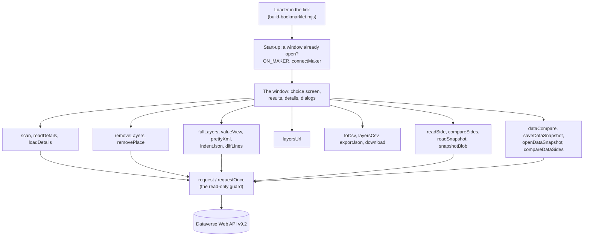

**Why one file, and no library.** A bookmarklet is one script. A single file can also be pasted into the console as it
is ([2.6](#26-the-development-loop)), needs no bundler, and can be read from top to bottom. Environment Inspector runs inside other people's pages: it must
not depend on their code or disturb it, and it must stay under the size limit of a favourite. So it uses no framework
and no component library: the Fluent 2 look of the window is plain CSS in the file ([8.1](#81-shadow-dom-and-styles)).

**Order inside the function.** Function declarations are hoisted, so the start-up at the top can call
`connectMaker` before the line that defines it. Values declared with `const`, such as `CONFIG`, exist only from their
line on; the code above the settings part does not use them.

The file marks its parts with comment lines: `// ------...------ <name>` in the engine and `// ---- <name>` in the
window. In the order of the file:

| Marker | What it holds | Main names | Chapter |
| --- | --- | --- | --- |
| (the top, before any marker) | The header comment with the safety rules; where it may run; a window already open on the page; connecting | `ON_MAKER`, `envOfUrl`, `KEY`, `placeholder`, `giveUp`, `conn` | [4.2](#42-start-up-and-connecting) |
| `sign-in on the maker portal` | Reading the maker portal's cached token, and finding the environment's address | `accessTokenEntries`, `scopesOf`, `makerToken`, `makerAccount`, `connectMaker` | [5.7](#57-the-maker-portal-sign-in) |
| `settings` | The settings, the values derived from the connection, the constant tables | `CONFIG`, `VERSION`, `ORIGIN`, `API`, `ACTIVE`, `DEFAULT`, `ORG`, `MAKER`, `IS_DEV`, `IS_PROD`, `CLASSIC`, `NAMES`, `METADATA`, `TABLE_PARTS`, `PART_OF`, `BY_TABLE`, `TABLE_BOUND`, `GROUPS`, `groupOf`, `typeWanted`, `STATE_ONLY`, `MICROSOFT`, `QUIET_NO_ACCESS` | [4.3](#43-settings-config), [4.4](#44-constant-tables-classic-names-metadata-groups-and-others) |
| `Web API` | Every request with the read-only guard, concurrency, retries, Stop and paging; reading a component's layers | `request`, `requestOnce`, `read`, `write`, `getAll`, `pool`, `slot`, `release`, `pause`, `stopAllReads`, `resumeReads`, `SessionError`, `StopError`, `GUID`, `placeOk`, `getLayers`, `places`, `managedOf`, `managedPrint`, `ExactNumber`, `exactNumbers`, `fileRefOf`, `changedKeys` | [5](#5-the-request-layer), [3.5](#35-msdyn_componentlayers) |
| `managed solutions` | The list of managed solutions, hidden ones included | `listManagedSolutions` | [8.3](#83-the-choice-screen-and-saved-selections) |
| `scan` | The scan, the details of the findings, the status line | `scan`, `readDetails`, `readTop`, `loadDetails`, `statusLine` | [6](#6-the-scan-step-by-step) |
| `compare environments` | Comparing environments: reading a side, snapshot files, what counts as the same, matching and the statuses | `keyOfType`, `matchKey`, `readSide`, `columnsOf`, `recordValues`, `definitions`, `fingerprinted`, `snapshotBlob`, `snapshotName`, `readSnapshot`, `normText`, `norm`, `both`, `topLine`, `unset`, `named`, `compareSides` | [11](#11-comparing-environments) |
| `compare data`, with `tables, counts and definitions`, `the columns and the matching of a table`, `reading records`, `data snapshot files`, `normalizing`, `matching and comparing`, `very large tables` | Comparing data: the tables, their counts, definitions and read access; the columns and the matching of a table; reading records; data snapshot files; values as compared; matching and comparing; tables too large to keep, counted; the memory guard; a whole comparison and a whole snapshot | `DATA_SNAP`, `DATA_LIMITS`, `dataTableList`, `dataCounts`, `dataDefinitions`, `dataAccess`, `dataColumns`, `dataChosen`, `dataMatchPlan`, `dataLookups`, `dataSpec`, `readWhy`, `eachPage`, `dataLine`, `keptTable`, `readDataSide`, `dataSnapshotWriter`, `readLines`, `snapshotKind`, `openDataSnapshot`, `checkDataHead`, `checkDataLine`, `dataSelection`, `readDataSnapshot`, `canonNumber`, `normCell`, `matchValue`, `diffKind`, `kindLine`, `slicer`, `dataHeapCheck`, `dataPlan`, `dataMatch`, `lookupDiff`, `pairer`, `compareTable`, `DataIndex`, `ValueTable`, `countTable`, `compareDataSides`, `dataNotes`, `dataKeepPlan`, `readProgress`, `dataCompare`, `saveDataSnapshot` | [12](#12-comparing-data) |
| `remove` | Deleting, with the checks before and after each place | `removePlace`, `removeLayers` | [10](#10-deleting) |
| `files` | Downloads, the CSV and JSON exports | `stamp`, `download`, `csvCell`, `toCsv`, `layersCsv`, `exportJson` | [13](#13-exports) |
| `links to the solution layers pages` | The address of each finding's layers page | `PART_SEGMENT`, `CLASSIC_PAGE`, `classicLayers`, `layersUrl` | [7](#7-links-to-the-solution-layers-pages) |
| `UI` | Escaping, icons, the sections of the object types, the style sheet, the window's markup in a shadow root | `esc`, `P`, `icon`, `TYPE_SECTIONS`, `STYLE`, `host`, `root`, `app`, `mini`, `$` | [8.1](#81-shadow-dom-and-styles) |
| `state` | The window's state, the choices remembered in the browser, and each tool's saved selections | `sizeWatch`, `view`, `result`, `busy`, `scanning`, `deleting`, `chosen`, `typesSel`, `tablesSel`, `topSel`, `savedName`, `logRows`, `STORE`, `SAVED`, `SAVED_KEY`, `savedList`, `loadSaved`, `loadCmpSaved`, `loadDataSaved`, `loadSavedOf`, `storeSavedOf`, `plural`, `someNames`, `announce` | [4.5](#45-state-and-globals), [8.3](#83-the-choice-screen-and-saved-selections) |
| `dialogs and toasts` | The one dialog and the messages in the corner | `openDialog`, `pickSearch`, `toast` | [8.9](#89-toasts-dialogs-and-the-deleting-pill) |
| `menus` | Every menu of the window (Saved selections, Export, More, and the comparisons' pages' More tab, Filter and +N), with the keyboard of Fluent menus; the comparisons' menus kept inside the window | `openMenu`, `fitMenu`, `MENUS`, `menuOpen`, `refitMenus`, `closeMenus` | [8.8](#88-keyboard-and-accessibility) |
| `the choice screen` | Switching screens; the solutions, object types, saved selections (each tool's own) and the *Managed layers on top* switch | `setView`, `solRows`, `renderSolutions`, `TABLE_GROUPS`, `groupOn`, `renderTypes`, `savedText`, `renderSaved`, `renderPickBar`, `renderTop`, `renderPick` | [8.2](#82-views-and-rendering), [8.3](#83-the-choice-screen-and-saved-selections) |
| `tables` | The Tables card and the Choose tables dialog; ticking solutions; applying and saving selections (the Save selection dialog, shared by the three tools) | `readTables`, `loadTables`, `renderTables`, `toggleSol`, `applySaved`, `saveDialog`, `changedPick` | [8.3](#83-the-choice-screen-and-saved-selections), [8.4](#84-the-table-picker) |
| `scanning` | Starting a scan and showing its progress | `scopeText`, `clock`, `drawStep`, `progress`, `withBusy`, `runScan` | [8.2](#82-views-and-rendering) |
| `compare environments: the mode, ...`, `the comparison's rows, ...`, `the comparison's window: ...` | The comparison's choice screen (the mode, the Compare with strip, both sides' solutions, saved selections), running a comparison or saving a snapshot; its rows' statuses, labels and exports; its view's state, the order of the sides, the counts and the lists' rows | `mode`, `keepCompare`, `loadEverySolution`, `cmpSolRows`, `cmpScope`, `renderOther`, `renderDirect`, `renderMode`, `openCmpFile`, `applyCmpSaved`, `saveCmpDialog`, `runCompare`, `runSnapshot`, `cvStatus`, `safeOrigin`, `unmanagedLayer`, `holdersOf`, `cmpFinding`, `cmpResult`, `shortNames`, `PROP_LABEL`, `PROP_MORE`, `PROP_KIND`, `cmpPropLabel`, `severalOf`, `VALUE_LABEL`, `VALUE_MORE`, `cmpValueWord`, `cvDetail`, `cmpCsv`, `cmpJson`, `cv`, `cvReset`, `cvSides`, `cvSwap`, `ST_LABEL`, `stLabel`, `cvCount`, `cvRows`, `cvFlat`, `cvEvery`, `cvListBase`, `secName`, `solsDiffering`, `otherSols`, `solPlace`, `renderCv`; and the parts shared with Compare data: `setMode`, `switchMode`, `startRun`, `endRun`, `keepResults`, `downloadBlob` | [11.2](#112-the-mode-and-the-choice-screen), [11.6](#116-running-a-comparison), [11.7](#117-the-results-and-the-details) |
| `compare environments: the overview (E1)`, `a list of components (E2)`, `compare environments: a component, side by side (E3)`, `a compared component's (E3) and a compared record's (D3) two definitions as two layer-shaped objects` | Compare environments' three levels: the overview, with E0 while the run lasts and the notes; a list of components with its tabs, Filter, search and lines; one component side by side with its Layers and JSON tabs | `e1Data`, `e1Row`, `e1Lanes`, `e1EnvRows`, `e1Rows`, `e1Fold`, `e1Draw`, `e1Pick`, `e0Draw`, `cvNotes`, `e2Tabs`, `e2Line`, `e2Items`, `e2Lanes`, `e2Head`, `e2FilterMenu`, `e2Chips`, `cvListPage`, `e2Refresh`, `e2Fit`, `cvReveal`, `cvGo`, `e2Click`, `findingOf`, `cvOpen`, `itemGo`, `cvBack`, `e3Head`, `e3Html`, `propHead`, `e3What`, `e3Json`, `e3Click`, `e3Key`, `SIDE`, `cmpLayers`, `e3Layers`, `e3LayersBody` | [11.7](#117-the-results-and-the-details) |
| `compare data: the choice`, with `sizes, names and estimates`, `the Tables card`, `the Chosen tables card`, `the strip (Compare with) and the footer`, `opening a data snapshot, and taking a choice`, `saved selections`, `a table's settings`, `Compare and Save snapshot` | Compare data's choice screen: the table list and counts, the chosen tables, the strip and the footer, opening a data snapshot, saved selections, a table's settings, the confirmation of a long read, the runs | `DATASTORE`, `dsel`, `dsnap`, `dcmp`, `loadDataTables`, `readDataCounts`, `needDefs`, `sizeOf`, `dataEstimate`, `dataRowsShown`, `dataTags`, `renderDataTables`, `dataInfo`, `renderDataChosen`, `renderDataOther`, `dataPickBar`, `renderDataPick`, `openDataFile`, `applyDataChoice`, `applyDataSaved`, `saveDataDialog`, `openTableSettings`, `cleanSettings`, `dataGo`, `confirmLarge`, `longRun`, `napWatch`, `runDataSnapshot`, `runDataCompare` | [12.2](#122-the-choice-screen) to [12.5](#125-saved-selections-and-the-last-choice), [12.13](#1213-running-a-comparison) |
| `the comparisons' results: shared parts, ...`, `side by side: ...`, `the virtual list: ...` | The parts both comparisons draw with, built once: the status icons, connectors, labels, tags, results and lane heads; the side-by-side sheet's rows, boxes, folds and long values (also the scan's details); the list drawn only where it is on screen | `iso`, `ST_SVG`, `stIcon`, `connector`, `vPill`, `vDash`, `onlyIn`, `bItem`, `statusLabel`, `uTag`, `bigN`, `bigT`, `laneHead`, `laneBtn`, `laterTag`, `snapAge`, `snapLine`, `savedLine`, `dayWords`, `utcWords`, `sbsRow`, `sbsBox`, `sbsQuiet`, `sbsDash`, `sbsCopy`, `sbsGroup`, `sbsToggle`, `sbsDiffs`, `sbsClaim`, `sbsKept`, `sbsOpenSet`, `sbsLines`, `sbsLinesHtml`, `sbsUnfold`, `sbsLongRow`, `vlists`, `vlist` | [8.10](#810-the-comparisons-pages-levels-the-header-and-shared-parts) |
| `compare data: the window (5)`, `compare data: the run's rows`, `compare data: the view while a data snapshot is saved`, `compare data: the overview after a run (D1)`, `shared by both overviews (D1, E1)`, `compare data: the overview while the run goes on (D0)` | Compare data's own view, its state and its first level: the run's rows; the view of a data snapshot being saved; the overview of tables after a run and while it lasts; Good to know and the notes at the top, shared with E1 | `dv`, `dvReset`, `dvRun`, `dvLive`, `dvCmp`, `dvRunning`, `dStLabel`, `dStTip`, `dStOrder`, `stepHome`, `liveRun`, `liveTable`, `drawLive`, `liveText`, `saveOverview`, `d1Title`, `d1Row`, `d1RowHtml`, `d1Items`, `d1Lanes`, `gtkBlock`, `rsNote`, `d1Draw`, `d1Pick`, `d1Find`, `d0Done`, `d0RowHtml`, `d0Lanes`, `d0Draw`, `renderDv`, `dvTr`, `dvGo` | [12.13](#1213-running-a-comparison), [12.15](#1215-the-results-and-a-records-details) |
| `compare data: a table's records (5.3, 5.4)`, `a list's lines (shared: ...)`, `compare data: a table's records (D2)`, `compare data: the view's events` | How a compared table is shown (its plan), its records sorted and searched; the list line both comparisons share; a table's records with its tabs, column chips and search; the view's clicks and keys | `dvPlan`, `dvLine`, `dvRecName`, `dvShow`, `dvPair`, `markText`, `dvColTip`, `dvList`, `dvSearch`, `dvSort`, `dvShown`, `listLine`, `listLink`, `listAbsent`, `listLanes`, `tabsFit`, `d2Tabs`, `d2Counts`, `kindLineLanes`, `d2What`, `d2Line`, `d2Items`, `d2Lanes`, `dvTablePage`, `dvRefresh`, `d2Fit`, `stateWords`, `dvFocusRow`, `d2Open`, `d2SameText` | [12.15](#1215-the-results-and-a-records-details) |
| `compare data: a record's links ...`, `compare data: a record, side by side (D3)`, `compare data: exports (6)` | A record's form in each environment and its two sides as layers; a record side by side with its JSON tab; the exports | `recordUrl`, `recordLink`, `recordLayers`, `recordOthers`, `recList`, `recPos`, `openRecord`, `recGo`, `d3Head`, `d3Html`, `d3What`, `d3Json`, `recCopy`, `d3Click`, `d3Key`, `exportOnce`, `csvAllLines`, `csvTableLines`, `dataCsv`, `dataJson`, `dataSnapOut`, `dataExportTexts` | [12.15](#1215-the-results-and-a-records-details), [12.16](#1216-the-exports-of-a-data-comparison) |
| `results` | Which rows can be ticked; the types Dataverse does not delete; the list shown (unmanaged layers or managed layers on top) | `active`, `undeletable`, `cannotDelete`, `topName`, `noDeleteText`, `selectable`, `kindSel`, `isKind`, `topChecked`, `solName`, `solNameU`, `cmpText` | [8.5](#85-results-search-type-bubbles-and-column-menus), [10.10](#1010-types-dataverse-will-not-delete) |
| `column filters and sorting` | The five filterable columns, the rows shown, the values of a column | `COLS`, `filters`, `sortBy`, `shown`, `drawnRows`, `columnValues`, `renderFilters` | [8.5](#85-results-search-type-bubbles-and-column-menus) |
| `type bubbles` | The bubbles above the grid | `renderChips` | [8.5](#85-results-search-type-bubbles-and-column-menus) |
| `the kind of layer shown` | The switch between the unmanaged layers and the managed layers on top, each list with its own view; then the rest of the bubbles and the More menu | `renderKinds`, `views`, `setKind`, `layoutChips`, `typeClick` | [8.5](#85-results-search-type-bubbles-and-column-menus) |
| `column widths` | Column widths, then the column menus, the rows of the grid, the bottom bar and the pill, the banners and the scan's titles | `applyColWidths`, `fitColumn`, `openPop`, `renderPop`, `setFilter`, `STATUS`, `statusCell`, `rowHtml`, `renderRows`, `fitTags`, `updateRow`, `timeLeft`, `syncMini`, `syncSelection`, `renderBanners`, `subtitle`, `RUN_TITLE`, `failTitle` | [8.5](#85-results-search-type-bubbles-and-column-menus), [8.6](#86-column-widths) |
| `the comparisons' results: levels, their header, going back` | The comparisons' three levels in containers of their own, the page header on every level, going back and Swap's redraw; the results screen of every tab; Scan, Compare or Save again; Stop; the Export menu's items | `LV_NAME`, `lvState`, `lvBox`, `lvAt`, `lvShow`, `lvTab`, `lvDrop`, `lvClose`, `lvSaveAt`, `lvToAnchor`, `lvFocus`, `lvUp`, `lvGo`, `lvRedrawAll`, `lvHead`, `lvHeadOff`, `lvStep`, `renderResults`, `titleParts`, `titleText`, `rescan`, `stopLabel`, `cvExportTexts` | [8.10](#810-the-comparisons-pages-levels-the-header-and-shared-parts) |
| `a component's layers and what changed` | Reading every layer, showing values, the line difference, the details sheet's head and body | `fullLayers`, `parseJson`, `attrsOf`, `safeJson`, `stable`, `scalarText`, `prettyXml`, `indentJson`, `valueView`, `asStored`, `diffLines`, `markPair`, `sheet`, `layerLabel`, `openSheet`, `closeSheet`, `renderSheetHead`, `userNames`, `loadSheet`, `onTopIndex`, `layerRef`, `MERGED`, `topNote`, `renderSheetBody`, `compareRows`, `BIG`, `MAX_LINES`, `FileRef`, `isWrContent`, `contentSide` | [9](#9-details-and-comparison) |
| `the scan's details, What changed: ...` | The two layers compared as two lanes, drawn with the side-by-side parts; their pickers; the Layers and JSON tabs | `lyPick`, `lyName`, `LY_MORE`, `lyLabels`, `codeLine`, `lyCode`, `lyHead`, `lyMenu`, `lyRow`, `lyRowOf`, `lyFile`, `lyCompare`, `lyRedraw`, `lyPickOpen`, `lyPickChoose`, `lyPickKey`, `activeWhen`, `renderLayersTab`, `highlightJson`, `childTables`, `renderJsonTab` | [9.2](#92-comparing-two-layers), [9.8](#98-layers-and-json-tabs-children-tables) |
| `details: events` | Clicks and keys in the details: tabs, pickers, folds, Copy, Download | `sheetGo`, `copyText` | [9.9](#99-copy-and-download) |
| `deleting` | The confirmation and the run | `beforeUnload`, `confirmDelete`, `runDelete` | [10](#10-deleting) |
| `the window` | Moving, resizing, maximizing | `fitGeo`, `defaultGeo`, `placeWin`, `toggleMax`, `startDrag`, `onDrag`, `endDrag`, `onResize` | [8.7](#87-moving-resizing-and-maximizing) |
| `open, close, environment changes` | Closing and opening the window again, Escape, Alt+Left and the mouse's back button, Tab, the solution open in the maker portal, the test hooks, the first load | `refocus`, `minimize`, `restore`, `hide`, `ESC_UP`, `onEscape`, `onAltArrow`, `onSideButton`, `openSolution`, `takeOpenSolution`, `show`, `destroy`, `loadSolutions` | [4.2](#42-start-up-and-connecting), [4.6](#46-the-test-hooks-on-window__environmentinspector), [8.8](#88-keyboard-and-accessibility) |

### 4.2 Start-up and connecting

When the favourite is clicked, the loader in the link unpacks the code and runs it ([14.2](#142-the-loader-and-the-size-limit)). The code then decides
whether it may start, and where its data comes from.

`environment-inspector.js`, the start (the top of the function):

```js
(async () => {
  'use strict'
  // Where it runs: a page of the environment itself, or the maker portal (make.powerapps.com) with an environment open.
  const ON_MAKER = /^make\.(preview\.)?powerapps\.com$/i.test(location.hostname)
  const envOfUrl = () => ((/\/environments\/([0-9a-z-]+)/i.exec(location.pathname) || [])[1] || '').toLowerCase()
  const KEY = ON_MAKER ? 'maker|' + envOfUrl() : location.hostname
  // A window already open on this page: shown again; or one of the Unmanaged Layer Scanner (this tool's earlier name),
  // closed first.
  const earlier = !window.__environmentInspector && window.__layerScanner, old = window.__environmentInspector || earlier
  if (old) {
    if (typeof old.destroy !== 'function') { alert('An older version of Environment Inspector is open on this page. Reload the page, then click the bookmark again.'); return }
    if (old.starting) { alert('Environment Inspector is still starting. Wait a moment.'); return }
    if (!earlier && old.key === KEY && old.ready()) { old.show(); return }
    // Another environment (the maker portal changes environment without reloading the page): start again. (One still
    // loading its solutions is busy: it asks to wait.)
    if (!old.destroy()) { alert('Environment Inspector is still working. Wait until it has finished, then click the bookmark again.'); return }
  }
  if (!ON_MAKER && !/\.dynamics\.com$/i.test(location.hostname)) { alert('Open the environment (https://<org>.crm.dynamics.com) or its Solutions page in the maker portal (make.powerapps.com) first, then click the bookmark again.'); return }
  if (ON_MAKER && !envOfUrl()) { alert('Open an environment in the maker portal (for example its Solutions page), then click the bookmark again.'); return }
  const placeholder = { key: KEY, starting: true }   // a second click while connecting does not start a second window
  window.__environmentInspector = placeholder
  const giveUp = (msg) => { if (window.__environmentInspector === placeholder) delete window.__environmentInspector; alert(msg) }
  let conn
  try { conn = ON_MAKER ? await connectMaker(envOfUrl()) : { origin: location.origin, envId: '', host: location.hostname, account: '' } } catch (e) { giveUp(e.message); return }
  if (conn.error) { giveUp(conn.error); return }
  if (ON_MAKER && envOfUrl() !== conn.envId) { giveUp('The maker portal moved to another environment while Environment Inspector was starting. Click the bookmark again.'); return }
```

**One window per page.** `KEY` names the environment: the host name on an environment page, `maker|` and the
environment id on the maker portal. A click on the favourite while a window is already on the page does this:

| On the page | What happens |
| --- | --- |
| Nothing | Environment Inspector starts |
| A window of a version without `destroy` | An alert asks to reload the page |
| A window that is still connecting (`starting`) | An alert asks to wait |
| A ready window for the same environment | It is shown again (`show`): no second window, and no new code |
| A window for another environment (the maker portal changes environments without reloading the page) | It is removed (`destroy`) and a new one starts; if it is busy (a window still loading its managed solutions is), `destroy` refuses and an alert asks to wait |

A window of the tool's earlier name, Unmanaged Layer Scanner, counts as one too: when `window.__environmentInspector` is
not set, `old` is `window.__layerScanner` (`earlier`). Such a window is never shown again: it is removed first, as a
window for another environment is, and this version starts. The other way round, a window of this version also sets
`window.__layerScanner` when that name is free, so the earlier favourite, clicked on the same page, shows this window
rather than opening a second one ([4.6](#46-the-test-hooks-on-window__environmentinspector)). `ready()` is true once the
list of managed solutions is no longer loading: it loaded, or couldn't be read. A window whose list failed has its own
**Try again**, and *Compare data* works without that list, so its results (a data comparison too) are shown again rather
than thrown away. The placeholder object `{ key, starting: true }` holds the place during the connection, so that a
double click starts one window only; `giveUp` removes it again, but only if it is still its own.

**Where it may run.** On a host that is neither the maker portal nor under `.dynamics.com`, or on the maker portal
without an environment in the address, an alert says what to open, and nothing else happens.

**Connecting.** `conn` holds where the data comes from:

| Field | On an environment page | On the maker portal |
| --- | --- | --- |
| `origin` | The page's own origin, for example `https://contoso.crm.dynamics.com` | The environment's Dataverse address, found by `connectMaker` |
| `envId` | Empty at first; `loadSolutions` reads it with `RetrieveCurrentOrganization` for the links to the maker portal ([chapter 7](#7-links-to-the-solution-layers-pages)) | The id in the page address, confirmed by Dataverse |
| `host` | The page's host name | The environment's host name, used to pick its token for each request |
| `account` | Empty: the browser's session cookie signs the requests | The maker portal account whose token is used |

`connectMaker` ([5.7](#57-the-maker-portal-sign-in)) asks each Dataverse host that the maker portal holds a token for, most recently used first, for
its environment id with `RetrieveCurrentOrganization`, and keeps the one whose id is the id in the page address. If the
browser holds the maker portal sign-in of several accounts for that environment and none is marked active, it refuses
to guess, and the alert says so. If no host matches, the alert says: "The maker portal has no current sign-in to this
environment's data. Wait until the Solutions list has loaded (or reload the page), then click the bookmark again."

**After connecting**, the rest of the function runs without waiting: the settings and constants ([4.3](#43-settings-config), [4.4](#44-constant-tables-classic-names-metadata-groups-and-others)), the
functions of the engine, then the window. The window is built at once: a `div` (`host`) covering the page, with a
shadow root that holds the style sheet and the markup ([8.1](#81-shadow-dom-and-styles)). Key presses are stopped at `host`, so the app's own
keyboard shortcuts do not react to typing in the window. The function ends by replacing the placeholder with the real
`window.__environmentInspector` ([4.6](#46-the-test-hooks-on-window__environmentinspector)), showing the choice screen, and calling `loadSolutions`; when the tab last used
was *Compare environments* or *Compare data*, it also reads what that tab lists (`loadEverySolution`,
[11.2](#112-the-mode-and-the-choice-screen); `loadDataTables`, [12.2](#122-the-choice-screen)).

`environment-inspector.js`, `loadSolutions`:

```js
function loadSolutions() {
  solState = 'loading'; solError = ''; renderSolutions(); renderPickBar()
  withBusy(async () => {
    try {
      allSolutions = await listManagedSolutions()
      const known = new Set(allSolutions.map((s) => s.unique))
      chosen = new Set([...chosen].filter((u) => known.has(u)))
      // The environment id, for the links to the maker portal (the maker portal's own address already has it).
      if (!conn.envId) try { conn.envId = lc((await read("RetrieveCurrentOrganization(AccessType=Microsoft.Dynamics.CRM.EndpointAccessType'Default')")).Detail.EnvironmentId) } catch (e) { if (e instanceof SessionError) throw e }
      takeOpenSolution()   // started from a solution's page in the maker portal: that solution, all types
      solState = allSolutions.length ? 'ready' : 'none'
    } catch (e) { solState = 'failed'; solError = e.message }
  }).then(() => {
    if (view === 'pick') renderPick()
    if (solState === 'ready') loadTables().catch(() => { })   // the tables' display names, for the Tables card; read again when chosen
  })
}
```

1. While the list loads, the solution list shows placeholder rows of the same size, so nothing jumps when the rows
   arrive ([8.3](#83-the-choice-screen-and-saved-selections)).
2. The remembered choice ([8.3](#83-the-choice-screen-and-saved-selections)) keeps only solutions that are installed in this environment.
3. On an environment page, the environment id is read once. If that fails (other than an expired sign-in),
   everything still works, and the rows link to the environment's classic layers page instead of the maker portal ([7.3](#73-the-classic-page)).
4. Started on a solution's page in the maker portal (`.../solutions/<solution id>/...`), `takeOpenSolution` selects
   that solution with all object types and no table limit, and the bar says why. If that solution is not managed, the
   bar says so instead.
5. Once the solutions are ready, the list of tables is read in the background, for the Tables card ([8.4](#84-the-table-picker)).

The whole load runs inside `withBusy`, so `destroy` refuses to remove a window that is still loading.

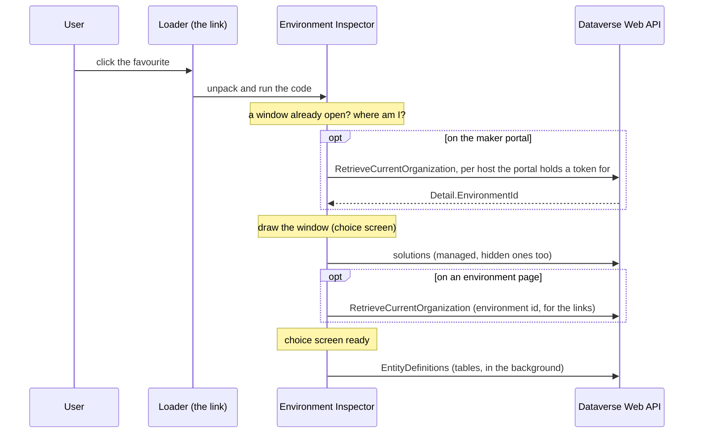

### 4.3 Settings: `CONFIG`

The main limits and timings are in one object near the top of the file. A few more are written next to
the code that uses them: constants such as `MAX_LINES` ([4.4](#44-constant-tables-classic-names-metadata-groups-and-others)), and plain numbers such as the 10-second wait when a
removal meets a lock ([3.8](#38-removeactivecustomizations)).

`environment-inspector.js`, `CONFIG`:

```js
const CONFIG = {
  // Optional environment rules, set at build time from inspector.settings.json (see the README); none by default.
  // Each is a regular expression matched against the environment's name, the first part of its address.
  developmentEnvironments: null,                  // deleting is never offered there
  productionEnvironments: null,                   // the delete confirmation names them as production, in red
  maxRemovePerRun: 100,                           // larger clean-ups go in several runs
  autoDetails: 500,                               // details are read automatically for this many findings; the rest on request
  maxRows: 2000,                                  // rows drawn in the table (filter to see others)
  concurrency: 8,                                 // requests in flight at once (Dataverse allows 52 per user; in tests 8 were about
                                                  // twice as fast as 4, and 16 no faster)
  detailConcurrency: 6,                           // layer reads at once (in tests 6 to 8 were about 4 times as fast as 1 at a time)
  pageSize: 5000,                                 // rows per page (Dataverse maximum); smaller only for tests
  deleteConcurrency: 1,                           // one component at a time, as Solution Layers Explorer does (Dataverse does
                                                  // the removals one after the other anyway, about 8 s each)
  layerCheckLimit: 1000,                          // components not in the solutions' component lists whose layers are read to place them,
                                                  // and components flagged only by the solution summary whose layers are read to confirm them
  readTimeout: 300000,                            // a read with no full answer after 5 minutes is ended, not sent again
  managedMicrosoft: false,                        // "Managed layers on top": also check Microsoft's solutions as the one underneath
                                                  // (they are layered on each other by design; for tests)
  topCheckLimit: 1000,                            // possible managed layers on top confirmed by their layers in one scan (the
                                                  // others are not listed; a banner counts them)
  scanPath: 'auto',                               // where a scan looks for the unmanaged layers: 'auto' (from the chosen solutions, or
                                                  // from the whole environment when one of them is Microsoft's), 'solutions' or
                                                  // 'environment' (for tests; see scan)
  // Compare data (first estimates, to be set from measurements in the demo, lowered rather than raised):
  dataConcurrency: 3,                             // tables read at once (each table's pages one after another)
  dataPageValues: 150000,                         // values per page: page size = this ÷ columns read (×2 with annotations), 500 to 5,000
  dataLarge: 50000,                               // records: the Large tag
  dataVeryLarge: 1000000,                         // records: the Very large tag and the confirmation
  dataMaxRecords: 5000000,                        // records per table in either environment (Too large above; a table too large to
                                                  // keep whole is counted instead)
  dataMaxTotal: 5000000,                          // records in one comparison (the larger side of each table, summed)
  dataConfirmMinutes: 5,                          // a confirmation before a read estimated this long or more
  dataRate: 2500,                                 // records read per second per table, for the estimates
  dataKeepChars: 400e6,                           // characters of records kept whole, both sides; the largest tables past it are counted
  dataListCap: 50000,                             // records listed per counted table (the others are counted)
  dataHeapStop: 0.7,                              // stop when Edge reports the page above this share of its memory limit
                                                  // (performance.memory: usedJSHeapSize ÷ jsHeapSizeLimit)
  dataGridMax: 500000,                            // lines a table's records list at once (the same records shown too)
  dataSortMax: 100000,                            // records sorted by name; past it, by status in the order read
  listMaxPx: 30e6,                                // device pixels a long list's spacer takes at most
}
```

| Setting | Default | What it controls | Used by |
| --- | --- | --- | --- |
| `developmentEnvironments` | `null` | A regular expression matched against the environment's name (`ORG`). When it matches, deleting is turned off: the tick boxes are disabled, the **Delete** buttons hidden, a *Development* badge in the title bar says why in its tooltip, and `removeLayers` refuses to run. Set by the build from `inspector.settings.json` ([14.5](#145-environment-rules-inspectorsettingsjson)) | `IS_DEV` |
| `productionEnvironments` | `null` | Matched the same way. When it matches, a red *Production* badge in the title bar, and the confirmation says "You're deleting in the production environment" with the environment's name | `IS_PROD` |
| `maxRemovePerRun` | 100 | Most components in one deletion run. With more ticked, **Delete** is disabled and the bar says "You can delete up to 100 at a time." | `syncSelection`, `confirmDelete` |
| `autoDetails` | 500 | Findings whose details the scan reads by itself, besides the ones only the summary found; the rest on request, with **Read N more** (N is 500, or fewer when fewer are left) | `scan`, `renderBanners` |
| `maxRows` | 2,000 | Rows drawn in the grid; a search or a filter reaches the others, and the subtitle says when only the first 2,000 are drawn | `drawnRows`, `subtitle` |
| `concurrency` | 8 | Requests in flight at once, for every request; also the number of component types swept at a time, and of the reads of each part of step 1 from the chosen solutions ([5.3](#53-concurrency)) | `slot`, `scan` |
| `detailConcurrency` | 6 | Components whose layers are read at a time, for the details and for placing components by their layers | `loadDetails`, `scan` |
| `pageSize` | 5,000 | Rows per page, asked with the header `Prefer: odata.maxpagesize` (the Dataverse maximum). Smaller only for tests of the paging | `requestOnce` |
| `deleteConcurrency` | 1 | Components deleted at a time ([1.4](#14-how-deleting-works-in-one-page)) | `removeLayers` |
| `layerCheckLimit` | 1,000 | Most components placed by their layers ([6.7](#67-components-placed-by-their-layers)), and most summary-only components confirmed by their layers ([6.8](#68-step-4-confirming-and-reading-the-details)), in one scan. Components left to place beyond it make the scan incomplete; summary-only components beyond it stay *not read yet*, and the banner says they might have no unmanaged layer of their own | `scan` |
| `readTimeout` | 300,000 (5 minutes) | A read with no full answer within this many milliseconds is ended and not sent again, so that a heavy query does not load the server twice | `requestOnce` |
| `managedMicrosoft` | `false` | With *Managed layers on top*, whether the chosen solutions published by Microsoft are looked under too. They are layered on each other by design, so this is for tests only ([6.11](#611-managed-layers-on-top), [16.8](#168-managed-layers-on-top)) | `scan` (`findManagedTops`) |
| `topCheckLimit` | 1,000 | Most candidate managed layers on top confirmed by their layers in one scan. The others are not listed: `result.managed.notChecked` counts them, and an amber banner says how many ([6.11](#611-managed-layers-on-top)) | `scan`, `renderBanners` |
| `scanPath` | `'auto'` | Where step 1 looks for the unmanaged layers: `'auto'`, from the chosen solutions, or from the whole environment when one of them is published by Microsoft; `'solutions'` or `'environment'` forces a way, for tests. A scan's `path` option overrides it ([6.2](#62-step-1-from-the-chosen-solutions-or-the-whole-environment)) | `scan` |
| `dataConcurrency` ... `dataSortMax` | | *Compare data*: the tables read at once, the page size, the size marks and limits of a table and of a comparison, the estimates, the records kept whole and listed, the memory guard, a table's list of records and its order ([12.17](#1217-settings-storage-and-test-hooks) explains each) | `dataSpec`, `readDataSide`, `dataEstimate`, `dataKeepPlan`, `countTable`, `dataHeapCheck`, `dvList`, `dvSort` and others |
| `listMaxPx` | 30,000,000 | The most device pixels the spacer of a long list of the comparisons' pages takes (Blink's layout units stop near 33.5 million). A taller list keeps its spacer at this height divided by the display scale, and its scroll maps to its lines in proportion ([8.10](#810-the-comparisons-pages-levels-the-header-and-shared-parts)) | `vlist` |

[15.2](#152-change-limits-and-timings) explains how to change them, and Appendix [A.1](#a1-config) lists them again.

Right after `CONFIG`, the values that depend on the connection:

`environment-inspector.js`, the settings part:

```js
const VERSION = '__VERSION__'   // set by build-bookmarklet.mjs from package.json
const ORIGIN = conn.origin
const API = ORIGIN + '/api/data/v9.2/'
const ACTIVE = 'fd140aae-4df4-11dd-bd17-0019b9312238'    // the unmanaged ("Active") layer, same id everywhere
const DEFAULT = 'fd140aaf-4df4-11dd-bd17-0019b9312238'
const ORG = new URL(ORIGIN).hostname.split('.')[0]
const MAKER = ON_MAKER ? location.origin : 'https://make.powerapps.com'   // the maker portal, for the links to each component's layers
const IS_DEV = !!CONFIG.developmentEnvironments && CONFIG.developmentEnvironments.test(ORG), IS_PROD = !!CONFIG.productionEnvironments && CONFIG.productionEnvironments.test(ORG)
```

| Name | Value | Used for |
| --- | --- | --- |
| `VERSION` | `'__VERSION__'` in the source; the build writes the version of `package.json` ([14.4](#144-the-version)) | The tooltip of the window's title; `window.__environmentInspector.version` |
| `ORIGIN`, `API` | The environment's address, and its Web API address | `requestOnce` accepts nothing else ([5.2](#52-read-only-by-design)) |
| `ACTIVE`, `DEFAULT` | The two fixed solution ids ([3.2](#32-the-active-solution-and-the-default-solution)) | Step 1 of the scan, the summary, the links |
| `ORG` | The environment's name: the first part of its host name, for example `contoso` for `contoso.crm.dynamics.com` | The badge in the title bar (with the full address as its tooltip), the environment rules, the names of downloaded files, the key of the remembered choice ([8.3](#83-the-choice-screen-and-saved-selections)) |
| `MAKER` | The maker portal's address: the page's own on the maker portal (so the preview portal stays on preview), else `https://make.powerapps.com` | The links ([7.1](#71-maker-portal-addresses)) |
| `IS_DEV`, `IS_PROD` | Whether the environment rules match `ORG` | Deleting turned off, the badges, the confirmation |

**Changing a setting** means changing `CONFIG` and building again. For a test, `window.__environmentInspector.config` is the
same object ([4.6](#46-the-test-hooks-on-window__environmentinspector)): a value changed there takes effect where it is next read, for example `pageSize` at the next
request. The environment rules are the exception: `IS_DEV` and `IS_PROD` are worked out once, at start-up.

### 4.4 Constant tables: `CLASSIC`, `NAMES`, `METADATA`, `GROUPS` and others

The scan is driven by a few tables of constants, all in the settings part. They hold what the code knows about
Dataverse that it cannot read from the environment.

**`CLASSIC`: the classic component types.** One entry per type number: the component's table (its logical name), the
layer name ([3.4](#34-component-types-and-layer-names)), and the name the maker portal shows. It has 49 types.

`environment-inspector.js`, `CLASSIC` (the first lines):

```js
// Classic component types: the table behind each, the name the layer table uses, and the name the maker portal shows.
const CLASSIC = {
  1: ['entity', 'Entity', 'Table'], 2: ['attribute', 'Attribute', 'Column'], 9: ['', 'OptionSet', 'Choice'], 10: ['relationship', 'EntityRelationship', 'Relationship'],
  14: ['entitykey', 'EntityKey', 'Key'], 20: ['role', 'Role', 'Security role'], 22: ['displaystring', 'DisplayString', 'Display string'],
  26: ['savedquery', 'SavedQuery', 'View'], 29: ['workflow', 'Workflow', 'Process'], 31: ['report', 'Report', 'Report'], 36: ['template', 'Template', 'Email template'],
  // ...
}
```

* The scan looks up each table in `EntityDefinitions` for its entity set name (the name in Web API addresses), its
  primary id column and its primary name column. A type whose table is missing, or has no `solutionid` or no
  `ismanaged` column, cannot be read row by row; it is counted in `typesWithoutColumns`.
* An empty table name (type 9, global choices) means "not read row by row": the summary finds those ([3.6](#36-the-solution-component-summary)).
* Types 1, 2, 10 and 14 are read through `METADATA` instead (below).
* A newer type number whose table is one of these tables names the same components: the scan reads it as the classic
  number (`same`, `codeOf`; duplicate detection rules are also 4414, [3.4](#34-component-types-and-layer-names)).
* `WORKFLOW_TYPE`, `FORM_TYPE` and `VIEW_TYPE`, right after `CLASSIC`, name processes, forms and views by their kind,
  as the maker portal does (*Cloud flow*, *Main form*, *Public view* ...).

**Which columns name a component.** Step 1 asks each table only for the columns it needs; these tables say which.

`environment-inspector.js`, `NAMES` and the column tables:

```js
// Columns used to show each component: [display name column, schema/unique name column]. Others use the primary name.
const NAMES = {
  22: [null, 'displaystringkey'], 29: ['name', 'uniquename'], 36: ['title', null], 61: ['displayname', 'name'], 62: ['sitemapname', 'sitemapnameunique'],
  80: ['name', 'uniquename'], 90: ['name', 'typename'], 300: ['displayname', 'name'], 380: ['displayname', 'schemaname'], 381: ['schemaname', 'schemaname'],
}
const SCHEMA_GUESS = ['uniquename', 'schemaname', 'connectionreferencelogicalname']   // newer component types
const TABLE_COLUMN = { 60: 'objecttypecode', 26: 'returnedtypecode', 59: 'primaryentitytypecode', 29: 'primaryentity', 50: 'entity' }
const SUBTYPE_COLUMN = { 29: 'category', 60: 'type', 26: 'querytype' }
const WANTED_COLUMNS = ['ismanaged', 'solutionid', 'name', 'displayname', 'title', 'typename', 'sitemapname', 'sitemapnameunique', 'displaystringkey', 'category', 'type', 'querytype', ...SCHEMA_GUESS]
```

`WANTED_COLUMNS` lists the columns whose presence the scan checks on every table, in one request at the start ([1.3](#13-how-a-scan-works-in-one-page)).
The name and kind columns go into a query only when the table has them (that one request tells), so the same code
works for every type and every version of Dataverse. [6.2](#62-step-1-from-the-chosen-solutions-or-the-whole-environment) explains how step 1 uses `NAMES`, `SCHEMA_GUESS`,
`TABLE_COLUMN` and `SUBTYPE_COLUMN`.

**Metadata, copies, parts.** Six more constants steer step 1 and step 3. [Chapter 6](#6-the-scan-step-by-step) shows each one in the code that
uses it:

| Constant | Holds | Used by |
| --- | --- | --- |
| `METADATA` | For tables, columns, relationships and keys: the component table's entity set, its id column and its name column ([3.3](#33-managed-and-unmanaged-components)) | Step 1, both ways ([6.3](#63-tables-columns-relationships-and-keys)) |
| `TYPE_FILTER` | The extra filter that leaves out copies: business-unit copies of roles, activation copies of processes ([3.3](#33-managed-and-unmanaged-components)) | Step 1, both ways ([6.2](#62-step-1-from-the-chosen-solutions-or-the-whole-environment)) |
| `TABLE_PARTS` | The types a table "with all objects" brings: columns, relationships, keys, views, charts, forms ([3.7](#37-solution-components-and-with-all-objects)) | Step 3, `solsOf` ([6.6](#66-step-3-which-managed-solutions-hold-each-component)) |
| `PART_OF` | The parts that no component list names, each with the component it belongs to and its column for it: plug-in step images (their step), plug-in types (their assembly), field permissions (their profile), duplicate detection rule conditions, SLA items, routing rule items, record creation rule items and mobile offline profile items | Step 1 from the chosen solutions ([6.2](#62-step-1-from-the-chosen-solutions-or-the-whole-environment)) |
| `BY_TABLE` | The parts read by their table, each with its column for the table: forms, views, charts, ribbons, custom control default configurations, hierarchy rules, and the table analytics, column image and table image configurations | Step 1 from the chosen solutions ([6.2](#62-step-1-from-the-chosen-solutions-or-the-whole-environment)) |
| `TABLE_BOUND` | The types that can belong to a table. With tables chosen, only these types are read, and a finding is kept when it is one of the chosen tables or belongs to one (for a relationship, either of its two tables) | `scan`, `inTables` ([6.5](#65-object-types-and-tables)) |

**Object types.** The choice screen offers object types grouped as the maker portal groups them. Forms are split into
forms and dashboards, and processes into business rules, cloud flows and other processes, by their kind.

`environment-inspector.js`, `GROUPS` and `CODE_GROUP`:

```js
// Object types to choose from, as the maker portal groups them. Forms and processes are split by their kind.
const GROUPS = ['Tables', 'Columns', 'Relationships', 'Keys', 'Forms', 'Views', 'Charts', 'Business rules', 'Dashboards', 'Cloud flows', 'Other processes',
  'Choices', 'Security roles', 'Column security profiles', 'Web resources', 'Environment variables', 'Connection references', 'Email templates',
  'Display strings', 'Plug-ins', 'Apps', 'Site maps', 'Reports', 'Other']
const CODE_GROUP = { 1: 'Tables', 2: 'Columns', 10: 'Relationships', 14: 'Keys', 26: 'Views', 59: 'Charts', 9: 'Choices', 20: 'Security roles', 70: 'Column security profiles',
  71: 'Column security profiles', 61: 'Web resources', 380: 'Environment variables', 381: 'Environment variables', 36: 'Email templates', 22: 'Display strings',
  90: 'Plug-ins', 91: 'Plug-ins', 92: 'Plug-ins', 93: 'Plug-ins', 80: 'Apps', 300: 'Apps', 62: 'Site maps', 31: 'Reports' }
```

The 24 groups are used twice, by `groupOf` and `typeWanted`, which come right after them ([6.5](#65-object-types-and-tables)
shows both). Before step 1, `typeWanted` says whether a component type must be read at all: a type is read when any
of its groups is chosen, so forms are read for *Forms* or *Dashboards*. After the summary, `groupOf` puts each finding
in exactly one group, by its kind, and findings of groups that were not chosen are dropped. Every type that
`CODE_GROUP` does not name, and that is not a form, a process or a connection reference, is in *Other*. On the screen, `TYPE_SECTIONS` arranges the groups in sections (Data, Forms and views, Automation, Apps and
resources, Security and settings, Everything else), and `TABLE_GROUPS` lists the groups still offered when tables are
chosen ([8.3](#83-the-choice-screen-and-saved-selections)).

**Processes, publishers and quiet types.**

`environment-inspector.js`, `MICROSOFT` and `QUIET_NO_ACCESS`:

```js
const MICROSOFT = /microsoft|dynamics 365/i   // publishers hidden by default in the solution list
// Types skipped without a note when Dataverse refuses them with its own security error 0x80040256 (CrmSecurityError),
// seen in some environments even for System Administrators who hold the privileges it names. Any other refusal of
// them (PrivilegeDenied 0x80040220: the role really lacks the privilege) is still named. Still read where allowed.
const QUIET_NO_ACCESS = new Set(['AttributeImageConfiguration', 'EntityImageConfiguration'])
```

* `STATE_ONLY`, right before `MICROSOFT`: the properties left out of a finding's list of changes (with every name ending in
  `idunique`). When a process's unmanaged layer changes nothing else, and its status or owner is among its changes,
  *What changed* says *Only status or owner*; otherwise, when nothing is left once these are left out, it says *Only
  system values*. [6.8](#68-step-4-confirming-and-reading-the-details) shows the set and how `readDetails` uses it.
* `MICROSOFT`: solutions whose publisher matches it are hidden in the choice screen until *Show Microsoft and hidden
  solutions* is turned on, as are solutions that are hidden in Dataverse (`isvisible` false). A chosen solution is
  always shown. A scan with a chosen solution whose publisher matches it reads the whole environment
  ([6.2](#62-step-1-from-the-chosen-solutions-or-the-whole-environment)). *Managed layers on top* does not look under
  the chosen solutions whose publisher matches it, unless `CONFIG.managedMicrosoft` is set ([6.11](#611-managed-layers-on-top)).
* `QUIET_NO_ACCESS`: the component types (by layer name) that are skipped without the *Not checked* note when a read of
  them is refused with `CheckPrivilege` and error code 0x80040256 ([6.9](#69-complete-or-incomplete)). In some environments Dataverse refuses the column and
  table image configurations that way even to System Administrators who hold the privileges it names: 0x80040256 is
  *CrmSecurityError*, "A failure occurred in CrmSecurity", a fault of its own security check, so the note named them
  in every scan. A refusal with *PrivilegeDenied* (0x80040220, the role really lacks the privilege) is still named.
  They are still read wherever Dataverse allows it (the code comes from the answer's `error.code`, kept on the error as
  `code` by `requestOnce`).

**Other constants, further down the file.** Each is explained in its chapter:

| Constant | Holds | Chapter |
| --- | --- | --- |
| `GUID` | The pattern of a component id, checked by `placeOk` before an id goes into an address | [5.2](#52-read-only-by-design) |
| `LAYER_SYSTEM` | The values left out when the managed layers are compared after a removal: `overwritetime`, `modifiedon`, `modifiedby`, `modifiedonbehalfby`, `versionnumber` | [10.6](#106-after-each-place-the-checks) |
| `PART_SEGMENT`, `CLASSIC_PAGE` | The part of a maker portal address for each part of a table; the types linked to the classic page | [7.1](#71-maker-portal-addresses), [7.3](#73-the-classic-page) |
| `P`, `TYPE_SECTIONS`, `STYLE` | The icons (20 by 20 paths), the sections of the object types, the style sheet | [8.1](#81-shadow-dom-and-styles), [8.3](#83-the-choice-screen-and-saved-selections) |
| `ST_SVG`, `CX_G`, `CX_SR`, `ISO` | The status icons and tags (16 by 16, filled discs and rings, outline glyphs); the connectors' glyphs and the words screen readers hear for them; the two characters that isolate a name in a text that can't hold an element | [8.1](#81-shadow-dom-and-styles), [8.10](#810-the-comparisons-pages-levels-the-header-and-shared-parts) |
| `LV_NAME`, `LV_LINES`, `MENUS`, `ESC_UP` | The comparisons' three levels' names; the rows a level's scroll anchor is taken from; every menu of the window, by its button; whether Esc goes up a level (on) | [8.8](#88-keyboard-and-accessibility), [8.10](#810-the-comparisons-pages-levels-the-header-and-shared-parts) |
| `ST_LABEL`, `E1_TIP`, `E1_ICON`, `E2_ICON`, `IT_ST`, `UM_KEYS`, `E1_CHUNK` | *Compare environments*: the statuses' names, their one-line meanings and icons on the overview, a list's tabs and a component's page; the *Unmanaged layer on top* filter's choices; how many solutions of a long fold are drawn at a time | [11.7](#117-the-results-and-the-details) |
| `D1_TOP`, `D0_SOON`, `D0_LATER`, `D2_ICON`, `REC_ST`, `MARKS_LINE`, `D3_FIRST` | *Compare data*: the notes that stay at the top of the overview; what a row that doesn't open yet says while a run lasts; a table's tabs' and a record's icons; the line that explains the marks of a value; how many same columns a record's page draws at a time | [12.15](#1215-the-results-and-a-records-details) |
| `LOG_HEAD` | The header of the deletion log | [13.4](#134-deletion-log-csv) |
| `STORE`, `SAVED`, `SAVED_KEY`, `CMPSTORE`, `DATASTORE`, `COLW`, `GEO` | The keys of the browser storage | [8.3](#83-the-choice-screen-and-saved-selections) |
| `TABLE_GROUPS` | The object types offered when tables are chosen | [8.3](#83-the-choice-screen-and-saved-selections) |
| `undeletable`, `NO_DELETE` | The types without a tick box (it starts with email templates, type 36, and grows when Dataverse refuses another type), and the text of their tooltip | [10.10](#1010-types-dataverse-will-not-delete) |
| `SPECIAL_TIPS`, `STATUS` | The tooltips of *Only system values* and *Only status or owner*; the labels of the outcomes and their marks (the grey dashed question mark, the red error disc, or none) | [8.5](#85-results-search-type-bubbles-and-column-menus), [10.7](#107-outcomes) |
| `COLS` | The five filterable columns, and how to get each column's values from a finding | [8.5](#85-results-search-type-bubbles-and-column-menus) |
| `POP_MAX` | Values listed at once in a column menu (300); a search finds the others | [8.5](#85-results-search-type-bubbles-and-column-menus) |
| `COL_KEYS`, `COL_MIN`, `COL_MAX`, `CHANGED_MIN` | The resizable columns, their least and greatest widths, and the least width of *What changed* (150 pixels) | [8.6](#86-column-widths) |
| `SYSTEM_KEYS` | The system values: in the details they are folded apart and not counted; a compared component in one environment only lists its definition without them | [9.2](#92-comparing-two-layers) |
| `MERGED` | The types that merge their layers (forms, site maps, model-driven apps), named in the note on a managed layer on top | [9.2](#92-comparing-two-layers) |
| `WR_IMAGE` | The web resource types shown as images | [9.3](#93-showing-a-value-valueview) |
| `BIG`, `MAX_LINES` | The most characters of a value compared on the screen (1,000,000) and the most lines of a long value drawn at once (3,000), in the three side-by-side views | [9.10](#910-limits-that-keep-the-page-responsive) |
| `JSON_FIELD`, `DEPTH` | The three views of the JSON tab; the names of a privilege's depths | [9.8](#98-layers-and-json-tabs-children-tables) |
| `MIN_W`, `MIN_H` | The least size of the window: 720 by 560 pixels | [8.7](#87-moving-resizing-and-maximizing) |
| `DATA_SNAP`, `DATA_V`, `DATA_LIMITS` | The format of a data snapshot, its version, and its limits (with how often a page that still fails is tried again) | [12.7](#127-data-snapshot-files) |
| `DT_TYPES`, `MATCH_TYPES`, `OPT_COLS`, `NEVER_COLS`, `CONTENT_COLS`, `ENV_DATA` | Compare data's column types read and those a match can use; the columns left out unless ticked and never compared, with their reasons; attachment content; the tables whose lookups are compared by name | [12.4](#124-the-columns-compared-left-out-never-read), [12.9](#129-values-and-lookups) |
| `KIND`, `OTHER_SPACES`, `INVISIBLE` | The kinds of differences that carry nothing of their own; the characters that make two texts look the same | [12.9](#129-values-and-lookups) |
| `EXCEL_LINES` | The lines Excel shows | [12.16](#1216-the-exports-of-a-data-comparison) |

Three sets of "system" property names exist for the scan and the details, for three different jobs: `STATE_ONLY` for
the list of changes of a finding, `SYSTEM_KEYS` for the comparison of two layers, and `LAYER_SYSTEM` for the check after
a removal. The comparisons have their own: `REC_IGNORE` and `META_IGNORE` for components ([11.5](#115-what-counts-as-the-same-norm)), and `OPT_COLS` and
`NEVER_COLS` for records ([12.4](#124-the-columns-compared-left-out-never-read)), which keep a record's status and currency as data. They are kept apart on
purpose: each one leaves out only what is noise for its own job.

### 4.5 State and globals

All state lives in variables inside the outer function. Nothing is kept on the server, and only a few choices are
kept in the browser.

**The finding.** Each component the scan finds is one object, named `f` throughout the code. Its fields are filled in
step by step, by the steps of the scan ([chapter 6](#6-the-scan-step-by-step)) and by the window:

| Field | Set by | Holds |
| --- | --- | --- |
| `key` | Step 1 or the summary | `<type number>\|<id>`, unique within a scan (a classic type under its classic number, [3.4](#34-component-types-and-layer-names)); used as the row's key everywhere in the window |
| `code`, `kind` | Step 1 or the summary | The type number (2 for a column, 60 for a form), and the layer name ([3.4](#34-component-types-and-layer-names)), such as `Attribute` or `SystemForm` |
| `id` | Step 1 or the summary | The component's id, in lower case. For tables, columns, keys and relationships, the metadata id (for a relationship, the definition's place) |
| `alt` | The metadata step ([6.3](#63-tables-columns-relationships-and-keys)) | For a relationship: its other place, `[{ id, kind: 'Relationship' }]` ([3.4](#34-component-types-and-layer-names)) |
| `type` | Step 1 or the summary | The name shown in the Type column: *Column*, *Main form*, *Public view*, *Cloud flow* ... |
| `display`, `schema`, `logical` | Step 1 or the summary | Display name; schema or unique name; logical name (used to match a table to the chosen tables) |
| `table` | Step 1 or the summary | The logical name of the component's table, or empty |
| `tables`, `schemaName` | The metadata step ([6.3](#63-tables-columns-relationships-and-keys)) | For a relationship: both of its tables, and its schema name |
| `fromSummary` | The summary ([6.4](#64-step-2-the-solution-summary)) | `true` when only the solution summary found it |
| `kindGuessed` | The summary ([6.4](#64-step-2-the-solution-summary)) | `true` when the type number has no known layer name, so the summary's type name is used |
| `tableLabel`, `tableId` | Step 3 ([6.6](#66-step-3-which-managed-solutions-hold-each-component)) | The table as "Display name (logical name)"; the table's metadata id, for the links |
| `listedIn` | Step 3 ([6.6](#66-step-3-which-managed-solutions-hold-each-component)) | The managed solutions whose component list has a row for it (for a managed layer on top, the covered families whose lists have it, [6.11](#611-managed-layers-on-top)) |
| `solutions`, `solutionIds` | Step 3 ([6.6](#66-step-3-which-managed-solutions-hold-each-component)) | The chosen managed solutions that hold it: their names joined with commas, and their ids sorted by name (for a managed layer on top, the covered families, each by its family's solution, not the solution on top) |
| `linkSolution` | Step 3 ([6.6](#66-step-3-which-managed-solutions-hold-each-component)) | The solution its link opens in ([7.2](#72-which-solution-goes-in-the-address)) |
| `placedByLayers` | Step 3 ([6.6](#66-step-3-which-managed-solutions-hold-each-component)) | `true` when its solutions came from its layers ([6.7](#67-components-placed-by-their-layers)) |
| `managedTop` | Step 3b ([6.11](#611-managed-layers-on-top)) | `true` for a managed layer on top: another managed solution's layer covers a chosen solution's. Never ticked or deleted |
| `onTop` | Step 3b, then `readTop` ([6.11](#611-managed-layers-on-top)) | The solution on top: `{ id, unique, name, publisher }` |
| `holderUniques` | Step 3b ([6.11](#611-managed-layers-on-top)) | The unique names of every solution of the covered families (a solution with its patches and pending upgrade) |
| `detailsLoaded` | `readDetails` ([6.8](#68-step-4-confirming-and-reading-the-details)) | `true` once its layers were read |
| `activeKinds` | `readDetails` ([6.8](#68-step-4-confirming-and-reading-the-details)) | The layer names of the places that have an unmanaged layer and at least one managed layer |
| `topKinds` | `readTop` ([6.11](#611-managed-layers-on-top)) | For a managed layer on top: the layer names of the places where it was confirmed |
| `layerList` | `readDetails` ([6.8](#68-step-4-confirming-and-reading-the-details)) | Every layer of every place, with its order, solution, publisher, overwrite time and number of changes (the All layers export, [13.2](#132-all-layers-csv)) |
| `layers` | `readDetails` ([6.8](#68-step-4-confirming-and-reading-the-details)) | The solutions of its managed layers, top first, joined with " > " (the tooltip of the Managed solution column) |
| `changed`, `changedKeys` | `readDetails` ([6.8](#68-step-4-confirming-and-reading-the-details)) | The text of *What changed* (up to 10 names, or *Only system values*, *Only status or owner*, *Layers could not be read*), and the full list of changed properties (for a managed layer on top, what the layer on top changes) |
| `stateOnly` | `readDetails` ([6.8](#68-step-4-confirming-and-reading-the-details)) | `true` for a process whose unmanaged layer changes only its status or owner |
| `noLayer` | `readDetails` ([6.8](#68-step-4-confirming-and-reading-the-details)) | `true` when its layers show no unmanaged layer on top of a managed one (for a managed layer on top: no other solution's layer on top of a covered one); such a finding is dropped |
| `deleted` | `runDelete` ([chapter 10](#10-deleting)) | `true` once its unmanaged layer was deleted; the row stays, struck through |

**The result of a scan.** `scan` returns one object with the findings, what was chosen, what was skipped and why, and
the time and number of requests ([6.1](#61-inputs-and-the-result-object) lists its fields). The window keeps it in `result`, and **Full details (JSON)**
exports it ([13.3](#133-full-details-json)).

**The request layer** ([chapter 5](#5-the-request-layer)):

| Variable | Holds |
| --- | --- |
| `conn` | The connection: `origin`, `envId`, `host`, `account` ([4.2](#42-start-up-and-connecting)) |
| `requests` | The number of requests of the current scan or run; `scan` sets it to 0 when it starts, and so does each comparison or snapshot (`startRun`) |
| `inFlight`, `waiting` | The requests in flight, and the ones waiting for a free place (`slot`, `release`) |
| `liveRequests` | The requests started and not finished, including those waiting or pausing. A stopped scan's reads have all ended when it is 0 |
| `pauseUntil` | The time until which every request waits, after an HTTP 429 |
| `armed` | `true` only while `removeLayers` runs: the one state in which a write passes the guard ([5.2](#52-read-only-by-design)) |
| `stopReads`, `stopCtl` | Stop: a flag, and the `AbortController` whose signal every read carries ([5.5](#55-stop)) |
| `liveReads` | The reads under way, each with why it waits to be tried again, for the step line ([5.4](#54-retries-throttling-and-the-read-time-limit)) |
| `myUserId`, `dataEnvInfo`, `memoryStop`, `held`, `heldFrom` | *Compare data*: your user id (`WhoAmI`, read once), this environment's name, id and version (read once), and the memory guard's state: whether it stopped the run, what the run holds by its own count, and the page's memory when the run started ([12.12](#1212-memory-dataheapcheck)) |

**The window** ([chapter 8](#8-the-window)):

| Part | Variables |
| --- | --- |
| The screens | `view` (`'pick'` or `'results'`), `busy`, `scanning` (also while a comparison or a snapshot runs), `deleting` (`null`, or the run: its keys, the counts, the start time, the stop flag and the component being deleted), `scanError`, `finishing` |
| The choice screen | `allSolutions`, `solState` (`'loading'`, `'ready'`, `'none'` or `'failed'`), `solError`, `chosen` (unique names), `typesSel`, `showAll`, `savedName` (the saved selection applied, per tool), `pickReason`, `tablesSel`, `tableList`, `tablesPromise`, `topSel` (*Managed layers on top*), `firstList` |
| The results | `result`, `selected` (the keys of the ticked rows), `status` (key to the outcome of a deletion and its detail), `keepDeleted` (deleted rows still shown until the search or a filter changes), `filters`, `sortBy`, `pop` (the open column menu), `pinned` (types picked from More), `chipsKey`, `kindSel` (the list shown: `''`, `'u'` or `'m'`, [8.5](#85-results-search-type-bubbles-and-column-menus)), `views` (each list's saved search, filters, sort and picked types), `scanScope`, `scanTypes`, `scanGen` |
| The comparison | `mode`, `direct` (*Unmanaged changes*), `snap` (the snapshot open), `cmpChosen`, `pickOf`, `everySol` and `everyState` (every solution, managed and unmanaged), `running` (what the last run was: `'scan'`, `'compare'`, `'snapshot'`, `'data'` or `'dataSnapshot'`), `cmp` (the last comparison), `lastCmp`, `cv` (its view: the level shown, `page`: `overview`, `list` or `item`; the list's solution, tab, *Unmanaged layer on top* and type filters and search; its folded and opened groups; whether *Show them* is on; what opened the list, for going back; the row and line that have the focus; the component shown, `item`, with its tab and folds; the order of the sides, which Compare data shares) ([chapter 11](#11-comparing-environments)) |
| Compare data | `dataList`, `dataByName`, `dataState` (the table list), `dataCountOf` (the counts), `dataDefOf` (the definitions), `dsel` (the chosen tables and their settings), `dataShowAll`, `dsnap`, `dsnapFile` and `dsnapTables` (the data snapshot open), `dcmp` (the last data comparison), `lastData`, `dvRun` (the run under way, for its rows, and the comparison it builds, `dvRun.d`, which a table opened meanwhile reads through `dvCmp`), `dv` (the level shown and the table; on a table's page its tab, column chip, search, *Show them* and the line that has the focus; on the overview its search, the row that has the focus, the tables whose reason is shown and Good to know; the record shown, `rec`; what opened the table), `dvCtx` (the order of the records listed, which a record's pager follows), `fileFault` ([chapter 12](#12-comparing-data)) |
| The comparisons' levels | `lvState` (per tab and level: stale or not, and where it was scrolled), `lvList` (each level's virtual list), `dvParked` ([8.10](#810-the-comparisons-pages-levels-the-header-and-shared-parts)) |
| The deletion log | `logRows` (every deletion of the page session; a new scan does not clear it), `lastLog` |
| The columns | `colW`, `colDrag` |
| The details | `sheet` (the scan's component shown, its tab, its place, its layers, the two layers compared and what is shown of them; for a web resource with a layer that keeps its content as a file, the file in effect and its content, `sheet.wrFile`), `lyPick` (the layer picker open), `layerCache` (every layer of the last 20 places read, with all their data), `layerEpoch` (raised by each removal, so reads started before it are not kept), `sbsDiffs` and `sbsKept` (the long values drawn, and the folds opened in them, of all three side-by-side views) |
| The window | `geo` (place, size, maximized), `drag` |

**One task at a time: `busy`.** Loading the solutions, a scan, **Read N more**, a comparison, saving a snapshot, a
data comparison, saving a data snapshot and a deletion run all go through `withBusy`, which refuses to start a second task while one runs.

`environment-inspector.js`, `withBusy`:

```js
async function withBusy(fn) {
  if (busy) return false
  busy = true
  try { await fn(); return true } finally { busy = false }
}
```

While `busy` is true, `destroy` refuses to remove the window ([4.2](#42-start-up-and-connecting)), and no second task starts.

**Browser storage.** Environment Inspector keeps ten keys in the browser's local storage: the last choice of each of the
three tools (with the tab last used), each tool's saved selections, the column widths, the window's place and size, the
order of a comparison's two sides, and a mark that what the earlier name kept was copied. [8.3](#83-the-choice-screen-and-saved-selections) lists the keys, what each one holds, which ones the
environments of the maker portal share, what is taken over from the tool's earlier name, and how every value read
back is checked. Every read and write is in a `try`
block, so a browser that refuses storage only loses these conveniences. On the maker portal it also **reads**
the portal's own sign-in cache in local storage ([5.7](#57-the-maker-portal-sign-in)); it never writes it. Results, details, records and logs are never stored:
they are gone when the page is reloaded.

**What Environment Inspector adds to the page.** The `host` element at the end of `<body>`; two `keydown` listeners on
`document`, for Escape and for Alt+Left and Alt+Right (in the capture phase, so the window gets them first when it has
the focus, [8.8](#88-keyboard-and-accessibility)); listeners on the window itself for the mouse's side buttons; a `resize` listener on `window`;
a `beforeunload` listener while a deletion runs ([10.8](#108-stop-sign-in-expiry-and-leaving-the-page)), and while a data comparison or a data snapshot runs past 10 seconds
([12.13](#1213-running-a-comparison)); during such a run, a Web Lock named `environmentInspector:run`; size observers on parts of the window (`sizeWatch`); and `window.__environmentInspector`, also as `window.__layerScanner`
when that name is free ([4.2](#42-start-up-and-connecting)). The `beforeunload` listener and the Web Lock are let go when the run ends; `destroy` removes the rest,
disconnects the size observers and the virtual lists (`vlists`) and lets go of the results (it refuses while a run is going on).

### 4.6 The test hooks on `window.__environmentInspector`

At the end of the start-up, Environment Inspector puts one object on the page (under the earlier name too, when it is
free, [4.2](#42-start-up-and-connecting)). It uses the object itself only at
start-up, to find a window already open ([4.2](#42-start-up-and-connecting)); tests use it to drive the engine without
the window.

`environment-inspector.js`, the test hooks (in `open, close, environment changes`):

```js
// (ready: shown again rather than started anew once the managed solutions are in, or couldn't be: a window whose list
// failed has its own Try again, and Compare data works without the list, so its comparison is kept)
window.__environmentInspector = { key: KEY, version: VERSION, show, destroy, ready: () => solState !== 'loading', scan, listManagedSolutions, loadDetails, removeLayers, getLayers, layersUrl, config: CONFIG, environment: () => ({ org: ORG, url: ORIGIN, envId: conn.envId }),
  parts: { diffLines, prettyXml, indentJson, parseJson, valueView, childTables, scalarText, status: stIcon, label: statusLabel, tag: uTag, connector, pill: vPill, dash: vDash, onlyIn,
    sbs: { row: sbsRow, box: sbsBox, quiet: sbsQuiet, dash: sbsDash, copy: sbsCopy, group: sbsGroup, toggle: sbsToggle, lines: sbsLines, longRow: sbsLongRow, laneHead, laneBtn, later: laterTag, held: () => sbsDiffs.size, runs: () => sbsRuns, xmlPair } },
  compare: { readSide, compareSides, readSnapshot, snapshotBlob, snapshotName, norm, fingerprinted, perf: () => ({ overviewMs: e1Ms }) },
  // Compare data's engine: compare compares two sides (made up in the checks); run is a whole comparison with a data
  // snapshot, save saves one.
  data: { tableList: dataTableList, counts: dataCounts, exactCount: dataExactCount, definitions: dataDefinitions, access: dataAccess, currencies: dataCurrencies, rootBu: dataRootBu, rootTeam: dataRootTeam, columns: dataColumns, chosen: dataChosen,
    matchPlan: dataMatchPlan, spec: dataSpec, typeWords, eachPage, line: dataLine, prints: longsToPrints, readSide: readDataSide, writer: dataSnapshotWriter, snapshotName: dataSnapshotName,
    openSnapshot: openDataSnapshot, readSnapshot: readDataSnapshot, snapshotSide: dataSnapshotSide, kind: snapshotKind, checkHead: checkDataHead, checkLine: checkDataLine, selection: dataSelection, headTable: dataHeadTable,
    normCell, matchValue, diffKind, canonNumber, side: dataSide, compare: compareDataSides, run: dataCompare, save: saveDataSnapshot, limits: DATA_LIMITS, stop: stopAllReads, resume: resumeReads,
    // very large tables: the index, a counted table, which tables a run counts, the hash, the memory guard
    index: DataIndex, count: countTable, keepPlan: dataKeepPlan, murmur32, heapCheck: dataHeapCheck, memoryStopped: () => memoryStop, held: () => held, amountText, perf: () => ({ ...dvPerf }) } }   // also used by automated tests
// (the earlier favourite, Unmanaged Layer Scanner, looks for this name: it shows this window rather than a second one)
if (!window.__layerScanner) window.__layerScanner = window.__environmentInspector
```

| Member | What it is |
| --- | --- |
| `key`, `version` | The environment key ([4.2](#42-start-up-and-connecting)) and the version |
| `show()`, `destroy()`, `ready()` | Show the window again; remove the window and this object from the page (returns `false`, and does nothing, while it is busy); whether the list of managed solutions is no longer loading (it loaded, or failed) |
| `scan(solutions, progress, options)` | The scan ([chapter 6](#6-the-scan-step-by-step)). `solutions` are objects from `listManagedSolutions`; `progress(text, percent, since)` is called as it goes (`since`, when given, is when the work the step waits for started); `options` are `details`, `allSolutions`, `objectTypes`, `tables`, `managed` and `path` ([6.1](#61-inputs-and-the-result-object) explains them and the result) |
| `listManagedSolutions()` | Every managed solution, hidden ones included: `id`, `unique`, `name`, `version`, `installedOn`, `publisher`, `hidden`, and `parent` (for a patch, the id of its solution; otherwise empty) |
| `loadDetails(result, findings, progress)` | Reads the details of more findings of a result ([6.8](#68-step-4-confirming-and-reading-the-details)) |
| `removeLayers(findings, onRow, options)` | Deletes the unmanaged layers of the findings, with the checks but **without any confirmation** ([chapter 10](#10-deleting)) |
| `getLayers(id, kind)` | The layers of one place, top first ([3.5](#35-msdyn_componentlayers)) |
| `layersUrl(f, env)` | The link of a finding ([chapter 7](#7-links-to-the-solution-layers-pages)); with `env` (`{ envId, origin }`), in another environment |
| `config` | `CONFIG` itself ([4.3](#43-settings-config)) |
| `environment()` | `{ org, url, envId }`; on an environment page, `envId` is filled once the solutions have loaded ([4.2](#42-start-up-and-connecting)) |
| `parts` | Functions of the details that need no Dataverse: `diffLines`, `prettyXml`, `indentJson`, `parseJson`, `valueView`, `childTables`, `scalarText` ([chapter 9](#9-details-and-comparison)); the comparisons' shared parts, which return markup: `status` (`stIcon`), `label` (`statusLabel`), `tag` (`uTag`), `connector`, `pill` (`vPill`), `dash` (`vDash`), `onlyIn`; and under `sbs` the side-by-side parts (`row`, `box`, `quiet`, `dash`, `copy`, `group`, `toggle`, `lines`, `longRow`, `laneHead`, `laneBtn`, `later`), `held()`, how many long values the window holds, `runs()`, how many times two values were compared line by line (a value drawn again reuses its rows) ([8.10](#810-the-comparisons-pages-levels-the-header-and-shared-parts)), and `xmlPair`, which lays out two sides' XML alike ([9.4](#94-xml-laid-out-without-loss-prettyxml)) |
| `compare` | The comparison's engine ([chapter 11](#11-comparing-environments)): `readSide(scope, report, extraKeys)` reads this environment; `compareSides(A, B)` compares two sides; `readSnapshot(file)` opens a snapshot file; `snapshotBlob(side)` and `snapshotName(side)` make one; `norm(value, ctx)` normalizes a value; `fingerprinted(items, wrLong)` gives a side's long values their fingerprints, as a snapshot keeps them; `perf()`, how long the overview's figures took to work out the last time (`overviewMs`: `e1Data`, in milliseconds) |
| `data` | Compare data's engine ([chapter 12](#12-comparing-data)): the reads, the columns and the matching of a table, reading records, data snapshot files, values as compared, two sides given whole (`side`) and compared (`compare`), a whole comparison (`run`) and snapshot (`save`), Stop, the very large tables' parts and the memory guard; `perf()`, the longest redraw of a run's rows and the time of the regrouping at its end (`live`, `regroup`, in milliseconds). [12.17](#1217-settings-storage-and-test-hooks) lists every member |

**Using them from the console.** On a page where Environment Inspector is open (and its solutions have loaded):

```js
const s = window.__environmentInspector
s.version          // "2.0.0" ("__VERSION__" when the source itself was pasted)
s.environment()    // { org: "contoso", url: "https://contoso.crm.dynamics.com", envId: "..." }
const all = await s.listManagedSolutions()
const mine = all.filter((x) => x.unique === 'contoso_projects')
const r = await s.scan(mine, (text, percent) => console.log(Math.round(percent), text), { allSolutions: all, details: false })
r.findings.map((f) => `${f.type}: ${f.schema || f.display}`)
```

The comparison's engine works the same way. The window always compares with a snapshot, but `compareSides` takes any
two sides. Reading a solution twice and comparing the two reads finds nothing:

```js
const C = s.compare
const scope = { solutions: ['contoso_projects'], types: [], tables: [], direct: false }
const A = await C.readSide(scope), B = await C.readSide(scope)
C.compareSides(A, B).filter((r) => r.status !== 'same')   // []
```

Compare data's engine compares two made-up sides without a request; [12.17](#1217-settings-storage-and-test-hooks) has the example.

With `details: false`, the scan still reads the layers of the components that only the summary found ([6.8](#68-step-4-confirming-and-reading-the-details)) and of
the components it must place by their layers ([6.7](#67-components-placed-by-their-layers)), and no others. A scan started here runs beside the window, which
does not know about it: starting a scan in the window ends its reads (`runScan` calls `resumeReads`, [5.5](#55-stop)).

The same scan from the whole environment, to compare the two ways of step 1
([6.2](#62-step-1-from-the-chosen-solutions-or-the-whole-environment)): both must give the same findings for a solution
of your own, and `r.path` says which way a scan went.

```js
const opts = { allSolutions: all, details: false }
const S = await s.scan(mine, () => {}, { ...opts, path: 'solutions' }), E = await s.scan(mine, () => {}, { ...opts, path: 'environment' })
const keys = (x) => x.findings.map((f) => f.key).join()
keys(S) === keys(E)   // true
;[S.requests, E.requests]   // for the test solution: about 33 against 312
```

The `parts` are plain functions, handy for checking a change to the details without an environment:

```js
s.parts.indentJson('{"a":[1,2],"b":{}}')
// '{\n  "a": [\n    1,\n    2\n  ],\n  "b": {}\n}'
s.parts.diffLines(['a', 'b', 'c'], ['a', 'x', 'c'])
// [[0,0,0],[-1,1,-1],[1,-1,1],[0,2,2]]: a the same, b removed, x added, c the same
```

`config` is useful for tests of the paging: with `s.config.pageSize = 50`, every list comes in many small pages. In the
test environment, a scan with page size 50 found the same components with about 785 requests instead of about 450.
It also lets a test of *Managed layers on top* look under Microsoft's solutions, which the scan otherwise leaves
out: `s.config.managedMicrosoft = true`, then a scan with `managed: true` ([16.8](#168-managed-layers-on-top)). And
`s.config.scanPath = 'environment'` (or `'solutions'`) makes every scan, the window's too, go that way, until it is
set back to `'auto'` ([16.2](#162-scan-checks)).

**What the hooks do not change.** Every request made through the hooks goes through the same `requestOnce`, with the
same address check and the same read-only guard. `removeLayers` arms writes for its own run only, refuses to run in a
development environment, and does the same checks before and after each place as a run from the window; it does not
ask for a confirmation, does not apply `maxRemovePerRun`, and does not update the window. Use it only on components of
a test solution. The hooks give nothing that code running in the page could not do by calling the Web API itself, so
they do not weaken the read-only design: they only make the tool's own functions easy to test.

---

## 5. The request layer

Every request Environment Inspector sends to Dataverse goes through one function, `requestOnce`. It is the lowest part of the
engine: the scan ([chapter 6](#6-the-scan-step-by-step)), the details ([chapter 9](#9-details-and-comparison)) and
deleting ([chapter 10](#10-deleting)) all build on it. This chapter explains what that function allows and refuses, how it shares the environment's capacity, what it does when Dataverse is busy, slow or
unreachable, how **Stop** ends the reads of a scan, how collections are read page by page, and how it signs in
when it runs on the maker portal.

### 5.1 One function for every request

Environment Inspector talks to the Dataverse Web API, version 9.2, at the environment's own address, for example
`https://contoso.crm.dynamics.com/api/data/v9.2/`. Whether it lists the managed solutions, sweeps a component type,
reads the layers of a component or removes an unmanaged layer, the request goes through `requestOnce`. Small wrappers
around it name the intent.

`environment-inspector.js`, `request`, `read` and `write`:

```js
let liveRequests = 0   // requests started and not finished (waiting, pausing or in flight)
const liveReads = new Set()   // the reads under way: { retry } (see retryWait)
async function request(method, path, body, opts = {}) {
  liveRequests++
  const me = { retry: null }
  if (!opts.write) liveReads.add(me)
  try { return await requestOnce(method, path, body, { ...opts, me }) } finally { liveRequests--; liveReads.delete(me) }
}
// ...
const read = (path, opts) => request('GET', path, null, opts)
const write = (method, path, body) => request(method, path, body, { write: true })
```

| Function | Used for | Goes through |
| --- | --- | --- |
| `read(path, opts)` | Every read that returns one answer: the solution summary's check, the kind of a form or process, the environment id, a web resource's current content, the name of the user who saved a component last. | `request('GET', path, null, opts)` |
| `getAll(path, opts)` | Every collection, page by page ([5.6](#56-paging-and-pools)). `opts.prefer` adds to the `Prefer` header: a comparison asks for each lookup's table and name ([11.3](#113-reading-one-side-readside)). | `read` for each page |
| `write(method, path, body)` | The removal of an unmanaged layer, and nothing else. Its only caller is `removePlace`. | `request(..., { write: true })` |
| `request(...)` | Counts the requests that are started and not finished (`liveRequests`), so that Stop knows when the last one has ended ([5.5](#55-stop)), and keeps each read under way in `liveReads`, where a read that waits to be tried again says why ([5.4](#54-retries-throttling-and-the-read-time-limit)). | `requestOnce` |

**The one request that does not go through it.** On the maker portal, `connectMaker` sends its own `fetch` before the
code knows which Dataverse address belongs to the environment ([5.7](#57-the-maker-portal-sign-in)). It sends only
`RetrieveCurrentOrganization`, only to `https` addresses ending in `.dynamics.com` for which the maker portal already
holds a token, and gives each one 30 seconds.

**What `requestOnce` does, in order.**

1. Checks the address and the method ([5.2](#52-read-only-by-design)). A refused request never reaches the network.
2. Then, up to six attempts:
   1. Ends at once if the scan has been stopped ([5.5](#55-stop)).
   2. Waits while a throttling pause is running ([5.4](#54-retries-throttling-and-the-read-time-limit)).
   3. On the maker portal, reads the borrowed token again ([5.7](#57-the-maker-portal-sign-in)).
   4. Waits for a free slot: at most eight requests are in flight ([5.3](#53-concurrency)).
   5. Sends the request. A read gets a 5-minute limit and can be aborted by Stop; a write gets neither.
   6. Reads the whole answer as text and gives the slot back.
   7. Returns the parsed JSON, tries again, or throws an error.

The part that sends the request:

`environment-inspector.js`, `requestOnce`:

```js
// A read ends when the scan is stopped, or when no full answer came within CONFIG.readTimeout (it is then not
// sent again, so a heavy query does not load the server twice). A write is never ended early: its result is
// checked by reading the layers again.
const ctl = new AbortController(), onStop = () => ctl.abort()
let late = false, res, text, netError = null
const timer = write ? 0 : setTimeout(() => { late = true; ctl.abort() }, CONFIG.readTimeout)
if (halt) halt.addEventListener('abort', onStop)
try {
  requests++
  res = await fetch(url, {
    method, credentials: ON_MAKER ? 'omit' : 'same-origin', redirect: 'manual', signal: write ? undefined : ctl.signal,
    headers: { Accept: 'application/json', 'Content-Type': 'application/json; charset=utf-8', 'OData-MaxVersion': '4.0', 'OData-Version': '4.0', Prefer: `odata.maxpagesize=${pageSize || CONFIG.pageSize}${prefer ? ',' + prefer : ''}`, ...auth },
    body: body ? JSON.stringify(body) : undefined,
  })
  text = await res.text()
} catch (e) { netError = e }
finally { clearTimeout(timer); if (halt) halt.removeEventListener('abort', onStop); release() }
```

| Option | Value | Why |
| --- | --- | --- |
| `credentials` | `same-origin` on a page of the environment; `omit` on the maker portal. | On the environment's own pages, the browser's session cookie signs the request in. On the maker portal there is no such session; the borrowed token goes in the `Authorization` header instead, and no cookie is sent. |
| `redirect` | `manual` | A redirect, usually to the sign-in page when the session has ended, is not followed. It comes back as a response of type `opaqueredirect` and is treated as an expired session. |
| `signal` | Reads only | Aborted by Stop or by the 5-minute timer. A write is never aborted. |
| `Accept`, `Content-Type`, `OData-MaxVersion`, `OData-Version` | JSON, OData 4.0 | The Web API's own format and version. |
| `Prefer` | `odata.maxpagesize=5000`, and what the caller adds (`prefer`) | The largest page Dataverse returns (`CONFIG.pageSize`). It does no harm on requests that return one record. A comparison adds `odata.include-annotations=...` to the rows it reads, for the table and name of each lookup ([11.3](#113-reading-one-side-readside)). Compare data gives each table a page size of its own (the option `pageSize`), kept for every next link ([12.6](#126-reading-this-environment)). |
| `Authorization` | `Bearer` and the token, on the maker portal only | See [5.7](#57-the-maker-portal-sign-in). |

**The request counter.** `requests` grows by one for every `fetch`, retries included. `scan` sets it to 0 when it
starts and reports it in the result (`result.requests`) and in the last progress message. "452 requests" therefore
counts every attempt sent during that scan, including any other request sent meanwhile (the counter is shared, so the
background read of the table list counts too if it runs at the same time).

**Errors.** `requestOnce` throws one of these:

`environment-inspector.js`:

```js
class SessionError extends Error {}
class StopError extends SessionError {}   // the scan was stopped: it passes every catch, as a session error does
const MAKER_EXPIRED = "The maker portal's sign-in to this environment has expired. Reload the page, then click the bookmark again."
```

| Error | Thrown when | What happens next |
| --- | --- | --- |
| `SessionError` | The sign-in has ended: an answer 401, a redirect, or (on the maker portal) no token or one about to expire. | Every step of the scan passes it on (`if (e instanceof SessionError) throw e`). The scan ends, and the window shows "Your sign-in has expired". |
| `StopError` | The scan was stopped. | It is a `SessionError`, so it passes every `catch` in the same way, with no second check in each. The window goes back to the choice. |
| `Error` with `status` | Dataverse answered with an error status. | The step that sent the request decides: most record it as a part that could not be read ([6.9](#69-complete-or-incomplete)); a read of a component type in step 1 or step 3b recognizes a 403 "no read access" (`refused`, [6.2](#62-step-1-from-the-chosen-solutions-or-the-whole-environment)). |
| `Error` | A blocked address, a network error after the retries, no answer within 5 minutes, or an answer that is not JSON. | As above. |

### 5.2 Read-only by design

The scan, the details and the exports only read. The first lines of `requestOnce` make sure of it.

`environment-inspector.js`, `requestOnce`:

```js
async function requestOnce(method, path, body, { write = false, me = null, prefer = '', pageSize = 0, exact = false } = {}) {
  // Only this environment's Web API, and only reads unless a confirmed removal is running.
  const u = new URL(path, API), url = u.href
  if (u.origin !== ORIGIN || !u.pathname.startsWith('/api/data/v9.2/')) throw new Error(`Blocked: ${url.slice(0, 80)} is not this environment's Web API.`)
  let all
  try { all = decodeURIComponent(u.pathname + u.search) } catch { throw new Error(`Blocked: ${url.slice(0, 80)} is not a valid address.`) }
  if (u.pathname.includes('//')) throw new Error(`Blocked: ${url.slice(0, 80)} is not a valid address.`)
  if ((method !== 'GET' || /RemoveActiveCustomization/i.test(all)) && !(write && armed)) throw new Error('Blocked: Environment Inspector is read-only outside a confirmed removal.')
```

| Check | Refuses | Why |
| --- | --- | --- |
| Origin and path | Any address that is not the environment's address (`ORIGIN`) followed by `/api/data/v9.2/`. | Nothing is sent to another host or another path, and on the maker portal the borrowed token cannot leave the environment. The `@odata.nextLink` addresses that come back from Dataverse go through the same check. |
| Decoding | An address that `decodeURIComponent` cannot decode. | The method and removal name check below reads the decoded address. An address that cannot be decoded cannot be checked, so it is refused. |
| Empty path segments | A path that contains `//`. | The code never builds such a path. |
| Method and removal name | Any method other than `GET`, and any address that contains `RemoveActiveCustomization` anywhere in its decoded path or query, in any case, unless the request comes from `write()` while `armed` is true. | `RemoveActiveCustomizations` is a Web API function, called with `GET`, so a check of the method alone would let it through. The same pattern also covers the older `RemoveActiveCustomization` action. |

**Who can write.** `write()` is the only function that passes `write: true`, and `removePlace` is its only caller.
`armed` is true only while `removeLayers` runs:

`environment-inspector.js`, `removeLayers`:

```js
armed = true
try {
// ...
} finally { armed = false }
```

In the window, `removeLayers` is called only by `runDelete`, after the one confirmation of a deletion (scripts on the
page can also reach it through `window.__environmentInspector`, [6.1](#61-inputs-and-the-result-object), which the tests use).
It refuses to run in a development environment named in the build settings (`inspector.settings.json`). A request with
`write: true` outside `removeLayers` is refused because `armed` is false; a request sent through `read()` while a
removal runs is refused unless it is a plain read.

**Ids and names in addresses.** Before a component id or a layer name goes into an address, it is checked:

`environment-inspector.js`, `placeOk`:

```js
const GUID = /^[0-9a-f]{8}-[0-9a-f]{4}-[0-9a-f]{4}-[0-9a-f]{4}-[0-9a-f]{12}$/i
function placeOk(id, kind) { if (!GUID.test(String(id)) || !/^[A-Za-z][A-Za-z0-9_]{0,99}$/.test(String(kind))) throw new Error(`Not a component id and layer name: ${String(id).slice(0, 40)} ${String(kind).slice(0, 40)}`) }
```

`getLayers`, the details' `fullLayers` and `removePlace` call `placeOk`. The membership step keeps only ids that are
GUIDs ([6.6](#66-step-3-which-managed-solutions-hold-each-component)), and the reads of the kind of a form or process
skip an id that is not one ([6.4](#64-step-2-the-solution-summary)). Step 3b of *Managed layers on top* keeps only GUIDs too, and only table and
relationship names made of letters, digits and underscores ([6.11](#611-managed-layers-on-top)).

**No batches.** Environment Inspector uses only `/api/data/v9.2/` and never sends `$batch`. A model-driven app sends `$batch`
requests of its own to `/api/data/v9.0/` in the background. They show up in the browser's network log next to the
tool's requests, but they come from the app.

**Verified.** In every test scan, the browser's network log showed no write request from the scan.

### 5.3 Concurrency

At most eight requests are in flight at once (`CONFIG.concurrency`), whatever asks for them: the scan, the details of
a component, the list of tables or a deletion. A request waits for a free slot just before it is sent:

`environment-inspector.js`, `slot` and `release`:

```js
const waiting = []
async function slot() { while (inFlight >= CONFIG.concurrency) await new Promise((r) => waiting.push(r)); inFlight++ }
function release() { inFlight--; const w = waiting.shift(); if (w) w() }
```

`release` frees the slot and wakes the request that has waited longest, which checks again. `requestOnce` gives the
slot back as soon as the answer has been read, also when the request failed (in a `finally` block).

**Why eight.** Dataverse's service protection limits allow 52 requests in flight per user, and its answers carry a
hint, `x-ms-dop-hint`, of how many to send at once (4 in the test environment). In the test environment,
eight at a time were about twice as fast as four, and sixteen no faster than eight: twenty queries of component types
took 0.55 s four at a time, 0.26 s eight at a time and 0.34 s sixteen at a time; twenty layer reads took 2.6 s one at a
time, 0.74 s four at a time, 0.61 s eight at a time and 0.57 s sixteen at a time. No request was throttled. Eight
leave the rest to the app the user has open and keep the load on the environment modest: a full scan of a large
environment takes 10 to 16 seconds ([6.10](#610-performance-and-scale)).

**Why not `$batch`.** Dataverse runs the requests of a batch one after the other: twenty layer reads in one batch took
2.7 s, as long as one at a time. Requests in flight at the same time are what makes a scan faster.

**Waiting holds no slot.** The slot is given back as soon as an answer has been read, and the throttling pause and
the waits between retries happen while no slot is held, so a request that waits does not hold back the others.

Each step also limits how many of its items run at once, with `pool` ([5.6](#56-paging-and-pools)):

| Step | Items at once | Set by |
| --- | --- | --- |
| The first reads: tables, columns of interest, component type definitions | 3 requests together | `scan` (`Promise.all`) |
| From the chosen solutions: their component lists, with the first reads | All asked for at once, within the 8 in flight: one request per solution (more than 8 lists to read: one per 50 solutions) | `scan` (`listOf`) |
| From the chosen solutions: the reads of each part of step 1 (the components listed, the parts of their components, the parts of their tables, the rows of tables, columns, keys and relationships; the parts run at the same time) | 8 requests per part | `CONFIG.concurrency` (`fromSolutions`) |
| From the whole environment: one sweep per component type | 8 types | `CONFIG.concurrency` |
| Table, column and key definitions, 100 tables per request (from the chosen solutions, also columns and keys by id, 50 per request) | 4 requests; from the whole environment, during the sweeps | `scan` (`tableDefs`, `idDefs`) |
| Relationship definitions | 3 requests together | `scan` (`relDefs`) |
| Solution summary | 1 request, during step 1; from the chosen solutions, one per chosen solution, 4 at a time | `scan` (`summaryJob`) |
| The kind of the forms and processes the summary flags | 8 | `CONFIG.concurrency` |
| Solution membership, 200 ids per request (from the whole environment, 50) | 8 requests | `CONFIG.concurrency` |
| *Managed layers on top*: the chosen solutions' component lists and the rows of their components ([6.11](#611-managed-layers-on-top)) | 8 requests per part | `CONFIG.concurrency` (`look`) |
| Components placed by their layers, the candidates of *Managed layers on top*, and the details of each finding | 6 components | `CONFIG.detailConcurrency` |
| Deleting | 1 component | `CONFIG.deleteConcurrency` |

The layers of a component can be large (a form's layer data can come to about half a megabyte), so layer reads run
six at a time (in tests, six to eight at a time were about four times as fast as one at a time). Deleting runs one component at a time: Dataverse carries out removals one after the other anyway.

### 5.4 Retries, throttling and the read time limit

After the answer has arrived, the rest of `requestOnce` decides what to do with it:

`environment-inspector.js`, `requestOnce`:

```js
if (halted()) throw stop()
if (late) throw new Error(`${method} ${path.slice(0, 120)}: no answer within ${CONFIG.readTimeout / 60000} minutes`)
if (netError) {   // network error (VPN blip, dropped connection)
  if (!write && attempt < 6) { await retryWait(me, "Couldn't reach Dataverse", 'trying again', 1000 * 2 ** attempt, halt); continue }
  throw new Error(`${method} ${path.slice(0, 120)}: network error ${netError.message}`)
}
if (res.type === 'opaqueredirect' || res.status === 401) {
  if (ON_MAKER && !renewed) { renewed = true; attempt--; continue }   // the portal may have renewed its token meanwhile
  throw new SessionError(ON_MAKER ? MAKER_EXPIRED : 'Your session has expired. Reload the page, sign in again and click the bookmark.')
}
if (res.status === 429) { pauseUntil = Math.max(pauseUntil, Date.now() + 1000 * Number(res.headers.get('Retry-After') || 2 ** attempt)); if (attempt < 6) continue }
// A 500/504 on a heavy query is usually a server timeout: try it once more only, so it does not load the server.
if (!write && (res.status === 502 || res.status === 503) && attempt < 6) { await retryWait(me, `Dataverse is busy (HTTP ${res.status})`, 'trying again', 1000 * 2 ** attempt, halt); continue }
if (!write && (res.status === 500 || res.status === 504) && attempt < 2) { await retryWait(me, res.status === 504 ? 'A request took Dataverse too long (HTTP 504)' : "Dataverse couldn't answer a request (HTTP 500)", 'trying it once more', 3000, halt); continue }
let json = null
try { json = text ? (exact ? JSON.parse(text, exactNumbers) : JSON.parse(text)) : null } catch { json = undefined }
if (!res.ok) { const e = new Error(`${method} ${path.slice(0, 140)}: HTTP ${res.status} ${(json && json.error && json.error.message) || ''}`); e.status = res.status; e.code = (json && json.error && json.error.code) || ''; throw e }
if (json === undefined) throw new Error(`${method} ${path.slice(0, 120)}: the answer was not JSON (sign-in page?)`)
return json
```

The sixth attempt is not followed by another: a 429, 502 or 503 then becomes an error with its status, and a network
error is reported as one.

With the option `exact`, the answer is parsed with `exactNumbers`, so that a number JavaScript can't hold as written
keeps its digits ([9.5](#95-json-indented-without-loss-indentjson-and-exact-numbers)). Compare data asks for it when it
reads decimals, currency amounts or big whole numbers ([12.6](#126-reading-this-environment)); every other read is
parsed as before.

**The progress line says why a read waits.** `request` keeps an entry for each read under way (`liveReads`), and
`retryWait`, which waits as `pause` does, writes into the read's entry why it waits, what then, and until when, and
clears it after. When a step has not moved for 3 seconds and a read waits to be tried again, the step line says why,
with the countdown in the time's place: "Dataverse is busy (HTTP 503)… 58% · trying again in 4 s" (a 500 says
"Dataverse couldn't answer a request", a 504 "A request took Dataverse too long", a network error "Couldn't reach
Dataverse"). A step that still moves shows its own messages: the other reads go on. During a throttling pause every
read waits, and the line says "Dataverse asked to slow down… · going on in 12 s" at once
([8.2](#82-views-and-rendering)). A write waits without a note: the deleting pill shows its own state.

**The policy.**

| Answer | A read | A write (the removal) |
| --- | --- | --- |
| 429 (throttled) | Pauses every request for the `Retry-After` time (in seconds; 2, 4, 8, 16 or 32 seconds when the header is missing), then tries again. Up to six attempts. | The same: Dataverse refused the request before running it. |
| 502, 503 | Waits 2, 4, 8, 16, then 32 seconds and tries again. Up to six attempts. | Not sent again. |
| 500, 504 | Waits 3 seconds and tries once more. | Not sent again. |
| Network error (dropped connection, VPN interruption) | Waits 2, 4, 8, 16, then 32 seconds and tries again. Up to six attempts. | Not sent again. |
| No full answer within 5 minutes | Ended and not sent again. | No time limit. |
| 401, or a redirect | On the maker portal, the token is read again and the request sent once more (this does not count as an attempt). Otherwise, or the second time, a `SessionError`. | The same. |
| Any other error status | An error with the status and Dataverse's message. | The same. |
| Success, but not JSON | An error: "the answer was not JSON (sign-in page?)". | The same. |

**Throttling.** When Dataverse's service protection limits are reached, it answers 429 with a `Retry-After` header.
The request moves `pauseUntil` forward and goes back to the top of its loop, where it waits:

`environment-inspector.js`, `requestOnce`:

```js
while (Date.now() < pauseUntil) { await pause(pauseUntil - Date.now(), halt); if (halted()) throw stop() }
```

`pauseUntil` is shared by every request, new ones included, so Environment Inspector as a whole stops for the time Dataverse
asked for instead of each request finding out on its own. The limits are counted per user, so only the user running
it is slowed down; other users are not. On the maker portal, Dataverse lets the page read `Retry-After`
(its CORS answer exposes that header), so throttling works there too.

**Server errors.** A 502 or 503 is usually a short interruption, so the wait grows each time. A 500 or 504 on a heavy
query is usually the server running out of time; sending it again and again would load the server for the same
outcome, so it is tried only once more.

**The read time limit.** A read that has no full answer, the status and the whole body, within
`CONFIG.readTimeout` (5 minutes) is aborted by its timer (`late`) and fails with "no answer within 5 minutes". It is
not sent again: a query that takes that long is heavy for the server, and a second copy would load it twice, most
likely for the same outcome. The step that sent it then handles the error like any other: most steps record a part
that could not be read, so the scan says it is INCOMPLETE ([6.9](#69-complete-or-incomplete)) and the user can scan
again later; a failed read of a component's layers shows "Layers could not be read"; a failed first read ends the scan.

**Writes.** A write has no time limit, is never aborted (not even by Stop) and is never sent again after an error
status or a network error: the error can arrive after Dataverse has already made the change. Instead, the deletion
reads the component's layers again right after the call and decides from what it finds. Two cases are tried again:
a 429, because Dataverse refused the request before running it, and a customization lock (another import or publish is
running), which `removePlace` waits out, 10 seconds at a time, up to five times. On the maker portal, a 401 or a
redirect is also sent once more with the token read again, as for a read: the request was refused before it ran.

**Errors and JSON.** An error status becomes an `Error` whose message holds the method, the start of the address, the
status and Dataverse's own message, with the status in `e.status`. A success is read as text and parsed with
`JSON.parse`: an empty body gives `null`, and a body that is not JSON (typically a sign-in page) is refused. The layer
data in an answer (`msdyn_changes`, `msdyn_componentjson`) is JSON text held in string columns, so it stays text here;
it is parsed later, where every number JavaScript cannot hold exactly as written is kept as written (`exactNumbers`,
[9.5](#95-json-indented-without-loss-indentjson-and-exact-numbers)).

### 5.5 Stop

**Stop scan** ends a scan within about a second, even when reads are waiting for a throttling pause or for a slow
answer. Two pieces of state make it work: a flag, `stopReads`, and an `AbortController`, `stopCtl`. **Stop** during a
comparison or a snapshot works the same way; during a data comparison it also ends the reading of the data snapshot
file and the matching and comparing, at their next slice, and the memory guard stops a run through the same function
([12.12](#1212-memory-dataheapcheck), [12.14](#1214-stop-and-failures)).

`environment-inspector.js`, `stopAllReads`, `resumeReads` and `pause`:

```js
let requests = 0, pauseUntil = 0, inFlight = 0, armed = false, stopReads = false
// Stop: the reads waiting or in flight end at once (their fetch is aborted). A removal is never aborted.
let stopCtl = new AbortController()
function stopAllReads() { stopReads = true; stopCtl.abort() }
function resumeReads() { const old = stopCtl; stopCtl = new AbortController(); stopReads = false; old.abort() }   // reads of before end too
// A wait before a read is tried again, which Stop ends early (halt: the read's stop signal). Writes wait it out.
const pause = (ms, halt) => (!halt ? sleep(ms) : new Promise((r) => {
  if (halt.aborted) return r()
  const done = () => { clearTimeout(t); halt.removeEventListener('abort', done); r() }
  const t = setTimeout(done, ms)
  halt.addEventListener('abort', done)
}))
```

Each read takes the stop signal of the moment it starts, and checks it at every step:

`environment-inspector.js`, `requestOnce`:

```js
let renewed = false
// A read belongs to the scan running when it started: once that scan is stopped, it stays stopped.
const halt = write ? null : stopCtl.signal, halted = () => !!halt && (halt.aborted || stopReads)
const stop = () => new StopError('The scan was stopped.')
for (let attempt = 1; attempt <= 6; attempt++) {
  if (halted()) throw stop()
  while (Date.now() < pauseUntil) { await pause(pauseUntil - Date.now(), halt); if (halted()) throw stop() }
```

Where a read is when Stop is pressed, and what ends it:

| The read is ... | What ends it |
| --- | --- |
| About to start (a step is going to call it) | `halted()` at the top of the loop throws a `StopError`. Nothing is sent. |
| Waiting for the throttling pause or between retries | `pause` resolves at once on the abort; `halted()` then throws. |
| Waiting for a slot | It gets the slot, sees `halted()`, gives the slot back and throws. |
| In flight | `onStop` aborts its `fetch` ([5.1](#51-one-function-for-every-request)). The abort is caught as a network error, and `halted()` throws before the error is looked at. |
| Answered just now | `halted()` right after the `fetch` throws; the answer is not used. |

A write is not affected: its `halt` is `null`. A deletion has its own **Stop deleting**, which ends the run after the
component being deleted at that moment.

**What the window does.** The button calls `stopAllReads`:

`environment-inspector.js`, the **Stop scan** button:

```js
$('stopScan').onclick = () => { if (scanning && !stopReads) { if (root.activeElement === $('stopScan')) $('resTitle').focus(); stopAllReads(); $('stopScan').disabled = true; stopLabel('Stopping…', $('stopScan').classList.contains('stop-ic')); $('stepTxt').textContent = 'Stopping…'; $('stepSec').textContent = '' } }
```

The `StopError` passes every `catch` in `scan` and `pool` and reaches `runScan`, which goes back to the choice:

`environment-inspector.js`, `runScan`:

```js
scanning = true; resumeReads(); scanGen++; scanScope = scopeText(sols, types, tables, managed); scanTypes = types
// ...
try { result = await scan(sols, progress, { allSolutions, objectTypes: types, tables, managed }) }
catch (e) { if (e instanceof StopError) stopped = true; else scanError = e.message; result = null }
finally {
  scanning = false; clearInterval(stepTimer)
  const gen = scanGen
  const settle = () => { if (gen !== scanGen) return; if (!liveRequests) resumeReads(); else setTimeout(settle, 100) }   // the scan's other reads end first
  setTimeout(settle, 0)
  $('stopScan').hidden = true
  if (stopped) { progOff(true); setView('pick'); toast('Scan stopped.', { kind: 'info' }); return }
```

1. A step that runs its items in a `pool` waits for the running items to end, then throws the `StopError`
   ([5.6](#56-paging-and-pools)); the other steps throw it at once.
2. `runScan` shows the choice again with the message "Scan stopped.". A stopped scan has no result: nothing found up
   to then is shown. A comparison or a snapshot being saved stops the same way, through `endRun`, with its button
   **Stop** and the message "Comparison stopped." or "Stopped: the snapshot wasn't saved." ([11.6](#116-running-a-comparison)).
3. `settle` checks every 100 milliseconds until no request is left (`liveRequests` is 0), then calls `resumeReads`.
   Until then every read is refused, including any that a step of the stopped scan was about to start. If a new scan
   has started meanwhile (`scanGen` has changed), it has called `resumeReads` itself, and `settle` does nothing.

**Why `resumeReads` also aborts the old controller.** A read that was started under the previous stop signal belongs
to what was running then. Aborting that signal ends it, so it cannot outlive the scan it belonged to and add its
answer to the next one.

**The table list.** The list of tables for **Choose tables** is read in the background and can be cut by `resumeReads`
when a scan starts, or refused during the moment after a Stop. `readTables` then tries again, up to 20 times, 300
milliseconds apart ([8.4](#84-the-table-picker) shows it).

**Verified.** Stopping a scan of every managed solution of a large test environment went back to the choice in under
a second.

### 5.6 Paging and pools

**Paging.** Dataverse returns a collection in pages of at most 5,000 rows (the `Prefer` header, [5.1](#51-one-function-for-every-request)). `getAll` reads
every page:

`environment-inspector.js`, `getAll`:

```js
async function getAll(path, opts) {
  let url = path, rows = [], pages = 0
  while (url) {
    const page = await read(url, opts)
    if (!page || !Array.isArray(page.value)) throw new Error(`Unexpected answer for ${path.slice(0, 100)}`)
    rows = rows.concat(page.value)
    url = page['@odata.nextLink'] || null
    if (++pages > 2000) throw new Error('Too many pages')
  }
  return rows
}
```

* Each page is read with `read`, so the `@odata.nextLink` address that Dataverse returns goes through the address check
  of [5.2](#52-read-only-by-design) like any other.
* An answer without a `value` array is an error ("Unexpected answer for ..."), never an empty list.
* A collection of more than 2,000 pages (over 10 million rows at 5,000 a page) ends with "Too many pages", so a loop
  of next links cannot run forever.

Most reads of step 1 return a single page: they ask only for the components that have an unmanaged layer, and there
are few. A component list can have several pages (System's has over 7,000 rows). Paging was tested with a page size
of 50 instead of 5,000 (`CONFIG.pageSize`): the same 152 findings, with 785 requests instead of 452.

**Records, page by page.** Compare data reads whole tables, up to millions of records, so it doesn't gather them as
`getAll` does: `eachPage` hands each page to the caller and keeps nothing, with a page size set per table, and tries a
page that still fails twice more, 30 seconds apart ([12.6](#126-reading-this-environment)).

**Pools.** `pool` runs a function over a list, a few items at a time:

`environment-inspector.js`, `pool`:

```js
// Runs fn over the items, n at a time. The first error stops new items and is thrown when the running ones are done
// (so their progress messages do not overwrite it); an expired session or Stop met meanwhile is thrown instead, since
// it must end the scan.
async function pool(items, n, fn) {
  let i = 0, failed = null
  await Promise.all(Array.from({ length: Math.min(n, items.length) }, async () => { while (i < items.length && !failed) { const k = i++; try { await fn(items[k], k) } catch (e) { if (!failed || (e instanceof SessionError && !(failed instanceof SessionError))) failed = e } } }))
  if (failed) throw failed
}
```

* `n` workers take the next item from the list until it is empty.
* The first error stops the workers from taking new items. It is thrown once the items already running have ended,
  so their progress messages cannot overwrite it. An expired session or Stop met meanwhile is thrown instead of an
  ordinary first error, because it must end the scan.
* Inside the scan, the sweeps, each read of step 1 from the chosen solutions (`guard`), the placing by layers and the
  details catch their errors item by item and record them. The errors that reach `pool` there are therefore the ones
  that must end the whole scan: an expired session and Stop. Three steps let an ordinary error end their `pool` and
  record it instead: the reading of the table, column and key definitions ("Tables, columns and relationships: ...",
  [6.3](#63-tables-columns-relationships-and-keys); when step 3b of *Managed layers on top* is the one that needs them,
  "Managed layers on top, the definitions of tables, columns, keys and relationships: ..."), the solution memberships
  ("Solutions of the components: ...", [6.6](#66-step-3-which-managed-solutions-hold-each-component)), and each part of
  step 3b, which catches its own errors and goes on with the others ([6.11](#611-managed-layers-on-top)).
* Compare data reads its tables without `pool` (`readDataSide`): each table's errors are caught in its own task, so one
  table that fails never stops the others ([12.6](#126-reading-this-environment)).

### 5.7 The maker portal sign-in

On a page of the environment, for example `https://contoso.crm.dynamics.com/main.aspx`, the page has a session with
Dataverse, and each request carries the browser's session cookie (`credentials: 'same-origin'`). On the maker portal
(`make.powerapps.com`), the page has no session with the environment's Dataverse address. The maker portal keeps its
own Dataverse sign-in, an access token issued through Microsoft's MSAL library, in the browser's local storage, and
renews it while the portal is used. No interface of the page hands it out, so Environment Inspector borrows the cached token,
for this one environment only.

**Where it runs.** At the start, `ON_MAKER` tells the two places apart (`make.powerapps.com` or
`make.preview.powerapps.com`). On the maker portal, the environment id comes from the page address
(`/environments/{id}/...`) and `connectMaker` finds the Dataverse address; Environment Inspector does not start without it. On a
page of the environment, `conn` is that page's own address, and `loadSolutions` reads the environment id later
through `read`, with `RetrieveCurrentOrganization`, for the links to the maker portal ([4.2](#42-start-up-and-connecting) shows the line;
[chapter 7](#7-links-to-the-solution-layers-pages) the links).

**Finding the token.** The MSAL cache holds one entry per access token, under a key that contains `|accesstoken|`.
`accessTokenEntries` reads those entries; each names its scopes (`target`), its account (`homeAccountId`) and its
expiry (`expiresOn`, in seconds):

`environment-inspector.js`, `scopesOf` and `makerToken`:

```js
function scopesOf(e) { return String(e.target || '').toLowerCase().split(' ') }
// The token for a host, of one signed-in account (the one the environment was confirmed with), never another's.
function makerToken(host, account) {
  let best = null
  for (const e of accessTokenEntries()) if (String(e.homeAccountId) === account && scopesOf(e).some((t) => t.startsWith(`https://${host}/`)) && (!best || Number(e.expiresOn) > Number(best.expiresOn))) best = e
  return best && { token: best.secret, secondsLeft: Number(best.expiresOn) - Math.floor(Date.now() / 1000) }
}
```

`makerToken` keeps the tokens of one account whose scopes start with the environment's address, and takes the one that
expires last. It is called for every attempt of every request, so a token the portal has renewed in the meantime is
picked up.

**One account.** A browser profile can hold the maker portal sign-in of several accounts. Environment Inspector uses the
account the portal uses, and never mixes two:

`environment-inspector.js`, `makerAccount`:

```js
// The account the maker portal is using for a host: the only account with a token for it, or MSAL's active account.
// { account, ambiguous }: ambiguous when several accounts have one and none is marked active.
function makerAccount(host) {
  const accounts = [...new Set(accessTokenEntries().filter((e) => scopesOf(e).some((t) => t.startsWith(`https://${host}/`))).map((e) => String(e.homeAccountId)))]
  if (accounts.length <= 1) return { account: accounts[0] || '', ambiguous: false }
  for (let i = 0; i < localStorage.length; i++) {
    const k = localStorage.key(i) || ''
    if (!/active-account/i.test(k)) continue
    try { const a = JSON.parse(localStorage.getItem(k)); if (a && accounts.includes(String(a.homeAccountId))) return { account: String(a.homeAccountId), ambiguous: false } } catch { }
  }
  return { account: accounts[0], ambiguous: true }
}
```

**The environment's address.** The maker portal address names the environment by its id, not by its Dataverse
address, and the cache can hold tokens for several environments. `connectMaker` asks each address the portal holds a
token for which environment it is:

`environment-inspector.js`, `connectMaker`:

```js
// The environment's Dataverse address: every address the portal holds a token for is asked for its environment id,
// and only the one whose id is the id in the page address is used (the browser can hold tokens for several).
async function connectMaker(envId) {
  const hosts = new Set()
  for (const e of accessTokenEntries()) for (const t of scopesOf(e)) { const m = /^https:\/\/([a-z0-9-]+(?:\.[a-z0-9-]+)*\.dynamics\.com)\//.exec(t); if (m) hosts.add(m[1]) }
  // Try first the addresses this page has called most recently (the open environment's), so other environments are
  // asked only when needed (a read of their id, with their own token).
  const last = new Map()
  for (const r of performance.getEntriesByType('resource')) { try { const h = new URL(r.name).hostname.toLowerCase(); last.set(h, Math.max(last.get(h) || 0, r.startTime + 1)) } catch { } }
  for (const host of [...hosts].sort((a, b) => (last.get(b) || 0) - (last.get(a) || 0))) {
    const { account, ambiguous } = makerAccount(host)
    const t = makerToken(host, account)
    if (!t || t.secondsLeft < 120) continue
    try {
      const r = await fetch(`https://${host}/api/data/v9.2/RetrieveCurrentOrganization(AccessType=Microsoft.Dynamics.CRM.EndpointAccessType'Default')`,
        { credentials: 'omit', redirect: 'manual', headers: { Accept: 'application/json', Authorization: 'Bearer ' + t.token }, signal: AbortSignal.timeout(30000) })
      if (!r.ok) continue
      const d = (await r.json()).Detail
      if (d && String(d.EnvironmentId).toLowerCase() === envId) {
        if (ambiguous) return { error: 'This browser holds the maker portal sign-in of more than one account for this environment, and Environment Inspector cannot tell which one you are using. Sign out of the other account (or use a separate browser profile), reload the page, then click the bookmark again.' }
        return { origin: `https://${host}`, envId, host, account }
      }
    } catch { }
  }
  throw new Error("The maker portal has no current sign-in to this environment's data. Wait until the Solutions list has loaded (or reload the page), then click the bookmark again.")
}
```

The addresses come from the scopes of the cached tokens (only `https` addresses ending in `.dynamics.com`), sorted
by when this page last called them (the browser's resource timing entries), so the open environment's address usually comes first and other environments are asked only
when needed. Each is asked with its own token (at least 2 minutes left), without cookies or redirects, for 30 seconds
at most. The first address whose `Detail.EnvironmentId` is the id in the page address is used; when several accounts
hold a token for it and none is marked active, Environment Inspector refuses to start rather than pick one.

After `connectMaker`, the start-up checks that the page address still names the same environment: the maker portal
changes environments without reloading the page.

**Using the token.** For every attempt, `requestOnce` reads the token again and puts it in the `Authorization` header:

`environment-inspector.js`, `requestOnce`:

```js
const auth = {}
if (ON_MAKER) {
  const t = makerToken(conn.host, conn.account)
  if (!t || t.secondsLeft < 30) throw new SessionError(MAKER_EXPIRED)
  auth.Authorization = 'Bearer ' + t.token
}
// ...
if (res.type === 'opaqueredirect' || res.status === 401) {
  if (ON_MAKER && !renewed) { renewed = true; attempt--; continue }   // the portal may have renewed its token meanwhile
  throw new SessionError(ON_MAKER ? MAKER_EXPIRED : 'Your session has expired. Reload the page, sign in again and click the bookmark.')
}
```

| Situation | What happens |
| --- | --- |
| No token, or less than 30 seconds left | The request is not sent. A `SessionError`: "The maker portal's sign-in to this environment has expired. Reload the page, then click the bookmark again." |
| Answer 401, or a redirect | The token is read again (the portal may have renewed it meanwhile) and the request sent once more. A second 401 gives the same `SessionError`. |

**Where the token goes.** Only into the `Authorization` header of requests to the confirmed environment's Web API
(the address check of [5.2](#52-read-only-by-design)), and of `connectMaker`'s own check. It is never stored, shown, logged, or put in an export
or the deletion log. Requests on the maker portal are sent with `credentials: 'omit'`.

**Cross-origin requests.** Dataverse answers requests from `make.powerapps.com` with `Access-Control-Allow-Origin` set
to that origin, for every query the tool uses. It exposes `Retry-After` to the page, but not the
`x-ms-ratelimit-*` headers.

**Limits.**

* The MSAL cache in local storage is not a documented interface. A future version of the portal could store it
  differently; Environment Inspector then says it has no sign-in, and never guesses.
* The maker portal renews its token only while the portal page itself is used. A long deletion can outlast it; the
  components not reached are then marked "Not tried". Before a deletion, the confirmation warns when the sign-in ends in
  less than about a minute plus 20 seconds per component. Large deletions are better run from a page of the environment.
  *Compare data* asks first, too, when the portal's sign-in ends less than 2 minutes after a read is estimated to end
  ([12.2](#122-the-choice-screen)).

---

## 6. The scan step by step

`scan` finds the components of the chosen managed solutions that have an unmanaged (Active) layer on top. It does not
read the layers of every component, one by one, as Solution Layers Explorer (XrmToolBox) does. It asks the component
tables for the rows whose top layer is unmanaged, checks a summary that covers the types it cannot ask that way, and
only then works out which managed solutions hold what it found. Step 1 goes one of two ways
([6.2](#62-step-1-from-the-chosen-solutions-or-the-whole-environment)):

* **From the chosen solutions** (1S), when none of them is published by Microsoft: their component lists, then only
  the rows of the components they list, of the parts of the tables they hold and of the parts of the components they
  list. The work follows the size of the chosen solutions.
* **From the whole environment** (1E), when one of them is Microsoft's: one sweep per component type, for every
  component of the environment whose top layer is unmanaged; step 3 keeps those in the chosen solutions. The work
  follows the number of component types and the number of findings, not the number of components in the environment.

Both ways find the same components in the chosen solutions, and from step 2 on the scan is the same. The optional
*Managed layers on top* ([6.11](#611-managed-layers-on-top)) adds a step that reads the component lists of the chosen
solutions (1S has read them already), so its part follows the size of those solutions.

[1.3](#13-how-a-scan-works-in-one-page) gave the outline in one page. This chapter goes through each step with its code and its requests, then says what
makes a scan complete or INCOMPLETE and how it scales.

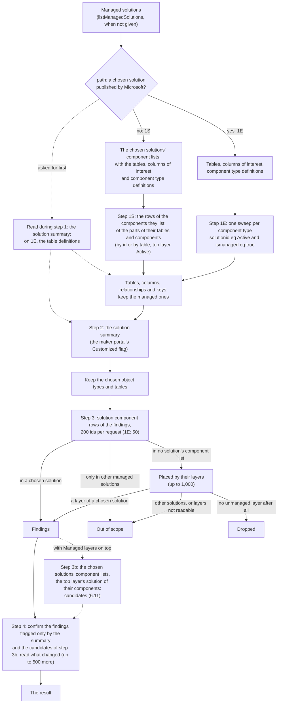

The progress line under the title says which step is running:

| Progress message | Progress | Step |
| --- | --- | --- |
| Reading the component lists of the chosen solutions (*n* of *N*)… | 2% | 1S: the chosen solutions' component lists, each counted as it answers ("(*n* of *N*)" with more than one solution) ([6.2](#62-step-1-from-the-chosen-solutions-or-the-whole-environment)) |
| Reading the tables and the component types… | 2% | The first reads ([6.2](#62-step-1-from-the-chosen-solutions-or-the-whole-environment)); on 1S, once the lists are in, while these reads are still out |
| Checking the components of the chosen solutions (*n* of *N*)… | 5% to 57% | Step 1S: the rows of the *N* components the lists name, of the object types chosen |
| Checking the parts of their components (*n* of *N*)… | 5% to 57% | Step 1S: the parts no list names (plug-in step images and types, field permissions, rule items, a custom control's files), through the *N* listed components they belong to |
| Checking the parts of their tables (*n* of *N*)… | 5% to 57% | Step 1S: the forms, views, charts and other parts of the *N* tables the lists name (with tables chosen, the chosen ones among them) |
| Reading the definitions of tables and columns (*n* of *N*)…, then Reading the definitions of relationships… | 5% to 57% on 1S, 50% to 57% on 1E | The definitions of tables, columns, keys and relationships ([6.3](#63-tables-columns-relationships-and-keys)): on 1S, those of the tables the lists name and of the columns and keys they list elsewhere, *N* requests; on 1E, when the sweeps found metadata rows, the step waits for every table's, read during the sweeps |
| Checking the columns, keys and relationships of their tables (*n* of *N*)… | 5% to 57% | Step 1S: the rows of the *N* tables, columns, keys and relationships listed or on the tables listed |
| Checking component types (*n* of *N*)… | 5% to 50% | Step 1E, the sweeps |
| Reading the solution summary (this can take a minute)… | 58% | Step 2, the solution summary, asked for first ([6.4](#64-step-2-the-solution-summary)) |
| Finding which solutions the components are in…, then the same with (*n* of *N*) | 62% to 64% | Step 3, membership ([6.6](#66-step-3-which-managed-solutions-hold-each-component)) |
| Checking the remaining components (*n* of *N*)… | 64% to 66% | Components placed by their layers ([6.7](#67-components-placed-by-their-layers)) |
| Checking managed layers on top: *what*… | 66% to 69% | Step 3b, with *Managed layers on top* ([6.11](#611-managed-layers-on-top)): *what* is the oldest part still reading: "component lists", a type in the plural ("web resources", with "(*n* of *m*)" past 50), "forms of tables held with all objects", "the definitions of tables, columns and keys" and so on |
| Reading what changed (*n* of *N*)… | 70% to 99% | Step 4, the details ([6.8](#68-step-4-confirming-and-reading-the-details)) |
| The result's status line | 100% | The end (`statusLine`, [6.9](#69-complete-or-incomplete)) |

On 1S the parts of step 1 run at the same time: the line names the first of them, in the order of the table, that is
still reading, with its count ("(*n* of *N*)" when *N* is more than 1), and the bar shows the share of the reads planned
so far that have answered, from 5 to 57%; it never goes back, also when the definitions add reads to the plan.

After the percentage, the line shows the time since the scan started, in minutes and seconds, counted every second to
the end of the scan: "58% · 0:12". It never starts again with a new step. A throttling pause, or a read of the step
waiting to be tried again, shows why instead, with its countdown in the time's place ([8.2](#82-views-and-rendering)).

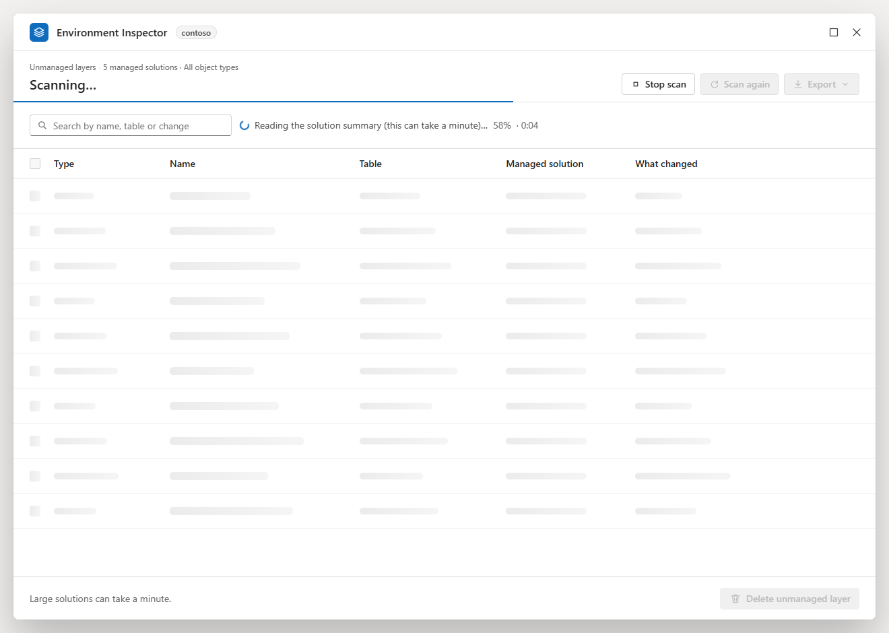

*A scan of five managed solutions during step 2: while it waits for the solution summary, `scan` has called
`progress('Reading the solution summary (this can take a minute)…', 58, summaryAt)`; after the percentage, the time since
the scan started (0:04). Placeholder rows of the final size keep the grid from jumping
when the results arrive. **Stop scan** calls `stopAllReads` ([5.5](#55-stop)).*

### 6.1 Inputs and the result object

`environment-inspector.js`, `scan`:

```js
// solutions: the managed solutions chosen ({ id, unique, name }); allSolutions: every managed solution (read when not given)
// objectTypes: object type groups to check (see GROUPS); empty or null: all of them.
// tables: logical names of the tables whose components are checked; empty or null: all (and components without a table).
// managed: also find the components of the chosen solutions with another managed solution's layer on top (step 3b).
// path: where step 1 looks for the components whose top layer is unmanaged: 'solutions', from the chosen solutions
//   (1S: what their component lists name, the parts of the tables they hold, the parts of the components they list);
//   'environment', every one in the environment (1E: one sweep per component type), of which step 3 keeps those in the
//   chosen solutions; 'auto' (CONFIG.scanPath, the default): from the chosen solutions, unless one of them is published
//   by Microsoft. Microsoft's solutions hold components that no component list names and that nothing they list leads
//   to (for example System's columns of tables that only other solutions hold, and its display strings): only their
//   layers place them, so only the whole environment finds them all. Both ways find the same components in the chosen
//   solutions; 1S costs what the chosen solutions hold, 1E what the environment holds.
async function scan(solutions, progress = () => {}, { details = true, allSolutions = null, objectTypes = null, tables: onlyTables = null, managed = false, path = CONFIG.scanPath } = {}) {
```

| Input | Meaning |
| --- | --- |
| `solutions` | The managed solutions chosen, as `{ id, unique, name }`. The window always passes at least one, as `listManagedSolutions` gives them. Their `publisher` chooses the way of step 1 (taken from `allSolutions` when a solution has none), and *Managed layers on top* reads it too ([6.11](#611-managed-layers-on-top)). |
| `progress(message, percent, since)` | Called at each step. The window shows the message and moves the progress bar. `since`, when given, is the time (`performance.now()`) the awaited work started, which the step line takes as the step's start: a read of the step that waits to be tried again is named 3 seconds after it ([8.2](#82-views-and-rendering)). |
| `details` | Whether the details of the findings (what each unmanaged layer changes) are read for up to 500 of them during the scan. Default `true`. The findings flagged only by the solution summary are read in any case ([6.8](#68-step-4-confirming-and-reading-the-details)). |
| `allSolutions` | Every managed solution of the environment, as `listManagedSolutions` returns them. Read when not given. |
| `objectTypes` | The object type groups chosen, such as `['Forms', 'Views']` (the names in `GROUPS`). Empty or `null`: all of them. |
| `tables` | The logical names of the tables chosen, such as `['contoso_project']`. Empty or `null`: every table, and the components that belong to no table. |
| `managed` | Whether to look for managed layers on top as well: step 3b and its confirmation in step 4 ([6.11](#611-managed-layers-on-top)). Default `false`. |
| `path` | The way of step 1 ([6.2](#62-step-1-from-the-chosen-solutions-or-the-whole-environment)): `'solutions'`, `'environment'`, or `'auto'` (any other value too), which goes from the chosen solutions unless one of them is Microsoft's. Default `CONFIG.scanPath`, `'auto'`. |

The window calls it from `runScan` ([5.5](#55-stop)) with the solutions, object types and tables of the choice
screen, the *Managed layers on top* switch, and the managed solution list it read when it opened (so `path` is
`CONFIG.scanPath`):

```js
try { result = await scan(sols, progress, { allSolutions, objectTypes: types, tables, managed }) }
```

Scripts on the page can call `scan`, `listManagedSolutions` and the tool's other functions too, through the
object it leaves on `window` ([4.6](#46-the-test-hooks-on-window__environmentinspector)).

`listManagedSolutions` reads every managed solution, the hidden ones included: Microsoft's base solutions (System and
others) are hidden, and many standard tables, forms and views belong only to them. `_parentsolutionid_value` names
the solution a patch belongs to (`parent`), so that *Managed layers on top* counts a patch as its solution
([6.11](#611-managed-layers-on-top)).

```text
solutions?$select=solutionid,uniquename,friendlyname,version,installedon,isvisible,_parentsolutionid_value&$filter=ismanaged eq true&$expand=publisherid($select=friendlyname,customizationprefix)
```

**The result.** `scan` returns one object. The **Full details (JSON)** export ([13.3](#133-full-details-json)) writes it out,
without `solutionNames` and `environment` (a short list of the components step 1 found: on 1E every one in the
environment, counted in `environmentFindings`; on 1S those of the chosen solutions).

| Field | Holds |
| --- | --- |
| `org`, `url` | The environment's name (the first part of its address, such as `contoso`) and its address. |
| `scannedOn`, `seconds`, `requests` | When the scan ran (UTC, ISO 8601), how long it took in seconds and how many requests it sent ([5.1](#51-one-function-for-every-request)). |
| `solutions`, `types`, `tables` | What was chosen: unique names of the solutions; object type groups (`null`: all); table logical names (`null`: all). |
| `path`, `pathWhy` | The way step 1 went: `'solutions'` or `'environment'`; `pathWhy` is `'microsoft'` when the rule went the whole environment's way because a chosen solution is Microsoft's, and is left out otherwise (a way forced by `path` or `CONFIG.scanPath` has none). |
| `findings` | The components with an unmanaged layer on top, in the chosen solutions, and with `managed`, the confirmed managed layers on top (`managedTop`); sorted by type and then by name. |
| `typesFailed` | The parts that could not be read. Not empty: the scan is INCOMPLETE ([6.9](#69-complete-or-incomplete)). |
| `noAccess` | Component types the user's security role cannot read, as `{ type, kind, privilege }`, with `quiet: true` for the image configurations refused with 0x80040256 (`QUIET_NO_ACCESS`). Shown as "Not checked", not as incomplete; the quiet ones are not shown, only kept in the JSON export. |
| `warnings` | Messages shown as a neutral banner above the grid. No step of this version adds one. |
| `notes` | Information only, such as the number of internal rows without a definition ([6.3](#63-tables-columns-relationships-and-keys)), and on 1S "Only the chosen solutions were read, so unmanaged layers in other solutions aren't counted (environmentFindings is null)." In the JSON export only. |
| `cleared` | Components that looked layered but whose layers show no unmanaged layer on top of a managed one, as "type name". Not listed. (Candidate managed layers on top that turn out not to be covered are counted in `managed.notOnTop` instead.) |
| `managed` | What *Managed layers on top* did: `{ checked, lower, skipped, candidates, notOnTop, notChecked, notDecided }` ([6.11](#611-managed-layers-on-top)). There in every result; without the option, `checked` is `false` and the rest empty or 0. |
| `outOfScope` | Components with an unmanaged layer that are in other managed solutions only (with those solutions in `inSolutions`, or their managed layers in `layers` for those placed by their layers), or that could not be placed (`error`, `notChecked`). Not listed; in the JSON export. On 1E every such component of the environment; on 1S only those step 1 met through the chosen solutions (a part of a table they hold without all objects, a part no list names). |
| `environmentFindings` | On 1E, how many components with an unmanaged layer were found in the environment, of the object types and tables chosen, in any solution: counted before the solutions were applied and before the summary-only ones were confirmed. On 1S `null`: other solutions were not read. |
| `typesChecked`, `typesWithoutColumns` | How many component types step 1 read (on 1E every type swept; on 1S the types read for what the chosen solutions hold), and the type numbers whose table is missing or has no `ismanaged` or `solutionid` column, so that they could not be read row by row and are left to the solution summary ([6.2](#62-step-1-from-the-chosen-solutions-or-the-whole-environment)). |
| `solutionNames` | A map from a solution's unique name to its display name, for the details. Not exported. |

**A finding.** Each entry of `findings` is one component, the object named `f` throughout the code. The scan fills
most of its fields, `readDetails` ([6.8](#68-step-4-confirming-and-reading-the-details)) the ones about its layers, and the window `deleted`; [4.5](#45-state-and-globals) lists every field and
the step that sets it. A managed layer on top has `managedTop`, `onTop` (the solution on top), `holderUniques` (every
solution of the covered families: a solution with its patches and pending upgrade), `listedIn` (the covered families
whose component lists have it) and, once confirmed, `topKinds` (the places where it is on top); [6.11](#611-managed-layers-on-top) explains them.

### 6.2 Step 1: from the chosen solutions or the whole environment

Step 1 finds the managed components whose top layer is unmanaged: in such a component's own row, `solutionid` names
the Active solution and `ismanaged` is true ([3.3](#33-managed-and-unmanaged-components)). It asks for those rows in
one of two ways, after the same first reads: from the chosen solutions (1S), or from the whole environment (1E).

**The first reads.** Three requests run together (`Promise.all`): the tables, the columns that matter for step 1,
and the component type definitions (used for the types that are not in the built-in list). With the environment's
address as base (`https://contoso.crm.dynamics.com/api/data/v9.2/`), they are:

```text
EntityDefinitions?$select=LogicalName,SchemaName,DisplayName,MetadataId,EntitySetName,PrimaryIdAttribute,PrimaryNameAttribute

EntityDefinitions?$select=LogicalName&$expand=Attributes($select=LogicalName;$filter=LogicalName eq 'ismanaged' or LogicalName eq 'solutionid' or LogicalName eq 'name' or LogicalName eq 'displayname' or LogicalName eq 'title' or LogicalName eq 'typename' or LogicalName eq 'sitemapname' or LogicalName eq 'sitemapnameunique' or LogicalName eq 'displaystringkey' or LogicalName eq 'category' or LogicalName eq 'type' or LogicalName eq 'querytype' or LogicalName eq 'uniquename' or LogicalName eq 'schemaname' or LogicalName eq 'connectionreferencelogicalname')

solutioncomponentdefinitions?$select=solutioncomponenttype,name,primaryentityname
```

The second one returns, for every table, only the columns in `WANTED_COLUMNS` that it has. Step 1 uses it to know
whether a table can be asked for its unmanaged rows (it needs `solutionid` and `ismanaged`) and which name columns it
has. These three reads, and the managed solution list when it is not given, are the only reads whose failure ends the
scan as a whole: without them, nothing else can be read. (On 1S, a chosen solution's component list that can't be
read does not end it: below.)

**Component types come from two places.**

| Source | Types | Gives |
| --- | --- | --- |
| `CLASSIC`, built in ([4.4](#44-constant-tables-classic-names-metadata-groups-and-others)) | 49 classic types, from 1 (table) to 432 (table image configuration). | For each: the table behind it, the name the layer table uses, and the label the maker portal shows. |
| `solutioncomponentdefinitions` | The newer ("solution component framework") types, such as connection references. | `name`: the layer name; `primaryentityname`: the table. The label is the table's display name in sentence case ("Connection Reference" becomes "Connection reference"). |

`environment-inspector.js`, `scan`:

```js
const types = new Map(Object.entries(CLASSIC).map(([k, v]) => [Number(k), { table: v[0], kind: v[1], label: v[2] }]))
const kindOf = new Map([...types.entries()].map(([k, v]) => [k, v.kind]))
// A newer number for a classic type's table names the same components (Dataverse also numbers duplicate detection
// rules 4414 and their conditions 4416, and component lists use either number): they are read and keyed under the
// classic number only (same: newer number -> classic number), as the comparison reads them (componentTypes).
const classicOf = new Map(Object.entries(CLASSIC).filter(([, v]) => v[0]).map(([k, v]) => [v[0], Number(k)])), same = new Map()
for (const d of defs) {
  const code = d.solutioncomponenttype
  if (!kindOf.has(code)) kindOf.set(code, d.name)
  if (types.has(code) || !d.primaryentityname) continue
  if (classicOf.has(d.primaryentityname)) { same.set(code, classicOf.get(d.primaryentityname)); continue }
  const t = tables.get(d.primaryentityname)
  types.set(code, { table: d.primaryentityname, kind: d.name, label: sentence((t && label(t.DisplayName)) || d.name) })
}
const codeOf = (n) => { const c = Math.round(Number(n)); return same.get(c) || c }   // a component type as a list or the summary gives it
```

Every type number gets a layer name in `kindOf`, also the newer types without a table. Only the types with a table
(`ty.table`) can be read row by row. `typeLabel` turns a type number, and for processes, forms and views their kind,
into the label the grid shows (`WORKFLOW_TYPE`, `FORM_TYPE`, `VIEW_TYPE`).

**One number for one table.** `solutioncomponentdefinitions` also defines newer numbers for a few classic types'
tables: in the test environment, 4414 for duplicate detection rules (`duplicaterule`, type 44) and 4416 for their
conditions (type 45), and the component lists name those components only by these numbers. Taken as types of their
own, they were swept twice, and a changed rule was listed twice: once as type 44, once as 4414. Now such a number is
not a type of its own: `same` maps it to the classic number, and `codeOf` reads every type number a component list,
the solution summary or a membership row gives ([6.4](#64-step-2-the-solution-summary), [6.6](#66-step-3-which-managed-solutions-hold-each-component))
through it. Each such table is read once, both ways, and its components are keyed `44|<id>` (or `45|<id>`) whichever
number names them. (A scan of the whole environment reads two types fewer in the test environment.)

**How a type's table is read.** Its entity set, its id column, the columns that name a component, and how a row
becomes a finding are worked out once per type by `recordSpec`, which both ways of step 1 and step 3b of *Managed
layers on top* use ([6.11](#611-managed-layers-on-top)):

`environment-inspector.js`, `scan`:

```js
// How a component type's own table is read: its entity set and key, the columns that name the component, its table
// and its kind, and a row made into a finding. null: no such table with solutionid and ismanaged (the solution
// summary covers the type). Used by the reads of step 1 and by the managed check (step 3b).
function recordSpec(code, ty) {
  const t = tables.get(ty.table), c = cols.get(ty.table)
  if (!t || !t.EntitySetName || !c || !c.has('solutionid') || !c.has('ismanaged')) return null
  const has = (col) => col && (c.has(col) || col === t.PrimaryNameAttribute)
  const [dCol0, sCol0] = NAMES[code] || [t.PrimaryNameAttribute, SCHEMA_GUESS.find((x) => c.has(x)) || null]
  const dCol = has(dCol0) ? dCol0 : t.PrimaryNameAttribute, sCol = has(sCol0) ? sCol0 : null
  const tCol = TABLE_COLUMN[code], subCol = has(SUBTYPE_COLUMN[code]) ? SUBTYPE_COLUMN[code] : null, pk = t.PrimaryIdAttribute
  return { set: t.EntitySetName, pk, tCol, sel: [...new Set([pk, dCol, sCol, tCol, subCol].filter(Boolean))].join(','), extra: TYPE_FILTER[code] ? ` and ${TYPE_FILTER[code]}` : '',
    make: (r) => {
      const id = lc(r[pk]), table = tCol && r[tCol] && r[tCol] !== 'none' ? r[tCol] : '', sub = subCol ? r[subCol] : null
      return { key: `${code}|${id}`, code, kind: ty.kind, id, display: (dCol && r[dCol]) || '', schema: (sCol && r[sCol]) || '', logical: (sCol && r[sCol]) || (dCol && r[dCol]) || '', table,
        type: code === 60 && !table && sub === 0 ? 'Dashboard' : typeLabel(code, sub) }
    } }
}
```

**Which way: `path`.** The way is chosen at the start of the scan, once the managed solutions are known and before
anything else is read, from the chosen solutions' publishers:

`environment-inspector.js`, `scan`:

```js
const managedById = new Map(allSolutions.map((s) => [s.id, s]))
// The path (see above), with the publisher test of step 3b.
const microsoft = solutions.some((s) => MICROSOFT.test(s.publisher || (managedById.get(s.id) || {}).publisher || ''))
const fromLists = path === 'solutions' || (path !== 'environment' && !microsoft)
const pathWhy = !fromLists && path !== 'environment' ? 'microsoft' : ''
```

* `'auto'` (`CONFIG.scanPath`, the default): from the chosen solutions (`fromLists`), unless a chosen solution's
  publisher matches `MICROSOFT` ([4.4](#44-constant-tables-classic-names-metadata-groups-and-others)), the same test
  *Managed layers on top* makes; then the whole environment, and the result says why (`pathWhy: 'microsoft'`).
* `'solutions'` and `'environment'` force a way, for tests ([16.2](#162-scan-checks)); the result then has no
  `pathWhy`.

**Why a Microsoft solution means the whole environment.** Both ways keep the same rows: those with the Active
solution on top and `ismanaged` true. They differ in which rows they read. 1E reads every such row of the environment,
so step 3 places every one, whatever holds it, through its solution component rows or its layers. 1S reads the rows
that the chosen solutions' lists lead to: what they list, the parts of the tables they list, the parts of the
components they list. For a solution of your own that is, as far as every test shows, every one of its components: in
the test environment both ways gave the same findings, field by field, for the test solution (five ways), for 52 other solutions alone (forced
through 1S) and for several solutions together. Microsoft's solutions hold components that no component list names and
that nothing they list leads to: System held 6 of its 40 findings so (hidden name columns of tables that only an
unmanaged solution, or none, lists, and two display strings). Only their layers place them, after 1E has found them.
So a choice with a Microsoft solution goes the whole environment's way, which is exact by definition; in the test
environment, that is every managed solution but the test solution (520 of 521). The two ways cost very differently
([6.10](#610-performance-and-scale)): for the test solution, 51 requests from its list against 330 from the whole
environment.

#### From the chosen solutions (1S): `fromSolutions`

**The component lists.** They are asked for at the start, right after the solution summary and before the first
reads, so they arrive while those are read. With *Managed layers on top* on, the lists of the chosen solutions'
patches and pending upgrades that step 3b reads are asked for too ([6.11](#611-managed-layers-on-top)). Each list is
read once per scan (`listOf` keeps the read):

`environment-inspector.js`, `scan`:

```js
const lists = new Map()
const listOf = (id) => { if (!lists.has(id)) { const p = getAll(`solutioncomponents?$select=objectid,componenttype,rootcomponentbehavior&$filter=_solutionid_value eq ${id}`); p.catch(() => {}); lists.set(id, p) } return lists.get(id) }
const plan = managed ? topPlan() : null   // the solutions of step 3b
if (fromLists) {
  const ids = [...new Set([...solutions.map((s) => s.id), ...(plan && plan.lower.length ? plan.reads.map((x) => x.id) : [])])]
  if (ids.length <= 8) ids.forEach(listOf)
  else for (const batch of chunks(ids, 50)) {
    const job = getAll(`solutioncomponents?$select=objectid,componenttype,rootcomponentbehavior,_solutionid_value&$filter=${inList('solutionid', batch)}`); job.catch(() => {})
    for (const id of batch) { const p = job.then((rows) => rows.filter((r) => lc(r._solutionid_value) === id)); p.catch(() => {}); lists.set(id, p) }
  }
}
```

Up to 8 lists, one request each; more, one request per 50 solutions (`inList` makes the
`Microsoft.Dynamics.CRM.In` filter, `chunks` the groups). The step line counts the chosen solutions' lists as they
answer, "Reading the component lists of the chosen solutions (2 of 5)…", then, when they are in before the first
reads, "Reading the tables and the component types…". A list that can't be read adds "The component list of *unique
name*: *error*" to `failed`; that solution counts as listing nothing, and the others go on.

**What the lists name.** `fromSolutions` gathers the chosen solutions' rows (only theirs, not the patches' that step
3b reads):

`environment-inspector.js`, `scan`, `fromSolutions`:

```js
// listed: every component a chosen list names; byCode: type -> those ids; heldAny: the tables they list
const listed = new Set(), byCode = new Map(), heldAny = new Set()
solutions.forEach((s, i) => {
  for (const r of listRows[i]) {
    const id = lc(r.objectid), code = codeOf(r.componenttype)
    if (!GUID.test(id)) continue
    listed.add(id)
    if (!byCode.has(code)) byCode.set(code, new Set())
    byCode.get(code).add(id)
    if (code === 1 && tableById.has(id)) heldAny.add(tableById.get(id))
  }
})
const held = [...heldAny].filter((t) => /^[a-z0-9_]+$/i.test(t) && (!tableSet || tableSet.has(lc(t))))   // with tables chosen, only those
const wanted = (code) => { const ty = types.get(code); return !!ty && !!ty.table && typeWanted(code, ty.kind, groups) && (!tableSet || TABLE_BOUND.has(code)) }
const keep = (f) => { if (!found.has(f.key)) found.set(f.key, f) }
const activeTop = `solutionid eq ${ACTIVE} and ismanaged eq true`
```

* `byCode`: the ids of each type the lists name, the type read through `codeOf`.
* `held`: the tables the lists name, whatever their `rootcomponentbehavior`: a part of a table held without all its
  objects can still be another solution's, or the solution's own with a row of its own, so step 3 decides. With tables
  chosen, only those among them.
* `wanted`: the types to read, as `typeWanted` and `TABLE_BOUND` decide for the sweep.
* `activeTop`: the sweep's condition. Every read below adds it (with the type's `TYPE_FILTER`), so a row kept here is a
  row the sweep would keep; `keep` makes it a finding with `recordSpec`'s `make`, as the sweep does.

**The reads.** Four parts run at the same time, each `CONFIG.concurrency` reads at a time:

| Part | What it reads | Request | Per request |
| --- | --- | --- | --- |
| The components the lists name | Each type with a record table: its listed components | `{entity set}?$select={columns}&$filter=Microsoft.Dynamics.CRM.In(PropertyName='{id}',PropertyValues=['{id 1}',…]) and solutionid eq {Active} and ismanaged eq true[ and {type filter}]` | 200 ids |
| The parts of their components | `PART_OF`: step images (through `sdkmessageprocessingstepid`), plug-in types (`pluginassemblyid`), field permissions (`fieldsecurityprofileid`), duplicate detection rule conditions and mobile offline profile items (`regardingobjectid`), SLA items (`slaid`), routing rule items (`routingruleid`), record creation rule items (`convertruleid`) | The same, with `In` on the part's column for its component | 200 components |
| | A listed custom control's files, named `cc_<control name>/…`: the controls' names, then their files | `customcontrols?$select=customcontrolid,name&$filter=Microsoft.Dynamics.CRM.In(PropertyName='customcontrolid',…)`, then `webresourceset?$select=webresourceid,displayname,name&$filter=solutionid eq {Active} and ismanaged eq true and (startswith(name,'cc_{name 1}/') or …)` | 200 controls; 15 names |
| The parts of their tables | `BY_TABLE`: forms (`objecttypecode`), views (`returnedtypecode`), charts and custom control default configurations (`primaryentitytypecode`), ribbons (`entity`), hierarchy rules (`primaryentitylogicalname`), table analytics, column image and table image configurations (`parententitylogicalname`) | `{entity set}?$select={columns}&$filter=solutionid eq {Active} and ismanaged eq true[ and {type filter}] and ({table column} eq '{table 1}' or …)` | 20 tables |
| | The table mappings of the tables held, whatever their top layer, and their column mappings | `entitymaps?$select={columns},sourceentityname,targetentityname,solutionid,ismanaged&$filter=sourceentityname eq '{table}' or targetentityname eq '{table}' or …`, then `attributemaps?$select={columns}&$filter=Microsoft.Dynamics.CRM.In(PropertyName='entitymapid',…) and solutionid eq {Active} and ismanaged eq true` | 20 tables; 200 table mappings |
| Tables, columns, keys and relationships | The definitions of the tables held, and of the columns and keys listed on other tables; then the rows of the tables held, of the columns and keys listed or on a table held, and of the relationships listed or with either table held ([6.3](#63-tables-columns-relationships-and-keys)) | `entities`, `attributes`, `entitykeys` by id, `relationships` by name, each `and solutionid eq {Active}` | 200 ids; 100 names |

A table mapping found with the Active solution on top becomes a finding as any other (its row carries `solutionid` and
`ismanaged`, read for that). These parts reach what has (almost) no row of its own in a component list
([3.7](#37-solution-components-and-with-all-objects)). With tables chosen only the types of `TABLE_BOUND` are wanted, so
of these routes only the forms, views, charts and ribbons of the chosen tables are read, and the relationships of any
table the lists name that touch a chosen table ([6.5](#65-object-types-and-tables)).

**When a part's component can't be read.** A part found only through its component needs that component's row: a
custom control's files need its name, and column mappings their table mapping. When the custom controls' names can't
be read (refused, or the read fails), every control file whose top layer is unmanaged is read instead,
`webresourceset?…&$filter=solutionid eq {Active} and ismanaged eq true and (startswith(name,'cc_'))`, as 1E reads it;
when the table mappings can't be read, every column mapping whose top layer is unmanaged,
`attributemaps?…&$filter=solutionid eq {Active} and ismanaged eq true`. Step 3 places them as it does on 1E, so none is
missed. The refused type is still named, as on 1E ("Custom control" or "Table mapping" under *Not checked*), and a
failed table mapping read is still "EntityMap: *error*" ("CustomControl: *error*" comes only from reading listed custom
controls by id). In the test environment no control file or column mapping had an unmanaged layer on top: those two
reads took 94 and 100 ms there.

**Errors.** Each read runs in `guard`: an expired session and Stop pass; a type the user's security role can't read
goes into `noAccess` once (`refused`, below); any other error adds "`{kind}`: `{message}`" to `failed`, once per type,
and the other reads go on. `guard` also counts the types read: `typesChecked` is their number on 1S, the types read
for what the chosen solutions hold. So on 1S *Not checked* names only the types it read; a type the chosen solutions
hold none of has nothing to check, where 1E names every type of the environment it can't read
([6.9](#69-complete-or-incomplete)).

**The step line and the bar.** Each part counts what its reads have answered: the components read, of those listed
("Checking the components of the chosen solutions (*n* of *N*)…"), the listed components whose parts are read
("Checking the parts of their components…"), the tables whose parts are read ("Checking the parts of their
tables…"), the requests for definitions ("Reading the definitions of tables and columns (*n* of *N*)…", then "…of
relationships…" while those are still out), and the rows of tables, columns, keys and relationships ("Checking the
columns, keys and relationships of their tables…"). The line names the first of these parts still reading
(`show`), and the bar moves from 5 to 57% with the share of the planned reads that have answered (`planned`,
`answered`); it never goes back, also when the definitions plan more reads.

`fromSolutions` returns the ids the chosen lists name (`listed`), for step 2 ([6.4](#64-step-2-the-solution-summary)).

#### From the whole environment (1E): one sweep per component type

For each type that has a table, of the object types and tables chosen, one query asks for the components whose top
layer is unmanaged, eight types at a time:

`environment-inspector.js`, `scan`:

```js
// 1E. One sweep per component type. The definitions of tables, columns, keys and relationships do not depend on
//     the sweeps, so they are read while those run, when a metadata type is checked (metaWanted).
const metaWanted = [1, 2, 10, 14].some((c) => types.has(c) && typeWanted(c, types.get(c).kind, groups) && (!tableSet || TABLE_BOUND.has(c)))
if (metaWanted) readMeta().catch(() => {})   // read where it is needed
let done = 0
const typeList = [...types.entries()].filter(([code, ty]) => ty.table && typeWanted(code, ty.kind, groups) && (!tableSet || TABLE_BOUND.has(code)))
typesChecked = typeList.length
await pool(typeList, CONFIG.concurrency, async ([code, ty]) => {
  try {
    if (METADATA[code]) {
      const [set, pk, nm] = METADATA[code]
      for (const r of await getAll(`${set}?$select=${pk},${nm}&$filter=solutionid eq ${ACTIVE}`)) metaRows.push({ code, id: lc(r[pk]), name: r[nm] })
    } else {
      const spec = recordSpec(code, ty)
      if (!spec) { noColumns.push(code); return }
      for (const r of await getAll(`${spec.set}?$select=${spec.sel}&$filter=solutionid eq ${ACTIVE} and ismanaged eq true${spec.extra}`)) { const f = spec.make(r); found.set(f.key, f) }
    }
  } catch (e) {
    if (e instanceof SessionError) throw e
    if (!refused(e, ty)) failed.push(`${ty.kind}: ${e.message}`)
  }
  progress(`Checking component types (${++done} of ${typeList.length})…`, 5 + 45 * done / typeList.length)
})
```

`refused` decides, for both ways, whether a failed read was a refusal of the user's security role:

`environment-inspector.js`, `scan`:

```js
// A type the user's security role cannot read: not an error, but said, once. The image configurations refused with
// Dataverse's own security error (see QUIET_NO_ACCESS) are skipped without a note. true: it was refused so.
const refused = (e, ty) => {
  const priv = e.status === 403 && /CheckPrivilege/i.test(e.message) && /prv\w+/.exec(e.message)
  if (priv && !noAccess.some((x) => x.kind === ty.kind)) noAccess.push({ type: ty.label, kind: ty.kind, privilege: priv[0], ...(QUIET_NO_ACCESS.has(ty.kind) && /^0x80040256$/i.test(e.code || '') ? { quiet: true } : {}) })
  return !!priv
}
```

Tables, columns, relationships and keys are swept differently, through `METADATA` ([6.3](#63-tables-columns-relationships-and-keys)).
For every other type the query is:

```text
{entity set}?$select={id},{display name},{schema name},{table},{kind}&$filter=solutionid eq fd140aae-4df4-11dd-bd17-0019b9312238 and ismanaged eq true[ and {type filter}]
```

For example, for web resources and for processes:

```text
webresourceset?$select=webresourceid,displayname,name&$filter=solutionid eq fd140aae-4df4-11dd-bd17-0019b9312238 and ismanaged eq true

workflows?$select=workflowid,name,uniquename,primaryentity,category&$filter=solutionid eq fd140aae-4df4-11dd-bd17-0019b9312238 and ismanaged eq true and type eq 1
```

`fd140aae-4df4-11dd-bd17-0019b9312238` is the Active solution (`ACTIVE`), the unmanaged layer, with the same id in
every environment.

**Why one query per type finds them.** A managed component keeps `ismanaged` true. When its top layer is unmanaged,
its `solutionid` names the Active solution instead of the managed solution it came from. The query therefore returns
exactly the managed components with an unmanaged layer on top, and nothing else: an unmanaged-only component has
`ismanaged` false. This was checked against a read of the layers of every component of a test environment, one by
one (83,000 components): the same 135 components, with no false positives. On a managed test solution with 17 layered
components of 13 types, the scan found all 17, both ways. 1S asks the same question with the ids, or the tables, that
the chosen lists give.

**The columns of each query** are chosen at run time from the columns the table has (`recordSpec`), both ways:

| Constant | For | Holds |
| --- | --- | --- |
| `NAMES` | Types whose names are not in the primary name column | `[display name column, schema or unique name column]`, such as `['displayname', 'name']` for web resources. Other types use the table's primary name. |
| `SCHEMA_GUESS` | Types not in `NAMES` (mostly the newer types) | The schema name column, the first of `uniquename`, `schemaname` and `connectionreferencelogicalname` that the table has. |
| `TABLE_COLUMN` | Forms, views, charts, processes, ribbons | The column that names the component's table, such as `objecttypecode` for forms. `none` means no table. |
| `SUBTYPE_COLUMN` | Processes, forms, views | The column that holds the kind (`category`, `type`, `querytype`), turned into a label by `WORKFLOW_TYPE`, `FORM_TYPE` and `VIEW_TYPE`. |
| `TYPE_FILTER` | Security roles, processes | An extra condition (below). |

`environment-inspector.js`, `TYPE_FILTER`:

```js
// Rows that are not components themselves: business-unit copies of roles, activation copies of classic processes.
const TYPE_FILTER = { 20: '_parentroleid_value eq null', 29: 'type eq 1' }
```

A security role exists once per business unit: the copies in child business units have a parent role and are not
components of their own. A classic process has a definition row (`type` 1) and, while it is activated, an activation
row (`type` 2). Without these conditions, one changed role or process would be listed several times.

**What can go wrong for a type, and what happens** (both ways).

| Situation | Result |
| --- | --- |
| The type's table is not in the table list, has no entity set, or has no `solutionid` or `ismanaged` column (`recordSpec` returns `null`) | The type is not read, and its number goes into `typesWithoutColumns`. It relies on the solution summary. |
| Answer 403 with `SecLib::CheckPrivilege` (the user's security role cannot read the table) | The type goes into `noAccess`, once, with the privilege named in the message, such as `prvReadAttribute` (`refused`). Shown as "Not checked", not as incomplete ([6.9](#69-complete-or-incomplete)); the image configurations refused with error 0x80040256 get `quiet: true` and are not shown (`QUIET_NO_ACCESS`). |
| Any other error | `failed` gets "`{kind}`: `{message}`" (on 1S once per type, whichever of its reads failed), and the scan is INCOMPLETE. |
| On 1S, a chosen solution's component list can't be read | `failed` gets "The component list of `{unique name}`: `{message}`"; the other solutions' components are read, and the scan is INCOMPLETE. |
| On 1S, the custom controls' names or the table mappings can't be read | Their parts are read the whole environment's way (above), so none is missed. The table mappings' refusal or error is named as on 1E; the custom controls are named only by their own read, by id. |
| An expired session, or Stop | Passed on: the scan ends ([5.1](#51-one-function-for-every-request)). |

Types that are never read row by row: choices (global option sets, type 9, which have no table of their own) and newer
types without a primary table. They are covered by the solution summary.

### 6.3 Tables, columns, relationships and keys

Tables, columns, relationships and keys have component tables of their own, but those tables have no `ismanaged`
column, so step 1 cannot tell a managed column from an unmanaged one by its row. It reads the rows whose top layer is
unmanaged, and the definitions (the metadata) say which are managed.

`environment-inspector.js`, `METADATA`:

```js
// Tables, columns, relationships and keys have their own component tables without an ismanaged column.
// Relationships carry their own ids there, so they are matched to their definitions by schema name.
const METADATA = { 1: ['entities', 'entityid', 'logicalname'], 2: ['attributes', 'attributeid', 'logicalname'], 10: ['relationships', 'relationshipid', 'name'], 14: ['entitykeys', 'entitykeyid', 'logicalname'] }
```

| Type | Swept with (1E) | Read on 1S (`In`, 200 ids or 100 names per request) | Matched to its definition by |
| --- | --- | --- | --- |
| Table (1) | `entities?$select=entityid,logicalname&$filter=solutionid eq fd140aae-4df4-11dd-bd17-0019b9312238` | The tables the lists name: `entities?$select=entityid,logicalname&$filter=Microsoft.Dynamics.CRM.In(PropertyName='entityid',PropertyValues=[…]) and solutionid eq fd140aae-…` | Id: `entityid` is the table's metadata id. |
| Column (2) | `attributes?$select=attributeid,logicalname&$filter=solutionid eq fd140aae-…` | The columns the lists name and those of the tables they name, by `attributeid` | Id: `attributeid` is the column's metadata id. |
| Relationship (10) | `relationships?$select=relationshipid,name&$filter=solutionid eq fd140aae-…` | The relationships the lists name and those with either table among the tables they name (with tables chosen, those that touch a chosen table), by `name` | Schema name: `relationshipid` is an id of its own. |
| Key (14) | `entitykeys?$select=entitykeyid,logicalname&$filter=solutionid eq fd140aae-…` | As columns, by `entitykeyid` | Id: `entitykeyid` is the key's metadata id. |

**The definitions.** They are kept in one object for the whole scan, `meta` (`managed`, `tableOf`, `names`, `parts`,
`relByName`, `relById`, `relTables`), and each table is read once (`tableJobs`), however many steps ask for it:

* `tableDefs(logicals)`: the definitions of these tables, with their columns and keys, 100 tables per request, four
  requests at a time (`pool`; in a test about twice as fast as two). It keeps each table's columns and keys (`parts`),
  their managed flag (`managed`), table (`tableOf`) and names (`names`).
* `idDefs(ids)`: on 1S, the columns and keys a list names on a table whose definition was not read, 50 per request,
  four at a time. The `attributes` table has no column for its table, so they are found inside the tables'
  definitions, with a `$filter` in the `$expand`.
* `relDefs()`: the relationship definitions, whole, in three requests, once per scan (`relByName`, `relById`,
  `relTables`).
* `readMeta()`: on 1E, every table's definitions (with tables chosen, only the chosen tables'), then the
  relationships'. The scan starts it right after the first reads, before the sweeps, when tables, columns, relationships
  or keys are among the object types checked (`metaWanted`): it then runs during the sweeps, and the matching below
  and step 3b of *Managed layers on top* ([6.11](#611-managed-layers-on-top)), which needs them only for those types,
  get the same answer (`metaPromise`). When the sweeps find no such row and step 3b needs none, the definitions were
  read for nothing (13 requests in the test environment, while the sweeps ran); that is rare. Before, the scan read
  them after the sweeps and waited 7 to 8 seconds for them. While the matching waits for them, the progress line says
  how many of the requests for 100 tables have been answered, "Reading the definitions of tables and columns (4 of
  10)…", then "Reading the definitions of relationships…" (`metaMsg`; the step starts at the first request,
  `metaAt`); the bar moves from 50 to 57% (`metaPct`).
* On 1S, `fromSolutions` reads the definitions of the tables the lists name (`tableDefs(held)`), then those of the
  columns and keys they list elsewhere (`idDefs`), and the relationship definitions when relationships are wanted and
  the lists name a relationship or a table. The step line counts these requests ("Reading the definitions of tables and
  columns (*n* of *N*)…", then "…of relationships…" while those are still out). Step 3b on 1S asks for what it needs on
  top (`metaFor`, [6.11](#611-managed-layers-on-top)).

One request for 100 tables, and one for columns and keys by id, look like this:

```text
EntityDefinitions?$select=LogicalName,MetadataId,IsManaged&$filter=LogicalName eq 'account' or LogicalName eq 'contact' or … or LogicalName eq 'contoso_project'&$expand=Attributes($select=MetadataId,IsManaged,SchemaName,DisplayName),Keys($select=MetadataId,IsManaged,SchemaName,DisplayName)

EntityDefinitions?$select=LogicalName&$expand=Attributes($select=MetadataId,IsManaged,SchemaName,DisplayName;$filter=MetadataId eq {id 1} or … or MetadataId eq {id 50}),Keys($select=MetadataId,IsManaged,SchemaName,DisplayName;$filter=MetadataId eq {id 1} or …)
```

The relationship definitions are read whole, in three requests:

```text
RelationshipDefinitions?$select=MetadataId,SchemaName,IsManaged
RelationshipDefinitions/Microsoft.Dynamics.CRM.OneToManyRelationshipMetadata?$select=MetadataId,ReferencedEntity,ReferencingEntity
RelationshipDefinitions/Microsoft.Dynamics.CRM.ManyToManyRelationshipMetadata?$select=MetadataId,Entity1LogicalName,Entity2LogicalName
```

On 1S, the rows are then read by id and by name, as the table above shows: the tables the lists name, the columns and
keys they list and those of the tables they name (`parts`), and the relationships they list or that have either table
among the tables they name, by their schema names. "Checking the columns, keys and relationships of their tables (*n*
of *N*)…" counts them.

**Matching.** `keepManaged` runs when step 1 found at least one such row: on 1E after the sweeps (waiting for
`readMeta`), on 1S after its rows. Each row is matched to its definition, and only the managed ones are kept:

`environment-inspector.js`, `scan`, `keepManaged`:

```js
function keepManaged(rows) {
  const internal = [], unknown = []
  for (const m of rows) {
    let id = m.id, isManaged = meta.managed.get(id), extra = {}
    // A relationship's own settings (cascading) are layered on its "Relationship" component, whose id is the
    // relationships-table id; its definition ("EntityRelationship") uses the metadata id. Both are checked.
    if (m.code === 10) { const r = meta.relByName.get(lc(m.name)); if (r) { id = lc(r.MetadataId); isManaged = r.IsManaged; extra = { alt: [{ id: m.id, kind: 'Relationship' }], tables: meta.relTables.get(id) || [], schemaName: r.SchemaName } } }
    if (isManaged === undefined) {   // no definition found
      if (tableSet && m.code !== 10) continue   // a table that was not chosen (only the chosen tables were read)
      // Known internal rows: hidden "...dsc" columns, and the two internal halves ("One"/"Two") of a many-to-many relationship.
      const half = m.code === 10 && /(One|Two)$/.test(m.name) && meta.relByName.has(lc(m.name.replace(/(One|Two)$/, '')))
      ;(m.code === 2 && /dsc$/i.test(m.name) || half ? internal : unknown).push(`${types.get(m.code).label} ${m.name}`)
      continue
    }
    if (isManaged !== true) continue   // unmanaged-only components are not layers on managed solutions
    const nm = meta.names.get(id) || {}
    const table = m.code === 1 ? '' : m.code === 10 ? (extra.tables || [])[0] || '' : meta.tableOf.get(id) || ''
    found.set(`${m.code}|${id}`, { key: `${m.code}|${id}`, code: m.code, kind: types.get(m.code).kind, type: types.get(m.code).label, id,
      display: nm.display || '', schema: extra.schemaName || nm.schema || m.name, logical: m.name, table, ...extra })
  }
  if (internal.length) notes.push(`${internal.length} internal rows (hidden ...dsc columns, internal halves of many-to-many relationships) have no definition and are not listed.`)
  if (unknown.length) failed.push(`${unknown.length} table, column, relationship or key rows with an unmanaged top layer have no matching definition: ${unknown.slice(0, 20).join(', ')}${unknown.length > 20 ? ', ...' : ''}`)
}
```

On 1S the rows read are those of the definitions read, or of components a list names, so the internal rows, which
have no definition and which no list names, are never read: the note on them comes from 1E only.

| The row's definition | What happens |
| --- | --- |
| Found, `IsManaged` true | A finding. A column or key gets its table; a relationship gets its first table (the referencing table of a one-to-many relationship, the first table of a many-to-many one) and both in `tables`. |
| Found, `IsManaged` false | Not listed: an unmanaged-only component is not a layer on a managed solution. |
| Not found, with tables chosen (not a relationship) | Skipped: the row belongs to a table that was not chosen, whose definitions were not read. |
| Not found: a hidden "...dsc" column, or the internal "One" or "Two" half of a many-to-many relationship | An internal row. Counted in `notes`, not listed. In a large test environment there were 344 of them (332 columns such as `owneriddsc`, 12 halves). |
| Not found, anything else | Counted, and the first 20 named, in `failed`: the scan is INCOMPLETE. |
| The step fails | `failed` gets "Tables, columns and relationships: `{message}`". |

**A relationship has two places.** Its definition and its own settings are layered separately, under different names
and ids:

| Place | Layer name | Id | Holds |
| --- | --- | --- | --- |
| The definition | `EntityRelationship` | The metadata id (from `RelationshipDefinitions`) | The relationship's definition. |
| The settings | `Relationship` | The `relationships` table's own id (`relationshipid`) | Its own settings, such as cascading: what happens to related records when a record is deleted, assigned or shared. |

The finding uses the metadata id as `id` and `EntityRelationship` as `kind`, and keeps the second place in `alt`:
`[{ id: relationshipid, kind: 'Relationship' }]`. `places(f)` returns both. Reading the layers, deleting and the links
all look at both places. Reading a relationship's layers the way Solution Layers Explorer does returns nothing; reading
both places by their layer names finds them.

### 6.4 Step 2: the solution summary

Some types cannot be read row by row: choices (global option sets), newer types without a table, and types whose
table has no `solutionid` or `ismanaged` column. For those, the scan reads the maker portal's "Customized" flag, from
the virtual table `msdyn_solutioncomponentsummaries` ([3.6](#36-the-solution-component-summary)): on 1E for the Default
solution, which holds every component; on 1S for each chosen solution, or, with more than 20 chosen, for the Default
solution, of which it keeps the components the chosen lists name:

`environment-inspector.js`, `scan`:

```js
// The solution summary (step 2) depends on nothing the scan reads, so it is asked for first, and Dataverse prepares it
// while the rest runs (its request takes one of the CONFIG.concurrency places); step 2 waits for it, and the progress
// line says so. 1E reads the Default solution's (every customized managed component of the environment); 1S each
// chosen solution's own, 4 at a time (it lists only the components its component list names), or with more than 20
// chosen the Default solution's, kept in step 2 for the components their lists name.
const summaryAt = performance.now()
const summaryOf = (id) => getAll(`msdyn_solutioncomponentsummaries?$filter=(msdyn_solutionid eq ${id}) and (msdyn_hasactivecustomization eq 'true') and (msdyn_ismanaged eq 'true')&$select=msdyn_componenttype,msdyn_componenttypename,msdyn_objectid,msdyn_name,msdyn_displayname,msdyn_primaryentityname`)
const summaryJob = !fromLists || solutions.length > 20 ? summaryOf(DEFAULT)
  : (async () => { const each = []; await pool(solutions.map((s, i) => [s.id, i]), 4, async ([id, i]) => { each[i] = await summaryOf(id) }); return each.flat() })()
summaryJob.catch(() => {})   // read in step 2 (a scan stopped or failed before then leaves it unread)
// ...
// 2. The maker portal's "Customized" flag, for the types the reads cannot read (global option sets and others).
progress('Reading the solution summary (this can take a minute)…', 58, summaryAt)
try {
  const summaryAll = await summaryJob
  // (1S with more than 20 chosen: the Default solution's, of which the chosen ones' part)
  const summaryRows = chosenLists && solutions.length > 20 ? summaryAll.filter((s) => chosenLists.listed.has(lc(s.msdyn_objectid))) : summaryAll
  for (const s of summaryRows) {
    const code = codeOf(s.msdyn_componenttype), id = lc(s.msdyn_objectid), key = `${code}|${id}`
    if (found.has(key)) continue
    const table = s.msdyn_primaryentityname && s.msdyn_primaryentityname !== 'none' ? s.msdyn_primaryentityname : ''
    found.set(key, { key, code, kind: kindOf.get(code) || s.msdyn_componenttypename, kindGuessed: !kindOf.has(code), type: typeLabel(code, null), id,
      display: s.msdyn_displayname || '', schema: s.msdyn_name || '', logical: s.msdyn_name, table, fromSummary: true })
  }
  // ...
  const summaryKinds = new Set([1, 26, 29, 60, 61, 80, 62, 20])   // (1E) types the summary flags whenever they are customized
  let broken = false
  if (!summaryRows.length) {
    if (!chosenLists) broken = [...found.values()].some((f) => summaryKinds.has(f.code))
    if (!broken && (!chosenLists || (chosenLists.listed.size && !summaryAll.length))) {
      const probe = await read(`msdyn_solutioncomponentsummaries?$filter=(msdyn_solutionid eq ${DEFAULT}) and (msdyn_componenttype eq 1)&$select=msdyn_objectid&$top=1`)
      broken = !(probe && Array.isArray(probe.value) && probe.value.length)
    }
  }
  if (broken) failed.push('Solution summary: it returned nothing although it should list the customized components, so global option sets and other types without a table were not checked')
```

The Default solution's query, and the same with a chosen solution's id on 1S:

```text
msdyn_solutioncomponentsummaries?$filter=(msdyn_solutionid eq fd140aaf-4df4-11dd-bd17-0019b9312238) and (msdyn_hasactivecustomization eq 'true') and (msdyn_ismanaged eq 'true')&$select=msdyn_componenttype,msdyn_componenttypename,msdyn_objectid,msdyn_name,msdyn_displayname,msdyn_primaryentityname
```

* `fd140aaf-4df4-11dd-bd17-0019b9312238` is the Default solution (`DEFAULT`).
* The two flags are compared as text, `eq 'true'`: `msdyn_hasactivecustomization` filters only that way, and
  `msdyn_hasactivecustomization eq true` returns error `0x80060888`.
* A row step 1 already found is skipped. Every other row becomes a finding with `fromSummary: true`. Its type number
  is read through `codeOf` ([6.2](#62-step-1-from-the-chosen-solutions-or-the-whole-environment)); its layer name comes
  from `kindOf`; when the type number is unknown, the summary's type name is used instead (`kindGuessed`), and the
  type is shown as "Type *number*".
* A chosen solution's own summary lists the same rows as the Default solution's for the components its list names
  (checked on 7 solutions in the test environment), so both ways get the same findings from it. With more than 20
  chosen, one query of the Default solution's summary is cheaper than one per solution; `chosenLists.listed` (the ids
  the chosen lists name, from step 1) keeps their part.

**Asked for at the start.** The summary does not depend on step 1, and Dataverse can take a while to compute it
(2.5 to 10 seconds in the test environment, more in a very large one; the first one of a session took up to 12 seconds),
so the scan asks for it first, before the first reads, and Dataverse computes it while they and step 1 run. Step 2 then
usually finds it ready; when it does not, the progress line says so, the step starting when the summary was asked for
(`summaryAt`). A failure is caught at once (`summaryJob.catch`), so that it is never an unhandled rejection, and comes
back in step 2, where `await summaryJob` throws it again.

**An empty summary.** The summary is a virtual table and might return nothing in an environment where it does not
work. An empty answer is therefore checked, each way as its summary allows:

* **1E**, the Default solution's summary: if step 1 found a component of a type the summary always flags when it is
  customized (tables, views, processes, forms, web resources, apps, site maps, security roles), the empty summary is
  wrong. If it found none, one more request asks the summary for a single table of the Default solution, which always
  has tables; no answer means the summary does not work.
* **1S**: a chosen solution's summary can rightly be empty while some of its components have an unmanaged layer. It
  lists only root components, so not a table's views or forms; it does not count a component whose unmanaged layer
  changes only system values; and some solutions' summaries list nothing at all (113 of the 415 managed solutions with
  components in the test environment). So what step 1 found decides nothing, and only that same request for a table of
  the Default solution does. It is not sent when the chosen lists name nothing, nor when more than 20 solutions are
  chosen and the Default solution's summary had rows.

```text
msdyn_solutioncomponentsummaries?$filter=(msdyn_solutionid eq fd140aaf-4df4-11dd-bd17-0019b9312238) and (msdyn_componenttype eq 1)&$select=msdyn_objectid&$top=1
```

Either way, `failed` gets "Solution summary: it returned nothing although it should list the customized components,
so global option sets and other types without a table were not checked", and the scan is INCOMPLETE. In the test
environment that request took 0.4 to 0.6 seconds.

**Forms and processes found only by the summary.** The summary does not say which kind of form or process a component
is, and the kind decides its type label and its object type group (a business rule and a cloud flow are both
processes). Each one's kind is read, eight at a time (`pool`, `CONFIG.concurrency`):

```text
systemforms({id})?$select=type,objecttypecode
workflows({id})?$select=category,primaryentity
```

The answer gives the kind, and the table when the summary named none; `typeLabel` then gives the label (*Main form*,
*Cloud flow*). A form or process on a table that was not chosen is skipped. A failed read leaves the component with the
label of its type number (*Form*, *Process*); only an expired session or Stop end the scan.

**What the summary cannot do.**

* It cannot be narrowed to the chosen tables: a filter on `msdyn_primaryentityname` is ignored (the same rows come
  back). Rows on other tables are dropped afterwards ([6.5](#65-object-types-and-tables)).
* It flags a table when only one of its parts, such as a form, is customized. A table flagged only by the summary
  might have no unmanaged layer of its own, so step 4 reads its layers before it is listed
  ([6.8](#68-step-4-confirming-and-reading-the-details)).
* It does not cover the types the user's security role cannot read: a summary filter on their type numbers returns
  HTTP 400.

**When it fails.** `failed` gets "Solution summary (global option sets and types without a table): `{message}`". The
summary is one of the slowest queries of the scan (2.5 to 10 seconds in a large test environment); when Dataverse answers
500 or 504 it is tried once more, and when no full answer comes within 5 minutes it is not
([5.4](#54-retries-throttling-and-the-read-time-limit)).

### 6.5 Object types and tables

The choice screen can narrow a scan in two ways: to some **object types** (as the maker portal groups them in a
solution's Objects list) and to some **tables**. Both make the scan faster, because fewer component types are read,
either way.

`environment-inspector.js`, `groupOf` and `typeWanted`:

```js
const isConnRef = (kind) => /^connectionreference$/i.test(kind || '')
function groupOf(f) {
  if (f.code === 60) return /dashboard/i.test(f.type) ? 'Dashboards' : 'Forms'
  if (f.code === 29) return f.type === 'Business rule' ? 'Business rules' : f.type === 'Cloud flow' ? 'Cloud flows' : 'Other processes'
  if (isConnRef(f.kind)) return 'Connection references'
  return CODE_GROUP[f.code] || 'Other'
}
// Whether a component type has to be read for the chosen groups (null: all groups).
function typeWanted(code, kind, groups) {
  if (!groups) return true
  if (code === 60) return groups.has('Forms') || groups.has('Dashboards')
  if (code === 29) return groups.has('Business rules') || groups.has('Cloud flows') || groups.has('Other processes')
  if (isConnRef(kind)) return groups.has('Connection references')
  return groups.has(CODE_GROUP[code] || 'Other')
}
```

* `typeWanted` decides, before step 1, which component types are read. Forms and processes are read when any of
  their groups is chosen (*Forms* or *Dashboards*; *Business rules*, *Cloud flows* or *Other processes*), because the
  kind is only known row by row.
* `groupOf` decides, after step 2, which group each finding belongs to, from its kind: an interactive dashboard is in
  *Dashboards*, a cloud flow in *Cloud flows*. A connection reference is recognized by its layer name, because it is a
  newer type whose number is not built in.

**Tables.** With tables chosen, only the types that can belong to a table are read, and only the components of the
chosen tables are kept:

`environment-inspector.js`, `TABLE_PARTS` and `TABLE_BOUND`:

```js
// Parts of a table: in a solution that holds the table "with all objects", these belong to it without rows of their own.
const TABLE_PARTS = new Set([2, 10, 14, 26, 59, 60])
// Types that belong to a table: tables, columns, relationships, keys, views, processes, ribbons, charts, forms.
const TABLE_BOUND = new Set([1, 2, 10, 14, 26, 29, 50, 59, 60])
```

`environment-inspector.js`, `scan`:

```js
const inTables = (f) => TABLE_BOUND.has(f.code) && (f.code === 1 ? tableSet.has(lc(f.logical)) : [f.table, ...(f.tables || [])].some((t) => t && tableSet.has(lc(t))))
```

A table is kept when it is one of the chosen tables; any other table-bound component when its table, or for a
relationship either of its tables, is one of them. The components that belong to no table (choices, web resources,
security roles, apps and others) are left out entirely; the choice screen says so before anything is chosen.

After step 2, the findings outside the choice are dropped:

`environment-inspector.js`, `scan`:

```js
// Only the chosen object types.
if (groups) for (const [k, f] of found) if (!groups.has(groupOf(f))) found.delete(k)
// Only the components of the chosen tables.
if (tableSet) for (const [k, f] of found) if (!inTables(f)) found.delete(k)
```

| Stage | Object types chosen | Tables chosen |
| --- | --- | --- |
| Step 1E, the sweeps | Only the types `typeWanted` accepts. | Only the types in `TABLE_BOUND`. |
| Step 1S, the chosen solutions' reads | Only the types `typeWanted` accepts (`wanted`), of those the lists name or lead to. | Only the types in `TABLE_BOUND`: the components the lists name of those types, the forms, views, charts and ribbons of the chosen tables among those the lists name, and the relationships of any table they name that touch a chosen table. |
| Matching tables, columns and keys | No change. | Only the chosen tables' definitions are read (on 1S, of those the lists name, and the columns and keys they list elsewhere). |
| Step 2, the summary | Read whole (it cannot be narrowed). | Read whole; the kind of a form or process is read only when it is on a chosen table or the summary names no table for it. |
| After step 2 | Findings of other groups are dropped. | Findings of other tables are dropped. |
| Step 3 onwards | Only the findings left are placed and read. | The same. |
| Step 3b, with *Managed layers on top* ([6.11](#611-managed-layers-on-top)) | Only the types `typeWanted` accepts are read (and not those the user's role cannot read); a candidate of another group is not kept. | Only the types in `TABLE_BOUND` are read: the forms, views, charts, columns and keys of the chosen tables among those held with all objects, and only the relationships that touch a chosen table; a candidate on another table is not kept. |

In a test, one table of a small managed solution was scanned in 1.3 to 3.1 seconds with 29 requests from the
solution's list, against 1.6 to 2.7 seconds and 51 requests with every table; from the whole environment, in about 3
seconds with 32 requests, against 5 to 9 seconds and 330 requests ([6.10](#610-performance-and-scale)).

### 6.6 Step 3: which managed solutions hold each component

The findings so far are, on 1E, every layered component of the environment, of the types and tables chosen; on 1S,
those the chosen solutions' lists lead to, among them parts that other solutions may hold (a part of a table a chosen
solution holds without all its objects, a part no list names). Step 3 keeps those in the chosen managed solutions. It
does not use the chosen solutions' component lists, even on 1S, which has read them: a finding's `listedIn` names every
managed solution whose list has it, and a table held with all objects by any managed solution counts, so that a
component only in other solutions is out of scope, and one in no list is placed by its layers, exactly as on 1E. It
reads the solution component rows of the findings themselves, by id, in requests like this one:

```text
solutioncomponents?$select=objectid,componenttype,rootcomponentbehavior,_solutionid_value&$filter=Microsoft.Dynamics.CRM.In(PropertyName='objectid',PropertyValues=['{id 1}','{id 2}',…,'{id 200}'])
```

* The ids are those of the findings, the second place of each relationship (`alt`), and the tables that the parts
  are on (`tablesOf`, below). Only GUIDs go into the address.
* On 1S, 200 ids per request, as the comparison of environments reads them (an address of about 8,000 characters);
  on 1E, fifty (about 2,500 characters). Eight requests run at a time (`pool`); a component's rows all come in the
  answer for its own request, so the order the answers arrive in changes nothing.
* Rows in solutions that are not managed (the Default solution, the Active solution and every unmanaged solution) are
  ignored. The others are kept in `rowsOf`, by component id, as `{ sol, type, behavior }`, the type read through
  `codeOf` ([6.2](#62-step-1-from-the-chosen-solutions-or-the-whole-environment)).
* Reading by id gives the same membership as reading each solution's whole component list. This was cross-checked on
  seven solutions, System included.

**Parts of a table held "with all objects".** A solution can hold a table with all its parts, without a row for each
part. `rootcomponentbehavior` on the table's row says how it is held, and only 0, *Include subcomponents*, brings the
table's parts with it ([3.7](#37-solution-components-and-with-all-objects) has the three values).

`environment-inspector.js`, `scan`:

```js
const solsOf = (f) => {
  const s = new Set()
  for (const id of [f.id, ...(f.alt ? [f.alt[0].id] : [])]) for (const r of rowsOf.get(id) || []) s.add(r.sol)
  f.listedIn = [...s]   // solutions whose component list has it (the maker portal opens it in those)
  // A table held "with all objects" brings its columns, forms, views, charts, keys and relationships.
  for (const t of tablesOf(f)) for (const r of rowsOf.get(tableId.get(t)) || []) if (r.type === 1 && r.behavior === 0) s.add(r.sol)
  return [...s]
}
// ...
for (const f of found.values()) {
  f.tableLabel = f.table ? tableLabel(f.table) : ''
  f.tableId = f.code === 1 ? f.id : tableId.get(f.table) || ''   // for the maker portal link
  const all = solsOf(f), chosen = all.filter((x) => chosenIds.has(x))
  if (chosen.length) { f.solutions = names(chosen); f.solutionIds = sortIds(chosen); f.linkSolution = sortIds(chosen.filter((x) => f.listedIn.includes(x)))[0] || f.solutionIds[0]; inScope.push(f) }
  else if (all.length) oos(f, { inSolutions: names(all) })
  else noRow.push(f)
}
```

* `tablesOf` gives the tables of a part: columns, relationships (both tables), keys, views, charts and forms
  (`TABLE_PARTS`). Business rules and other processes, ribbons and the tables themselves need a row of their own.
* `solsOf` gives every managed solution that holds the component: those with a row for it (`listedIn`), and those
  that hold one of its tables with `componenttype` 1 and `rootcomponentbehavior` 0.
* `linkSolution` is the chosen solution its links open in: the first by name among the chosen solutions that list it,
  otherwise the first chosen solution that holds its table ([7.2](#72-which-solution-goes-in-the-address)).

| The component is held by | Result |
| --- | --- |
| At least one chosen solution | A finding, with `solutions` (the names, for the grid), `solutionIds` and `linkSolution`. |
| Only managed solutions that were not chosen | `outOfScope`, with `inSolutions`. Not listed. |
| No managed solution's component list | `noRow`: placed by its layers ([6.7](#67-components-placed-by-their-layers)). |

When this step fails, `failed` gets "Solutions of the components: `{message}`". The components whose rows were not read
then go to `noRow`, and their layers place them.

### 6.7 Components placed by their layers

A few parts of standard tables are in a managed solution without a row of their own in any component list. In a large
test environment there were 12 with an unmanaged layer, found from the whole environment: hidden name columns such as
`RegardingObjectIdYomiName`, two display strings and a view, all in System. Parts of some types have no row of their own
as a rule: plug-in step images, plug-in types, field permissions, table and column mappings, custom control files
([3.7](#37-solution-components-and-with-all-objects)). For all of these, the managed layers say which solutions they
are in: a layer's `msdyn_solutionname` is the unique name of its solution.

On 1S, the components in no list are the parts step 1 reached through a component or a table the chosen solutions
list: a step image of a listed step, a listed control's file, a column mapping of a table they list, a column of a
table they hold without its subcomponents and with no row of its own. They are placed here the same way: one whose
layers name only other solutions is out of scope, as on 1E.

`environment-inspector.js`, `scan`:

```js
const toCheck = noRow.slice(0, CONFIG.layerCheckLimit), notPlaced = []
const someOf = (list) => list.slice(0, 20).map((f) => `${f.type} ${f.schema || f.display || f.id}`).join(', ') + (list.length > 20 ? ', ...' : '')
if (noRow.length > toCheck.length) failed.push(`Solutions of ${noRow.length - toCheck.length} components with an unmanaged layer that are in no solution's component list: there are more than ${CONFIG.layerCheckLimit.toLocaleString()}, so they were not checked: ${someOf(noRow.slice(CONFIG.layerCheckLimit))}`)
let checked = 0
await pool(toCheck, CONFIG.detailConcurrency, async (f) => {
  try {
    const managedUnique = await readDetails(f, allNames)
    const chosen = allSolutions.filter((s) => chosenIds.has(s.id) && managedUnique.includes(s.unique)).map((s) => s.id)
    if (chosen.length) { f.solutions = names(chosen); f.solutionIds = sortIds(chosen); f.placedByLayers = true; inScope.push(f) }
    else if (f.noLayer) { /* no unmanaged layer after all */ }
    else if (/could not be read/.test(f.changed || '')) { notPlaced.push(f); oos(f, { error: f.changed }) }
    else oos(f, { layers: f.layers })
  } catch (e) { if (e instanceof SessionError) throw e; notPlaced.push(f); oos(f, { error: e.message }) }
  progress(`Checking the remaining components (${++checked} of ${toCheck.length})…`, 64 + 2 * checked / Math.max(1, toCheck.length))   // 3b goes on from 66
})
if (notPlaced.length) failed.push(`Solutions of ${notPlaced.length} components with an unmanaged layer: they are in no solution's component list and their layers could not be read, so it is not known whether they are in the chosen solutions: ${someOf(notPlaced)}`)
for (const f of noRow.slice(CONFIG.layerCheckLimit)) oos(f, { notChecked: true })
```

At most 1,000 of them are read (`CONFIG.layerCheckLimit`), six at a time, with `readDetails`
([6.8](#68-step-4-confirming-and-reading-the-details)), which returns the unique names of the managed layers'
solutions when the component has an unmanaged layer on top.

| What the layers show | Result |
| --- | --- |
| An unmanaged layer on top of managed layers, one of them from a chosen solution | A finding, with `placedByLayers: true`. Its links open in the Default solution ([7.2](#72-which-solution-goes-in-the-address)). Its details are already read. |
| An unmanaged layer on top of layers of other solutions only | `outOfScope`, with its managed layers. |
| No unmanaged layer on top of a managed one (`noLayer`) | Dropped. |
| The layers could not be read | `outOfScope` with the error, and `notPlaced`: it might be in a chosen solution. |
| More than 1,000 such components | The rest go to `outOfScope` with `notChecked`. |

The last two make the scan INCOMPLETE ([6.9](#69-complete-or-incomplete)): a component that cannot be placed might
belong in the list.

With *Managed layers on top*, step 3b runs next and adds its candidates to the findings ([6.11](#611-managed-layers-on-top)). The findings are then
sorted by type, and by name within a type.

### 6.8 Step 4: confirming and reading the details

Step 4 reads the layers of the findings: to confirm the ones flagged only by the solution summary and the candidate
managed layers on top, and to show what each unmanaged layer changes.

`environment-inspector.js`, `scan`:

```js
// 4. Details: the managed layers underneath and what the unmanaged layer changes. Components flagged only by the
//    solution summary are read first, all of them and whatever the details setting: the summary also flags a table
//    when only one of its parts is customized, so only their own layers say whether they have an unmanaged layer.
//    The other findings' details are read up to autoDetails (the rest on request).
//    More than layerCheckLimit of them: the rest stay "not read yet" (the banner says they aren't confirmed yet).
//    Managed layers on top (step 3b) are listed only once their layers confirm them (most parts of a table held with
//    all objects have no layer of the solution that holds it): up to topCheckLimit, the components the chosen
//    solutions list first, then the types with fewer candidates; the others are counted (managed.notChecked). The
//    candidates that the solution summary also flagged (twins) take their places among them.
const unread = result.findings.filter((f) => !f.detailsLoaded), perType = new Map()
const ranked = [...unread.filter((f) => f.managedTop), ...twins.values()]
for (const f of ranked) perType.set(f.type, (perType.get(f.type) || 0) + 1)
ranked.sort((a, b) => (!a.listedIn.length - !b.listedIn.length) || perType.get(a.type) - perType.get(b.type) || byTypeName(a, b))
const within = new Set(ranked.slice(0, CONFIG.topCheckLimit)), twinSet = new Set(twins.values())
const tops = ranked.filter((f) => within.has(f) && !twinSet.has(f)), heldTwins = ranked.filter((f) => within.has(f) && twinSet.has(f))
managedTop.notChecked = ranked.length - within.size
if (ranked.length > within.size) { const skip = new Set(ranked.filter((f) => !within.has(f))); result.findings = result.findings.filter((f) => !skip.has(f)) }
const confirm = [...unread.filter((f) => f.fromSummary).slice(0, CONFIG.layerCheckLimit), ...tops]
const toRead = details ? [...confirm, ...unread.filter((f) => !f.fromSummary && !f.managedTop).slice(0, CONFIG.autoDetails)] : confirm
if (toRead.length) await loadDetails(result, toRead, progress)
// A candidate that the solution summary also flagged (for example a table one of whose parts is customized) is one
// only when that flag turned out not to be an unmanaged layer of its own: then it is confirmed as the others (within
// the same limit); a flag not confirmed yet leaves it unchecked.
if (heldTwins.length) {
  const has = new Map(result.findings.map((f) => [f.key, f])), free = heldTwins.filter((f) => !has.has(f.key))
  const onTop = (f) => has.has(f.key) && (has.get(f.key).activeKinds || []).length > 0   // the flag was an unmanaged layer of its own
  managedTop.notOnTop += heldTwins.filter(onTop).length
  managedTop.notDecided = heldTwins.filter((f) => has.has(f.key) && !onTop(f)).length   // its flag not read yet, or its layers unreadable
  if (free.length) { result.findings.push(...free); result.findings.sort(byTypeName); tops.push(...free); await loadDetails(result, free, (m) => progress(m, 99)) }
}
// One whose layers could not be read is not confirmed, so the list might hold it wrongly: the scan is incomplete.
// (A type whose layer name is not known is the exception: it is shown as "Layers could not be read".) A managed
// layer on top whose layers could not be read is not listed.
const kept = new Set(result.findings), unconfirmed = confirm.filter((f) => f.fromSummary && kept.has(f) && !f.kindGuessed && !(f.activeKinds || []).length)
if (unconfirmed.length) failed.push(`${unconfirmed.length} components flagged only by the solution summary could not be confirmed, because their layers could not be read: ${someOf(unconfirmed)}`)
const notRead = tops.filter((f) => kept.has(f) && !(f.topKinds || []).length)
if (notRead.length) {
  const drop = new Set(notRead)
  result.findings = result.findings.filter((f) => !drop.has(f))
  failed.push(`${notRead.length} possible managed layers on top could not be confirmed, because their layers could not be read: ${someOf(notRead)}`)
}
result.seconds = (performance.now() - t0) / 1000
result.requests = requests
progress(statusLine(result), 100)
return result
```

1. **Confirming.** The findings flagged only by the summary are read first, up to 1,000 (`CONFIG.layerCheckLimit`),
   whatever the `details` setting.
2. **Managed layers on top**, when the scan looked for them: the candidates of step 3b and the *twins* (candidates
   that the summary flagged too) are ranked together and cut at 1,000 (`CONFIG.topCheckLimit`); the others are
   counted in `managed.notChecked`. The regular candidates within the limit come next, also whatever the `details`
   setting. Once this first reading has settled the findings flagged by the summary, the twins within the limit whose
   summary finding was dropped are read as well ([6.11](#611-managed-layers-on-top) explains the order and the twins).
3. **Details.** With `details` on (always, in the window), up to 500 other findings are read as well
   (`CONFIG.autoDetails`). The rest stay "not read yet".
4. A finding flagged only by the summary whose layers could not be read is not confirmed and might not belong in the
   list, so the scan is INCOMPLETE. A finding whose layer name is not known (`kindGuessed`) is the exception: it is
   listed with "Layers could not be read". A candidate managed layer on top whose layers could not be read is not
   listed at all; `failed` names it, so the scan is INCOMPLETE too.

**Reading one component.** `readDetails` reads the layers of each place of the component (a relationship has two)
with `getLayers`, which checks the id and the name (`placeOk`, [5.2](#52-read-only-by-design)), reads every page and sorts the layers by
`msdyn_order`, top first:

```text
msdyn_componentlayers?$filter=(msdyn_componentid eq '{id}' and msdyn_solutioncomponentname eq 'Attribute')&$select=msdyn_solutionname,msdyn_order,msdyn_name,msdyn_solutioncomponentname,msdyn_changes,msdyn_componentlayerid,msdyn_publishername,msdyn_overwritetime
```

The layer table needs both the component id (in quotes) and the layer name. The layer name is the type's own name,
not its number: email templates are `Template` (not `EmailTemplate`), and newer types use the name from
`solutioncomponentdefinitions`.

`environment-inspector.js`, `readDetails`:

```js
// Reads the layers of one component: the managed layers underneath (top first) and what the unmanaged layer changes.
// Returns the unique names of its managed layers' solutions.
async function readDetails(f, names) {
  if (f.managedTop) return readTop(f, names)
  let any = false, managedLayers = null, keys = [], readAll = true, sawLayers = false
  const activeKinds = [], layerList = []
  for (const p of places(f)) {
    let layers
    try { layers = await getLayers(p.id, p.kind) } catch (e) { if (e instanceof SessionError) throw e; readAll = false; continue }
    if (layers.length) sawLayers = true
    for (const l of layers) layerList.push({ place: p.kind, order: l.msdyn_order, solution: l.msdyn_solutionname, publisher: l.msdyn_publishername || '', overwrite: l.msdyn_overwritetime || '', name: l.msdyn_name || '', layerId: l.msdyn_componentlayerid || '', changes: changedKeys(l).length })
    const active = layers.find((l) => l.msdyn_solutionname === 'Active')
    if (!managedLayers && layers.some((l) => l.msdyn_solutionname !== 'Active')) managedLayers = layers.filter((l) => l.msdyn_solutionname !== 'Active').map((l) => l.msdyn_solutionname)
    if (active && layers.some((l) => l.msdyn_solutionname !== 'Active')) { any = true; activeKinds.push(p.kind); keys = keys.concat(changedKeys(active)); if (!f.display && !f.schema) f.display = active.msdyn_name || '' }
  }
  f.activeKinds = activeKinds
  f.layerList = layerList
  f.layers = managedLayers ? managedLayers.map((u) => names.get(u) || u).join(' > ') : ''
  f.detailsLoaded = true
  if (any) {
    const extra = keys.filter((k) => !STATE_ONLY.has(k) && !/idunique$/i.test(k))
    f.stateOnly = f.kind === 'Workflow' && extra.length === 0 && keys.some((k) => ['statecode', 'statuscode', 'ownerid', 'owninguser', 'owningteam'].includes(k))
    f.changed = f.stateOnly ? 'Only status or owner' : extra.length ? [...new Set(extra)].slice(0, 10).join(', ') : 'Only system values'
    f.changedKeys = !f.stateOnly && extra.length ? [...new Set(extra)] : undefined   // all of them (What changed shows the first 10)
  } else if (readAll && sawLayers && !f.kindGuessed) f.noLayer = true   // its managed layers were read and none is unmanaged: not a finding
  else f.changed = sawLayers || !readAll ? 'Layers could not be read' : `Layers could not be read (no layers under the name ${f.kind})`
  return any ? managedLayers || [] : []
}
```

* A candidate managed layer on top goes to `readTop` instead, which reads the same layers with another rule
  ([6.11](#611-managed-layers-on-top)).
* `activeKinds`: the places where an Active layer sits on a managed layer. A place with only an Active layer is an
  unmanaged-only component and does not count.
* `layers`: the managed layers underneath, top first, by solution name ("Contoso Core > System"). The grid shows them
  when the pointer rests on the managed solution.
* `layerList`: every layer of every place, with its order, solution, publisher, overwrite time and number of changed
  properties, for the **All layers (CSV)** export.
* `changed` and `changedKeys`: the properties the unmanaged layer changes, from its `msdyn_changes`. The status, the
  owner and the values Dataverse sets itself are left out (`STATE_ONLY`, and names ending in `idunique`).

`environment-inspector.js`, `STATE_ONLY`:

```js
// A process layer holding only these properties was just switched on or off, or given a new owner.
const STATE_ONLY = new Set(['statecode', 'statuscode', 'ownerid', 'owninguser', 'owningteam', 'owningbusinessunit', 'modifiedon', 'modifiedby',
  'modifiedonbehalfby', 'versionnumber', 'componentstate', 'overwritetime', 'solutionid', 'supportingsolutionid', 'ismanaged', 'workflowid', 'workflowidunique'])
```

| What changed shows | When |
| --- | --- |
| The property names, such as `displayname`, `requiredlevel` | The unmanaged layer changes these properties. `changedKeys` holds all of them; the grid shows as many as fit. |
| Only status or owner | A process whose unmanaged layer changes only its status (on or off) or its owner, and values Dataverse sets itself. |
| Only system values | The unmanaged layer changes only values Dataverse sets itself, such as `modifiedon` (for a component that is not a process, also when it changes only its status or owner), or no property at all. |
| Layers could not be read | A place could not be read, or the layers did not show an unmanaged layer on a managed one and the layer name is not known for sure. |
| Layers could not be read (no layers under the name *X*) | Every place was read and none returned a layer: the layer name is probably not the one Dataverse uses for this type. |
| Not read yet | The details have not been read (the window shows this for findings without `detailsLoaded`). |

A finding whose layers were all read, with at least one layer and no unmanaged layer on top of a managed one, gets
`noLayer` and is dropped, unless its layer name is not known for sure (`kindGuessed`). It typically comes from the
summary, or its unmanaged layer was removed since step 1.

`loadDetails` reads a list of findings six at a time and drops those with `noLayer`. It keeps the names of the
unmanaged ones in `cleared`, and counts the candidate managed layers on top that turned out not to be covered in
`managed.notOnTop` ([6.11](#611-managed-layers-on-top)):

`environment-inspector.js`, `loadDetails`:

```js
async function loadDetails(result, list, progress = () => {}) {
  let n = 0
  const names = result.solutionNames || new Map()
  await pool(list, CONFIG.detailConcurrency, async (f) => {
    try { await readDetails(f, names) } catch (e) { if (e instanceof SessionError) throw e; f.changed = 'Layers could not be read' }
    progress(`Reading what changed (${++n} of ${list.length})…`, 70 + 29 * n / list.length)
  })
  const cleared = new Set(result.findings.filter((f) => f.noLayer).map((f) => f.key)), gone = result.findings.filter((f) => cleared.has(f.key))
  result.cleared = (result.cleared || []).concat(gone.filter((f) => !f.managedTop).map((f) => `${f.type} ${f.schema || f.display}`))
  if (result.managed) result.managed.notOnTop = (result.managed.notOnTop || 0) + gone.filter((f) => f.managedTop).length   // candidates whose chosen solution's layer is on top after all
  result.findings = result.findings.filter((f) => !cleared.has(f.key))
}
```

A failed read marks the finding "Layers could not be read" instead of ending the scan.

**Reading more.** When findings are left unread, a banner above the grid says how many, and how many of them were
flagged only by the summary and "might have no unmanaged layer of their own". Its button, **Read N more** (N is 500,
or fewer when fewer are left), calls `loadDetails` for the next 500, those flagged only by the summary first. Rows that
turn out to have no unmanaged layer leave the list, and their tick is removed ([8.5](#85-results-search-type-bubbles-and-column-menus)). A managed layer on top is never
left for it: the scan reads every candidate it keeps.


*The results of a scan of five managed solutions. What changed holds the property names that `readDetails` found in
each unmanaged layer; "Only status or owner" is a cloud flow whose unmanaged layer only switched it on or off or gave it
a new owner (`stateOnly`). Managed solution lists the chosen solutions that hold the component (`solsOf`): the
Customer tier column is in two of them.*

### 6.9 Complete or INCOMPLETE

A scan that could not read everything never looks complete. Every part that fails adds a message to `typesFailed`,
and one message is enough for the window to say the list might be incomplete.

| Message (start) | Step | Meaning |
| --- | --- | --- |
| "The component list of `{unique name}`: `{error}`" | Step 1S | A chosen solution's component list could not be read; its components were not read ([6.2](#62-step-1-from-the-chosen-solutions-or-the-whole-environment)). |
| "`{kind}`: `{error}`" | Step 1 | A component type could not be read: its sweep on 1E, or one of its reads on 1S (named once). |
| "*n* table, column, relationship or key rows with an unmanaged top layer have no matching definition: …" | Matching the metadata | Rows that are neither known internal rows nor matched to a definition. |
| "Tables, columns and relationships: `{error}`" | Matching the metadata | The definitions could not be read. |
| "Solution summary: it returned nothing although it should list the customized components, …" | Step 2 | The summary answered with nothing, and the check showed that it does not work: on 1E, step 1 found a type it always flags, or it does not even list a table of the Default solution; on 1S, only the latter ([6.4](#64-step-2-the-solution-summary)). |
| "Solution summary (global option sets and types without a table): `{error}`" | Step 2 | The summary, or its check, could not be read. |
| "Solutions of the components: `{error}`" | Step 3 | The solution component rows could not be read. |
| "Solutions of *n* components … there are more than 1,000, so they were not checked: …" | Placing by layers | Too many components without a row to place. |
| "Solutions of *n* components with an unmanaged layer: they are in no solution's component list and their layers could not be read, …" | Placing by layers | Components that could not be placed. |
| "*n* components flagged only by the solution summary could not be confirmed, because their layers could not be read: …" | Step 4 | Findings that might not belong in the list. |
| "Managed layers on top, *part*: `{error}`" | Step 3b | One part of *Managed layers on top* could not be read, for example "the component list of *unique name*" or "relationships"; the candidates the other parts found are still listed ([6.11](#611-managed-layers-on-top)). |
| "Managed layers on top: `{error}`" | Step 3b | An error that no part caught; the candidates found until then are still listed. |
| "*n* possible managed layers on top could not be confirmed, because their layers could not be read: …" | Step 4 | Candidates whose layers could not be read: not listed, but they might be covered. |

**What the user sees.** The window shows a warning banner above the grid, "Some parts couldn't be read, so this list
might be incomplete. Scan again in a moment.", with the messages under **Details**. The last progress message, from
`statusLine`, starts with "INCOMPLETE:":

`environment-inspector.js`, `statusLine`:

```js
function statusLine(r) {
  const left = r.findings.filter((f) => !f.detailsLoaded).length, mt = r.findings.filter((f) => f.managedTop).length
  let s = `Found ${r.findings.length - mt} components with an unmanaged layer in the ${r.solutions.length} chosen managed solution(s)${r.types ? ` (${r.types.join(', ')} only)` : ''}, in ${r.seconds.toFixed(1)} s (${r.requests} requests).`
  if (r.managed && r.managed.checked) s += r.managed.lower.length ? ` Managed layers on top: ${mt}${r.managed.notChecked + (r.managed.notDecided || 0) ? ` (${r.managed.notChecked + (r.managed.notDecided || 0)} more not checked)` : ''}.` : " Managed layers on top: not checked (the chosen solutions are Microsoft's)."
  if (left) s += ` What changed isn't read yet for ${left}.`
  const na = (r.noAccess || []).filter((x) => !x.quiet)
  if (na.length) s += ` Not checked (no read access): ${na.map((x) => x.type).join(', ')}.`
  if (r.typesFailed.length) s = `INCOMPLETE: ${r.typesFailed.length} part(s) could not be read (see Export JSON). ` + s
  return s
}
```

The window replaces the progress line with the results right after, so the status line is mostly read by scripts that
call `scan` with a `progress` of their own. The JSON export holds `typesFailed` in full. With *Managed layers on top*,
the count of unmanaged layers leaves out the managed layers on top, and "Managed layers on top: *n*." follows (with
"(*m* more not checked)", *m* being `notChecked` and `notDecided` together), or "Managed layers on top: not checked
(the chosen solutions are Microsoft's)." when every chosen solution was left out.

**Not checked is not incomplete.** A component type the user's security role cannot read (an answer 403 with
`SecLib::CheckPrivilege` to a read of it) goes into `noAccess`. The window shows a neutral note instead, for example
"Not checked: Connection role. Your security role can't read this type (prvReadConnectionRole), so it was skipped.
Everything else was checked." Scanning again would not help, the summary cannot cover those types, and everything
else was checked. On 1E the note names every type of the environment the role can't read; on 1S only the types it
read, those it needed for the chosen solutions: a type they hold none of has nothing to check, so it is not named
([6.2](#62-step-1-from-the-chosen-solutions-or-the-whole-environment)). In the test environment, with connection roles
refused, the test solution (which holds none) gave no note from its list and "Not checked: Connection role" from the
whole environment; with email templates refused (it holds one), the note named them from its list too. The column and
table image configurations refused with Dataverse's own security error 0x80040256 are the exception
(`QUIET_NO_ACCESS`): in some environments Dataverse refuses them that way even to System Administrators, so they are
recorded with `quiet: true` (in the JSON export) and named neither in the note nor in the status line. The note then leaves out "Everything else was checked.", which would not be true. Refused for a missing
privilege (0x80040220), they are named as any other type.

**Not failures either.**

| What | Where it is said |
| --- | --- |
| Types that could not be read row by row because their table has no `solutionid` or `ismanaged` column (`typesWithoutColumns`) | JSON export. The summary covers them. |
| Internal rows without a definition (`notes`, on 1E) | JSON export. |
| On 1S, that other solutions were not read (`notes`, and `environmentFindings` null) | JSON export. |
| Findings whose layers show no unmanaged layer (`cleared`) | JSON export. They are not listed. |
| Components only in other managed solutions (`outOfScope`; on 1S, those step 1 met) | JSON export. |
| A finding whose layer name is not known, with layers that cannot be read | Listed, with "Layers could not be read". |
| More than 1,000 findings flagged only by the summary, or more than 500 others, not read yet | The banner, with **Read N more**; for those flagged by the summary it adds that they "might have no unmanaged layer of their own". |
| Candidate managed layers on top that turned out not to be covered, or whose component has an unmanaged layer on top (`managed.notOnTop`) | JSON export. They are not listed. |
| More than 1,000 candidate managed layers on top, twins included (`managed.notChecked`), and twins whose summary finding was not read or could not be read (`managed.notDecided`) | The amber banner and the status line count them together; they are not listed ([6.11](#611-managed-layers-on-top)). |
| Chosen solutions published by Microsoft, not looked under for managed layers on top (`managed.skipped`) | A neutral banner names them. |

**A scan that does not finish.** Some errors end the scan without a result:

| Error | The window shows |
| --- | --- |
| The sign-in has expired (`SessionError`) | "Your sign-in has expired", with the message. |
| One of the first reads failed: the tables, the columns, the component type definitions, or the managed solutions when they were not given (not a chosen solution's component list) | "Couldn't read the environment. Dataverse didn't respond to one of the requests. This is usually temporary, so try again in a moment.", with the error under **Details**, and **Try again**. |
| Stop (`StopError`) | The choice screen, with "Scan stopped.". |

None of these shows part of a list: either the scan finished and says what it could not read, or there is no list.

### 6.10 Performance and scale

**Measured.** In a test environment with about 950 tables, 37,000 columns, 11,000 relationships, 28,700 top-level
components and 520 managed solutions, of which 157 components had an unmanaged layer on top (November 2026). From the
whole environment (1E), the way of every scan before the chosen solutions' way was added, and still of every choice
with a Microsoft solution:

| Scan | Time | Requests | Findings |
| --- | --- | --- | --- |
| Every managed solution | 10 to 16 seconds (before the summary and the definitions were read during the sweeps, with four requests at a time: 26 to 47 seconds) | 459 | 157 |
| One small managed solution | 5 to 8 seconds (before: 15 to 25) | 331 | 17 |
| The same solution, one table | About 3 seconds (before: about 9) | 32 | 9 |
| Every managed solution, Forms and Views only | About 5 seconds | 51 | 42 |
| Every managed solution, page size 50 instead of 5,000 (a test of the paging, October 2026) | About 25 seconds | 785 | 152 |

For comparison, reading the layers of each of the environment's 83,000 components, in batches of 200, four batches at a
time, took 45 minutes, and found the same 135 components that the scan found at that point (before a managed test
solution was added).

From the whole environment, a small solution costs almost as much as all of them: step 1 reads the whole environment
by type, and only steps 3 and 4 depend on the solutions chosen. Choosing object types or tables cuts step 1.

**The two ways side by side.** The same environment later (521 managed solutions), each choice scanned with `path`
forced each way, details read; the findings were the same, field by field, except where noted:

| Choice | From the chosen solutions (1S) | From the whole environment (1E) | Findings |
| --- | --- | --- | --- |
| The test solution, every object type | 51 requests, 1.6 to 2.7 seconds | 330 requests, 4.9 to 9.4 seconds | 17 |
| The same, details off | 33 requests, 1.0 seconds | 312 requests, 4.2 seconds | 17 |
| The same, Forms, Views and Columns | 17 requests, 1.2 to 1.4 seconds | 43 requests, 3.4 to 5.8 seconds | 6 |
| The same, one table | 29 requests, 1.3 to 3.1 seconds | 32 requests, 2.8 to 3.0 seconds | 9 |
| The same, with *Managed layers on top* | 67 requests, 1.9 to 2.1 seconds | 347 requests, 6.0 to 7.1 seconds | 17 |
| Each of 54 managed solutions alone (the rule sends 53 of them, Microsoft's, to 1E) | 8 to 337 requests (median 42), 1.1 to 6.2 seconds (median 1.7) | 312 to 383 requests (median 313), 4.2 to 9.4 seconds (median 4.9) | 0 to 71; System 34 against 40 |
| Every managed solution (the rule: 1E) | 1,058 requests, 22.9 seconds | 458 requests, 10.1 seconds | 151 against 157 |

1E costs about the same whatever is chosen: one sweep per component type, then work in proportion to the findings.
1S costs what the chosen solutions hold: their lists, about one request per 200 components of each type they list, one
per 20 tables they list for each type of part, the definitions of those tables, and then, as on 1E, the summary (one
per solution), the memberships and the layers. For one solution it is several times cheaper; for every solution at
once it costs more than 1E, but such a choice holds Microsoft's solutions, so the rule sends it to 1E. The 6 findings
1S misses for System are why ([6.2](#62-step-1-from-the-chosen-solutions-or-the-whole-environment)).

**Where the time goes.** Most of a scan is waiting for Dataverse's answers. In the full scan above, the sweeps took
about 4.5 seconds and the layers of the 157 findings about 6 seconds; the definitions and the solution summary,
which had taken up to 8 and 10 seconds after the sweeps, arrived during them. The rest of the steps took under a
second each. From the chosen solutions, the whole scan of the test solution without details took about a second; a
slow solution summary then sets the time (once 5 seconds in the test environment).

**Where the requests go.** For the scan of every managed solution in that environment, from the whole environment, and
estimated for a very large one:

| Step | Test environment | Very large environment (estimate: 5,000 tables, 200,000 columns, 150,000 components, 2,000 findings) |
| --- | --- | --- |
| Managed solution list | 1 request (517 solutions) | 1 to 2 requests |
| Tables, columns of interest, type definitions | 3 requests, about 0.4 MB, under a second | 3 requests, about 2 MB |
| One sweep per component type | About 110 requests | 110 to 250 requests (more pages only where many rows have an unmanaged layer) |
| Table, column and key definitions, 100 tables per request | 10 requests, 4.8 MB, 1.5 to 7 seconds during the sweeps | 50 requests, about 25 to 50 MB |
| Relationship definitions | 3 requests, 2.2 MB | 3 to 6 requests, about 12 MB |
| Solution summary | 1 request, 2.5 to 10 seconds, during the sweeps | Likely 20 to 60 seconds. A 500 or 504 is tried once more; no full answer in 5 minutes ends it. Either way the scan is then INCOMPLETE. |
| Kind of each form or process flagged only by the summary | 1 request each | 1 request each |
| Solution membership, 50 ids per request | 5 requests | About 50 requests (plus the tables of the parts) |
| Components placed by their layers | 12 components, 1 to 2 requests each | At most 1,000; more make the scan INCOMPLETE |
| Confirming the findings flagged only by the summary | 1 to 2 requests each, at most 1,000 | The same |
| Details | 1 to 2 requests per finding, 500 at most during the scan | 500 per step; a form's layers can be about 0.5 MB |
| Whole scan | About 460 requests, 10 to 16 seconds | Roughly 1,000 to 2,500 requests, a few minutes |
| One by one, as Solution Layers Explorer does | About 83,000 lookups, 1.7 to 3.5 hours | About 400,000 lookups, 8 to 17 hours |

An environment where many components have an unmanaged layer on top makes 1E's membership step large, one request
per 50 such components wherever they are, and, when many of them have no list row of their own (table and column
mappings, plug-in step images, custom control files), its placing by layers too: up to 1,000 components, and INCOMPLETE
beyond. 1S reads only the chosen solutions' part of them.

From the chosen solutions, the requests of one scan:

| Step | Requests |
| --- | --- |
| The component lists | One per chosen solution (more pages past 5,000 rows); more than 8 lists to read, one per 50 solutions |
| The first reads | 3, as on 1E |
| The components the lists name | One per type for every 200 of them |
| The parts of those components | One per type of part for every 200 components; a listed custom control's files, one request for every 200 controls' names, then one per 15 names |
| The parts of the tables the lists name | One per type of part (9 types) for every 20 tables, and the table mappings (one per 20 tables) with their column mappings (one per 200 mappings) |
| Tables, columns, keys and relationships | The definitions of the tables the lists name (one per 100 tables), of the columns and keys they list elsewhere (one per 50), and the relationship definitions (3); then the rows, one per 200 ids, relationships one per 100 names |
| Solution summary | One per chosen solution, four at a time (more than 20 chosen: the Default solution's, 1) |
| Solution membership, 200 ids per request | One per 200 findings and tables of their parts |
| Placing, confirming, details | As on 1E |

These are scans without *Managed layers on top*. [6.11](#611-managed-layers-on-top) lists the requests that option adds; they follow the size of the
chosen solutions and the number of candidates.

**Against the service protection limits.** Dataverse limits each user, over 5 minutes, to 6,000 requests and 20
minutes of combined execution time, with at most 52 requests at once. A full scan stays far below the request count,
sends at most 8 requests at once ([5.3](#53-concurrency)), and pauses everything for the `Retry-After` time when it is
throttled ([5.4](#54-retries-throttling-and-the-read-time-limit)). The heaviest part is the layer details of forms; it
is capped at 500 per step and read six at a time. Only the user running the scan is throttled if a limit is reached;
other users are not.

### 6.11 Managed layers on top

The steps above find unmanaged layers. With *Managed layers on top* turned on ([8.3](#83-the-choice-screen-and-saved-selections)), `scan` gets `managed: true` and
also looks for another reason why a solution's version of a component may not be the one in effect: another managed
solution's layer on top of it. Such a layer is not an unmanaged layer and cannot be removed here, so these components
are listed for information only; when the scan finds unmanaged layers as well, the two kinds are shown as two lists
([8.5](#85-results-search-type-bubbles-and-column-menus)). The [README](../README.md#managed-layers-on-top) describes the option for the people who use it.

**Why a managed layer ends up on top.** Dataverse stacks a component's managed layers in the order their solutions
were first installed ([3.1](#31-solutions-and-layers)): a solution installed later sits above the ones installed before. Importing a solution
again, as an update or an upgrade, replaces its layer where it is; it does not move it up. So when two managed
solutions ship the same component, the later one's layer is the one in effect, however often the earlier one is
imported again: what the earlier one brings doesn't show. Forms, site maps and model-driven apps merge their layers, so
for them only the parts the later one changes are hidden. A common case: a solution that once shipped a copy of
another solution's component, and was installed after it, keeps that old copy on top of every later version of the
other solution.

The tools for unmanaged layers do not help. Both act on the Active layer only: *Overwrite unmanaged customizations* on
import removes the unmanaged customizations of the solution's components ([10.10](#1010-types-dataverse-will-not-delete)), and `RemoveActiveCustomizations` those of
one component ([3.8](#38-removeactivecustomizations)). Neither moves or removes a managed layer. What helps is a change to the solution on top:
remove the component from it (or change the component there) and import that solution again as an upgrade, or
uninstall it. When that solution is not yours to change, make the change in a solution installed after it, whose
layer then comes on top. The note in the details says the same ([9.2](#92-comparing-two-layers)).

**What counts.** A component is a candidate when both hold:

* a chosen solution holds it: the solution's component list has it, or the solution holds its table (for a
  relationship, either of its tables) "with all objects" and it is a column, key, relationship, form, view or chart of
  that table ([3.7](#37-solution-components-and-with-all-objects));
* its top layer belongs to another managed solution, chosen or not. The component's own row says which: its
  `solutionid` names the solution of its top layer, managed or not ([3.3](#33-managed-and-unmanaged-components), [3.9](#39-facts-the-tool-relies-on-and-how-they-were-verified)).

A solution, its patches and its pending upgrade (`<unique name>_Upgrade`) are one **family**, whichever of them are
chosen: a layer of the family on top of another layer of the same family (a patch on top of its solution, for
example) is not a managed layer on top. A component whose top layer is the Active layer is not a candidate: it is in
the unmanaged list, as always. Nor is a component of an object type or a table that was not chosen, or of a type that
the user's security role cannot read (`noAccess`, [6.2](#62-step-1-from-the-chosen-solutions-or-the-whole-environment)): that type is not read again. A component that the solution
summary flags (for example a table one of whose parts is customized) waits until step 4 has read its own layers: it is
a candidate only when they show no unmanaged layer of its own.

**Microsoft's solutions are not looked under.** Microsoft layers its solutions on each other by design, so nearly every
standard component would be listed. The chosen solutions whose publisher matches `MICROSOFT` ([4.4](#44-constant-tables-classic-names-metadata-groups-and-others)) are left out
of the solutions looked under (`looked`; `managed.skipped` names them), and a banner names them ([8.5](#85-results-search-type-bubbles-and-column-menus)). Their unmanaged
layers are checked as usual, and the solution on top may be Microsoft's. `CONFIG.managedMicrosoft` turns the rule off,
for tests ([16.8](#168-managed-layers-on-top)). The rule reads each chosen solution's `publisher`, as `listManagedSolutions` gives it: a script that
passes solutions without it has none left out.

**Step 3b: `findManagedTops`.** It runs after the components without a solution component row are placed
([6.7](#67-components-placed-by-their-layers)), before the findings are sorted. `topPlan` works out the families and
the component lists to read; it runs at the start of the scan (`plan`), so that step 1 from the chosen solutions can
ask for those lists with its own ([6.2](#62-step-1-from-the-chosen-solutions-or-the-whole-environment)). Then `look`
does the reads:

`environment-inspector.js`, `scan`, step 3b:

```js
const managedTop = { checked: !!managed, lower: [], skipped: [], candidates: 0, notOnTop: 0, notChecked: 0, notDecided: 0 }
const twins = new Map()   // candidates that the solution summary also flagged (unconfirmed yet): step 4 decides
if (managed) try { await findManagedTops() } catch (e) { if (e instanceof SessionError) throw e; failed.push(`Managed layers on top: ${e.message}`) }   // each part catches its own
// The solutions of step 3b: those looked under, each one's family (the solution with its patches and its pending
// upgrade, <name>_Upgrade, chosen or not; famOf: solution id -> the family's solution; a layer of a family is never
// "on top" of the same family), the component lists read (the chosen solutions', and those of the patches and pending
// upgrade of a chosen solution) and the solutions underneath (a chosen patch or upgrade counts as its solution when
// that is chosen too).
function topPlan() {
  const looked = solutions.filter((s) => CONFIG.managedMicrosoft || !MICROSOFT.test(s.publisher || ''))
  const byUnique = new Map(allSolutions.map((x) => [x.unique, x.id]))
  const famOf = new Map(allSolutions.map((x) => [x.id, (x.parent && managedById.has(x.parent) && x.parent) || (/_Upgrade$/.test(x.unique) && byUnique.get(x.unique.slice(0, -8))) || x.id]))
  const lookedIds = new Set(looked.map((s) => s.id))
  const reads = allSolutions.filter((x) => lookedIds.has(x.id) || lookedIds.has(famOf.get(x.id)))
  const lower = looked.filter((s) => famOf.get(s.id) === s.id || !lookedIds.has(famOf.get(s.id)))
  return { looked, famOf, reads, lower }
}
async function findManagedTops() {
  const { looked, famOf, reads, lower } = plan
  managedTop.lower = lower.map((s) => s.unique); managedTop.skipped = solutions.filter((s) => !looked.includes(s)).map((s) => s.unique)
  if (!lower.length) return
  const cands = new Map()
  try { await look(reads, famOf, cands) } finally { for (const f of cands.values()) inScope.push(f); managedTop.candidates = cands.size + twins.size }
}
```

* `famOf` maps every managed solution, chosen or not, to its family's solution: a patch to its `parent` (when that is
  a managed solution of the environment), a pending upgrade `<base>_Upgrade` to the solution named `<base>`, any other
  solution to itself.
* `reads` are the solutions whose component lists are read: the chosen ones (`looked`), and the patches and pending
  upgrade of a chosen solution.
* `lower` are the chosen solutions looked under, kept in `managed.lower`: those that are their family's solution, and
  a patch or an upgrade chosen without its solution. A patch chosen with its solution counts as that solution.
* `look` runs in a `try` block whose `finally` adds the candidates found so far to the findings, whatever happens in
  it. `managed.candidates` counts them with the twins (below). An error that no part caught adds "Managed layers on
  top: *error*" to `failed`.

`look` reads each part on its own, through `part`: a failure other than an expired session or Stop adds "Managed
layers on top, *part*: *error*" to `failed` (the scan is then INCOMPLETE, [6.9](#69-complete-or-incomplete)), and the other parts go on. A part
that reads one type (the rows of a record type, or the forms, views or charts of tables) passes it to `part`: when the
user's security role can't read that type, it goes into `noAccess` as in step 1 (`refused`, named under *Not
checked*), not into `failed`. First the component lists:

`environment-inspector.js`, `scan`, step 3b, `look`:

```js
async function look(reads, famOf, cands) {
  // component key (or a table's logical name) -> the families that list it (or hold it with all objects); listedBy:
  // the solutions themselves that list it, heldBy: those that hold a table with all objects (the maker portal opens a
  // component only in a solution that holds it)
  const holders = new Map(), allObjects = new Map(), listedBy = new Map(), heldBy = new Map()
  const hold = (map, k, root) => { const s = map.get(k) || new Set(); s.add(root); map.set(k, s) }
  const tableById = new Map(tablesRows.map((t) => [lc(t.MetadataId), t.LogicalName]))
  // The reads of each part run CONFIG.concurrency at a time (add() below gives the same result whatever order the
  // answers arrive in), and some parts run at the same time: the step line names the oldest part still reading, with
  // its count, so it names what the scan waits for. running: part -> { done, total } (total 0: not counted).
  let step = 0
  const running = new Map()
  const show = () => { for (const [what, c] of running) return progress(`Checking managed layers on top: ${what}${c.total ? ` (${c.done.toLocaleString()} of ${c.total.toLocaleString()})` : ''}…`, 66 + Math.min(3, ++step / 8)) }
  const track = async (what, total, fn) => { const c = { done: 0, total }; running.set(what, c); show(); try { await fn((n) => { c.done += n; show() }) } finally { running.delete(what); show() } }
  // ty: the type a part reads (a type the user's security role cannot read is said, as in step 1, not named here)
  const part = async (what, fn, ty = null) => { try { await fn() } catch (e) { if (e instanceof SessionError) throw e; if (!ty || !refused(e, ty)) failed.push(`Managed layers on top, ${what}: ${e.message}`) } }
  await track('component lists', reads.length > 1 ? reads.length : 0, (counted) => pool(reads, CONFIG.concurrency, async (x) => {
    await part(`the component list of ${x.unique}`, async () => {
      const root = famOf.get(x.id)
      for (const c of await listOf(x.id)) {
        const code = codeOf(c.componenttype), id = lc(c.objectid), k = `${code}|${id}`
        hold(holders, k, root); hold(listedBy, k, x.id)
        if (code === 1 && c.rootcomponentbehavior === 0 && tableById.has(id)) { hold(allObjects, tableById.get(id), root); hold(heldBy, tableById.get(id), x.id) }
      }
    })
    counted(1)
  }))
```

* Each list is read whole, every page, once per scan (`listOf`, [6.2](#62-step-1-from-the-chosen-solutions-or-the-whole-environment)):
  on 1S it was asked for at the start, with the chosen solutions' own lists, and step 3b takes it from there; on 1E
  it is read here:

  ```text
  solutioncomponents?$select=objectid,componenttype,rootcomponentbehavior&$filter=_solutionid_value eq {solution id}
  ```

  A list that failed on 1S fails here too: the INCOMPLETE details then name it twice, as "The component list of …"
  and "Managed layers on top, the component list of …".

* The lists are read `CONFIG.concurrency` at a time (`pool`). `track` keeps each part that is reading in `running`,
  so the step line names the oldest part still reading, with its count.

* A type number is read through `codeOf`, as in step 1: a duplicate detection rule a list names as 4414 is held under
  44.

* `holders` maps each component the lists hold (`<type number>|<id>`) to the families that list it (each family by its
  family's solution, `root`), and `allObjects` each table held "with all objects" (`rootcomponentbehavior` 0) to the
  families that hold it so. `listedBy` keeps the solutions themselves that list the component, for its link.

Then the candidates. `add` decides whether a component is one, and `rootsOf` gives the families that hold it:

`environment-inspector.js`, `scan`, step 3b, `add` and `rootsOf`:

```js
// A candidate: the solution of its top layer is managed, and at least one chosen solution that holds it is another
// one (that solution's layer is then covered, even when the solution on top is chosen too). A component with an
// unmanaged finding is left to that finding; one flagged only by the solution summary waits for step 4 (twins).
const known = new Set(inScope.filter((f) => !f.fromSummary).map((f) => f.key)), flagged = new Set(inScope.filter((f) => f.fromSummary).map((f) => f.key))
const add = (f, roots, top) => {
  const t = managedById.get(top)
  if (!t || !roots || known.has(f.key) || cands.has(f.key) || twins.has(f.key)) return
  const ids = [...roots].filter((r) => r !== famOf.get(top)).sort(byIndex)   // the chosen families whose layer is covered
  if (!ids.length || (groups && !groups.has(groupOf(f))) || (tableSet && !inTables(f))) return
  const lst = holders.get(f.key) || new Set()
  Object.assign(f, { managedTop: true, onTop: { id: top, unique: t.unique, name: t.name, publisher: t.publisher }, holderUniques: allSolutions.filter((x) => ids.includes(famOf.get(x.id))).map((x) => x.unique),
    solutionIds: sortIds(ids), solutions: names(ids), listedIn: ids.filter((x) => lst.has(x)), tableLabel: f.table ? tableLabel(f.table) : '', tableId: f.code === 1 ? f.id : tableId.get(f.table) || '' })
  const covered = (set) => sortIds([...(set || [])].filter((x) => ids.includes(famOf.get(x))))   // the solutions themselves, of the covered families
  f.linkSolution = covered(listedBy.get(f.key))[0] || (TABLE_PARTS.has(f.code) && covered(heldBy.get(f.table))[0]) || f.solutionIds[0]
  ;(flagged.has(f.key) ? twins : cands).set(f.key, f)
}
// The chosen solutions that hold a component: those that list it, and for a part of a table (column, key, form,
// view, chart) those that hold its table with all objects.
const rootsOf = (f) => new Set([...(holders.get(f.key) || []), ...(TABLE_PARTS.has(f.code) && f.table ? allObjects.get(f.table) || [] : [])])
```

* `top` is the component's `solutionid`. `managedById` holds every managed solution, so a top layer in the Active
  solution or in an unmanaged solution makes no candidate.
* `rootsOf` gives the families that list the component and, for a part of a table (`TABLE_PARTS`), those that hold
  its table with all objects, whichever read found it: a view listed by one chosen solution and held through its table
  by another names both.
* `ids` are those families, less the family of the solution on top (`famOf.get(top)`): the covered families. A patch
  chosen alone, with a later patch of the same solution on top, is therefore not listed. The covered families become
  the finding's `solutions` and `solutionIds`, each named by its family's solution (a patch chosen alone shows its
  solution's name). `holderUniques` lists every solution of the covered families: the layers that step 4 and the
  details look for underneath. `listedIn` keeps the covered families whose lists have the component, and
  `linkSolution` is the first by name of the solutions of the covered families that list it (`listedBy`), else, for a
  part of a table, of those that hold its table with all objects (`heldBy`), else the first covered family by name
  ([7.2](#72-which-solution-goes-in-the-address)): the maker portal opens a component only in a solution that holds it.
* `known` holds the unmanaged findings of the steps above: such a component is left to its finding. `flagged` holds
  the components flagged only by the solution summary, not confirmed yet: a candidate among them goes to `twins`
  instead of the candidates, and step 4 decides (below).

The candidates come from four reads, eight requests at a time (`pool`, `CONFIG.concurrency`; the parts run at the same
time):

| Components | Request | Per request |
| --- | --- | --- |
| Those the lists hold, of a type with a record table | `{entity set}?$select={id},{name columns},{table column},{kind column},solutionid&$filter=Microsoft.Dynamics.CRM.In(PropertyName='{id}',PropertyValues=['{id 1}',…,'{id 50}'])` | 50 ids |
| The forms, views and charts of the tables held with all objects | `{entity set}?$select={id},{name columns},{table column},{kind column},solutionid&$filter=ismanaged eq true and ({table column} eq '{table 1}' or … or {table column} eq '{table 20}')` | 20 tables |
| The tables the lists hold; the columns and keys the lists hold, and those of the tables held with all objects | `entities?$select=entityid,logicalname,solutionid&$filter=Microsoft.Dynamics.CRM.In(PropertyName='entityid',PropertyValues=[…])`, and the same with `attributes` and `attributeid`, or `entitykeys` and `entitykeyid` | 50 ids |
| The relationships the lists hold, and those of every table held with all objects (on either side); with tables chosen, only those that touch a chosen table | `relationships?$select=relationshipid,name,solutionid&$filter=name eq '{schema name 1}' or … or name eq '{schema name 25}'` | 25 relationships |

* **Record types.** `recordSpec` ([6.2](#62-step-1-from-the-chosen-solutions-or-the-whole-environment)) gives the same entity set and columns as step 1; the query adds `solutionid` and
  filters by id alone, without `TYPE_FILTER`: the ids come from the component lists, which hold the components
  themselves. For web resources, for example:
  `webresourceset?$select=webresourceid,displayname,name,solutionid&$filter=Microsoft.Dynamics.CRM.In(PropertyName='webresourceid',PropertyValues=['{id 1}',…])`.
  A type is read only when its table can be read that way (`recordSpec` is not `null`), the user's security role can
  read it (`unreadable` holds the types in `noAccess` when step 3b starts), and the chosen object types and tables
  call for it (`wanted`: `typeWanted`, and `TABLE_BOUND` when tables are chosen). The types without such a table,
  global choices among them, are not looked at. Step 3b reads the rows of every listed component, whatever its top
  layer, so it can meet a type step 1 did not read (on 1S, a type only a patch lists): when the role can't read it,
  `part` names it under *Not checked*, as step 1 would.
* **Forms, views and charts of a table held with all objects** need no row of their own in the list, so they are read
  by their table column (`TABLE_COLUMN`: `objecttypecode`, `returnedtypecode`, `primaryentitytypecode`), with
  `ismanaged eq true`. With tables chosen, only the chosen tables among those held with all objects are read
  (`allTables`).
* **Tables, columns and keys** are read from their own component tables, as in [6.3](#63-tables-columns-relationships-and-keys), by id. The ids of the columns and keys
  of a table held with all objects (with tables chosen, of a chosen one) come from the definitions (`parts`), and so do
  the names and tables of all of them (`names`, `tableOf`). On 1E they are `readMeta`'s, read once per scan for the
  metadata step too; on 1S, `metaFor` reads only what step 1 has not: the definitions of the tables held with all
  objects, the relationships', and the columns and keys the lists name, by id
  (`metaFor(allTables, [...(byCode.get(2) || []), ...(byCode.get(14) || [])])`). When they cannot be read, the part is
  "the definitions of tables, columns, keys and relationships", and the tables, columns, keys and relationships are
  not looked at.
* **Relationships.** A component list names a relationship by its definition's id (its `EntityRelationship` place). Its
  row in `relationships`, which carries `solutionid`, is found by its schema name. A relationship is held by the
  families that list it and by those that hold either of its tables with all objects, chosen or not; with tables
  chosen, only the relationships that touch a chosen table are read. Its `solutionid` names the top layer of its
  cascade settings (the `Relationship` place, [3.4](#34-component-types-and-layer-names)), so a relationship is a candidate when another solution's layer is on
  top of its cascade settings; its definition alone is not looked at. Step 4 reads both places.

The progress line says "Checking managed layers on top: *what*…", between 66% and 69%: "component lists"; each type
read, in the plural (`many`: "web resources", "processes", "plug-in assemblies"; acronyms stay, as in "SLAs"), with
"(*n* of *m*)" when there are more than 50 ("columns (50 of 1,200)"); "forms of tables held with all objects" (and
views, charts); "tables", "columns", "keys"; and "relationships", with "(*n* of *m*)" past 25. A failed part is named
the same way: "the component list of *unique name*", "web resources", "views of tables held with all objects", "the
definitions of tables, columns, keys and relationships", "relationships".

**Step 4: confirming the candidates.** A candidate comes from `solutionid` alone, and a part of a table held with all
objects often has no layer of the solution that holds it, only layers of the solutions that define it ([3.9](#39-facts-the-tool-relies-on-and-how-they-were-verified)):
such a part is in the solution without being covered. So a candidate is listed only once its layers confirm it.
Step 4 ([6.8](#68-step-4-confirming-and-reading-the-details) shows its code) ranks the candidates and the twins together (`ranked`):

* first the components that a covered family lists (`listedIn` not empty), then the parts of tables held with all
  objects; within each, the types with fewer candidates first (counted by `type`, the type shown), then by type,
  name and key (`byTypeName`), so the order the answers arrive in never changes which ones are checked. The types
  with many candidates, such as the columns of large tables, are therefore the first ones left out;
* at most 1,000 (`CONFIG.topCheckLimit`, `within`). The others, twins included, are counted in `managed.notChecked`,
  and the regular ones among them are removed from `findings`.

The regular candidates within the limit (`tops`) are read right after the findings flagged only by the summary,
whatever the `details` setting. **The twins** within the limit (`heldTwins`) wait for that reading, which settles the
summary's findings:

* its summary finding was dropped (its layers showed no unmanaged layer of its own, `cleared`): the twin joins the
  findings and is read at once (`loadDetails`, with its progress shown at 99%), then counts as a candidate like the
  others: confirmed, found not covered, or dropped and named when its layers cannot be read;
* its summary finding shows an unmanaged layer of its own (`activeKinds`): it stays an unmanaged finding, and the twin
  is counted in `managed.notOnTop`;
* its summary finding was not read (past `CONFIG.layerCheckLimit`), or its layers could not be read: the twin is not
  decided, `managed.notDecided`.

The findings are sorted again (`byTypeName`) when twins join them.

`readDetails` hands each candidate to `readTop`:

`environment-inspector.js`, `readTop`:

```js
// The same for a managed layer on top (step 3b): confirmed when, in a place of the component, the top layer belongs to
// none of the covered solutions (holderUniques: the chosen solutions that hold it, other than the one on top) and one
// of theirs is underneath; What changed is what that top layer changes. A place with an unmanaged layer on top is left
// to the unmanaged scan. topKinds: the places confirmed.
async function readTop(f, names) {
  const own = new Set(f.holderUniques || []), layerList = [], topKinds = []
  let top = null, keys = [], readAll = true, sawLayers = false, managedLayers = null
  for (const p of places(f)) {
    let layers
    try { layers = await getLayers(p.id, p.kind) } catch (e) { if (e instanceof SessionError) throw e; readAll = false; continue }
    if (layers.length) sawLayers = true
    for (const l of layers) layerList.push({ place: p.kind, order: l.msdyn_order, solution: l.msdyn_solutionname, publisher: l.msdyn_publishername || '', overwrite: l.msdyn_overwritetime || '', name: l.msdyn_name || '', layerId: l.msdyn_componentlayerid || '', changes: changedKeys(l).length })
    if (!managedLayers && layers.length) managedLayers = layers.filter((l) => l.msdyn_solutionname !== 'Active').map((l) => l.msdyn_solutionname)
    const t = layers[0]
    if (!t || t.msdyn_solutionname === 'Active' || own.has(t.msdyn_solutionname) || !layers.some((l) => own.has(l.msdyn_solutionname))) continue
    topKinds.push(p.kind); keys = keys.concat(changedKeys(t)); top = top || t
    if (!f.display && !f.schema) f.display = t.msdyn_name || ''
  }
  Object.assign(f, { activeKinds: [], topKinds, layerList, layers: managedLayers ? managedLayers.map((u) => names.get(u) || u).join(' > ') : '', detailsLoaded: true })
  if (top) {
    f.onTop = { ...f.onTop, unique: top.msdyn_solutionname, name: names.get(top.msdyn_solutionname) || top.msdyn_solutionname, publisher: top.msdyn_publishername || (f.onTop || {}).publisher || '' }
    const extra = [...new Set(keys.filter((k) => !STATE_ONLY.has(k) && !/idunique$/i.test(k)))]
    f.changed = extra.length ? extra.slice(0, 10).join(', ') : 'Only system values'
    f.changedKeys = extra.length ? extra : undefined
  } else if (readAll && sawLayers) f.noLayer = true   // the chosen solution's layer is on top after all, or none of theirs is there
  else f.changed = sawLayers || !readAll ? 'Layers could not be read' : `Layers could not be read (no layers under the name ${f.kind})`
  return []
}
```

* A place is confirmed (`topKinds`) when its top layer belongs to none of the covered families (`holderUniques`) and
  a layer of one of them is underneath. A place whose top layer is the Active layer is left to the unmanaged scan.
* *What changed* lists the properties that the top layer of the confirmed places changes (its `msdyn_changes`, without
  `STATE_ONLY` and the names ending in `idunique`), or *Only system values*; a managed layer on top never says *Only
  status or owner*. `onTop` is then taken from that layer: its solution's unique name, display name and publisher (the
  `id` stays the one `solutionid` gave).
* `layers` lists the managed layers of the first place that has any, top first, the one on top included.
* No place confirmed, every place read and some layers found: `noLayer`. `loadDetails` drops the candidate and
  counts it in `managed.notOnTop`, not in `cleared`: a covered family's layer is on top after all, or none of theirs
  is there.
* A place that could not be read, or no layers at all under the layer name, and no place confirmed: no `topKinds`.
  `scan` then drops the candidate and adds "*n* possible managed layers on top could not be confirmed, because their
  layers could not be read: …" to `failed`, so the scan is INCOMPLETE.
* No candidate is left unread: it is read during the scan, or not listed. **Read N more** never gets one.

**The result.** `result.managed` is in every result:

| Field | Holds |
| --- | --- |
| `checked` | `true` when the scan looked for managed layers on top (`managed`) |
| `lower` | The unique names of the chosen solutions looked under: those that are their family's solution, and a patch or an upgrade chosen without its solution |
| `skipped` | The unique names of the chosen solutions left out because they are Microsoft's |
| `candidates` | The candidates step 3b found, the twins included |
| `notOnTop` | Candidates whose layers showed no other family's layer on top of a covered one, and twins whose component has an unmanaged layer of its own: not listed |
| `notChecked` | Candidates beyond `topCheckLimit`, twins included: not read, not listed |
| `notDecided` | Twins within the limit whose summary finding was not read, or could not be read: not listed |

The managed layers on top that are listed are the findings with `managedTop`. A candidate whose layers could not be read
is in none of these counts; `typesFailed` names it. Besides the fields of [4.5](#45-state-and-globals), such a finding has:

| Field | Holds |
| --- | --- |
| `managedTop` | `true` |
| `onTop` | The solution on top: `{ id, unique, name, publisher }` |
| `holderUniques` | The unique names of every solution of the covered families |
| `listedIn` | The covered families whose component lists have it; empty for a part held through its table only |
| `topKinds` | The layer names of the places where it was confirmed; `activeKinds` is empty |

Its `solutions` and `solutionIds` name the covered families, not the one on top, and *What changed* is what the layer
on top changes. `cannotDelete` is true for it, so it is never ticked, confirmed or deleted ([10.10](#1010-types-dataverse-will-not-delete)). Even through the
test hooks, `removeLayers` would skip it: its check before each place finds no Active layer on top ([10.4](#104-before-each-place)).

**What it costs.** Without the option, nothing: `findManagedTops` does not run. With it, one step more:

| Read | Requests |
| --- | --- |
| The component lists of the chosen solutions, with their patches and pending upgrade | One per solution, more when a list has more than 5,000 rows; on 1S read once with step 1's lists (more than 8 lists: one request per 50 solutions), so only the patches' and upgrades' lists are more |
| The solution of each listed component's top layer | One per type for every 50 components |
| The forms, views and charts of the tables held with all objects | One per type for every 20 tables |
| The columns, keys and relationships of those tables | The table definitions first (100 tables per request, unless the scan already read them, [6.3](#63-tables-columns-relationships-and-keys); on 1S only those not read yet, and the columns and keys listed, by id), then one request for every 50 columns or keys, and the relationships by name, 25 per request |
| The layers of each candidate | One per candidate (two for a relationship), at most 1,000, six at a time |

In the test environment, the option added 16 requests to a scan of the test solution from its list (51 to 67), and 17
from the whole environment (330 to 347). The reads of each part of step 3b run eight at a time (`pool`,
`CONFIG.concurrency`). A part that fails is named on its own, and `add` keeps the same candidates whatever order the
answers arrive in; the ranking breaks ties by type, name and key, so the same candidates fall within `topCheckLimit`.
Their number follows the size of the chosen solutions and the number of candidates, where the rest of a scan from the
whole environment follows the number of component types and of unmanaged layers ([6.10](#610-performance-and-scale)). A
solution that holds a standard table with all its objects can make many of that table's columns and relationships
candidates, and most of them turn out not to be covered. Fewer object types or tables mean fewer reads and fewer
candidates.

---

## 7. Links to the solution layers pages

Each row opens the page that shows the component's solution layers, the same page as **See solution layers** in the
maker portal. One function, `layersUrl`, builds the address. It is used by a click on the row or its name, the open
icon at the end of the row, the open button in a component's details, and the "Solution layers page" column of the
**Excel (CSV)** export. When it returns an empty address, the row and the name are not links.

### 7.1 Maker portal addresses

`environment-inspector.js`, `layersUrl`:

```js
const PART_SEGMENT = { 2: 'fields', 10: 'relationships', 14: 'keys', 26: 'views', 59: 'charts', 60: 'forms' }
const CLASSIC_PAGE = new Set([22, 72, 73, 90, 93, 172])
// env: another environment's { envId, origin } (a comparison's other side; an empty origin: no classic page there).
const classicLayers = (kind, id, origin = ORIGIN) => (origin ? `${origin}/WebResources/msdyn_/solutionlayers/index.html#/componentlayers/${encodeURIComponent(kind)}/${id}` : '')
function layersUrl(f, env = null) {
  const envId = env ? env.envId : conn.envId, origin = env ? env.origin : ORIGIN
  const kinds = (f.managedTop ? f.topKinds : f.activeKinds) || []   // the places with the layer on top
  if (f.code === 10 && f.alt && kinds.length && kinds.every((k) => k === 'Relationship')) return classicLayers('Relationship', f.alt[0].id, origin)
  if ((CLASSIC_PAGE.has(f.code) || !envId) && !f.kindGuessed) return classicLayers(f.kind, f.id, origin)
  if (!envId) return ''
  const base = `${MAKER}/environments/${envId}/solutions/${f.placedByLayers || !f.linkSolution ? DEFAULT : f.linkSolution}`
  if (f.code === 1) return `${base}/entities/${f.id}/layers`
  const seg = PART_SEGMENT[f.code] || (f.code === 29 && f.type === 'Business rule' ? 'business%20rules' : '')
  if (seg && f.tableId) return `${base}/objects/entities/${f.tableId}/${seg}/${f.id}/layers`
  return `${base}/objects/all/${f.id}/layers`
}
```

Most types open in the maker portal. `{environment}` is the environment id, `{solution}` the id of the solution
chosen in [7.2](#72-which-solution-goes-in-the-address), `{table}` the metadata id of the component's own table (`tableId`), and `{id}` the component id.

| Component | Address |
| --- | --- |
| Table | `https://make.powerapps.com/environments/{environment}/solutions/{solution}/entities/{id}/layers` |
| Column, relationship, key, view (any kind), chart, form (any kind) | `https://make.powerapps.com/environments/{environment}/solutions/{solution}/objects/entities/{table}/{part}/{id}/layers`, where `{part}` is `fields`, `relationships`, `keys`, `views`, `charts` or `forms` (`PART_SEGMENT`) |
| Business rule | The same, with `business%20rules` as `{part}` |
| Every other type with a maker page: cloud flows and other processes, connection references, environment variables, email templates, security roles, column security profiles, web resources, choices, plug-in assemblies and steps, apps, site maps, dashboards, reports, and others | `https://make.powerapps.com/environments/{environment}/solutions/{solution}/objects/all/{id}/layers` |
| Display strings, plug-in types, plug-in step images, record filters, channel access profiles; a relationship whose unmanaged layer (or managed layer on top) is only on its cascade settings | The classic page of the environment ([7.3](#73-the-classic-page)) |

* The table in the address must be the component's own table, and `objects/` is required for the parts of a table.
* A part without a known table, such as a dashboard, uses `objects/all`.
* For a relationship, `{table}` is its first table ([6.3](#63-tables-columns-relationships-and-keys)) and `{id}` its metadata id.
* On the preview maker portal (`make.preview.powerapps.com`), links use that address instead (`MAKER` is the page's
  own origin there).
* On a page of the environment, the environment id comes from `RetrieveCurrentOrganization` ([5.7](#57-the-maker-portal-sign-in)).
  If it could not be read, links go to the classic page.
* **Another environment.** With `env`, `layersUrl` builds the same addresses for another environment: `env` is
  `{ envId, origin }`, its environment id for the maker portal and its address for the classic page. A comparison
  uses it for the snapshot's environment ([11.7](#117-the-results-and-the-details)). Without an `origin` there is no
  classic page there (`classicLayers` returns an empty address), and without an `envId` no maker portal address.

Every address was found in the maker portal and then opened directly for at least one component of each of the 23
types found in a test environment. A maker page takes 3 to 8 seconds to load.

### 7.2 Which solution goes in the address

The maker portal's layers page loads a component only when the solution in its address holds it: either its component
list has the component, or it holds the component's table "with all objects". That is exactly how step 3 decides that
a component is in a solution ([6.6](#66-step-3-which-managed-solutions-hold-each-component)), so the address uses a
chosen solution that holds it:

| The finding | Solution in the address |
| --- | --- |
| Listed in one or more chosen solutions | The first of them by name (`linkSolution`). |
| Held only through its table "with all objects" | The first chosen solution, by name, that holds its table. |
| Placed by its layers (`placedByLayers`), or no solution known | The Default solution (`fd140aaf-4df4-11dd-bd17-0019b9312238`), which has every component. |
| A managed layer on top ([6.11](#611-managed-layers-on-top)) | The first by name of the solutions of the covered families that list it (`listedBy`), else the first covered family by its family's solution; never the solution on top. |

The page then opens inside the managed solution the component was found in, with that solution in its breadcrumb, so
the user lands in the solution the row names.

The tooltip of the name and of the open icon says where the link goes:

`environment-inspector.js`, `linkTitle`:

```js
function linkTitle(f, link) {
  if (/componentlayers/.test(link)) return f.code === 10 ? "Open the classic Solution layers page (it shows the relationship's cascade settings)" : 'Open the classic Solution layers page'
  return `Open solution layers in ${f.placedByLayers || !f.linkSolution ? 'Default Solution' : solName(f.linkSolution)}${f.code === 10 ? " (the maker portal shows the relationship's definition, not its cascade settings)" : ''}`
}
```

A relationship's maker page shows the layers of its definition only. Its tooltip says so, and when its unmanaged layer
(or its managed layer on top) is only on its cascade settings, the link goes to the classic page instead ([7.3](#73-the-classic-page)).

### 7.3 The classic page

Every environment has a classic *Solution layers* page, which shows the layers of any component by its layer name and id.
`classicLayers` ([7.1](#71-maker-portal-addresses)) builds its address:

```text
https://contoso.crm.dynamics.com/WebResources/msdyn_/solutionlayers/index.html#/componentlayers/DisplayString/{id}
```

It opens on the environment's own address, also when Environment Inspector runs on the maker portal, and uses the browser's own
session with the environment.

`layersUrl` uses it in three cases:

| Case | Address |
| --- | --- |
| A relationship whose unmanaged layer is only on its cascade settings: every place in `activeKinds` is `Relationship` (known once the details are read); for a managed layer on top, every place in `topKinds` | `Relationship` and the `relationships` table's id (`alt`) |
| A type in `CLASSIC_PAGE`, whose maker page does not exist or is empty | The finding's layer name and id |
| No environment id, so no maker portal address can be built | The finding's layer name and id |

`CLASSIC_PAGE` holds the type numbers 22 (display strings), 90 (plug-in types), 93 (plug-in step images), and 72, 73
and 172 (record filters and channel access profiles).

A finding whose layer name is not known for sure (`kindGuessed`) never gets a classic link, because the page needs the
right name. It opens in the maker portal (`objects/all`), or has no link when the environment id is not known.

---

## 8. The window

This chapter describes the user interface half of `environment-inspector.js`, from the `UI` section marker to the end of the
file: how the window is drawn and styled, how each screen is rendered, what is remembered in the browser, and how the
mouse, the keyboard and screen readers are handled. The details sheet, where layers are read and compared, lives in
the same half and is described in [chapter 9](#9-details-and-comparison).

The window has no network code of its own. Every read it starts (the tables for the picker, a component's layers for
the details) goes through `request` and `requestOnce` ([chapter 5](#5-the-request-layer)), with the same address check and read-only guard as the
scan, and every removal goes through `removeLayers`.

### 8.1 Shadow DOM and styles

**Why a shadow root.** The window is drawn over pages it does not control: a model-driven app or the maker
portal. Their style sheets would change the window, and the window's style sheet would change the page. The source
says: "Fluent 2 design (the maker portal's own design language), drawn in a shadow root so the page's styles do not
reach it."

`environment-inspector.js`, the host element (right after `STYLE`):

```js
const host = document.createElement('div')
host.style.cssText = 'position:fixed;inset:0;z-index:2147483646;pointer-events:none'   // only the window itself takes clicks
const root = host.attachShadow({ mode: 'open' })
try { const s = new CSSStyleSheet(); s.replaceSync(STYLE); root.adoptedStyleSheets = [s] } catch { const st = document.createElement('style'); st.textContent = STYLE; root.appendChild(st) }
```

* **One layer over the whole page**, with a `z-index` just under the highest value browsers accept, so the window
  stays above the app's own menus and dialogs.
* **The page stays usable.** The host and the `.app` element inside it have `pointer-events:none`; only the window
  (`.win`) and the deleting pill ([8.9](#89-toasts-dialogs-and-the-deleting-pill)) take clicks. While a drag runs, the classes `moving`, `sizing` and `colsizing`
  give `.app` the pointer for the whole page, so the cursor keeps its shape and the page under it does not react.
* **Nothing is inherited.** `:host{all:initial}` resets every property the page would pass down (font, colour, line
  height, text direction).
* **The style sheet** `STYLE` is one template string, adopted as a constructable style sheet, or added as a `<style>`
  element where that fails. When `build-bookmarklet.mjs` minifies the code, it turns each line break followed by
  indentation in the HTML and CSS templates into a single space.
* **Keyboard events stay inside.** The host stops `keydown`, `keyup` and `keypress` from leaving the shadow tree ("keep
  the app's shortcuts out of the window"): typing in the window's search box must not trigger the model-driven app's
  keyboard shortcuts. The Escape handler ([8.8](#88-keyboard-and-accessibility)) listens on the document in the capture phase, so it still sees the key
  first.

**Design tokens.** The colours are Fluent 2 values, defined as custom properties on `.app`:

| Token | Value | Used for |
| --- | --- | --- |
| `--brand`, `--brand-h`, `--brand-p` | `#0f6cbd`, `#115ea3`, `#0f548c` | Primary buttons (rest, hover, pressed), the focus line of inputs, the selected tab, the progress bar, pressed bubbles; `--brand-p` also the keys of JSON |
| `--brand-bg`, `--brand-s` | `#ebf3fc`, `#b4d6fa` | Selected rows, pressed bubbles, counts, notes; a pressed column chip and a chosen filter's chip (with `--brand-s` as their border) |
| `--fg1` to `--fg4` | `#242424`, `#424242`, `#616161`, `#707070` | Text, from strongest to weakest; in JSON, strings `--fg1`, numbers, `true`, `false` and `null` `--fg3` |
| `--bg1` to `--bg4` | `#fff`, `#fafafa`, `#f5f5f5`, `#ebebeb` | Backgrounds: window, property headers, hover, pressed |
| `--s1` to `--s3` | `#d1d1d1`, `#e0e0e0`, `#f0f0f0` | Strokes: control borders, card borders, row separators |
| `--red`, `--red-h`, `--red-bg`, `--red-s` | `#c50f1f`, `#a80d1a`, `#fdf3f4`, `#eeacb2` | Delete buttons, errors (the red error disc), the *Production* badge. No status of a comparison is red |
| `--green`, `--green-bg` | `#0e700e`, `#f1faf1` | The deleted check mark, "Nothing to clean up", a toast that went well |
| `--amber`, `--amber-bg`, `--amber-s` | `#8a3707`, `#fff9f5`, `#fdcfb4` | Warnings: the incomplete-scan banner, the *Development* badge, the sign-in note in the delete confirmation, warning toasts, the notes at the top of a comparison's overview (an old snapshot, a run that stopped) |
| `--ea`, `--ea-t`, `--ea-bg`, `--ea-s` | `#0f6cbd`, `#0f548c`, `#ebf3fc`, `#b4d6fa` | This environment in a comparison: its lane's bar and dot, its pills, the *Only in* and *Unmanaged only in* icons on its side, its tinted buttons in a lane head, a line only it has ([8.10](#810-the-comparisons-pages-levels-the-header-and-shared-parts)) |
| `--eb`, `--eb-t`, `--eb-bg`, `--eb-s` | `#8251c4`, `#5c2e91`, `#f5effb`, `#dccbf2` | The snapshot's environment, the same way |
| `--dif`, `--dif-t`, `--dif-bg`, `--dif-m` | `#c55a11`, `#9e3a0b`, `#fdf0e6`, `#f8d6bd` | *Different*: its disc and ≠ connector; `--dif-m` marks the characters that differ in two values |
| `--lay`, `--lay-t`, `--lay-bg`, `--lay-s` | `#038387`, `#005f66`, `#e7f5f6`, `#a6dadd` | *Layers differ*, and the teal tags of an unmanaged layer or a managed layer on top (in the scan's grid too, with *Overridden by*); the layer a scan's details are about |
| `--unk`, `--unk-t`, `--unk-bg`, `--unk-s` | `#616161`, `#424242`, `#f2f2f2`, `#a8a8a8` | *Couldn't compare*: the grey dashed ring with a question mark, a missing result rather than a difference (also *Result unknown* after a deletion) |
| `--same`, `--same-t`, `--same-bg` | `#107c10`, `#0e700e`, `#f1faf1` | *Same*: the green disc with a check |
| `--eq`, `--line`, `--box` | `#8a8a8a`, `#d1d1d1`, `#f5f5f5` | The = connector; the plain line between two counts; the background of a value's box |

An element of one environment carries the class `ea` or `eb`, which sets `--e`, `--e-t`, `--e-bg` and `--e-s` to that environment's colours; in the scan's details the two layers take
`ely` (the teal of the layer the row is about) and `elm` (grey, another managed layer). Each status has its own colour
and its own shape, and always its word: only *Only in* takes an environment's colour, by design, and red is kept for
deleting and errors. A few colours are written directly: link text (`#115ea3`), disabled controls (`#f0f0f0` behind
`#bdbdbd` text), the marks of a value's invisible characters (`#a4262c` on `#fde7e9`), and the whole deleting pill
([8.9](#89-toasts-dialogs-and-the-deleting-pill)), which lies outside `.app` and cannot use its custom properties.

**Type, shapes and depth.** Text is Segoe UI 14/20 px; the screen headings are 20/28 px at weight 600 (the title bar
16/22 px), the comparisons' titles on every level too. Counts, versions and positions use tabular figures
(`font-variant-numeric:tabular-nums`), so a number that changes keeps its width. Property names, values, differences
and JSON use "Cascadia Mono", then Consolas. Controls have 4 px corners; cards, the window and dialogs 8 px.
Shadows follow Fluent's elevation: `0 32px 64px` for the window and dialogs, `0 8px 16px` for menus and toasts. Each
control is a class: `.btn` (`primary`, `danger`, `danger-o`, `subtle`, `icon`), `.input`, `.switch`, `.chip` (a type
bubble), `.pill` (`ok`, `bad`, `amb`), `.badge`, `.card`, `.menu`, `.pop`, `.tabs`, `.seg`, `.sel`, `.toast`, `.dialog`.
The comparisons' pages and the scan's details add their own, all starting with `rs-` (so they never meet the scan's
older names, such as `.open` or `.vb`): `.rs-si` (a status icon), `.rs-st` (a status label), `.rs-utag` (a tag),
`.rs-cx` (a connector), `.rs-lh` (a lane head), `.rs-r` (an overview's row), `.rs-li` (a list's line), `.rs-dr` (a row
side by side), `.rs-vb` (a value's box), `.rs-lv` (a long value), `.rs-tab` and `.rs-chip`
([8.10](#810-the-comparisons-pages-levels-the-header-and-shared-parts)).

**Icons.** There are no image files and no icon font. The object `P` holds the path data of 32 icons drawn on a 20 x 20
grid, and `icon(name, size)` writes an inline SVG with `stroke="currentColor"` (an icon takes the colour of its text)
and `aria-hidden="true"`. This keeps the bookmarklet small and makes no request for a file. The statuses have icons of
their own, `ST_SVG`, drawn on a 16 x 16 grid by `stIcon(k, size)`: filled discs with a white glyph (*Different* ≠,
*Unmanaged only in* a pencil, *Layers differ* layers, *Same* a check, and the red error disc with a cross), a ring
filled on its environment's side for *Only in* (the other half after **Swap**), the grey dashed ring with a question
mark for *Couldn't compare*, and two outline glyphs for the tags, which are not statuses (the pencil of an unmanaged
layer, the layers of a managed layer on top). Each part is drawn in `currentColor` and each glyph in white, so a
contrast theme keeps every shape. The icons are `aria-hidden`: the status is always said in words beside them, or in
a visually hidden word.

**Narrow and short windows.** The window is resized on its own, so the layout reacts to the window's size, not the
page's. `.panel` is a size container named `panel` (`container:panel / inline-size`). Below 1,040 px,
`@container panel (max-width:1040px)` hides the second count of the results title while the list switch is shown
(`#resTitle.both .t2`, [8.5](#85-results-search-type-bubbles-and-column-menus)). At 1,000 px and less, the page
header of every tab's results (`.res-head.cmpm` for the comparisons, `.res-head.scnm` for the scan) keeps only the
icons of **Change selection**, **Scan again** or **Compare again** and **Stop**, each still named by its tooltip and
`aria-label`, and so does the scan's details' header for **Solution layers** and **Delete unmanaged layer**
(`#sheet.lyd`); at 800 px and less these headers' sides narrow from 24 to 16 px. Below 900 px, rule blocks of
`@container panel (max-width:900px)` narrow the right
column of the choice screen to 280 px, list the object types in one column, hide the word *Optional* on the cards, and
the table icon and the count on the tables card, and narrow the results' search box to 220 px (150 px after a scan made
with *Managed layers on top*, `.tools.topscan`, and the switch's buttons get 8 px of padding). The right column of the choice screen, `.rcol`, is a size container of its
own (`container:rcol / size`): below 600 px of height (`@container rcol (max-height:600px)`), the *Managed layers on
top* card keeps only its title row and control, and so does the *Limit to tables* card when no table is chosen; with
tables chosen, it keeps one line instead (`.tb-short`, [8.3](#83-the-choice-screen-and-saved-selections)), and the note above the object types, which that line
makes redundant, is hidden (`#typeList .t-note`). So the object types keep room. The containers are named because a
query without a name applies to the nearest container, which inside the right column is `.rcol`. Until a column is resized,
the results grid never squeezes below 1,000 px: it scrolls sideways instead ([8.5](#85-results-search-type-bubbles-and-column-menus), [8.6](#86-column-widths)). The
scan's grid keeps that layout at every width. The comparisons' pages (`.cmpv`) have three widths, by the panel:
over 1,120 px; 801 to 1,120 px, where the columns narrow; and 800 px or less, where an overview's row takes two lines
(its name and its result on the first, each lane's figures on the second, its line of kinds dropped), a list's line
puts what differs under the name, a row side by side puts its label above its two values, and the overview's lane
heads keep one grey line. On a table's records from 801 to 1,120 px the lanes are 112 px, so the record's key isn't cut,
and a record's id wraps onto two lines in a narrow lane (`.rs-did`). At 1,000 px and less, a list's tabs take a line of their own, with its chips, Filter and
search on the next. The window is not made narrower than 720 px unless the page is (`MIN_W`,
[8.7](#87-moving-resizing-and-maximizing)); the checks go down to 640 px. [8.10](#810-the-comparisons-pages-levels-the-header-and-shared-parts)
says what each level keeps in place. `.cmpv` is also a size container named `cv`, which only the view of a data snapshot
being saved still queries. On *Compare data*'s choice screen, below 900 px **Saved
selections** keeps only its icon and the Chosen tables card narrows to 300 px, and below 800 px the two cards stack
and scroll ([12.2](#122-the-choice-screen)).

**Motion.** The window fades in, panels rise, the details slide in, placeholders shimmer, and a table being compared
has a spinner. With *Reduce motion* set in the operating system (`prefers-reduced-motion:reduce`), all of these are
turned off: the spinners become still rings, a message leaves without its fade (`.toast.out`), and the layer picker
opens without moving. The window has one colour scheme (light, like the maker portal's
default). For Windows' contrast themes (`forced-colors:active`), a few rules keep what colour alone would lose: the
status icons are drawn in `CanvasText` (*Couldn't compare* in `GrayText`) with their glyphs in `Canvas`, so each keeps
its shape; the lane buttons get a border (an off one in `GrayText`); **Copy** stays shown; a line one side alone has
keeps a 2 px solid edge, and the gap opposite a dashed outline; the dot before a lane head's name is drawn in
`CanvasText`, so the name stays at its lane's edge ([8.10](#810-the-comparisons-pages-levels-the-header-and-shared-parts)). The focus rings the window draws as inset shadows
(rows, lines, group heads, buttons, a search box's edge), which forced colours drop, also get a transparent 2 px
outline, which the theme paints in its own focus colour (`Highlight` on a search box), and the dialog, menus, pop-ups
and messages get a 1 px `CanvasText` edge. These rules close `STYLE`, so they win ties.

**The keyboard's focus.** Besides the rings above, a menu item with the keyboard's focus gets a black 2 px ring inside
it (`.menu .mi:focus-visible`), and a page's title, which takes the focus when a level opens (`h2[tabindex="-1"]`),
shows a 2 px ring around its words when the keyboard moved the focus there, none after a click (`:focus-visible`).

### 8.2 Views and rendering

**One markup string.** The whole window is written once, when Environment Inspector starts (`app.innerHTML = ...`). Later
renders change the content of its parts, show or hide them, and set attributes.

```text
div (host on document.body: fixed, full page, pointer-events:none)
└── #shadow-root (open)                   style sheet: STYLE
    ├── div.app                           the tokens; fixed, full page, pointer-events:none
    │   └── div.win#win                   the window: place and size from geo (8.7)
    │       ├── div.panel (role="dialog")
    │       │   ├── div.top#top            title bar: logo, "Environment Inspector", environment badges, Maximize, Close
    │       │   ├── section.view#vPick     the choice screen (8.3)
    │       │   │   ├── div.pick-head      heading, the three tabs (#modeSw), Saved selections menu
    │       │   │   ├── div.other#otherCard  Compare with: the snapshot open, the two file inputs (#snapIn, #dataIn) (11.2, 12.2)
    │       │   │   ├── div.cols           Managed solutions card | Object types, Limit to tables, Managed layers on top,
    │       │   │   │                      Unmanaged changes cards
    │       │   │   ├── div.dcols#dataCols Compare data: Tables card | Chosen tables card (12.2)
    │       │   │   └── div.bar            message, Back to results, Save snapshot, Save selection, Scan or Compare
    │       │   ├── section.view#vRes      the results (8.5); data-state, and data-level on a comparison's page
    │       │   │   ├── div.res-head       the page header (76 px; .cmpm on a comparison's pages, .scnm on the scan's):
    │       │   │   │                      nav#where "Where you are", Back (#lvBack), the title (#resTitle) and #st,
    │       │   │   │                      Stop, Change selection, Scan or Compare again, Export menu, the pager (#lvPager)
    │       │   │   ├── div.progress#prog  2 px progress bar (on the header's bottom edge on a comparison's pages)
    │       │   │   ├── div.tools#resTools search box, list switch (#kinds), type bubbles, More, Clear filters, scan step
    │       │   │   ├── div#banners
    │       │   │   ├── div.cmpv#cv        Compare environments' pages: #cvNav (hidden), then one container per level,
    │       │   │   │                      #cvL1 the overview, #cvL2 a list, #cvL3 a component (8.10, 11.7)
    │       │   │   ├── div.cmpv#dv        Compare data's pages: #dvL1 the overview, #dvL2 a table's records, #dvL3 a
    │       │   │   │                      record; #dvSave while a data snapshot is saved (8.10, 12.15)
    │       │   │   ├── div.grid-wrap      table.grid (sticky header with the column menus, tbody#rows), div.empty
    │       │   │   └── div.bar#selBar     selection message, Clear selection, Stop deleting, Delete
    │       │   ├── section.sheet#sheet    the scan's details (chapter 9), over the results, below the title bar:
    │       │   │                          the same page header (nav#shWhere, #shBack, #shTitle, the pager, Solution
    │       │   │                          layers, Delete), the tabs, #shPart, #shTools, #shBody
    │       │   ├── div.pop#pop            the column menu (one, moved under the header clicked)
    │       │   ├── div.scrim#dlg          the dialog (one, filled for each use)
    │       │   ├── div.toasts#toasts
    │       │   └── div.sr#live            live region for screen readers
    │       └── div.rz × 8                 resize handles: four edges, four corners
    └── button.mini                        the pill of a deletion or a data run (8.9)
```

Inside the panel, later parts sit on top of earlier ones: the details (`z-index` 12), the column menu (15), the dialog
(20) and the toasts (30). `$` is a short name for `root.getElementById`.

**State.** The window's state is a handful of variables at the top of the UI half, listed in [4.5](#45-state-and-globals): the screen shown
(`view`), the last result (`result`), whether something is working (`busy`, `scanning`, `deleting`), the choice
(`chosen`, `typesSel`, `tablesSel`), the ticks, outcomes and filters of the results (`selected`, `status`, `filters`,
`sortBy`, `pinned`), the column widths (`colW`, [8.6](#86-column-widths)) and the window's place and size (`geo`, [8.7](#87-moving-resizing-and-maximizing)). The render functions
below draw from them.

**Two screens.** `setView` shows one of the two sections and draws it.

`environment-inspector.js`, `setView`:

```js
function setView(v) {
  if (view === 'results' && v !== 'results') lvSave()   // (a comparison's level shown: its place, should it be drawn again)
  view = v
  $('vPick').hidden = v !== 'pick'
  $('vRes').hidden = v !== 'results'
  for (const t of root.querySelectorAll('.toast:not(.sticky)')) t.dismiss()
  closeMenus(); closePop(); closeSheet()
  if (v === 'pick') { keepDeleted.clear(); $('close').title = 'Close (Esc)'; renderPick(); setTimeout(() => pickSearch().focus(), 30) }
  else { renderResults(); setTimeout(() => $('resTitle').focus(), 30) }
}
```

Changing screens keeps the place of a comparison's level shown (`lvSave`), closes everything that floats, dismisses the
toasts that are not sticky ([8.9](#89-toasts-dialogs-and-the-deleting-pill)), and puts the focus on
the first thing a user needs: the search of the tab's choice screen (`pickSearch`), or the results title (an `h2` with `tabindex="-1"`, so screen
readers start reading there).

**The render functions.** Each part has one function that draws it from the state, by building an HTML string and
setting the `innerHTML` of one container.

| Function | Draws | Called when |
| --- | --- | --- |
| `renderPick` | The choice screen: `renderSaved`, `renderSolutions`, `renderTables`, `renderTypes`, `renderTop`, `renderPickBar` | The screen is shown, a saved selection is applied, the solutions arrive, the window is shown again (`show`) |
| `renderResults` | The header buttons, the progress bar, the placeholders while scanning or the error, then the title (`titleParts`), `renderFilters`, `renderBanners`, `renderRows` and the subtitle | A scan starts or ends, after **Read N more**, before and after a deletion run |
| `renderFilters` | **Clear filters (n)**, the list switch and the bubbles (`renderChips`, which calls `renderKinds` first, then `layoutChips`), the sort and filter marks of the headers | A filter or the sort changes; the list shown changes |
| `renderRows` | The rows drawn and the empty state, then `fitTags` and `syncSelection` | A search, a filter, a sort |
| `updateRow` | One row, replaced in place with a fresh `rowHtml` | Each step of a deletion run |
| `syncSelection` | The select-all box, the row highlights, the bottom bar, the deleting pill | A tick changes; during a deletion run |
| `renderSheetBody` | The scan's details ([chapter 9](#9-details-and-comparison)) | The details open; a tab, a layer, a fold or **Swap** |
| `renderCv` | Compare environments' level shown, in place of the grid: the overview (`e1Draw`), a list (`cvListPage`) or a component (`e3Html`), then the header (`lvHead`); a level kept as it was is only shown ([8.10](#810-the-comparisons-pages-levels-the-header-and-shared-parts), [11.7](#117-the-results-and-the-details)) | A comparison ends; another level (`cvGo`, `cvOpen`, `cvBack`); **Swap** (`lvRedrawAll`); while it runs, `e0Draw` draws E0 |
| `renderDataPick` | Compare data's choice: `renderDataTables`, `renderDataChosen`, `dataPickBar` ([12.2](#122-the-choice-screen)) | In place of the other tools' cards, when *Compare data* is the tab shown |
| `renderDv` | Compare data's level shown, in place of the grid: the overview (`d1Draw`, or D0's `d0Draw` while a run lasts), a table's records (`dvTablePage`) or a record (`d3Html`), then the header; while a data snapshot is saved, its own view (`saveOverview`) ([12.15](#1215-the-results-and-a-records-details)) | A data run starts or ends; another level (`dvGo`, `openRecord`); **Swap**; a run's rows are drawn again in place (`drawLive`), and every long list as it scrolls (`vlist`) |
| `lvHead` | The page header of a comparison's level: *Where you are*, Back, the title and its grey text, the level's buttons, the pager ([8.10](#810-the-comparisons-pages-levels-the-header-and-shared-parts)) | Each level drawn or shown; a run's progress ("6 of 10 tables done") |

**Events.** Lists are drawn again whole, so their events are handled by one listener on a container that is never
replaced (`#solList`, `#tlList`, `#rows`, `#popList`, `#sheet`, `#cv`, `#dtList`, `#dcList`, `#dv`, or `root`). The listener finds the element clicked
with `closest` and reads its `data-` attributes (`data-u`, `data-k`, `data-view`, `data-col`, `data-type`,
`data-copy` and others).

**Escaping.** Everything the window shows comes from Dataverse, from local storage or from the page, and is treated as
untrusted text:

* `esc` replaces `&`, `<`, `>`, `"` and `'` with character references. Every value put into an HTML string goes through
  it, in text and in attribute values (names, labels, messages, ids in `data-` attributes, link addresses).
* Where a whole element's text is set, `textContent` is used instead (the details title, the dialog title, the scan
  step). Keys used in selectors go through `CSS.escape`.
* `escXml` and `escAttr` write XML, not HTML: `prettyXml` uses them to build the laid-out XML source ([9.4](#94-xml-laid-out-without-loss-prettyxml)). That text
  is escaped again (`escLine`) before it is drawn, so the user sees the XML source as text.
* `highlightJson` adds `<span>` elements to JSON text. It escapes every string and leaves the rest as it is, which is
  safe because it is only given valid JSON ([9.5](#95-json-indented-without-loss-indentjson-and-exact-numbers)).

Every `innerHTML` assignment was checked, and 20,000 random JSON documents were sent through the highlighter, without
finding a way to add markup.

**Nothing jumps.** The source says: "Nothing is inserted above content after it is drawn, so nothing jumps." In
practice:

* Placeholder rows have the real row height: six while the solutions load (53 px), ten while a scan runs.
* The progress bar is always in the layout (2 px); when idle it is transparent and hidden from screen readers.
* The search box, the list switch, the bubbles, **Clear filters** and the scan step share one row of fixed height
  (44 px). Bubbles never wrap: those that do not fit go under **More** ([8.5](#85-results-search-type-bubbles-and-column-menus)).
* The results title (`#resTitle`) stays on one line, ending with an ellipsis when it does not fit, so the header never
  grows when a scan ends.
* Text that changes keeps a minimum width (the **Scan** button 96 px, the details' position "14 of 23" 56 px); the
  object types list keeps the room of its scroll bar (`scrollbar-gutter:stable`).
* Banners are drawn by `renderResults` together with the rows they describe, never added later above rows on screen.
* Long names end with an ellipsis inside their column instead of wrapping, so every row keeps its height. The *Type*
  and *Managed solution* cells show their full text as a tooltip (`title`).

The comparisons' pages, and the scan's results and details since they share the page header, add their own rules
([8.10](#810-the-comparisons-pages-levels-the-header-and-shared-parts)):

* The page header is 76 px on every level of every tab, the choice screens included (`.pick-head`), with the title on
  the same row, so going from choosing to the results, and in and out of a level, moves nothing. The progress line lies
  on the header's bottom edge and takes no room.
* Rows have their final height from the first moment: an overview's rows 69 px (75 px at 800 px and less), E1's
  solution rows 87 px (75 px), a list's lines 44 px (56 px), D1's group headings 38 px. D0 and E0, while a run lasts, are laid out as the
  overview will be, each row in its place, so the end of a run regroups the rows once (D0's into D1's three groups) and
  keeps the focus on the same table.
* Counts use tabular figures; the left lane's values are right-aligned, so the two lanes face each other; tabs keep their places and the width their bold words take; a list's tabs and chips that don't fit go under a
  **More** tab or a **+N** menu instead of wrapping.
* Each level keeps its own container, so going back shows the level as it was left (its search, folds and scroll),
  without drawing it again; a level drawn again at another width keeps its first line in view.
* The lane heads stay in view while a page scrolls, and a long value's two sides stay level line by line.

**The results screen's states.** `renderResults` draws one of three states and writes it to `data-state` on the
section (`running`, `failed` or `done`), which the tests read. The scan's results have the comparisons' page header
(`.scnm`, 76 px): its first line says *Unmanaged layers* (in `#where`) and, after a dot, the scope (`#st`), and the title
is on the second; the toolbar, banners, grid and bottom bar below it are laid out as before, with the statuses' colours
and icons.

| State | Title | What shows |
| --- | --- | --- |
| Scanning | "Scanning…" | **Stop scan**; the scope as the subtitle; the progress bar; the step, its percentage and the time since the scan started; ten placeholder rows; "Large solutions can take a minute." in the bottom bar. The bubbles, **More**, **Clear filters** and the list switch are hidden |
| Failed, sign-in | "Scan didn't finish" | "Your sign-in has expired" and the message; **Change selection**, **Try again** |
| Failed, other | "Scan didn't finish" | "Couldn't read the environment", "Dataverse didn't respond to one of the requests. This is usually temporary, so try again in a moment.", the message under *Details*; **Change selection**, **Try again** |
| Done | "23 unmanaged layers" or "No unmanaged layers"; with *Managed layers on top*, also their number: "20 unmanaged layers · 5 managed layers on top", or "1 managed layer on top · no unmanaged layers" when only those were found (`titleParts`, [8.5](#85-results-search-type-bubbles-and-column-menus)) | Banners, bubbles, the grid, the bottom bar ([8.5](#85-results-search-type-bubbles-and-column-menus)) |

A comparison and a snapshot being saved go through the same states, with titles of their own (`RUN_TITLE`):
"Comparing environments" or "Saving a snapshot…" (for *Compare data*, "Comparing data", with "6 of 10 tables done"
after it, or "Saving a data snapshot…") with **Stop**, then "The comparison didn't finish" or "The snapshot wasn't
saved" (`failTitle`); a data snapshot that isn't valid gives "Couldn't read the data snapshot" with the file's own
message. Both comparisons show their own pages from the start of the run, laid out as their overview will be: E0 for
components, D0 for data, each table saying how far it is ([8.10](#810-the-comparisons-pages-levels-the-header-and-shared-parts),
[11.6](#116-running-a-comparison), [12.13](#1213-running-a-comparison)). A failure's page keeps the comparisons' page
header; the components' **Save snapshot** keeps the scan's.


*Scanning: **Stop scan** in the header, **Scan again** and **Export** disabled, the progress bar at 58%, the step
"Reading the solution summary (this can take a minute)…" reported by `scan` through `progress`, the time since the
scan started after the percentage (0:04), and ten shimmering placeholder rows.*

**The step line counts the time.** A step that waits for one long request (the solution summary can take a minute in a
very large environment) would otherwise look stalled. After the percentage, `drawStep` shows the time since the scan
or the comparison started (`runSince`), in minutes and seconds (`clock`: "0:12", "1:05"), counted every second to
the end of the run: it never starts again with a new step. It has a span of its own (`stepSec`), so a narrow window
shortens the text, never the time; its tooltip says "Time since it started". `progress` keeps the message and the
time the step's awaited work started (`stepSince`: `since`, else the time the message first showed). During a
throttling pause (`pauseUntil`), and when the step has not moved for 3 seconds while a read waits to be tried again
(`liveReads`, [5.4](#54-retries-throttling-and-the-read-time-limit)), the text says why, and the countdown takes the
time's place. The text is also the tooltip. A timer that `runScan` and `startRun` (a comparison or a snapshot)
start, and that the end of the run stops (`stepTimer`), redraws the line every second, so a note can show up to a
second late:

`environment-inspector.js`, the window:

```js
// The step line: what is being read, the percentage, and the time since the run started, counted every second for the
// whole run (it never starts again with a new step). While Dataverse throttles, the line says so; when a step has not
// moved for 3 seconds and a read waits to be tried again, it says why. Their countdown takes the time's place, which a
// narrow window never cuts; the whole text is also the tooltip.
let stepMsg = '', stepSince = 0, stepTimer = 0, runSince = 0
const clock = (s) => `${Math.floor(s / 60)}:${String(s % 60).padStart(2, '0')}`
const drawStep = () => {
  const now = Date.now(), s = Math.floor((performance.now() - stepSince) / 1000), total = Math.floor((performance.now() - runSince) / 1000)
  let note = pauseUntil > now ? { why: 'Dataverse asked to slow down', then: 'going on', until: pauseUntil } : null
  if (!note && s >= 3) for (const x of liveReads) if (x.retry && x.retry.until > now && (!note || x.retry.until > note.until)) note = x.retry
  // (a data comparison: the time left the step says goes to its right, in the clock's place: "53% · about 3 min left")
  const left = !note && running === 'data' ? /, ((?:about \d+ min|less than a minute) left)(?=…$)/.exec(stepMsg) : null
  const txt = note ? `${note.why}…` : left ? stepMsg.replace(left[0], '') : stepMsg
  $('stepTxt').textContent = txt; $('stepTxt').title = txt
  $('stepSec').textContent = note ? `· ${note.then} in ${Math.ceil((note.until - now) / 1000)} s` : left ? `· ${left[1]}` : `· ${clock(total)}`
  $('stepSec').title = note || left ? '' : 'Time since it started'
}
const progress = (msg, pct, since) => {
  if (!scanning || stopReads) return
  const v = Math.max(2, Math.min(100, pct))
  if (msg !== stepMsg || since) { stepMsg = msg; stepSince = since || performance.now() }
  drawStep()
  $('stepPct').textContent = `${Math.round(v)}%`
  $('pg').style.width = v + '%'
  $('prog').setAttribute('aria-valuenow', String(Math.round(v)))
  $('prog').setAttribute('aria-valuetext', `${stepMsg} ${Math.round(v)}%`)   // (screen readers hear the step line through the bar)
  if (!mini.hidden) syncMini()   // (a data run behind the pill: it says how far it is)
}
```

`progress(msg, pct, since)` keeps the bar between 2 and 100% and sets `aria-valuenow`, and `aria-valuetext` with the
step's text, so screen readers hear the step line through the progress bar. When the window has become the pill during
a data run, it brings the pill up to date too ([8.9](#89-toasts-dialogs-and-the-deleting-pill)). During a comparison
run, the step line is one node moved into the first heading of the overview being built (E0's `#cvStep`, D0's
`#dvStepAt`; while a data snapshot is saved, its view's `#dvStep`), with the percentage and the time at its right.
`stepHome` takes it back to the tools row first, before anything that may hold it is emptied (`renderResults`,
`renderDv`, `lvDrop`), so a redraw never loses it. In a data comparison, a step that says the time left (", about 3 min left") has it moved to the time's place, so
the line reads "53% · about 3 min left". A run starts the line at
"· 0:00" (`runSince` and `stepSince` set together). After **Stop scan** (**Stop** for a comparison or a snapshot) it
ignores new steps, so "Stopping…" stays, without the time, until the run has ended; a stopped scan goes back to the
choice screen with the toast "Scan stopped.". A finished scan fills the bar, which fades out 300 ms later
(`finishing`).

### 8.3 The choice screen and saved selections

**Three tools.** The tabs at the top of the choice screen, *Unmanaged layers*, *Compare environments* and *Compare
data* (`#modeSw`, a group of three buttons with `aria-pressed`), switch between the scan, the comparison of two
environments and the comparison of data. A click calls `switchMode`, which keeps the choice of the tool left and brings
back the other's (`setMode`), reads what the new tab lists the first time (`loadEverySolution`, `loadDataTables`), and
draws the screen again (`renderPick`, which starts with `renderMode`). The scan and *Compare environments* share the cards of
solutions, object types and tables, each with its own ticks; *Compare data* has cards of its own. This section describes
the scan's choice and the parts the three tools share; the comparison's is in [11.2](#112-the-mode-and-the-choice-screen),
the data comparison's in [12.2](#122-the-choice-screen). The window keeps the result of whichever tool made the last
one, and **Back to results** shows only in that tool's tab.


*The choice screen (`renderPick`) with *Show Microsoft and hidden solutions* on: five managed solutions ticked ("5
selected" in the card header), hidden solutions tagged *Hidden*, every object type ticked, no table chosen, *Managed
layers on top* off. The footer (`renderPickBar`) says "5 solutions · All object types".*

**Managed solutions.** `renderSolutions` draws the rows that `solRows` returns:

* Without *Show Microsoft and hidden solutions*, solutions whose publisher matches "microsoft" or "dynamics 365"
  (`MICROSOFT`), and hidden solutions, are left out, **except the ones ticked**: a choice is never hidden from the
  person making it.
* The search looks in the name, the unique name and the publisher. Each row shows the name (and *Hidden*), the unique
  name, the publisher, the version and the installed date.
* **Select all shown** ticks the rows listed now (the search and the switch apply); **Clear** unticks every solution.
* While the list loads, six placeholder rows are drawn; a failed load shows the error and **Try again**; an
  environment without managed solutions shows "No managed solutions".

**Object types.** `renderTypes` draws the groups of `TYPE_SECTIONS` (*Data*, *Forms and views*, *Automation*, *Apps
and resources*, *Security and settings*, *Everything else*) as native check boxes. *All* in the card header is
checked, unchecked or mixed (`indeterminate`). When tables are chosen, only the types that can belong to a table are
listed (`TABLE_GROUPS`), with a note saying why (in a short window the note is hidden: the tables card's one line says
it, [8.1](#81-shadow-dom-and-styles)); the ticks of the other types are kept in `typesSel` and come back as
they were when the table limit is removed. *All* acts only on the types listed.

**Limit to tables.** `renderTables` draws the tables card: "Every table is checked. ..." with **Choose tables**, or the
chosen tables as tags (at most 16, then "+N more", in at most two lines), a hint saying what is checked, **Check all
tables** and **Change**. The tags show display names once the tables are read ([8.4](#84-the-table-picker)). With tables chosen it also writes one
line, "3 tables chosen · Check all tables" (`.tb-short`), whose **Check all tables** (`#tblAllBtn2`) does what the
hint's (`#tblAllBtn`) does; that line shows only in a short window, in place of the tags and the hint ([8.1](#81-shadow-dom-and-styles)).

**Managed layers on top.** The card under the tables card holds one switch (`#topSw`, `role="switch"`), off by
default, with the hint "Also list components where a solution installed later has its managed layer on top of a chosen
solution's. They are listed only, not deleted." `topSel` holds its state. `renderTop` draws it, disabled until the
solutions are loaded; a click turns it over and calls `changedPick`. **Scan** passes it to `runScan`, which passes it
to `scan` as `managed` ([6.11](#611-managed-layers-on-top)); **Scan again** takes it from the result (`result.managed.checked`), so it scans the same
way. In a short window, below 600 px of height for the right column, this card keeps only its title row and switch,
and the tables card its title row and button, or with tables chosen its one line (`@container rcol`, [8.1](#81-shadow-dom-and-styles)).

**The footer.** `renderPickBar` enables **Scan** and **Save selection** only when the solutions are loaded and at
least one solution and one type are ticked; **Scan** also waits until nothing is working (`busy`). Its message is, in
order: "Loading managed solutions…", "The solution list couldn't be loaded.", "Select at least one managed solution to
scan." (or the reason a solution open in the maker portal was not taken, see below), "Select at least one object
type.", or the summary of the choice ("**Sales forms** · **3 solutions** · Forms, Views · Table: Project", with "·
Managed layers on top" at the end when the switch is on). **Back to results** shows when a result exists. Any change of the choice calls `changedPick`, which drops the name of the saved
selection applied.

**Started from a solution in the maker portal.** When the page is a solution's page in the maker portal
(`/solutions/<solution id>`), `takeOpenSolution` ([4.2](#42-start-up-and-connecting)) ticks that solution alone, with every type and no table limit, and the footer says "selected
because it's open in the maker portal". Showing the window again from another managed solution's page does the same
and switches to the choice screen. If the solution is not managed, the footer says so and the last choice stays. The
*Managed layers on top* switch keeps its state either way.

**What is remembered.** Ten keys in the browser's local storage:

| Key | Holds | Written by |
| --- | --- | --- |
| `environmentInspector:<org>:solutions` | The scan's last choice in this environment: `{ solutions, types, tables, pick, managed }` | `runScan`, at each scan |
| `environmentInspector:selections` | The scan's saved selections: `[{ name, solutions, types, pick, tables, managed, savedOn }]`, sorted by name | `storeSavedOf`: **Save**, remove, **Undo** |
| `environmentInspector:compareSelections` | *Compare environments*' saved selections: `[{ name, solutions, pick, types, tables, direct, savedOn }]` ([11.2](#112-the-mode-and-the-choice-screen)) | `storeSavedOf` |
| `environmentInspector:dataSelections` | *Compare data*'s saved selections: `[{ name, savedOn, tables: [settings] }]` ([12.5](#125-saved-selections-and-the-last-choice)) | `storeSavedOf` |
| `environmentInspector:columns` | Column widths in pixels: `{ type, name, table, solution }` ([8.6](#86-column-widths)) | `saveColW`; removed by **Reset column widths** |
| `environmentInspector:window` | The window's place and size: `{ x, y, w, h, max }` ([8.7](#87-moving-resizing-and-maximizing)) | `saveGeo`, after a move, a resize or maximize |
| `environmentInspector:<org>:compare` | The comparison's choice in this environment, and the tab last used: `{ mode, direct, solutions, pick, tables }` ([11.2](#112-the-mode-and-the-choice-screen)) | `keepCompare`: a solution ticked, *Unmanaged changes*, a snapshot opened, a saved selection applied, a change of tool, and each comparison or snapshot |
| `environmentInspector:<org>:data` | *Compare data*'s last choice in this environment: `{ tables: [settings] }` ([12.5](#125-saved-selections-and-the-last-choice)) | `keepData`, at each change of the choice |
| `environmentInspector:cmpOrder` | The order of a comparison's two sides, for both comparisons: `ab` (this environment on the left) or `ba` ([8.10](#810-the-comparisons-pages-levels-the-header-and-shared-parts)) | `cvSwap`, at each **Swap** of either tab |
| `environmentInspector:copiedFromEarlierName` | `1` once what the earlier name kept was copied (below) | The start, once |

`<org>` is the first part of the environment's address (`contoso` for `contoso.crm.dynamics.com`). Local storage belongs
to the site. On an environment's own pages, each environment has its own. On the maker portal, every environment
shares one: saved selections, column widths, the window's place and the order of the sides are shared there, while the last choice of each tool stays per environment because its key names the environment.
Each tool keeps its saved selections under its own key: an earlier version reads the scan's list, keeps only the
entries with solutions and writes the list back, which would drop the other tools' entries. The **Save selection** dialog says which: "Saved in this browser
for every environment" or "for this environment only".

**Kept under the earlier name.** Up to version 1.0.0 the tool was called Unmanaged Layer Scanner, and its keys started
with `unmanagedLayerScanner:`. The first time Environment Inspector starts in a browser's site, it copies every such
key to the same key under its own name, unless that key is already set, so what the browser remembered carries over;
then it sets `environmentInspector:copiedFromEarlierName`, so the copy is made once, and a reset made later sticks.
The old keys stay as they are, for the earlier favourite, and nothing else reads them:

`environment-inspector.js`, the keys of the earlier name, then `STORE` and `SAVED` (in `state`):

```js
// What this browser kept under the tool's earlier name (Unmanaged Layer Scanner) is copied once to this name: the
// chosen solutions, saved selections, column widths, window size and the details' layout. (Once: a marker says it is
// done, so a reset made later sticks; the earlier favourite keeps its own.)
try {
  const OLD = 'unmanagedLayerScanner:', NEW = 'environmentInspector:', DONE = NEW + 'copiedFromEarlierName'
  if (!localStorage.getItem(DONE)) {
    const keys = Array.from({ length: localStorage.length }, (_, i) => localStorage.key(i)).filter((k) => k && k.startsWith(OLD))
    for (const k of keys) if (localStorage.getItem(NEW + k.slice(OLD.length)) === null) localStorage.setItem(NEW + k.slice(OLD.length), localStorage.getItem(k))
    localStorage.setItem(DONE, '1')
  }
} catch { }
const STORE = `environmentInspector:${ORG}:solutions`, SAVED = 'environmentInspector:selections'
```

`types` and `pick` are two views of the object types: `types` is what is scanned (empty for all) and is used for the
summary text; `pick` is every ticked type, including those hidden while tables are chosen, and is what is put back.
Older entries without `pick` fall back to `types`, and an older last choice stored as a plain list of solution unique
names is still read. `managed` is the *Managed layers on top* switch: only `true` turns it on, so an entry saved
before the option existed reads as off.

**Reading storage safely.** Any script on the same site, or a person in the developer tools, can change local storage,
and a browser can refuse it (a private window, blocked site data). Every read and write is in a `try` block, and every
value read is checked before it is used.

`environment-inspector.js`, `SAVED_KEY`, `savedList` and `loadSaved`:

```js
const SAVED_KEY = { scan: SAVED, compare: 'environmentInspector:compareSelections', data: 'environmentInspector:dataSelections' }
const savedList = (m) => { try { const v = JSON.parse(localStorage.getItem(SAVED_KEY[m]) || '[]'); return Array.isArray(v) ? v : [] } catch { return [] } }
const loadSaved = () => savedList('scan').filter((x) => x && typeof x.name === 'string' && x.name.trim() && Array.isArray(x.solutions))
  .map((x) => ({ name: x.name.slice(0, 60), solutions: strings(x.solutions), types: strings(x.types).filter((g) => GROUPS.includes(g)), pick: strings(x.pick).filter((g) => GROUPS.includes(g)), tables: strings(x.tables).filter((t) => /^[a-z0-9_]{1,128}$/i.test(t)).map(lc), managed: x.managed === true, savedOn: typeof x.savedOn === 'string' ? x.savedOn.slice(0, 10) : '' }))
```

Names are cut to 60 characters, object types must be known groups (`GROUPS`), and table names must be plain logical
names, because the scan later puts them into query addresses. Without these checks, a crafted saved selection could
stop the window from starting. *Compare environments*' entries are read the same way (`loadCmpSaved`), and *Compare
data*'s through `dataSelection`, which drops an entry that isn't valid and keeps the others
([12.5](#125-saved-selections-and-the-last-choice)). Column widths must be numbers between 40 and 3,000 and the window's
place four finite numbers; anything else is ignored. The order of the sides is reversed only by `ba`; a comparison's choice keeps only lists of text, and *Compare data*'s last choice is read
as a saved selection is.

**Saved selections.** Each tool has its own, under its own key (`SAVED_KEY`), with the same menu, dialog and rules; the
code that draws, saves and removes them is shared (`loadSavedOf`, `storeSavedOf`, `renderSaved`, `saveDialog`), and
`savedName` remembers, per tool, the selection applied until the choice changes (`changedPick`). The **Saved
selections** menu (`renderSaved`) lists the current tool's selections only, each with its summary (`savedText`: for the
scan "3 solutions · Forms, Views · Table: Project", and "· Managed layers on top" when it has the switch on; for the
comparisons, [11.2](#112-the-mode-and-the-choice-screen) and [12.5](#125-saved-selections-and-the-last-choice)), a
check mark on the one applied, and a trash button.

* **Applying one** (`applySaved`) ticks its solutions that are installed here, its types and its tables, and sets the
  *Managed layers on top* switch as it was saved. Its solutions that are not installed here are named in a warning
  toast. The comparisons apply theirs with `applyCmpSaved` and `applyDataSaved`.
* **Removing one** asks nothing: the toast "Removed “Sales forms”." offers **Undo**.
* **Save selection** (`saveDialog(summary, placeholder, make)`) asks for a name (at most 60 characters), under a summary
  of what it saves (the switch too) and where it is kept. When the name exists, the button says **Replace**. `make(old)`
  says what each tool saves, given the entry of the same name saved before: the scan keeps the old entry's solutions
  that are not installed in this environment, so saving on one environment of the maker portal does not drop another
  environment's solutions; the comparisons keep what couldn't be ticked here in the same way.

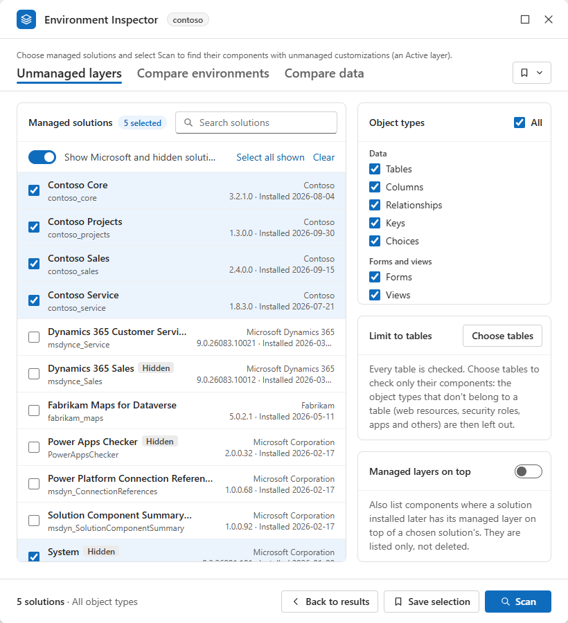

*The choice screen in a narrow window. Below 900 px the container queries ([8.1](#81-shadow-dom-and-styles)) narrow the right column to 280 px,
list the object types in one column, and drop *Optional* from the option cards and the table icon from **Choose
tables**. **Back to results** shows because a scan result exists.*

### 8.4 The table picker

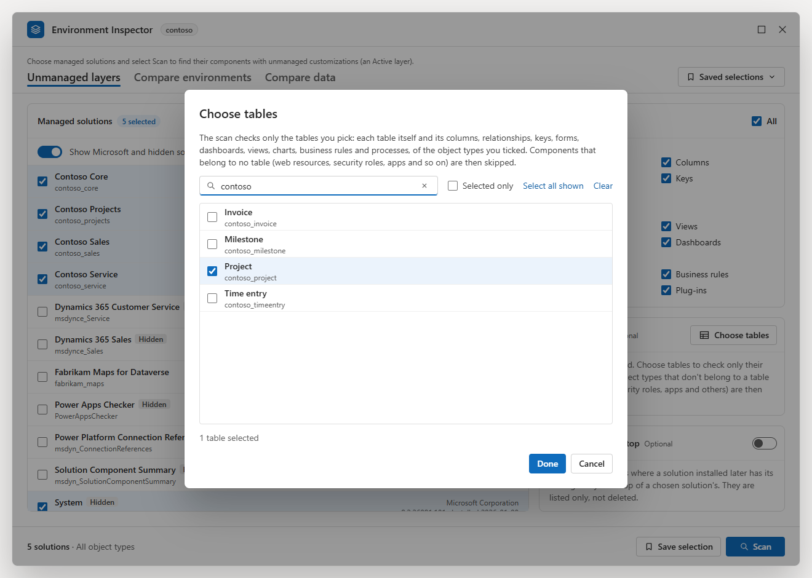

*The **Choose tables** dialog (wide, 720 px) with the search "contoso": four tables match in their display or logical
name, one is ticked, and the footer says "1 table selected".*

**Reading the tables.** `loadTables` reads every table once per window, with one request (paged by `getAll`, [5.6](#56-paging-and-pools)):
`EntityDefinitions?$select=LogicalName,DisplayName,IsPrivate`. Private tables are left out, and the rest are sorted by
display name. It starts as soon as the solutions are loaded, so the tables card can show display names; the dialog
shows "Loading tables…" until they arrive. A failed read is not kept (`tablesPromise` is cleared), so opening the
dialog again tries again.

`environment-inspector.js`, `readTables`:

```js
const readTables = async () => { for (let i = 0; ; i++) { try { return await getAll('EntityDefinitions?$select=LogicalName,DisplayName,IsPrivate') } catch (e) { if (!(e instanceof StopError) || i >= 20) throw e; await sleep(300) } } }
```

**Why it retries a stopped read.** Starting a scan, or **Stop scan**, ends the reads in flight at once, this one
included if it was still running. A stopped read is not an error of the table list, so it is tried again, up to 20
times, 300 ms apart.

**Working on a copy.** The dialog works on `tmp`, a copy of `tablesSel`. **Cancel** leaves the choice as it was;
**Done** copies `tmp` back and draws the tables card and the object types again (the types offered depend on whether
tables are chosen, [8.3](#83-the-choice-screen-and-saved-selections)).

**The list.** `draw` lists the tables that match the search (display or logical name) and, with *Selected only*, only
the ticked ones. **Select all shown** ticks the tables listed; **Clear** unticks every table. The footer says "N tables
selected", or "None selected: all tables are checked". A click ticks a row in place, without drawing the list again.
The list is a listbox with one row in the tab order ([8.8](#88-keyboard-and-accessibility)): ↑ and ↓ move, Home and End go to the ends, Space and Enter
tick.

### 8.5 Results: search, type bubbles and column menus


*The results of a scan of five managed solutions: 23 unmanaged layers. The line above the title gives the scope and the time; the
bubbles show *All 23* and seven types with their counts, and **More 9** holds the types that do not fit. The *Email
template* row has an information icon instead of a tick box: Dataverse does not delete that type's unmanaged layer.
The scan was made without *Managed layers on top*, so there is one list and no switch (*Two lists*, below).*

**The header.** The title is the number of unmanaged layers not deleted. When the scan looked for managed layers on top
(`topChecked`: the option was on and at least one chosen solution is not Microsoft's), it adds their number: "20
unmanaged layers · 5 managed layers on top", or "· no managed layers on top". `titleParts` gives the two counts, what
was found first: a scan that found managed layers on top and no unmanaged layer reads "1 managed layer on top · no
unmanaged layers". `renderResults` puts the second count in a `.t2` span, and the whole title (`titleText`) in its
tooltip. The title stays on one line, with an ellipsis. While the list switch is shown it has the class `both`, and
below 1,040 px its second count is then hidden: the switch gives it ([8.1](#81-shadow-dom-and-styles)). `subtitle` writes the subtitle, the line above the title
(`#st`, after *Unmanaged layers*): the scope
(solutions, object types, tables, and "Managed layers on top" when the option was on) and "Scanned in 2.5 s", then,
when they apply, "3 deleted", "showing 5 of 23" (while a search or filter hides rows of the list shown) and "the first
2,000 are drawn". **Change selection**, **Scan again** and **Export** are disabled during a
deletion run.

**Banners.** `renderBanners` adds one banner per case above the grid:

| Banner | When |
| --- | --- |
| "Some parts couldn't be read, so this list might be incomplete. Scan again in a moment." (amber), with *Details* listing each part | The scan is incomplete (`result.typesFailed`) |
| "Not checked: *types*. Your security role can't read these types (*privileges*), so they were skipped. Everything else was checked." | Types the user cannot read (`result.noAccess`, except the quiet image configurations; without the last sentence when there are quiet ones). From the chosen solutions, only types read for them ([6.9](#69-complete-or-incomplete)) |
| "What changed is shown for N components. M more aren't read yet ..." (with how many were flagged only by the solution summary and might have no unmanaged layer of their own), and **Read N more** | Findings whose layers were not read yet. N counts the unmanaged findings read; the managed layers on top are always read |
| "**N possible managed layers on top weren't checked**, because there were more than 1,000 to check. Choose fewer object types or tables to check them." (amber; the part from "because" only when some were over the limit) | Candidate managed layers on top over `CONFIG.topCheckLimit` (`result.managed.notChecked`) and twins not decided (`notDecided`), counted together ([6.11](#611-managed-layers-on-top)) |
| "Managed layers on top weren't looked for under *solutions*: Microsoft layers its solutions on each other by design." ("under the chosen solutions" when all of them are Microsoft's) | With the option on, chosen solutions published by Microsoft were left out (`result.managed.skipped`) |
| The scan's warnings | `result.warnings` |

**Read N more** reads the next 500 at most (`CONFIG.autoDetails`) with `loadDetails` ([6.8](#68-step-4-confirming-and-reading-the-details)), those flagged only by the
solution summary first. Rows that turn out to have no unmanaged layer leave the list and the selection.

**The grid.**

| Column | Default width | Shows |
| --- | --- | --- |
| (tick) | 48 px | A tick box; a spinner while the row is deleted; the green check disc once deleted; an information icon for a type whose unmanaged layer Dataverse does not delete, and the teal outline layers for a managed layer on top (its tooltip comes from `noDeleteText`) |
| Type | 172 px | The type as the maker portal names it |
| Name | 22% | The display name as a link to the component's solution layers page, and the schema name under it |
| Table | 17% | The table's display name, and its logical name under it; "—" for no table |
| Managed solution | 15% | The chosen solutions the component is in; the tooltip adds the managed layers underneath, top first. For a managed layer on top, the covered solutions with *Overridden by &lt;solution&gt;* under them, in teal (`.lg.ot`), and a tooltip that names the solution on top and lists the managed layers, top first |
| What changed | the rest | The names of the properties the unmanaged layer changes (for a managed layer on top, those the layer on top changes); after a deletion attempt, the outcome |
| (actions) | 88 px | **Layers and what changed** (the details) and the solution layers link |

The table has `table-layout:fixed`, a sticky header and, until a column is resized ([8.6](#86-column-widths)), a minimum width of 1,000 px:
"a narrow window scrolls sideways instead of losing a column".

**Clicking a row.** A click anywhere on a row, except its tick box, a link or a button, opens the component's solution
layers page in a new tab (`window.open` with `noopener`). A double click does not open a second tab (`e.detail > 1`),
and selecting text in a row to copy it opens nothing. *What changed* and the document icon open the details ([chapter 9](#9-details-and-comparison))
instead. For the keyboard, the name and the icon at the end of the row are real links.

**What changed.** `changedCell` builds one tag per property name (at most 40) and a "+N" element; `fitTags` then shows
as many tags as fit in the column, and "+N" for the rest. Its comment: "All widths are read first, then everything is
written, so a long list costs one layout." Reading and writing in turn would force a layout per row. The first tag
always shows (cut with an ellipsis if need be), and the tags shown plus "+N" always add up to the total. A
`ResizeObserver` fits them again when the grid's width changes. A row not read yet says "Not read yet"; a process whose
layer only switched it on or off or changed its owner, "Only status or owner"; a layer that changes only values
Dataverse sets itself, "Only system values". When the cell lists properties, its tooltip names them all ("Changed:
...", for a managed layer on top "Changed by &lt;solution&gt;: ..."), then "Select to see the layers and compare
them."

**Rows drawn.** `drawnRows` returns the first 2,000 rows shown (`CONFIG.maxRows`). The table has no virtual scrolling:
every search, filter and sort draws all its rows again, so their number is capped, and the subtitle says when rows are
not drawn. The exports are not capped: **Excel (CSV)** and **All layers (CSV)** take every row shown that is not
deleted, drawn or not.

**Search, filters and sorting.** The search box matches the type, the names, the table, the solutions (for a managed
layer on top, the solution on top too) and the changed property names (`matches`), at each keystroke. Each column is described in `COLS` by its title and a function that
gives a row's values in that column.

`environment-inspector.js`, `COLS`:

```js
const changedValues = (f) => (!f.detailsLoaded && !f.changed ? ['Not read yet'] : f.changedKeys ? f.changedKeys : [f.changed || '(None)'])
const COLS = {
  type: ['Type', (f) => [f.type]],
  name: ['Name', (f) => [f.display || f.schema || '(no name)']],
  table: ['Table', (f) => [f.table ? f.tableLabel || f.table : '(No table)']],
  solution: ['Managed solution', (f) => (f.solutionIds && f.solutionIds.length ? f.solutionIds.map((id) => solName(id) || id) : [f.solutions || '(None)'])],
  changed: ['What changed', changedValues],
}
```

A finished comparison shows its own view instead of the grid ([11.7](#117-the-results-and-the-details)).

* A row can have several values in a column: one per solution, one per changed property. A filter is the set of values
  shown, and a row passes when **any** of its values is in it. That makes "which components changed `formxml`?" one
  tick in the *What changed* menu.
* `shown` applies `visible`, the list shown (`isKind`, see *Two lists* below), the filters (`passes`) and the search,
  then the sort. `visible` keeps deleted rows on the screen, struck through, until the search or a filter changes
  (`keepDeleted`).
* Without a sort, rows keep the scan's order (by type, then name). Sorting compares text with one `Intl.Collator`,
  made once (`COLL`), ignoring case and accents and reading digits as numbers (`cmpText`); ties are ordered by type,
  then name. The same sort again goes back to the scan's order.
* `setFilter` drops a filter that keeps every value of the column ("A filter that keeps every value is no filter").

**The column menu.** A click on a column header opens the column menu (`openPop`), under the header (above it when
there is less than 300 px below and more room above), inside the window, between 160 and 520 px high (`placePop`). It
follows the window when the window moves.

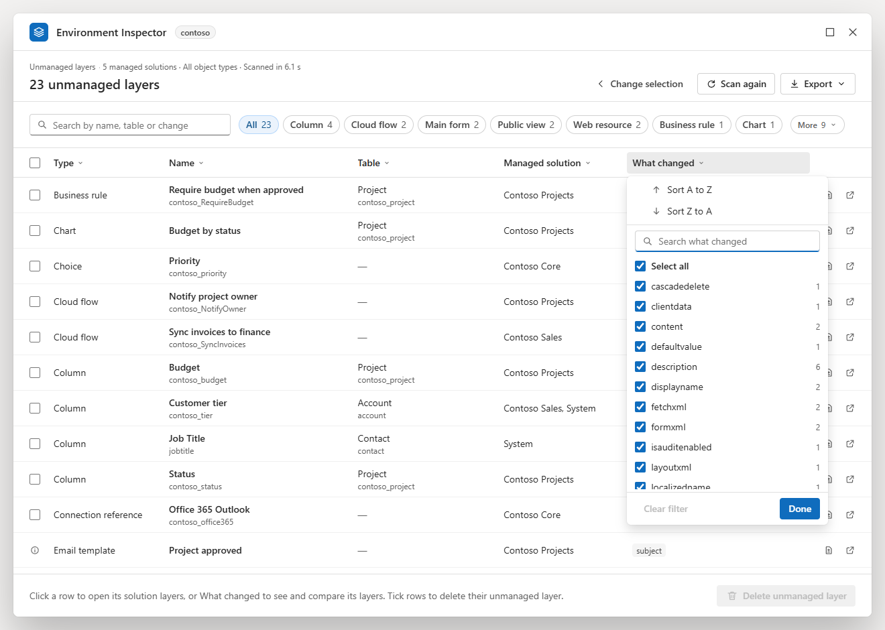

*The *What changed* column menu: **Sort A to Z**, **Sort Z to A**, the search, **Select all**, and one value per
changed property with the number of rows that have it (*description*: 6). **Fit to contents** is not offered because
this column has no width of its own ([8.6](#86-column-widths)), and **Reset column widths** shows only once a width was changed.*

* **The values** come from `columnValues`, each with the number of rows that have it among the rows of the list shown
  that the other columns' filters and the search leave. A value filtered in but with no row left is still listed, with 0, so it can be
  cleared. Values in parentheses ("(No table)", "(None)") come last.
* **Ticking or clearing** a value filters at once; there is no Apply. **Select all** (**Select all search results**
  while searching) acts on every value that matches the search, also those beyond the ones listed. **Enter** in the
  menu's search keeps only the values found that are ticked, as in Excel, and closes the menu. At most 300 values are
  listed (`POP_MAX`), then "N more values. Search to find them."
* **Clear filter** removes the column's filter. **Done** and Esc close the menu and return the focus to the header; it
  also closes when the focus leaves it and on a click outside it.
* While scanning or deleting, the headers are disabled. Each shows a sort arrow and a filter mark when they apply, and
  its cell carries `aria-sort`.

**Type bubbles.** The bubbles are the Type column's filter, drawn as buttons: ticking types in the Type menu presses
the same bubbles. `renderChips` counts the rows not deleted per type, in the list shown.

`environment-inspector.js`, `typeClick`:

```js
const typeClick = (t, add) => {
  if (deleting || !result) return
  const ft = filters.type
  if (!t) setFilter('type', null)
  else if (add) { const s = new Set(ft || []); s.has(t) ? s.delete(t) : s.add(t); setFilter('type', s.size ? s : null) }
  else setFilter('type', ft && ft.size === 1 && ft.has(t) ? null : new Set([t]))
}
```

* A click shows only that type; a second click on the same bubble shows all types again; Ctrl+click (Cmd+click on a
  Mac) adds or removes a type; *All* clears the filter. **Clear filters (n)** clears the other columns' filters; the
  bubbles keep theirs.
* **The order is fixed**: types picked from **More** first (see below), then most rows first, then by name. A click on
  a bubble never moves it, so a second click at the same place hits the same type. (An earlier version moved the
  pressed bubble to the front, and a second click then picked another type.)
* A pressed type whose rows have all been deleted stays, with 0, so the filter stays visible.

**More.** The bubbles must never wrap, scroll or run off the window. `layoutChips` measures which bubbles pass the
right edge of their box, hides them and lists them in the **More** menu (`menuitemcheckbox`, a check mark for the
pressed ones). The width of **More** depends on its count, which depends on its width, so it measures again, up to four
times.

`environment-inspector.js`, `layoutChips` (the measuring):

```js
const over = () => { const right = box.getBoundingClientRect().right + 0.5; return chips.filter((c) => c.getBoundingClientRect().right > right) }
const label = (n) => { $('moreBtn').innerHTML = `More <span class="n">${n}</span>${icon('chevron', 12)}`; $('moreBtn').setAttribute('aria-label', `${n} more types`) }
const settle = () => { let h = over(); for (let i = 0; i < 4; i++) { label(h.length); const h2 = over(); if (h2.length === h.length) return h2; h = h2 } return over() }
```

A type picked from **More** is pinned (`pinned`, until the next scan): it moves right after *All*, so it is in view,
and the last bubble that no longer fits goes under **More**. **More** is drawn pressed when a hidden type is filtered.
A `ResizeObserver` lays the row out again when its width changes; `layoutChips` does nothing when the width, the
number of bubbles and **Clear filters** are as before (`chipsKey`).

**Two lists.** When a scan made with *Managed layers on top* finds both kinds ([6.11](#611-managed-layers-on-top)), a segmented switch between the
search box and the bubbles (`#kinds`, a `role="group"` labelled "Layers shown") shows one list at a time: **Unmanaged**
(first) or **Managed on top**, each button with the number of its rows not deleted. `kindSel` holds the list shown:
`''` while the switch is hidden, `'u'` or `'m'`; `isKind` keeps the rows of that list. The switch is hidden while
scanning and when the scan found one kind only, disabled during a deletion run, and set back to **Unmanaged** by each
new scan. Each label keeps the width of its bold form (a hidden bold copy of the text, `.b::after`), so pressing a
button never moves the bubbles.

`environment-inspector.js`, `renderKinds`:

```js
function renderKinds() {
  // ...
  const k = $('kinds'), all = result ? result.findings : [], m = all.filter((f) => f.managedTop).length
  k.hidden = scanning || !m || m === all.length
  if (k.hidden) { kindSel = ''; k.innerHTML = ''; return }
  if (!kindSel) kindSel = 'u'
  const left = active(), nm = left.filter((f) => f.managedTop).length
  k.innerHTML = [['u', 'Unmanaged', left.length - nm], ['m', 'Managed on top', nm]].map(([v, t, n]) => `<button data-kind="${v}" aria-pressed="${kindSel === v}" ${deleting ? 'disabled' : ''}>${stIcon(v === 'u' ? 'pen' : 'lay', 14)}<span class="b" data-t="${t}">${t}</span> <span class="n">${n.toLocaleString()}</span></button>`).join('')
}
```

`renderChips` calls it first, so the switch is drawn with the bubbles. A click on the other button calls `setKind`, then
puts the focus back on the button. Each list keeps its own view:

`environment-inspector.js`, `views` and `setKind`:

```js
// Each list keeps its own search, column filters, sort and picked types (a new scan clears them).
let views = {}
function setKind(k) {
  views[kindSel] = { filters, sortBy, pinned, q: $('q').value }
  const v = views[k] || { filters: {}, sortBy: null, pinned: new Set(), q: '' }
  kindSel = k; filters = v.filters; sortBy = v.sortBy; pinned = v.pinned; $('q').value = v.q
  keepDeleted.clear(); closePop(); renderFilters(); renderRows(); $('st').textContent = subtitle()
}
```

`setKind` keeps the column filters, the sort, the types picked from **More** and the search text of the list left, and
brings back those of the other list (none the first time). `runScan` empties `views`. What the list shown changes:

| Part | With one list shown |
| --- | --- |
| Rows | `shown` keeps the rows of the list, then applies the filters and the search |
| Type bubbles | Counted on the list; *All* gives its number of rows |
| Column menus | The values and counts of the list (`columnValues`) |
| Search | Within the list, with the list's own search text; it also finds a managed layer on top by the solution on top (`matches`) |
| Filters and sort | Each list has its own column filters, sort and picked types (`views`); a new scan clears them |
| Header tick box | Ticks the selectable rows of the list that are drawn. In **Managed on top** nothing can be ticked, so it is disabled |
| Subtitle | "showing *x* of *y*" counts within the list |
| Bottom bar | With nothing ticked, `syncSelection` looks at the list shown (`here`, before the search and filters): no rows, no text; only managed layers on top (**Managed on top**, or a scan that found only those, with no switch), "Click a row to open its solution layers, or What changed to compare the layer on top with the one it covers."; otherwise the usual hint, which ends with "Tick rows to delete their unmanaged layer." only when a row of the list can be ticked. Rows ticked in **Unmanaged** are counted as "· *n* under Unmanaged" while **Managed on top** is shown |
| The grid's label | "Components with a managed layer on top" when every row of the list shown is one, else "Components with an unmanaged layer" |
| Empty grid | "No components match" while the list has rows that the search or the filters hide; "All unmanaged layers deleted" once every row of the list is deleted. "Nothing to clean up" (the scan found nothing) adds ", and no other managed solution's layer is on top of theirs" when the scan looked for managed layers on top (`topChecked`) |
| Exports | **Excel (CSV)** and **All layers (CSV)** take the rows of the list ([13.1](#131-excel-csv)); **Full details (JSON)** holds both lists |
| **Delete** | Ticks stay on the **Unmanaged** list while the other is shown; **Delete** switches back to it first (`setKind('u')`, with that list's own search and filters), so the confirmation's order and its "hidden" marks are those of the **Unmanaged** list ([10.1](#101-from-ticks-to-a-run)) |

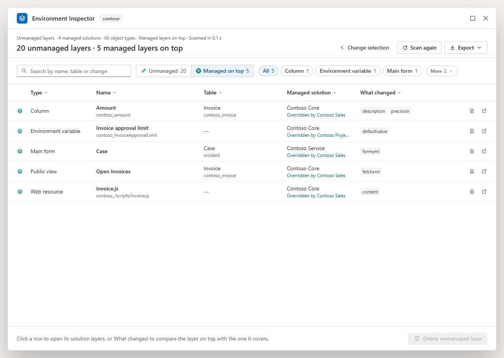

*The **Managed on top** list of a scan of four Contoso solutions with *Managed layers on top* on. The title counts both
lists, the subtitle ends with the option, and the switch shows **Managed on top 5** pressed next to **Unmanaged 20**;
the bubbles count this list only. Each row has the teal outline layers instead of a tick box, and *Overridden by* with the
solution on top, in teal, under the solution it covers: four rows by Contoso Sales, one by Contoso Projects.*

**Selection and the bottom bar.** `selected` holds the keys of the ticked rows; the select-all box ticks the selectable
rows drawn. `syncSelection` keeps the bar up to date: with nothing ticked, a hint ("Click a row to open its solution
layers, or What changed to see and compare its layers. ..."); with rows ticked, "**3 components selected**" (plus "· 2
hidden by the search or filters"), **Clear selection** and **Delete 3 unmanaged layers**; above 100, "You can delete up
to 100 at a time." in red, with **Delete** disabled (`CONFIG.maxRemovePerRun`); during a run, the progress ([8.9](#89-toasts-dialogs-and-the-deleting-pill)). In
the **Managed on top** list, the hint and the count of hidden rows read as *Two lists* above says.

A row cannot be ticked during a deletion run, once it is deleted, when Dataverse does not delete its type's unmanaged
layer, when it is a managed layer on top ([6.11](#611-managed-layers-on-top)), or in a development environment named in `inspector.settings.json`, where
**Delete** is not shown at all (`selectable`, [10.1](#101-from-ticks-to-a-run)).

**Export**, in the header, saves the rows and the details as files; [chapter 13](#13-exports) describes each export.

### 8.6 Column widths

Four columns can be resized: *Type*, *Name*, *Table* and *Managed solution*. *What changed* has no edge of its own: "it
takes the room the others leave (at least 150 px; the grid scrolls sideways below that)".

* **Drag** the right edge of a header. The edges show when the pointer is over the header row.
* **Double-click** an edge, or select **Fit to contents** in the column's menu (also from the keyboard), to make the
  column as wide as its longest value drawn, narrower or wider.
* **Reset column widths**, in any column's menu once a width was changed, goes back to the defaults. The widths are
  remembered ([8.3](#83-the-choice-screen-and-saved-selections)).

A column is at least `COL_MIN` wide (Type 90, Name 120, Table 100, Managed solution 100 px) and at most `COL_MAX`
(900 px). *What changed* keeps at least `CHANGED_MIN` (150 px): the grid's minimum width is the sum of the other
columns plus that. Until a column is resized, the widths are those of the `colgroup` (`COL_DEFAULT`).

**From percentages to pixels.** Until a column is resized, three columns are percentages. The first real move of a drag,
or a fit, calls `startColW`, which measures the four columns and keeps them in pixels from then on, so the others do
not change width while one is dragged. `applyColWidths` writes the widths to the `colgroup` and leaves *What changed*
without a width, so it takes the rest.

**Dragging.**

* `pointerdown` on an edge (`.cr`) captures the pointer and adds `colsizing` to `.app`, so the cursor stays a
  column-resize cursor over the whole page.
* A move of less than 3 px is not a resize ("a click is not a resize"): a click on an edge changes and saves nothing.
* Each move sets the column to its starting width plus the distance, within `COL_MIN` and `COL_MAX`, and fits the tags
  again on the next animation frame (`scheduleFit`), not on every pointer event.
* While the grid is scrolled sideways, it keeps at least the width it had when the drag started (`hold`). Otherwise a
  narrower column would shrink the grid, the scroll position would change and the edge would slide away from the
  pointer.
* Only a drag that moved saves the widths.

**Fitting.** `fitColumn` measures text, not boxes.

`environment-inspector.js`, `textW` and `fitColumn`:

```js
// As wide as its longest value shown (and its header): the text's own width, whatever the column's width is now.
const textW = (el) => { const r = document.createRange(); r.selectNodeContents(el); return r.getBoundingClientRect().width }
function fitColumn(k) {
  const i = COL_KEYS.indexOf(k) + 1, th = thOf(k), hb = th.querySelector('.hb')
  if (i < 1) return
  startColW()
  let w = textW(hb.querySelector('.l')) + hb.querySelector('.ind').getBoundingClientRect().width + 4 + 16 + 8 + 10   // gap, the button's and the cell's padding, the edge
  for (const tr of root.querySelectorAll('#rows tr[data-k]')) {
    const td = tr.children[i]
    if (!td) continue
    const parts = [...td.children]
    w = Math.max(w, 24 + (parts.length ? Math.max(...parts.map(textW)) : textW(td)))
  }
  colW[k] = Math.round(Math.min(COL_MAX, Math.max(COL_MIN[k], Math.ceil(w) + 2)))
  applyColWidths(); saveColW(); fitTags()
}
```

* A `Range` around an element's contents gives the width of the text itself. The element's box would report the
  column's current width, so a column made too wide could never be fitted narrower.
* Each line of a cell counts (the display name and the schema name under it).
* `Math.ceil(w) + 2` makes up for widths rounded to half pixels, which could cut the last letter of the longest name.

### 8.7 Moving, resizing and maximizing

The window floats over the page without blocking it: "moved by its title bar, resized by its edges and corners,
maximized with the button or a double-click on the title bar. Its place and size are remembered in this browser."

**The geometry.** `geo` holds `{ x, y, w, h, max }` in page pixels. `placeWin` writes it to the `.win` element, sets the
**Maximize** button's icon and label ("Maximize" or "Restore down"), and places an open column menu again. The first
time, the window is centred, at most 1,280 x 900 px and 24 px from each edge of a smaller page (`defaultGeo`);
afterwards, the stored geometry is used, fitted into the page.

`environment-inspector.js`, `fitGeo`:

```js
// Kept inside the page: wholly when it fits (strict), or with at least part of the title bar reachable while moving.
function fitGeo(g, strict) {
  const W = vw(), H = vh()
  const w = Math.round(Math.min(Math.max(g.w, Math.min(MIN_W, W)), W)), h = Math.round(Math.min(Math.max(g.h, Math.min(MIN_H, H)), H))
  const x = strict ? Math.min(Math.max(g.x, 0), W - w) : Math.min(Math.max(g.x, 160 - w), W - 160)
  const y = strict ? Math.min(Math.max(g.y, 0), H - h) : Math.min(Math.max(g.y, 0), H - 56)
  return { x: Math.round(x), y: Math.round(y), w, h, max: !!g.max }
}
```

* **Size**: at least 720 x 560 px (`MIN_W`, `MIN_H`), at most the page. On a page smaller than that, the page's size
  is the minimum.
* **Strict** (opening, the page resized, the window shown again, **Restore down**): the whole window is pulled into
  view.
* **Loose** (while moving): the window may go partly off the page, but at least 160 px of it stay on the page across,
  and the title bar (56 px high) never leaves the page at the top or the bottom. The window can always be grabbed.

**Moving.** `pointerdown` on the title bar, outside its buttons, starts a drag with the pointer captured, so a fast move
does not lose the window. A move of less than 4 px (across and down together) is not a move, so a click on the title
bar does nothing. While moving, `.app` gets `moving`: it takes the pointer for the whole page, and text in the window
cannot be selected by accident.

**Maximizing.** **Maximize**, or a double-click on the title bar, toggles `max`. The class `max` on `.win` covers the
page (`!important` overrides the inline sizes), squares the corners and hides the resize handles. The size from before
stays in `geo` for **Restore down**. Dragging the title bar of a maximized window "comes back to its size under the
pointer, as in Windows" (`onDrag`): grabbed at three quarters of the page's width, the restored window is held at
three quarters of its own, at the top of the page.

**Resizing.** Eight handles (`.rz`) lie along the panel's edges and reach 6 px outside them: 8 px strips on the edges
(stopping 14 px from the corners) and 18 x 18 px squares on the corners, each with the matching cursor. The east and
south edges stop at the page's right and bottom; the west and north edges stop at its left and top, and none can make
the window smaller than the minimum.

**When the page changes.** On a `resize` of the page, a window that is not maximized is fitted again (strict); a
maximized one follows the page by itself. The geometry is saved after a move or resize that actually moved, and after
each toggle of **Maximize**.

### 8.8 Keyboard and accessibility

**Keys.**

| Where | Key | Does |
| --- | --- | --- |
| Anywhere in the window | Esc | The first that applies: clears a search box that has text; closes the narrow window's search field of Compare data's overview; closes the column menu; closes an open menu; closes the dialog; closes the scan's layer picker; closes the scan's details; goes up one level on a comparison's page below its overview (`ESC_UP`, as **Back**); closes the window (during a deletion run or a data run, it becomes the pill, [8.9](#89-toasts-dialogs-and-the-deleting-pill)) |
| Anywhere in the window | Alt+←, the mouse's back button | Up one level, as **Back**: from a record or a component to its list, from a list to its overview, from the scan's details to its list; closes an open menu first. Where there is no level above, nothing. Alt+→ and the mouse's forward button do nothing. All four are taken, so the page under the window never goes back or forward |
| Anywhere in the window | Tab, Shift+Tab | Moves through the window and wraps at its ends; while a dialog is open, through the dialog only |
| Solution list, table list, Compare data's Tables card, a table's column list | ↑, ↓, Home, End; Space, Enter | Moves to the previous, next, first or last row; ticks or unticks the row |
| Compare data's Chosen tables card | ↑, ↓, Home, End; Enter; Delete | Moves between the tables; opens the table's settings; removes the table (the focus goes to the next one) |
| **Saved selections**, **Export**, **More** | ↑, ↓ (wrapping), Home, End | Moves through the items |
| The same menus | Tab | Closes the menu; the focus goes back to its button |
| A saved selection in the menu | Enter, Space | Applies it |
| A column menu's search | Enter | Keeps only the values found |
| **Save selection** dialog | Enter | Saves |
| The scan's details | Alt+↑, Alt+↓ | Previous or next component, in the order of the grid |
| The scan's details, a lane's layer picker | Enter, Space, ↓; then ↑, ↓, Home, End, Enter, Space, Tab | Opens the list of layers; moves through it (the other lane's layer is skipped), chooses, or closes it and moves on |
| A comparison's overview (its rows: one Tab stop) | ↑, ↓, Page Up, Page Down, Home, End; Enter | Moves the focus from row to row, a group's first row brought into view with its heading; opens the row's list (or shows why a table wasn't compared) |
| A comparison's list (its lines: one Tab stop) | ↑, ↓, Page Up, Page Down, Home, End; Enter; →, ← | Moves from line to line; opens the record or the component; goes from the line to its links (**Open** or **Layers** in each lane) and back |
| A list's tabs; Compare data's column chips | ←, →, Home, End; Enter, Space (↓ on **More**) | Moves between them without filtering; chooses the one with the focus |
| A record's or a component's page | Alt+↑, Alt+↓ | The previous or next one of the list it was opened from (the pager); left to a drop-down list that has the focus |
| Details tabs (the scan's, a record's, a component's) | ←, → (Home, End on the comparisons' pages) | Previous or next tab, wrapping; the tab is selected at once |

**Esc acts only on the window.** The handler listens on the document in the capture phase, and returns at once unless
the window is shown and the event's path goes through the host, that is, unless the focus is in the window. The page
keeps its own Esc.

`environment-inspector.js`, `onEscape`:

```js
const ESC_UP = true
const onEscape = (e) => {
  if (e.key !== 'Escape' || host.style.display === 'none' || app.hidden || !e.composedPath().includes(host)) return
  e.preventDefault()
  const t = e.composedPath()[0]
  if (t && t.type === 'search' && t.value) { t.value = ''; t.dispatchEvent(new Event('input', { bubbles: true })); return }   // first Escape clears a search
  if (t && t.id === 'dvTq' && dv.find && d1Narrow()) { d1Find(false); return }   // (then the narrow window's search field closes)
  if (!$('pop').hidden) { closePop(true); return }
  if (menuOpen()) { closeMenus(true); return }
  if (!dlgClose && lyPick) { lyPickClose(); return }
  if (!dlgClose && !$('sheet').hidden) { closeSheet(); return }
  const tab = ESC_UP && !dlgClose ? lvTab() : ''
  if (tab && lvAt(tab) > 1) { lvUp(tab); return }
  hide()
}
document.addEventListener('keydown', onEscape, true)
```

`composedPath()[0]` is the element inside the shadow tree that has the focus (`e.target` would only be the host).
Clearing a search fires an `input` event, so the list is filtered again as if the text had been deleted. Outside a
deletion run, `hide` closes an open dialog before anything else ([8.9](#89-toasts-dialogs-and-the-deleting-pill)).
`menuOpen` looks at every menu of `MENUS`, those of the comparisons' pages included. On a comparison's page below its
overview, Esc goes up one level, as **Back** does; on an overview it closes the window as before, so the close button's
tooltip says "Close (Esc)" only there (`lvHead`).

**Alt+Left and the mouse's back button.** In Edge, both send the page back, which would leave the page under the
window (and close the window with it). So the window takes them wherever it has the focus (Alt+Left) or the pointer
(the mouse's buttons): `onAltArrow` listens on the document in the capture phase, so a handler inside the window never
sees them either, and `onSideButton` listens on the window for the side buttons' `mousedown`, `mouseup`, `auxclick` and
`pointerup`. Both prevent the browser's default and act once: the back button when it is let go.

`environment-inspector.js`, `onAltArrow` and `onSideButton`:

```js
const onAltArrow = (e) => {
  if (!e.altKey || e.ctrlKey || e.metaKey || e.shiftKey || (e.key !== 'ArrowLeft' && e.key !== 'ArrowRight')) return
  if (host.style.display === 'none' || app.hidden || !e.composedPath().includes(host)) return
  const tab = lvTab()
  e.preventDefault(); e.stopPropagation()
  if (dlgClose) return
  if (!tab) {   // (the scan's details: back to its list; nothing else has a level above. An open menu closes either way.)
    const up = e.key === 'ArrowLeft' && !$('sheet').hidden
    closePop(); closeMenus(!up)
    if (up) { lyPick = null; closeSheet() } else if (lyPick) lyPickClose()
    return
  }
  const up = e.key === 'ArrowLeft' && (!$('sheet').hidden || lvAt(tab) > 1)
  closePop(); closeMenus(!up)
  if (up) lvUp(tab)
}
document.addEventListener('keydown', onAltArrow, true)
const onSideButton = (e) => {
  if ((e.button !== 3 && e.button !== 4) || app.hidden || host.style.display === 'none') return
  const tab = lvTab()
  e.preventDefault()
  if (e.type === 'mouseup' && e.button === 3 && !dlgClose) { closePop(); closeMenus(); if (tab) lvUp(tab); else if (!$('sheet').hidden) { lyPick = null; closeSheet() } }
}
for (const ev of ['mousedown', 'mouseup', 'auxclick', 'pointerup']) win.addEventListener(ev, onSideButton)
```

Neither touches the page's history: the window has no `pushState` and no `popstate` listener. With a dialog open, both
are taken and do nothing else. Whether Edge still goes back on a real mouse's back button after `preventDefault` is a
matter for a check by hand ([16.5](#165-window-and-keyboard-checks)).

**Tab stays in the window.** The window is not modal: the page around it stays usable with the mouse. For the keyboard,
a handler on the shadow root wraps Tab at the window's first and last focusable elements (in the dialog's while one is
open), skipping disabled, hidden and `inert` ones and, outside a dialog, those with `tabindex="-1"`. It wraps only when
no stop lies further in the direction of the press, so Shift+Tab from a level's focused title reaches **Back**;
between them the browser's own order applies. Without it, Tab would
leave the window, whose elements come last in the page, for the page's own controls.

**`inert`.** An open dialog makes the title bar, both screens and the details `inert`: they cannot be clicked or
focused and are hidden from screen readers. The open details make the results `inert` the same way.

**Where the focus goes.**

| After | The focus goes to |
| --- | --- |
| The choice screen is shown | The solution search |
| The results are shown (also when a scan starts), a deletion is confirmed, a deletion run ends | The results title (`h2`, `tabindex="-1"`) |
| The scan's details open / close (**Back**, Alt+Left, Esc, *Where you are*) | The details title / the row's **Layers and what changed** button (the results title if the row is not drawn) |
| A comparison's level opens (a list from the overview, a record or a component from its list) / the pager moves | The new level's title (`#resTitle`, an `h2` with `tabindex="-1"`) / stays on the pager's button, and "8 of 10, Portugal" is announced |
| A comparison goes up a level (**Back**, a link of *Where you are*, Alt+Left, the mouse's back button, Esc) | On a list, the line of the record or component shown last; on the overview, the row that opened the list. Brought into view only as far as needed, and drawn first when it was folded or past **Show more** (`lvFocus`, `cvReveal`); the title if it is no longer there |
| A tab, a chip, the Filter or a search of a list changes | Stays where it was |
| **Swap** | Stays on **Swap**, drawn again in the same place; "Contoso Test is now on the left" is announced |
| A table's settings close (**Done**, **Cancel**, Esc) | The table's block in the Chosen tables card |
| A dialog opens | Its first input, else the button marked `focus` (**Cancel** in the delete confirmation), else its first button |
| A dialog closes | The element that had the focus before, if it is still there, enabled and shown; else the solution search or the results title |
| A column menu closes with Esc, **Done** or a sort; a menu closes with Esc or Tab | Its column header; its button |
| A saved selection is applied | **Scan**, or the solution search while **Scan** is disabled |
| A drop-down or a segmented button in the details is used | The same control, drawn again |
| The list switch of the results is used | The button pressed, drawn again |

The details title is focused 30 ms after opening, and that timer is cleared when the details close: "a focus still
pending from opening must not land after closing".

**Roles and attributes.**

| Element | Role and attributes |
| --- | --- |
| The window | `role="dialog"`, `aria-modal="false"`, labelled by its title |
| Solution list, table list | `role="listbox"`, `aria-multiselectable="true"`; rows `role="option"` with `aria-selected`; one row in the tab order (`tabindex="0"`, moved with the arrows); the check box in each row `aria-hidden` and out of the tab order; the solution list `aria-busy` while it loads |
| *Show Microsoft and hidden solutions*, *Managed layers on top* | `role="switch"`, `aria-checked`, labelled by their label; the second is also described by its hint (`aria-describedby`) |
| **Saved selections**, **Export**, **More** | `aria-haspopup="menu"`, `aria-expanded`; `role="menu"` with `menuitem` (in **More**: `menuitemcheckbox`, `aria-checked`) |
| Type bubbles | `role="group"` "Filter by type"; each bubble `aria-pressed`; **More** labelled "9 more types" |
| The list switch (`#kinds`) | `role="group"` "Layers shown"; each button `aria-pressed` |
| The grid | Labelled "Components with an unmanaged layer" (or "Components with a managed layer on top" when every row of the list shown is one, `syncSelection`); `aria-busy` while scanning; `aria-sort` on each header cell; header buttons `aria-haspopup="dialog"`, `aria-expanded` |
| Column menu | `role="dialog"` labelled "Sort and filter *column*" |
| Progress bar | `role="progressbar"`, `aria-valuenow`, `aria-valuetext` (the step and its percentage), named for the run (`aria-label`: "Scan progress", "Comparison progress" for both comparisons, "Snapshot progress" for both tabs' **Save snapshot**); hidden from the accessibility tree when idle |
| Tick column icons | `role="img"` labelled "Deleted", "Deleting" or "Can't be deleted here" |
| Icon buttons and links | `aria-label`, for example "Layers and what changed: *name*", or the link's title with "(opens in a new tab)" |
| The scan's details | Labelled by the component's name; *Where you are* a `nav`; `tablist`, `tab` (`aria-selected`, `aria-controls`, one in the tab order), `tabpanel` (labelled by the selected tab); *What changed* a `table` ("*name*: Contoso Projects 1.3.0.0 and the Active layer, side by side": the left layer, then the right, each by `lyLayerPhrase`, so after **Swap** "*name*: the Active layer and Contoso Projects 1.3.0.0, side by side") whose lane heads are its column headers, each named with its layer, its kind and its place ("layer 2 of 3"); a lane's picker `aria-haspopup="listbox"`, its list a `listbox` with `aria-activedescendant`, the other lane's layer `aria-disabled`; **Swap** "Swap the two layers" |
| A comparison's page header | `nav` labelled "Where you are", its steps links (`role="link"`, `tabindex="0"`); **Back** named "Back to *list* (Alt+Left)", with `aria-keyshortcuts="Alt+ArrowLeft"`; the title an `h2` with `tabindex="-1"` that takes the focus on every level, its grey text inside it after a visually hidden comma, so both are read together ("Country, 14 records differ"); the pager's buttons "Previous record (Alt+Up)" and "Next record (Alt+Down)" (*component* on a component's page) |
| A comparison's overview | A `grid` ("The two environments, side by side", "The tables compared"), one Tab stop; the lane heads its column headers, each named by the environment and its lines and described (`aria-description`) only by what its tooltip adds: the address, the snapshot file's name and, on *Compare data*, what the third line counts; each row named by its sentence (for example "Exchange rate. 1,204 records in Contoso Dev, 1,198 in Contoso Test. 34 records differ: 28 different, in Rate and Valid to; 6 only in Contoso Dev."), its name the row header; a connector read as words between the two values ("differs from", "the same as", "couldn't be compared with"), a plain line not at all; Find a table a `search` |
| A comparison's list | The tabs a `tablist` "Show", each tab named with its count; the column chips a `toolbar` "Columns that differ" (`aria-pressed`); Filter a menu button with two `group`s ("Type", "Unmanaged layer on top") of menu items, the filters chosen a `group` "Filters chosen"; Find a record, Find a component a `search`; the list a `grid` ("Records of Country", "Components of Contoso Projects"), one Tab stop, `aria-rowindex` on each line; each line a row named by its sentence, its name the row header, its status a visually hidden word (the icon's tooltip says what it means); its links named "Open Portugal in Contoso Dev (new tab)", an off one `aria-disabled` with its reason as `aria-description` and tooltip, a dash where the record or component isn't (`role="img"`, "Not in Contoso Test") |
| A record's or a component's page | `tablist` "Views of the record" or "Views of the component"; *What differs* a `table` ("Portugal in Contoso Dev and in Contoso Test") with the environments' lane heads as column headers and each label a row header; a value's environment said before it (visually hidden); the characters that differ in `mark`; a note under a pair as the row's `aria-description`; Copy named "Copy the value in Contoso Dev"; the lane heads' buttons named with the environment ("Open Portugal in Contoso Dev"), an off one `aria-disabled` with its reason |
| Dialog | `role="dialog"`, `aria-modal="true"`, labelled by its title and described by its body |
| Toasts | `role="status"`; warnings `role="alert"` |
| Compare data's choice | The Tables card a listbox as the solution list; the Chosen tables card `role="listbox"`, each block `role="option"` labelled with what it says, its third line included ("Exchange rate, matched by Code and Valid from, 10 of 14 columns. Enter: settings. Delete: remove."); its **Settings** and **Remove** labelled with the table's name; a table's column list a listbox; the footer's tooltip its whole text, as in every tab |


The rows of Compare data's overview are not `aria-busy` while a run lasts, so a screen reader can read the rows already
compared; only the overview's grid is busy for one frame while D0's rows regroup into D1's at the end.

**What a screen reader hears.** A live region (`#live`, `aria-live="polite"`) announces what happens away from the
focus: "Scan finished: 23 unmanaged layers." (or "no unmanaged layers"; with *Managed layers on top*, the title's two
counts, for example "Scan finished: 20 unmanaged layers, 5 managed layers on top."), "Scan didn't finish.", "Comparison
finished: 4 solutions and 13 components differ · Contoso Dev and Contoso Test." (for data, the overview's title:
"Comparison finished: 53 records differ in 6 of 10 tables · Contoso Dev and Contoso Test.", or "Comparison stopped: 4
of 6 tables compared."), "The comparison didn't finish.", "Counting the chosen tables' records…" while **Compare** or
**Save snapshot** waits for counts; on the comparisons' pages, the lines a list shows after a tab, a chip, the Filter or
a search ("8 records shown", "13 components shown"), the pager's place ("8 of 10, Portugal"; in the scan's details "13
of 20, Information", `sheetGo`), "Copied", "Contoso Test is now on the left" after **Swap** (in the scan's details, the
layer now on the left: "The Active layer is now on the left"), and, for a row of D0 that doesn't
open yet, "Exchange rate opens once it is compared."; "Stopping after the component being deleted now." and "Deleted 3
of 3.". `announce` empties the region and writes the text 50 ms later, so the same text said twice is still read.
Toasts are read as they appear. A name from Dataverse or a snapshot inside a text that can't hold an element (a live
message, a tooltip, an `aria-label`) is put between the characters U+2068 and U+2069 (`iso`), so a right-to-left name
can't turn the rest of the sentence around; inside markup it is in a `bdi` element.

**Focus rings.** Every focusable element shows a 2 px black outline when focused from the keyboard (`:focus-visible`);
buttons draw it inside their border, and primary and danger buttons add a white inner line so the ring shows on the
coloured background. On the comparisons' pages, the header's buttons and the lane heads' buttons draw it 1 px outside
their border, and the rows and lines of an overview or a list draw it inside their edges, so the ring of a row is never
cut by the row next to it.

### 8.9 Toasts, dialogs and the deleting pill

**Toasts.** `toast(text, { kind, action, sticky, more })` shows a short message in the lower right corner of the window, above
the bottom bar: `ok` (the green check disc), `warn` (amber warning, `role="alert"`) or `info`. A toast can have one action link
(**Undo**, **Download log**) and always has a close button. Its text is escaped, and a long word without a space (a
reason Dataverse gave, such as an exception's name) wraps rather than being cut at the toast's edge
(`overflow-wrap:anywhere`). `more: { label, items, rest }` folds a list under a link right after the sentence it
explains (a `details` element, its summary the label: "Why", "Why, for each"), then the rest of the toast's words
(`rest`) after a line and 8 px of space. An item is a text, or a name and its reason (`[name, why]`): the name in bold,
the reason whole, and what Dataverse said after "(HTTP 400):" on its own quieter lines (`.tq`); nothing is cut and
there is no tooltip. The list scrolls when it is long, so a toast stays a few lines whatever it lists, and it is a tab
stop (`tabindex="0"`) named like the fold, so the keyboard scrolls it too. Compare data's *Data snapshot saved* toast uses it for the tables that couldn't
be read.

* It goes away after 5 seconds, or 8 seconds when it has an action, so there is time to use it. The timer stops while
  the pointer or the focus is on the toast, and starts again when they leave.
* A sticky toast stays until it is closed. Sticky toasts carry results a user must not miss: a deletion run that did
  not delete everything, a run stopped by the user, by an expired sign-in or by an error, a failed **Read N more**, and
  a successful run that finished while the window was closed; a snapshot saved (where to open it), a file that isn't a
  snapshot, and a data run stopped by the memory guard.
* Changing screens dismisses the toasts that are not sticky (`setView`).

**Dialogs.** There is one dialog element; `openDialog({ title, body, actions, wide, focus })` fills it for **Choose tables**
(wide, [8.4](#84-the-table-picker)), **Save selection** ([8.3](#83-the-choice-screen-and-saved-selections)), the delete confirmation ([10.2](#102-the-confirmation)), a table's settings (wide,
[12.3](#123-a-tables-settings)) and the confirmation of a long data read ([12.2](#122-the-choice-screen)). `focus` names what has the focus first
(by default the first input, else the action marked `focus`, else the first action). The callers build the body and escape what
they put in it. While it is open, the title bar, both screens and the details are `inert`; `dlgClose` hides it, ends
`inert` (the results stay inert behind the details) and returns the focus ([8.8](#88-keyboard-and-accessibility)). `dlgClose` is also the flag "a dialog
is open": Esc and the window's close button close the dialog first, and showing the window again does not redraw the
screen behind it.

**During a deletion run.** The deletion itself (`removeLayers`) and its safety checks are described in [chapter 10](#10-deleting);
the window shows its progress.

Each step redraws one row (`updateRow`) and, while the window is shown, scrolls it into view, so the list follows the
component being deleted. The search, the bubbles, the list switch, the column menus, **Change selection**, **Scan
again** and **Export** are disabled, and the details cannot be opened. The bar says "**Deleting 2 of 3**: API base address
(Environment variable) · about a minute or less left · You can close this window; deleting continues.", with **Stop
deleting** (then "Stopping…"), which ends the run after the component being deleted; the time left then gives way to
"stopping after this one". `timeLeft` assumes 8.5 seconds per component until the first is done ("Dataverse takes
about 8 s per component"), then uses the pace so far; under a minute it says "about a minute or less left", otherwise
"about *n* min left". Leaving or reloading the page asks for confirmation (`beforeunload`, [10.8](#108-stop-sign-in-expiry-and-leaving-the-page)).

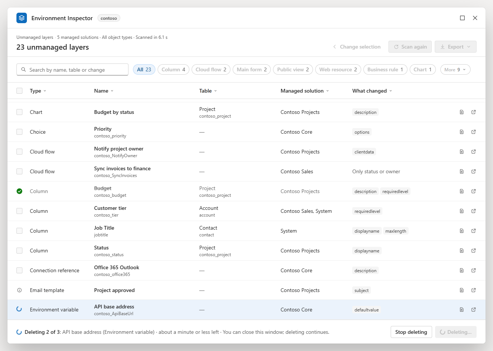

*While deleting: the first component is done (struck through, the green check disc), the second has a spinner, the third waits
ticked and disabled; the rows still in the run have a blue background. The header buttons and the bubbles are
disabled.*

**The pill.** Closing the window during a deletion run, or during a data comparison or a data snapshot, does not stop
it: `hide` turns the window into a pill in the lower right corner of the page.

`environment-inspector.js`, `minimize`, `restore` and `hide`:

```js
const minimize = () => { app.hidden = true; mini.hidden = false; syncMini() }
const restore = () => { app.hidden = false; mini.hidden = true; miniEnd = null }
const hide = () => {
  if (dlgClose && !deleting) { dlgClose(); return }
  closeMenus(); closePop()
  if (deleting || dataRunning()) { minimize(); return }   // deleting, or a data run, goes on; the pill in the corner shows how far it is
  restore(); host.style.display = 'none'
}
```

* The pill (`button.mini`) says "Deleting unmanaged layers · 5 of 17" and the time left, with a spinner; when the run
  ends, "Deleting finished · Select to see the results" with the green check disc, "Deleting finished with problems"
  with the red error disc, or "Deleting stopped" after **Stop deleting** (`runDelete` calls `endMini`). Selecting it
  shows the window as it was.
* During a data run it says "Comparing data" or "Saving a data snapshot", the percentage, and the time left when the
  step line gives one; at the end, how the run ended, with the green check disc or the red error disc (`endMini`, `miniEnd`:
  "Comparison finished", "Comparison stopped", "Snapshot saved", "The snapshot wasn't saved") and what selecting it
  does ([12.13](#1213-running-a-comparison)).
* `syncSelection` updates it at every step of a deletion, and `progress` at every step of a data run (`syncMini`).
* It lies outside `.app`, where the design tokens are defined, so its colours are written directly in its CSS.

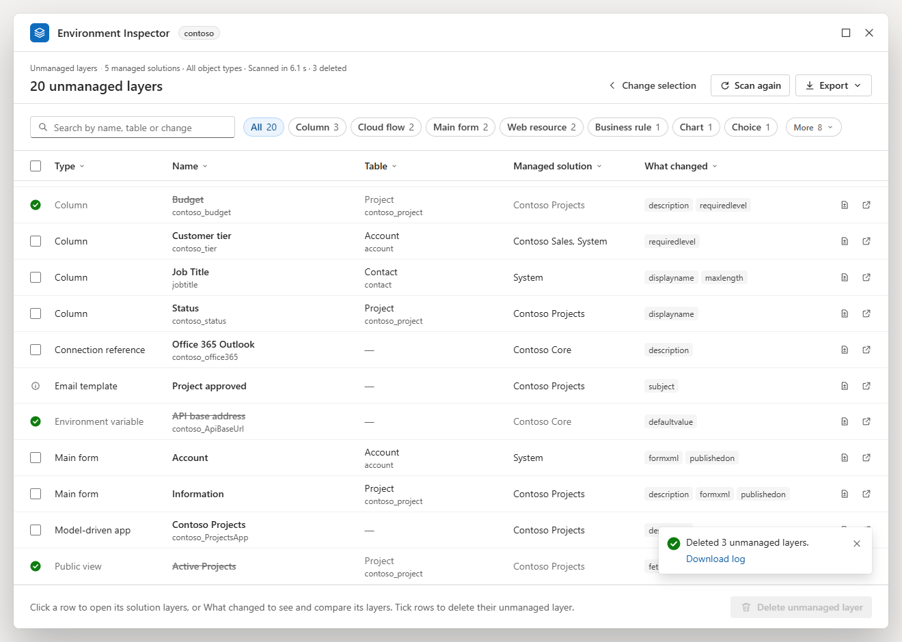

*After the run: the deleted rows stay in place, struck through with the green check disc, until the search or a filter
changes. The title, the subtitle ("3 deleted") and the bubbles are counted again, and the toast offers **Download
log**, the log of this run.*

**Closing and opening again.** Outside a run, closing only hides the host (`display:none`); the state stays. Clicking
the bookmark again on the same environment calls `show`, which shows the window as it was, fitted into the page. On
the maker portal, which changes environments without reloading the page, clicking the bookmark in another
environment calls `destroy`, which removes the window (not while it is working) before a new one starts.

### 8.10 The comparisons' pages: levels, the header and shared parts

Both comparisons show their results the same way, with the answer first: an overview, a list, then one item side by
side. The code that does it is shared, in three parts of the file: `the comparisons' results: shared parts`, `side by
side` and `the virtual list` (the drawing parts), and `the comparisons' results: levels, their header, going back`. Each
tab keeps its own data code ([chapter 11](#11-comparing-environments), [chapter 12](#12-comparing-data)) and gives these
parts only what to draw.

**Three levels.**

| Level | Compare environments (`#cv`) | Compare data (`#dv`) | Opened by |
| --- | --- | --- | --- |
| 1, `overview` | E1: the two environments, the solutions compared, the components of those solutions, the other solutions installed (`e1Draw`); E0 while the run lasts (`e0Draw`) | D1: the tables in three groups (`d1Draw`); D0 while the run lasts (`d0Draw`) | The end of a run |
| 2, `list` | E2: the components of a solution, of *All components*, of the unmanaged changes or of another solution (`cvListPage`) | D2: a table's records (`dvTablePage`) | A row of the overview (`cvGo`, `dvGo`) |
| 3, `item` | E3: one component side by side (`e3Html`) | D3: one record side by side (`d3Html`) | A line of the list (`cvOpen`, `openRecord`), and the pager |

Each level has a container of its own inside the tab's view (`lvBox`: `#cvL1` to `#cvL3`, `#dvL1` to `#dvL3`, made when
first needed), and only the level shown is visible (`lvShow`, `lvAt`). A level stays as it was while a deeper one is
open, so going back shows it without reading or drawing anything again: its search, its folds, its scroll and its
focused row are as they were left. `lvState` marks a level stale when its container was emptied (`lvDrop`: another view
took the tab's place, or a new result came) or when **Swap** changed it; a stale level is drawn again from the state
(`cv`, `dv`) when it is next shown, and put back at its scroll anchor (`lvSaveAt`, `lvToAnchor`: the first row in view,
by its key, so a level drawn again at another width lands on the same row). Going up lets the level left go
(`lvClose`): opened again, it starts anew. `#vRes` carries the level shown as `data-level`, which the tests read.

**The page header, on every level.** `lvHead` writes the whole header of the level shown, in the place of the scan's
header (`.res-head.cmpm`, 76 px; [8.1](#81-shadow-dom-and-styles)):

* **Where you are** (`nav#where`): on an overview the tab's name; below it the way up, each step a link named for what it
  opens ("All tables › Country ›", "All solutions › Contoso Projects ›").
* **Back** (`#lvBack`), below an overview only: an 80 by 32 px button with an arrow and the word *Back*, named "Back to all
  tables (Alt+Left)", "Back to Country (Alt+Left)".
* **The title**, in words: the answer on an overview ("53 records differ in 6 of 10 tables", "4 solutions and 13
  components differ", "Comparing data"), the table's or the solution's name on a list, the record's or the component's
  name on its page; then its grey text inside the same heading ("14 records differ", "6 of 10 tables done",
  "Main form · Project"), so a screen reader reads both together. The title takes the focus on every level.
* **The level's actions**: **Change selection** and **Compare again** on an overview, **Stop** while a run lasts (for a data run, on D0
  only), **Export** on an overview and a list, and on a record's or a component's page the pager instead (`#lvPager`:
  "8 of 10" with **Previous** and **Next**, also Alt+Up and Alt+Down from anywhere in the results, `lvStep`).

The scan's results and the three choice screens use the same header style and height (`.res-head.scnm`, `.pick-head`),
so going from choosing to the results moves nothing, and the scan's details draw their own header the same way
([chapter 9](#9-details-and-comparison)).

**Going back.** `lvUp(tab)` goes up one level: a record or a component to its list, a list to its overview; an overview
stays. **Back**, Alt+Left, the mouse's back button and Esc (below an overview) all call it ([8.8](#88-keyboard-and-accessibility)); a link of
*Where you are* calls `lvGo(tab, level)`, which can go up two levels at once. The window never touches the page's
history (no `pushState`): the page underneath stays where it is. Going up puts the focus on the line or row the user came
from ([8.8](#88-keyboard-and-accessibility)).

**Two lanes, and Swap.** Each environment has a lane, from its head at the top of a sheet to the bottom: its colour
(`ea` for this environment, `eb` for the snapshot's, [8.1](#81-shadow-dom-and-styles)) and its side. The lane heads are the first row of every
sheet (`laneHead`): a 3 px bar in the environment's colour on the sheet's top edge, its name with a dot, and up to
three grey lines (what it is, when it was read or saved, what it holds); they stay in view while the page scrolls.
The snapshot's line is the same on every screen of both comparisons (`snapLine`: "Snapshot · 1 day old", "Data
snapshot · less than a day old", through `snapAge`), and when it was saved (`savedLine`) is on the overview's next line
and in a component's or record's lane-head tooltip. A name or line too long for its lane wraps instead of being cut:
the lane rows take `height:auto` (at least 61 px), the heads stretch to the row's height with their words at the foot,
and each bar (`.rs-lh::before`) stays over its lane, so both bars stay level. The overviews
(`#cvOv`, `#dvOv`) keep their fixed heights at every width, so their lane heads never wrap: below 1,280 px a very long
name is cut with "…", at 1,120 px and less a long line under it too ("Saved Sep 30, 2025 at 8:42 a.m."), and at 800 px
and less only the first line under the name shows (`.rs-ov .rs-lh small+small`); their tooltips (`e1Lanes`,
`d1Lanes`, `d0Lanes`) hold the name and its first two lines whole, then the address and the snapshot file's name,
and, on *Compare data*, the third line last, with what it counts. A lane head is named (`aria-label`) by its name and
lines, and its description (`aria-description`, which takes the tooltip's place for screen readers; an empty one
leaves none) holds only the tooltip's other lines, so a screen reader doesn't hear the name and lines twice: on the
overviews the address, the snapshot file's name and, on *Compare data*, what the third line counts; on a component's
or a record's page also when the snapshot was saved. In a Windows contrast theme the dot before a lane head's name
(`.rs-en i`) is drawn in `CanvasText` (`forced-color-adjust:none`): forced colours would paint it `Canvas`, blank yet
still taking its room, which would set the name off from its lane's edge.
**Swap**, the round button between the two heads, is the only way to swap: it exchanges the sides for both tabs at once
(`cv.order`, kept in the browser as `environmentInspector:cmpOrder` by `cvSwap`, [8.3](#83-the-choice-screen-and-saved-selections)), marks every kept level of both tabs stale
and draws the one shown again at its place with the focus kept (`lvRedrawAll`), and says "Contoso Test is now on the
left".

**Statuses.** Each status has one name, one colour and one shape everywhere (a tab, a row's line of kinds, a list's
line, a record's or a component's title), and is always said in words:

| Status | Icon (`stIcon`) | Colour | Means |
| --- | --- | --- | --- |
| *Different* | `dif`: a disc with ≠ | Orange, `--dif` | In both, and what is compared differs |
| *Only in Contoso Dev*, *Only in Contoso Test* | `onlyA`, `onlyB`: a ring filled on that environment's side | That environment's, `--ea` or `--eb` | In one environment and not the other |
| *Unmanaged only in Contoso Dev* (components) | `unm`: a disc with a pencil | This environment's, `--ea` | An unmanaged change here, in none of the compared solutions, that the snapshot has none of |
| *Layers differ* (components) | `lay`: a disc with layers | Teal, `--lay` | The same definition, with another solution's layer on top on one side |
| *Couldn't compare* | `unk`: a grey dashed ring with a question mark | Grey, `--unk` | A missing result, not a difference: it couldn't be read, matched or compared for certain |
| *Same* | `same`: a disc with a check | Green, `--same` | The same in both |

The teal outline pencil (`uTag`, *Unmanaged layer in Dev*, *in Test*, *in both*) and the outline layers (*Managed layer
on top*) are tags, not statuses. Between two sides, a connector (`connector`) says how they relate: a plain line between
two counts (`ln`), = (`eq`), ≠ (`ne`), layers (`lay`, another layer on top), ? (`unk`), a dashed line (`na`, one side
only), dotted (`wait`, not read yet) and a spinner (`run`, being read); a screen reader hears it as words between the
two values (`CX_SR`; on D0, a table read here and waiting is "not compared yet", one being compared "being compared",
`D0_CX`). Two counts are always joined by a plain line, never by = or ≠, so a figure is never taken for a
verdict.

**The parts of a page.** All return markup, and escape what they are given (a name from a snapshot is text, never
markup):

| Part | Draws |
| --- | --- |
| `stIcon`, `statusLabel`, `uTag`, `onlyIn`, `bItem` | A status icon; a status as a tinted label with its icon and word; the unmanaged-layer tag; what is only on one side, under that side's count; one kind of a result |
| `vPill`, `vDash`, `connector` | A count or a version in its side's tint (an estimate in grey; *Newer* inside the newer version); a dashed box saying why a side has nothing; the connector |
| `bigN`, `bigT` | An overview's result: the figure and its words, or words with an icon |
| `laneHead`, `laneBtn`, `laterTag` | A lane head; a tinted button in a lane head (**Open in Contoso Dev**, **Solution layers in Dev**), or, without an address, an off one that stays focusable and says why; the *Later* tag on the later of two dates |
| `listLine`, `listLink`, `listAbsent`, `listLanes`, `tabsFit` | A list's line: the status icon (its word visually hidden), the name and its grey second name, what differs in words, then each lane's link (**Open** or **Layers**, off with its reason, or a dash where it isn't), and a chevron; the list's lane heads; tabs that never get cut, those that don't fit going into a **More** tab |
| `gtkBlock`, `rsNote`, `gtkScope` | *Good to know*, one folded line under an overview's sheet (its first note and "· 3 more notes"); a note at the top (amber); Good to know's first note, the run's scope and time ("Compared 10 tables with Contoso Test (data snapshot) in 2.2 s") |
| `dayWords`, `utcWords`, `snapAge`, `snapLine`, `savedLine` | Dates in words: "today at 10:42 a.m.", "Oct 3, 2026, 2:22 p.m. UTC"; a snapshot's age and its lane-head line ("1 day old", "Snapshot · 1 day old", "Data snapshot · less than a day old"), and when it was saved ("Saved Nov 16 at 8:42 a.m.") |

**Side by side.** A record (D3), a component (E3) and the scan's details draw their comparison with the same parts: a
sheet (`.rs-det`) whose rows share one grid (`--cols`: the label, one lane, the connector, the other lane), so each
lane runs from its head to the bottom. `sbsRow` draws a row (its label, Dataverse's name in mono under it, its
tooltip `tip`, its two cells, the connector, a note under the pair, which is also the row's description); `sbsBox` a value in a box with its
**Copy** at the top right, shown on hover and focus; `sbsQuiet` a value without a box (the same values, *About this
record*, *Where it is*); `sbsDash` a dashed box saying why a side has nothing; `sbsGroup` a group heading ("2 columns
differ"); `sbsToggle` the button that shows the same values ("Show the 15 columns that are the same"); `sbsCopy` the
**Copy** button. The characters that differ in two values are marked (`mark`). Rows keep
classes of their own (`rs-dq` for the same values, `rs-dab` for *About this record*, *Where it is* and the notes), apart
from the lists' classes.

**Long values.** `sbsLines(A, B, options)` lays two texts out line by line with `diffLines`
([9.7](#97-the-line-difference-difflines-folds-and-side-by-side)), and `sbsLongRow` puts them across both lanes:

* the lines of both sides stay level, row by row, each row as tall as its taller side; long lines wrap (no sideways
  scrolling, no ellipsis), and a line's leading spaces (a tab counts as 4) become its indent, so a wrapped line goes on
  under its own start;
* a line only one side has is tinted in its side's colour with a 2 px edge, and the other side has a hatched gap;
  two lines that differ have what differs marked;
* 3 unchanged lines are kept around each change, and longer unchanged stretches are folded into a button, "26
  unchanged lines", which opens them (`sbsUnfold`, the focus on the value);
* lines are numbered, except in a text shown whole (D3 shows a text of up to 20 lines whole);
* at most `MAX_LINES` (3,000) lines are drawn; a line under them says how many more there are.

The folds a user opened are kept (`sbsKept`, `sbsOpenSet`): by owner (`dv`, `cv`, `ly`), then by item (a record, a
component, a pair of layers; the latest 100 of each owner), then by value, with the shape of its difference, so a page
drawn again (a fold, the same values shown, **Swap**, a visit later) keeps them open, and a value that changed starts
folded again. The rows of each long value drawn are held in `sbsDiffs` for its folds; the first long value an owner
draws in a task lets that owner's others go (`sbsClaim`), so only the page shown is held. `window.__environmentInspector.parts.sbs.held()`
says how many are held.

**The virtual list.** Overviews and lists can be long (2,000 tables; 500,000 records), so they are drawn only where
they are on screen: `vlist(box, body, options)` keeps every item's height (measured once drawn, again at another width),
draws the items in view and 15 above and below, each at its place, and keeps them while they stay in range, so nothing
changes when nothing moved. The focused row is always drawn and is the list's one Tab stop. Past `CONFIG.listMaxPx`
device pixels (Blink's layout units stop near 33.5 million), the list's spacer stays at that height divided by the
display scale and its scroll maps to its lines in proportion; drawing, Page Down, End and the scroll anchors all go
through that one mapping, worked out again when the display scale changes. The list gives screen readers each row's
`aria-rowindex`.

**Menus kept inside the window.** A menu of the comparisons' pages (a list's **More** tab and **Filter**, D2's **More**
and **+N**) is placed by `fitMenu` within the window and the page's scroll body, 8 px from their edges: under its
button, from the side its CSS gives it or the other one when it would pass an edge (clamped when it still would), upward
when there is more room above, and never taller than its room (it scrolls inside itself) nor wider than the window. When
the window's size changes, `refitMenus` fits the tabs and chips again, places an open menu again by its button and keeps
the focus on its item, or closes it when its button is no longer shown.

---

## 9. Details and comparison

The details sheet shows one component's layers and what each one changes, as Solution Layers Explorer does: the
comparison of any two layers property by property (*What changed*), the list of layers (*Layers*) and each layer's raw
data (*JSON*). It opens from a row's *What changed* cell or its document icon (`openSheet`), over the results; **Back**,
Alt+Left, the mouse's back button, Esc or the link of *Where you are* closes it (`closeSheet`). It does not open during
a scan or a deletion run, and it reads nothing until it is opened. The sheet is the scan's only: a compared component
and a compared record open pages of their own, level 3 of their tab
([11.7](#117-the-results-and-the-details), [12.15](#1215-the-results-and-a-records-details)). *What changed* is drawn
with the same side-by-side parts as those pages ([8.10](#810-the-comparisons-pages-levels-the-header-and-shared-parts)),
each part keeping its own data code (`lyCompare` here).

**The sheet's state.**

| Field | Holds |
| --- | --- |
| `f` | The component shown |
| `tab` | `compare`, `layers` or `json`; kept when moving to the previous or next component |
| `place` | Which part of the component: a relationship has two ([9.1](#91-reading-every-layer)) |
| `layers`, `error` | Every layer of that place, top first (`null` while reading); the read's error, if it failed |
| `a`, `b` | The two layers compared, as indexes in `layers`: `a` in the right lane, `b` in the left one. At first `a` is the unmanaged layer (or the managed layer on top) and `b` the layer under it (or the chosen solution's own layer) |
| `onlyDiff`, `hideSystem` | Whether the properties that are the same, and the system values that differ, are folded (both at first, and again for each new pair of layers; **Swap** keeps them as they are) |
| `json`, `jl` | The *JSON* tab's data (`changes`, `all` or `children`) and layer |
| `token`, `cmp` | The current read ([9.1](#91-reading-every-layer)); the last comparison drawn (`compareRows`), for **Copy** |
| `wrFile` | For a web resource with at least one layer that keeps its content as a file: `{ ref, content }`, the reference (in lower case) and the content (base64) of the file in effect now, or `{ error }` when they could not be read; `null` otherwise. `compareRows` gives that content to the top layer when its file is that one ([9.11](#911-web-resource-content-kept-as-a-file-contentfileref)) |

`json` stays as set for as long as the window exists; `onlyDiff` and `hideSystem` are set again when another
component opens. `lyPick` holds the layer picker that is open, if any ([9.2](#92-comparing-two-layers)).

`environment-inspector.js`, `sheet`:

```js
const sheet = { f: null, tab: 'compare', place: 0, layers: null, error: '', a: 0, b: 1, onlyDiff: true, hideSystem: true, json: 'changes', jl: 0, token: null }
```

**The head.** `renderSheetHead` draws the page header of the comparisons ([8.10](#810-the-comparisons-pages-levels-the-header-and-shared-parts)),
76 px, in the results header's place (`#sheet.lyd`): *Where you are* names the list the details were opened from, "All
unmanaged layers ›" (or "All managed layers on top ›"), as a link back to it; **Back** is named "Back to all unmanaged
layers (Alt+Left)"; the title is the component's name with the row's teal tag (*Unmanaged layer* or *Managed layer on
top*; none for a component deleted in this session), and its grey text the type, the schema name, the table and the
solutions (for a managed layer on top, then "Overridden by &lt;solution&gt;"). On the right: the position in the grid ("14 of
23") with **Previous** and **Next** (disabled at the ends; they follow the rows drawn, with the grid's sort and filters,
so they stay in the list shown; named "Previous component (Alt+Up)"), the **Solution layers** link and **Delete
unmanaged layer**, which opens the same confirmation as the bottom bar, for this component. A component that
`cannotDelete` excludes, a managed layer on top among them, and a component deleted in this session have no Delete
button. Under the header, the tabs *What changed*, *Layers* and *JSON*, and for a relationship the switch between its
two parts (*Definition*, *Cascade settings*, `placeSwitch`).

### 9.1 Reading every layer

`environment-inspector.js`, `fullLayers`:

```js
const layerCache = new Map()   // "id|layer name" -> every layer with all its data, top first (the last 20 components)
let layerEpoch = 0              // changes when a removal ran: reads started before it are not kept
async function fullLayers(p) {
  const k = `${p.id}|${p.kind}`
  if (layerCache.has(k)) { const v = layerCache.get(k); layerCache.delete(k); layerCache.set(k, v); return v }
  placeOk(p.id, p.kind)
  const epoch = layerEpoch
  const rows = (await getAll(`msdyn_componentlayers?$filter=(msdyn_componentid eq '${p.id}' and msdyn_solutioncomponentname eq '${p.kind}')`)).sort((a, b) => b.msdyn_order - a.msdyn_order)
  if (epoch === layerEpoch) { layerCache.set(k, rows); while (layerCache.size > 20) layerCache.delete(layerCache.keys().next().value) }
  return rows
}
```

**All columns.** The query has no `$select`, so each layer row comes with all its data: `msdyn_changes` (what the layer
changes), `msdyn_componentjson` (the component as that layer defines it, *All properties*), `msdyn_children`
(*Children*), `msdyn_order`, `msdyn_solutionname`, `msdyn_publishername` and `msdyn_overwritetime`. The scan's own read
(`getLayers`, [3.5](#35-msdyn_componentlayers), used by `readDetails`, [6.8](#68-step-4-confirming-and-reading-the-details)) asks for eight columns only: it runs for hundreds of components and
needs neither the full component nor its children. The rows are sorted by `msdyn_order`, highest first, so index 0 is the top layer.

**A place.** Layers are read per place: a component id and the name its layers use (`msdyn_solutioncomponentname`).
`places(f)` ([3.4](#34-component-types-and-layer-names)) gives the component's own place and, for a relationship, a second one: its cascade settings are
layered on the `Relationship` component, its definition on `EntityRelationship`. `openSheet` starts on the place that
has the unmanaged layer (for a managed layer on top, the first place in `topKinds`), and a segmented button (*Cascade
settings*, *Definition*) switches. `placeOk` ([5.2](#52-read-only-by-design)) checks
that the id is a GUID and the name a plain identifier before either goes into the address.

**The cache.** The layers of the last 20 places are kept. A `Map` keeps its keys in the order they were added, so a hit
is moved to the end and the first key is the one used longest ago. Going back and forth with **Previous** and **Next**
reads nothing again, while memory stays bounded: each layer row of a form holds its form XML, in *All properties* and
often in *Changes* too.

**`layerEpoch`.** A deletion run increases it after each component and removes that component's places from the cache,
so the details read them again. A read that started before a removal can finish after it; comparing the epoch keeps
such a read from putting the old layers back into the cache.

**The token.** `loadSheet` gives each read its own token, and picks the two layers compared by default. Every read is
done before anything is drawn: the layers, the web resource's current content and the layers compared by default are
set together at the end, so a tab clicked meanwhile still shows "Reading the layers…".

`environment-inspector.js`, `loadSheet`:

```js
async function loadSheet() {
  const f = sheet.f, p = places(f)[sheet.place], token = {}
  sheet.token = token; sheet.layers = null; sheet.error = ''
  renderSheetBody()
  // Every read is done before the details are drawn: the layers and the two layers compared by default are set
  // together at the end, so a tab clicked meanwhile still shows "Reading the layers…".
  let layers = null, error = '', wrFile = null
  try { layers = await fullLayers(p); if (sheet.token !== token) return }
  catch (e) { if (sheet.token !== token) return; error = e.message }
  // A web resource whose content Dataverse keeps as a file: each layer holds only a reference to its file
  // (contentfileref). The Web API gives out only the file in effect now, through the web resource itself; it is
  // shown for the top layer when its reference is that file's (see compareRows), and no other layer's content is
  // ever guessed.
  if (lc(p.kind) === 'webresource' && (layers || []).some((l) => fileRefOf(attrsOf(l.msdyn_componentjson)))) {
    try { const w = await read(`webresourceset(${p.id})?$select=content,contentfileref`); if (sheet.token !== token) return; wrFile = { ref: lc(w && w.contentfileref), content: (w && w.content) || '' } }
    catch (e) { if (sheet.token !== token) return; wrFile = { error: e.message } }
  }
  // Who last changed the component (modifiedby in the unmanaged layer's data): the user's name, read once per user and
  // waited for 3 seconds at most (then the date alone; a later answer is kept for next time). Only "no access" and "no
  // such user" are remembered as no name; any other failure is tried again next time.
  const act = (layers || []).find((l) => l.msdyn_solutionname === 'Active'), by = act ? (activeWhen(act) || {}).by : ''
  if (by && !userNames.has(by)) {
    const named = read(`systemusers(${by})?$select=fullname`).then((u) => { userNames.set(by, (u && typeof u.fullname === 'string' && u.fullname) || '') },
      (e) => { if (e.status === 403 || e.status === 404) userNames.set(by, '') })
    await Promise.race([named, sleep(3000)])
    if (sheet.token !== token) return
  }
  sheet.layers = layers; sheet.error = error; sheet.wrFile = wrFile
  const L = layers || [], ia = L.findIndex((l) => l.msdyn_solutionname === 'Active'), it = onTopIndex(L)
  if (ia < 0 && it >= 0) {                         // a managed layer on top, against the chosen solution's own layer
    const own = new Set(f.holderUniques || [])
    sheet.a = it; sheet.b = L.findIndex((l) => own.has(l.msdyn_solutionname))
  } else {
    sheet.a = ia >= 0 ? ia : 0                     // by default the unmanaged layer, against the managed layer right under it
    sheet.b = Math.min(L.length - 1, sheet.a + 1)
    if (sheet.b === sheet.a) sheet.b = Math.max(0, sheet.a - 1)
  }
  sheet.jl = sheet.a
  renderSheetBody()
}
```

Holding Alt+↓ starts a read for each component passed. When an answer arrives and `sheet.token` is no longer its token,
the user has moved on (another component, another place, or the details closed), and the answer is dropped: only the
last read draws. By default the unmanaged layer (*Active*) is compared with the managed layer right under it, and the
*JSON* tab starts on the unmanaged layer. For a managed layer on top that is still on top in the layers read now
(`onTopIndex`, [9.2](#92-comparing-two-layers)), the layer on top (on the right, teal) is compared with the highest layer of a covered solution (on the left, grey), and the
*JSON* tab starts on the layer on top. When an unmanaged layer is on top by then (a change made since the scan), the
details treat it as any unmanaged layer.

**A web resource whose content is kept as a file.** When at least one layer of a web resource holds a `contentfileref`
in its *All properties* ([3.5](#35-msdyn_componentlayers)), `loadSheet` also reads the content in effect now, once each time the details load, with
`webresourceset(<id>)?$select=content,contentfileref`, and keeps it in `sheet.wrFile` (or the read's error). A layer
that holds the content itself needs no read. The details are drawn after this read, so "Reading the layers…" stays
until it is done. The answer is not cached with the layers. `compareRows` uses it for the one `content` row
([9.2](#92-comparing-two-layers)); [9.11](#911-web-resource-content-kept-as-a-file-contentfileref) explains what is shown.

**The states.** "Reading the layers…" with a spinner; "Couldn't read the layers" with the message and **Try again**; "No
layers" ("Dataverse has no layers for this component under the name ..."); and, with one layer, "Only one layer": there
is nothing to compare, and its data is under *JSON*.

The read is an ordinary request through `requestOnce` ([chapter 5](#5-the-request-layer)): the address check and the read-only guard apply,
throttling pauses it, and a read with no full answer within 5 minutes ends with an error instead of being sent
again.

### 9.2 Comparing two layers

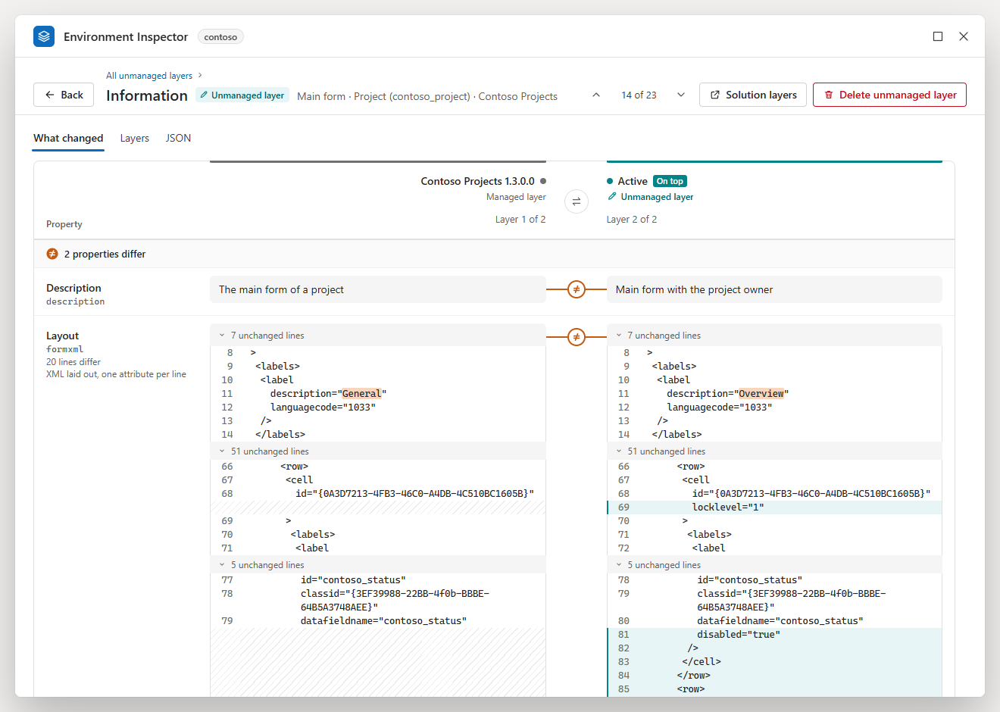

*The *What changed* tab of a main form: the page header (**Back**, "All unmanaged layers ›", the name with its teal
*Unmanaged layer* tag, the grey text, the pager "14 of 23", **Solution layers**, **Delete unmanaged layer**), then the
two layers as two lanes: Contoso Projects 1.3.0.0 (a managed layer, grey) on the left and Active, on top (the unmanaged
layer, teal) on the right, each with its place in the stack ("Layer 1 of 2"), **Swap** between them. "2 properties
differ": each named in words, then by its key (*Description* `description`, *Layout* `formxml`). *description* is
short, so its two values are boxes with the ≠ connector between them; *formxml* is laid out level by level, one
attribute per line ("20 lines differ", "XML laid out, one attribute per line": the Active layer adds `locklevel="1"`
to a cell that has one attribute in the managed layer, [9.4](#94-xml-laid-out-without-loss-prettyxml)) and its lines
are kept level on both sides ([9.7](#97-the-line-difference-difflines-folds-and-side-by-side)): what differs is marked,
a line only one side has is tinted with a hatched gap opposite, and the unchanged stretches are folded ("7 unchanged
lines", "51 unchanged lines", "5 unchanged lines").*

**What is compared.** Each layer's *All properties* (`msdyn_componentjson`): an entity whose `Attributes` are a list of
`{ Key, Value }`. `attrsOf` turns it into a `Map` from key to value, reading numbers exactly ([9.5](#95-json-indented-without-loss-indentjson-and-exact-numbers)). Because each
layer's whole component is compared, not only its *Changes*, any two layers can be compared, managed ones too.

`environment-inspector.js`, `compareRows`:

```js
function compareRows(L) {
  const A = L[sheet.a], B = L[sheet.b], ma = attrsOf(A.msdyn_componentjson), mb = attrsOf(B.msdyn_componentjson)
  // A web resource's content is one property, whichever way each layer holds it: in the layer (content) or as a
  // file of its own (contentfileref). The two can differ between layers. The content in effect (read by loadSheet) is
  // the top layer's, so it is given only to the top layer, and only when that layer's file is the file in effect (and
  // to the other layer too when both name that same file); any other file can't be read and is kept as a FileRef.
  if (lc(A.msdyn_solutioncomponentname || places(sheet.f)[sheet.place].kind) === 'webresource') {
    const cur = sheet.wrFile && !sheet.wrFile.error ? sheet.wrFile : null, ra = fileRefOf(ma), rb = fileRefOf(mb)
    const inEffect = (ref, l) => !!cur && ref === cur.ref && (l === L[0] || (ra === rb && (A === L[0] || B === L[0])))
    for (const [m, l, ref] of [[ma, A, ra], [mb, B, rb]]) {
      if (ref && !m.has('content')) m.set('content', inEffect(ref, l) ? cur.content : new FileRef(ref, l === L[0]))
      if (ref) m.delete('contentfileref')
    }
  }
  const keys = [...new Set([...ma.keys(), ...mb.keys()])]
  const rows = keys.map((k) => { const inA = ma.has(k), inB = mb.has(k); return { k, inA, inB, same: inA && inB && stable(ma.get(k)) === stable(mb.get(k)), system: isSystemKey(k), va: ma.get(k), vb: mb.get(k) } })
  rows.sort((x, y) => (x.same - y.same) || (x.system - y.system) || cmpText(x.k, y.k))
  return { A, B, ma, mb, rows }
}
```

* **Every key of either layer** is a row. A property found in one layer only has a dashed box, "Not in this layer", on
  the other side.
* **A web resource's content is one row**, named `content`, whichever way each layer holds it: in the layer
  (`content`, base64) or as a file of its own (`contentfileref`). There is no `contentfileref` row. The top layer,
  when its file is the one in effect (`sheet.wrFile`, [9.1](#91-reading-every-layer)), gets that content as its value (so does the other layer
  when both name that file); any other file becomes a `FileRef`, which is never shown. A layer that holds both keeps its own `content`. *Same* or not is then decided as for any
  property: the same base64 is *Same* whichever way each layer keeps it, and two layers that name the same file are
  *Same* too ([9.11](#911-web-resource-content-kept-as-a-file-contentfileref)).
* **Same or not** is decided on the values, not on how they are shown. `stable` writes a value as JSON with the keys of
  every object sorted, so objects with the same keys in another order are the same (as Solution Layers Explorer's
  `DeepEquals`). If a value cannot be written (nested too deeply), `stable` returns a random string, so the property
  counts as different rather than the same.
* **System values** are those Dataverse sets itself: `isSystemKey` is true for `modifiedon`, `modifiedby`,
  `modifiedonbehalfby`, `createdon`, `createdby`, `createdonbehalfby`, `versionnumber`, `overwritetime`, `solutionid`,
  `supportingsolutionid`, `componentstate`, `ismanaged`, `publishedon`, `organizationid` and any key ending in
  `idunique`. They almost always differ between layers and say nothing about the customization.
* **The order**: properties that differ first; within each group, ordinary properties before system values; then by
  name.

**Two lanes** (`lyCompare`). The two layers are the two lanes of a side-by-side sheet
([8.10](#810-the-comparisons-pages-levels-the-header-and-shared-parts)): `sheet.b` on the left, `sheet.a` on the right.
The layer the row is about (the unmanaged layer, or the managed layer on top: `layerRef`) is teal (`ely`), any other
grey (`elm`), and each keeps its colour when the two are swapped; the environments' blue and purple are never used
here. Each lane head (`lyHead`) names its layer (the solution's name and version, or *Active*), *On top* for the
component's top layer, its kind (*Unmanaged layer*, *Managed layer on top* with its teal glyph, or *Managed layer*) and
its place in the stack counted from the bottom, "Layer 2 of 3", the same number everywhere (the Layers tab's *Order*
column keeps `msdyn_order`). Its tooltip has the layer's order and publisher.

* **The pickers.** With more than two layers, each lane's "Layer 2 of 3" is a button that opens a list of every layer,
  top first, numbered by its place ("3 · Contoso Service 1.8.3.0", *Managed* or *Unmanaged* after it), the one in the
  other lane listed but not to be chosen ("On the right"). `lyPickOpen`, `lyPickKey` and `lyPickChoose` handle it:
  ↑, ↓, Home and End move (skipping the other lane's layer), Enter or Space chooses, Esc closes it, and Tab or
  Shift+Tab closes it and moves on. With exactly two layers there is nothing to choose: the lane heads only say their
  places.
* **Swap** ("Swap the two layers") exchanges the lanes, keeps the same properties and the system values shown as they
  were, and announces which layer is now on the left ("The Active layer is now on the left"). Choosing another layer, or
  **Compare with Active** (**Compare with top layer** for a managed layer on top,
  [9.8](#98-layers-and-json-tabs-children-tables)), starts a new comparison, folded again; after those two links and
  **JSON** in the Layers tab, the focus moves to the tab they open (`renderSheetBody` puts it back on the selected tab
  when the redraw took it away).
* **The groups.** First "N properties differ", the properties that differ (not system values); then, folded, "Show the N
  properties that are the same" (`lySame`, with their values quiet and their long values on one line with how many
  lines they have) and "Show the N system values that also differ · such as Modified on, which Dataverse sets itself"
  (`lySys`), whose group says *not counted*. With none that differ: "No property differs". Only one layer, or the
  same layer on both sides, gives a message instead of the sheet ("Only one layer", "Choose two different layers").

**The note on a managed layer on top.** For a managed layer on top ([6.11](#611-managed-layers-on-top)), `topNote` puts a teal note across the sheet,
under the lane heads and above the groups. It says that *T*'s layer is on top, so the component works as that solution sets it; that *T* was installed
after *S*, and importing *S* again doesn't move its layer up; and what to do for the component to work as *S* sets it
("For the component to work as *S* sets it, remove the component from *T* ..."): remove the component from *T* (or
change it there) and import that solution again as an upgrade, or uninstall it, or, when *T*
isn't yours to change, make the change in a solution installed after it. For a form, a site map or a model-driven app
(`MERGED`), it adds that the parts the solution on top doesn't change still come from the layers underneath. [A.5](#a5-messages)
has the text. *T* and *S* are display names, taken from the layers read now:

`environment-inspector.js`, `onTopIndex`, `layerRef` and `MERGED`:

```js
// For a managed layer on top: its index in the layers read now (-1: none, or the chosen solution's layer, or an
// unmanaged layer, is on top now).
function onTopIndex(L) {
  const f = sheet.f
  if (!f || !f.managedTop || !L.length || L[0].msdyn_solutionname === 'Active') return -1   // an unmanaged layer on top: as any unmanaged layer
  const own = new Set(f.holderUniques || [])
  return !own.has(L[0].msdyn_solutionname) && L.some((l) => own.has(l.msdyn_solutionname)) ? 0 : -1
}
// What the Layers tab compares the other layers with: the unmanaged layer, or else the managed layer on top (-1: none).
const layerRef = (L) => { const ia = L.findIndex((l) => l.msdyn_solutionname === 'Active'); return ia >= 0 ? ia : onTopIndex(L) }
// Why a managed layer on top is listed and how to change it, above its comparison.
const MERGED = { 60: 'A form', 62: 'A site map', 80: 'A model-driven app' }
```

* `onTopIndex` looks at the top layer read now, and gives 0 when it belongs to none of the solutions of the covered
  families (`holderUniques`) while one of theirs is underneath. *T* is that layer's solution, *S* the solution of the highest
  covered layer.
* Otherwise it gives -1, and there is no note: when, read again, a covered solution's layer is on top after all, on
  the other place of a relationship, or when an unmanaged layer is on top (a change made since the scan). The details
  then show the layers as for any component: no *Managed, on top* tag, and **Compare with Active** when there is an
  unmanaged layer.
* `loadSheet` uses it for the default pair ([9.1](#91-reading-every-layer)), the lane heads for the kind of the layer on top and its teal colour, the Layers tab for its tag and its links ([9.8](#98-layers-and-json-tabs-children-tables)).

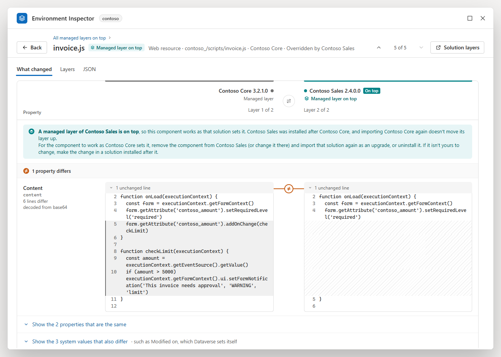

*The details of a managed layer on top: the web resource invoice.js of Contoso Core, overridden by Contoso Sales, as the
grey text says, with the teal *Managed layer on top* tag. *What changed* opens on Contoso Core 3.2.1.0 (grey, on the
left) against the layer on top, Contoso Sales 2.4.0.0 (teal, *On top*), under the teal note of `topNote` ("For the
component to work as Contoso Core sets it, remove the component from Contoso Sales …"); the lines of
the content show what the copy on top takes away from Contoso Core's version, and the same properties and the system
values that differ are folded below.*

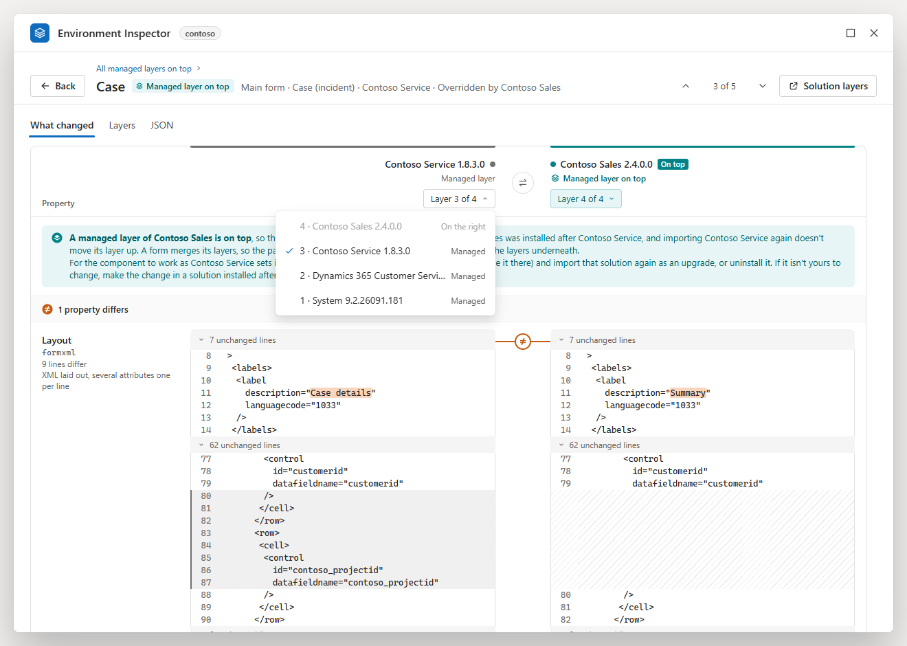

*A main form four layers deep, its left lane's picker open: every layer, top first, numbered from the bottom; the
layer in the other lane, "4 · Contoso Sales 2.4.0.0", is listed but can't be chosen ("On the right").*

**A property** (`lyRow`, `lyRowOf`). Each row is a row of the sheet (`sbsRow`): its label is the property in words
(`lyName(k, kind)`, the kind the layer's `msdyn_solutioncomponentname`), as the comparisons name it in that kind of
component (`cmpPropLabel(k, kind)`: `PROP_KIND` first, then `PROP_LABEL` and `PROP_MORE`; *Layout* for `formxml`,
*Form type* for a form's `type`, *On or off* for a process's `statecode` and *Status* for a view's or a plug-in step's,
[11.7](#117-the-results-and-the-details)), plus the names the comparisons don't read (`LY_MORE`: `formxmlmanaged` *Layout changes
(managed)*, `sitemapxmlmanaged` *Site map changes (managed)*, `appmodulexmlmanaged` *App changes (managed)*,
`contentjson` *Content (JSON)*, `contentfileref` *Content file*, `contentjsonfileref` *Content file (JSON)*) and a
label in each language (`name - LocalizedLabel` *Name in each language*, `description - LocalizedLabel` *Description
in each language*), else its key with a capital; then the key in monospace, the row's tooltip holding both on two lines
("Form type" and `type`), whole when the column cuts the name with "…"; and under them in grey *System value* for a system value, how many lines differ and what was done
to the text ("XML laid out, several attributes one per line", or "XML laid out, one attribute per line" after `xmlPair`, [9.4](#94-xml-laid-out-without-loss-prettyxml); "JSON indented", "decoded from base64"). If drawing a row fails, it
says "This value couldn't be shown (...). It is in the JSON tab." instead of breaking the tab.

**How a value is shown.** A web resource's `content` with a file that can't be read on at least one side
(`isWrContent`) goes to `contentSide` and `lyFile` ([9.11](#911-web-resource-content-kept-as-a-file-contentfileref)).
Any other property's two values, a web resource's `content` that both sides hold in the layer or as the file in effect
included, are turned into text with `valueView` ([9.3](#93-showing-a-value-valueview)) and shown in one of these forms:

| Values | Shown as |
| --- | --- |
| An image web resource on either side | Each side's image in its box, with its description under it ("image, 192 bytes") |
| Either text longer than 1,000,000 characters (`BIG`) | Each side's length in its box, and the note "This value is too large to compare here (N characters). Copy it to compare it in another tool." |
| Both texts on one line, at most 200 characters each | A box each (`sbsBox`), with **Copy**, the characters that differ marked, and the ≠ connector between them; "(empty)" for an empty value, a dashed box "Not in this layer" for a missing one; a value that `VALUE_LABEL` names (a process's or a plug-in step's `statecode`, when it is a plain number) in words, with the value after it: "On (1)" |
| A label in each language (`… - LocalizedLabel`) | As text (`lyLabels`, through `labelMap` and `labelText`): one language its text alone; several "English (1033): Labels form · French (1036): Formulaire", each side listing every language either layer has, empty where it has none, so a translation added in one layer is the only change. **Copy** and the JSON tab keep the value as stored; `valueView` itself still gives it as indented JSON, so *Compare environments* reads as before |
| A longer text, in one layer only | Its lines in its lane (the first 5,000 characters), each at its own indent (`lyCode`, the indent a share of the value's deepest, as in `sbsLines`), its wrapped rows 2 characters further in (`.ly-ln`: `padding-left:2ch;text-indent:-2ch`, plus 2ch in `.ly-ln.in`), so they can't be taken for lines of their own; `codeLine` puts a `<wbr>` before a dot and after an opening bracket or a comma (a carriage return's mark kept whole), so a long line breaks at a space or there before it breaks inside a word; a dashed box in the other |
| A longer text in both | The lines of both, level, across both lanes (`sbsLines`, `sbsLongRow`; [9.7](#97-the-line-difference-difflines-folds-and-side-by-side)), "N lines differ" under the label |
| The same value (in *Show the N properties that are the same*) | Quiet, without a box (`sbsQuiet`), = between them; a long one by its first line and how many lines it has |

Two values that `valueView` lays out the same while they differ are shown as stored instead
([9.6](#96-when-two-values-look-the-same)). A long value always gives `sbsLines` the same layer's text first,
whichever lane it is in, so **Swap** keeps the same rows and the folds opened in them.

### 9.3 Showing a value: `valueView`

`valueView` turns a property's value into the text compared on the screen. With `exact` set, it returns the value as
stored instead, for Copy ([9.9](#99-copy-and-download)) and for values that look the same once laid out ([9.6](#96-when-two-values-look-the-same)).

`environment-inspector.js`, `valueView`:

```js
const WR_IMAGE = { 5: 'image/png', 6: 'image/jpeg', 7: 'image/gif', 10: 'image/x-icon' }
// A property's value as text for comparing; web resource content decoded (images are shown as images).
// exact: the value as stored, not laid out (web resource content still decoded), for Copy.
function valueView(key, v, attrs, kind, exact = false) {
  if (lc(kind) === 'webresource' && key === 'content' && typeof v === 'string' && /^[A-Za-z0-9+/=\s]*$/.test(v)) {
    const t = Number(scalarText(attrs.get('webresourcetype'))), bytes = Math.round(v.replace(/\s/g, '').length * 3 / 4)
    if (WR_IMAGE[t]) return exact ? { text: v } : { image: `data:${WR_IMAGE[t]};base64,${v.replace(/\s/g, '')}`, text: `(image, ${bytes.toLocaleString()} bytes)` }
    if (t === 8) return { text: exact ? v : `(Silverlight file, ${bytes.toLocaleString()} bytes)` }
    const d = b64Text(v)
    if (d != null) { const x = !exact && [4, 9, 11, 12].includes(t) ? prettyXml(d) : null; return x ? { text: x, note: 'decoded from base64', xml: d } : { text: d, note: 'decoded from base64' } }
  }
  const text = scalarText(v)
  if (typeof v === 'string' && !exact) {
    const t = text.trim()
    if (t.startsWith('<') && t.endsWith('>')) { const x = prettyXml(t); if (x) return { text: x, note: XML_NOTE[2], xml: t } }
    if ((t.startsWith('{') && t.endsWith('}')) || (t.startsWith('[') && t.endsWith(']'))) { const j = parseJson(t); if (j && typeof j === 'object') { const x = indentJson(t); if (x) return { text: x, note: 'JSON indented' } } }
  }
  return { text }
}
```

**Web resource content.** A web resource's `content` is its file in base64. It is shown according to the web
resource's type (`webresourcetype`, read from the same layer):

| Type | Shown as |
| --- | --- |
| 5 PNG, 6 JPG, 7 GIF, 10 ICO | The image, and "(image, N bytes)" as its text |
| 8 Silverlight (XAP) | "(Silverlight file, N bytes)" |
| 4 XML, 9 XSL, 11 SVG, 12 RESX | The decoded text, laid out as XML ([9.4](#94-xml-laid-out-without-loss-prettyxml)) when it parses |
| 1 HTML, 2 CSS, 3 JavaScript, any other | The decoded text |

`b64Text` decodes the base64 (white space removed) as UTF-8 and drops a byte order mark; invalid byte sequences are
replaced, not fatal. Content that is not valid base64 is shown as stored. The byte count comes from the base64 length,
so it may be up to two bytes too high.

When Dataverse keeps a layer's content as a file, the layer holds `contentfileref` instead of `content`. When the layer
is the top one and its file is the one in effect, `compareRows` gives it the content in effect, read from the web
resource itself, as its `content` value, so `valueView` shows it the same way. Any other file is a `FileRef`, which
never reaches `valueView` ([9.11](#911-web-resource-content-kept-as-a-file-contentfileref)).

**Images.** An image is shown from a `data:` address built from the content, and only when the content holds only
base64 characters (the test at the start of `valueView`) and the web resource's type is one of the four in `WR_IMAGE`.
The image type in the address comes from that fixed list, never from the content. The address is escaped and put in an
`` element, which runs no script, on a chequered background (so transparent parts show) and at most 280 x 200 px.
SVG web resources are not in the list: they are compared as XML text.

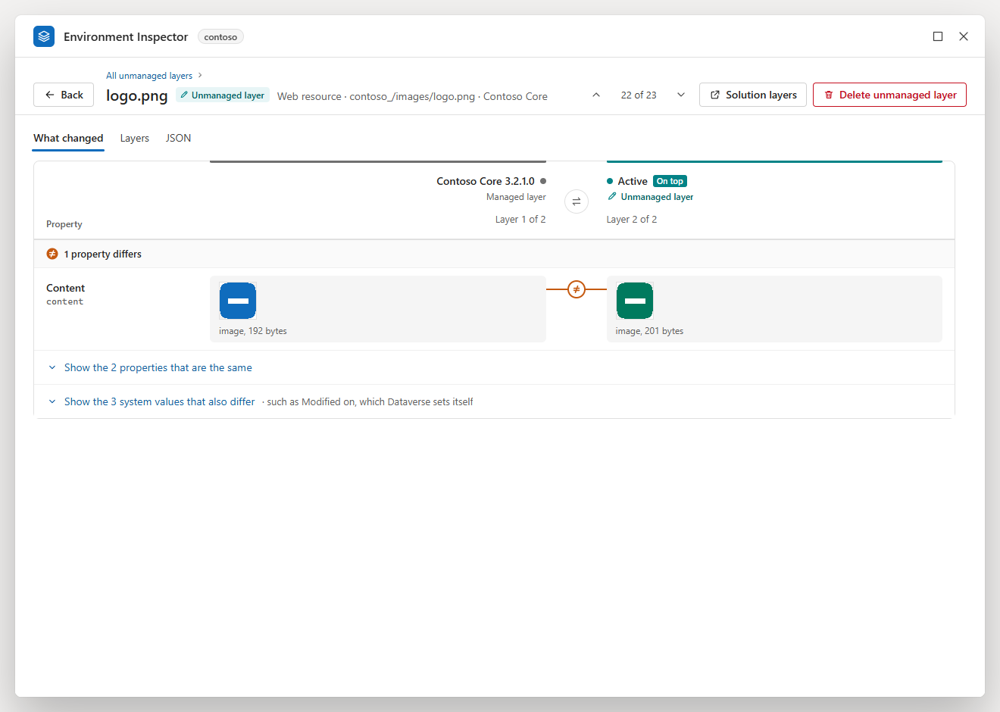

*An image web resource: the managed layer's image and the unmanaged layer's, each in its lane's box with its description
under it ("image, 192 bytes", "image, 201 bytes"), the ≠ connector between them.*

**Other values.** `scalarText` writes a value of the layer data as text:

| Value | Text |
| --- | --- |
| `null` or missing | Empty |
| Text, number, true or false | As it is. A number that JavaScript cannot hold exactly as written (an `ExactNumber`, [9.5](#95-json-indented-without-loss-indentjson-and-exact-numbers)) keeps its text, for example `1.0` or `12345678901234567890` |
| A lookup `{ Id, LogicalName, Name }` | "contact 1b2c... (Name)" |
| A choice or a money value `{ Value }` | The value |
| A managed property `{ Value, CanBeChanged }` | "true (can be changed: false)" |
| Any other object or list | JSON indented by two spaces (`safeJson`), with exact numbers written as written, without quotes |

Below 40 levels of nesting it calls itself for an inner `Value`; deeper, it writes JSON at once.

`environment-inspector.js`, `scalarText`:

```js
function scalarText(v, depth = 0) {
  if (depth > 40) return safeJson(v)
  if (v === null || v === undefined) return ''
  if (typeof v !== 'object' || v instanceof ExactNumber) return String(v)
  if ('Id' in v && 'LogicalName' in v) return `${v.LogicalName} ${v.Id}${v.Name ? ` (${v.Name})` : ''}`   // a lookup
  const keys = Object.keys(v)
  if (keys.length === 1 && 'Value' in v) return scalarText(v.Value, depth + 1)   // a choice or a number
  if ('Value' in v && 'CanBeChanged' in v) return `${scalarText(v.Value, depth + 1)} (can be changed: ${v.CanBeChanged})`   // a managed property
  return safeJson(v, 2)
}
```

**Text that is XML or JSON.** A text value that starts with `<` and ends with `>` is laid out as XML ([9.4](#94-xml-laid-out-without-loss-prettyxml)); one that
starts with `{` or `[`, ends with `}` or `]` and parses as JSON is indented ([9.5](#95-json-indented-without-loss-indentjson-and-exact-numbers)). When the layout fails (not
well-formed, too large), the text is shown as stored. Forms, views, charts, site maps, ribbons and process definitions
are stored as XML text, and many newer properties as JSON text, so most long values are laid out.

### 9.4 XML laid out without loss: `prettyXml`

Form XML, FetchXML and similar values are stored on one long line. Compared as they are, any change would make the
whole value one changed line. `prettyXml` puts each element, and each attribute of an element with several, on its own
line, and changes nothing else. Its comment states the rule: "Only the spacing between elements changes. Text is kept
exactly as written, and an element whose text matters (text mixed with elements, or xml:space="preserve") is kept as
written on one line, so that two different values never look the same."

For example, `<tab name="general" showlabel="true"><labels><label description="General" languagecode="1033" /></labels></tab>`
is shown as:

```xml
<tab
    name="general"
    showlabel="true"
>
  <labels>
    <label
        description="General"
        languagecode="1033"
    />
  </labels>
</tab>
```

A change of `description` is now one changed line, and the marked part ([9.7](#97-the-line-difference-difflines-folds-and-side-by-side)) is the word that changed.

`environment-inspector.js`, `prettyXml0` (the walk; `prettyXml(t, split)` calls it, keeping the layouts of the latest 8
values of 20,000 characters or more in `xmlMemo`, as a page drawn again lays them out again):

```js
const walk = (n, d) => {
  const pad = '  '.repeat(d)
  if (n.nodeType === 1) {
    const at = attrs(n), kids = [...n.childNodes]
    const head = at.length && at.length >= split ? [`${pad}<${n.nodeName}`, ...at.map((a) => `${pad}    ${a}`), pad] : [`${pad}<${n.nodeName}${at.length ? ' ' + at[0] : ''}`]
    if (!kids.length) { head[head.length - 1] += head.length > 1 ? '/>' : ' />'; out.push(...head); return }
    // Text only, text among elements, spacing within a line (such as a space between two words in SVG text), or
    // spacing that must be kept: the content exactly as written. Line breaks and indentation between elements go.
    if (n.getAttribute('xml:space') === 'preserve' || kids.every(texty) || kids.some((c) => texty(c) && (!blank(c) || !/[\r\n]/.test(c.nodeValue)))) { head[head.length - 1] += `>${kids.map(flat).join('')}</${n.nodeName}>`; out.push(...head); return }
    head[head.length - 1] += '>'
    out.push(...head)
    for (const c of kids) if (!blank(c)) walk(c, d + 1)   // only the spacing between elements is left out
    out.push(`${pad}</${n.nodeName}>`)
  } else { const s = flat(n); if (s) out.push(pad + s) }
}
```

**The rules.**

* **Parsing.** The value is parsed by the browser's `DOMParser` as XML, which runs no scripts. A value that is not
  well-formed gives `null` and is shown as stored.
* **Elements.** Each element starts a line, indented two spaces per level. With two or more attributes (`split`), each
  is on its own line, four spaces further in, and the element's `>` or `/>` is on a line of its own at the element's
  indent, so adding or removing the last attribute is one line added or removed; with one, it stays on the element's
  line, and an empty element ends with ` />`.
* **Pairs** (`xmlPair`, for the two sides of a comparison). When an element has one attribute on one side and several
  on the other, its one-attribute line would show as changed although its attribute didn't. When such a line isn't
  found on the other side, both values are laid out again with `split` 1 (every attribute on its own line), and that
  layout is kept if it gives fewer changed lines; the note then says "XML laid out, one attribute per line" (otherwise
  "XML laid out, several attributes one per line", `XML_NOTE`). The latest 4 pairs' choices are kept.
* **Attributes** keep their order and are written with `escAttr`, which writes a tab, a line feed and a carriage return
  inside a value as `&#9;`, `&#10;` and `&#13;`. An XML parser turns a literal line break in an attribute value into a
  space, so a line break written as a reference is a different value, and it stays visibly different.
* **Text.** An element with only text, text mixed with elements, spacing within a line between its children (a space
  between two words in SVG text), or `xml:space="preserve"` is written on one line as written (`flat`), apart from line
  breaks in its own text. Only white space with a line break between elements (the original's indentation) is left out.
* **Comments, CDATA sections and processing instructions** are kept as they are.
* **The XML declaration** is not part of the parsed document, so it is copied from the start of the value.
* **A DOCTYPE** makes `prettyXml` give up ("a DOCTYPE can add default attributes"): the value is shown as stored.
* **Text is escaped** with `escXml`, so the result is XML source again. When drawn, it is escaped once more for HTML
  (`escLine`), so `&amp;` in the value shows as `&amp;`.

**What can still differ.** The layout is the same for values the XML parser reads the same way: `&#65;` and `A`, single
and double quotes around attributes, spacing inside a tag, line endings. When two different values look the same after
layout, they are shown as stored instead ([9.6](#96-when-two-values-look-the-same)).

**Limits.** A value over 3,000,000 characters is not parsed, and a result over 200,000 lines is not used. A document
nested deeply enough to overflow the stack is caught (`try` around the walk). All three are shown as stored.

### 9.5 JSON indented without loss: `indentJson` and exact numbers

**Why not `JSON.stringify(JSON.parse(text), null, 2)`.** Parsing and writing JSON again changes it: numbers become
JavaScript numbers (`12345678901234567890` becomes `12345678901234567000`, `1.50` becomes `1.5`), keys that look like
whole numbers move to the front of their object (`{"b":1,"2":2}` becomes `{"2":2,"b":1}`), and of two equal keys only
the last is kept. A comparison must neither show such changes nor hide them, so `indentJson` indents the text as
written.

`environment-inspector.js`, `indentJson`:

```js
// JSON indented without changing it: numbers, strings and the order of keys stay exactly as written (parsing and
// writing it again would round large numbers and reorder some keys). t must be valid JSON.
function indentJson(t) {
  const str = /"(?:\\.|[^"\\])*"/y
  let out = '', depth = 0
  const nl = () => '\n' + '  '.repeat(depth)
  for (let i = 0; i < t.length; i++) {
    const c = t[i]
    if (c === '"') { str.lastIndex = i; const m = str.exec(t); if (!m) return null; out += m[0]; i += m[0].length - 1 }
    else if (c === '{' || c === '[') {
      let j = i + 1
      while (/[ \t\r\n]/.test(t[j] || '')) j++
      if (t[j] === (c === '{' ? '}' : ']')) { out += c + t[j]; i = j } else { depth++; out += c + nl() }
    } else if (c === '}' || c === ']') { depth--; out += nl() + c }
    else if (c === ',') out += ',' + nl()
    else if (c === ':') out += ': '
    else if (!/[ \t\r\n]/.test(c)) out += c
  }
  return out
}
```

* Strings are copied whole with a sticky regular expression, escapes included: nothing inside a string is touched.
* An opening bracket starts a new line one level deeper; an empty `{}` or `[]` stays on one line. A comma ends the
  line; a colon becomes `": "`.
* White space outside strings is dropped; numbers, `true`, `false` and `null` are copied character for character, so
  `{"f":1.50,"big":12345678901234567890}` keeps `1.50` and every digit.
* It is only called on text that `JSON.parse` accepted, so it never sees broken JSON.

**Exact numbers in parsed data.** The layer data itself (`msdyn_componentjson`, `msdyn_changes`) has to be parsed, to
find the properties and compare their values. Parsed as usual, a number becomes a JavaScript number and loses how it
was written: `12345678901234567890` becomes `12345678901234567000`, `0.1234567890123456789` loses its last digits,
`1e2` becomes `100`, and `1.0` and `1.50` become `1` and `1.5`. So `parseJson` passes a reviver, `exactNumbers`, that
keeps every such number as written.

`environment-inspector.js`, `ExactNumber`, `exactNumbers`, `parseJson` and `safeJson`:

```js
// Reads JSON as Dataverse wrote it: a number JavaScript cannot hold exactly as written (a whole number above 2^53,
// such as a relationship's cascade mask, a long fraction, an exponent) is kept as written, in an ExactNumber, so it is
// shown, copied and compared exactly, and never taken for a string with the same digits.
class ExactNumber {
  constructor(s) { this.s = s }
  toJSON() { return '\u0000#' + this.s }   // compared and fingerprinted apart from any string; safeJson writes it back as a number
  toString() { return this.s }
}
const exactNumbers = (k, v, c) => (typeof v === 'number' && c && typeof c.source === 'string' && JSON.stringify(v) !== c.source ? new ExactNumber(c.source) : v)
// ...
const parseJson = (t) => { try { return t ? JSON.parse(t, exactNumbers) : null } catch { return null } }
// ...
const safeJson = (v, n) => { try { return JSON.stringify(v, null, n).replace(/"\\u0000#([-+.0-9eE]+)"/g, '$1') } catch { return String(v) } }   // exact numbers written back as numbers
```

* **Which numbers.** The reviver's third argument (`c.source`, the number as written) is a newer JavaScript feature
  that Edge supports. A number is kept as written when JavaScript would write it back differently
  (`JSON.stringify(v) !== c.source`): the examples above, and `-0`. A number that comes back the same, such as `7` or
  `0.1`, stays a plain JavaScript number. In a browser without `c.source`, every number stays a plain number.
* **Shown and copied as written.** `ExactNumber` holds the text (`s`), and `toString` gives it back: `scalarText`
  shows `1.0` as `1.0` ([9.3](#93-showing-a-value-valueview)), and Copy copies it so ([9.9](#99-copy-and-download)).
* **Compared as written, and never as a string.** `stable` (the comparison of two layers, [9.2](#92-comparing-two-layers)) and `managedPrint`
  (the check after a removal that the managed layers' values did not change, [10.6](#106-after-each-place-the-checks)) write values with
  `JSON.stringify`, which calls `toJSON`: an exact number becomes a marker, the character U+0000 and `#`, followed by the
  number as written. So `1.0` differs from the number `1`, and also from the text `"1.0"`, which has the same digits.
* **Written back as numbers.** `safeJson` writes a value as JSON for the screen and for Copy (`scalarText`, [9.6](#96-when-two-values-look-the-same)),
  and turns each marker back into the number as written, without quotes: `{ "a": 1.0, "b": "1.0" }` stays exactly
  that, indented.

**Colours in the JSON tab.** `highlightJson` marks keys (`k`), strings (`s`), numbers (`n`) and `true`, `false` and `null` (`b`),
which the details and the comparisons' JSON tabs colour with neutral tokens, never a status's colour: keys `--brand-p`,
strings `--fg1`, the rest `--fg3` ([8.1](#81-shadow-dom-and-styles)):

`environment-inspector.js`, `highlightJson`:

```js
function highlightJson(t) {   // only for valid JSON (indentJson of JSON that parsed): outside strings there are only brackets, numbers and words
  if (t.length > 500000) return esc(t)
  return t.replace(/("(?:\\.|[^"\\])*")(\s*:)?|\b(?:true|false|null)\b|-?\d+(?:\.\d+)?(?:[eE][+-]?\d+)?/g, (m, str, colon) => (str ? `<span class="${colon ? 'k' : 's'}">${esc(str)}</span>${colon || ''}` : /^[tfn]/.test(m) ? `<span class="b">${m}</span>` : `<span class="n">${m}</span>`))
}
```

Its output goes into the page as HTML, so it must never let markup through. Strings are escaped with `esc`; everything
else is left as it is. That is safe only because the text is valid JSON: outside strings, valid JSON holds only
brackets, commas, colons, white space, digits, signs, decimal points, exponents and the words `true`, `false` and
`null`, none of which is markup. So `renderJsonTab` calls it only for text that parsed, and escapes anything else with
`esc`. Above 500,000 characters the text is shown escaped and without colours, because the replacement and the many
`<span>` elements would slow the page.

### 9.6 When two values look the same

Laying values out makes them easier to read, and also makes some different values look the same. XML values that
differ only in spacing inside a tag, in how a character is written (`&#65;` or `A`), in a literal line break inside an
attribute, or in line endings (the XML parser normalizes them); XML or JSON with extra spaces at the start or end (the
layout works on the trimmed text); JSON that differs only in spacing; a lookup that differs only in a field its short
form leaves out; a number and a text with the same digits (`1` and `"1"`, or `1.0` and `"1.0"`). The property would be
counted as differing and its two values would show nothing different.

`lyRowOf` notices this case (the values are not the same by `stable`, neither is an image, but their texts are
equal) and shows both as stored.

`environment-inspector.js`, `asStored`:

```js
// Two different values that look the same once laid out (spacing only, or details the short form leaves out): both
// shown as stored instead, so the difference can be seen.
function asStored(r, kind, c) {
  let a = valueView(r.k, r.va, c.ma, kind, true), b = valueView(r.k, r.vb, c.mb, kind, true)
  if (a.text === b.text) { a = { text: safeJson(r.va, 2) }; b = { text: safeJson(r.vb, 2) } }   // as JSON: a string shows its quotes, a number not
  const eol = (x) => x.replace(/\r\n?/g, '\n'), note = a.text !== b.text && eol(a.text) === eol(b.text) ? 'only the line endings differ (CR shows a Windows line ending)' : 'shown as stored: laid out, the two look the same'
  return [{ ...a, note }, { ...b, note }]
}
```

1. First, `valueView` with `exact`: the stored text, web resource content still decoded.
2. If those are still equal (a lookup's short form, a number and a text with the same digits, or two web resource
   contents that decode to the same text), both raw values are written as JSON with `safeJson` ([9.5](#95-json-indented-without-loss-indentjson-and-exact-numbers)): a text in
   quotes, with its line breaks written as `\n`; a number without quotes, exactly as written; an object whole, indented.
3. The note goes under the property's label, and under a pair of short values: "only the line endings differ (CR
   shows a Windows line ending)", or "shown as stored: laid out, the two look the same".

**Line endings made visible.** Values are split into lines at line feeds, so a Windows line ending leaves a carriage
return at the end of each line. `escLine`, which escapes every line of a difference and every short value, draws it as
"␍" (U+240D) in grey, with the tooltip "Carriage return (CR)", so "a difference in line endings alone can be seen".

**When two values only differ in type.** The number `1` and the text `"1"` are different values (`stable` writes them
differently), but both show as `1`. Step 2 shows them as JSON: `1` and `"1"`, the text with its quotes. The same holds
for an exact number and a text with the same digits (`1.0` and `"1.0"`), because `stable` never takes an `ExactNumber`
for a text ([9.5](#95-json-indented-without-loss-indentjson-and-exact-numbers)).

### 9.7 The line difference: `diffLines`, folds and side by side

**The algorithm.** `diffLines` compares two lists of lines with the Myers algorithm, the one most `diff` tools use: it
finds a shortest list of line removals and additions that turns the first list into the second. Past its limit, it
lines the two lists up on the lines each has exactly once, and compares the stretches between them the same way.

`environment-inspector.js`, `diffLines` (its comment and the step that goes past the limit):

```js
// Line differences. Each step: [0 same | -1 removed | 1 added, line in a, line in b]. The lines both start and end with
// are taken out, the rest goes to Myers' shortest edit, which stops at 2,000 edits (about 1,000 changed lines: its memory
// grows with their square). Past that, the lines found exactly once on each side, kept in the same order on both, line
// the value up, and each stretch between two of them is compared the same way (its own lines found once included). A
// stretch whose two sides have no line in common is its removed lines, then its added ones, as Myers would give it. A
// stretch that has lines in common but still can't be lined up is given the same way, each of those steps marked
// with a fourth element (1), and the result's far is true: the caller says so and doesn't pair those lines.
function diffLines(a, b) {
  // ...
      else if (!myers(a0, ea, b0, eb)) {
        const an = depth < 40 ? anchors(a0, ea, b0, eb) : Object.assign([], { shared: true })
        if (!an.length && !an.shared) {   // no line in both: all removed, then all added, is the shortest difference (paired, as Myers gives it)
          for (let i = a0; i < ea; i++) ops.push([-1, i, -1])
          for (let j = b0; j < eb; j++) ops.push([1, -1, j])
        } else if (!an.length) {   // lines in both, but nothing to line them up on: its lines given as they are, not paired
          far = true
          for (let i = a0; i < ea; i++) ops.push([-1, i, -1, 1])
          for (let j = b0; j < eb; j++) ops.push([1, -1, j, 1])
        } else {
          let pa = a0, pb = b0
          for (const p of an) { run(pa, p.i, pb, p.j, depth + 1); ops.push([0, p.i, p.j]); pa = p.i + 1; pb = p.j + 1 }
          run(pa, ea, pb, eb, depth + 1)
        }
      }
  // ...
}
```

1. **Same start and end.** The lines a stretch starts and ends with on both sides are taken out first. Most
   customizations change a few lines in the middle of a long value, so the search often works on a short part.
2. **The search** (`myers`). For each number of edits `D` from 0 up, every path is extended as far as equal lines allow,
   until one reaches the end of both lists. A copy of the frontier is kept for each `D` (`snaps`), and the steps are
   found by walking back through them.
3. **The limit.** The search stops at 2,000 edits. Its time grows with the length times `D`, and the copies of the
   frontier take memory in proportion to `D` squared (about 4 million numbers at 2,000).
4. **Past the limit** (`anchors`). The lines found exactly once in the stretch on each side, in the longest run that
   keeps the same order on both (patience sorting), line it up; each stretch between two of them goes through steps 1
   to 4 again, 40 levels deep at most. A stretch whose two sides have no line in common at all (`anchors` tells it by
   `shared`) is given as all its removed lines, then all its added lines, paired as Myers would, and counted with the
   others at any size ("1,500 lines differ"). A stretch that has lines in common but none found once on each side is
   given the same way, unpaired, each step marked, and the result's `far` is true. `sbsRows` then counts each side's
   lines in that part (`fl`) and the lines that differ where the value is lined up (`lined`), and `sbsLines` says, in
   the lanes' order: "12 lines differ; a part with too many changes isn't lined up (900 lines in Contoso Dev, 3,400 in
   Contoso Test)" when lines that differ were lined up, "A part with too many changes isn't lined up (…)" when the
   lines lined up are all the same, and "Too many changes to line them up (…)" when no line of the value is lined up
   (`some`). Before, a value past the limit showed every line as changed (about 19,990 lines for a 20,000-line value
   with about 1,050 changed).
5. **The result** is a list of steps `[kind, line in a, line in b]` (`0` same, `-1` removed, `1` added), in order.

As a rough figure, two texts of 100,000 lines that differ in 999 lines (1,998 removed and added lines, just under the
limit) are compared in about 50 ms on a desktop computer. `sbsLines` keeps the rows of the latest 6 values drawn
(`sbsMemo`, by the fold's key), so a value drawn again with the same lines (Swap, a fold, the pager back) isn't compared
again.

**Sides and counts.** `lyRowOf` passes the two layers' lines to `sbsLines` in one order, the layer higher in the stack
first, whichever lane each is in; `sbsLines`
calls `diffLines` ([8.10](#810-the-comparisons-pages-levels-the-header-and-shared-parts)); each side is then drawn in its lane,
whichever lane that is, so **Swap** changes nothing but the lanes. A compared record (D3) and a compared component (E3)
use the same `sbsLines`, their two environments as the two sides. "N lines differ" counts the rows with a change:
each pair of a removed and an added line, and each line only one side has.

**The changed part of a line.** In each block the first removed line is paired with the first added line, the second
with the second, and so on. `markPair` finds what a pair has in common at the start and at the end, and marks the rest
with `<mark>` (`--dif-m`, the same on both sides). A pair with nothing in common at either end is not marked: the whole
line is the change.

**Level lines.** `sbsLinesHtml` draws the steps as rows of two cells, one per lane, so both sides stay level: paired
lines share a row, each row as tall as its taller side; a line only one side has is tinted in its lane's colour with a
2 px edge, and the other side's cell is a hatched gap. Long lines wrap (they never make the page scroll sideways), and a
line's leading spaces become its indent, so a wrapped line goes on under its own start. The indent is drawn as a share
of the deepest one in the whole value, both sides and folded lines included (`lineIn`, `--in` and `--mx`): each
nesting level keeps its own step, the deepest line never takes more than a fifth of the lane, and opening a fold moves
nothing. Each cell has its line number
(`rs-no`), except in a text shown whole. A line feed alone ends a line; a carriage return before it shows as ␍
(`escLine`).

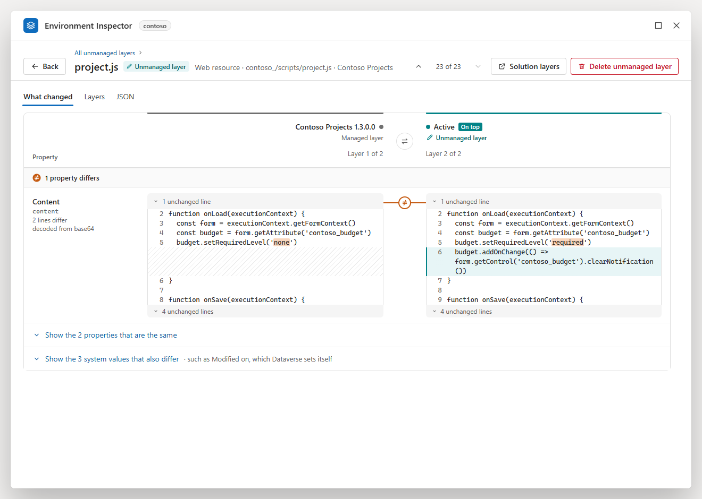

*A JavaScript web resource, decoded from base64: a changed line on each side, with the changed word marked, and a line
only the unmanaged layer has, tinted teal with its edge, a hatched gap opposite. "2 lines differ". The unchanged lines
around the change are folded ("1 unchanged line", "4 unchanged lines"), and the same properties and the system values
that differ are folded below.*

**Folds.** `sbsLinesHtml` keeps every changed line and three lines around it, and folds each other stretch of unchanged
lines into a button ("36 unchanged lines") across both lanes. Selecting a fold draws those lines in its place
(`sbsUnfold`), and the value takes the focus.

`environment-inspector.js`, `sbsLinesHtml` (the start):

```js
function sbsLinesHtml(id) {
  const d = sbsDiffs.get(id), { rows, sides, whole } = d, n = rows.length, keep = new Uint8Array(n), out = []
  for (let i = 0; i < n; i++) if (whole || rows[i].x) for (let j = Math.max(0, i - 3); j <= Math.min(n - 1, i + 3); j++) keep[j] = 1
  if (whole) keep.fill(1)
  let drawn = 0, cut = 0
  for (let i = 0; i < n;) {
    let j = i
    while (j < n && keep[j] === keep[i]) j++
    if (keep[i] || d.open.has(i)) {
      for (let k = i; k < j; k++) { if (drawn >= MAX_LINES) { cut = n - k; break } out.push(rows[k]); drawn++ }
      if (cut) break
    } else out.push({ fold: [i, j] })
    i = j
  }
  // ...
}
```

* Each long value drawn is kept in `sbsDiffs` under a number that its fold buttons carry (`data-lv`, `data-from`);
  the folds opened are kept apart (`sbsKept`), so drawing the details again (another fold, a layer picker, **Swap**,
  the same properties shown) keeps them open ([8.10](#810-the-comparisons-pages-levels-the-header-and-shared-parts)).
  Only the long values of the page shown are held (`sbsClaim`).
* **At most 3,000 lines** are drawn per long value (`MAX_LINES`), folds not counted; the rest is replaced by "N more
  lines of this difference aren't shown. Copy the values to compare them in another tool."
* A long property that is the same is shown, among the same properties, by its first line and how many lines it has.

### 9.8 Layers and JSON tabs, Children tables

**Layers.** `renderLayersTab` lists the layers of the place as the maker portal's *Solution layers* page does, top
first.


*The *Layers* tab of a main form: the unmanaged layer (order 2, *Unmanaged*, last published on 2026-10-09, 3 changed
properties) over the managed layer of Contoso Projects 1.3.0.0. **JSON** opens a layer's data; **Compare with Active** compares the managed layer
with the unmanaged one.*

| Column | From |
| --- | --- |
| Order | `msdyn_order` |
| Solution | The solution's display name, and its unique name under it; for the unmanaged layer, "Active" and "Unmanaged customizations" |
| Publisher | `msdyn_publishername`; in a narrow window, under the solution's name |
| Layer | A tag: *Unmanaged* (teal, with the outline pencil) or *Managed* (grey); for a managed layer on top, *Managed, on top* (teal, with the outline layers) on the layer that `onTopIndex` finds ([9.2](#92-comparing-two-layers)) |
| Version | The solution's version, taken from the list of managed solutions read at the start (`solVersion`); empty for the unmanaged layer; in a narrow window, under the solution's name after the publisher |
| Overwrite time | `msdyn_overwritetime` in the browser's local format. The unmanaged layer always carries 1900-01-01, so its row shows `activeWhen` instead: the last change with *Last changed* under it (*Last changed by &lt;name&gt;* when the layer names the user, `modifiedby`, whose name `loadSheet` read), or for a form the last publish with *Last published*, and a tooltip that says where it comes from; "—" when its data holds neither (relationships) |
| Changed properties | The number of properties in `msdyn_changes` (`changedKeys`) |
| (actions) | **Compare with Active** (on the other layers, when there is an unmanaged layer): *What changed* with that layer in the left lane and the unmanaged layer in the right one; in the narrowest window it reads **Compare** (its accessible name and tooltip stay "Compare with Active"). For a managed layer on top whose place has no unmanaged layer, **Compare with top layer** does the same with the layer on top on the right (`layerRef`). **JSON**: the *JSON* tab on that layer. The two links stack when the column is narrow |

**Narrow windows.** The table fits the window down to its narrowest (720 pixels) without scrolling sideways. Its
headers wrap, the date and the time of a cell each stay whole but can go on two lines (`whenHtml`), the two links stack,
and a long solution name ends with "…" (the whole name in its tooltip). The table sits in a `.ltw` box that CSS
container queries measure: below 860 pixels the *Publisher* and *Version* columns are hidden and the same values show
under the solution's name in a small grey line (`.nar`), with less padding; below 700 pixels **Compare with Active**
(and **Compare with top layer**) reads **Compare**.

`environment-inspector.js`, `whenHtml`:

```js
// The same in the Layers tab, the date and the time each kept whole: a narrow window puts them on two lines.
const whenHtml = (t) => {
  const s = when(t), d = s === '—' ? '' : new Date(t).toLocaleDateString(), m = d && s.startsWith(d) && /^([,\s]*)(\S.*)$/.exec(s.slice(d.length))
  return s === '—' ? s : m ? `<span class="d">${esc(d + m[1].trim())}</span> <span class="d">${esc(m[2])}</span>` : `<span class="d">${esc(s)}</span>`
}
```

**The unmanaged layer's date.** Dataverse dates the unmanaged layer's overwrite time 1900-01-01, but the layer's own
data (*All properties*, then *Changes*) holds the component's `modifiedon`: the last time it was saved, usually the
unmanaged change. A form holds `publishedon`, its last publish, instead; a relationship holds neither. For a record
type the managed layers carry the same `modifiedon`: it is the component's, not the layer's. Table and column layers
write these times without a zone; they are UTC, so `activeWhen` adds the `Z`.

**And by whom.** With `modifiedon`, a record type's layer data holds `modifiedby`: the user who saved the component
last, as `{ Id, LogicalName: "systemuser", Name: null }`, with no name. `activeWhen` returns its id as `by`;
`loadSheet` reads the user's `fullname` once per user (`userNames`, request 19 of [A.2](#a2-web-api-requests)) and waits for it 3 seconds at most;
the row reads *Last changed by &lt;name&gt;*, with the user in the tooltip. A long name wraps onto two lines at most
(`.who`: 220 pixels wide, then "…"). When the name is not there in time the date stands alone, and a later answer is
kept for the next time. Only "no access" (403) and "no such user" (404) are remembered as no name; any other failure
is tried again next time. Forms, tables, columns and relationships hold no
`modifiedby`. Like the date, it is the last save: usually, not always, the author of the unmanaged change.

`environment-inspector.js`, `activeWhen`:

```js
// When the unmanaged layer was last changed, and by whom. Dataverse gives it no overwrite time (1900-01-01), but its
// data holds the component's last save, modifiedon, and the user who made it, modifiedby (a form holds only
// publishedon, its last publish; tables, columns and relationships record no user, relationships no date either).
// Table and column layers write these times without a zone: they are UTC. by: the user's id, or ''.
function activeWhen(l) {
  for (const t of [l.msdyn_componentjson, l.msdyn_changes]) {
    const m = attrsOf(t)
    for (const [k, label, tip] of [['modifiedon', 'Last changed', 'when the component was last saved (modifiedon): usually the unmanaged change, though a later import or publish also sets it'], ['publishedon', 'Last published', 'when it was last published (publishedon)']]) {
      const v = m.get(k)
      if (typeof v === 'string' && /^\d{4}-\d\d-\d\dT\d\d:\d\d/.test(v) && !/^1900/.test(v)) {
        const u = k === 'modifiedon' && m.get('modifiedby'), by = u && typeof u === 'object' && typeof u.Id === 'string' && GUID.test(u.Id) ? lc(u.Id) : ''
        return { at: /(Z|[+-]\d\d:?\d\d)$/i.test(v) ? v : v + 'Z', label, tip: `Dataverse gives an unmanaged layer no overwrite time. This is ${tip}.`, by }
      }
    }
  }
  return null
}
```

**JSON.** `renderJsonTab` shows one layer's raw data, as Solution Layers Explorer's *Changes*, *All properties* and
*Children* tabs do. A drop-down picks the layer; **Changes** (`msdyn_changes`, what this layer changes), **All
properties** (`msdyn_componentjson`, the component as this layer defines it) and **Children** (`msdyn_children`,
records that belong to the component in this layer) pick the data. `jsonText` indents text that parses as a JSON object
or list with `indentJson` ([9.5](#95-json-indented-without-loss-indentjson-and-exact-numbers)), and `highlightJson` colours it; anything else is shown as it is, escaped. A layer
without that data shows "No changes" ("No all properties", "No children").

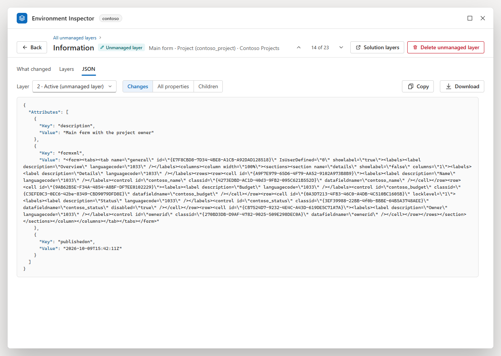

*The *JSON* tab on the unmanaged layer of a main form, **Changes**: indented, its keys in blue and its numbers and words in grey.
The form XML stays one string, because this tab shows the data as stored; *What changed* is where it is laid out.*

**Children as tables.** Lists of records inside *Children*, such as a security role's privileges or a choice's labels
and values, are hard to read as JSON. `childTables` finds them and `childTablesHtml` draws each as a table above the
JSON.

`environment-inspector.js`, `childTables`:

```js
const DEPTH = { 1: 'User', 2: 'Business unit', 4: 'Parent: child business units', 8: 'Organization' }
function childTables(j) {
  const out = []
  const visit = (v, path, depth) => {
    if (!v || typeof v !== 'object' || depth > 5 || out.length >= 10) return
    const ents = Array.isArray(v) ? v : Array.isArray(v.Entities) ? v.Entities : null
    if (ents && ents.length && ents.every((e) => e && Array.isArray(e.Attributes))) { out.push({ path: path || 'Records', rows: ents.map((e) => new Map(e.Attributes.filter((a) => a && typeof a.Key === 'string').map((a) => [a.Key, a.Value]))) }); return }
    for (const [k, x] of Object.entries(v)) visit(x, path ? `${path}.${k}` : k, depth + 1)
  }
  visit(j, '', 0)
  return out
}
```

* **A list of records** is a list (or an object with an `Entities` list) whose items all have an `Attributes` list.
  The search goes at most five levels deep and stops after ten tables.
* **The title** is the path to the list ("Records" at the top) and the number of records. **The columns** are the
  eight keys found in the most records, most frequent first.
* **The cells** use `scalarText` ([9.3](#93-showing-a-value-valueview)), cut to 160 characters with "…". For `privilegedepthmask` the depth is named:
  "User (1)", "Business unit (2)", "Parent: child business units (4)", "Organization (8)".
* **At most 500 rows** per table, then "The first 500 are shown; all of them are in the JSON below." Building the
  tables is inside a `try` block: data of an unexpected shape shows the JSON alone.

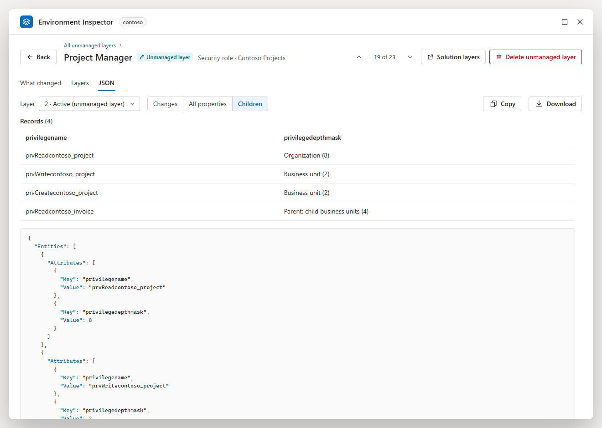

*The *Children* data of a security role's unmanaged layer: four privileges as a table ("Records (4)"), each depth
named, above the indented JSON.*

### 9.9 Copy and Download

Copy and Download act only on a click, and only on data already read. They make no request.

**Copy in *What changed*.** Every value compared can be copied, for each layer that has the property: each value's box
has a **Copy** button at its top right (`sbsCopy`), shown on hover and when the focus is on it, named for its layer
("Copy the value in the Active layer", "Copy the content in Contoso Projects": `lyLayerPhrase` names the Active layer "the Active layer"); a long value has it on its first line in each
lane, and a same value at the end of its quiet text. A web resource's content with a file that cannot be read on one
side ([9.11](#911-web-resource-content-kept-as-a-file-contentfileref)) has it only on the side whose content can be
read (held in the layer, or the top layer's file in effect).

The click handler copies the value as stored, not as laid out on the screen: "The value as stored (web resource
content decoded), not as laid out on the screen, so it can be pasted back as it was."

`environment-inspector.js`, the click handler of the details, **Copy**:

```js
else if (t.dataset.copy) {
  const k = t.closest('[data-k]').dataset.k, r = sheet.cmp && sheet.cmp.rows.find((x) => x.k === k), c = sheet.cmp
  if (!r) return
  // The value as stored (web resource content decoded), not as laid out on the screen, so it can be pasted back as it was.
  const side = t.dataset.copy === 'a', kind = c.A.msdyn_solutioncomponentname || places(sheet.f)[sheet.place].kind
  const m = side ? c.ma : c.mb, v = side ? r.va : r.vb
  const x = isWrContent(r, kind) ? contentSide(side ? r.inA : r.inB, v, m, kind).exact   // a web resource's content, maybe kept as a file
    : valueView(r.k, v, m, kind, true)
  if (x) copyText(x.text, `the ${r.k === 'content' ? 'content' : 'value'} in ${lyLayerPhrase(side ? c.A : c.B, layerShort)}`)
}
```

A compared component's page and a compared record's have their own **Copy**, which copies the value as stored, not the
normalized value that decided the status ([11.7](#117-the-results-and-the-details), [12.15](#1215-the-results-and-a-records-details)).

For a web resource's `content` with a file that cannot be read on one side, the handler copies
`contentSide(...).exact`, the decoded content of that layer ([9.11](#911-web-resource-content-kept-as-a-file-contentfileref)); a side that cannot be read gives nothing to
copy, and has no **Copy** anyway. Any other row, a web resource's `content` that both layers hold in the layer or as
the file in effect included, goes through `valueView` with `exact`.

| Value | What is copied |
| --- | --- |
| Text (XML and JSON included) | The text exactly as stored: no layout, no indentation, its own line endings |
| A number JavaScript cannot hold exactly as written (`ExactNumber`, [9.5](#95-json-indented-without-loss-indentjson-and-exact-numbers)) | The number as written, for example `1.0`, `1e2` or `12345678901234567890` |
| Text or script web resource content | The decoded text |
| Image or Silverlight web resource content | The base64 text, as stored |
| A web resource's content kept as a file (`contentfileref`) | For the top layer, when its file is the one in effect: that content, as for `content` above (decoded text, or base64 for an image or Silverlight file). Nothing for a layer whose file cannot be read |
| A lookup, a choice or a managed property | The short text shown on the screen (`scalarText`) |
| Any other object | JSON indented by two spaces (`safeJson`: exact numbers as written, without quotes) |

**Copy and Download in *JSON*.** Both take the text the tab shows (`jsonText`): the indented JSON, whose values,
strings and key order are as stored ([9.5](#95-json-indented-without-loss-indentjson-and-exact-numbers)), or the stored text when it is not JSON. **Download** saves it as
`<layer name>-<component id>-<layer solution>-<data>.json`, in lower case, for example
`systemform-<id>-active-changes.json` (the data is `changes`, `all` or `children`), through `download`: a `Blob`, a
temporary link, and an object address released after a minute.

`copyText` uses `navigator.clipboard.writeText` and confirms with a toast ("Copied the value in the Active layer.", "Copied
the content in the Active layer." for a property named `content`, such as a web resource's content, "Copied changes."); the
comparisons' pages also announce "Copied". When the browser refuses, a
warning toast says "The browser didn't allow copying."

### 9.10 Limits that keep the page responsive

The details show data that customizers control and that can be very large: form XML of several hundred kilobytes, web
resources of megabytes, deeply nested JSON. The page must stay usable whatever the data: without limits, a very large
or crafted value could freeze the tab in the comparison. Each limit below shows the rest another way, so nothing is
lost: Copy gives the full value, and the *JSON* tab the full data.

| Limit | Value | Where | Why |
| --- | --- | --- | --- |
| Places whose layers are cached | 20 | `fullLayers` | Previous and next read nothing again, and memory stays bounded ([9.1](#91-reading-every-layer)) |
| Properties drawn | Those that differ; the same ones and the system values only once shown | `lyCompare` | A form has dozens of properties; drawing the same ones only on request keeps the tab quick (the checks draw a form of 400 fields again in under 200 ms) |
| A value compared on the screen, or a web resource's content shown alone ([9.11](#911-web-resource-content-kept-as-a-file-contentfileref)) | 1,000,000 characters (`BIG`) | `lyRowOf`, `lyFile` | Splitting, comparing, escaping and drawing a larger value would hold the page; it can be copied instead |
| A short value | One line of at most 200 characters on each side | `lyRowOf` | Two boxes next to each other read better than a difference of one line |
| A long value in one layer only | Its first 5,000 characters | `lyRowOf` | It has nothing to be compared with; **Copy** gives it whole |
| XML laid out | 3,000,000 characters in, 200,000 lines out | `prettyXml` | Parsing and walking a larger document takes too long; it is shown as stored |
| Nesting | 40 levels in `scalarText`; stack overflows caught in `prettyXml`, `stable` and `lyRow` | | Deeply nested data shows as JSON or as stored, or counts as different; it never breaks the view |
| Edits searched | 2,000 removed and added lines per stretch | `diffLines` | Time grows with the length times the edits, memory with the edits squared; beyond it, the value is lined up on the lines found once on each side; a stretch with no line in common is counted as removed and added lines, and only one with lines in common but none found once on each side is shown as its old lines, then its new ones ("A part with too many changes isn't lined up", "Too many changes to line them up") |
| Lines drawn per long value | 3,000, folds opened included | `MAX_LINES`, `sbsLinesHtml` | Each line is several elements; tens of thousands at once would slow the page |
| Unchanged lines around a change | 3 | `sbsLinesHtml` | Enough to see where a change is; the rest is folded |
| Long values held | Those of the page shown | `sbsClaim` | A page drawn again lets the earlier ones go, so memory stays bounded however often the same values are shown |
| JSON coloured | 500,000 characters | `highlightJson` | Above it, the text is shown escaped and without colours |
| Children tables | 10 tables, 5 levels, 8 columns, 500 rows, 160 characters per cell | `childTables`, `childTablesHtml` | A role can have hundreds of privileges; the tables stay readable and quick, and the JSON below has everything |

The results have limits of their own ([8.5](#85-results-search-type-bubbles-and-column-menus)): 2,000 rows drawn (`CONFIG.maxRows`), 300 values listed in a column menu
(`POP_MAX`), 40 property names built per *What changed* cell, and 16 table names on the tables card.

### 9.11 Web resource content kept as a file: `contentfileref`

Dataverse can keep a web resource's content as a file instead of in the layer data, and each layer holds it one way or
the other ([3.5](#35-msdyn_componentlayers)). A layer that keeps it as a file has `contentfileref`, a reference to its own file, in its *All
properties* instead of `content`. The two layers of one web resource can differ: in the test environment, right after
a web resource's content was saved through the Web API, the Active layer held the content in the layer while the
managed layer held only a file reference; Dataverse later moved both to files. The Web API gives out only the file in
effect now, through the web resource itself; the files of the other layers cannot be read (`fileattachments` refuses
Retrieve and has no readable body). So *What changed* shows one `content` property whichever way each layer keeps it,
compares the two contents when both can be read, says so when one cannot, and never guesses a layer's content.

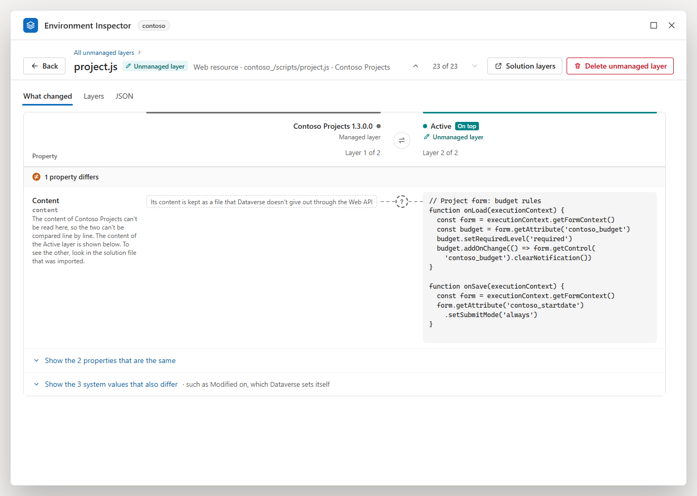

*A JavaScript web resource whose content is kept as files: Dataverse gives out only the Active layer's file, so the *Content* property (`content`) shows the Active layer's content in its lane, each line at its own indent, the two too long for the lane wrapped after an opening bracket and before a dot (`codeLine`), their wrapped parts 2 characters further in; the managed layer's lane has a dashed box saying that its file can't be read through the Web API, the grey dashed ? between them, and the lead sentence under the property's name says why the two can't be compared line by line ("The content of Contoso Projects can't be read here, … The content of the Active layer is shown below.").*

**Reading the content in effect.** When at least one layer of a web resource holds a `contentfileref`, `loadSheet`
reads the web resource once each time its details load ([9.1](#91-reading-every-layer)): `webresourceset(<id>)?$select=content,contentfileref`, the
content in effect (base64) and the reference of its file. It keeps them in `sheet.wrFile` as `{ ref, content }`, the
reference in lower case, or `{ error }` when the read failed.

`environment-inspector.js`, `fileRefOf`:

```js
// The reference to the file that holds a web resource's content in a layer (contentfileref), when Dataverse keeps
// the content as a file instead of in the layer ('' otherwise). attrs: a Map of a layer's properties, or its
// Attributes list.
const fileRefOf = (attrs) => {
  const v = attrs instanceof Map ? attrs.get('contentfileref') : ((Array.isArray(attrs) ? attrs : []).find((a) => a && a.Key === 'contentfileref') || {}).Value
  const s = v && typeof v === 'object' ? v.Id || v.Value : v
  return typeof s === 'string' && GUID.test(s) ? lc(s) : ''
}
```

A reference is a GUID, given as it is or as the `Id` or `Value` of an object; anything else counts as no reference.

**One `content` row.** `compareRows` ([9.2](#92-comparing-two-layers)) merges the two ways for each of the two layers compared. The content in effect is
the top layer's, so only the top layer gets it as its `content`, when it holds a reference and no `content` and its
reference is the file in effect; the other layer gets it too only when both name that same file. Any other reference
becomes a `FileRef` (`top` is set for the top layer's), which is never shown. The `contentfileref` key is then removed, so there is no row of that name. A layer that holds
the content itself keeps it. The *JSON* tab still shows each layer's data as stored, with the references.

`environment-inspector.js`, `FileRef` and `isWrContent`:

```js
// A web resource layer's content kept as a file (contentfileref) that can't be read here, in a compared row: compared
// by its file (top: the layer is the top one, whose file would be the one in effect; see compareRows).
class FileRef { constructor(ref, top = false) { this.ref = ref; this.top = top } toJSON() { return '\u0000@' + this.ref } toString() { return `(a file: ${this.ref})` } }
const isWrContent = (r, kind) => r.k === 'content' && lc(kind) === 'webresource' && (r.va instanceof FileRef || r.vb instanceof FileRef)
```

`stable` writes a `FileRef` as a text that starts with a NUL character and `@`, which base64 never holds: two layers
that name the same file are *Same*, and a file that cannot be read never counts as the same as content that can.
`isWrContent` is true for a web resource's `content` row with a `FileRef` on at least one side.

**Both sides can be read.** When each layer holds its content in the layer, or was given the content in effect by
`compareRows`, the row holds no `FileRef` and is an ordinary property: *Same* when the base64 is the same, whichever way each layer keeps it;
otherwise decoded by `valueView` ([9.3](#93-showing-a-value-valueview)) and shown as any other value ([9.2](#92-comparing-two-layers)): a short value as two boxes with
**Copy** for each, a longer one line by line, an image as an image.

**At least one side cannot be read.** `lyRowOf` asks `contentSide` about each of the two layers.

`environment-inspector.js`, `contentSide` and the start of `lyRowOf`:

```js
// One side of a web resource's content: { view, exact } when it is held in the layer (or was the content in effect,
// given by compareRows), { why } when it is a file that can't be read, {} when the layer has no content.
function contentSide(inL, v, m, kind) {
  if (!inL) return {}
  if (!(v instanceof FileRef)) return { view: valueView('content', v, m, kind), exact: valueView('content', v, m, kind, true) }
  const cur = sheet.wrFile
  if (v.top && (!cur || cur.error)) return { why: `its content is kept as a file, and the content in effect couldn't be read${cur ? ` (${cur.error})` : ''}` }
  return { why: "its content is kept as a file that Dataverse doesn't give out through the Web API" }
}
// ...
function lyRowOf(r, c, L, same) {
  const kind = c.A.msdyn_solutioncomponentname || places(sheet.f)[sheet.place].kind
  // ...
  if (isWrContent(r, kind)) {   // a web resource's content, one side at least kept as a file
    const sa = contentSide(r.inA, r.va, c.ma, kind), sb = contentSide(r.inB, r.vb, c.mb, kind)
    if (r.same || (r.inA && !sa.view) || (r.inB && !sb.view)) return lyFile(r, c, L, sa, sb, X, Y, head)
    xR = sa.view || null; xL = sb.view || null
    if (xL && xR && !xL.image && !xR.image) {
      if (sa.exact.text === sb.exact.text) return sbsRow({ ...head, cx: 'eq', span: esc('The content is the same in both layers; only the way Dataverse keeps it differs (in the layer, or as a file).'), cls: 'rs-dab' })
      if (xL.text === xR.text) { const note = 'shown as stored: laid out, the two look the same'; xR = { ...sa.exact, note }; xL = { ...sb.exact, note } }
    }
  } else {
    const lb = lyLabels(r)
    if (lb) { xR = lb.a; xL = lb.b } else { xR = r.inA ? valueView(r.k, r.va, c.ma, kind) : null; xL = r.inB ? valueView(r.k, r.vb, c.mb, kind) : null }
    if (xL && xR && !r.same && !xL.image && !xR.image && xL.text === xR.text) [xR, xL] = asStored(r, kind, c)
    else if (!r.same) [xR, xL] = xmlPair(xR, xL)
  }
  // ...
}
```

`contentSide` returns:

| The layer | Returns |
| --- | --- |
| Has no content | `{}`; `lyFile` gives it a dashed box, "Not in this layer" |
| Holds the content in the layer, or was given the content in effect by `compareRows` | `{ view, exact }`: `valueView` of the content, laid out and as stored |
| Keeps it as a file (a lower layer, even one whose reference is the file in effect, or a top layer whose file is another) | `{ why }`: "its content is kept as a file that Dataverse doesn't give out through the Web API" |
| The top layer, keeping it as a file, when the content in effect could not be read | `{ why }`: "its content is kept as a file, and the content in effect couldn't be read (*error*)" |

A `FileRef` is never shown: the only file Dataverse gives out is the one in effect, and `compareRows` has already
given its content to the top layer (and to the other layer when both name that file). A lower layer whose reference
is the file in effect stays a `FileRef`: the content in effect is the top layer's, so it is never shown as a lower
layer's. `lyRowOf` hands the row
to `lyFile` when it is *Same* (both layers name the same file) or when a layer that has content cannot be read.
Otherwise both sides can be read and are drawn as any other value; when neither is an image and the two decode to the
same text although they are stored differently, it says "The content is the same in both layers; only the way
Dataverse keeps it differs (in the layer, or as a file).", and when only the laid-out texts are equal, both are shown
as stored ([9.6](#96-when-two-values-look-the-same)).

**What `lyFile` shows.** One row of the sheet: its lead sentence under the label *Content*, then a cell in each lane,
and between them the grey dashed ? connector (= when both name the same file):

| Case | Lead sentence |
| --- | --- |
| Both layers name the same file | "Both layers use the same file, so their content is the same." Both lanes show that content |
| One layer's content can be read, the other's cannot | "The content of *layer* can't be read here, so the two can't be compared line by line. The content of *other layer* is shown below. To see the other, look in the solution file that was imported." The first name is the layer that cannot be read; each layer is named after "The content of" (`lyLayerPhrase`: "the Active layer", or the solution's name as Dataverse gives it), so a name ending in s reads right and keeps its case |
| No layer's content can be read | "Neither layer's content can be read here: Dataverse keeps it in files and gives out only the file in effect now, which is neither of these two." The last clause only when the content in effect was read and neither layer names its file |

Each lane's cell holds:

* for a layer whose content can be read: the content in its box, with **Copy** ("Copy the content of the Active layer"): the
  image, the text in a code box (with line endings shown, [9.6](#96-when-two-values-look-the-same)), or, above 1,000,000 characters (`BIG`), "This content is too large to show here (*n*
  characters). Copy it to read it in another tool.";
* for a layer whose content cannot be read, a dashed box with the reason from `contentSide`, in sentence case;
* for a layer without content, a dashed box, "Not in this layer".

**Every combination.** The two layers compared can hold the content in any of these ways:

| One layer | The other layer | Shown |
| --- | --- | --- |
| In the layer | In the layer | An ordinary property ([9.2](#92-comparing-two-layers)) |
| In the layer | The file in effect, on the top layer | An ordinary property; *Same* when the base64 is the same |
| In the layer, or the file in effect on the top layer | Any other file (on a lower layer, even the file in effect) | `lyFile`: the first layer's content, and the reason for the other |
| The file in effect, one of the two being the top layer | The same file | Both get the content in effect: *Same* |
| Any other file | The same file | *Same*: "Both layers use the same file, so their content is the same." |
| A file that can't be read | A different file that can't be read | `lyFile`: "Neither layer's content can be read here: ..." |
| The top layer's file, when the content in effect could not be read | | `lyFile`: that layer's box gives the error |

After a customization the file in effect is usually the unmanaged layer's (or the unmanaged layer holds the content
itself), so with the defaults (the Active layer on the right against the managed layer under it on the left) the right
lane shows the content and the left lane's dashed box says that the managed layer's content is kept as a file that
Dataverse doesn't give out through the Web API.

**Copy** copies `contentSide(...).exact`, the decoded content (base64 for an image or a Silverlight file) ([9.9](#99-copy-and-download)):
"Copied the content in Active." A removal of such a web resource's unmanaged layer keeps the content in the deletion
log when it can ([10.4](#104-before-each-place)).

---

## 10. Deleting

Deleting is the only part of Environment Inspector that changes anything in the environment. This chapter follows one run from
the ticked rows to the log: how the list of components is put together, the confirmation, `removeLayers` and the
checks around each Dataverse call, the outcomes, what happens when a run is stopped or the sign-in ends, and the log of
what was removed.

What a deletion does, in Dataverse terms: it removes the unmanaged (Active) layer of a component, the same as
**Remove active customizations** on the component's *Solution layers* page in the maker portal. The component then
behaves as its top managed layer defines. Nothing else is removed: not a managed layer, not the component itself, not
another component's layer. Nothing is published either. In every test the removal took effect without publishing, and
publishing a table would also publish other people's pending changes on it.

The whole flow, with the function that does each step:

```
ticked rows (selected)
  -> Delete unmanaged layer (delBtn), or Delete unmanaged layer in the details (shDel)
  -> confirmDelete: one dialog that lists the components in the order they will be deleted
  -> runDelete: the window's side of the run (rows, bottom bar, pill, log, final message)
       -> removeLayers: arms the write guard and takes one component at a time
            -> one(f), for each place of the component:
                 getLayers (before) -> removePlace -> getLayers (after) -> outcome of the place
            <- onRow(f, state, detail, result) when each component is done
  <- a message with Download log
```

### 10.1 From ticks to a run

The tick boxes fill `selected`, a set of finding keys (`"<type number>|<component id>"`). A row has an active tick box
only when `selectable` allows it.

`environment-inspector.js`, `selectable`:

```js
const selectable = (f) => !IS_DEV && !deleting && !f.deleted && !cannotDelete(f)
```

So nothing can be ticked in a development environment ([14.5](#145-environment-rules-inspectorsettingsjson)), during a run, once a row is deleted, when its type is
one that Dataverse does not delete, or when the row is a managed layer on top ([10.10](#1010-types-dataverse-will-not-delete)). The tick box in the header ticks or clears the selectable rows that are
drawn (at most `CONFIG.maxRows`); on the *Managed on top* list, whose rows can't be ticked, it is hidden, its space kept (`syncSelection`).

Ticks survive the search and the column filters. A ticked row that a filter hides stays ticked, and the bottom bar
says so: "3 components selected · 1 hidden by the search or filters". A new scan clears every tick, and **Read N more**
removes the ticks of rows that turned out to have no unmanaged layer.

`syncSelection` keeps the bottom bar in step. The button reads **Delete unmanaged layer** for one component and
**Delete 3 unmanaged layers** for three. It is disabled while a scan or a run is going on, when nothing is ticked, and
above `CONFIG.maxRemovePerRun` (100), when the bar says "120 selected · You can delete up to 100 at a time." In a
development environment the button is not drawn at all.

**The order.** The components are deleted top to bottom in the order shown, whatever column the list is sorted by.
Ticked rows that the search or a filter hides come after them, in the scan's order (by type, then by name). Only
unmanaged layers are deleted, so when the **Managed on top** list is shown ([8.5](#85-results-search-type-bubbles-and-column-menus)), **Delete** first switches back to the
**Unmanaged** list (`setKind('u')`, which brings back that list's own search, filters and sort): the order and the
confirmation's "hidden" marks are those of the list the rows are deleted from.

`environment-inspector.js`, the click handler of the Delete button:

```js
// In the order shown, top to bottom (whatever the sort); ticked rows hidden by a filter come after, in the scan's order.
$('delBtn').onclick = () => {
  if (!result) return
  // Only unmanaged layers are deleted: from the managed list, the Unmanaged list comes back first, so the order shown
  // and the confirmation's "hidden" marks are those of the list being deleted from.
  if (kindSel === 'm') setKind('u')
  const at = new Map(shown().map((f, i) => [f.key, i])), n = result.findings.length
  confirmDelete(result.findings.map((f, i) => [f, at.has(f.key) ? at.get(f.key) : n + i]).filter(([f]) => selected.has(f.key)).sort((a, b) => a[1] - b[1]).map(([f]) => f))
}
```

**Why this order?** People read the list from the top. The confirmation shows the same list, in the same order, as
the run follows, so what you read in the dialog is what happens, and **Stop deleting** ([10.8](#108-stop-sign-in-expiry-and-leaving-the-page)) leaves exactly the rows
below the current one untouched.

**From the details.** **Delete unmanaged layer** in a component's details (`shDel`) calls `confirmDelete([sheet.f])`:
that component alone, ticked or not. The button is hidden for deleted rows, for types Dataverse does not delete and for
managed layers on top (`cannotDelete`), and disabled while the window is busy.

### 10.2 The confirmation

`confirmDelete` does nothing while the window is busy, in a development environment, or without a scan result. It
filters the components through `selectable` once more and does nothing when none is left or there are more than
`CONFIG.maxRemovePerRun`. Then it opens one dialog.


*"Delete 3 unmanaged layers?" for the column Budget (`contoso_budget`, on Project), the environment variable API base
address (`contoso_ApiBaseUrl`) and the public view Active Projects (on Project), listed in the order `delBtn` gave
them. **Cancel** has the focus; the bottom bar behind the dialog says "3 components selected".*

| Part | Text | When |
| --- | --- | --- |
| Title | "Delete unmanaged layer?" or "Delete 3 unmanaged layers?" | Always |
| Explanation | "This removes the unmanaged customizations (the Active layer) from these 3 components, the same as **Remove active customizations** on the Solution layers page. They go back to what the managed solution defines. Managed layers aren't changed." (for one: "this component", "It goes back") | Always |
| Red note | "You're deleting in the production environment **contoso**." | The environment's name matches `productionEnvironments` ([14.5](#145-environment-rules-inspectorsettingsjson)) |
| Amber note | "The maker portal sign-in ends in about 12 minutes, which might not be enough. Reload the page to renew it, or delete fewer at a time." | Maker portal only: the borrowed sign-in (`makerToken`, [5.7](#57-the-maker-portal-sign-in)) has less than 60 seconds plus 20 seconds per component left |
| List | Type, name, then the schema name, "on *table*" and "hidden by the search or filters" where they apply | Always |
| Footer | "They are deleted one at a time, in this order. You can't undo this. A log of the removed changes can be downloaded afterward." (for one, without the first sentence) | Always |
| Buttons | **Delete** (red) and **Cancel** | Always |

`environment-inspector.js`, `confirmDelete`, the guards and the sign-in check:

```js
function confirmDelete(items) {
  if (busy || IS_DEV || !result) return
  items = items.filter(selectable)
  if (!items.length || items.length > CONFIG.maxRemovePerRun) return
  const one = items.length === 1, shownKeys = new Set(shown().map((f) => f.key))
  let signIn = ''
  if (ON_MAKER) {
    // The borrowed sign-in is renewed only while the portal itself is used; a run that outlasts it stops safely.
    const t = makerToken(conn.host, conn.account), left = t ? t.secondsLeft : 0
    if (left < 60 + 20 * items.length) signIn = `<div class="note amb">${icon('warn')}<span>The maker portal sign-in ends in about ${plural(Math.max(0, Math.floor(left / 60)), 'minute')}, which might not be enough. Reload the page to renew it, or delete fewer at a time.</span></div>`
  }
```

**Why 20 seconds per component?** Dataverse's removal call took 7 to 9 seconds per component in tests, and about 25
seconds for a relationship, which has two places ([10.3](#103-removelayers)). The reads around each call add under a second. Twenty seconds
per component leaves room for a slow call.

`openDialog` makes the rest of the window inert and puts the focus on **Cancel**, so Enter alone never deletes; the
window's Tab handler keeps the focus inside the dialog while it is open. Escape closes the dialog. **Delete** closes the details (if open) and the dialog, and
starts `runDelete`.

**Why one confirmation and nothing more?** It is the maker portal's own design: one question, then the removal. The
protection is in the checks that run around every call ([10.4](#104-before-each-place) and [10.6](#106-after-each-place-the-checks)), which need no extra step from the user.
Earlier versions also asked for a backup download, the environment's name and a change reference; they were removed,
and the checks stayed.

### 10.3 `removeLayers`

`removeLayers(items, onRow, { concurrency, shouldStop })` deletes the unmanaged layer of each finding in `items` and
returns one result per item, in the order of `items`: `{ f, outcome, detail, layers, ms }`. The array also carries
`stopped` (why the run ended early, or `null`) and `userStopped` (how many components were not tried because the user
stopped the run). `ms` holds the milliseconds spent reading before, in the call and checking after; the window does not
show them, but a script can.

`environment-inspector.js`, `removeLayers`, the start:

```js
async function removeLayers(items, onRow = () => {}, { concurrency = CONFIG.deleteConcurrency, shouldStop = () => false } = {}) {
  if (IS_DEV) throw new Error('Deleting is turned off in development environments.')
  const results = new Array(items.length)
  let stopped = null
  results.userStopped = 0
  // onRow(f, state, detail, result): the result (with the removed changes) as soon as a component is done, so the
  // log keeps it even if the run ends early. The screen cannot stop or lose a run.
  const report = (f, state, detail, r) => { try { onRow(f, state, detail, r) } catch { } }
  const notTried = (f, why) => { const r = { f, outcome: 'Not attempted', detail: why, layers: [], ms: {} }; report(f, r.outcome, why, r); return r }
```

`report` swallows any error of `onRow`: a bug in the window cannot stop a run halfway or lose a result.

**Arming the write guard.** Every request goes through `requestOnce`, which refuses anything but a read unless a
removal is running ([5.2](#52-read-only-by-design) shows the guard). A request other than a GET, or one whose decoded address names the removal
anywhere, passes the guard only when it was sent through `write()` (which sets `write: true`) while `armed` is true.
`removePlace` is the only caller of `write()`, and `removeLayers` is the only code that sets `armed`, for the length of
the run:

`environment-inspector.js`, `removeLayers`, the end:

```js
armed = true
try {
  let next = 0
  await Promise.all(Array.from({ length: Math.max(1, Math.min(concurrency, items.length)) }, async () => {
    while (next < items.length) { const k = next++; results[k] = await one(items[k]) }
  }))
  results.stopped = stopped
} finally { armed = false }
return results
```

**One at a time.** `CONFIG.deleteConcurrency` is 1, as in Solution Layers Explorer. Dataverse does the removals one
after the other anyway: in a test with 17 components, one at a time took 161 seconds, four at a time 147 seconds and
eight at a time 136 seconds, and at eight at a time each call waited up to 120 seconds, close to Dataverse's 2-minute
limit for a request. One at a time also makes the order and **Stop deleting** exact.

**One component: `one(f)`.** For each item, `one` first checks whether the run has already ended (the sign-in expired)
or the user stopped it; either way the component is reported as not attempted. Otherwise it reports the state
`Deleting` (the row shows a spinner) and goes through the component's places.

**Places.** A place is a component id with the layer name Dataverse files its layers under. Most components have one.
A relationship found by its schema name has two, in this order: its cascade settings (layer name `Relationship`, with
the id of the `relationships` table) and its definition (`EntityRelationship`, with the metadata id). `places(f)` ([3.4](#34-component-types-and-layer-names))
returns them. For a component with two places, each detail starts with "cascade settings: " or "definition: ".

### 10.4 Before each place

Right before a place is touched, its layers are read again with `getLayers` ([3.5](#35-msdyn_componentlayers)). The scan's copy is not used: someone may
have removed the layer in the maker portal since, or an import may have changed the component.

`environment-inspector.js`, `removeLayers` (in `one`), before the call:

```js
for (const p of places(f)) {
  let before
  try { before = await timed('read', () => getLayers(p.id, p.kind)) } catch (e) { if (e instanceof SessionError) throw e; outcomes.push('Failed'); say(p, `its layers could not be read (${e.message}); nothing was deleted`); continue }
  if (before.length) sawLayers = true
  const top = before.find((l) => l.msdyn_solutionname === 'Active'), managedBefore = managedOf(before), printBefore = managedPrint(before)
  if (!top || before[0] !== top || !managedBefore.length) continue   // nothing to delete here, or unmanaged-only (deleting that would delete the component)
  touched = true
  const name = top.msdyn_solutioncomponentname || p.kind
  const entry = { place: p.kind, id: p.id, layerName: name, result: '', changes: top.msdyn_changes || '' }
  kept.push(entry)
  // A web resource whose content is kept as a file: the unmanaged layer's changes name only its file, which goes
  // with the removal. Its content (base64, as Dataverse stores it) is kept in the log when that file is the one
  // in effect now, so the change can still be redone by hand.
  let fileRef = ''
  try { fileRef = lc(p.kind) === 'webresource' ? fileRefOf(JSON.parse(top.msdyn_changes || '{}').Attributes) : '' } catch { }
  if (fileRef) {
    try { const w = await timed('read', () => read(`webresourceset(${p.id})?$select=content,contentfileref`)); if (w && lc(w.contentfileref) === fileRef) entry.content = w.content || '' }
    catch (e) { if (e instanceof SessionError) throw e }
    if (entry.content === undefined) entry.contentNote = 'the content of the unmanaged layer could not be read before the removal'
  }
  called = true
  const error = await timed('remove', () => removePlace({ id: p.id, name }))
```

Step by step:

1. **The layers cannot be read:** the place fails with "its layers could not be read (...); nothing was deleted", and
   nothing is sent for it.
2. **Nothing to delete:** the place is skipped when it has no Active layer, when the Active layer is not the top one
   (`getLayers` sorts the layers by `msdyn_order`, highest first), or when no managed layer lies under it.
3. **The unmanaged-only rule.** A component with only an Active layer is not a managed component: removing its Active
   layer would delete the component itself. The scan never lists such components, and this check makes sure a
   component that became one since the scan is not touched either.
4. **What is recorded:** `managedBefore`, the managed layers as `solution#order`, and `printBefore`, the same layers
   with their publisher and the values each one sets ([10.6](#106-after-each-place-the-checks)).
5. **The layer name** sent to Dataverse is the one on the Active layer's row (`msdyn_solutioncomponentname`), spelled
   as Dataverse spells it; the scan's layer name is used only when the row has none. The check after the call reads
   the layers under that same name.
6. **The log entry** keeps the Active layer's `msdyn_changes` exactly as stored, before it is gone ([10.9](#109-the-deletion-log)).
7. **A web resource whose content is kept as a file** ([3.5](#35-msdyn_componentlayers)). When the unmanaged layer keeps its content as a file, its
   changes name only that file (`contentfileref`), and the file goes with the removal. When the unmanaged layer holds
   the content itself, its changes already contain it, and nothing more is read. When the Active layer's
   `msdyn_changes` holds a reference, the web resource's content in effect is read right before the call, with
   `webresourceset(<id>)?$select=content,contentfileref`. When the reference of the file in effect is the unmanaged
   layer's, the entry keeps the content as `content`, base64, as Dataverse stores it. Otherwise (another file is in
   effect, or the read failed), the entry gets `contentNote`: "the content of the unmanaged layer could not be read
   before the removal". This costs one extra read per such component, counted in `ms.read`. An expired sign-in during
   this read ends the run before the call, and the component is not tried ([10.8](#108-stop-sign-in-expiry-and-leaving-the-page)); any other error only leads to the note.

A change to the unmanaged layer made in the few seconds between this read and the call is removed with it, but is not
in the log. A change to the managed layers in that time shows in the check after the call ([10.6](#106-after-each-place-the-checks)).

### 10.5 The call: `removePlace`

`environment-inspector.js`, `removePlace`:

```js
async function removePlace(place) {
  placeOk(place.id, place.name)
  for (let tries = 0; ; tries++) {
    try {
      await write('GET', `RemoveActiveCustomizations(SolutionComponentName='${place.name}',ComponentId=${place.id})`)
      return null
    } catch (e) {
      if (e instanceof SessionError) throw e
      if (/Resource not found for the segment 'RemoveActiveCustomizations'/i.test(e.message)) {   // older environments: the documented action
        try { await write('POST', 'RemoveActiveCustomization', { LogicalName: lc(place.name), Id: place.id }); return null } catch (e2) { if (e2 instanceof SessionError) throw e2; return e2.message }
      }
      if (/0x8004F077|CustomizationLock|another .* running/i.test(e.message) && tries < 5) { await sleep(10000); continue }   // an import or publish holds the lock
      if (/0x8004f059|not supported for components of type/i.test(e.message)) return 'Dataverse does not allow deleting the unmanaged layer of this component type. Undo the change by hand, or import its managed solution again with "Overwrite unmanaged customizations".'
      return e.message
    }
  }
}
```

* `placeOk` checks that the id is a GUID and the layer name is a plain name (a letter, then up to 99 letters, digits or
  underscores) before either goes into the address.
* `RemoveActiveCustomizations` is the Dataverse function the maker portal and Solution Layers Explorer use. It is a
  function, so it is called with GET, through `write()` so that the guard requires `armed`.
* Environments that do not know the function answer "Resource not found for the segment"; the older action
  `RemoveActiveCustomization` is then sent once, as a POST with the layer name in lower case and the id.
* An import or a publish holds the customization lock (error 0x8004F077): the call waits 10 seconds and tries again,
  up to five more times.
* Error 0x8004f059 ("not supported for components of type") gets a plain message ([10.10](#1010-types-dataverse-will-not-delete)).
* Any other error is returned as text, not thrown. Only an expired sign-in (`SessionError`) is thrown.

**How a write is sent.** `requestOnce` treats writes differently from reads ([5.4](#54-retries-throttling-and-the-read-time-limit)): a write has no time limit, cannot
be aborted, and is sent again only when it certainly did not run, after a 429 or, on the maker portal, once after a
401. After a 5xx answer or a network error it is not sent again, because the server may have made the change before
the answer was lost.

**Why the call's answer is not trusted.** An error answer does not prove that nothing happened, and a success answer
does not prove that the right thing happened. The outcome comes from reading the layers again ([10.6](#106-after-each-place-the-checks)). A call that
returned an error but left a clean result counts as deleted.

### 10.6 After each place: the checks

`environment-inspector.js`, `removeLayers` (in `one`), after the call:

```js
let after = null
try { after = await timed('check', () => getLayers(p.id, name)) } catch (e) { if (e instanceof SessionError) throw e }
if (!after) { outcomes.push(error ? 'Unknown' : 'Deleted, not verified'); say(p, error ? `the call returned an error and the layers could not be read again: ${error}` : 'the layers could not be read again to check') }
else if (after.some((l) => l.msdyn_solutionname === 'Active')) { outcomes.push('Failed'); say(p, error || 'the unmanaged layer is still there') }
else if (JSON.stringify(managedOf(after)) !== JSON.stringify(managedBefore)) { outcomes.push('Failed'); say(p, `the managed layers changed: before ${managedBefore.join(' > ')}, now ${managedOf(after).join(' > ')}`) }
else if (JSON.stringify(managedPrint(after)) !== JSON.stringify(printBefore)) { outcomes.push('Unknown'); say(p, 'the unmanaged layer is gone, but the values of a managed layer changed at the same time (another import or change?); check its layers') }
else outcomes.push('Deleted')
entry.result = outcomes[outcomes.length - 1]
```

The checks, in the order they are made:

| After the call | Outcome of the place | Detail |
| --- | --- | --- |
| The layers cannot be read again, and the call returned an error | `Unknown` | "the call returned an error and the layers could not be read again: *error*" |
| The layers cannot be read again, and the call returned no error | `Deleted, not verified` | "the layers could not be read again to check" |
| An Active layer is still there | `Failed` | The call's error, or "the unmanaged layer is still there" |
| The managed layers are not the same list (solution and order) | `Failed` | "the managed layers changed: before contoso_projects#2 > System#1, now ..." |
| The same managed layers, but one of them has another publisher or sets a different value | `Unknown` | "the unmanaged layer is gone, but the values of a managed layer changed at the same time (another import or change?); check its layers" |
| Otherwise | `Deleted` | None |

`environment-inspector.js`, `managedOf` and `managedPrint`:

```js
const managedOf = (layers) => layers.filter((l) => l.msdyn_solutionname !== 'Active').map((l) => `${l.msdyn_solutionname}#${l.msdyn_order}`)
// The managed layers as they are defined (solution, order, publisher and the values each one sets), to check that a
// removal left them as they were. Values Dataverse keeps up to date itself are left out (after a removal it resets
// the overwrite time of the layer that comes on top).
const LAYER_SYSTEM = new Set(['overwritetime', 'modifiedon', 'modifiedby', 'modifiedonbehalfby', 'versionnumber'])
// ...
const managedPrint = (layers) => layers.filter((l) => l.msdyn_solutionname !== 'Active').map((l) => {
  let set = l.msdyn_changes || ''
  try { const a = JSON.parse(set, exactNumbers).Attributes; if (Array.isArray(a)) set = sortedJson(a.filter((x) => x && !LAYER_SYSTEM.has(lc(x.Key))).map((x) => [String(x.Key), x.Value]).sort((p, q) => (p[0] < q[0] ? -1 : p[0] > q[0] ? 1 : 0))) } catch { }
  return `${l.msdyn_solutionname}#${l.msdyn_order}#${l.msdyn_publishername || ''}#${set}`
})
```

`managedPrint` gives one string per managed layer: its solution, its order, its publisher and the values it sets (the
`Attributes` of its `msdyn_changes`, sorted by name, objects with their keys sorted). For a column whose managed layer
in Contoso Projects sets a description and a maximum length, the string is:

```
contoso_projects#2#Contoso#[["description","x"],["maxlength",100]]
```

The values Dataverse keeps up to date itself are left out: after a removal it resets the overwrite time of the layer
that comes on top. The changes are read with `exactNumbers` ([9.5](#95-json-indented-without-loss-indentjson-and-exact-numbers)), so a number JavaScript cannot hold exactly as written
(a relationship's cascade mask above 2^53, for example) is compared as written, and never taken for a text with the
same digits. A layer whose changes cannot be parsed is compared by its stored text.

**Why two comparisons?** `managedOf` answers "are the same managed layers still there, in the same order?"; a
difference there is a failure. `managedPrint` answers "does each one still set the same values?". A difference there,
with the Active layer gone, usually means another import or change ran at the same moment: the removal worked, but the
component is not what it was. Environment Inspector cannot tell which change came from where, so the outcome is `Unknown` and
the detail says to look at the layers.

After each component, `runDelete` drops the component's layers from the details cache (`layerCache`) and moves
`layerEpoch` on, so its details read the layers again and a read that started before the removal is not kept.

### 10.7 Outcomes

A component's outcome combines the outcomes of its places:

`environment-inspector.js`, `removeLayers` (in `one`):

```js
const every = (v) => outcomes.length > 0 && outcomes.every((o) => o === v)
const outcome = every('Deleted') ? 'Deleted' : every('Skipped') ? 'Skipped' : every('Not attempted') ? 'Not attempted' : outcomes.includes('Unknown') && !outcomes.includes('Failed') ? 'Unknown' : outcomes.some((o) => o.startsWith('Deleted')) ? (outcomes.every((o) => o.startsWith('Deleted')) ? 'Deleted, not verified' : 'Partly deleted') : outcomes.includes('Unknown') ? 'Unknown' : 'Failed'
```

The first row that fits decides:

| Places | Component |
| --- | --- |
| Every place `Deleted` | `Deleted` |
| No place touched and none failed | `Skipped`, with "it has no unmanaged layer on top of a managed layer any more", or "its layers could not be read (no layers under the name *layer name*)" when no layers came back at all |
| Only `Not attempted` (the sign-in expired before anything was sent, [10.8](#108-stop-sign-in-expiry-and-leaving-the-page)) | `Not attempted` |
| `Unknown`, and no `Failed` | `Unknown` |
| Every place deleted, at least one without a check | `Deleted, not verified` |
| Some places deleted (with or without a check), the others failed | `Partly deleted` |
| `Unknown` and `Failed`, nothing deleted | `Unknown` |
| Anything else | `Failed` |

A place that was skipped adds no outcome. A relationship whose unmanaged layer is only on its cascade settings
therefore ends as `Deleted` when that one place is deleted. An unexpected error inside `one` adds `Unknown`, with the
detail "stopped on an error: *message*".

The window maps the outcomes to what the row shows through `STATUS`:

`environment-inspector.js`, `STATUS`:

```js
const STATUS = { Skipped: ['plain', 'Skipped'], 'Not attempted': ['plain', 'Not tried'], Unknown: ['unk', 'Result unknown'], Failed: ['err', 'Not deleted'], 'Deleted, not verified': ['unk', 'Deleted (not checked)'], 'Partly deleted': ['err', 'Partly deleted'] }
```

The label (with the grey dashed question mark for an unknown result, the red error disc for one not deleted, nothing for one
not tried; `statusCell`) and the detail replace the *What changed* cell of the row; the detail starts with a capital and ends with a
full stop, and its tooltip holds the whole text. `Deleted` has no label: the row is struck through and the green check
disc takes the place of its tick box. Appendix [A.4](#a4-outcomes) lists every outcome with its meaning.


*A run of three. The column Budget is done: struck through, with the green check disc. The environment variable API base
address is being deleted: a spinner in its tick box column, and the bottom bar says "Deleting 2 of 3: API base address
(Environment variable) · about a minute or less left · You can close this window; deleting continues." The rows of the
run not done yet are blue; the public view still to come is ticked and greyed out. Scan again, Export, the search, the
type bubbles and the column menus are disabled until the run ends.*

Deleted rows stay in the list, struck through, until the search or a filter changes, you go back to the choice screen,
or a new scan starts (`keepDeleted`). The title and the type bubbles leave them out at once ("20 unmanaged layers"),
and the subtitle counts them ("· 3 deleted"). A row with any other outcome can be ticked again.


*After the run: three rows struck through, the title down to 20, the subtitle "5 managed solutions · All object types ·
Scanned in 6.1 s · 3 deleted", and the message "Deleted 3 unmanaged layers." with **Download log**. The email template
keeps its information icon instead of a tick box ([10.10](#1010-types-dataverse-will-not-delete)).*

**The final message.** When the run ends, `runDelete` counts the outcomes and shows one message:

| Situation | Message | Look |
| --- | --- | --- |
| The sign-in expired during the run | "Deleted 2. Your sign-in expired, so the rest weren't tried. Reload the page and scan again." | Warning, stays until dismissed |
| You stopped the run | "Stopped: 1 deleted, 2 not tried. The ones not tried are still ticked." | Warning, stays |
| One component, deleted | "Deleted the unmanaged layer of “Budget”." | Success; stays only if the window was closed |
| Several, all deleted | "Deleted 3 unmanaged layers." | Success; stays only if the window was closed |
| Anything else | "Done: 2 deleted, 1 couldn't be deleted (the reasons are in the rows)." | Warning when any component is not deleted, not checked, partly deleted or unknown; stays |
| `removeLayers` itself failed | "Stopped: *message*" | Warning, stays |

The counts start with "*n* deleted" and add, only when not zero and in this order: "deleted but not checked",
"already without an unmanaged layer" (`Skipped`), "partly deleted", "with an unknown result", "couldn't be deleted" and
"not tried". "(the reasons are in the rows)" follows when any component failed, was partly deleted or has an unknown
result. The messages at the end of a run offer **Download log** ([10.9](#109-the-deletion-log)) when the run logged anything. Screen readers
hear "Deleted 2 of 3." at the end.

### 10.8 Stop, sign-in expiry and leaving the page

**Stop deleting.** The button in the bottom bar sets `deleting.stop`. It then reads "Stopping…" and is disabled, and
the bar says "stopping after this one". `removeLayers` asks `shouldStop()` before it starts each component: the
component being deleted finishes, with its checks, and every later one is reported `Not attempted` with the detail
"you stopped the run" (not repeated in the row). A removal that has started is never interrupted: writes carry no
abort signal. After the run the components that were not tried are ticked again, so one click on **Delete** goes on
where the run stopped.

**The sign-in expires.** On an environment page, an answer of 401 or a redirect (to the sign-in page) throws a
`SessionError` ([5.4](#54-retries-throttling-and-the-read-time-limit)): "Your session has expired. Reload the page, sign in again and click the bookmark." On the maker
portal, the borrowed token is read again for every request; a request is refused when the token has less than 30
seconds left, and after a 401 the request is sent once more with the token read again (the portal may have renewed it)
before it gives "The maker portal's sign-in to this environment has expired. Reload the page, then click the bookmark
again." ([5.7](#57-the-maker-portal-sign-in)). In `removeLayers`:

| When | Outcome | Detail |
| --- | --- | --- |
| Before the component's removal was sent | `Not attempted` | "the sign-in expired before this component was tried" |
| After its removal was sent | `Unknown` | "the sign-in expired during this component; check its layers after signing in again" |
| Every later component | `Not attempted` | "the sign-in expired" |

`results.stopped` is then set and the final message is the sign-in one ([10.7](#107-outcomes)). The maker portal renews its token only
while the portal page itself is in use, which is why the confirmation warns when the token may run out ([10.2](#102-the-confirmation)). Large
runs are better started from the environment's own page, whose sign-in does not depend on the portal renewing a token.

**Closing the window.** During a run, the close button and Escape only hide the window (`hide` calls `minimize`). A
pill in the bottom right corner of the page shows how far the run is, with the time left: "Deleting unmanaged layers ·
5 of 17 · about 1 min left". Selecting it opens the window again. When the run is over it reads "Deleting finished ·
Select to see the results" (green check disc), "Deleting finished with problems · Select to see the results" (red error
disc, when a component ended other than *Deleted*, *Deleted, not verified* or *Skipped*, or the run stopped on an error)
or "Deleting stopped · Select to see the results" (after **Stop deleting**), and a success message stays until it is
dismissed. [8.9](#89-toasts-dialogs-and-the-deleting-pill) describes the pill and how
`timeLeft` estimates the time.

**Leaving or reloading the page.** For the length of a run, `runDelete` listens to the page's `beforeunload` event,
so the browser asks before it leaves or reloads.

`environment-inspector.js`, `beforeUnload`:

```js
const beforeUnload = (e) => { e.preventDefault(); e.returnValue = '' }
```

If you leave anyway, the run stops with the page. The component being deleted at that moment may or may not have
lost its unmanaged layer (its check never ran), the later ones are untouched, and the log is lost: it lives in the
page's memory ([10.9](#109-the-deletion-log)). Open the page again and scan to see where things stand.

**The favourite again.** Clicking the favourite during a run shows the window. In the maker portal, clicking it in
another environment does not replace a working window: "Environment Inspector is still working. Wait until it has
finished, then click the bookmark again."

### 10.9 The deletion log

When a component is done, `runDelete` turns its result into one CSV row and adds it to two lists at once: `runRows`,
this run, and `logRows`, every run since the page was loaded (a new scan does not clear it). A run that ends early
keeps the rows of the components already done.

`environment-inspector.js`, the log's header and rows (`logRow` is in `runDelete`):

```js
const logRows = []   // every deletion of this session (scans do not clear it)
const LOG_HEAD = 'Result,Type,Display name,Schema name,Table,Managed solution,Component id,Detail,Unmanaged changes per place (with result),Deleted on'
const logText = (rows) => '\ufeff' + [LOG_HEAD, ...rows].join('\r\n')
// ...
const runRows = [], when = new Date().toISOString()
const logRow = (r) => [r.outcome, r.f.type, r.f.display, r.f.schema, r.f.tableLabel, r.f.solutions, r.f.id, r.detail, JSON.stringify(r.layers), when].map(csvCell).join(',')
```

| Column | Content |
| --- | --- |
| Result | The outcome as the code names it (`Deleted`, `Not attempted`, ...; [A.4](#a4-outcomes) maps them to the labels on the screen) |
| Type, Display name, Schema name | As in the list |
| Table | Display name and logical name, for example `Project (contoso_project)`; empty for a component without a table |
| Managed solution | The chosen managed solutions the component is in |
| Component id | The component's id |
| Detail | The row's detail; empty for `Deleted` |
| Unmanaged changes per place (with result) | A JSON array with one entry per place that was sent for removal (below); `[]` when none was |
| Deleted on | When the run started, in UTC (ISO 8601); the same for every row of a run |

Each entry of the JSON array:

```json
{
  "place": "Attribute",
  "id": "<component id>",
  "layerName": "Attribute",
  "result": "Deleted",
  "changes": "<the Active layer's msdyn_changes, as stored>"
}
```

`place` is the layer name the scan knew the place by, `layerName` the one on the Active layer's row (sent in the call),
`result` the place's own outcome ([10.6](#106-after-each-place-the-checks)). `changes` is the JSON text Dataverse holds for the unmanaged layer: the
properties it set and their values.

**A web resource whose content is kept as a file.** When the unmanaged layer holds the content itself, its `changes`
already contain it (`content`, base64), and the entry is as above. When the unmanaged layer keeps it as a file, its
`changes` name only that file (`contentfileref`), which the removal takes away. So its entry has one more key, after
`changes` ([10.4](#104-before-each-place)):

```json
{
  "place": "WebResource",
  "id": "<component id>",
  "layerName": "WebResource",
  "result": "Deleted",
  "changes": "<the Active layer's msdyn_changes, as stored>",
  "content": "<the unmanaged layer's content, base64, as Dataverse stores it>"
}
```

When the content could not be read before the removal (another file was in effect, or the read failed), the last key
is `"contentNote": "the content of the unmanaged layer could not be read before the removal"` instead. Decode `content`
from base64 to get the file back. The content can be large, so the cell may pass Excel's limit ([13.5](#135-keeping-spreadsheets-safe)).

**Where to get it.**

* **Download log** in the final message: this run's rows only. The text is built when the run ends, so a later run
  cannot change what that message downloads.
* **Export** → **Deletion log (CSV)** (*Every deletion of this session, with the removed changes*): every run since
  the page was loaded. The item appears once a run has logged a row.

Both are saved as `unmanaged-layers-deleted-<environment>-<yyyymmddhhmm>.csv` (the time in UTC, [chapter 13](#13-exports)).

Components that were not tried are in the log too (Result `Not attempted`, an empty array), so the log accounts for
every component of the confirmation.

**Redoing a change.** The log is not an import file. To bring back a change that was needed, read its `changes` text
and set those properties again by hand, in the maker portal; for a web resource kept as a file, upload the decoded
`content` again.

**Download it before you leave.** The log is kept in the page's memory only, not in the browser's storage. A reload,
or a click on the favourite in another environment of the maker portal, loses it.

### 10.10 Types Dataverse will not delete

Dataverse refuses to remove the unmanaged layer of an email template, with error 0x8004f059, whatever the API: the
function `RemoveActiveCustomizations` and the older action `RemoveActiveCustomization` fail the same way. The code
knows this from the start.

`environment-inspector.js`, `undeletable`, `cannotDelete`, `NO_DELETE` and `noDeleteText`:

```js
// Types whose unmanaged layer Dataverse does not delete (error 0x8004f059): e-mail templates, and any type that
// fails that way during this session. They stay in the list and the exports, without a tick box.
// A managed layer on top (the scan's optional check) is not an unmanaged layer: only its own solution can take it away.
const undeletable = new Set([36])
const cannotDelete = (f) => !!f.managedTop || undeletable.has(f.code)
const NO_DELETE = 'Dataverse does not allow deleting the unmanaged layer of this type. Undo the change by hand, or import the managed solution again with "Overwrite unmanaged customizations".'
const topName = (f) => (f.onTop && (f.onTop.name || f.onTop.unique)) || 'another managed solution'
const noDeleteText = (f) => (f.managedTop ? `A managed layer of ${topName(f)} is on top. It isn't an unmanaged layer, so it can't be deleted here. Open What changed to see what it changes and how to fix it.` : NO_DELETE)
```

Rows of these types show an information icon instead of a tick box, with `NO_DELETE` as its tooltip, and their details
have no Delete button. They stay in the list and in every export. (In a development environment every tick box is
disabled anyway, so the icon is not used there.)

**Managed layers on top** ([6.11](#611-managed-layers-on-top)) get the same treatment, whatever their type: `cannotDelete` is true for them, so they
are never `selectable`, never in a confirmation, and their details have no Delete button. Their icon's tooltip comes
from `noDeleteText` and names the solution on top. Such a layer is not an unmanaged layer: neither
`RemoveActiveCustomizations` nor anything else in Environment Inspector can remove it, only a change to the solution on top.
`removeLayers` would skip one anyway, because its check before each place finds no Active layer on top ([10.4](#104-before-each-place)).

**Types learned during a session.** When Dataverse gives the same answer for another type during a run,
`removePlace` returns its own message ("Dataverse does not allow deleting the unmanaged layer of this component type.
...") and the row shows *Not deleted* with it. `runDelete` recognizes the text and adds the type to `undeletable`:

```js
if (/does not allow deleting the unmanaged layer/.test(detail || '')) undeletable.add(f.code)   // no tick box for this type from now on
```

The type then has no tick box until the page is reloaded. To make it permanent, add its number to `undeletable`
([15.3](#153-add-a-component-type)).

**What to do instead.**

* **Undo the change by hand.** Open the details, compare the Active layer with the managed layer under it, **Copy** the
  managed value and set it again in the maker portal. The component then works as managed, but the unmanaged layer
  stays: it now holds the managed values, and it will hide whatever a later version of the managed solution sets for
  those properties.
* **Import the managed solution again** with the import option *Overwrite unmanaged customizations*. This removes the
  unmanaged customizations of every component in that solution, not only this one: check the scan's list for that
  solution first.

---

## 11. Comparing environments

The second tab of the choice screen, *Compare environments*, compares two environments: the components of the
solutions you choose and, with *Unmanaged changes*, the components someone changed or created in either environment
itself. One environment is the one the tool runs on, read live; the other is a **snapshot** file saved there. The
comparison reads only, like the scan: every request is a GET through `requestOnce` ([5.2](#52-read-only-by-design)),
and nothing is changed in either environment. Unlike the scan, it covers unmanaged solutions and unmanaged components
too: between two environments every difference counts. The third tab, *Compare data*, compares records instead of
components, with a file of its own ([chapter 12](#12-comparing-data)). The [README](../README.md#compare-environments) describes it
for the people who use it. This chapter explains how a side is read, what a snapshot holds, what counts as the same,
how components are matched, and how the window shows the result. Its examples compare Contoso Dev, the environment the
tool runs on, with a snapshot of Contoso Test.

In the code, the engine is the `compare environments` part (after `scan`, before `remove`), in four sections: `reading
one side`, `snapshot files`, `normalizing` and `matching and comparing`. The window's parts are `compare environments:
the mode, what to compare with, and running a comparison`, `the comparison's rows`, `the comparison's window`, then one
part for each of its three levels: `compare environments: the overview (E1)`, `a list of components (E2)` and
`compare environments: a component, side by side (E3)`, which draw with the parts both comparisons share
([8.10](#810-the-comparisons-pages-levels-the-header-and-shared-parts), [4.1](#41-one-file-many-parts-a-map-of-environment-inspectorjs)).

### 11.1 Why definitions and not layers

The obvious way to compare two environments is to read every layer of every component on both sides. It is far too
slow: `msdyn_componentlayers` answers one component per request ([3.5](#35-msdyn_componentlayers)), and `$batch` runs
its requests one after another. Reading every layer of the test environment, about 83,000 components, took 45 minutes.
Solution exports can't be the basis either: a managed solution can't be exported.

So the comparison reads what is **in effect**, in bulk: each component's definition as Dataverse stores it (the
component's own row, or for tables, columns, keys, relationships and global choices their metadata), and the
**solution of its top layer**, which the component's own row names in `solutionid` ([3.9](#39-facts-the-tool-relies-on-and-how-they-were-verified)):
the Active solution for an unmanaged layer on top, otherwise the managed solution whose layer is on top. Two components
whose definitions match and whose top layers are the same solution are the same; a solution at another version is a
difference of the solution itself, shown once on its own row ([11.6](#116-running-a-comparison)). Layers are read only
where nothing else names the layer on top, for global choices (one request each, [11.3](#113-reading-one-side-readside)),
and for a component whose *Layers* tab is opened ([11.7](#117-the-results-and-the-details)).

**Why a snapshot file.** Environment Inspector runs in one page, signed in to one environment. A snapshot saved in the other
environment needs no second sign-in, works on every page (the environment's own pages and the maker portal), keeps a
record of an environment at a point in time, and can be compared with later. Reading two environments live at once
needs a second sign-in, which only the maker portal could give ([5.7](#57-the-maker-portal-sign-in)); it is not part of
this version. A comparison always needs a snapshot. To check an environment against itself, save a snapshot and compare
with it right away: nothing should differ ([16.9](#169-comparing-environments)).

### 11.2 The mode and the choice screen

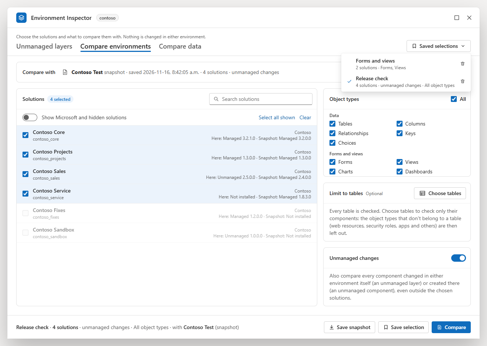

*The choice screen in the comparison mode (`renderPick`, `renderMode`): the snapshot of Contoso Test open in the
**Compare with** strip; the solutions, each with its version here and in the snapshot, those the snapshot doesn't hold
greyed out; the object types; the Tables card; *Unmanaged changes*; the **Saved selections** menu open, with this tab's
own selections; **Save snapshot**, **Save selection** and **Compare** in the footer.*

`mode` is `'scan'`, `'compare'` or `'data'` ([chapter 12](#12-comparing-data)). The tabs at the top of the choice
screen (`#modeSw`) switch it through `switchMode` and `setMode`, which keep the object types and tables of the tool
left and bring back the other's (`pickOf`; `typesOf` says whose the ticks on screen are, since *Compare data* has none):
each tool keeps its own choice. `keepCompare` stores the mode, the *Unmanaged changes* switch (`direct`), the chosen solutions
(`cmpChosen`) and the comparison's object types and tables in the browser's local storage under
`environmentInspector:<org>:compare`, apart from the scan's choice. `renderMode` changes the heading screen readers
hear ("Compare with another environment") and the line under the tabs, shows the **Compare with** strip
(`#otherCard`) and the *Unmanaged changes* card (`#directCard`), hides *Managed layers on top*, shows **Save
snapshot**, and turns **Scan** into **Compare**. The object types and the Tables card are the scan's own.

**The solutions.** `loadEverySolution` reads every solution of the environment, managed and unmanaged (`Default` and
`Active` left out), the first time the mode is chosen (the scan's list holds the managed ones only). `cmpSolRows` puts
this environment's solutions and the snapshot's in one list, one row per unique name, each with its version on both
sides ("Here: Managed 3.2.1.0 · Snapshot: Managed 3.2.0.0", or "Not installed"). A solution the snapshot does not hold
can't be compared: its row is greyed out (`off`), can't be ticked, and says why in its tooltip ("Not in the snapshot of
Contoso Test: save a new snapshot there to compare it"). *Show Microsoft and hidden solutions* works as in the scan.

**Compare with.** `renderOther` draws the strip: **Open a snapshot…**, with "Save one in the other environment first:
there, choose Compare environments, then Save snapshot.", or the snapshot open, with its environment, when it was saved
and what it holds ("Contoso Test snapshot · saved *time* · 4 solutions · unmanaged changes"; the file name in the
tooltip), and **Open another**. A data snapshot opened here is recognized from its start (`snapshotKind`) and refused
with "This is a data snapshot. Open it under Compare data." and **Open it there**, which switches to *Compare data* and
opens it there ([12.1](#121-records-and-a-file-of-their-own)). The file input (`#snapIn`) is part of the window's markup, outside what `renderOther`
redraws, so a file chosen while the screen redraws is not lost. Opening a file runs `readSnapshot`
([11.4](#114-snapshot-files)), then takes the snapshot's choice: its solutions, object types, tables and *Unmanaged
changes*; the name of a saved selection applied is let go. **Compare** stays off until a snapshot is open, and the
footer then ends with "open a snapshot to compare with".

**Unmanaged changes.** The switch (`#directSw`, on at first) adds every component whose top layer is unmanaged in
either environment, inside the chosen solutions or not: "Also compare every component changed in either environment
itself (an unmanaged layer) or created there (an unmanaged component), even outside the chosen solutions." With it on,
no solution needs to be chosen.

**What is compared** is `cmpScope()`: the solutions, object types and tables chosen, each within what the snapshot holds
(a snapshot saved for some object types can't be compared on others), and *Unmanaged changes* only when the snapshot
was saved with them. `renderDirect` disables the switch, with the reason, when it wasn't ("The snapshot of Contoso Test
doesn't hold them: save it there with Unmanaged changes on."). When the snapshot holds none of the chosen object types
or tables, `cmpScope` names them in `outside` and **Compare** stays off ("The snapshot of Contoso Test holds none of the
chosen object types."): an empty list would mean all of them. Otherwise the footer sums up what will be compared: "4
solutions · unmanaged changes · All object types · with Contoso Test (snapshot)".

**Saved selections**, as in the scan ([8.3](#83-the-choice-screen-and-saved-selections)), with a list of their own
(`environmentInspector:compareSelections`, read by `loadCmpSaved`): each holds its name, the day it was saved, the
solutions, the object types ticked (`pick`) and chosen (`types`), the tables and *Unmanaged changes*. The menu gives each
one's summary ("4 solutions · unmanaged changes · All object types", and "· 2 tables" when it has tables).

* **Applying one** (`applyCmpSaved`) waits for the list of every solution, then ticks its solutions that are installed
  here or held by the snapshot open (with a snapshot open, only those it holds), its object types, its tables and
  *Unmanaged changes*, and puts the focus on **Compare** when it can be used, else on **Save snapshot**, else on the
  search. One warning toast names, a sentence each, the solutions not installed here and those the snapshot doesn't
  hold ("1 solution in “Release check” isn't in the snapshot of Contoso Test, so it isn't ticked: contoso_sandbox.").
* **Saving one** (`saveCmpDialog`, through the shared `saveDialog`, "For example: Release check") keeps the solutions of
  the selection saved before under that name that couldn't be ticked here: those not installed here and, with a
  snapshot open, those it doesn't hold.

**The right column** holds three cards, as in the scan. In a short window the Tables card and *Unmanaged changes* keep
only their title and control: the scan shortens its cards below 600 pixels of column height, the comparison below 540
(`.rcol.cmp`), because the strip above takes some of the height. In the smallest window the object types keep at least
150 pixels and the column scrolls.

### 11.3 Reading one side: `readSide`

`readSide(scope, report, extraKeys)` reads one environment and returns a **side**: `{ format, v, tool, env, takenOn,
wrLong, scope, languages, otc, tableIds, solutions, items, failed, noAccess, unread, skipped, nameCols, holders }`. A snapshot is a side
saved to a file, so a side read live and a side opened from a file are compared the same way. `scope` is `{ solutions,
types, tables, direct }`: unique names, object type groups (empty: all), table logical names (empty: all) and
*Unmanaged changes*. `report(what, fraction)` moves the progress line: each part of the read has its share of the bar
(the solutions, the component lists, the unmanaged changes, the names, then each part of the definitions) and moves
through it as its requests answer; the window writes "Reading this environment: *part*…" (`readReport`), with the time
since the comparison or the snapshot started, which runs on to the end ([8.2](#82-views-and-rendering)). `extraKeys` are
the other side's components, each as `{ k, code, kind }` ([11.6](#116-running-a-comparison)).

1. **The first reads, at once**: every solution (with its publisher, its install date and, for a patch, its
   solution); every table definition (`LogicalName`, `SchemaName`, `DisplayName`, `MetadataId`, `EntitySetName`,
   `PrimaryIdAttribute`, `PrimaryNameAttribute`, `ObjectTypeCode`); the tables that have a `solutionid` column; the
   component type definitions (`solutioncomponentdefinitions`, [6.2](#62-step-1-from-the-chosen-solutions-or-the-whole-environment)); the
   environment's languages (`RetrieveProvisionedLanguages`; when they can't be read, the failure is named and labels
   are compared in every language); and the environment itself (`RetrieveCurrentOrganization`: its name, id and
   version). `otc` maps each table's type code to its logical name, for [11.5](#115-what-counts-as-the-same-norm), and
   `tableIds` each table to its metadata id, for the links ([11.7](#117-the-results-and-the-details)).
2. **The chosen solutions' component lists.** A solution, its patches (by `parentsolutionid`) and its pending upgrade
   (`<unique name>_Upgrade`) are one family and count as the solution, as for *Managed layers on top*
   ([6.11](#611-managed-layers-on-top)); a patch or a pending upgrade chosen on its own counts as itself. One
   `solutioncomponents` request per solution of the families, `CONFIG.concurrency` at a time; a table with
   `rootcomponentbehavior` 0 is held with all its objects ([3.7](#37-solution-components-and-with-all-objects)).
3. **Unmanaged changes**, when asked: for each component type chosen, the rows whose `solutionid` is the Active
   solution, as in the scan's sweep ([6.2](#62-step-1-from-the-chosen-solutions-or-the-whole-environment)), but without `ismanaged eq true`:
   components that exist only unmanaged, made in the environment itself, are unmanaged changes too. They are marked
   `direct`. A type the user's security role can't read goes to `noAccess`, as in the scan; any other failure is named
   in `failed` ("Unmanaged changes, web resources: *reason*").
4. **Names for the metadata types.** Tables, columns, keys, relationships and global choices have other ids in each
   environment (a column added in each environment by hand, for example), so they are matched by name: the tables by
   logical name; the columns and keys of every table (100 tables per request, only when columns or keys are compared);
   every relationship (two requests); every global choice (one request). `keyOf` turns `<type code>|<id>` into the
   component's **key**: `1|<table>`, `2|<table>|<column>`, `14|<table>|<key>`, `10|<relationship>`, `9|<choice>`, and
   `<type code>|<id>` for every other type. A column that Dataverse derives from another (`AttributeOf`, such as the
   name of a lookup) is left out: it has no definition of its own.
5. **The keys to read**: the components of the lists, each with the chosen solutions that hold it (`sols`); the
   unmanaged changes (`direct`); the tables held with all their objects; and `extraKeys`, the other side's components,
   so that a component outside this side's chosen solutions is found rather than reported missing (they are marked
   `extra`). A **newer component type**, from `solutioncomponentdefinitions` and numbered 10000 and up, gets its number
   from each environment itself: one table can be type 11658 in one environment and 11684 in another. So the other
   side's key of a newer type is translated to this environment's number through its table name (`kind`,
   `codeOfKind`); a type this environment doesn't have is left out.
6. **The definitions**: `definitions` ([below](#reading-the-definitions-definitions)).
7. A key that nothing was found for becomes `{ k, code, kind, absent: true }`, with the chosen solutions that list it:
   a component list can name a component that no longer exists, and the other side can name one this environment
   doesn't have. A key whose read failed is not absent: it gets `noRead` (below).

The side's `items` are one object per component:

| Field | What it is |
| --- | --- |
| `k` | The key (step 4) |
| `code`, `type`, `kind` | The component type number, its label (a form's kind, a view's kind, a process's category) and its layer name ([3.4](#34-component-types-and-layer-names)). For a newer type, `kind` is also the table name that finds it in another environment |
| `id`, `name`, `schema`, `table` | The component's id, display name, schema or unique name, and table. A plug-in step's table is its message filter's (below) |
| `nk` | A **name key** for a record type, to match it when its id is not on the other side: `<type>\|<table>\|<kind>\|<value>\|<language>`. `<type>` is the number of a classic type and the table name of a newer one (`keyOfType`); `<kind>` a form's, view's or process's kind; `<value>` the first of `uniquename`, `schemaname`, `connectionreferencelogicalname`, `sitemapnameunique`, `displaystringkey`, `typename`, `name` and `title` that the row has (`KEY_COLS`), else the table's primary name column; `<language>` a display string's language |
| `sols`, `direct` | The chosen solutions that hold it, and whether it is an unmanaged change (its top layer is the Active layer, step 3) |
| `in` | Every solution whose component list has it, chosen or not, by unique name (any but Default and Active; an empty list: none). A managed solution in the list holds a layer of it, so a layer in one environment only is found even under the layer on top. Missing when not known (the read failed, or a snapshot saved by an earlier version) |
| `inTable` | The other solutions that hold its table with all its objects, for a column, relationship, key, form, view or chart. Such a solution usually holds no layer of the part: the part keeps the layers of the solutions that define it |
| `managed` | Whether it has a managed layer (Dataverse's `IsManaged` or `ismanaged`), when the component's table or metadata says. Never compared: it tells an unmanaged layer, in the scan's sense (the Active layer on top of a managed component), from a component made in the environment itself ([11.7](#117-the-results-and-the-details)) |
| `parent` | What a component that Dataverse makes in each environment belongs to: a column mapping's table mapping (`<source table>\|<target table>`), a real-time workflow step's workflow (`wf:<id>`) |
| `top` | The solution of its top layer: `{ active: true }`, `{ unique, version, managed }`, or `null` when it is not known (a global choice in a snapshot saved by an earlier version) |
| `props` | Its definition as read: the columns of its row, or its metadata |
| `env` | The values set per environment, kept apart ([11.5](#115-what-counts-as-the-same-norm)) |
| `noRead` | Why it could not be read, when a read failed |
| `alt` | For a relationship, the id of its row in `relationships` (its cascade settings' layers, [3.4](#34-component-types-and-layer-names)) |
| `absent` | `true` when nothing was found for its key (step 7) |

Besides the items, a side keeps what it couldn't read (`failed`, `unread`), the types the security role can't read
(`noAccess`), the columns that were not compared because Dataverse doesn't return them (`skipped`), each component
table's primary name column by type (`nameCols`), with which both sides name their components the same way
([11.6](#116-running-a-comparison)), whether every component's solutions were read (`holders`: `in` and `inTable`), and
the length past which a web resource's content is kept as its fingerprint (`wrLong`, [11.4](#114-snapshot-files)).

#### Reading the definitions: `definitions`

* **Tables, columns, keys and relationships**: `RetrieveMetadataChanges` with every property, 10 tables per request, 4
  requests at a time. The answer holds each table with its columns (and their choices), keys and relationships, as
  Dataverse stores them. A table held with all its objects brings all its parts, and they count as held by the
  solutions that hold the table (`heldBy`); a relationship counts for both its tables. A table's own definition leaves
  out its parts (they are components of their own) and keeps its privileges' names and types.
* **Their top layers**: `entities`, `attributes` and `entitykeys` by id (50 per request, with
  `Microsoft.Dynamics.CRM.In`), and `relationships` by name (25 per request), each with its `solutionid`.
* **Global choices**: two requests for all of them (the `OptionSetMetadata` and `BooleanOptionSetMetadata` casts of
  `GlobalOptionSetDefinitions`: the Web API can't filter them). A choice has no row with a `solutionid`, so its layer on
  top comes from its layers: one `msdyn_componentlayers` request per choice (about a tenth of a second each),
  `CONFIG.concurrency` at a time, keeping the layer with the highest order (the Active layer as `{ active: true }`). A
  choice whose layers can't be read gets `noRead`, and one line in `failed` counts them ("The layers on top of 3 global
  choices: *reason*").
* **Every other type**: its own rows, by id, 50 per request (fewer for large rows: 20 for forms, web resources,
  processes, plug-in assemblies and email templates, 10 for reports, canvas apps and mail merge templates,
  `PER_REQUEST`), with `solutionid` and the annotations that give each lookup's table and name. The forms, views and
  charts of the tables held with all their objects are read by table, 20 tables per request. **The other side's
  components** that are not among this side's own (`extra`) are first only looked for, the id alone, 200 ids per
  request; then the rows of those found are read like the others. Most of them are records a product made in the other
  environment only, so the full read is spared for the many that aren't here.
* **The columns of a row** are worked out at run time by `columnsOf`, 40 tables per request: every column that can be
  read, except the companions Dataverse derives (`AttributeOf`), calculated and rollup columns (`SourceType` 1 and 2,
  with a rollup's `_date` and `_state` columns), images, files and party lists, virtual columns (but multi-select
  choices), the primary key, the values Dataverse sets itself (`REC_IGNORE`), ids that end in `idunique`, and per table
  the columns in `SKIP`: derived copies (a form's `formjson`, a site map's managed XML), internal values (a flow's
  `clientdataiscompressed` and `modifymetadata`), statistics, and secrets (a plug-in assembly's content and password, a
  service endpoint's keys and tokens, a step's secure configuration); and in every table, a column whose name suggests a
  secret (`SECRET`: secret, password, saskey, authvalue, apikey, privatekey, secureconfig, credential, token,
  connectionstring, accountkey, sharedkey, sharedaccesskey; the same rule as *Compare data*'s). `columnsOf` also gives
  each table's primary name column (`PrimaryNameAttribute`, when it is one of those columns and not a lookup), kept in
  the side's `nameCols`, and whether the table has an `ismanaged` column, which each row is then read with (the item's
  `managed`). When Dataverse refuses a column in `$select` although its metadata lists it, the read is sent again
  without it, and the column is named in `skipped` ("&lt;type&gt;: the column &lt;name&gt;, which Dataverse doesn't
  return"): not a failure, since there is nothing in it to read.
* **What a row does not hold**: a security role's privileges (`roleprivilegescollection`, 25 roles per request, as
  "&lt;privilege&gt;: &lt;depth&gt;"), a model-driven app's parts (`appmodulecomponents`, by type and id or table
  name), and a plug-in assembly's content, compared by its SHA-256 fingerprint only (two assemblies per request, two
  requests at a time): the content is large and is never kept.
* **A Power Pages site setting** whose name suggests a secret (a client secret, an app key) keeps its content as its
  fingerprint only.
* **What some components belong to.** Dataverse makes some components in each environment, with ids of their own:
  plug-in steps, their images, table mappings and column mappings. They are matched by what they are
  ([11.6](#116-running-a-comparison)), and three reads, 200 ids per request, give what their rows don't hold:
  * a plug-in step's table: the `primaryobjecttypecode` of its message filter (`sdkmessagefilters`), kept as the step's
    `table`;
  * a column mapping's two tables: the `sourceentityname` and `targetentityname` of its table mapping (`entitymaps`),
    kept as its `parent`;
  * the workflow behind a real-time workflow's step. Dataverse makes such steps when the workflow is activated, and a
    step's `configuration` is the id of the activation, whose `parentworkflowid` is the workflow (`workflows`). It is
    kept as the step's `parent` (`wf:<workflow id>`), and names a step that has no name ("*workflow* · *message* of
    *table*").

  A failed read is named in `failed` ("The tables of plug-in steps: ...", "The table mappings of column mappings: ...",
  "The workflows of plug-in steps: ...") and leaves those components to be matched by what is left.
* **Every solution that holds each component.** For every component read (not only the unmanaged changes): its
  solution component rows in any solution but Default and Active (`solutioncomponents` by `objectid`, 200 ids per
  request), into `in`; and for a column, relationship, key, form, view or chart, the solutions that hold its table with
  all its objects (a relationship: either of its tables), into `inTable` when they aren't in `in` already. The side's
  `holders` is then `true`. They name the solutions of an unmanaged change outside the chosen solutions (or *No
  solution*), the other solutions installed in either environment that hold compared components, and a managed
  solution that holds a component in one environment only ([11.6](#116-running-a-comparison),
  [11.7](#117-the-results-and-the-details)). A failed read leaves `in` out ("The solutions that hold each component:
  ...").

A part that fails is named in `failed` ("&lt;what&gt;: &lt;reason&gt;"), and the components it should have read get
`noRead` (`notRead`), so they show as *Couldn't compare* rather than missing: the tables, columns, keys and
relationships of a chunk of table definitions, every global choice, the components whose layer on top couldn't be read,
the other side's components whose search failed, and the roles, apps or plug-in assemblies of a failed read. What can't
be named one by one (the parts of a table held with all its objects, the forms, views and charts read by table) goes to
the side's `unread` (tables, type codes and parts), so the other side's components there are *Couldn't compare* too. A
type the user's security role can't read goes to `noAccess`, as in the scan; the image configurations that Dataverse
refuses with its own security error are left out without a note (`QUIET_NO_ACCESS`,
[6.2](#62-step-1-from-the-chosen-solutions-or-the-whole-environment)). A sign-in that ended (`SessionError`) stops the reading.

### 11.4 Snapshot files

**Saving.** **Save snapshot** (`runSnapshot`) reads this environment with the choice made (`readSide`), then
`snapshotBlob` turns the side into JSON, compressed with the browser's `CompressionStream('gzip')`, and `downloadBlob`
saves it as `snapshot-<org>-<stamp>.json.gz` (`snapshotName`; the stamp in UTC, as for the exports, [13](#13-exports)).
A value longer than 1,000,000 characters (`LONG`), and a web resource's content longer than 500,000 (`WR_LONG`: product
libraries are several hundred KB each), is kept as its fingerprint, `{ "#sha256": ..., length }` (`fingerprinted`); the
snapshot records that length as `wrLong`. At a comparison both sides are given their fingerprints with the snapshot's
own length (an earlier version kept web resources past 100,000 characters as fingerprints, so a snapshot without
`wrLong` is compared at 100,000), so the two meet. A side too large to write as one text (a page's longest text is about
536 million characters), or over 500 MB unpacked (`SNAP_MAX`), which the other environment couldn't open, is refused:
"This snapshot is too large to save. Choose fewer solutions or object types, or turn off Unmanaged changes." A snapshot
of the test solution (115 components) is 85 KB; with *Unmanaged changes* (about 19,600 components), about 13 MB. The
toast says what was saved and where to open it: "Saved *file* (85 KB, 115 components). In the other environment, choose
Compare environments, then open it under Compare with." The size is in KB, MB or GB (`fileSize`), never "0.0 MB".
**Export** → *Snapshot of this environment*, after a comparison, saves the side just read the same way.

**Save snapshot** keeps the results on screen: the scan's or the comparison's state is kept before the read and put
back after it, so **Back to results** returns to them. While a comparison or a snapshot is read, the scan's tick boxes
and **Delete** stay hidden (`syncSelection`).

A snapshot holds configuration: scripts, flow definitions, environment variable values, plug-in step settings,
endpoint addresses. It never holds a token, a password, a key or secure configuration: those columns are never read
(`SKIP`, `SECRET`). The raw values are kept, not the normalized ones, so a later version compares an old snapshot with
its own rules.

**The format.** A snapshot names its format (`format`), the version of that format (`v`) and the version of the tool
that saved it (`tool`). Files saved under the tool's earlier name, Unmanaged Layer Scanner, name another format, which
is read the same way:

`environment-inspector.js`, `SNAP`, `SNAP_V` and `SNAP_OLD` (in `compare environments`):

```js
const SNAP = 'environment-inspector-snapshot', SNAP_V = 1, SNAP_OLD = 'unmanaged-layer-scanner-snapshot'   // (files saved under the earlier name are read too)
```

**Opening.** `readSnapshot(file)` treats the file as untrusted. It first looks at the file's first 200 unpacked bytes
(`snapshotKind`): a data snapshot is refused with "This is a data snapshot. Open it under Compare data."
([12.7](#127-data-snapshot-files)). Then:

`environment-inspector.js`, `readSnapshot` (the start):

```js
const SNAP_MAX = 500e6   // bytes unpacked: a page can't hold a longer text
// ...
async function readSnapshot(file) {
  const big = () => new Error('This file is too large to be a snapshot.')
  if (file.size > SNAP_MAX) throw big()
  const head = new Uint8Array(await file.slice(0, 2).arrayBuffer())
  let text, n = 0
  const cap = new TransformStream({ transform(chunk, c) { n += chunk.byteLength; if (n > SNAP_MAX) c.error(big()); else c.enqueue(chunk) } })   // stops a file that unpacks to more
  try { text = head[0] === 0x1f && head[1] === 0x8b ? await new Response(file.stream().pipeThrough(new DecompressionStream('gzip')).pipeThrough(cap)).text() : await file.text() }
  catch { throw n > SNAP_MAX ? big() : new Error("This file isn't a snapshot: it couldn't be unpacked.") }
  let s
  // (a key named toString or valueOf is dropped: text made from such an object would stop the comparison)
  try { s = JSON.parse(text, (k, v) => (k === 'toString' || k === 'valueOf' ? undefined : v)) } catch { throw new Error("This file isn't a snapshot: it isn't valid JSON.") }
```

A file over 500 MB, packed or unpacked (`SNAP_MAX`), is refused before it fills the page's memory: the unpacked bytes
are counted as they come. So is a file of more than 10,000,000 values (`SNAP_VALUES`: each `{`, `[` and `,` outside
strings, counted before the file is parsed), as millions of tiny values take minutes and gigabytes to parse whatever the
file's size; a real snapshot of a large environment has about 520,000. Then it checks the shape (`format` must be `SNAP` or `SNAP_OLD`, above, with an environment,
a time, items, solutions and a scope), refuses a format version newer than its own (`SNAP_V`, "This snapshot was saved
by a newer version of Environment Inspector. ..."), and copies the file field by field into a new object:
strings are cut to a length, ids must be GUIDs, type codes and table names must look like them, the scope's object
types must be known groups, the scope's solutions never include `Default` or `Active`, and anything else is dropped.
Among the checks:

| Field | Kept when |
| --- | --- |
| A solution's `installedOn` | A date written `yyyy-mm-dd`; else empty |
| `tableIds` | A plain logical name with a GUID; others are dropped |
| An item | Its key is text under 600 characters and its type number a whole number above 0 |
| An item's `in`, `inTable` | A list: its texts; missing otherwise |
| An item's `managed` | `true` or `false`; missing otherwise |
| An item of a classic type kept under a newer number too | Dropped: an earlier version read duplicate detection rules twice (as 44 and 4414); they are kept once, under the classic number (`CLASSIC_KIND`) |
| `holders`, `wrLong` | `true` or `false`, else `null`; a whole number above 0, else `null` |
| An item's `parent` | Text, cut to 300 characters |
| `skipped` | Its texts |
| `nameCols` | A type name with a plain column name; `null` when the file has none |

Nothing from the file is ever put on the page as markup: the window escapes it like any value read from Dataverse
([8.1](#81-shadow-dom-and-styles)). `JSON.parse` makes plain data only: nothing in a file is ever run. The other
environment's address and ids serve only its links: they are built from checked ids, and only to an `https` Dataverse
address (`safeOrigin`, [11.7](#117-the-results-and-the-details)).

**A snapshot saved by an earlier version** has no `nameCols` (it reads as `null`), no `in`, `inTable`, `managed` or
`parent`, no `holders` or `wrLong`, no table on its plug-in steps, no layer on top of its global choices, and its newer
types' name keys use their numbers. It is still compared, on its own terms: names are worked out from the definitions
on both sides alike, a newer type's number in a name key is replaced by its table name, plug-in steps are matched by
their message filter ([11.6](#116-running-a-comparison)), web resources are compared at the fingerprint length it was
saved with, and the layers of solutions that aren't compared are compared only when both sides read every solution that
holds each component (`holders`, [11.6](#116-running-a-comparison)). A note under *Good to know* says what such a
snapshot lacks ([11.7](#117-the-results-and-the-details)).

### 11.5 What counts as the same: `norm`

`norm(value, ctx)` turns a value into what decides the status. The details still show the values as stored.

* **Values Dataverse sets itself, or that differ by design**, are left out: in rows, `REC_IGNORE` (created and modified
  on and by, version number, overwrite time, owner, the component state, the solution columns and others); in
  metadata, `META_IGNORE` (`MetadataId`, `HasChanged`, `IsManaged`, `IntroducedVersion`, `CreatedOn`, `ModifiedOn`,
  `ObjectTypeCode`, `ColumnNumber` and others) and every annotation (a key with `@`). `META_IGNORE` also holds
  `CanBeChanged`, the part of every managed property (such as `IsCustomizable`) that follows whether the component is
  managed: it is true where a solution is developed and usually false where it is installed, so it would set a
  development environment apart from every other. The property's value is still compared.
* **Values set per environment** are kept apart in `env`, compared, and shown, but never make a row *Different*:
  `ENV_VALUE` (an environment variable's value, a connection reference's connection, a plug-in step's user, a role's
  business unit, an SLA's business hours, a canvas app's ids and its connection and database references, an agent's
  publishing state and its Microsoft 365 app ids) and any lookup to an environment's own data (`DATA_TABLES`: business units, users, teams, queues, calendars,
  currencies, the organization). So is the activation that a real-time workflow's step runs, which each environment
  makes itself ([11.6](#116-running-a-comparison)).
* **No value, a blank, `false` and 0 are the same** (`unset`): a column that one environment never set and the other
  holds at its default, such as a flow's business process type, empty in one and 0 in the other.
* **Type codes** of custom tables differ by environment. `normText` replaces them, in XML attributes such as
  `object="10234"` and in JSON such as `"ObjectTypeCode": 10234`, with the table's logical name from the side's `otc`.
  GUIDs are compared in lower case, whatever case they are written in.
* **Text that holds JSON** is compared without the order of its keys (it is parsed, with exact numbers, and normalized
  like any value), and a key in it that only one side has is a difference (`FROM_TEXT`, see `both` below); **text
  that holds XML** without the spaces between its tags.
* **A component matched by its name** ([11.6](#116-running-a-comparison)) has its own id taken out of its text: a view's
  fetch names its own id, which differs in each environment.
* **Ids of other components matched by name** are read through the pairs (`ctx.ids`, [11.6](#116-running-a-comparison)):
  on the snapshot's side, a lookup to one of them that has no name (a column mapping's table mapping, a step image's
  step), and such an id anywhere in a text, reads as this environment's id.
* **Labels** become their text per language, only in the languages both environments have (a note names the others;
  with none in common, labels aren't compared). A label missing in one of those languages is a difference. When one
  side's languages are not known, every language is compared.
* **Lookups** become `<table>:<name>`, so a lookup to the same component with another id on each side is the same.
* **A choice column that uses a global choice** that is compared too is compared only on which choice it uses: the
  options are compared once, on the choice itself, instead of on every column that uses it.
* **Fingerprints** (`#sha256`) stand for the value they replace.

`environment-inspector.js`, `normText` and `norm`:

```js
function normText(t, ctx, d = 0) {
  if (t.length > 3e6) return t
  const s = t.trim(), xml = s[0] === '<' && s.endsWith('>')
  let x = (xml ? s.replace(/>\s+</g, '><') : t).replace(/((?:object|otc|objecttypecode|etc)=")(\d{4,})"/gi, (m, a, n) => (ctx.otc[n] ? `${a}${ctx.otc[n]}"` : m))
    .replace(/("(?:Object|ObjectTypeCode|Otc)"\s*:\s*)(\d{4,})/g, (m, a, n) => (ctx.otc[n] ? `${a}"${ctx.otc[n]}"` : m))
  // Ids, when the text has any (a text without a dash has none: base64 content is passed over quickly): in one case;
  // a component's own id, when it was matched by name, as "(its own id)"; then each id of a component the other side
  // matched by name as this side's id (an app's site map, a step image's step).
  if (x.includes('-')) {
    x = x.replace(GUID_ANY, (m) => m.toLowerCase())
    if (ctx.own) x = x.split(ctx.own).join('(its own id)')
    if (ctx.ids && ctx.ids.size) x = x.replace(GUID_ANY, (m) => ctx.ids.get(m) || m)
  }
  // JSON held in text (a flow's definition, a form's JSON): normalized, and marked, so that a key one side has and the
  // other hasn't counts there (both() keeps it): it is part of the definition, not a newer Dataverse's property.
  if (!xml && s.length > 1 && ((s[0] === '{' && s.endsWith('}')) || (s[0] === '[' && s.endsWith(']')))) {
    try { const r = norm(JSON.parse(x, exactNumbers), { ...ctx, own: '' }, d + 1); if (r && typeof r === 'object') r[FROM_TEXT] = true; return r } catch { }
  }
  return x
}
// Labels as their text per language (the languages both environments have; all of them when one side's are not
// known), metadata without what differs between environments by design, lookups by the name of what they point to.
function norm(v, ctx, d = 0) {
  if (typeof v === 'string') return normText(v, ctx, d)
  if (!v || typeof v !== 'object' || d > 40 || v instanceof ExactNumber) return v
  if (Array.isArray(v)) return v.map((x) => norm(x, ctx, d + 1))
  if ('#sha256' in v) return `#${v['#sha256']}`
  // (each language both environments have, with '' where a label is missing: a missing translation is a difference)
  if (Array.isArray(v.LocalizedLabels)) { const m = {}; if (ctx.langs) for (const l of ctx.langs) m[l] = ''; for (const l of v.LocalizedLabels) if (l && (!ctx.langs || ctx.langs.has(l.LanguageCode))) m[l.LanguageCode] = l.Label; return m }
  if ('table' in v && 'id' in v && 'name' in v && Object.keys(v).length === 3) return `${v.table}:${v.name || (ctx.ids && ctx.ids.get(lc(v.id))) || v.id}`   // a lookup
  const out = {}
  for (const k of Object.keys(v).sort()) if (!META_IGNORE.has(k) && !k.includes('@') && k !== '__proto__') out[k] = k === 'Targets' && Array.isArray(v[k]) ? [...v[k]].sort() : norm(v[k], ctx, d + 1)
  return out
}
```

`environment-inspector.js`, `unset`:

```js
// No value, a blank, false and 0 count as the same: a column one environment never set and the other holds at its
// default (a flow's business process type, null in one, 0 in the other).
const unset = (v, d = 0) => (v == null || v === '' || v === false || v === 0 ? null : d > 40 || typeof v !== 'object' || v instanceof ExactNumber ? v
  : Array.isArray(v) ? v.map((x) => unset(x, d + 1)) : Object.fromEntries(Object.entries(v).map(([k, x]) => [k, unset(x, d + 1)])))
```

**Only what both sides have.** `both` keeps, at every level, the properties that both normalized values have: a
property only one side has (one that a newer Dataverse version added, an older snapshot, a column Dataverse refused on
one side) is not compared. Inside JSON held in text (marked `FROM_TEXT` by `normText`) every key is kept: it is part
of the definition. A property both sides have is compared even when one of them is empty. Two normalized values
are then compared with `stable` ([9.2](#92-comparing-two-layers)) after `unset`; `stable` writes JSON with its keys in
order, so the order of keys never matters. The details lay XML and JSON out for reading
([9.4](#94-xml-laid-out-without-loss-prettyxml)).

**Solutions and their versions.** A solution at another version, or with another latest patch, is a difference of the
solution itself, on its own row ([11.6](#116-running-a-comparison)): it does not make each of its components a
difference. A solution that is managed in one environment and unmanaged in the other at the same version is not a
difference: it is developed in one and installed in the other.

### 11.6 Running a comparison

`runCompare` (**Compare**):

1. Takes the snapshot's components that the choice covers (`inScopeItem`: an object type and table chosen, and a
   chosen solution holds it, or it is an unmanaged change when those are compared), each with only the chosen
   solutions that hold it.
2. Reads this environment with `readSide`, passing those components as `extraKeys` (`{ k, code, kind }`, so that a
   newer type is found by its table name, [11.3](#113-reading-one-side-readside)), and cuts its components by the
   object types and tables chosen the same way (`inScopeType`: a dashboard is not a form, a business rule is not a
   cloud flow; a relationship is in when either of its tables is chosen). `readSide` reads by component type, so
   without this cut a component of an object type not chosen would be *Only in* this environment.
3. Gives both sides' long values their fingerprints, at the snapshot's length for web resources (`fingerprinted`,
   [11.4](#114-snapshot-files)), as the snapshot keeps them.
4. Compares the two sides with `compareSides` and keeps the result in `cmp`: both sides, the rows, the scope, the time,
   the requests, the names shown for each side (`nameA`, `nameB`; " (snapshot)" is added when both have the same name)
   and their short forms (`shortA`, `shortB`), whether any row is an unmanaged change outside the compared solutions
   (`hasDirect`) or couldn't be compared (`hasError`), and the languages compared (`langs`). The choice is kept in
   `lastCmp`: **Compare again** repeats this comparison, whatever the choice screen holds since. `cvReset` starts the
   window on the overview ([11.7](#117-the-results-and-the-details)).

While it runs, the window shows E0, the overview as it will be laid out (`e0Draw`): the title "Comparing environments",
the lane heads (this environment's grey until it is read; the snapshot's as on the overview), the *Dataverse* and
*Languages* rows, each solution compared and *Unmanaged changes* in their final places with a dotted connector and
grey placeholders, and the step line in the first heading: "Reading this environment: *part*…" from 3 to 95%, then
"Comparing…", with the time since the comparison started ([8.2](#82-views-and-rendering)). **Swap** works meanwhile.
**Stop** goes back to the choice screen with "Comparison stopped.". An old snapshot's note is already at the top.

**Short names.** `shortNames` takes out of the two environments' names what they share at the start and at the end:
"Contoso Dev" and "Contoso Test" give "Dev" and "Test". The short names go where room is short: the tabs (*Only in
Dev*), the teal tag (*Unmanaged layer in Dev*), the sentences of the lines, the Filter's choices; the lane heads and
the buttons in them use the full names. When what is left is not a word on each side (two letters at
least), one is part of the other, or one is longer than 24 characters, the full names are used everywhere.

#### Matching: `compareSides`

**Solutions** come first: one row per chosen solution, by unique name, with its version, its latest patch (`patch`: the
highest version among the solutions whose parent it is) and its publisher. A solution on one side only is *Only in*,
one that differs in any of these is *Different*. Managed or unmanaged is shown but not compared
([11.5](#115-what-counts-as-the-same-norm)). The chosen solutions' patches and pending upgrades show with them
(`parts`). Every other solution installed in either environment gets a row too, marked `other`, compared the same way
(version, patch, publisher), except Default, Active and the patches, which show with their solution
([11.7](#117-the-results-and-the-details)).

**Names, the same way on both sides.** `named(side, cols, keysOf)` works out each component's name keys from its
definition, for both sides alike, so that a snapshot saved by an earlier version is keyed as a side read now is. `cols`
merges the two sides' `nameCols`. The keys are kept apart from the items, in a `WeakMap` (`keysOf`):

* `n`, the **name key**: the item's `nk` (in an older snapshot, with a newer type's number replaced by its table name);
  for the components that Dataverse makes in each environment with ids of their own, what they are (below); else the
  table's primary name, from `nameCols`.
* `f`, for a plug-in step and its images only: the step's key with its message filter's id in place of its table, for
  a snapshot saved without the steps' tables.

| Component | What its name key holds |
| --- | --- |
| Table mapping (46) | Its two tables |
| Column mapping (47) | Its table mapping's two tables (`parent`, or the table mapping of the same side) and its two columns |
| Plug-in step (92) | Its plug-in type, message, table, stage, mode, rank, name, filtering columns (in any order) and deployment; for a real-time workflow's step, also the workflow behind it (`parent`) |
| Plug-in step image (93) | Its step's key, its alias, its kind (pre-image, post-image or both) and its message property |

`environment-inspector.js`, `named`, a plug-in step:

```js
else if (x.code === 92 && nm(p.sdkmessageid)) {
  const h = nm(p.eventhandler) || nm(p.plugintypeid), m = nm(p.sdkmessageid), rest = [p.stage, p.mode, p.rank, p.name || '', colSet(p.filteringattributes), p.supporteddeployment].join('|')
  const fid = p.sdkmessagefilterid && typeof p.sdkmessagefilterid.id === 'string' ? p.sdkmessagefilterid.id : ''
  n = x.table ? ['92', h, m, x.table, rest, x.parent || ''].join('|') : ''
  keys.f = ['92', h, m, fid ? '#' + fid : '', rest].join('|')
  x.name = x.name || `${m}${x.table ? ` of ${x.table}` : ''} · ${h.split('.').pop()}`
```

A component with no name gets one from these: "contoso_project → contoso_task" for a table mapping,
"contoso_project.contoso_budget → contoso_task.contoso_budget" for a column mapping, "Update of contoso_project ·
ProjectPlugin" for a step, "Target (pre-image) · *step*" for an image. A component with neither a name nor a schema
name gets the first text of at most 160 characters among its properties whose name says name, title, label, text,
subject or description, unless that text is an id.

**Then the matching**, in three passes:

1. **By key** (`matchKey`): tables, columns, keys, relationships and global choices by name; every other type by id,
   which a solution keeps from one environment to the next. A newer type's key has its table name in place of its
   number, so a component meets itself although each environment numbers its type differently:

   `environment-inspector.js`, `keyOfType` and `matchKey`:

   ```js
   // A component type as both environments know it: a classic type by its number (the same everywhere), a newer one by
   // its table name, as each environment numbers the newer types itself (one table can be type 11658 in one environment
   // and 11684 in another). matchKey: a component's key with its type so.
   const keyOfType = (code, kind) => (code < 10000 || !kind ? String(code) : kind)
   const matchKey = (x) => (x.code >= 10000 && x.kind ? x.kind + x.k.slice(x.k.indexOf('|')) : x.k)
   ```

2. **By name key, in two rounds**: `n`, then `f`. A key matches one to one only when it belongs to exactly one
   component on each side, counted over all of each side's components, not only those left. Round `f` matches only
   what round `n` could not: where the components on both sides have an `n`, round `n` has decided. A real-time
   workflow's steps match in round `f` only when their workflows are the same one, by id or paired by name (`wfPair`).

   `environment-inspector.js`, `compareSides`:

   ```js
   const done = new Set(), unsure = new Map()
   for (const r of ['n', 'f']) {
     const key = (x) => (keysOf.get(x) || {})[r] || ''
     const count = (m) => { const c = new Map(); for (const x of m.values()) { const k = key(x); if (k) c.set(k, (c.get(k) || 0) + 1) } return c }
     const group = (list) => { const m = new Map(); for (const x of list) { const k = key(x); if (k && !done.has(x)) { const l = m.get(k) || []; l.push(x); m.set(k, l) } } return m }
     const ca = count(ia), cb = count(ib), ga = group(leftA), gb = group(leftB)
     // Round f: a real-time workflow's steps only when their workflows are the same one (by id, or paired by name);
     // other steps only when a side isn't fully keyed (round n has decided the rest).
     const wfPair = r === 'f' ? new Map(pairs.filter(([a]) => a.code === 29).map(([a, b]) => [`wf:${lc(b.id)}`, `wf:${lc(a.id)}`])) : null
     for (const [k, la] of ga) {
       const lb = gb.get(k)
       if (!lb) continue
       if (r === 'f') {
         const pa = la.length === 1 ? la[0].parent || '' : '', pb = lb.length === 1 ? lb[0].parent || '' : ''
         if (/^wf:/.test(pa) && /^wf:/.test(pb) ? pa !== pb && wfPair.get(pb) !== pa : la.every((x) => (keysOf.get(x) || {}).n) && lb.every((x) => (keysOf.get(x) || {}).n)) continue
       }
       if (la.length === 1 && lb.length === 1 && ca.get(k) === 1 && cb.get(k) === 1) { pairs.push([la[0], lb[0], true]); done.add(la[0]); done.add(lb[0]); unsure.delete(la[0]); unsure.delete(lb[0]); continue }
       const why = `${ca.get(k)} in ${A.env.name} and ${cb.get(k)} in ${B.env.name} look the same (${r === 'n' ? 'the same name' : 'the same step'}), and their ids differ`
       for (const x of [...la, ...lb]) if (!unsure.has(x)) unsure.set(x, why)
     }
   }
   ```

3. **Never a guess.** Components that a key points to more than once on a side, and that no round matches, are not
   matched: they are *Couldn't compare* (`review`), with how many look the same on each side ("2 in Contoso Dev and 1 in
   Contoso Test look the same (the same name), and their ids differ").

**Ids through the pairs.** Two components matched by name have different ids, and so does every lookup to them.
`compareSides` therefore maps the snapshot's ids of the pairs matched by name to this environment's (`ctxB.ids`, kept
as `rows.ids` for the details), and `norm` reads the snapshot's lookups, and the ids in its texts, through it
([11.5](#115-what-counts-as-the-same-norm)): a column mapping's table mapping, a step image's step. One id is set per
environment instead: a real-time workflow's step, matched by its workflow (or, in a snapshot saved without the
workflow, run by Dataverse's workflow-execution plug-in on both sides), runs an activation that each environment made
itself, so its `configuration` goes to the values set per environment when it is only an id. Any other id that differs
is a difference.

The solutions a row names are the chosen solutions only: a snapshot compared on fewer of its solutions doesn't count
the others as a difference. **Other solutions' layers.** When both sides read every solution that holds each component
(`A.holders` and `B.holders`, which a snapshot saved by an earlier version lacks), `otherDiff` names the solutions that
aren't compared, managed in either environment, whose component list has the component on one side only: a layer of
another managed solution in one environment only, which the layer on top can hide. A chosen solution's patch or
pending upgrade doesn't count, nor an unmanaged solution (it holds no layer of its own), nor a solution that holds the
component's table with all its objects (`inTable`: it usually holds no layer of the part).

#### The statuses

The status of a pair is the first that applies:

`environment-inspector.js`, `compareSides`, `pair`:

```js
const status = a.noRead || b.noRead ? 'error' : diff.length ? 'diff' : layer ? 'layers' : solDiff.length || otherDiff.length ? 'member' : envDiff.length ? 'env' : 'same'
```

A component on one side only is *Couldn't compare* when it couldn't be read on either side, *Only in* when it is known
to be missing on the other, and *Unmanaged only in* when that can't be known. Each status has one name, one colour and
one shape in the whole window (`cvStatus` gives its kind and its name; the kind gives its icon, `E1_ICON`, `E2_ICON`,
`IT_ST`, [8.10](#810-the-comparisons-pages-levels-the-header-and-shared-parts)):

| Status | Shown as | When |
| --- | --- | --- |
| `diff` | *Different* | A property of the definition differs (`changedKeys`) |
| `onlyA`, `onlyB` | *Only in Dev*, *Only in Test* | On one side only, and known to be missing on the other. `whyOnly` says why when it can: the solutions that hold it aren't installed there, the other side read it and it isn't there (*Not in Contoso Test*), or the snapshot doesn't hold the solutions it is in |
| `direct` | *Unmanaged only in Dev* | An unmanaged change in this environment, in none of the compared solutions, on which the snapshot has no unmanaged change. The snapshot holds only its solutions and its own unmanaged changes, so whether Contoso Test has the component from another solution can't be told |
| `layers` | *Layers differ* | The definitions match, but the layer on top doesn't (`layerDiff`, below) |
| `member` | *Layers differ* | Definition and layer match, but other compared solutions hold it (`solDiff`), or a solution that isn't compared (managed in either environment) lists it in one environment only (`otherDiff`, when both sides read every solution that holds each component) |
| `error` | *Couldn't compare* | A read failed on either side (`noRead`), or the other side couldn't read where it would be (`unread`) |
| `review` | *Couldn't compare* | A name key points to more than one component on a side |
| `env` | *Same* | Only values set per environment differ (`envKeys`); the line under its name says which. Not counted as a difference (`cmpSame`) |
| `same` | *Same* | Nothing differs |

`environment-inspector.js`, `cvStatus` (its kind, for the tabs and the icons, and its name):

```js
function cvStatus(r) {
  switch (r.status) {
    case 'diff': return ['diff', 'Different']
    case 'onlyA': return ['onlyA', `Only in ${cmp.shortA}`]
    case 'onlyB': return ['onlyB', `Only in ${cmp.shortB}`]
    case 'direct': return ['direct', `Unmanaged only in ${cmp.shortA}`]
    case 'layers': case 'member': return ['layers', 'Layers differ']
    case 'review': case 'error': return ['error', "Couldn't compare"]
    default: return ['same', 'Same']
  }
}
```

A row that couldn't be compared is never counted as a difference: the titles, the counts and *All differences* leave it
out, and it has a tab of its own.

**The layer on top.** `layerDiff` compares the two `top`s. Unknown on either side: no difference. A solution developed
in one environment (unmanaged there) and installed in the other (managed) is the normal case, not an unmanaged change:
on the developing side the component's top layer is the Active one (its solution is unmanaged), or the managed solution
it was built on when the developed solution lists it without changing it; on the other side the installed solution's
layer is on top. Neither is a layer difference. When both sides have the Active layer on top and a chosen solution that
holds the component is managed on one side and unmanaged on the other, the Active layer on the managed side is a real
unmanaged change, so it is a layer difference. The same solution on top at another version is not a layer difference:
the solution's own row shows its versions.

`environment-inspector.js`, `compareSides`, `layerDiff`:

```js
// The layer on top differs: an unmanaged layer on one side only, or another solution on top. Not the same solution at
// another version: that is the solution's difference, shown with it. Not when a chosen solution is developed on one
// side (unmanaged there) and installed on the other (managed): there its layer is on top, while on the developing side
// the Active layer is, or the managed solution it was built on.
function layerDiff(a, b) {
  const ta = a.top, tb = b.top
  if (!ta || !tb) return ''
  const dev = (x, t, o, solsT) => !!o && !o.active && !!o.unique && (solsT.get(o.unique) || {}).managed === false && (!!t.active || (t.unique !== o.unique && x.sols.includes(o.unique)))
  if (dev(a, ta, tb, solsA) || dev(b, tb, ta, solsB)) return ''
  if (ta.active && tb.active) {
    // An Active layer on both sides: where a chosen solution that holds it is managed, and unmanaged on the other side,
    // the Active layer is a change made directly.
    const over = (x, solsX, solsY) => x.sols.some((u) => (solsX.get(u) || {}).managed === true && (solsY.get(u) || {}).managed === false)
    return over(a, solsA, solsB) ? `${A.env.name} has an unmanaged layer on top` : over(b, solsB, solsA) ? `${B.env.name} has an unmanaged layer on top` : ''
  }
  // (an Active layer on one side: the component made there, or an unmanaged layer, by the one rule: madeIn)
  if (!!ta.active !== !!tb.active) { const [x, o, n, sx, so] = ta.active ? [a, b, A.env.name, solsA, solsB] : [b, a, B.env.name, solsB, solsA]; return madeIn(x, o, sx, so) ? `${n} has it as an unmanaged component (made there)` : `${n} has an unmanaged layer on top` }
  if (ta.unique !== tb.unique) return `${topLine(a, solsA)} is on top in ${A.env.name}, ${topLine(b, solsB)} in ${B.env.name}`
  return ''
}
```

Otherwise two unmanaged layers on top are not a layer difference: what they change is in the definitions, which are
compared. When the Active layer is on top on one side only, the reason tells an unmanaged layer from a component made
in that environment by the same rule as *Unmanaged: made in Dev* (`madeIn`: `managed` false, its only layer the Active
one; or, when `managed` isn't known, as in a snapshot saved by an earlier version, held by a solution developed
there): "Contoso Dev has it as an unmanaged component (made there)". The list's line, the CSV's *What differs*, the
JSON's `why` and the note on its page all use this reason.

**Speed.** Matching and comparing take well under a second; the time is the reading. Measured in the test environment
(8 requests at a time; Dataverse's speed varies about two times between sessions):

| Scope | Components | Read | Snapshot file |
| --- | --- | --- | --- |
| The test solution | 115 | About 5 to 9 s | 85 KB |
| The test solution with *Unmanaged changes* | About 19,600 | About 32 to 47 s | About 13 MB |

A comparison with a snapshot takes the time of this environment's read plus a second or two to open the file. Choosing
fewer object types or tables makes both shorter.

### 11.7 The results and the details

A finished comparison has a view of its own (`#cv`, `renderCv`) in place of the scan's grid, filters, banners and
bottom bar: `renderResults` hides those and draws it, in three levels
([8.10](#810-the-comparisons-pages-levels-the-header-and-shared-parts)): the overview (E1), a list of components (E2)
and one component side by side (E3). `cmpResult` still makes a result with `compare: true`, whose findings are the
rows that `cmpFinding` makes, so the header and **Export** work as for a scan. `cmpFinding` adds to each row its kind
and name (`cvStatus`), its solutions as names (`cvSolText`), the link to its solution layers page in each environment
(`link`, `linkB`), whether it has an unmanaged layer on top in each (`ua`, `ub`) or was made there (`ma`, `mb`), and
every solution that holds it in either environment (`holders`: `in` and `inTable`). One rule decides it, for every
screen and export (`umLayer`, `madeHere`): an unmanaged layer is what the scan means by it, the Active layer on top of a
managed component (Dataverse's `ismanaged` true), also when the component was changed through an unmanaged solution it
was added to (its *Layer on top* then shows the teal tag "over" its managed solution). A component made in an
environment (`ismanaged` false: in an unmanaged solution there, or in none) has the Active layer as its only layer: it
is an unmanaged component, not an unmanaged layer; it gets no teal tag, doesn't count under *Unmanaged layer on top*
or in a solution's "*n* unmanaged layers", and its page, the CSV's *On top in* column and the snapshot's Layers tab say
"Unmanaged: made in Dev". When `ismanaged` isn't known (a snapshot saved by an earlier version), a component that a
solution developed there holds (unmanaged there, managed in the other environment, which holds it or has it on top)
counts as made there (`devHere`); any other Active layer on top counts as an unmanaged layer.

**The title** counts the compared solutions and the components that differ (`titleParts`, `solsDiffering`): "4
solutions and 13 components differ", "1 component differs", or "No differences"; the other solutions count under their
own heading. It names no environment: the lane heads do. Good to know's first note says what was compared and how long
it took ("Compared 4 solutions and the unmanaged changes with Contoso Test (snapshot) in 2.6 s", `gtkScope`). When the
comparison ends, a screen reader hears "Comparison finished: 4 solutions and 13 components differ · Contoso Dev and
Contoso Test." **Change selection**, **Compare again** and **Export** are on the right; at 1,000 px and less the first two
show only their icon ([8.1](#81-shadow-dom-and-styles)).

**Colours and sides.** Each environment keeps its colour and its side in every level: blue for this environment, purple
for the snapshot's, each lane from its head down. **Swap**, between the lane heads of each sheet, exchanges the sides in
both tabs; the order is kept in the browser (`environmentInspector:cmpOrder`). The statuses have colours of their own,
never the environments' except *Only in* and *Unmanaged only in*, which belong to one side by design
([8.10](#810-the-comparisons-pages-levels-the-header-and-shared-parts)).

#### The overview

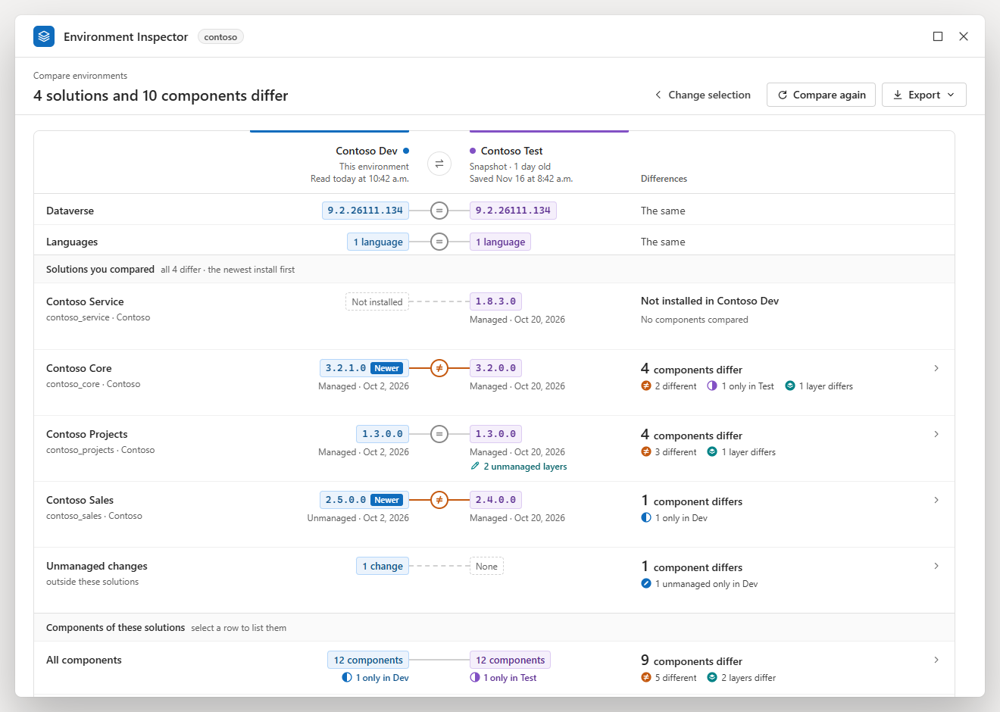

*The overview (E1) of Contoso Dev against a snapshot of Contoso Test: the lane heads (Contoso Dev, this environment,
read today; Contoso Test, a snapshot one day old), **Swap** between them; the environments' rows (Dataverse's version and
the languages, the same); "Solutions you compared · all 4 differ · the newest install first", each with its version in
each lane (*Newer* on the newer one), = or ≠ between them, how it is installed and when, its unmanaged layers on top, and
its result: the figure, then one line of kinds (orange *different*, purple *only in Test*, teal *layer differs*); the
unmanaged changes outside these solutions; then "Components of these solutions": *All components*, with each lane's
count and a plain line between them.*

`e1Draw` draws the overview as one grid (`#cvOv`, "The two environments, side by side"), from figures worked out once
per result in one pass over the findings (`e1Data`):

1. **The notes at the top**, amber, only for what no row can carry (`cvNotes().warn`): a snapshot more than 7 days old
   (`oldNote`), and what couldn't be read, by environment ("Couldn't read in Contoso Dev: …", "Couldn't read which
   solutions hold each component in …"), each with **Details**.
2. **The lane heads** (`e1Lanes`): each environment's name, what it is ("This environment", "Snapshot · 1 day old",
   `snapLine`, the same words on every page of both comparisons) and when it was read or saved; their tooltips hold the
   name and those lines whole, then the address and the snapshot file's name ("Contoso Test", "Snapshot · 1 day old",
   "Saved Nov 16 at 8:42 a.m.", its address, its file; while the run lasts and before the name is known, "This
   environment", "Reading now" and the address); a screen reader hears the name and lines as the lane head's name, and
   as its description only the address and the file's name
   ([8.10](#810-the-comparisons-pages-levels-the-header-and-shared-parts)). The overview's fixed heights keep each name
   and line on one line at every width: from 1,280 px up its lanes hold a name such as "Contoso Test (snapshot)" whole;
   below, a very long name is cut with "…", at 1,120 px and less a long line too ("Saved Sep 30, 2025 at 8:42 a.m."),
   and at 800 px and less only the first line under the name shows, all of them whole in the tooltip (the lists and
   the component's page wrap at every width).
3. **The environments** (`e1EnvRows`): *Dataverse* (each version, = or ≠ with *Newer*, "The same" or "Another
   version"; "Not known" when a side has none) and *Languages* (compared as sets: "The same", "Labels are compared in
   the languages both have", "No language in common: labels aren't compared"). They open nothing.
4. **Solutions you compared** (the heading says "all 4 differ", "2 of 4 differ" and "the newest install first"), each
   at 87 px (`e1SolSide`, `e1SolRes`): its version in each lane, the connector, "Managed · Oct 2, 2026" under it, then
   its unmanaged layers on top (teal, "2 unmanaged layers") or its latest patch; the result: "4 components differ" with
   one line of kinds, each with its icon and a tooltip saying what it means (`e1Kinds`, `E1_TIP`; kinds that don't fit
   the line give way to "+2 more", `e1Fit`), or "Not installed in Contoso Dev" ("Its 3 components are only in Test"),
   "No components compared", "No component differences" (another version), "No differences". Then *Unmanaged changes*
   ("outside these solutions"), with each environment's changes ("1 change", "None").
5. **Components of these solutions · select a row to list them**: *All components* (the components each environment
   has, what is only on a side under its count, and the kinds) and *Unmanaged layer on top* ("changed in the environment
   itself": each lane its own environment's; "2 components have one · All in Contoso Test").
6. **Other solutions · not compared: their versions, and their layers on the compared components · 1 of 6 differ**
   (`e1OtherRow`): every other solution installed in either environment, yours that differ first, with their versions,
   "Another version", "Another patch", "Not installed in …", and their layers on the compared components ("Its layer is
   on 2 compared components, in Dev only", "Holds no compared component"). Those that are the same and Microsoft's that
   differ are folded ("Show the 12 that are the same", "Show the 3 Microsoft solutions that differ"); a fold opens in
   place, 40 rows at once, then 150 a frame (`e1Fold`, `E1_CHUNK`), so a thousand solutions never hold the page.
7. **Good to know**, one folded line under the sheet (`e1Gtk`): the scope and the time, then the other notes
   (`cvNotes().info`): an older snapshot that doesn't keep the solutions that hold its components, components that
   couldn't be matched for certain, the languages, columns Dataverse lists but doesn't return, types your security role
   can't read.

Each row is named by its sentence ("Contoso Core. 3.2.1.0 in Contoso Dev, newer, differs from 3.2.0.0 in Contoso Test.
Managed in both. 4 components differ: 2 different, 1 only in Contoso Test, 1 layer differs."). The rows are one Tab stop
(`cv.ovCur`): ↑, ↓, Page Up, Page Down, Home and End move, Enter opens. A row with a chevron opens its list (`e1Pick`,
`cvGo`): a solution's components, *All components*, the unmanaged changes, or *Unmanaged layer on top* (the list of
*All components* with the Filter set to *In either*); another solution's row opens the compared components it holds.
`cvGo` remembers what opened the list (`cv.from`), so going back puts the focus on that row.

While the comparison runs, E0 stands in its place ([11.6](#116-running-a-comparison)), laid out as E1 will be.

#### The lists

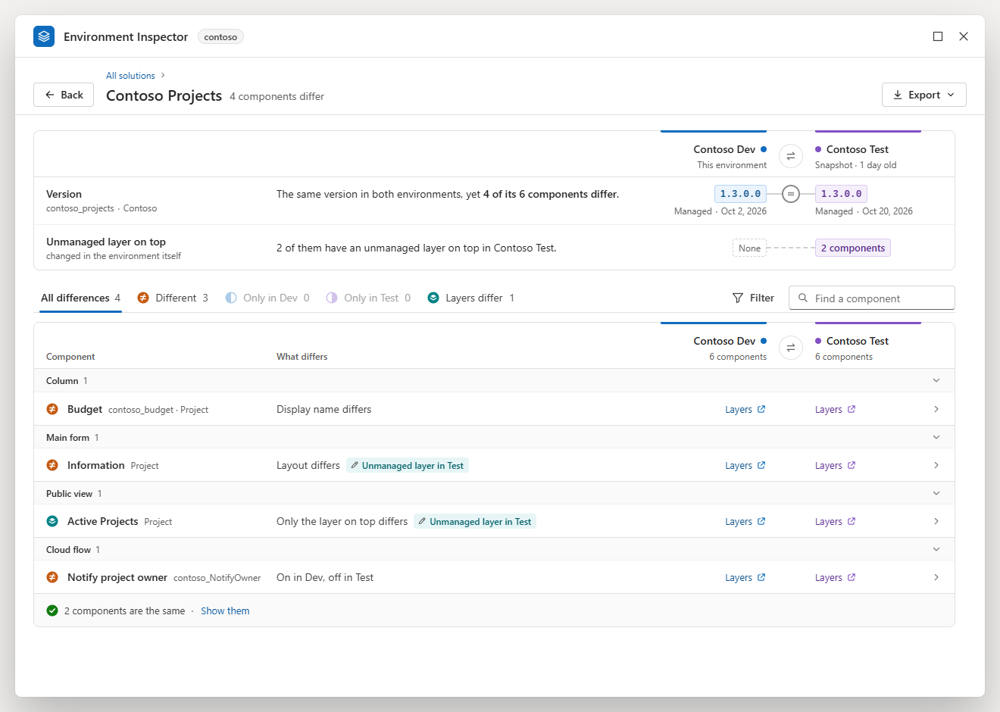

*The components of Contoso Projects (E2): **Back** and "All solutions ›" in the header, the title and "4 components
differ"; a first sheet that says what the list is (the same version in both environments, "yet 4 of its 6 components
differ"; "2 of them have an unmanaged layer on top in Contoso Test"); the tabs with their counts (*All differences* 4,
*Different* 3, *Only in Dev* 0, *Only in Test* 0, *Layers differ* 1), **Filter** and *Find a component*; then the list
under its own lane heads, by type: each line with its status icon, its name and grey second names, what differs in words
("Display name differs", "Layout differs", "On in Dev, off in Test"), the teal tag *Unmanaged layer in Test*, and
**Layers** in each environment; at the end "2 components are the same · Show them".*

`cvListPage` draws a list as level 2 (`#cvL2`); its lines are drawn by the virtual list (`e2vl`,
[8.10](#810-the-comparisons-pages-levels-the-header-and-shared-parts)). It holds:

* **The first sheet** (`e2Head`), on the list's grid so its lanes line up with the list's (its lane heads, like the
  list's, wrap a name or line too long for its lane, both bars level): for a solution, its version in each environment
  (= or ≠, *Newer*, how it is installed, "Managed · Oct 2, 2026", whose "·" sits only between two parts on one line:
  each part is kept whole and a wrapped line never starts or ends with the dot, while a hidden " · " is kept for screen
  readers and copied text; its latest patch) and a sentence ("The same version
  in both environments, yet 4 of its 6 components differ."). The *Version* row (`row(…, atTop)`, class `rs-erv`) has
  its cells at the top, as the overview's rows do, so the version pills, the connector's circle and its line sit level
  whatever wraps under them, the label's and the sentence's first lines padded to them (2 px; 3 px at 800 px and
  less); its second line, the solution's unique name and publisher ("contoso_projects · Contoso"), is built from parts
  as the install line is (`subOf`, `small.rs-erp`), so it wraps between them, the dot placed out of the line's flow and
  clipped where a part starts a line, its tooltip and its words for screen readers as before. Then *Unmanaged layer on top* with each environment's count
  (a count is a link that sets the Filter to them); for *All components*, the components each environment has; for the
  unmanaged changes, how many each environment has.
* **The tabs** (`e2Tabs`, a `tablist` "Show"): *All differences*, then the statuses in the window's order, each with
  its icon, its count and a tooltip with its meaning (`e2Mean`); *Unmanaged only in Dev* only where it can occur (the
  unmanaged changes' list). An empty tab is greyed but stays in its place; tabs that don't fit go under a
  **More** tab, the empty ones first (`tabsFit`). There is no *Same* tab: the same components are at the end of every
  list.
* **Filter** (`e2FilterMenu`): *Type* (the types the list holds) and *Unmanaged layer on top* (*Any*, *In either*,
  *In Dev*, *In Test*, *Only in Dev*, *Only in Test*, *In both*, *None*, `UM_KEYS`). The filters chosen show as chips
  that a click removes (`e2Chips`); the counts of the tabs follow them. **Find a component** searches the names, the
  table, the type, the solutions, the status and what differs (`searchText`; Esc clears it).
* **The list**: its lane heads (each environment's components, **Swap**), a heading per type that folds (a type of more
  than 300 lines starts folded when there are others), one line per component (`e2Line`, `listLine`), 100 lines per
  type, then "Show 500 more" (`e2More`). A line holds the status icon (its word visually hidden), the name and grey second names
  (the schema name when it isn't the name, the table, and the solutions on a list that spans several), what differs in
  words (`cvSay`), the teal tag of an unmanaged layer on top (`e2Tag`: *Unmanaged layer in Dev*, *in Test*, *in both*;
  it gives way, cut first, when the sentence needs the room), and **Layers** in each lane: the component's solution
  layers page there, in a new tab, off with its reason when it can't be opened from here ("Can't be opened from here:
  the snapshot doesn't hold its environment's address"), or a dash where the component isn't. "Nothing matches the
  search", "None here" or "No differences in Contoso Projects" when the list is empty.
* **The same components**, at the end of every tab's list: "✓ 2 components are the same · **Show them**", which adds
  them under it by type (`cv.same`).

The lines are one Tab stop: ↑, ↓, Page Up, Page Down, Home and End move, Enter opens the component (E3), → and ← go to
its **Layers** links and back. A tab, the Filter or a search announces how many components are shown ("8 components
shown").

**What differs, in words** (`cvSay`; the CSV export and the search keep `cvDetail`'s words, [The exports of a
comparison](#the-exports-of-a-comparison)), with the short names:

| Status | The line says |
| --- | --- |
| *Different* | The properties that differ, by the names `cmpPropLabel(k, f.kind)` gives them: "Display name differs", "Layout and description differ", "Runs as differs", "Privileges differ", "Columns (JSON) and columns differ", "A, B and C differ" (for a process whose only difference is its status: "On in Dev, off in Test"); then a layer difference when there is no unmanaged layer, and "In Contoso Fixes in Dev only" for a compared solution or another managed solution's layer in one environment only |
| *Only in* | Where it is on its side: "In Contoso Projects 1.3.0.0 in Dev", "In Contoso Fixes in Dev", "Made in Dev itself, in no solution", "An unmanaged change in Dev"; or why it isn't on the other |
| *Unmanaged only in* | "Test has no unmanaged change on it" |
| *Layers differ* | "Only the layer on top differs" (the teal tag says where), the solutions on top in each, or the solutions that hold it in one environment only; "Only the layers differ" when nothing more is known |
| *Couldn't compare* | Why: "2 in Dev and 1 in Test look the same, so they can't be matched for certain", or the read that failed |
| *Same* | "The same in both", or "The same, apart from values set per environment: *names*" |

One property's verb follows what its name names, not its last letter (`severalOf`): the window's own names that name
several things say so (`PLURAL`: "privileges", "columns", "columns (JSON)", "columns that start it", "dependencies",
"inputs" and the like) and take "differ"; any other of its own names (`OWN_NAMES`, every value of `PROP_LABEL`,
`PROP_MORE` and `PROP_KIND`) takes "differs" ("Runs as differs", "Shown on tablets differs",
"Allows other publishers' steps differs"); a name of Dataverse's own takes "differ" when it ends in a plural noun
("Settings differ"), unless it asks yes or no (it starts with *is*, *can*, *has*, *does*, *allow*, *enable* or *use*:
"Can modify additional settings differs").

#### The details of a compared component

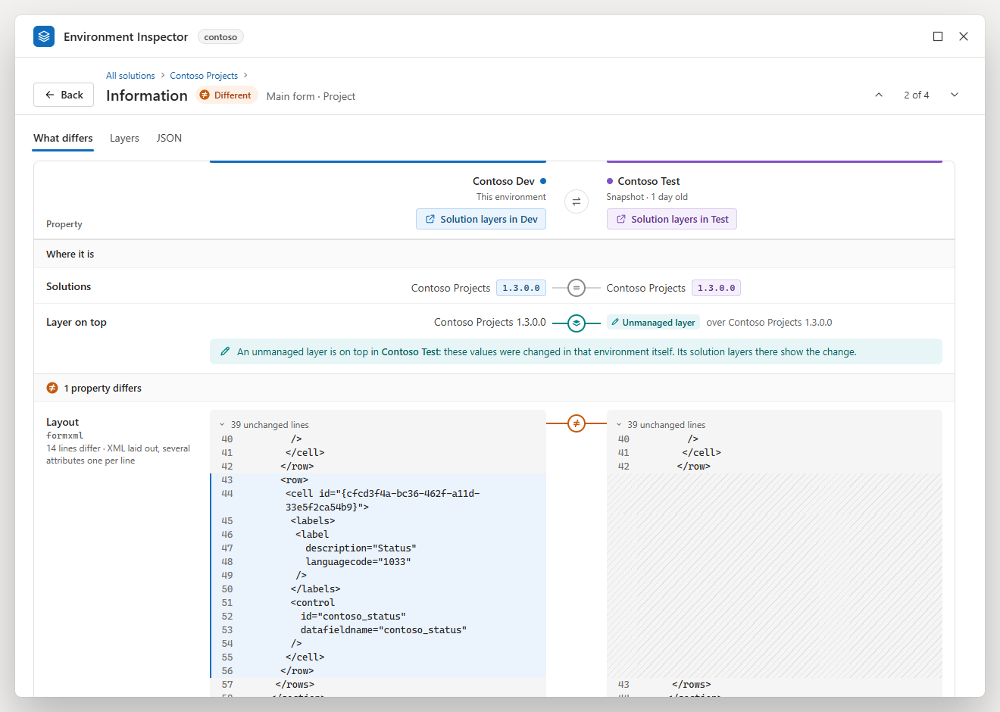

*The page of a form that differs (E3): "All solutions › Contoso Projects ›", **Back**, the name with its *Different*
label and "Main form · Project", the pager "2 of 4"; the tabs *What differs*, *Layers*, *JSON*; then the sheet: the lane
heads ("This environment"; "Snapshot · 1 day old") with **Solution layers in Dev** and **Solution layers in Test**, *Where it is* (Contoso Projects 1.3.0.0 in both;
the layer on top, with the teal *Unmanaged layer* tag in Contoso Test and its note), and "1 property differs": *Layout*
(`formxml`, "14 lines differ · XML laid out, several attributes one per line"), nested level by level, its lines level
on both sides, the row only Contoso Dev has (a cell with its label *Status* and the `contoso_status` control) tinted in
its blue with a hatched gap opposite, the unchanged lines folded.*

A component opens as a page of its own, level 3 (`cvOpen`, `e3Html`), the list it was opened from kept as it was
behind it. `cv.item` holds the component shown: its key, the keys of the list it was opened from and its place there
(the pager "2 of 4", **Previous** and **Next**, Alt+↑ and Alt+↓, `itemGo`), its tab, its folds. Going back
(`cvBack`) shows the list with the focus on the line of the component shown last (`cvFocusItem`, `cvReveal`: drawn
first when it was folded or past **Show more**). There is no **Delete** here. The header (`e3Head`) holds the
component's name, its status as a label and what it is ("Main form · Project").

`cmpLayers` turns the row's two definitions into two layer-shaped objects (named with `SIDE`, characters no solution
name can hold), with the normalized values as *All properties* (only what both sides have, as `both` keeps it, so the
page shows what decided the status) and the stored values as *Changes*; the layout of XML and JSON, web resource
content and **Copy** then work as for layers ([chapter 9](#9-details-and-comparison)). A choice column whose global
choice is compared too shows "(compared on the choice itself)" for its options.

**What differs** (`e3What`), a side-by-side sheet ("Information in Contoso Dev and in Contoso Test"):

* **The lane heads**: each environment, what it is ("This environment", "Snapshot · 1 day old": `snapLine`, the same
  words as on the overview and the list) and a tinted button, **Solution layers in Dev** and **Solution layers in
  Test**, that opens the component's solution layers page there in a new tab; off, and saying why under it, when it
  isn't there or can't be opened from here. The head's tooltip holds the environment's name, its address, when the
  snapshot was saved (`savedLine`: "Saved today at 3:13 a.m.", "Saved Nov 16 at 8:42 a.m.") and the file's name. A name
  or line too long for its lane wraps (the lane rows grow to fit, `min-height` 61 px, both bars level).
* **The links in each environment.** This environment's link is built as a scan's is (`layersUrl`,
  [chapter 7](#7-links-to-the-solution-layers-pages)): in a compared solution that holds the component, else the
  Default solution. The snapshot's link is built the same way for the snapshot's environment: `layersUrl` with that
  environment's id and address (`env`), its solutions' ids and its tables' ids, all checked when the file was opened
  ([11.4](#114-snapshot-files)). A classic page there needs an `https` Dataverse address:

  `environment-inspector.js`, `safeOrigin`:

  ```js
  // An environment's address from a snapshot (untrusted): a Dataverse address only, for the classic layers page.
  const safeOrigin = (u) => { try { const x = new URL(u); return x.protocol === 'https:' && /\.(dynamics\.com|dynamics\.cn|microsoftdynamics\.(de|us)|appsplatform\.us)$/i.test(x.hostname) ? x.origin : '' } catch { return '' } }
  ```

* **Where it is**: *Solutions*, each side's solutions lined up by unique name, oldest install first as its layers are,
  each with its version (*Newer* on the newer one) and "unmanaged" when so, then those that hold its table with all its
  objects, a dashed "Not in Test" where a side that knows its solutions lacks one ("Other solutions not known" when the
  side doesn't say, "No solution: made in Contoso Dev itself" when it is in none); and *Layer on top*: the teal
  *Unmanaged layer* tag, "over" the managed solution under it when one holds it there, "Unmanaged: made in Dev" for a
  component made there (such as one of a solution developed there and installed, managed, in the other), or the
  solution on top and its version. Their
  connectors: = for the same solutions at the same versions, ≠ for a version that differs, the layers sign for a
  solution or a layer on top that one side has and the other hasn't.
* **A note across both lanes** when an unmanaged layer is on top ("An unmanaged layer is on top in Contoso Test: these
  values were changed in that environment itself. Its solution layers there show the change."); for a status other
  than *Different* and *Same*, the status in a sentence (*Layers differ* with `cvDetail`'s words); and for *Different*,
  when the same solution and version are on top in both with no unmanaged layer, why two definitions can still differ:
  another solution's layer underneath that differs (forms, site maps, apps and choices combine their layers), the same
  version number imported again with other content, or something set once, when the component was first made in each
  environment.
* **"N properties differ"**: each property named in words, then by Dataverse's name ("Layout formxml"), both whole in
  the row's tooltip ("Form type" and `type` on two lines, `propHead`'s `tip`: a narrow column cuts a long name with
  "…", as it cuts a name of more than about 20 characters at 801 to 1,000 px, while at 1,280 px names such as
  "Merged with updated layout" and "Allows other publishers' steps" are whole); some values in words (the state of a
  process or a plug-in step, `VALUE_LABEL`: "On", its number in the tooltip "Stored as 1"), and a display label as its
  text (`labelText`: "Customer tier", "(empty)", "English (1033): … · French (1036): …"; Copy and the JSON tab keep it
  as stored). The names and the values in words are below. A short
  value is a box on each side with the characters that
  differ marked and ≠ between them; a long one has its lines level on both sides (`sbsLines`), "14 lines differ · XML
  laid out, several attributes one per line" under its name ("12 lines differ; a part with too many changes isn't
  lined up (…)", or "Too many changes to line them up (…)" when no line of it is lined up,
  [9.7](#97-the-line-difference-difflines-folds-and-side-by-side)); the first three long values are open, the others behind **Show the
  differences** (named for screen readers "Show the differences in *name*", with the name in words: "Column set", not
  "Columnsetxml"). An image shows on each side; a value over 1,000,000 characters is "Too large to compare here".
* **Folded**: "Show the 5 properties that are the same" (quiet values, = between them) and "1 value is set per
  environment, so it isn't counted" (both values, = or ≠).
* **A component in one environment only** shows its definition there, property by property ("Its definition in
  Contoso Dev"; values in words keep their "Stored as" tooltip, `oneRows`), and a dashed box in the other lane that says
  why ("Not in Contoso Test", "Not in the snapshot, which holds only its solutions and its own unmanaged changes",
  "Couldn't be read", "Couldn't be matched for certain").

**Property names.** `propHead(k, kind)` names a property on the page, and `cmpPropLabel(k, kind)` in a list's line
(`cvSay`), the CSV's *What differs* (`cvDetail`), the note on the page and the scan's details (`lyName(k, kind)`,
[9.2](#92-comparing-two-layers)); each caller passes the row's kind (`f.kind`). Both look first in `PROP_KIND`
(`kindLabel`), the names a column has in one kind of component only: a form's `type` is *Form type*; a view's and a
plug-in step's `statecode` *Status* (a process's stays *On or off*, from `PROP_LABEL`); a plug-in step's `mode`
*Execution mode*. Then in `PROP_LABEL`, the comparisons' names for any component (*Layout* `formxml`, *Query*
`fetchxml`; two forms of one thing named apart: *Columns* `layoutxml` and *Columns (JSON)* `layoutjson`, *Definition
(client data)* `clientdata` and *Definition (XAML)* `xaml`), and in `PROP_MORE`, words for the all-lower-case names
Dataverse gives a form's, a view's, a process's, a web resource's and a plug-in step's columns, each from the name
Microsoft's table reference gives it (*Table* `objecttypecode`, *Can be deleted* `canbedeleted`, *Shown on tablets*
`istabletenabled`, *Form state* `formactivationstate` (Microsoft's *Form State*), *Merged with updated layout*
`isairmerged`, *Quick Find view* `isquickfindquery`, *Definition* `definition`, *Allows other publishers' steps*
`iscustomprocessingstepallowedforotherpublishers`, *Execution order* `rank`, *Execution stage* `stage`, *Deployment*
`supporteddeployment`, *Invocation source* `invocationsource`, *Columns that start it* `filteringattributes`,
*Impersonating user* `impersonatinguserid`, *Offline on mobile* `isavailableformobileoffline`, *Silverlight version*
`silverlightversion`). A name with capitals (`DisplayName`) is split into words; any other stays Dataverse's name
alone.

**Values in words.** The choice values Microsoft documents for those columns show in words, each in a span whose
tooltip is "Stored as *n*" (`VALUE_MORE`, `cmpValueWord`): a form's `formactivationstate` (*Active*, *Inactive*),
`formpresentation` (*Classic layout*, *Updated layout*) and `type` (*Main form*, …); a view's `querytype` (*Public*,
*Advanced Find*, *Associated*, *Quick Find*, *Lookup*), `statecode` and `statuscode`; a process's `category`, `mode`
(*Background*, *Real-time*), `scope` (*User*, *Business unit*, *Parent: child business units*, *Organization*),
`runas` (*Owner*, *Calling user*), `type` (*Definition*, *Activation*, *Template*) and `businessprocesstype`
(*Business flow*, *Task flow*); a web resource's `webresourcetype` (*Webpage (HTML)*, *Style sheet (CSS)*, *Script
(JScript)*, *Data (XML)*, *PNG format*, …, *String (RESX)*); a plug-in step's `stage` (*Pre-validation*,
*Pre-operation*, *Post-operation*), `mode` (*Synchronous*, *Asynchronous*), `supporteddeployment` (*Server only*,
*Client for Outlook only*, *Both*), `invocationsource` (*Internal*, *Parent*, *Child*) and `statuscode` (*Enabled*,
*Disabled*); and any component's `languagecode` by its language's name (`LANG_NAME`: *English* for 1033). A choice
held as `{ Value: n }` is read by its number. A value whose meaning isn't certain (a form's presentation 2, a step's
internal stages, a process's status reasons) stays a number, and so, for now, do a process's `createstage`,
`updatestage` and `deletestage`. A view's type in the page's header, a list's groups, **Filter**, the CSV and the
scan's *Type* column (`VIEW_TYPE`) has Microsoft's capitals too: *Advanced Find view*, *Quick Find view*.

**Layers** shows this environment's layers, read when the tab opens (`e3Layers`, `e3ReadLayers`, `fullLayers`),
and for the snapshot the layer on top it recorded, with a link to all its layers in that environment: a snapshot keeps
no layers. **JSON** shows each environment's definition *As compared* and *As stored* (`CMP_JSON`), with **Copy** and
**Download**.

**Copy** on a value copies it as stored, not as compared, and announces "Copied". **Swap** (`#cvSwap3`) swaps both
tabs, as everywhere.

#### The exports of a comparison

In this mode **Export** offers (`cvExportTexts` names its items for the level shown):

| Menu item | File | Contents |
| --- | --- | --- |
| Excel (CSV) | `compare-<org>-<stamp>.csv` | On a list, the components it lists, as its tab, Filter and search keep them (and the same ones when **Show them** is on); on the overview, every row that isn't the same: the solutions and the components that differ, and those that couldn't be compared. The columns: type, display and schema name, table, status, what differs (`cvDetail`), solutions, the layer on top in each environment (*On top in Contoso Dev*: the solution and its version, *Unmanaged layer*, or *Unmanaged: made in Dev* for a component made there, `topLine`), every solution that holds it in each, the id in each, and the address of its solution layers page in each (`cmpCsv`). Every cell, the header's environment names too, goes through `csvCell` ([13.5](#135-keeping-spreadsheets-safe)) |
| Excel (CSV), every component | `compare-<org>-<stamp>.csv` | On a list only: every component of the list, the same ones too, as the Filter and the search keep them (`cvEvery`) |
| Full details (JSON) | `compare-<org>-<stamp>.json` | Both environments, the scope, the time and requests, what couldn't be read (`failed`) and what wasn't compared (`notCompared`: the columns Dataverse lists but doesn't return), and every row with both definitions (for rows that are the same, `sameSide`: their ids, layers on top, `managed`, `sols` and `in` only); a row with the Active layer on top in either environment also says whether that is an unmanaged layer there (`unmanagedLayerA`, `unmanagedLayerB`: false for a component made there) (`cmpJson`) |
| Snapshot of this environment | `snapshot-<org>-<stamp>.json.gz` | This environment as read for the comparison ([11.4](#114-snapshot-files)) |

*All layers (CSV)* and *Deletion log (CSV)* are not offered: a comparison reads no layers and deletes nothing.

The overview's CSV and the JSON list their rows in the screen's order, whatever order this environment's reads
answered in: the solutions first, in the overview's order (the compared ones the newest install first, then the others
as the overview and its folds list them), then the components by type, in the maker portal's order of types, and by
name.

### 11.8 Limits

* **One environment live.** The other side is a snapshot. Its age is shown, and a snapshot older than 7 days is
  marked.
* **Layers below the top** are not compared value by value: only the definition in effect and the solution of the top
  layer. A managed solution that holds a component in one environment only shows as *Layers differ*, since every
  solution's component list is read; what that layer sets is not compared. The details link to each environment's
  solution layers page, and their Layers tab reads this environment's layers.
* **Global choices** cost one request each for their layer on top. In a snapshot saved by an earlier version it is not
  known; their definitions are compared all the same.
* **What a definition does not hold** is not compared: data (records that aren't components), a flow's runs, a plug-in
  assembly's content apart from its fingerprint, secrets, calculated and rollup columns, the columns in `SKIP`, and the
  columns Dataverse lists but doesn't return.
* **Unmanaged changes outside the compared solutions** are compared with what the snapshot holds: its solutions and its
  own unmanaged changes. A component changed here and not there is *Unmanaged only in Dev*: whether Contoso Test has
  it, from another solution, can't be told.
* **Microsoft's components** are compared when Microsoft's solutions are chosen. System alone holds tens of thousands
  of components: choose some object types or tables to keep the comparison short.
* **A property only one environment has** (a newer Dataverse version, an older snapshot, a column one environment
  can't read) is not compared.
* **Matching by name** is used only where ids can't be: a component created by hand in each environment, with the same
  name, is matched by its name, and the components Dataverse makes in each environment (plug-in steps and their images,
  table and column mappings) by what they are. Two that look the same on one side are *Couldn't compare*: never a
  guess.

---

## 12. Comparing data

The third tab of the choice screen, *Compare data*, compares the records of the tables you choose between two
environments: the reference data a configuration depends on, such as countries, currencies, codes and rates, which
solutions don't carry. As in *Compare environments*, one environment is the one the tool runs on, read live; the other
is a file saved there, a **data snapshot**. It reads only: every request is a GET through `requestOnce`
([5.2](#52-read-only-by-design)), and nothing is changed in either environment. The
[README](../README.md#compare-data) describes it for the people who use it. This chapter explains what is chosen and
read, the data snapshot file, how records are matched and their values compared, how very large tables are compared
within the page's memory, and how the window shows the result. Its examples compare Contoso Dev, the environment the
tool runs on, with a data snapshot of Contoso Test, on tables such as Country (`contoso_country`), Currency
(`transactioncurrency`) and Exchange rate (`contoso_rate`).

In the code, the engine is the `compare data` part (after `compare environments`, before `remove`), in seven sections:
`tables, counts and definitions`, `the columns and the matching of a table`, `reading records`, `data snapshot files`,
`normalizing`, `matching and comparing` and `very large tables`. The window's parts start with `compare data: the
choice`, followed by the sections of the choice screen (the sizes and estimates, the Tables card, the Chosen tables
card, the strip and the footer, opening a data snapshot, saved selections, a table's settings, Compare and Save
snapshot), then `compare data: the window`, `the run's rows`, `the overview`, `a table's records`, `the view's
events`, `a record's details` and `exports` ([4.1](#41-one-file-many-parts-a-map-of-environment-inspectorjs)).

| Functions | What they do | Section |
| --- | --- | --- |
| `dataTableList`, `dataCounts`, `dataExactCount`, `dataDefinitions`, `dataAccess`, `dataEnv` | The tables of this environment, their record counts (Dataverse's, or made when a table is ticked), the chosen tables' definitions, your read access to them, this environment's name | [12.2](#122-the-choice-screen), [12.6](#126-reading-this-environment) |
| `dataColumns`, `dataChosen`, `dataMatchPlan`, `dataLookups`, `dataSpec` | A table's columns in three groups, the columns chosen, how its records are matched, how its lookups are compared, what is read | [12.3](#123-a-tables-settings), [12.4](#124-the-columns-compared-left-out-never-read) |
| `eachPage`, `dataLine`, `readDataSide` | Records read page by page, a record as a line, three tables at a time | [12.6](#126-reading-this-environment) |
| `dataSnapshotWriter`, `openDataSnapshot`, `checkDataHead`, `readDataSnapshot`, `checkDataLine`, `dataSelection` | The data snapshot file: writing it, opening it, checking it, reading its records | [12.7](#127-data-snapshot-files) |
| `dataPlan`, `matchValue`, `dataMatch` | A table's comparison plan, its records' match values, the matching | [12.8](#128-matching-records-datamatch) |
| `normCell`, `diffKind`, `lookupDiff`, `pairer`, `compareTable` | Values as compared, how two values differ, lookups, a pair's status, a table compared | [12.9](#129-values-and-lookups), [12.10](#1210-statuses-and-notes) |
| `keptTable`, `dataKeepPlan`, `countTable`, `DataIndex`, `ValueTable` | Tables kept whole, and tables too large to keep, counted | [12.11](#1211-kept-and-counted-tables) |
| `dataHeapCheck` | The memory guard | [12.12](#1212-memory-dataheapcheck) |
| `dataCompare`, `saveDataSnapshot`, `compareDataSides`, `dataNotes` | A comparison and a snapshot from start to end; two sides given whole (the checks); the notes | [12.13](#1213-running-a-comparison), [12.10](#1210-statuses-and-notes) |
| `renderDataPick`, `openTableSettings`, `applyDataChoice`, `dataGo`, `runDataCompare`, `runDataSnapshot` | The choice screen, a table's settings, a choice taken, the confirmation of a long read, the runs | [12.2](#122-the-choice-screen) to [12.5](#125-saved-selections-and-the-last-choice), [12.13](#1213-running-a-comparison) |
| `renderDv`, `d0Draw`, `d1Draw`, `dvTablePage`, `dvRefresh`, `openRecord`, `d3Html`, `dataCsv`, `dataJson`, `dataSnapOut` | The results: the overview while the run lasts and after it, a table's records, a record side by side, the exports | [12.15](#1215-the-results-and-a-records-details), [12.16](#1216-the-exports-of-a-data-comparison) |

### 12.1 Records, and a file of their own

**Not a part of *Compare environments*.** Almost everything differs from a comparison of components: what is chosen
(tables, their columns and how their records are matched, not solutions and object types), the scale (one table can
hold millions of records), and the file (the records themselves, which can hold personal data, and which a team may
want to keep apart from configuration). So it is a tab of its own, with its own choice screen, its own snapshot file
and its own engine. Its results look like *Compare environments*' on purpose: the same three levels (the overview of
tables, a table's records, one record side by side), the same page header and **Back**, lanes, statuses, connectors,
lists and side-by-side parts ([8.10](#810-the-comparisons-pages-levels-the-header-and-shared-parts)). It also shares
the request layer, the *Compare with* strip, the environments' colours and short names, **Swap** and the order it
keeps, the step line, **Stop**, the toasts, dialogs and menus, the line difference and the CSV cells.

**A file of its own.** A data snapshot is `data-snapshot-<org>-<stamp>.jsonl.gz`, beside the component snapshot
`snapshot-<org>-<stamp>.json.gz` ([11.4](#114-snapshot-files)). It is not one file for both: a data snapshot can be
hundreds of megabytes and is written and read as a stream, one line at a time, while a component snapshot is one JSON
text read whole; the two are saved at other times; and records can hold personal data. Each tab recognizes the other
tab's file from its first 200 unpacked bytes (`snapshotKind`): under *Compare data*, a snapshot of components gets
"This is a snapshot of components. Open it under Compare environments." with **Open it there**, which switches tab and
opens it; under *Compare environments*, a data snapshot gets the same the other way round
([11.2](#112-the-mode-and-the-choice-screen)).

**One result at a time.** The window keeps the last result of whichever tool made it (`result.data` marks a data
comparison, whose rows are in `dcmp`). Switching tabs doesn't lose it, and **Back to results** shows only in the tab
that made it. A scan or another comparison replaces it, and lets its records go. **Save snapshot** keeps the results on
screen and puts them back once the file is saved (`keepResults`, as for components).

### 12.2 The choice screen

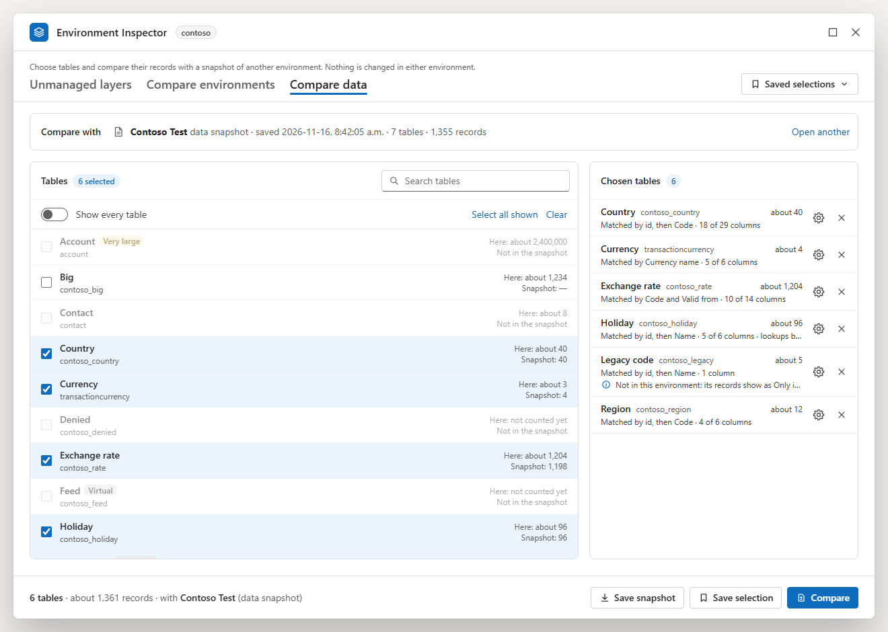

*The choice screen of *Compare data* with the data snapshot of Contoso Test open in the **Compare with** strip. Left,
the Tables card: each table with its record count here and in the snapshot ("Here: not counted yet" for the tables
Dataverse gave no count of), tags such as *Very large* and *Virtual*, greyed rows for the tables the snapshot doesn't
hold, and six tables ticked. Right, the Chosen tables card: a block per chosen table that says how its records are
matched and how many of its columns are compared ("Matched by Code and Valid from · 10 of 14 columns"), with
**Settings** and **Remove**; Legacy code, only in the snapshot, says its records show as *Only in Test*. The footer sums
up the choice.*

`mode` is `'data'`. Choosing the tab (`switchMode`) reads the table list the first time (`loadDataTables`), and
`renderMode` changes the screen: the heading screen readers hear is "Compare data with another environment", the
*Compare with* strip shows (`renderDataOther`), the two cards of the other tools (`.cols`) give way to Compare data's
own (`#dataCols`), and the footer has **Save snapshot**, **Save selection** and **Compare**. `renderPick` then calls
`renderDataPick`, which draws the Tables card, the Chosen tables card and the footer. The tab last used is kept with
the comparison's choice (`environmentInspector:<org>:compare`, [11.2](#112-the-mode-and-the-choice-screen)), so the
window opens on it next time.

**What the choice screen reads.** Only the table list, the record counts, the chosen tables' definitions and your read
access to them, this environment's name, all as GET requests through the request layer ([12.6](#126-reading-this-environment)
lists them). Each is tried again when the start of a run or **Stop** ended it (`pickRead`): those end every read under
way.

#### The Tables card

* **The list** (`dataTableList`): every table that can be compared, read once with one paged request. Private tables,
  many-to-many tables (`IsIntersect`), tables without an entity set name and tables whose logical name isn't a plain
  name are left out. Each table keeps its display and logical names, its entity set, primary key and primary name
  column, its kind (`tableKind`: *elastic*, *virtual* by its `TableType` or a data provider that isn't Dataverse's own,
  *activity* or *standard*), its ownership, and whether it is valid for Advanced Find. They are sorted by display name,
  then logical name.
* **Which rows show** (`dataRowsShown`): by default the tables valid for Advanced Find, which leaves out most of the
  tables Dataverse keeps for itself; **Show every table** lists the others too. The search ("Search tables") looks in
  the display and logical names of every table, so a publisher prefix such as `contoso_` finds every custom table.
  Without a search, a ticked table always shows, and so do the tables only the snapshot opened holds (tagged *Not
  here*). The filter never depends on the counts, so no row comes or goes as they arrive.
* **The counts** (`readDataCounts`, `dataCounts`): `RetrieveTotalRecordCount`, 100 tables per request, 2 requests at a
  time, started once the list is drawn, for standard and activity tables only: Dataverse keeps no count of virtual and
  elastic tables, and refuses a whole request that names one. A request refused because of one table its message names
  ("Entity mspp_adplacement is a virtual entity, which is not supported", "Entity aiskillconfig is not valid for read",
  "Entity x was not found in the CRM system", a missing `prvRead…` privilege) is sent again without that table, at most
  20 times per 100 tables; any other failure is split in halves until the table that fails it is alone, with at most 8
  more requests per 100 tables. A count of 0 isn't taken: an environment that keeps no counts answers 0 for every table.
  A table without a count reads "Here: not counted yet", with the tooltip "Dataverse gave no count of this table.
  Ticking it counts its records." Dataverse counts within the last day, which the counts' tooltip says ("Counted by
  Dataverse within the last day. The comparison reads every record."). As counts arrive, only each row's counts and tags
  are drawn again, in place (`countsSoon`, `drawCounts`, `redrawRow`): the list doesn't move and the focus stays. Until
  its count arrives, a row shows a short grey bar of the same size.
* **A ticked table without a count** is counted exactly (`needCounts`, `countNext`, `dataExactCount`), two tables at a
  time, once: `<set>?$select=<primary key>&$count=true&$top=1`, whose `@odata.count` is exact up to 5,000 (past that
  Dataverse says 5,000, with `totalrecordcountlimitexceeded`); from 5,000, a FetchXML count (`<fetch aggregate="true">`
  with `aggregate="count"` on the primary key), exact up to 50,000, past which Dataverse refuses (0x8004e023, "The
  maximum record limit of 50000 is exceeded"). The result, kept in `exactOf` until the window is opened again, is
  `{ n }` ("Here: 4,174", tooltip "Counted when it was ticked. The comparison reads every record."), `{ more: 50000 }`
  ("Here: more than 50,000", "Counted when it was ticked: Dataverse counts no further than 50,000. …"), `{ more: 5000 }`
  when the FetchXML count was refused for another reason, as some virtual tables and forms are ("Here: 5,000 or more",
  "Counted when it was ticked: Dataverse counted no further. …"), or `{ why }` ("Here: count not known", "Its records
  couldn't be counted: *reason*. The comparison reads every record."; a count of -1 or none, as some virtual tables
  answer, is "Dataverse didn't count them"). Meanwhile the row's grey bar comes back ("Counting its records…"). A table
  unticked while it waits isn't counted; one whose count failed is counted again when it is ticked again (`forget`).
* **A row** has the tick box, the display name with its tags, the logical name, and on the right, on two lines, "Here:
  about 1,204" and, with a snapshot open, "Snapshot: 1,198" (exact: the snapshot counted the records it saved). The
  other forms are "Here: not counted yet", "Here: 4,174", "Here: more than 50,000", "Here: 5,000 or more" and "Here:
  count not known" (`hereCount`, `hereWords`, `sideHtml`, `sideTip`), "Here: —" (not in this environment), "Snapshot: —"
  (the snapshot holds the table but couldn't read it when it was saved) and "Not in the snapshot".
* **A table's size** (`sizeOf`) is the larger of its count here and its count in the snapshot (a count of "more than
  *n*" counts as *n* + 1). It decides the tags, the estimates and whether the table can be ticked.

The tags (`dataTags`, each with a tooltip):

| Tag | When |
| --- | --- |
| *Too large* | Over `CONFIG.dataMaxRecords` records (5,000,000). The row is greyed and can't be ticked: a browser tab can't compare that many |
| *Very large* (amber) | Over `CONFIG.dataVeryLarge` (1,000,000). Its tooltip says how long reading it takes and that it needs much of the tab's memory; a comparison counts it rather than keeping it when the chosen tables don't all fit in what it keeps whole ([12.11](#1211-kept-and-counted-tables)) |
| *Large* | Over `CONFIG.dataLarge` (50,000), with how long reading it takes; a table counted as more than 50,000 here, and no larger in the snapshot: "More than 50,000 records here: how many isn't known, so neither is how long reading them takes." |
| *Elastic* | An elastic table: its records are matched by their id and partition |
| *Virtual* | Its records come from another system: reading them can be slow, and some such tables can't be read in full |
| *Some records only* (amber) | Ticked, owned by users, teams or business units, and your Read privilege on it is below organization level ([12.6](#126-reading-this-environment)) |
| *Can't read* | Ticked, and your security role can't read its records here |
| *Not here* | Only the snapshot holds it: its records show as *Only in Test* |

A row is greyed and can't be ticked (`dataOff`) when a snapshot is open that doesn't hold the table ("Not in the
snapshot of Contoso Test: save a new snapshot there with this table."), or when it is too large. **Select all shown**
ticks the rows shown that can be ticked; **Clear** unticks every table. The list is a listbox, as the solution list
is: one row in the tab order, ↑, ↓, Home and End move, Space and Enter tick ([8.8](#88-keyboard-and-accessibility)).

**Ticking a table** (`toggleData`) adds it to the choice, `dsel`, a `Map` from table name to its settings, in the order
chosen. Its definition is read in the background (`needDefs`: tables ticked at once go in one read, with your read
access to each, `readDefs`), and the choice is stored at once (`keepData`, [12.5](#125-saved-selections-and-the-last-choice)).
A table whose definition couldn't be read is read again the next time it is ticked (`forget`).

#### The Chosen tables card

One block per chosen table, in the order chosen: a table ticked goes at the bottom, so nothing above it moves, and its
block is brought into view within the card's own list. Empty, the card says what to tick: "Tick the tables to compare
on the left. Reference data, such as countries, currencies or product categories, usually has a few hundred records.
..."

`dataInfo(t)` works out what a block says, from the table's definition (or, for a table only in the snapshot, the
snapshot's) and its settings:

* **Line 1**: the display name, the logical name, and the size: this environment's count when it is the larger, as the
  row says it ("about 1,204", "4,174", "more than 50,000"), else about the snapshot's; "count not known"; a grey bar
  while the table is counted. Its tooltip gives both counts ("About 1,204 here · 1,198 in the snapshot", "More than
  50,000 here").
* **Line 2**: the settings in words. How its records are matched (`mWords`: "Matched by id, then Code", "Matched by id
  only", "Matched by id and partition", "Matched by Code and Valid from"), how many of its columns are compared ("all 18
  columns", "14 of 18 columns"), and, when it has lookups to tables outside the comparison, "lookups by id" or "lookups
  by name". While its definition is read, "Reading its columns…" takes the line's place, at the same height; when it
  couldn't be read, "Couldn't read its columns: *reason*." (with one period at the end, whatever the reason ends with:
  `dot`).
* **Line 3**, only when there is something to know: the first of a very large table (amber), no read access (red), read
  access to some records only (amber), not in this environment, a large table with the time to read it ("More than
  50,000 records: how long reading them takes isn't known." for one counted as more), a virtual table, chosen columns
  the snapshot didn't save, and columns or keys of a saved selection that this table hasn't here. A Large or Very large
  table's size note is known from the counts, so it is drawn while the columns are read too, under "Reading its
  columns…": the block keeps its height when they arrive. A size note that comes only from the count made when the table
  was ticked, after the block is drawn (`x.late`), goes after any other note; when it is the only one, the block gets
  the class `late`: line 3 stays hidden and the info icon at the end of line 2 shows the note as its tooltip, as in a
  narrow window, so the block doesn't grow a line when the count arrives.

Each block has **Settings** (a gear) and **Remove** (×). The card is a listbox with one block in the tab order: ↑, ↓,
Home and End move, Enter opens the settings, Delete removes the table and puts the focus on the next block
(`removeChosen`). A block's accessible name says the same as its lines, line 3 included: "Exchange rate, matched by Code
and Valid from, 10 of 14 columns. Enter: settings. Delete: remove.", "Denied, matched by id, then Name, 1 column. Your
security role can't read its records here. Enter: settings. Delete: remove."; while its columns are read, "Postal code,
reading its columns. About 182,400 records: reading them takes about 1 min. Enter: settings. Delete: remove."; when they
couldn't be read, "…, its columns couldn't be read: *reason*. …".

#### The strip and the footer

**Compare with** (`renderDataOther`) shows **Open a data snapshot…** with "Save one in the other environment first:
there, choose Compare data, tick the tables, then Save snapshot.", or the snapshot open: its environment's name, "data
snapshot · saved *time* · 7 tables · 1,355 records" and **Open another**. Its tooltip starts with the whole line, which
a narrow window cuts ("Contoso Test data snapshot, saved *time* · 7 tables · 1,355 records"), then the file's name, its
size ("47 KB": `fileSize`, never "0.0 MB") and the environment's address. The file input, `#dataIn`, sits next to the
component snapshot's in the window's markup, outside what the strip redraws. Opening a file runs `openDataFile`, which
reads and checks only the file's first line ([12.7](#127-data-snapshot-files)) and takes the choice the snapshot was
saved with ([12.5](#125-saved-selections-and-the-last-choice)).

**The estimate** (`dataEstimate(kind)`), for **Compare** (the chosen tables the snapshot holds, by their larger side:
the snapshot's count is exact) or **Save snapshot** (the chosen tables here, by their count here):

* the records (`records`): the tables' sizes added up. A table whose size isn't known is counted apart (`unknown`): one
  without a count here (and, when comparing, none in the snapshot), or one known only to have more records than a count
  could say (`more`, as `[table, n]`) and no more than that in the snapshot. `counting` names those whose count is still
  on its way;
* `total`: the records plus each `more` table's *n*, what the tables hold at least. The footer, the run's scope (the grey text
  after the title while a data snapshot is saved, and on a failure's page) and the confirmation all count with it (`recordsWords`): "about 1,361 records" when every size is known, "at least 62,006
  records" when one isn't, "no records" for tables counted empty, never "about 0 records";
* the time: each table here takes its records ÷ `CONFIG.dataRate` seconds (2,500 a second), longer in proportion past 30
  columns read; a table without a count counts as 5,000 records, or as many as it is known to have. Tables are read
  three at a time, so the whole is the longest table or the sum ÷ 3, whichever is more;
* the size of a snapshot: 30 bytes plus 4 per column read, per record;
* the tables over 50,000 records, largest first (a `more` table among them, as "more than 50,000"), and those over
  1,000,000.

**The footer** (`dataPickBar`), the first state that applies:

| State | The message | The buttons |
| --- | --- | --- |
| The table list is loading | "Loading tables…" | All off |
| It couldn't be loaded | "The table list couldn't be loaded." | All off |
| **Compare** or **Save snapshot** waits for counts (`dataGoing`) | A spinner and "Counting the chosen tables' records…" | **Compare** and **Save snapshot** off |
| No table ticked | "Select at least one table to compare." | **Compare**, **Save snapshot** and **Save selection** off |
| More records than one comparison holds (`CONFIG.dataMaxTotal`, 5,000,000) | An amber icon and "About 6,100,000 records: more than one comparison can hold (5,000,000). Compare fewer tables at a time." | **Compare** off |
| No snapshot open | "6 tables · about 1,361 records · open a data snapshot to compare with" | **Compare** off |
| Ready | "6 tables · about 1,361 records · with Contoso Test (data snapshot)", after the name of the saved selection applied | All on |

Past a minute of reading, "· about 16 min to read" is added, and "· 1 table of unknown size" when so, for example "4
tables · at least 182,508 records · about 1 min to read · 1 table of unknown size · open a data snapshot to compare
with". While a chosen table's count is on its way, "· counting their records…" takes the place of the records, the time
and the tables of unknown size: such a table's size isn't unknown yet. An amber icon starts the message when a chosen
table is *Very large*. The footer's tooltip is its whole text, as in the other tabs (a narrow window cuts its end).
**Save snapshot** needs a chosen table that is in this environment; **Compare** needs an open snapshot that holds a
chosen table; both wait while something runs (`busy`). **Back to results** shows when the window holds a data
comparison.

#### The confirmation of a long read

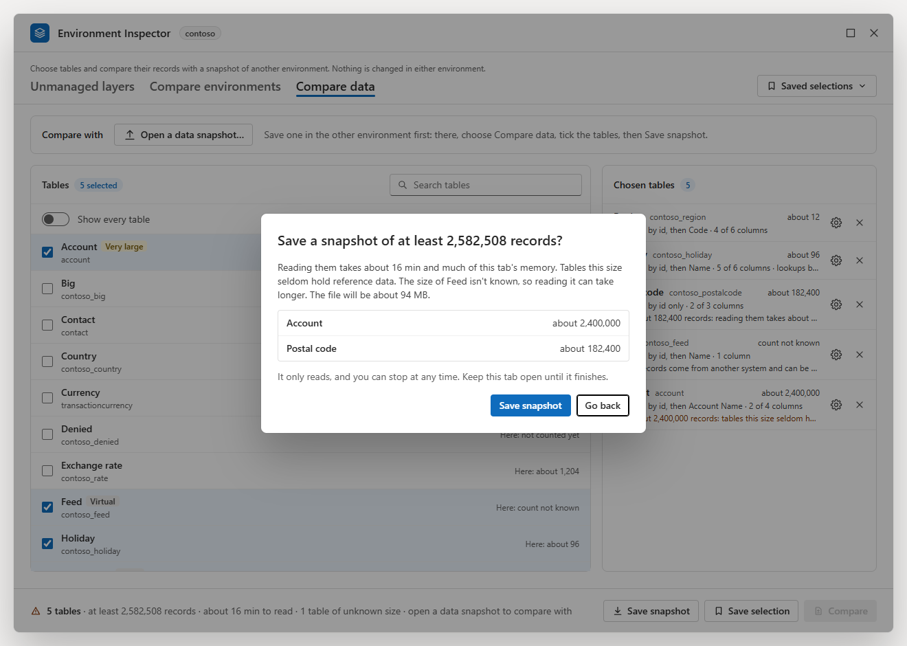

*The confirmation before **Save snapshot** of five tables, two of them large: Account, about 2,400,000 records, and
Postal code, about 182,400; Feed's records couldn't be counted, so it reads "at least 2,582,508 records". It gives the
records, the time to read them, the table whose size isn't known and the size of the file. **Go back** has the focus.*

**Compare** and **Save snapshot** call `dataGo(kind)`. First it waits, 10 seconds at most, while a chosen table's count
here is still on its way (`hereCount` undefined: Dataverse's counts, or the count made when it was ticked), so that its
size is known: `dataGoing` is set, the footer shows a spinner and "Counting the chosen tables' records…", which screen
readers hear too, and **Compare** and **Save snapshot** are off. The focus the button lost when it went off comes back
to it afterwards (Edge takes the focus off a button that turns off), so the confirmation's **Go back** returns to it.
Nothing starts if, meanwhile, another tab was chosen, a dialog was opened (`dlgClose`: a table's settings, **Save
selection**), another snapshot was opened, the window was closed or removed (its host hidden or gone), or the button can
no longer be used. A count still missing then goes to the
run as `undefined` (`runCounts`): `dataCompare` takes the snapshot's count for it, and only a count that couldn't be
made (`null`) makes a table of unknown size.

When a chosen table is *Very large*, or has more than 50,000 records of unknown number (a `more` of 50,000), or the
estimate is `CONFIG.dataConfirmMinutes` (5) minutes or more, `confirmLarge` asks first: "Compare about 2,582,508
records?" (or "Save a snapshot of about 2,582,508 records?"; "at least" in place of "about" when a size isn't known),
how long reading them takes (and, with a very large table, that it takes much of the tab's memory), which sizes aren't
known (`unknownSizes`: "The size of Postal code isn't known: it has more than 50,000 records, so reading it can take
longer.", "The size of Feed isn't known, so reading it can take longer.", "The sizes of Feed and Postal code aren't
known, so reading them can take longer."), for a snapshot the size of the file, the tables over 50,000 records, largest
first (at most five, then "and 2 more"; one counted as more: "Postal code — more than 50,000"), and "It only reads, and
you can stop at any time. Keep this tab open until it finishes." On the maker portal it is also asked when the portal's
sign-in ends less than 2 minutes after the read is estimated to end (`e.seconds + 120` over the seconds the portal's
token has left), with the note "The maker portal's sign-in ends in about 3 minutes: this read may not finish in time.
Start Environment Inspector from a page of the environment instead."; otherwise a read of 20 minutes or more adds that
its sign-in can end during a long read ([5.7](#57-the-maker-portal-sign-in)). **Go back** has the focus, so a second
Enter never starts a long read; Esc goes back too. **Compare again** never asks again: it repeats a run already
confirmed. A snapshot of more than 25,000,000 records is refused before anything is read: "A data snapshot can hold at
most 25,000,000 records. Save the largest tables in another snapshot."

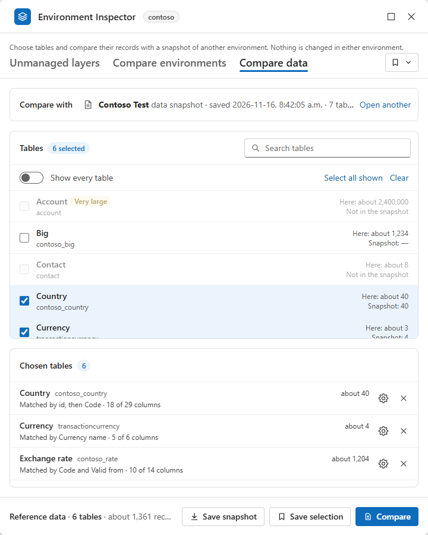

*Compare data's choice screen 720 pixels wide, the narrowest window: the three tabs and **Saved selections** (its icon
only) on one line, the strip cut (its tooltip holds the whole line), the Tables card first and the Chosen tables card
below it, each list scrolling on its own, and the footer's text cut, whole in its tooltip.*

**Narrow and short windows.** Below 900 pixels, **Saved selections** keeps only its icon and chevron (its name in the
tooltip and the accessible name), and the Chosen tables card narrows from 400 to 300 pixels. Below 800 pixels the two
cards stack and the area scrolls; a chosen table then keeps two lines, its third in the tooltip of an icon at the end
of line 2.

### 12.3 A table's settings

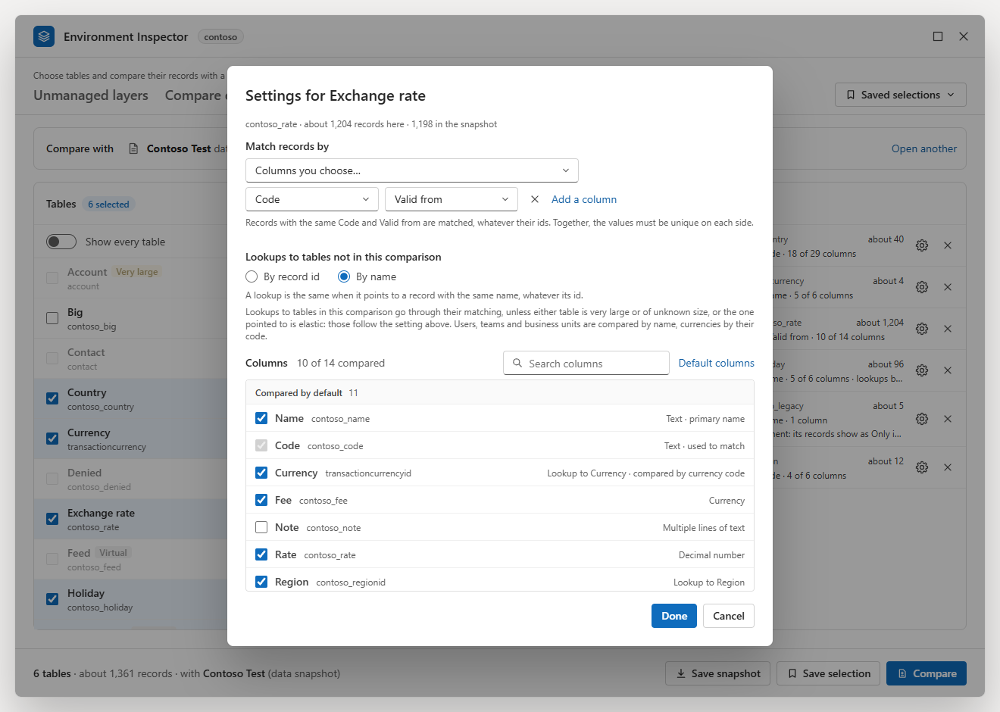

*The settings of Exchange rate: matched by **Columns you choose…** (Code and Valid from, with **Add a column**), its
lookups to tables outside the comparison compared by name, and its columns in groups, 10 of 14 compared. Code is ticked
and can't be unticked: it is used to match.*

**Settings** on a block (or Enter) calls `openTableSettings(t)`: a wide dialog that works on a copy of the table's
settings (`draft`). **Done** keeps the copy, through `cleanSettings`, which keeps only what differs from the defaults;
**Cancel** and Esc leave the settings as they were. Keeping a change clears the name of the saved selection applied. Every
change draws the parts that depend on it again (`redrawSettings`), keeping the focus and the place in the column list.
Each hint keeps the height of its longest text (the hints are stacked, and only the one that applies is visible), so
the dialog never changes height. While the table's definition is read, "Reading the table's columns…" shows and the
controls are off; for a table only in the snapshot, the controls are off with "This table isn't here: its records show
as Only in Test."

The line under the title gives the logical name and the counts: "contoso_rate · about 1,204 records here · 1,198 in the
snapshot", "contoso_holiday · 12,000 records here" (counted when it was ticked), "contoso_region · 1 record here", "… ·
its count here not known", or "… · not in this environment" for a table only in the snapshot.

#### Match records by

The ways offered (`matchOptions`), each with its hint under the select:

| Option | Offered | How records are matched |
| --- | --- | --- |
| *Automatic: id, then Code* | The table has exactly one active alternate key (*Code* is its display name) | The same id first: data moved with the Configuration Migration Tool or a package keeps its ids. Then by the key, where exactly one record on each side has the value. A record whose key isn't filled is matched by its primary name instead, among the records that lack the key too (`alt`, `altLabel`: when the key doesn't hold the primary name), and the hint says so: "A record that has no Code is matched by its Name instead." |
| *Automatic: id, then Name* | Otherwise, when the table has a primary name column both environments read | The same, by the primary name |
| *Automatic: id and partition* | An elastic table; the only choice | The same id and partition |
| *Id only* | Always but for elastic tables (the default when there is neither key nor name) | By id only: "Choose this when the data was moved with its ids." |
| *Key: Code (contoso_code)* | One per alternate key | By the key's columns, whatever the ids. A key that isn't active here or in the snapshot adds "This key isn't active in Contoso Test, so its values may repeat there." |
| *Name (contoso_name)* | The table has a primary name column | By the primary name, whatever the ids |
| *Columns you choose…* | Always | By up to three columns together, whatever the ids |

`dataMatchPlan(def, s, ok)` turns the settings into a plan: `by` (`auto`, `id`, `key`, `name`, `cols` or `partition`),
the columns (`cols`), their label in words, for a key its name, and for *Automatic* by a key the primary name to fall
back on (`alt`, `altLabel`). `ok(name)` says whether a column can be used: both environments read it, with the same
type. A setting that names a key or columns that can't be used falls back to the default (`fallback`).

`environment-inspector.js`, `dataMatchPlan`:

```js
function dataMatchPlan(def, s = {}, ok = (n) => colMap(def).has(n)) {
  const m = isObj(s.match) ? s.match : {}, cols = colMap(def), lbl = (n) => (cols.get(n) || {}).l || n
  if (def.type === 'elastic') return { by: 'partition', cols: [], label: 'id and partition' }
  const usable = (names) => names.length > 0 && names.every((n) => cols.has(n) && ok(n))
  const active = def.keys.filter((k) => k.active), pn = def.primaryName
  const alt = (k) => (pn && !k.includes(pn) && usable([pn]) ? { alt: pn, altLabel: lbl(pn) } : {})
  const auto = () => (active.length === 1 && usable(active[0].cols) ? { by: 'auto', cols: [...active[0].cols], label: active[0].l || active[0].n, key: active[0].n, ...alt(active[0].cols) }
    : def.primaryName && usable([def.primaryName]) ? { by: 'auto', cols: [def.primaryName], label: lbl(def.primaryName), name: true } : { by: 'id', cols: [], label: 'id' })
  switch (m.by) {
    case 'id': return { by: 'id', cols: [], label: 'id' }
    case 'key': { const k = def.keys.find((x) => x.n === m.key); return k && usable(k.cols) ? { by: 'key', cols: [...k.cols], label: k.l || k.n, key: k.n } : { ...auto(), fallback: true } }
    case 'name': return def.primaryName && usable([def.primaryName]) ? { by: 'name', cols: [def.primaryName], label: lbl(def.primaryName), name: true } : { ...auto(), fallback: true }
    case 'cols': { const l = Array.isArray(m.cols) ? [...new Set(m.cols)].slice(0, 3) : []; return l.length && l.every((n) => MATCH_TYPES.has((cols.get(n) || {}).t)) && usable(l) ? { by: 'cols', cols: l, label: andList(l.map(lbl)) } : { ...auto(), fallback: true } }
    default: return auto()
  }
}
```

With two active keys or more, *Automatic* uses the primary name. **Columns you choose…** offers the columns of the
*Compared by default* group, and those left out that are ticked, of a type keys can be made of (`MATCH_TYPES`: text,
whole numbers, choices, Yes/No, dates, lookups and unique identifiers) that both environments read alike, the primary
name first: not those left out, such as *Created on*, which differ in each environment by design. It starts with one
column; **Add a column** adds the next, up to three; a column after the first can be removed. The hint names the columns
chosen: "Records with the same Code and Valid from are matched, whatever their ids. Together, the values must be unique
on each side." A column used to match is always read and compared: its box is ticked and off ("used to match").

#### Lookups to tables not in this comparison

Two choices, *By record id* ("A lookup is the same when it points to the same record.") and *By name* ("A lookup is the
same when it points to a record with the same name, whatever its id."), and under them, always: "Lookups to tables in
this comparison go through their matching, unless either table is very large or of unknown size, or the one pointed to
is elastic: those follow the setting above. Users, teams and business units are compared by name, currencies by their
code." They are off, with "This table has no lookups to other tables.", when no compared lookup points to another table.
The default (`dataLookups`) is by record id when the table's records are matched with their ids (*Automatic*, *Id only*,
elastic), and by name otherwise: then the records' ids differ by design, and usually so do the ids of what they point
to. [12.9](#129-values-and-lookups) explains every rule.

#### Columns

The columns in three groups (`dataColumns`, [12.4](#124-the-columns-compared-left-out-never-read)), as a listbox with a
search ("Search columns"), **Default columns** (back to the defaults) and the count, "10 of 14 compared". *Compared by
default* first, the primary name at the top; *Left out unless you tick them*; *Never compared*, folded under **Show**,
which can't be ticked. Each row has its box, display name, logical name, and on the right its type in words
(`typeWords`: "Text", "Decimal number", "Lookup to Region", "Date (user local)" for a *User local* date whose format is
*Date only*, "Autonumber" with the tooltip "Each environment may number its own records."), or why it is left out or
never compared. With a snapshot open, a column it didn't save is greyed with "not in the snapshot": it can still be
ticked, for a later snapshot. Space ticks, ↑ and ↓ move.

**What is kept** (`cleanSettings`): `{ t, match, lookups, out, add }`, with only what differs from the defaults. `out`
names the columns compared by default that are left out, `add` the ones left out by default that are ticked; so a
column added to the table later is compared without saving the settings again. A way to match or a lookups setting that
wasn't touched stays as it was, and so do names this table hasn't here (a selection made in another environment). *Id
only* where there is neither key nor name is the default, so it is not kept.

### 12.4 The columns: compared, left out, never read

Compare data has its own column rules, `dataColumns(def)`. It doesn't reuse `REC_IGNORE` of *Compare environments*
([11.5](#115-what-counts-as-the-same-norm)), which leaves out the status and the currency of components: for records,
those are data. Each column gets a group and a reason, in this order (the first that applies):

| Group | Columns | Reason shown |
| --- | --- | --- |
| Never compared | The primary key, and an elastic table's `partitionid` (first, so a table whose name suggests a secret, such as Credential, still reads its id) | "Used to match records" |
| | A name that suggests a secret (`SECRET`: secret, password, saskey, authvalue, apikey, privatekey, secureconfig, credential, token, connectionstring, accountkey, sharedkey, sharedaccesskey; the same rule in every tab) | "Never read: it may hold a secret" |
| | A column Dataverse doesn't return (`IsValidForRead` false) | "Dataverse doesn't return it" |
| | Another column Dataverse marks as a primary id (an address's id) | "An id Dataverse sets" |
| | Attachment content: a note's `documentbody`, an email attachment's and an attachment's `body` (`CONTENT_COLS`) | "File content isn't compared" |
| | `versionnumber`; `owninguser`, `owningteam`, `owningbusinessunit`, `owneridtype`; `organizationid` (`NEVER_COLS`) | "Kept by Dataverse for itself", "Part of Owner", "One per environment" |
| | Images (before the next rule: Dataverse makes an image part of its id) | "Images can't be compared here" |
| | A column Dataverse keeps with another (`AttributeOf`, such as a lookup's name column), an image's id, address and time stamp, a file's name column | "Part of *column*" |
| | Any other type that isn't a value of the record: party lists, calendar rules, virtual columns other than *Choices* | "Not a value of the record" |
| Left out unless you tick them | `createdon`, `modifiedon` | "Set by Dataverse when a record is saved" |
| | `createdby`, `modifiedby`, `createdonbehalfby`, `modifiedonbehalfby` | "Set by Dataverse · compared by user name" |
| | `ownerid` | "Set per environment · compared by name" |
| | `overriddencreatedon`, `importsequencenumber` | "Set by imports" |
| | `processid`, `stageid`, `traversedpath` | "Business process flow position" |
| | `exchangerate`, but for the Currency table's own, which an administrator sets: compared | "Set by Dataverse from the currency" |
| | `solutionid`, `supportingsolutionid`, `componentstate`, `overwritetime`, `ismanaged` | "Set by Dataverse for solutions" |
| | `utcconversiontimezonecode`, `timezoneruleversionnumber` | "Kept by Dataverse for time zones" |
| | A currency copy in the base currency (`IsBaseCurrency`) | "A copy in the base currency" |
| | Calculated, rollup, formula and prompt columns (`SourceType` above 0), with a rollup's `_date` and `_state` | "Worked out by Dataverse from other values" |
| | Secured columns (`IsSecured`) | "Column security: a value you can't read looks empty" |
| | File columns | "File · compared by its file name" |
| Compared by default | Every other column of the types read (`DT_TYPES`) | Its type in words; "primary name", "compared by currency code" (`transactioncurrencyid`), "key: Code" (a column of an active key) |

The types read (`DT_TYPES`, the column's `AttributeTypeName` without "Type"): text (`String`, `Memo`, `EntityName`),
whole and big whole numbers, decimals, floating point numbers, currency, Yes/No and managed properties, choices,
statuses and status reasons, several choices (`MultiSelectPicklist`), dates, lookups (`Lookup`, `Customer`, `Owner`),
unique identifiers and files.

**The columns chosen** (`dataChosen(def, s)`): the *Compared by default* group less those in `out`, and the *Left out*
ones in `add`. A column never compared can't be chosen, whatever a setting or a file says.

**What is read** (`dataSpec(def, s, snap, { save })`): the columns chosen that can be read, those used to match, the
primary name (to name each record, whatever the snapshot saved), and an elastic table's `partitionid`. When comparing, a
chosen column is read only when the snapshot saved it with the same type and, for a date, the same behaviour (`ok`). A
snapshot also saves the columns of every active key, so that the matching can be changed when comparing. Never read,
whatever a setting says (`dataReadable`): a column whose name suggests a secret, one Dataverse doesn't return, a type
not in `DT_TYPES` (so never an image), and attachment content. A file column is read as its file name only
(`<column>_name`), never its content. A note's and an attachment's content are never read. A Power Pages value that may
hold a secret (`SECRET_VALUE`: `powerpagecomponent.content`, `adx_sitesetting.adx_value`, `mspp_sitesetting.mspp_value`)
is read, but as it is read, when the record's primary name matches `SECRET` or the record has none, it becomes
`{ "#sha256": "<hex>", "length": n }` (`spec.secretAt`, in `readDataSide`): it is saved and compared as that
fingerprint, as *Compare environments* keeps such a setting, and shown as "(a text of *n* characters)".

**A column Dataverse refuses.** Dataverse sometimes lists a column in a table's definition and then refuses it in
`$select` ("... doesn't contain attribute with Name = ..."). `leaveOut(spec, e)` then marks it as one Dataverse doesn't
return, takes it out of what is read (`spec.refused`, for the notes) and makes the query again; `readDataSide` reads the
table again, only before its first record (the lines' order would change), up to five times. A snapshot names such a
column as refused, so the other environment doesn't take it for one this environment lacks or one left out.

### 12.5 Saved selections and the last choice

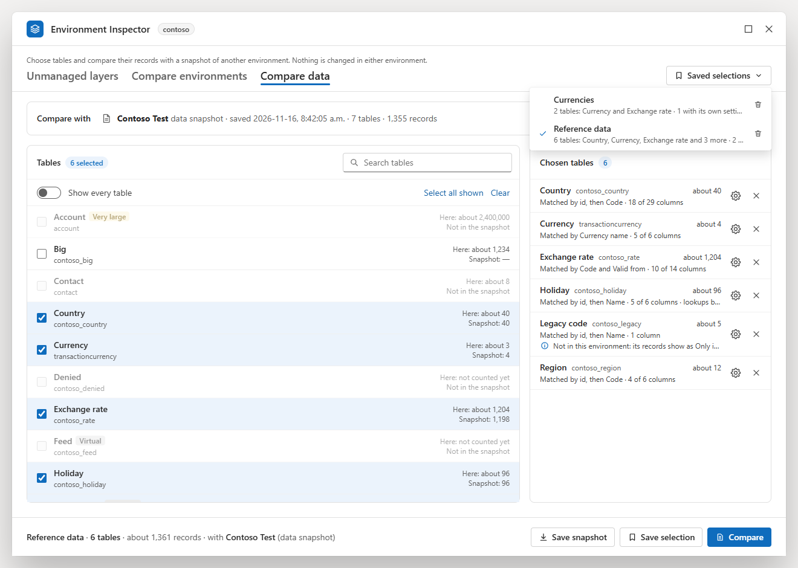

*The **Saved selections** menu of *Compare data*: two selections, each with the tables it holds ("6 tables: Country,
Currency, Exchange rate and 3 more · 2 with their own settings"), a check mark on the one applied, and a bin to remove
each. The footer starts with the name of the selection applied.*

Saved selections work as in the scan ([8.3](#83-the-choice-screen-and-saved-selections)), with the same controls,
texts and storage rules, and a list of their own: `environmentInspector:dataSelections`. The menu lists the current
tab's selections only.

**What a selection holds**: its name, the day it was saved, and the tables, each with the settings that differ from
the defaults, as a block keeps them:

```json
{ "name": "Reference data", "savedOn": "2026-11-15",
  "tables": [
    { "t": "contoso_country" },
    { "t": "contoso_rate", "match": { "by": "cols", "cols": ["contoso_code", "contoso_validfrom"] }, "lookups": "name", "out": ["contoso_note"] },
    { "t": "transactioncurrency", "match": { "by": "name" } } ] }
```

`match.by` is `auto`, `id`, `key` (with the key's name), `name` or `cols` (with one to three column names); `lookups`
is `id` or `name`; `out` and `add` are column names. Missing means the default. Not kept: the snapshot (a page can't
open a file by itself), the results, *Show every table* and the order of the sides.

**Saving** (`saveDataDialog`, through the shared `saveDialog`): **Save selection**, on once a table is ticked, asks for a
name (at most 60 characters, "For example: Reference data") under what it holds: "6 tables: Country, Currency,
Exchange rate and 3 more, with how each one is matched and compared." and where it is kept. An existing name makes the
button **Replace**. The tables of the selection saved before under that name that couldn't be ticked here are kept in
it: those not in this environment, those the snapshot open doesn't hold, and those too large, as the scan keeps
solutions that aren't installed. A selection holds at most 500 tables: with more ticked, a toast says so and nothing is
saved.

**Applying one** (`applyDataSaved`, then `applyDataChoice`) waits for the table list and, for a few seconds, the counts,
so that a table too large isn't ticked. It then ticks the tables that can be compared, with their settings, in
display-name order, and unticks the others; reads their definitions; and puts the focus on **Compare** when it can be
used, else on **Save snapshot**, else on the search. The footer starts with its name until the choice changes. Once the
definitions are here, one warning toast says, a sentence each, what couldn't be applied: tables not in this
environment (nor in the snapshot), tables the snapshot open doesn't hold ("... so they aren't ticked"), a table too
large to compare here, and settings that name columns or keys this table hasn't here ("Their defaults are used.").
Removing a selection asks nothing; the toast offers **Undo**.

**Read as untrusted.** Local storage can be changed by any script of the site. `dataSelection(x)` checks each entry
field by field and copies it: a name of 1 to 60 characters after trimming, 1 to 500 tables, table and column names in
lower case that match `^[a-z0-9_]{1,128}$`, a known way to match with its key or 1 to 3 columns, a known lookups setting,
at most 1,500 names in `out` and in `add`, each table once. An entry that isn't valid is dropped, and the others still
load (`loadDataSaved`). The same function checks the choice a data snapshot was saved with (which needs no name).

**The last choice** (the chosen tables and their settings) is kept per environment in
`environmentInspector:<org>:data`, as `{ tables: [settings] }`, at every change, and filled in when the tab opens again.
When the table list arrives, a table of the last choice that is no longer here, nor in the snapshot open, is let go.

**Opening a data snapshot** takes the choice it was saved with (its header's `selection`, or else all its tables), as
*Compare environments* takes a snapshot's solutions, through the same `applyDataChoice`; the toast says so: "Opened the
data snapshot of Contoso Test, saved *time*. Its tables and settings are chosen." The choice can then be saved under a
name here.

### 12.6 Reading this environment

#### The requests

| Request | When | Function |
| --- | --- | --- |
| `EntityDefinitions?$select=LogicalName,SchemaName,DisplayName,EntitySetName,PrimaryIdAttribute,PrimaryNameAttribute,OwnershipType,IsActivity,IsIntersect,IsCustomEntity,IsPrivate,IsValidForAdvancedFind,TableType,DataProviderId` | The first time the tab is chosen | `dataTableList` |
| `RetrieveCurrentOrganization(...)` | Once: this environment's name, id and version, for the lane heads, the names and a snapshot's header | `dataEnv` |
| `RetrieveTotalRecordCount(EntityNames=@p)?@p=['<table>',...]` | After the list: 100 standard and activity tables per request, 2 at a time; one refused because of a table its message names, again without it | `dataCounts` |
| `<entity set>?$select=<primary key>&$count=true&$top=1` | A ticked table Dataverse gave no count of, 2 tables at a time, once | `dataExactCount` |
| `<entity set>?fetchXml=<fetch aggregate="true"><entity name="<table>"><attribute name="<primary key>" alias="n" aggregate="count" /></entity></fetch>` | The same, when `$count` said 5,000 or more | `dataExactCount` |
| `RetrieveMetadataChanges(Query=@q)?@q=<query>`: every property of up to 10 tables, with their columns and keys | Tables ticked (those ticked at once in one read), 4 requests at a time; at the start of a run, those not read yet | `dataDefinitions` |
| `WhoAmI()` | Once, when a table owned by users, teams or business units is ticked | `dataAccess` |
| `systemusers(<your id>)/Microsoft.Dynamics.CRM.RetrieveUserPrivilegeByPrivilegeName(PrivilegeName='<Read privilege>')` | For each such table, 4 at a time | `dataAccess` |
| `transactioncurrencies?$select=transactioncurrencyid,isocurrencycode,currencyprecision` | A run that reads a lookup to currencies | `dataCurrencies` |
| `businessunits?$select=businessunitid&$filter=_parentbusinessunitid_value eq null` | A run that reads a lookup to business units or teams, or reads the Business Unit or Team table: the root business unit | `dataRootBu` |
| `teams?$select=teamid&$filter=isdefault eq true and _businessunitid_value eq <root business unit>` | The same, once the root business unit is known: its default team | `dataRootTeam` |
| `<entity set>?$select=<primary key>,<columns>,modifiedon&$orderby=<primary key>`, then each `@odata.nextLink` | **Compare** and **Save snapshot**: every record of each table read | `eachPage`, `readDataSide` |

**A table's definition** (`dataDef`) keeps what deciding how a column is compared needs: each column's logical and
display names and type, a date's behaviour and format, a number's precision, a choice's options with their labels, Yes
and No labels, a lookup's tables, whether it is a base-currency copy, calculated, secured, an autonumber, part of
another column or not returned by Dataverse; the table's keys with their columns and whether each is active; its kind,
its ownership, its Read privilege's name, and the language of its labels. A request that fails gives each of its
tables `{ name, error }`, with the reason in plain words.

**Your read access** (`dataAccess`): a table owned by the organization needs no check (`all`). For a table owned by
users, teams or business units, `RetrieveUserPrivilegeByPrivilegeName` gives the role privileges you hold for its Read
privilege, those of your teams' roles included. The deepest depth decides: `Global` (organization level) is `all`; any
other depth, `some` (records you can't read aren't returned, and would look missing); no privilege, `none`. A check that
fails counts as `some`, the safe side ([12.8](#128-matching-records-datamatch) says what `some` changes).

**The currencies, the root business unit and its default team** (`dataLookupData`) are read only when they are needed:
the currencies, when a lookup to them is read, as id to ISO code, with each code's precision (`currencyprecision`, in
`digits`, to show amounts); the root business unit's id and its default team's id, when a lookup read points to a
business unit or a team, or the Business Unit or Team table is read (each is named after its environment, so it counts
as the same on both sides). When they can't be read, the run goes on: currencies are then compared by name, a business
unit that may be the root one couldn't be compared for certain, and teams go by name.

#### The query: `dataSpec`

`dataSpec(def, s, snap, { save })` makes what a table's read needs: `read` (the columns read, [12.4](#124-the-columns-compared-left-out-never-read)),
the plan of its matching, its lookups' setting, and the query (`specQuery`):

* `$select`: the primary key, each column read (a lookup as `_<name>_value`, a file column as `<name>_name`), and
  `modifiedon` when it can be read (shown in a record's details, never compared);
* `$orderby=<primary key>`, the order Dataverse pages fastest, except for virtual and elastic tables, whose providers
  may not sort;
* annotations (`odata.include-annotations` with each lookup's table and name) only when a lookup is read;
* exact numbers (`exact`: the answer parsed with `exactNumbers`, [9.5](#95-json-indented-without-loss-indentjson-and-exact-numbers))
  only when a decimal, currency or big whole number column is read: the reviver is called for every value;
* the page size, set once per table and kept for every next link, as Dataverse asks:

`environment-inspector.js`, `dataSpec`:

```js
// (set once, and kept for every page: a column left out later only makes a page smaller; at most 1,000 records with a
// column of multiple lines of text, whose values can be long: emails, notes, logs)
const memo = spec.read.some((c) => c.t === 'Memo')
const size = def.type === 'elastic' ? 500 : Math.max(500, Math.min(memo ? 1000 : 5000, Math.floor(CONFIG.dataPageValues / (spec.select.length * (spec.annotate ? 2 : 1)) / 100) * 100))
spec.pageSize = Math.min(size, CONFIG.pageSize)
```

150,000 values a page (`CONFIG.dataPageValues`) divided by the fields selected (twice that with annotations), rounded
down to a hundred, from 500 to 5,000 records, at most 1,000 when a column of multiple lines of text is read (a page of
long texts can otherwise pass what a tab can take in one answer); 500 for an elastic table. A table of 30 fields reads
5,000 records a page, one of 300 fields 500, so a page holds about the same number of values whatever the table's width.
`requestOnce` takes the page size (`pageSize`, in place of `CONFIG.pageSize` in `Prefer: odata.maxpagesize`) and `exact`
as options ([5.1](#51-one-function-for-every-request)).

A table without an entity set or a primary key can't be read ("Exchange rate can't be read: it has no entity set or
primary key."). Nor can a table whose query would pass 31,000 characters (Dataverse takes an address of at most 32,768,
and a next link adds its paging cookie): it fails alone before any request, "it has too many columns to read in one
request: leave some out in its settings".

#### Page by page: `eachPage`

`eachPage(path, opts, onPage)` reads a query page by page, as `getAll` does ([5.6](#56-paging-and-pools)), but keeps
nothing: each page's rows go to `onPage`, and the next link is followed unchanged, through the same address check. Past
`CONFIG.dataMaxRecords` records (5,000,000) it stops with an error marked `tooMany`: a count a day old, or a table
without one, can turn out larger than it said. A page that still fails after the request layer's own retries
([5.4](#54-retries-throttling-and-the-read-time-limit)) is tried twice more, 30 seconds apart (`DATA_LIMITS.pageRetries`
and `pageRetryWait`), since a next link stays valid: the step line says "A page couldn't be read… · trying again in *n*
s", and **Stop** ends the wait. A refusal the same request can't change (a status under 500 other than 429), an expired
sign-in and Stop are not tried again; nor is a page that took Dataverse too long (HTTP 504, which the request layer
already sent twice, or no answer within 5 minutes): a heavy query sent again only loads the server more. After HTTP 500
it is tried once more only. A page that comes with no answer at all (Edge gives an empty text for an answer of more than
about 536 million characters) fails the table with "a page of its records was too large for this browser tab: leave its
long text columns out in its settings".

#### Three tables at a time: `readDataSide`

`readDataSide(specs, sink, report)` reads the tables of a run, `CONFIG.dataConcurrency` (3) at a time, each table's
pages one after another. The order: the largest table first, then from the smallest up, so a big table starts early and
reference tables finish early. Three reads at a time take at most 15 minutes of server time in any 5 minutes, within
Dataverse's limit of 20 minutes per user ([16.7](#167-large-environments-and-throttling)). Each record becomes a line (`dataLine`, below) and goes to `sink(spec, line)`: a kept table, a
counted table, or a snapshot's part. A record must have its id (a GUID), or the table fails; a text longer than
1,000,000 characters (`LONG`) becomes its SHA-256 fingerprint as it is read (`longsToPrints`), on both sides alike. A
page's records are handled in slices (every 256 records the slicer is asked whether 15 ms have passed,
[12.13](#1213-running-a-comparison)), so the window and **Stop** answer meanwhile.

**Each table's failure is its own.** The tables are not run through `pool`, whose first error stops the rest
([5.6](#56-paging-and-pools)): each table's errors are caught in its own task, and the others go on. A 403, a virtual
table that refuses a read without a filter, a page that still fails, or more than 5,000,000 records end that table only,
with how it ended (`complete`, `failed`, `tooMany`, or `goneB` when the sink couldn't read the snapshot again) and why,
in plain words (`readWhy`: "your security role doesn't allow it (HTTP 403: it lacks prvReadContact)" only when
Dataverse's message names a privilege, else "Dataverse refused to read it (HTTP 403)"; "Dataverse is busy (HTTP 503)";
Dataverse's own reason for another refusal, unless it holds an id, as a refusal's message often names the user;
"couldn't reach Dataverse"). `canPass(why)` says whether a reason can pass, so trying again may help: HTTP 429 or 5xx,
"no answer within" or "no answer after", "couldn't reach"; never a refusal, nor a page too large for the tab. An expired
sign-in or **Stop** ends every read; it is thrown once the tables being read have stopped. `report(spec, n, done, how)`
tells, when a table's read begins, after each page and when it ends.

#### A record as a line: `dataLine`

Each record is kept, saved and compared as a **line**: a JSON array of its id (in lower case), its values in the
order of the columns read, and when it last changed (`modifiedon`, or `null`). Every annotation and every other
property is dropped. `dataValue` writes each value as a data snapshot keeps it:

| Column type | In the line |
| --- | --- |
| Text, multiple lines of text, file name | The text; over 1,000,000 characters, `{"#sha256": "<hex>", "length": n}` |
| Whole number, choice, status, status reason | The number |
| Big whole number | Its digits, as text (up to 19) |
| Decimal, currency, floating point | The number as Dataverse wrote it, as text (exact, never through floating point) |
| Yes/No, managed property | `true` or `false` |
| Choices | Dataverse's "3,1,3" as a sorted list of numbers, each once: `[1,3]` |
| Date | As written: `2026-01-01` or `2026-01-01T08:00:00Z` |
| Lookup, customer, owner | `[table, id, name]`: the table from the lookup's annotation (else the column's first table), the id in lower case, the name as shown (at most 4,000 characters) |
| Unique identifier | In lower case |
| No value | `null` |

### 12.7 Data snapshot files

#### The format

`environment-inspector.js`, `DATA_SNAP`, `DATA_V` and `DATA_LIMITS` (in `compare data`):

```js
const DATA_SNAP = 'environment-inspector-data-snapshot', DATA_V = 1
// ...
const DATA_LIMITS = { packed: 4 * 1024 ** 3, unpacked: 20 * 1024 ** 3, line: 16 * 1048576, lines: 25000000, pageRetries: 2, pageRetryWait: 30000 }
```

A data snapshot is one gzip stream of UTF-8 text, one JSON value per line (JSON Lines), never one text:

1. **The header**: `format` (`DATA_SNAP`), `v` (`DATA_V`), `tool` (the version that saved it), `env` (`org`, `name`,
   `url`, `envId`, `version`), `takenOn`, `language` (of its labels), `rootBusinessUnit`, `rootTeam` (its default team),
   `currencies` (id to ISO code), `selection` (the choice it was saved with,
   [12.5](#125-saved-selections-and-the-last-choice)), `tables`, and `records` (the records of the tables read, added
   up). Each table: `name`, `label`, `set`, `pk`, `primaryName`, `type`, `ownership`, `access` (`all`, or `some` for
   whoever saved it), `read` (`complete` or `failed`, with `why`), `count` (its records), `bytes` (its records' text,
   unpacked), `columns` (the columns saved, in the order of each line's values, each with what comparing it needs: `n`,
   `l`, `t`, a date's `b` and `f`, a number's `p` (and `cp` when an amount is shown at its currency's precision), a
   choice's options `o`, Yes/No labels, a lookup's tables `to`, `auto`), `other` (the table's other columns that can be
   compared, not saved, so the other environment can tell a column left out from one this environment lacks; `refused`
   for one Dataverse refused to return) and `keys`. The header holds everything the choice screen needs, so a file opens
   without reading its records.
2. **Each table read**, in the header's order: `{"#t": i}`, a line per record ([12.6](#126-reading-this-environment)),
   then `{"#e": i, "n": <count>}`. A table that couldn't be read has no section: the header says why.
3. **The last line**: `{"#end": true, "tables": <n>, "records": <n>}`. A file without it was cut off.

The file is named `data-snapshot-<org>-<stamp>.jsonl.gz` (`dataSnapshotName`), the stamp being the time it was taken, in
UTC, to the minute. It never holds a token, a password, a column whose name suggests a secret, file content or images; a
Power Pages value that may hold a secret is kept as its fingerprint
([12.4](#124-the-columns-compared-left-out-never-read)). A snapshot saved before `rootTeam` was kept has none: lookups
to teams are then compared by name. It holds the records' values, which may include personal data: the toast after
saving says so ("It holds these records' values: keep it as you keep exports of your data.").

#### Writing: `dataSnapshotWriter`

**Save snapshot** (`runDataSnapshot`, then `saveDataSnapshot`) reads this environment's chosen tables
([12.13](#1213-running-a-comparison)) and writes the file in parts, so that memory stays flat whatever the number of
records:

* each table its own compressed part, filled as its records are read (`part(i).add(line)`): lines gathered 256 KB at a
  time, packed by a `CompressionStream('gzip')` whose output is kept as `Blob` parts merged every 8 MB (`gzipSink`), so
  the browser can keep them out of the page's memory;
* `done()` once a table is read; `fail(why)` when it couldn't be, which lets its part go. The unpacked bytes are counted
  at each flush, with room left for the header: a table that would take the file past 20 GB (`DATA_LIMITS.unpacked`,
  what a reader takes) fails alone ("A data snapshot can hold at most 20 GB of records. Save the largest tables in
  another snapshot."), from `add()` or `done()`, and the others are saved;
* `finish()` then makes the one file, in the header's order: the header, with each table's exact count, unpacked
  bytes and whether it was read; then each table read whole, its part unpacked and packed again into the file's one
  gzip stream; then the last line. A pause every 15 ms keeps the window answering while a file of a million records is
  packed. **Stop** ends it too, and nothing is saved.

A table that couldn't be read is in the header as such, with its reason and no records; one not in this environment is
left out. The header's tables are made after the read (`dataHeadTable`), so a column Dataverse refused meanwhile is left
out of them. Before anything is read, more than 2,000 tables, or a header longer than 15/16 of a line's limit (room for
what the header says of each table once read), is refused: "Too many tables for one data snapshot. Save them in two or
more snapshots." When none of the chosen tables could be read, nothing is downloaded and the window says why: the title
"The snapshot wasn't saved", the heading "Couldn't read the chosen tables" and the reason itself ("None of the chosen
tables could be read: Denied (your security role doesn't allow it (HTTP 403: it lacks prvReadcontoso_denied)).", or "The
chosen tables couldn't be found in this environment: contoso_audit."), without **Details**. **Try again** shows only
when a reason can pass (`canPass`); otherwise **Change selection** is the only button, and it is primary. More than
25,000,000 records in all stops the write ("A data snapshot can hold at most 25,000,000 records. ...").

**A record given twice.** A virtual or elastic table is read without an order (`unordered`), so its provider can give a
record twice while paging. While such a table is read, its records' identities are kept in an index (`DataIndex`,
through `identInto`: the id, and for an elastic table the partition), so a record given twice is written once. The index
is made at once for the table's count when it is known (about 55 bytes a record), else for what is known of its size
(5,000 records, or as many as it is known to have) up to 65,536 places, growing as records come; it is let go when the
table ends. Standard and activity tables are read in id order, each page going on after the last record read, so they
can't give a record twice: they are written straight to the file, holding nothing per record.

The toast gives the file's name, its size (`fileSize`: "47 KB", "12.3 MB"), its tables and records, the tables that
couldn't be read, and where to open it: "... In the other environment, choose Compare data, then open it under Compare
with." It is a warning when tables couldn't be read, or when a virtual table returned exactly 5,000 records
(`PROVIDER_CAP`), where some virtual tables stop ("Solution History returned exactly 5,000 records, where some virtual
tables stop: the snapshot may not hold them all."); records given twice add "Feed was read with 1 record twice; each is
saved once."

**Export** → *Data snapshot of this environment*, after a comparison, writes the tables read in full here the same way,
from the lines the comparison kept (`dataSnapOut`), with the columns read for it ([12.16](#1216-the-exports-of-a-data-comparison)).

#### Opening: `openDataSnapshot`

`openDataSnapshot(file)` treats the file as untrusted and reads as little as it can:

1. A file over 4 GB (`DATA_LIMITS.packed`) is refused.
2. Its first 200 unpacked bytes tell its kind (`snapshotKind`): a snapshot of components is refused with its own
   message and **Open it there**.
3. Only the first line, the header, is read (`readLines` stops after it, and the stream is cancelled): a file of
   several hundred megabytes opens as fast as a small one.
4. `checkDataHead` checks the header field by field and copies it into new objects; anything unknown is dropped.
5. The header's length and a short fingerprint of it (`hash32`, FNV-1a) are kept, to tell at a comparison that the file
   still starts with the header that was checked.

The records are checked when a comparison reads them. `readLines` reads the file as a stream (gzip when it starts with
`1f 8b`, else plain text): each line at most 16 MB (`DATA_LIMITS.line`), the whole at most 20 GB unpacked
(`DATA_LIMITS.unpacked`), counted as it unpacks, so a file that unpacks forever is stopped. Each piece read is searched
once for line breaks, and a long line's pieces are joined once, when it ends.

**The checks** (`checkDataHead`, `checkDataTable`, `checkDataCol`, `checkDataLine`), among them:

| Field | Kept when |
| --- | --- |
| `format`, `v` | `DATA_SNAP` and a whole number from 1; a newer version than `DATA_V` is refused ("This data snapshot was saved by a newer version of Environment Inspector. ...") |
| `env` | `org` a short plain name, `name` not empty (cut to 200 characters), `url` an `https` Dataverse address (`safeOrigin`, else empty), `envId` a GUID |
| `takenOn` | An ISO time in UTC that a date can be made of |
| `currencies` | At most 1,000, each a GUID to a three-letter code |
| `tables` | 1 to 2,000, each valid and each once; a table not valid refuses the file ("This file isn't a data snapshot: a table in it isn't valid.") |
| A table | Plain names for its name, entity set, primary key and primary name; a known kind, ownership, access and state; a count from 0 to 25,000,000; at most 1,500 columns saved, 3,000 others and 20 keys, each key's columns among its own; an elastic table must have saved `partitionid` |
| A column saved | A type of `DT_TYPES`; a date's known behaviour and format; a precision from 0 to 20 (Currency's own exchange rate has 12); `cp` only on an amount; at most 5,000 options, each label at most 400 characters; at most 5,000 tables for a lookup |
| `records` | The complete tables' counts added up, at most 25,000,000; the complete tables' `bytes` added up at most 20 GB, or the file is refused at once ("This file is too large to be a data snapshot.") rather than after reading it all |
| `rootBusinessUnit`, `rootTeam` | GUIDs, else none |
| `selection` | As a saved selection is checked, without a name ([12.5](#125-saved-selections-and-the-last-choice)) |
| A record line | An array of a GUID, one value per column saved, each valid for its column's type (text at most 1,048,576 characters, or a fingerprint; whole numbers and choices as numbers, other numbers as their text; at most 1,000 choices; a lookup's table, GUID and name), and a time or `null` |

A column whose name suggests a secret is never compared, and its values are never kept, even when a file has them.
A key named `__proto__`, `toString`, `valueOf` or `constructor` is dropped as the file is parsed (`safeKeys`), and every
name in a file stays a value, kept in a `Map` and never as an object's key, so a table or column named `constructor`
is compared as any other. Nothing from the file is ever put on the page as markup, and its links are built only from a
checked address and checked ids ([12.15](#1215-the-results-and-a-records-details)).

A refused file gets one of these messages. Found when the file is opened, it shows in a warning toast that stays, and
the strip stays as it was; found when a comparison reads the records, the comparison doesn't finish, and its page says
"Couldn't read the data snapshot" with the message ([12.14](#1214-stop-and-failures)):

| Message | When |
| --- | --- |
| "This file is too large to be a data snapshot." | Over 4 GB packed, 20 GB unpacked (or a header whose tables add up to more) or 25,000,000 record lines |
| "This file isn't a data snapshot: a line is too long." | A line over 16 MB |
| "This file isn't a data snapshot: it couldn't be unpacked." | Gzip that can't be unpacked |
| "This file isn't a data snapshot saved by Environment Inspector." | Another format, or a header that isn't valid; found when the records are read, a section with more lines or more text than its header says, or more than two blank lines after the last line |
| "This file isn't a data snapshot: a table in it isn't valid." | A table of the header isn't valid |
| "This is a snapshot of components. Open it under Compare environments." | A component snapshot, with **Open it there** |
| "This data snapshot is incomplete: the file ends early. Save it again there." | No last line, found when the records are read |
| "The snapshot file can't be read any more. Open it again under Compare with." | The file was moved or changed after it was opened |

#### Reading the records: `readDataSnapshot`

`readDataSnapshot(file, head, want, onLine, report)` reads the records at a comparison, before this environment is read
(the file's **first pass**, [12.13](#1213-running-a-comparison)):

* Its first line must have the length and fingerprint of the header checked when the file was opened; else the file
  "can't be read any more".
* Every structural line is checked: the sections in the header's order, each record line inside a section, each
  section's end with the count of its lines and of the header, at most two blank lines after the last line, and totals
  that agree. A section that holds more lines than its header's `count`, or more characters than its `bytes`, is refused
  at the first line past it: the header decided what is kept whole, so a header whose counts lie can't make a comparison
  hold far more than it planned. A file that fails stops the run there, before any record is read in this environment.
* The record lines of the tables wanted are parsed and checked value by value (`checkDataLine`), and each goes to
  `onLine(table, values)`; those of the other tables are only counted (a record line must start with `[`).
* A table whose records aren't valid (a value of the wrong type, an id twice, a wrong number of values) is refused
  alone: it is "Not compared: the snapshot's records aren't valid", and the others are compared.
* `report(share, label, name)` gives the share of the file read (by its packed bytes) and the table being read, for the
  step line and the table's row.
* Every 20,000 records, and every 32 MB of their text (a few long lines can hold as much), the memory guard looks at the
  page ([12.12](#1212-memory-dataheapcheck)), and **Stop** ends the reading as it ends Dataverse's. The window is told
  of each part of the file read (`report`), which also tells `napWatch` that the tab is awake
  ([12.13](#1213-running-a-comparison)).

A counted table's records are checked by its own index (`own`): no set of millions of ids is made here
([12.11](#1211-kept-and-counted-tables)). The same function makes the **second pass** of a counted table, which parses
only the lines it wants (`pick`).

### 12.8 Matching records: `dataMatch`

**A table's plan.** `dataPlan(s, ta, tb, w)` makes what comparing a table needs from its settings and its two sides (the
tables as read here and as the snapshot saved them): the columns compared, each with its place in each side's lines, its
two definitions and how both are compared (a floating point number at the smaller of the two precisions); the columns
chosen that can't be compared, each with why (only one environment has it, Dataverse refused it, another type or date
behaviour in each environment, or the snapshot didn't save it); how the records are matched, with each side's places of
the match columns, each with its own side's context (`dataMatchPlan`, with `ok` true for the columns both sides read
with the same type); the lookups' setting; and `wayOut`, what can match the records that have no value to match by (the
name, for a table matched by a key; other columns; or columns you choose), for their note. A column used to match is
always compared.

**Match values** (`matchValue`), worked out for matching only: text (and a file's name) in Unicode's composed form,
trimmed and in lower case, so letter case and spaces at the ends don't count, as in Dataverse's keys (accents count:
"Café" and "Cafe" are two values); a fingerprint by its hash; a lookup to an environment's own data as its value is
compared (`valueOf`, `lookupPrint`: users, teams, business units, queues and calendars by name, the root business unit
and its default team as one, currencies by their code when both sides know the codes (`byCode`), else by name, the
organization as one), any other lookup by the id of what it points to, or by its table and name in lower case when the
table's lookups are compared by name; any other value as it is compared ([12.9](#129-values-and-lookups)). The values of
several columns are joined. A record has no match value when one of its match columns has no value: Dataverse doesn't
keep a key unique then (and the window shows no match value for it). With *Automatic* by a key, a record whose key isn't
filled takes its primary name's value instead, starting with `\u0002` (never a key's), so it can pair only with a record
that lacks the key too.

**The rule.** *Automatic* in three steps; *Id only* skips the second; a key, the name or columns chosen skip the first.
An elastic table is matched by id and partition together, and nothing else.

1. **The same id.** Records with the same id on both sides are pairs, matched by id. (An elastic table's identity is its
   id and its partition.) Then, whatever the setting, the two root business units of the Business Unit table, and in the
   Team table the two roots' default teams, are one pair when both sides know them and neither is paired yet (`rootIds`;
   `how` 4, `byRoot`): each is named after its environment, so no other step would pair them, and `pairer` doesn't compare
   their names (its `root` argument; a *Good to know* line says so). Elastic tables aside.
2. **The match value**, among the records not yet paired. A value makes a pair only when exactly one record on each
   side has it, counted over all of that side's records, not only those left: a value held by records already paired by
   id makes no second pair. Where both sides have records left with a value that more than one record has, every one of
   them is *Couldn't compare*: never a guess.
3. **The records left alone** are *Only in* their environment, except: a record without a match value is *Couldn't
   compare* when the other side has records left without one too (they may be the same records), and always when
   records are matched by a key, the name or columns; and when the other side's reader may not see every record (read
   access `some` or `none`, [12.6](#126-reading-this-environment)), a record alone is *Couldn't compare*: it may be
   there too.

`environment-inspector.js`, `dataMatch`, the second step:

```js
mvA = await values(T.match.a, ta.lines); mvB = await values(T.match.b, tb.lines); NA = await count(mvA); NB = await count(mvB)
const LB = await left(mvB, pairB)
for (const [v, la] of await left(mvA, pairA)) {
  const lb = LB.get(v)
  if (!lb) continue
  if (NA.get(v) === 1 && NB.get(v) === 1) { pairA[la[0]] = lb[0]; pairB[lb[0]] = la[0]; if (nameValue(v)) { how[la[0]] = 3; byName++ } else { how[la[0]] = 2; bySecond++ } }
  else {
    const x = Object.freeze({ st: 'error', why: groupWhy(T, w, NA.get(v), NB.get(v), matchText(T.match.a, JSON.parse(ta.lines[la[0]]), nameValue(v)), nameValue(v)) })
    for (const p of la) aloneA[p] = x
    for (const q of lb) aloneB[q] = x
    if (nameValue(v)) unsureName += la.length + lb.length; else unsure += la.length + lb.length
  }
  if (!(++k & 255)) await w.slice()
}
```

`NA` and `NB` count each value over all of a side's records; `left` groups the records not yet paired by their value.
Four cases, *Automatic* on Region, matched by name (E is "Europe"):

| Contoso Dev | Contoso Test | Result |
| --- | --- | --- |
| A (id 1, E) | A (id 1, E), B (id 9, E) | A and A by id; B *Only in Test*: "No record in Dev has its id, and the only one named Europe is matched by id" |
| A (id 1, E), C (id 5, E) | A (id 1, E), B (id 9, E) | A and A by id; C and B *Couldn't compare*: "2 records in Dev and 2 in Test are named Europe" |
| C (id 5, E) | B (id 9, E) | C and B a pair, matched by the name, tagged *Matched by Name* |
| C (id 5, E), D (id 6, E) | B (id 9, E) | C, D and B *Couldn't compare*: "2 records in Dev and 1 in Test are named Europe" |

`dataMatch` returns each side's partner places (`pairA`, `pairB`, -1 for none), how each pair was matched (`how`: 1 by
id, 2 by the second step, 3 by the name in place of a key it has no value of, 4 as the root), each record left alone's
status and reason (`aloneA`, `aloneB`), and the counts (`byId`, `bySecond`, `byName`, `byRoot`, `unsure`, `unsureName`,
`noValue`). The reasons that name no value (`aloneReasons`) are made once per side and shared by every record that has
them: "No record in Test has its id" (by id; an elastic table's "No record in Test has its id and partition"), "No
record in Test has its Code" (a key, the name or columns), "No record in Test has its id or its Code" (*Automatic*; "…
its id or its Team Name" for a record matched by its name in place of a key), "It has no Code, so it can't be matched"
("It has no ObjectId with MembershipType or Team Name, so it can't be matched" when the name stands in for the key), for
a record of the snapshot when you can't read every record here, "You can't read every Contact in Contoso Dev, so it may
be there too", and for a record here when whoever saved the snapshot couldn't, "Whoever saved the snapshot of Contoso
Test couldn't read every Contact, so it may be there too". `groupWhy` names a value more than one record has ("2 records
in Dev and 1 in Test have the Code XK"), and `byIdWhy` a value only records already paired by id have.

**When the ids never meet.** A table matched by id only whose records share no id while both sides have records was
probably made in each environment separately. Its page then says so, with what to match by instead (`noIdsLine`, the
primary name, else a key, else columns): "No record of Region has the same id in both environments: they were probably
made in each one separately. Match them by Name in the table's settings."

**What the window shows.** A table's records say, in the line under the tabs, how they were matched and how many each
step paired (`matchWords`: "contoso_country · matched by their id, then Code · 18 columns compared", with "; the root business
unit as one" when the roots were paired; a step that matched nothing is left out; its tooltip, `matchTip`, gives the
counts: "contoso_country · 1,170 records matched by their id, 28 by Code · 18 columns compared"); each line
gives the record's match value as its grey second name when it isn't its name (`dvMatchText`), and "matched by Team
Name" or "matched as the root business unit" for a record matched that way; a record's page says,
under *About this record*, how it was matched ("Its id, the same in both environments", "Code KR, unique in both
environments (the ids differ)", "The root business unit in both environments", with " (the ids differ)" only when they
do). *Good to know* counts what the second step matched ("Matched by Code where the ids differ: 28 records of Exchange
rate."). Every step works in slices
of about 15 ms, so a million records are matched without stopping the window ([12.13](#1213-running-a-comparison)).

### 12.9 Values and lookups

**Raw values are kept**, and normalized only to compare (`normCell`): the window, **Copy** and the exports show them as
stored. A column is compared when it is chosen, both environments have it with the same type (and, for a date, the
same behaviour), and both read it (the snapshot saved it); the others are named under *Good to know*
([12.10](#1210-statuses-and-notes)). Two values the same as stored are the same at once (`sameRaw`, the common case);
the others are compared as `normCell` makes them.

#### Values by column type: `normCell`

| Column type | Compared as | Shown as (`dvShow`) |
| --- | --- | --- |
| Text, multiple lines of text, a file's name | Exactly; a text over 1,000,000 characters by its fingerprint and length | As stored, on a record's page in its box (a text of up to 20 lines whole, a longer one line by line, [12.15](#1215-the-results-and-a-records-details)); a fingerprint as "(a text of *n* characters)" |
| Whole number | The number | With its digits grouped |
| Big whole number, decimal, currency | Its exact digits without trailing zeros, never through floating point (`canonNumber`: 1.50 is 1.5, 1E2 is 100, -0 is 0) | A big whole number with its digits grouped; a decimal and an amount grouped at the column's precision (`amountText`: the zeros Dataverse writes past it dropped, fewer padded, a digit past it that isn't 0 kept, so two values that differ never look the same): a rate of precision 6 written 1.0030 shows "1.003000"; an amount with its record's currency code, at the currency's precision when the column follows it (`cp`, set by `dataDef` when its `PrecisionSource` is 2) and this environment knows that currency (`currencyprecision`): "300,000.00 CAD". Copy and the exports keep the text as stored |
| Floating point number | Rounded to the column's precision, the smaller of the two, half away from zero, on its digits (`roundTo`) | As Dataverse wrote it |
| Yes/No | Yes or no | The column's own label and the value: "Yes (true)" |
| Managed property | Its value | "Yes" or "No" |
| Choice, status, status reason | The number | Each environment's own label for its own value: "Active (0)" |
| Choices | The set of numbers, the order not counted | Each label with its number |
| Date only (its behaviour) | The day | "2026-01-01" |
| Date and time | To the second | "2026-01-01 08:00 UTC" for user local; without "UTC" for time zone independent (seconds shown when not zero) |
| Unique identifier | In lower case | As stored |
| Lookup, customer, owner | By the rules below | The name of what it points to and its table's display name: "Europe · Region" |

**No value is a value.** No value differs from 0, from No and from an empty list. (Dataverse keeps no empty text.)
*Compare data* is stricter here than *Compare environments*, whose `unset` makes them the same for definitions
([11.5](#115-what-counts-as-the-same-norm)): in data, a missing value is a fact about the record.

#### How two values differ: `diffKind`

Every difference counts, but some are hard to see. `diffKind` says which kind a difference is, the first that applies,
and `kindLine` says it in a line:

| Kind | The line | Looks the same |
| --- | --- | --- |
| Letter case only | "Name: only letter case differs" | |
| Spaces at the ends only | "Name: only spaces at the ends differ" | |
| Line breaks only (CR LF or CR against LF) | "Description: only how line breaks are stored differs" | Yes |
| Other spaces only (a no-break space for a space and the like) | "Name: only the kind of spaces differs (looks the same)" | Yes |
| Invisible characters only (a zero-width space, a soft hyphen, a direction mark, control characters other than a tab and the line breaks) | "Name: only invisible characters differ (looks the same)" | Yes |
| Accented letters stored differently only (one character or two) | "Name: only how accented letters are stored differs (looks the same)" | Yes |
| No value against 0 or No | "Discount: no value in Dev, 0 in Test"; for a choice, its option 0's label: "Kind: no value in Dev, Standard in Test"; for Yes/No, the column's own *No* label | |
| A choice with the same label under another number (when both sides' labels are in one language) | "Status reason: Active in both, but another option (1 in Dev, 100000001 in Test)" | |
| Anything else | "Rate differs" | |

A table's records say a kind in the record's line when one column differs ("Name: only letter case differs"; the
environments in the lanes' order, `kindLineLanes`); a record's page says it in a note under the pair, without the
column's name, and marks the characters that differ and those that can't be seen
([12.15](#1215-the-results-and-a-records-details)). Two different values are never shown the same way. The kinds that
carry nothing of their own are shared, frozen objects (`KIND`), not made again for every value that differs.

#### Lookups: `lookupDiff`

A lookup's two values (`[table, id, name]`), the first rule that applies:

1. **Both empty**: the same. **One empty, or two tables** (a customer lookup to an account here and a contact there):
   different.
2. **The organization**: never compared (one per environment).
3. **A currency**: by its ISO code (`isocurrencycode`) when both sides could read the codes: each environment makes its
   own currencies. When one side couldn't, by id or by name; two names that differ then can't tell the currencies apart
   for certain (*Couldn't compare*), never a false difference.
4. **An environment's own data** (`ENV_DATA`: users, teams, business units, queues, calendars): by the name of what it
   points to; the root business unit, named after each environment, counts as the same on both sides, and so does its
   default team when both sides know it (`dataContext` gives `rootTeam` to both sides' contexts only then: a snapshot
   saved before it was kept compares teams by name). A record pointed to without a name, or a business unit when one
   side's root business unit isn't known, can't be compared for certain.
5. **A kept table in this comparison**: through its matching (`w.matched`). The same when the two records pointed to
   are a pair; *Couldn't compare* when either couldn't be matched for certain ("Region points to Europe, which can't be
   matched for certain"); different when they aren't a pair, saying so when one of them is alone and the names are the same
   ("Region points to Europe in both, but Test's Europe is only in Test").
6. **Any other table** (a table not compared, a counted table, an elastic table): by the table's setting. *By name*:
   the same when the names are (a record pointed to without a name is compared by id). *By record id*: the same when
   the ids are; when the ids differ and the names are the same, the line says so ("Region: points to another record
   named Europe (its id differs)"), and *Good to know* counts such records per column, with the way out.

A pair whose only differences are lookups that couldn't be compared is *Couldn't compare*; with another column that
differs, it is *Different*, and that lookup is marked as not compared for certain. Two lookups shown with the same name
but pointing to records with other ids show the start of each id after the name ("Europe · Region · id 3f2a91c0…",
`dvPair`), so they don't look the same.

### 12.10 Statuses and notes

#### Record statuses

`pairer(T, w, stats)` compares a table's pairs: `pair(la, lb)` gives a pair's status, the columns that differ and how,
and why (`why`, the line the exports write under *What differs*). The line many records share ("Changed: Rate, Valid
to") is kept once, up to 1,000 different lines a table. It also counts how many records each column differs in, and
what the notes need. The window says what differs in its own words (`d2What`, [12.15](#1215-the-results-and-a-records-details)).

| Status | Icon | When | Its `why`, and what a table's records say |
| --- | --- | --- | --- |
| *Different* | Orange disc with ≠ | A pair, and a compared column differs | "Changed: Rate, Valid to", or the kind of one column ([12.9](#129-values-and-lookups)); the window: "Rate and Valid to differ", "Capital differs", "Kind: Standard in Dev, Premium in Test" |
| *Only in Dev* | A ring filled on Dev's side (blue) | Alone here, for certain | "No record in Test has its id or its Code", and the other reasons of [12.8](#128-matching-records-datamatch); the window: "Only in Contoso Dev: no record in Test has its id or its Code" |
| *Only in Test* | A ring filled on Test's side (purple) | Alone in the snapshot, for certain; every record of a table only in the snapshot | The same the other way round; "Exchange rate isn't in Contoso Dev" |
| *Couldn't compare* | Grey dashed ring with ? | It can't be matched for certain, has no value to match by, may be there unseen, or a lookup couldn't be compared | "2 records in Dev and 1 in Test have the Code XK", "It has no Code, so it can't be matched", "You can't read every Contact in Contoso Dev, so it may be there too", "Region points to Europe, which can't be matched for certain" |
| *Same* | Green disc with a check | A pair, and nothing compared differs | None; the window: "The same in both", listed only by **Show them** |

*All differences* is *Different*, *Only in Dev* and *Only in Test*. *Couldn't compare* is counted on its own, never as a
difference, as for components. The status names use the short names (`dStLabel`), and the order of *Only in Dev* and
*Only in Test* follows **Swap** (`dStOrder`). A table's comparison (`compareTable`) gives a row per record, `{ st, a, b,
by, why, diff, kinds }`: this environment's records in their order (each pair, or the record alone), then the
snapshot's records left alone; `a` and `b` are the records' places in each side's lines (a counted table's rows hold
the lines themselves).

#### Table states

A table's state decides its group on the overview (`d1Group`): a compared table with records that differ is in the
first group, one without in the second ("✓ No differences · All 40 records are the same", or "No records in either
environment"), and one that wasn't compared in the third, with the grey dashed ? between its lanes, "(?) Not compared"
and one sentence (`d1Why`). Its full reason (the engine's words, `notCompared`, and how many records were read before
a read failed, `d1Reason`) opens under the row when it is chosen.

| State | Its lanes | Its sentence |
| --- | --- | --- |
| `compared` | Each side's records | Its result ([12.15](#1215-the-results-and-a-records-details)) |
| Only in the snapshot | A dashed *Not in Contoso Dev* box in Dev's lane, the snapshot's records in the other | "14 records differ · The table isn't in Contoso Dev" (first group) |
| `failedA` | *Can't read* in Dev's lane | "Your security role can't read it in Contoso Dev.", "Dataverse is busy. Compare again in a moment.", or "Couldn't read it in Contoso Dev: *reason*" |
| `failedB` | *Not read* in the snapshot's lane | "The snapshot couldn't read it. Save a new one in Contoso Test." |
| `invalidB` | *Not valid* | "The data snapshot's records of it aren't valid. Save a new snapshot there." |
| `tooMany` | Dataverse's estimate here | "More than 5,000,000 records in Contoso Dev." |
| `stopped` | *Not read* | "Not compared: stopped" (in the result's place) |
| `goneB` | *Can't read* in the snapshot's lane | "The snapshot file can't be read any more. Open it again under Compare with." |
| `noSnapshot` | *Not in the snapshot* | "Not in the snapshot of Contoso Test." (only for two sides given whole: the window compares only tables the snapshot holds) |

#### The notes: `dataNotes`

The engine keeps two lists of notes, `warn` and `info`. The overview shows at the top, amber, only those no row can
carry (`D1_TOP`: an old snapshot, a stop, the memory guard, a sign-in that ended, a snapshot file that can't be read any
more); every other note is said in the row it concerns and listed under *Good to know*, one folded line under the sheet
whose first note is the run's scope and time ("Compared 10 tables with Contoso Test (data snapshot) in 2.2 s"; "Compared
8 of the 10 tables chosen with …"; "Couldn't compare the 2 tables chosen with … · 0.0 s", `gtkScope`). A note has
**Details** for long reasons or more than three columns.

**Warnings** (`warn`): the tables this environment couldn't read, with their reasons and how many records were read
first, ending with "Compare again in a moment." only when one of the reasons can pass (`canPass`: busy, a server error,
no answer, no connection; never after a refusal such as a 403, a virtual table's 400 or a 413, nor a page too large for
the tab); those the snapshot couldn't read; a table whose records in the snapshot aren't valid; read access to some
records only, here or for whoever saved the snapshot, and what it changes; a snapshot more than 7 days old; a table with
more than 5,000,000 records; a comparison stopped (when, what was compared and what wasn't) or stopped by the memory
guard ([12.12](#1212-memory-dataheapcheck)); a snapshot file that can't be read any more; a sign-in that ended while the
very large tables were read.

**Good to know** (`info`): how many records *Automatic* matched by the second step ("Matched by Code where the ids
differ: 1 record of Country."), and by their name where the key had no value ("Matched by Team Name where the ids differ
and ObjectId with MembershipType has no value: 16 records of Team."); records that couldn't be matched for certain, and
what to do (another key, or columns; "… a Team Name is used by more than one record that has no ObjectId with
MembershipType. Match them by columns you choose in the table's settings."); records with no value to match by ("2
records of Team couldn't be matched: they have no ObjectId with MembershipType or Team Name. Match them by columns you
choose in the table's settings.", the way out from `wayOut`); lookups that point to other records with the same names,
with the way out (compare lookups by name, and, when that table isn't in the comparison, add it); the columns not
compared, each kind in a note of its own (only one environment has them, the snapshot didn't save them, Dataverse
doesn't return them, another date behaviour or type in each environment); a choice whose same label has another number,
or whose labels differ (values are compared by number); line breaks stored differently, and no value against 0, counted
per column; the columns left out by default that weren't ticked (not those ticked that couldn't be compared: their own
notes name them); how lookups to users, teams, business units and currencies are compared; secured columns, when one is
ticked ("a value you can't read looks empty"); a counted table, very large or of unknown size here ("Region's size here
wasn't known: all its records were compared and counted, and those that differ are listed."), with how much of it is
listed and how its lookups were compared; a virtual table that returned exactly 5,000 records (`PROVIDER_CAP`) in either
environment ("Feed returned exactly 5,000 records in Contoso Dev and Contoso Test, where some virtual tables stop:
records past them may show as only in one environment."); a read of this environment over 2 minutes (records changed
meanwhile may show their old or new values); records read twice, each counted once; and the time the tab slept during
the run (`napWatch`, [12.13](#1213-running-a-comparison)).

### 12.11 Kept and counted tables

Most tables are **kept**: every record of both sides is in memory, and everything is possible. A table too large to keep
is **counted**: every record is matched and compared, and only those that aren't the same are listed, the first 50,000
of them.

#### Kept: `keptTable`

A kept table holds each record's line as its JSON text (one string per record, on both sides) in `lines`, and each
record's place by its identity in `ids` (a `Map`: its id; for an elastic table, its id and partition). A record read
twice (a paging glitch) is kept once and counted in `dup`, for the note. Everything works on a kept table: listing the
*Same* records, searching every record, opening any record, matching lookups through the pairs of other kept
tables, and exporting a data snapshot of this environment. A table only in the snapshot is always kept.

#### Which tables are counted: `dataKeepPlan`

Decided before anything is read, from the snapshot's header (each table's exact count and unpacked size, `bytes`) and
this environment's counts. The tables are taken smallest first and kept while their estimated text stays within
`CONFIG.dataKeepChars` (400 million characters): the snapshot's bytes, plus this environment's expected records at the
snapshot's average line. Once one doesn't fit, it and every larger one are counted. The tables only in the snapshot
count first. A table whose size here isn't known (`unknown`: its count couldn't be made) is never kept whole: it is
counted, its row saying "size not known" under its name and "differences listed up to 50,000" in its result. A count still on its way when the run starts
isn't unknown: the snapshot's count stands for it (`expect: h.count`). A counted table's plan (its matching, its
columns) is fixed then, for its index, and its lookups are compared by the table's setting, never through another
table's matching.

#### Counted: `countTable`

`countTable(T, tb, ta, w)` compares a counted table with fingerprints, in typed arrays, so it holds about 40 bytes a
record instead of its text:

* **`DataIndex`**, one per side: each record's identity (its id's 128 bits; an elastic table's partition by its hash),
  the hash of its match value (64 bits), the fingerprint of its compared values (64 bits), its flags and status, and,
  for this environment's records, the order they were read in and the snapshot's record its value paired it with. A
  record is found by its identity through open addressing, in slots at least twice as many as the records, from a hash
  with a seed taken at random. A probe past 4,096 slots, which only records piled up on purpose make, refuses the
  table. The snapshot's index has room for the records its header counts; this environment's grows as they come.
* **`ValueTable`**: the match values by their 64-bit hash, with how many records of each side have each one (all of
  them, as the rule counts them, and those left after the same id) and the first of those left. It grows as values come.
* **The fingerprints** (`fingerprint`, `murmur32`): two MurmurHash3 x86_32 hashes, each with its own seed, of the
  record's compared values as they are compared, written as one text. Two records whose values are the same as compared
  have the same fingerprint; any other difference gives another one, but for a chance in 2^64. Each comparison takes its
  seeds at random, so a crafted file can't make records collide or pile on one slot.

In order, through a run ([12.13](#1213-running-a-comparison)):

1. `addB(values)` for each of the snapshot's records, in the file's first pass: indexed, with its fingerprint and the
   hash of its match value. A record given twice refuses the table's records in the snapshot, as for a kept table.
2. `addA(line)` for each of this environment's records, as they are read: when the records are matched by id first, a
   record whose id is in the snapshot is paired at once and compared by fingerprint, and one found different keeps its
   line, up to the cap. When records are matched by value too, a record left is kept with its identity, value hash and
   fingerprint, and its line is written to a spool (a gzip `Blob`, 256 KB at a time): whether it will be listed is known
   only at the end. Matched by id only, a record left is alone for certain, and its line is kept, up to the cap.
3. `resolve()`: the records left are matched by their values with the same rule as a kept table's
   ([12.8](#128-matching-records-datamatch)), and each record left alone gets its status and why.
4. `pick()`: the records listed, the first `CONFIG.dataListCap` (50,000) that aren't the same: this environment's in the
   order they were read, then the snapshot's left alone. The root pair (`rootP`) is listed even past the cap, and its
   line kept whatever the cap, so it is always judged in full, its name left out, as in a kept table. The lines they
   need are flagged.
5. `readSpool()`, then, when one of the snapshot's lines is wanted (`needsFile`), a **second pass** over the file for
   those lines alone (`wants`, `takeB`), checked against the identity indexed at their place. A file that changed between
   the two passes leaves the table "Not compared: the snapshot file can't be read any more".
6. `finish(tr)`: the rows, each pair listed compared in full by the kept table's rules (`pairer`). A pair whose
   fingerprints differed only in how a lookup was shown can turn out the same (then counted, not listed) or not
   comparable for certain. The counts, the columns that differ, and whether the list was cut (`capped`).

A counted table's *Same* records are counted, never listed, and past the cap so are the others. Its row says "very large" (or "size not
known") under its name and "differences listed up to 50,000" in its result; its records' tabs and chips count the
records listed; a line under its tabs says what isn't listed ("The 1,234 same records aren't listed for a table this
large."); and *Good to know* says it was counted. `drop()` lets everything go: a table that failed or was stopped, or one done.

**The same records either way.** The offline checks compare the counted path with the kept path on the same made-up
sides (by id, by a key, by the name, *Automatic* with its four cases, an elastic table, read access in part, a
generated pair of 3,000 records in five settings) and require the same counts and records listed
([12.19](#1219-how-it-is-tested)). `countLines(x, w)` gives a table's two sides, given whole, to `countTable` as a run
does, for those checks.

### 12.12 Memory: `dataHeapCheck`

A comparison holds every record of a kept table, on both sides, as text, and a counted table's indexes. Before the tab
runs out of memory, a guard stops the run as **Stop** does.

`environment-inspector.js`, `heldStart` and `dataHeapCheck`:

```js
let memoryStop = false, held = 0, heldFrom = 0
const heldStart = () => { memoryStop = false; held = 0; heldFrom = performance.memory ? performance.memory.usedJSHeapSize || 0 : 0 }
function dataHeapCheck() {
  const m = performance.memory
  if (stopReads || !m || !(m.jsHeapSizeLimit > 0)) return false
  if (Math.max(m.usedJSHeapSize, heldFrom + held) / m.jsHeapSizeLimit <= CONFIG.dataHeapStop) return false
  memoryStop = true; stopAllReads()
  return true
}
```

* **The page's figure**: Edge's `performance.memory` gives the page's memory in use and its limit. Past
  `CONFIG.dataHeapStop` (70%) of the limit, the run stops. Where the browser has no such figure, nothing is stopped.
* **The run's own count**, `held`: Edge updates its figure only every 20 minutes, and in steps, so a run also counts what
  it holds: each record kept whole at 2 bytes a character of its text plus 100 for its place in the maps and rows made
  for it (`keptTable`), and the counted tables' typed arrays (`DataIndex`, `ValueTable`), added when they are made or
  grow and taken off when they are let go. That count, over the page's figure when the run started (`heldFrom`), stands
  for the page whenever it is the larger. `heldStart` starts the count at each run.
* **When it looks**: after each page read, every 20,000 lines of the data snapshot and every 32 MB of its text (and
  every 4,096 lines of a counted table's spool), and between the slices of matching and comparing.

`memoryStop` says why the run stopped. Before any table was compared, the window goes back to the choice with a warning
that stays: "Stopped to protect the browser: this tab was close to running out of memory. Compare fewer or smaller
tables at a time." After some were, they stay, and the overview's amber note at the top says the same, with when and which in its
details. A data snapshot stopped this way isn't saved ("... The snapshot wasn't saved. Save fewer or smaller tables at
a time."). `destroy` lets a comparison go at once, and disconnects the window's size observers (`sizeWatch`), whose
callbacks hold the window's state: a window started next, with its memory guard, starts from little.

### 12.13 Running a comparison

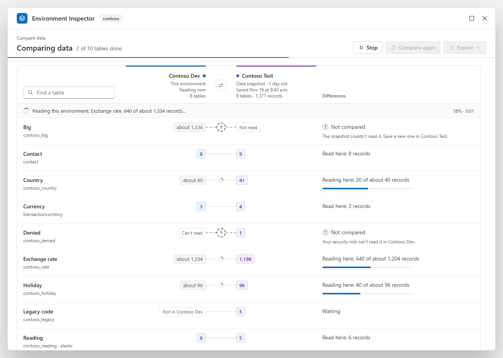

*A comparison of ten tables while this environment is read (D0): the title "Comparing data" with "2 of 10 tables done",
**Stop**, the progress line on the header's edge; the lane heads (Contoso Dev "Reading now", 8 tables; the data snapshot
of Contoso Test, 9 tables, 1,371 records); the search in its place but off; the step line in the first heading
("Reading this environment: Exchange rate, 640 of about 1,204 records…", "58% · 0:01" at its right). Each chosen table
already has its row, by display name, at its final height, saying how far it is: "Reading here: 20 of about 40 records"
with a bar, "Read here: 8 records", "Waiting", or, with the grey dashed ?, "Not compared" and why ("The snapshot couldn't
read it. Save a new one in Contoso Test.", "Your security role can't read it in Contoso Dev.").*

**Compare** (`runDataCompare`) takes the chosen tables the snapshot holds, opens the results at once on D0, the
overview laid out as it will end (`dvRun = liveRun(...)`, [12.15](#1215-the-results-and-a-records-details)), and calls `dataCompare(choice, file,
head, progress, opts)`:

1. **The definitions here** (from 1%): the chosen tables' definitions not read yet, the read access to each, this
   environment's name (`dataDefsFor`, `dataEnv`), then what each table reads (`dataSpec`, with the records expected: its
   count here, else the snapshot's: a count here not known, `null`, makes the table `unknown`, while one still on its
   way, `undefined`, takes the snapshot's), and, as needed, the currencies, the root business unit and its default team
   (`dataLookupData`). "Reading the table definitions…". A table whose definition couldn't be read, or that the snapshot
   couldn't read, says so in its row at once and isn't read.
2. **Kept or counted** (`dataKeepPlan`, [12.11](#1211-kept-and-counted-tables)), and each counted table's index made.
3. **The snapshot, first pass** (5 to 15%, by the share of the file read): every line checked; the kept tables' lines
   kept, the counted tables' records indexed; the tables not chosen only counted. A file that isn't valid stops the run
   here, before any record is read in this environment. "Reading the snapshot of Contoso Test: Exchange rate…". A table
   whose records in the snapshot aren't valid isn't read here: there is nothing to compare it with.
4. **This environment** (15 to 95%, by the records read over those expected, `readProgress`): `readDataSide`, three
   tables at a time ([12.6](#126-reading-this-environment)). "Reading this environment: Account, 120,000 of about
   2,400,000 records, about 14 min left…": with several tables at once, the one with the most left. The records expected
   are each table's count here, else the snapshot's (for a snapshot, 5,000 for a table without a count). For a table
   whose size here isn't known, the line gives the records read only: "Reading this environment: Solution History, 2,000
   records…". The time left shows after 15 seconds of reading, when more than a minute is left, from the records read in
   the last 30 seconds ("less than a minute left" at the end). A counted table's records are matched and compared as
   they come.
5. **The kept tables**, compared as soon as all of them are read (`compareKept`): every one matched first, so that
   lookups can go through any kept table's matching, then compared one after another, each shown in the overview as
   soon as it is done, while counted tables go on being read. "Comparing: Exchange rate…".
6. **The counted tables**: their records left matched by value, the lines they list taken from the spool and from the
   file's second pass (95 to 99%, "Finding the differences in the snapshot: Account…"), then their rows.
7. **The end** (`dataEnd`): the tables a Stop left are "Not compared: stopped", the time, and the notes
   ([12.10](#1210-statuses-and-notes)).

`dataCompare` returns the comparison, kept in `dcmp`: both sides, both environments' names full and short, whether it
was stopped and why, the notes, and a table per chosen table (`tr`): its name and label, its plan (`spec`), its state
and why, whether it was kept or counted, its counts (`a`, `b`, `diff`, `onlyA`, `onlyB`, `error`, `same`), how many
records each step matched, the columns that differ with how many records, and its rows. `lastData` keeps what
**Compare again** repeats: the same tables, settings and file, read again, without the confirmation.

**Save snapshot** (`runDataSnapshot`, then `saveDataSnapshot`): the definitions (from 1%), the records (5 to 95%), each
table written to its own compressed part as it is read, then "Writing the file…" (96%) and the download
([12.7](#127-data-snapshot-files)). Its rows show how far each table is ("Reading here: ...", "Read here: *n* records",
"Writing the file…"). The results on screen before it come back once it is saved.

**The run's rows** (D0, `d0Draw`). `liveRun` makes a row per chosen table, by display name, so a row never moves
while the run lasts; each is drawn at D1's height by the virtual list. `dataCompare` and `saveDataSnapshot` tell how
far each table is (`table(name, state, x)`: `snapshot`, `waiting`, `reading` with the records read, `read`, `not`
with why, `comparing`, `finding`, `writing`), and `done(tr, d)` gives a table's result as soon as it is compared,
with the comparison being built (`dvRun.d`). `liveTable` notes the change, and `drawLive` draws the changed rows again
in their place, once a frame (`d1vl.refresh`), and the header's "6 of 10 tables done". A row's lanes hold this
environment's records once read (before, Dataverse's estimate in grey, "about 1,204") and the snapshot's count, with a
dotted connector, a spinner while it is read; its result says how far it is (`d0RowHtml`: "Waiting", "Reading the
snapshot", "Reading here: 640 of about 1,204 records" with a 240 by 4 px bar when this environment's own count is known,
"Reading here: 2,000 records" when it isn't, "Read here: 8 records", "Comparing…", "Finding the differences…"), then its
result or why it wasn't compared, drawn as D1 draws it. Figures are tabular in fixed widths, so nothing moves when they
change. The lane heads say "Reading now" and the tables to read here (with about how many records when every one has
this environment's own count).

**Tables and records that open while the run goes on.** A table compared opens its records (D2) while the others are
still read, and a record of it its page (D3): both read the comparison being built (`dvCmp()`: `dvRun.d` during a
comparison run, else `dcmp`), and what they show is final once their table is compared, so they are drawn once and
stay as they are. A row that doesn't open yet says why in its tooltip and description, and when chosen
(`D0_SOON`: "Exchange rate opens once it is compared."; a table not compared: "its full reason shows when the comparison
ends", `D0_LATER`). **Stop** shows on D0 only; Export stays off until the end; **Back**, Alt+Left and Esc go up as after
a run. When the run ends with a table's records or a record shown, they stay shown, and D1, which regroups D0's rows, is
drawn when it is next shown, its row found again by its key. When it ends on D0, D0's rows regroup into D1's three groups
once, in place (`d0Kept`, `d0Refocus`: the focus stays on the same table's row), the overview's grid busy for that
frame only.

**Slices, never timers.** Matching and comparing are cut in slices of about 15 ms (`slicer`), with a pause between them
that lets the window and **Stop** answer:

`environment-inspector.js`, `yieldNow` and `slicer`:

```js
const yieldNow = () => (globalThis.scheduler && typeof globalThis.scheduler.yield === 'function' ? globalThis.scheduler.yield() : new Promise((r) => { const c = new MessageChannel(); c.port1.onmessage = () => { c.port1.close(); r() }; c.port2.postMessage(0) }))
function slicer() {
  let t = performance.now()
  const stopped = () => { if (stopReads) throw new StopError('The comparison was stopped.') }
  return async () => { stopped(); if (performance.now() - t < 15) return; dataHeapCheck(); await yieldNow(); t = performance.now(); stopped() }
}
```

`scheduler.yield()` where Edge has it, else a message through a `MessageChannel`; never `setTimeout`, which Edge slows in
background tabs (to once a minute after 5 minutes). So a comparison goes on at full speed behind other tabs. There is no
Worker: a page's script policy can refuse one made from a `blob:` address ([14.3](#143-eval-blob-and-the-pages-script-policy)).

**Long runs** (`longRun`):

* While a data run lasts, the tool holds a Web Lock
  (`navigator.locks.request('environmentInspector:run', { mode: 'shared' }, ...)`), which keeps the browser from
  freezing the tab. It is shared: a run in another tab of the same site holds it too, since a tab that only waits for a
  lock isn't kept from freezing.
* Once a run has lasted 10 seconds, leaving or reloading the page asks first (`beforeunload`), until it ends.
* Closing the window (× or Esc) during a data run turns it into the pill in the corner, as deleting does
  ([8.9](#89-toasts-dialogs-and-the-deleting-pill)): "Comparing data · 35% · about 8 min left", or "Saving a data
  snapshot · 35%"; at the end, how the run ended ("Comparison finished · Select to see the results", "Comparison
  stopped", "Snapshot saved", "The snapshot wasn't saved"). Selecting it shows the window.
* `napWatch` looks at the clock every second: a gap of over 70 seconds in which no page was read is time the tab slept
  (Edge can freeze a tab kept behind others). It is told of each page and of each step of progress, so a long read of
  the snapshot file, which can keep the clock's timer from running for minutes, isn't taken for sleep. More than 70
  seconds asleep in all adds a note under *Good to know*: "This tab was asleep for 12 min. Keep it in front during long
  comparisons."
* Screen readers hear the step line through the progress bar (`aria-valuetext`), named "Comparison progress" ("Snapshot
  progress" while a snapshot is saved), then "Comparison finished: 53 records differ in 6 of 10 tables · Contoso Dev and
  Contoso Test." (the title, [12.15](#1215-the-results-and-a-records-details)) or "Comparison stopped: 4 of 6 tables
  compared.".

**Two sides given whole.** `compareDataSides(A, B, choice, opts)` compares two sides that are already in memory (made by
`dataSide` from made-up tables, in the checks, [12.17](#1217-settings-storage-and-test-hooks)) with the same matching,
rules and notes; `opts.counted` names tables to count rather than keep.

### 12.14 Stop and failures

* **Stop while the snapshot or this environment is read**, before any table was compared: every read ends at once
  (`stopAllReads`, [5.5](#55-stop)), and the window goes back to the choice with "Comparison stopped.".
* **Stop once tables are compared** (the kept tables while counted ones are read, a table being compared, a counted
  table's second pass): the tables already compared stay, complete; the others are "Not compared: stopped". **Stop**
  pressed with the focus on it gives the focus to the results' title (`#resTitle`) first, so it isn't lost when the
  button goes. A table is never shown half compared. The title reads "2 records differ in 2 of the 3 tables compared"
  (or "No differences in the 4 tables compared"), the tables not compared are in the third group, "Not compared:
  stopped", and the amber note at the top says "Stopped after 4 min 12 s. Compared: Country, Currency, Holiday,
  Language. Not compared: Account, Contact.". This differs from the scan, which never shows anything partial, because each table here
  is either compared in full or marked.
* **Stop while a data snapshot is saved**: nothing is downloaded ("Stopped: the snapshot wasn't saved."), and the results
  on screen before it come back.
* **Save snapshot with no table read**: nothing is downloaded; "The snapshot wasn't saved", "Couldn't read the chosen
  tables" and the reason itself, with **Try again** only when a reason can pass ([12.7](#127-data-snapshot-files)).
* **A table that can't be read** (a 403, a virtual table that refuses a read without a filter, a page that still fails
  or comes back empty, a query too long, more than 5,000,000 records): that table alone ends, its records are let go and
  never reported missing, and the others go on ([12.6](#126-reading-this-environment)).
* **A sign-in that ends** (`SessionError`) stops every read. When tables were compared meanwhile, they stay, and a note
  gives the sign-in's message; otherwise the comparison didn't finish: "Your sign-in has expired".
* **A data snapshot that turns out not to be valid** at **Compare** (cut off, or changed since it was opened): "The
  comparison didn't finish", "Couldn't read the data snapshot" and the file's own message, not Dataverse's
  (`fileFault`).
* **The memory guard** stops as **Stop** does, and says why ([12.12](#1212-memory-dataheapcheck)).

### 12.15 The results and a record's details

A data comparison has a view of its own, `#dv` (beside the component comparison's `#cv`), drawn by `renderDv` in place
of the scan's grid, filters, banners and bottom bar, in the three levels both comparisons share
([8.10](#810-the-comparisons-pages-levels-the-header-and-shared-parts)): the overview of tables (D1, D0 while the run
lasts), a table's records (D2) and one record side by side (D3). `result` is `{ data: true, findings: [], seconds,
requests }`, so the header and **Export** work as for the other tools, and `dcmp` holds the comparison (`dvCmp()`
the one being built while a run lasts, [12.13](#1213-running-a-comparison)).

**The title** (`d1Title`) says how many records differ and in how many of the tables chosen: "53 records differ in 6
of 10 tables", "4 records differ in all 3 tables", "in both tables", "4 records differ in Account" (one table chosen);
"No differences in the 10 tables", or "in the 8 tables compared" when not every one was, with "· 2 records couldn't be
compared" when some couldn't be, so they are never hidden behind "No differences"; "No table could be compared"; after
a stop, "2 records differ in 2 of the 3 tables compared". It names no environment: the lanes do. Good to know's first
note says the scope and the time ([12.10](#1210-statuses-and-notes)). **Change selection**, **Compare again** and
**Export** are on the right. While a run lasts, the title is "Comparing data" with "6 of 10 tables done" (`d0Done`),
or "Saving a data snapshot…" with the scope, and **Stop**; **Export** is off, and a snapshot being saved has none.

**Lanes and names.** Each environment keeps its colour and its side, as in a comparison of components
([11.7](#117-the-results-and-the-details)): blue for this environment, purple for the snapshot. **Swap** (`cvSwap`) is
shared with *Compare environments*, and so is the order it keeps (`environmentInspector:cmpOrder`): it exchanges the
lanes on every level, the order of the *Only in* tabs and icons, and the environments' order in the sentences, keeping
each level's place. When the snapshot is this environment's own, the snapshot's side is named "Contoso Dev (snapshot)"
(`nameB`), but a text that already says snapshot uses its own name (`snapB`, `dSnap()`): "with Contoso Dev (data
snapshot)", "The data snapshot of Contoso Dev couldn't read: …", "Not in the snapshot of Contoso Dev.", the lane head's
tooltip "Contoso Dev (data snapshot)".

While a data snapshot is saved, `#dv` shows its own view instead (`#dvSave`, `saveOverview`): one lane, a row per
table read here saying how far it is; the comparison's levels are set aside meanwhile (`dvParked`) and come back
after.

#### The overview of tables

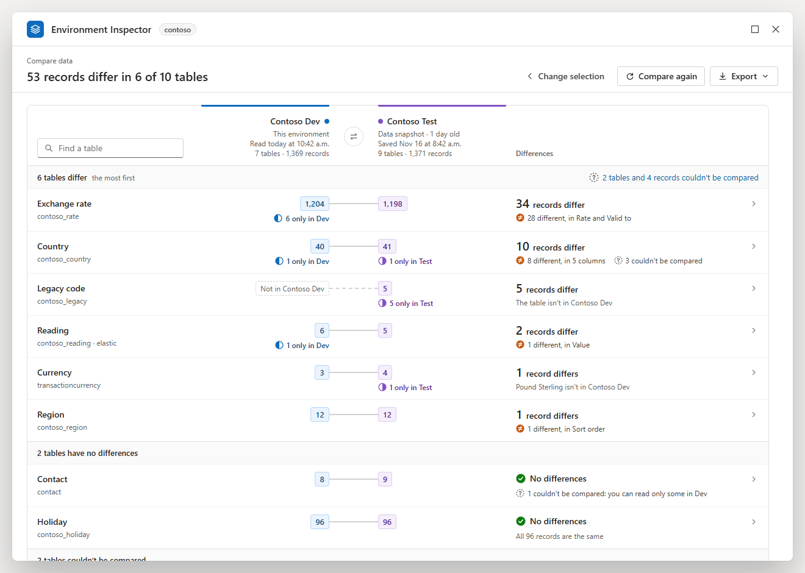

*The overview (D1) of a comparison of ten tables: "53 records differ in 6 of 10 tables"; the lane heads (Contoso Dev, read
today, 7 tables, 1,369 records; the data snapshot of Contoso Test, one day old, 9 tables, 1,371 records), **Swap**
between them, *Find a table*; "6 tables differ · the most first" with the link "2 tables and 4 records couldn't be
compared"; each table with its records in each lane and what is only on a side under them, a plain line between the
counts, and its result: "34 records differ" and one line of kinds ("28 different, in Rate and Valid to"); *Legacy code*
with a dashed *Not in Contoso Dev* box ("The table isn't in Contoso Dev"); then "2 tables have no differences".*

`d1Draw` draws, from the top:

1. **The notes at the top**, amber, only for what no row can carry (`D1_TOP`, [12.10](#1210-statuses-and-notes)).
2. **The sheet**: *Find a table* (`#dvTq`, the display or logical name; Esc clears it; at 800 px and less a button in
   the first heading opens it in that heading's place, `d1Find`), then the lane heads (`d1Lanes`): each environment's
   name, what it is, when it was read or saved, and its tables and records (here, the tables whose read finished; in the
   snapshot, the chosen tables it holds in full: no estimate). Their tooltips hold the name and the first two lines
   whole, then the address and the snapshot file's name, and last the third line with what it counts
   ("9 tables · 1,371 records: the chosen tables the snapshot holds in full, and their records"); their descriptions
   (`aria-description`) hold only the address, the file's name and that last line, as the name and lines are the lane
   head's name. The overview's rows keep their height, so a narrower window cuts a long name or line with "…"
   ([8.10](#810-the-comparisons-pages-levels-the-header-and-shared-parts)). D0's lane heads (`d0Lanes`) have the same
   tooltips and descriptions while the run lasts.
3. **The tables, in three groups** (`d1Items`, `d1Group`): "6 tables differ" (the most first), "2 tables have no
   differences" and "2 tables couldn't be compared" (by display name). The first heading holds the link to what
   couldn't be compared (`d1ToNot`): the third group, or the line under the groups, "4 records couldn't be compared in
   the tables above: Country, Contact", whose names are links to those tables' *Couldn't compare* tab. While the search
   filters the list, each heading says how many of its tables match, in grey.
4. **A table's row** (`d1RowHtml`, 69 px), one Tab stop for the list: its name and, under it, its logical name with
   "· elastic", "· very large" or "· size not known"; its records in each lane (`d1Side`), what is only there under
   that side's count ("6 only in Dev"), Dataverse's estimate in grey when this environment's count isn't known, or a
   dashed box ("Not in Contoso Dev", "Can't read", "Not read", "Not in the snapshot", "Not valid"); between them a plain
   line, a dashed one when one side has none, or the grey dashed ? when it wasn't compared; and its result: the figure
   and "records differ", then one line of kinds ("28 different, in Rate and Valid to", "in 5 columns", "3 couldn't be
   compared", "Pound Sterling isn't in Contoso Dev" for a table whose only difference is one record on one side,
   "differences listed up to 50,000" for a counted table); "✓ No differences · All 96 records are the same" (or "1
   couldn't be compared: you can read only some in Dev"); "No records in either environment"; or "(?) Not compared" and
   one sentence ([12.10](#1210-statuses-and-notes)). Each row is named by its sentence.
5. **Good to know**, one folded line under the sheet.

A compared table's row opens its records (`d1Pick`, `dvGo('table')`); one not compared shows its full reason under it,
and hides it again (`aria-expanded`, `dv.open`). The rows are drawn by the virtual list, so 2,000 tables draw a few
dozen rows. While the run lasts, D0 has the same frame ([12.13](#1213-running-a-comparison)); its rows regroup into
D1's once, at the end.

#### A table's records

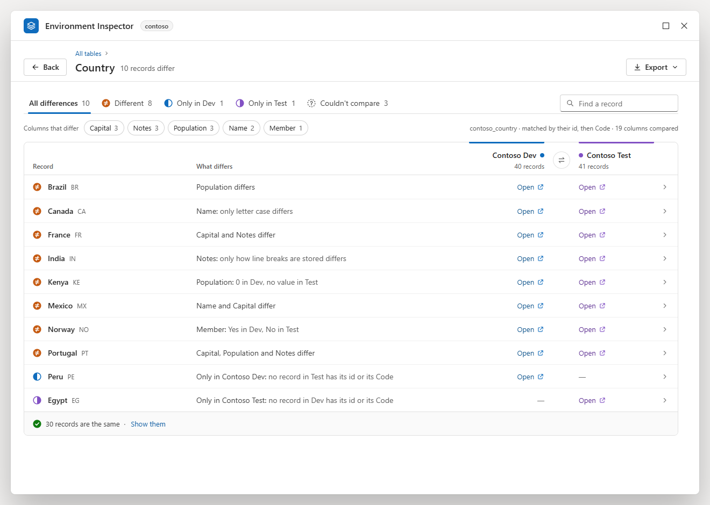

*Country's records (D2): **Back** and "All tables ›", the title "Country" and "10 records differ"; the tabs with their
icons and counts (*All differences* 10, *Different* 8, *Only in Dev* 1, *Only in Test* 1, *Couldn't compare* 3), *Find a
record*; "Columns that differ" as chips (*Capital* 3, *Notes* 3, *Population* 3, *Name* 2, *Member* 1) and "contoso_country ·
matched by their id, then Code · 19 columns compared" (its tooltip gives the counts: 37 by their id, 1 by Code); then
the list under its lane heads (Contoso Dev, 40
records; Contoso Test, 41 records): one line per record with its status icon, its name and code, what differs in words
("Population differs", "Name: only letter case differs", "Capital and Notes differ", "Population: 0 in Dev, no value in
Test", "Member: Yes in Dev, No in Test", "Only in Contoso Dev: no record in Test has its id or its Code"), **Open** in
each environment or a dash; and at the end "30 records are the same · Show them".*

`dvTablePage` draws the page as level 2 (`#dvL2`, its scroll body `#dvPage`) and `dvRefresh` fills it from `dv`:

* **The tabs** (`d2Tabs`): *All differences*, *Different*, *Only in Dev*, *Only in Test* (in the lanes' order) and
  *Couldn't compare*, each with its icon, its count (`d2Counts`) and a tooltip with its meaning (`d2Tip`); an empty tab
  is greyed but keeps its place; those that don't fit go under a **More** tab (`tabsFit`). There is no *Same* tab: the
  same records are at the end of the list.
* **The column chips** (a toolbar "Columns that differ"): each column that differs in the records, with how many, the
  most first; one at a time, a chip keeps the records that differ in that column, and the tabs' counts follow it; those
  that don't fit go under **+N more**. On a tab without *Different* records the chips are off, and the line stays.
* **Find a record** (`dvSearch`): every value read of a record on both sides (choices and Yes/No by their labels too,
  numbers with or without their grouping) and its line's reason; 150 ms after the last key (`dvTimer`), "8 records
  shown" announced.
* **How its records were matched**, on the right of the chips' line ([12.8](#128-matching-records-datamatch)); a line
  under the tabs when the ids never meet, and the notes of a counted table, of the 500,000-line limit and of the order
  past 100,000 records (`d2Notes`).
* **The list** (`d2Items`, `d2Line`, `listLine`), drawn by the virtual list: its lane heads (each environment's
  records, **Swap**), then one line per record, 44 px: its status icon (the word visually hidden, the meaning as the
  icon's tooltip), its name and, in grey, its match value when it isn't its name ("matched by Team Name" or "matched as
  the root business unit" for those matches), what differs in words (`d2What`: one column's kind, "Capital differs",
  "Capital and Notes differ", an *Only in* record's reason), and **Open** in each lane: the record's form in that
  environment, in a new tab (`recordUrl`, `recordLink`), off with its reason when it can't be opened from here
  ("Can't be opened from here: the snapshot doesn't hold its environment's address", an elastic record kept in a
  partition of its own), or a dash where the record isn't. The records are sorted by status, then name (`dvSort`); past
  `CONFIG.dataSortMax` (100,000) they keep the order they were read in, by status, and a note says so. At most
  `CONFIG.dataGridMax` (500,000) lines are listed (`dvList`).
* **The same records**: "✓ 30 records are the same · **Show them**", which lists them under it (`dv.same`); for a
  counted table, a line says they aren't listed.

Empty states: "Nothing matches the search", "None here", "No differences in Country", or for a table not compared why.
The lines are one Tab stop: ↑, ↓, Page Up, Page Down, Home and End move, Enter opens the record (`d2Open`), → and ← go to
its **Open** links and back. The lane heads stay in view while the list scrolls. A table opens while the run goes on too
([12.13](#1213-running-a-comparison)). Going back puts the focus on the row or the link that opened the table
(`d1Back`).

#### A record's details

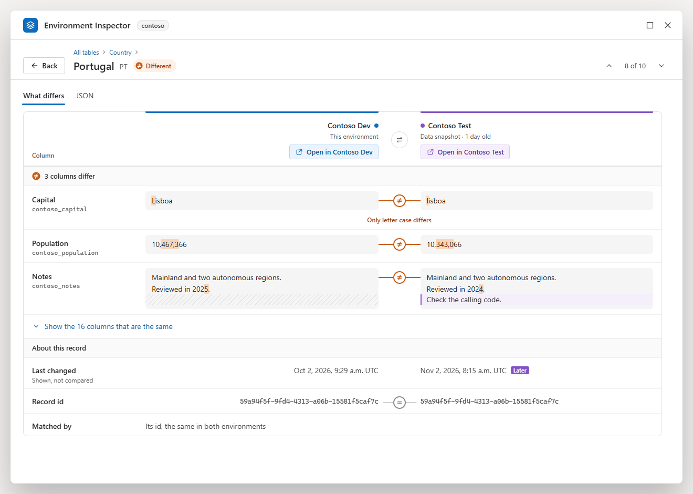

*Portugal, a record of Country that differs (D3): "All tables › Country ›", **Back**, the name, its code "PT" and its
*Different* label, the pager "8 of 10"; the tabs *What differs* and *JSON*; the lane heads ("This environment"; "Data
snapshot · 1 day old") with **Open in Contoso Dev**
and **Open in Contoso Test**; "3 columns differ": *Capital* (the first letter marked, the note "Only letter case
differs" under the pair), *Population* (the digits that differ marked) and *Notes* (a text of two lines and three, shown
whole and level, the line only Test has tinted purple with a hatched gap opposite); "Show the 16 columns that are the
same"; *About this record*: *Last changed* (shown, not compared; *Later* on the later one), *Record id* (= between
them), *Matched by* "Its id, the same in both environments".*

`openRecord` opens a record as a page of its own, level 3 (`#dvL3`, `d3Html`), the table's records kept as they
were behind it. `dv.rec` holds the record shown (`REC0`: its row, its place in the list it was opened from, its tab,
the same columns shown, the JSON tab's environment and form). The header (`d3Head`) holds its name, its match value
in grey, its status as a label, and the pager through the list it was opened from, in that list's order (`recList`,
`dvCtx`: "8 of 10", **Previous** and **Next**, Alt+↑ and Alt+↓, `recGo`, which announces "8 of 10, Portugal").

**What differs** (`d3What`), a side-by-side sheet ("Portugal in Contoso Dev and in Contoso Test"):

* **The lane heads**: each environment, what it is ("This environment", "Data snapshot · 1 day old": `snapLine`, as
  on the overview), and **Open in Contoso Dev** and **Open in Contoso Test**, the record's form in that environment, in
  a new tab; off, with its reason under it, when it can't be opened from here. The head's tooltip adds the address,
  when the snapshot was saved (`savedLine`) and the file's name; a name or line too long for its lane wraps, both bars
  level (as on a table's records).
* **"3 columns differ"**: each column by its display name and its logical name, its tooltip its type; the two values in
  boxes, ≠ between them, the characters that differ marked and those that can't be seen shown (`markText`: a space at
  either end, a line break, a carriage return, another kind of space, an invisible character; the line under the sheet
  says what the marks mean, `MARKS_LINE`); a note under the pair when the difference isn't plain (its kind,
  [12.9](#129-values-and-lookups), without the column's name, in the lanes' order); a text of up to 20 lines shown
  whole and level, a longer one line by line with folds (`sbsLines`, [8.10](#810-the-comparisons-pages-levels-the-header-and-shared-parts));
  a value is cut at 5,000 characters in its box (**Copy** gives it whole), and a pair over 1,000,000 characters says
  it is too large to compare here. A lookup that couldn't be compared for certain has the grey dashed ? between its
  values and a grey note saying why.
* **"Show the 16 columns that are the same"**, folded: quiet values, = between them; a record of many columns draws its
  first 200 at once and the rest just after (`D3_FIRST`).
* **About this record**: *Last changed* (`modifiedon` in UTC, "Oct 2, 2026, 9:29 a.m. UTC", shown, not compared, *Later*
  on the later one), *Record id* (= or ≠ with "Another id", **Copy**), *Matched by* ([12.8](#128-matching-records-datamatch)),
  and for the root business unit, "Its name isn't compared: each environment names it after itself."
* **A record in one environment only** shows its values there ("Its values in Contoso Dev", every compared column) and
  a dashed box in the other lane saying why. **A record that couldn't be compared** says why, and when its match value
  is used by more than one record, lists those records on each side, up to 10 a side, each with its link ("The other
  records with the same Code").

**JSON** shows each environment's record *As compared* and *As stored* (`recordLayers`, `CMP_JSON`), with **Copy** and
**Download**. **Copy** on a value copies it as stored (`recCopy`) and announces "Copied". A record opens while the run
goes on too, from a table already compared ([12.13](#1213-running-a-comparison)). Going back puts the focus on the line
of the record shown last (`dvFocusRow`).

#### Narrow windows

At 800 px and less ([8.1](#81-shadow-dom-and-styles)): an overview's row takes two lines (the name and the result on
the first, each lane's figures on the second, the line of kinds dropped; a table not compared gives its reason in the
result's place), and *Find a table* becomes a button in the first heading; a table's lines take 56 px, what differs
under the name, "Record" over the names; a record's rows put their label above their two values. At 1,000 px and less
a table's tabs take a line of their own, with the chips and the search on the next. The window can be as narrow as
640 px when the page is.

### 12.16 The exports of a data comparison

In this tool **Export** offers its items for the level shown (`dataExportTexts` fits their texts to it): three on the
overview, five on a table's records. Each is made from
what was read, without a request, and built as a `Blob` of parts (one per 1,000 lines), never one text: an export of
200,000 lines is built without an error. The building pauses every 15 ms (`partsBlob`, `dataCsv`, `dataJson` and
`dataSnapOut` are async, through `pauseFrom`), so the window keeps answering while a large file is made. Exports are
made one at a time (`exportOnce(job)`, `exporting`): one asked for while another is being made waits until that one is
done, then is made, never dropped, and a toast says so ("Another export is being made: this one follows when it is
done."). What a file holds is worked out when it is asked for (`job.run` closes over the view then, whatever the
window shows by the time it is made), and the same file asked for again while it is made or waits (`job.key`: the item
and what it holds, a double click) is made once. The CSV's file name and toast are worked out before it is built.

| Menu item | File | Contents |
| --- | --- | --- |
| Excel (CSV), on the overview | `data-compare-<org>-<stamp>.csv` | Every difference, one line per value. Columns: *Table*, *Table name*, *Result*, *Record*, *Match value*, *Column*, *Column name*, *Value in* each environment, *Id in* each environment, *Note*. A *Different* record has a line per column that differs, with its two values and, in *Note*, how it differs when that is not plain ("only letter case differs"); an *Only in* or *Couldn't compare* record one line, with its reason in *Note*; a table not compared one line, *Not compared*, with why (`csvAllLines`) |
| Excel (CSV), on a table's page | `data-compare-<org>-<table>-<stamp>.csv` | The records the page's tab, column chip and search keep, all of them (not only those drawn), and the same records when **Show them** is on: *Result*, *Record*, *Match value*, *Id in* each environment, then each column that differs among them (the chip's first) as two columns, its value in each environment, then *Note* (`csvTableLines`, `dvShown`) |
| Excel (CSV), every compared column, on a table's page | The same name | The same records, with both values of every compared column (`csvTableLines('cols')`) |
| Excel (CSV), every record, on a table's page | The same name | Every record of the table, the same ones too, as the search and the column chip keep them, with both values of each column that differs; for a counted table, every record listed (the same ones are counted only) (`csvTableLines('all')`) |
| Full details (JSON) | `data-compare-<org>-<stamp>.json` | The whole comparison: `format` (`environment-inspector-data-comparison`), `v`, `tool`, both environments, the time, the requests, whether it was stopped; each table with its state, whether it was kept, how it was matched (`match`: `by`, `cols`, and how many records each step matched, `byId`, `bySecond`, with `byName` and `byRoot` when there are any), its lookups' setting, its columns compared (with how many records each differs in), those not compared and why, its counts, and its records that aren't the same, each with its result, name, match value, how it was matched (`matchedBy`: `id`, `key`, `name`, `cols` or `root`), both ids, why, the columns that differ and both records' values; then the notes (`dataJson`). The *Same* records are counted, not listed |
| Data snapshot of this environment | `data-snapshot-<org>-<stamp>.jsonl.gz` | The tables read in full here, as read for this comparison, each with the columns it read, to compare with later ([12.7](#127-data-snapshot-files)). Off after a table was counted, since its records weren't kept: "Not for very large tables: use Save snapshot", or "Not for tables whose size wasn't known: use Save snapshot" when the only tables counted are those (`dataSnapOut`). Its toast gives the file's size as the others do ("Saved *file* (47 KB, 19 tables, 295 records). …") |

Values are written as the window shows them (a choice as "Active (0)"), except numbers (without grouping or currency
code), dates (as stored, ISO 8601) and lookups ("Europe (contoso_region)"). Every cell goes through `csvCell` ([13.5](#135-keeping-spreadsheets-safe)); the files start with a
byte order mark and use Windows line endings. Past 1,048,576 lines, the most Excel shows, the menu item says that Excel
shows the first 1,048,576 lines only. A counted table's file holds the records it lists, and a toast says how many more
were counted only. *All layers (CSV)* and the deletion log are not offered: a data comparison reads no layers and
deletes nothing.

### 12.17 Settings, storage and test hooks

**`CONFIG`.** Compare data's settings come after the others ([4.3](#43-settings-config) has the excerpt, and
[A.1](#a1-config) lists every key). They are first estimates, to be set from measurements, lowered rather than raised.

| Setting | Default | What it controls | Used by |
| --- | --- | --- | --- |
| `dataConcurrency` | 3 | Tables read at once; each table's pages one after another | `readDataSide`, `dataEstimate` |
| `dataPageValues` | 150,000 | Values per page: the page size is this ÷ the fields selected (× 2 with annotations), from 500 to 5,000 records | `dataSpec` |
| `dataLarge` | 50,000 | Records: the *Large* tag; the tables listed in the confirmation | `dataTags`, `dataInfo`, `dataEstimate` |
| `dataVeryLarge` | 1,000,000 | Records: the *Very large* tag and the confirmation | `dataTags`, `dataInfo`, `dataEstimate`, `dataGo` |
| `dataMaxRecords` | 5,000,000 | Records per table in either environment: *Too large* above it, and a read that passes it stops | `dataTags`, `dataOff`, `eachPage` |
| `dataMaxTotal` | 5,000,000 | Records in one comparison (the larger side of each table, added up): **Compare** is off past it | `dataPickBar` |
| `dataConfirmMinutes` | 5 | A read estimated this long or more is confirmed first | `dataGo` |
| `dataRate` | 2,500 | Records read per second per table, for the estimates | `dataEstimate`, `dataTags`, `dataInfo` |
| `dataKeepChars` | 400,000,000 | Characters of records kept whole, both sides; the largest tables past it are counted | `dataKeepPlan` |
| `dataListCap` | 50,000 | Records listed per counted table; the others are counted | `countTable` |
| `dataHeapStop` | 0.7 | The share of the page's memory limit past which a run stops | `dataHeapCheck` |
| `dataGridMax` | 500,000 | Lines a table's records list at once, the same records shown included | `dvList`, `d2Items` |
| `dataSortMax` | 100,000 | Records sorted by status, then name; past it, by status in the order read | `dvSort`, `d2Notes` |

Two other settings matter here: `pageSize` caps every page (`dataSpec` takes the smaller), and `readTimeout` ends a
page that gets no full answer within 5 minutes ([5.4](#54-retries-throttling-and-the-read-time-limit)). The limits of a
data snapshot file are in `DATA_LIMITS` ([12.7](#127-data-snapshot-files)).

**Browser storage** ([8.3](#83-the-choice-screen-and-saved-selections) lists every key):

| Key | Holds |
| --- | --- |
| `environmentInspector:<org>:data` | The last choice in this environment: `{ tables: [settings] }` |
| `environmentInspector:dataSelections` | Compare data's saved selections, apart from the other tools' |
| `environmentInspector:<org>:compare` | Also the tab last used (`mode` can be `'data'`; an older version reads anything but `'compare'` as the scan) |
| `environmentInspector:cmpOrder` | Shared with *Compare environments*: the order of the sides |

Nothing else is kept: not the snapshot, the records, the results, the counts made when tables were ticked or the
settings dialog's state. The Web Lock that a run holds, shared, is named `environmentInspector:run`; it is not storage.

**Test hooks.** `window.__environmentInspector.data` ([4.6](#46-the-test-hooks-on-window__environmentinspector)) gives
the engine to the console and to tests:

| Members | What they are |
| --- | --- |
| `tableList`, `counts`, `exactCount`, `definitions`, `access`, `currencies`, `rootBu`, `rootTeam` | The reads of the choice screen and of a run ([12.6](#126-reading-this-environment)) |
| `columns`, `chosen`, `matchPlan`, `spec`, `typeWords` | A table's columns, the columns chosen, the matching, what is read, a type in words |
| `eachPage`, `line`, `prints`, `readSide` | Reading records: page by page, a record as a line, long values to fingerprints, tables three at a time |
| `writer`, `snapshotName`, `openSnapshot`, `readSnapshot`, `snapshotSide`, `kind`, `checkHead`, `checkLine`, `selection`, `headTable`, `limits` | Data snapshot files ([12.7](#127-data-snapshot-files)) |
| `normCell`, `matchValue`, `diffKind`, `canonNumber`, `amountText` | Values as compared, and an amount or a decimal number as shown ([12.9](#129-values-and-lookups)) |
| `side`, `compare` | Two sides made of tables given whole (`dataSide`), compared (`compareDataSides`) |
| `run`, `save` | A whole comparison with a data snapshot (`dataCompare`), and saving one (`saveDataSnapshot`) |
| `stop`, `resume` | `stopAllReads` and `resumeReads` ([5.5](#55-stop)) |
| `index`, `count`, `keepPlan`, `murmur32` | Very large tables: `DataIndex`, `countTable`, `dataKeepPlan`, the hash |
| `heapCheck`, `memoryStopped()`, `held()` | The memory guard, whether it stopped the run, and what the run holds by its own count |
| `perf()` | The longest redraw of a run's rows and the time of D0's regrouping at the end, in milliseconds (`dvPerf`) |

Two made-up sides, compared in the console without a request:

```js
const D = window.__environmentInspector.data
const def = { name: 'contoso_country', label: 'Country', primaryName: 'contoso_name',
  columns: [{ n: 'contoso_name', l: 'Name', t: 'String' }, { n: 'contoso_code', l: 'Code', t: 'String' }] }
const id = '00000000-0000-4000-8000-000000000001'
const A = D.side({ name: 'Contoso Dev' }, [{ def, rows: [[id, 'Czechia', 'CZ', null]] }])
const B = D.side({ name: 'Contoso Test' }, [{ def, rows: [[id, 'Czechia ', 'CZ', null]] }])
const d = await D.compare(A, B, { tables: [{ t: 'contoso_country' }] })
d.tables[0].counts        // { a: 1, b: 1, diff: 1, onlyA: 0, onlyB: 0, error: 0, same: 0 }
d.tables[0].rows[0].why   // "Name: only spaces at the ends differ"
```

`side(env, tables)` checks each table as a data snapshot's header keeps it (with defaults for the entity set, primary
key, kind, ownership and access) and each record line as a snapshot's are, so a made-up side is as strict as a file.
The checks change `CONFIG` through the same object (for example a lower `dataKeepChars` makes every table counted, a
lower `dataHeapStop` trips the memory guard); reload the page afterwards.

### 12.18 Limits

| Limit | Value | What happens past it |
| --- | --- | --- |
| Records per table, in either environment | 5,000,000 (`dataMaxRecords`) | *Too large*, can't be ticked; a read that passes it stops that table ("more than 5,000,000 records") |
| Records per comparison | 5,000,000 (`dataMaxTotal`) | **Compare** is off, with the footer's reason; **Save snapshot** isn't held by it |
| Records kept whole, both sides | 400 million characters (`dataKeepChars`) | The largest tables are counted ([12.11](#1211-kept-and-counted-tables)) |
| Records listed per counted table | 50,000 (`dataListCap`) | The others are counted; a line under the tabs says so |
| The page's memory | 70% of Edge's limit (`dataHeapStop`) | The run stops; the tables compared stay ([12.12](#1212-memory-dataheapcheck)) |
| A value | 1,000,000 characters (`LONG`) | Kept and compared as its fingerprint and length, on both sides |
| Lines a table's records list | 500,000 (`dataGridMax`) | "Showing the first 500,000 of *n* records. Search or filter to see the others.", under the tabs |
| Records sorted by name | 100,000 (`dataSortMax`) | They are listed by status in the order they were read, and a line under the tabs says so |
| A data snapshot | 4 GB packed, 20 GB unpacked, 25,000,000 records, 2,000 tables, 16 MB a line | Refused when opened ([12.7](#127-data-snapshot-files)); when saving, more than 2,000 tables or a header too long is refused before reading, and a table that would pass 20 GB fails alone |
| A query | 31,000 characters | The table fails before any request: "it has too many columns to read in one request" |
| A page | 1,000 records with a column of multiple lines of text (else up to 5,000) | A page that comes back empty fails the table: "a page of its records was too large for this browser tab" |
| A saved selection | 500 tables, a name of 60 characters | Not saved; an entry past them isn't read |

And what isn't compared at all:

* **One environment live.** The other side is a data snapshot. Its age is shown, and one older than 7 days is marked.
* **Many-to-many tables** are not offered, nor private tables or tables without an entity set.
* **Related records** (notes, attachments, audit history) are not compared, nor images, file content, columns whose
  name suggests a secret, party lists and calendar rules ([12.4](#124-the-columns-compared-left-out-never-read)).
* **The counts** are Dataverse's, up to a day old, for standard and activity tables only; a table without one (virtual
  and elastic tables, every table of an environment that keeps none) is counted when it is ticked, exactly up to 50,000
  records. They set the tags and the estimates only, and the limits are enforced while reading.
* **Read access.** Records you can't read aren't returned. Below organization level, a record alone on the other side is
  *Couldn't compare*, never *Only in*; sharing and hierarchy security can show more than the role grants, and the rule
  stays on the safe side.
* **Matching never guesses.** A value that more than one record has can't match: those records are *Couldn't compare*.
  Letter case and spaces at the ends don't count in matching; accents do.
* **Choices** are compared by number: options made by hand in each environment can have other numbers for the same
  label, which a note points out.
* **A long read** sees records as they are when each page is read: records changed meanwhile may show their old or new
  values, which a note says past 2 minutes.
* **Virtual and elastic tables** depend on their provider: they are read without an order, and one that can't be read in
  full fails alone, with its reason. A virtual table that returns exactly 5,000 records, where some providers stop, is
  pointed out; one that stops at another number isn't. An elastic table's record kept in a partition of its own can't be
  opened by a link.

### 12.19 How it is tested

During development, *Compare data* was checked offline, in a headless Edge, on made-up Contoso environments whose Web
API is answered inside the browser, with data snapshots written both by the tool and by an independent writer (Node's
zlib). That harness is not published: its checks (in `docs_screenshots.mjs`, the script that also makes the screenshots)
are listed here so a change can be checked against the same cases, by hand or in a harness of your own. It has 263
checks of Compare data's own, in sixteen groups, and shares with *Compare environments* the checks of the redesigned
results (below):

| Group | Checks | What they cover |
| --- | --- | --- |
| GG | 31 | The choice screen: the third tab, the table list and the counts (a request that fails is split), the tags and sizes, **Show every table** and the search, the Chosen tables card and its keyboard, a table's settings (the ways to match, **Columns you choose…**, the columns in three groups, lookups), the footer's states, the confirmation of a long read, one result at a time, each tab's own kind of snapshot, the smallest window; and (`GG…e`) the engine's part of them |
| HH | 19 | Saved selections: saving, the menu, applying (with its warning), removing with **Undo**, the last choice per environment, crafted storage, the selections of *Compare environments*, a snapshot's choice taken when it is opened |
| II | 18 | Matching: by id, by a key, *Automatic*'s four cases, values held by records already paired, records without a value, letter case and accents, elastic tables, read access in part, the mirror, pages in another order; the counted path against the kept path; Stop while comparing |
| JJ | 23 | Values by type (decimals, big whole numbers, currency, floating point, no value, choices, several choices, dates, the kinds of text differences), lookups by every rule, long values, columns not compared, exact numbers read from Dataverse, 100 rounds of random changes in a generated pair |
| KK | 23 | Data snapshot files: saving (one gzip stream that Node reads), opening a 300 MB file in under a second, a file cut at a random byte, other formats and versions, markup and `javascript:` in names and values, lines and files too long, records that aren't valid, a broken structure, `__proto__` and `constructor` as names, a file changed after it was opened, Stop while saving |
| LL | 33 | The results: D0 while running and D1 after, the title, the three groups, the rows and their states, the notes, a table's records (its matching line, the tabs, the search, a table without differences, one without records), the lines' words for differences hard to see, 200,000 records drawn on screen only, a record's page for each status ("Another id" a grey note), Back to the line of the record shown last, the JSON tab, the pill, a table's records opened while the run goes on, leaving the page, the Web Lock, a tab that slept, the smallest window, counted tables in the window |
| MM | 9 | The exports: the overview's and a table's CSV, the every-column and every-record CSVs, Full details (JSON), the data snapshot of this environment, counted tables' exports, an export of 200,051 lines |
| NN | 21 | Reading: every request a GET to this environment, page sizes, annotations and the order; three tables at a time; a 503 and a 429 waited out; a table refused (403) or too large failing alone; a column Dataverse refuses; plain reasons; Stop at each step; a sign-in that ends; which tables are counted; the index; the memory guard; the file changed between the two passes |
| OO | 22 | Counts and matching: virtual and elastic tables never sent for counts, a refusal that names a table sent again without it, 0 taken as not known, a ticked table counted exactly (more than 50,000, 5,000 or more, not known), its texts and the footer's; records given twice saved once; keys and chosen columns with lookups to users, teams and currencies; a snapshot without currency codes; Currency's own exchange rate; the root business unit and its default team as one pair; a record matched by its name when its key isn't filled (kept and counted alike); the *Left out* note; a choice's option 0; elastic tables' reasons; the reasons a column is never compared; virtual tables that stop at 5,000; amounts and decimals at their precision; *Date (user local)*; the lookups line of the settings |
| SS | 15 | Safety and robustness: Power Pages values kept as fingerprints; the wider list of secret names; 10,000 long names sorted at once; a header whose counts lie, and blank lines after the end; a long read of the file not taken for sleep; pages of long texts; the maker portal's sign-in ending before the read (a stand-in for the portal); exports built in slices, and a second click ignored; files a reader would refuse; pages not sent again after a 504 or a timeout; the shared Web Lock; a query too long; 403 reasons; **Open in** for elastic records |
| WW, WP | 20 | The window: **Save snapshot** with no table read; the view of a data snapshot being saved; the bookmark clicked again when the solutions failed; footers' tooltips and the over-limit text; "Compare again in a moment." only when a reason can pass; a table's records in short windows, with the lane heads kept in view; chosen tables that keep their height while their columns are read; "1 record"; one period; Previous and Next record, then component again in the scan's details; the progress bar's name; the hint without numbers; Stop's focus; long words in toasts; "No table could be compared"; this environment's own snapshot named once |
| RR, RW | 10 | The last review's fixes: a count still on its way when a run starts (the engine and the window's wait), a snapshot's identity index for unordered tables only, the root's details, a record's environments, long numbers on a record's page, a block that keeps its height when its count arrives, the footer's total as the confirmation's, the footer while counts arrive |
| FR | 2 | The final review's fixes in the window: nothing starts when the window is closed during the wait for counts; the tooltips of a count still on its way and of a table only in the snapshot (with OO9b, a counted table's root pair, and RR3, the root's details) |
| HD | 17 | The release review's fixes: lookups compared through another table's matching named so, also for a table opened during the run; the snapshot's file name in a record's lane head; tables opened while the run goes on with differences, lookups, *Only in* and *Couldn't compare* records; the export menu's first item; the status tooltips; D0's hidden connector words; the matching line and its tooltip; the choice note that names the label; a record's key and id never cut from 801 to 1,120 px and at 900 px and less; two lines with the same name and value told apart by their ids; the snapshot toast's folded reasons; a search that extends the last one; and from the polish round: three exports asked for at once each made in turn, with the toast that says so, and what an export holds fixed when it is asked for; a table's records naming only the records its list draws; the lane heads cut nothing at 1,440, 1,280, 720 and 640 px, their bars level, the snapshot's line the same on D1 and D3 |

**The redesigned results** have 276 checks of their own, run on both comparisons, each named for what it covers (a
suffix says the level: `.d0` to `.d3` for Compare data, `.e`, `.e1` to `.e3` for Compare environments), and 31 more
for the side-by-side parts that D3, E3 and the scan's details share:

| Group | Checks | What they cover |
| --- | --- | --- |
| XA | 24 | Screen readers and keys: the rows' sentences, the grids, the lane heads as column headers (their descriptions only what their tooltips add), names isolated, the announcements, the spinner standing still with *Reduce motion* |
| XB | 48 | **Back** and the levels: Back, Alt+Left, the mouse's back button and Esc on every level of both tabs; the focus going down and up; the page under the window never moved; a level kept as it was left; **Swap** with a line focused |
| XC | 7 | The choice screens' header: the same 76 px header as the results, in each tab, down to 640 by 480 |
| XD | 9 | Running and **Stop**: D0's rows and their states, the step line, what opens while the run goes on |
| XE | 17 | Escaping: names, values and environments from crafted snapshots shown as text everywhere, right-to-left overrides, links only to Dataverse addresses |
| XF | 14 | Tabs, chips, the searches, **Show them**, the Filter, and the menus kept inside the window |
| XG | 1 | Every note of a comparison shown, at the top or under *Good to know* |
| XJ | 21 | Nothing moves: the header, the lane heads and every row at their heights, D0 against D1 and E0 against E1, nothing wider than its box |
| XK | 6 | A comparison stopped, failed or swapped while it runs, then a scan: no page error, the step line still working |
| XL | 17 | Lanes and **Swap**: the sides, their colours, the order kept for both tabs |
| XN | 7 | The notes: an old snapshot, a stop and the memory guard at the top, the rest in their rows |
| XO | 7 | **Open** and **Layers** links in both environments, in new tabs, off with their reasons |
| XP | 9 | Speed: 2,000 tables on D0 and D1, 500,000 lines at display scales 1, 1.5 and 2, a record of 1,000 columns, an overview with 1,000 other solutions and one of 19,600 components |
| XR | 12 | The answer first: every title, figure and sentence against the engine's result |
| XS | 21 | The statuses: each one's icon, colour, shape and word, told apart without colour too, and in a contrast theme |
| XT | 1 | The teal tag giving way to a line's sentence |
| XU | 34 | One rule for an unmanaged layer on every screen and export (a component made in an environment is *Unmanaged: made in Dev*; a managed one changed through an unmanaged solution has the teal tag "over" its solution), the wording of the lists' first sheet, titles and empty lists with a Filter on, the snapshot's age, labels shown as text in one or several languages, the names of a form's and a view's properties, and names from a crafted snapshot isolated or refused; and from the polish round: a component whose managed flag isn't known, made in Dev, said so on every screen and export; the words for one component and for all of them; the lane heads wrapping instead of cut, a long environment name too, both bars level; the version row's dot never starting or ending a line; the overview's exports in the screen's order; choice values in words with "Stored as" tooltips; and from the final review (the sample data's `cmpwords` variant: a plug-in step, a classic workflow, a business rule and a Quick Find view): every property of those and of a form named in words over Dataverse's name, the names that clashed with their values (*Form state*, *Merged with updated layout*, *Status*, *Status reason*, *On or off*), two forms of one thing named apart (*Columns (JSON)*, *Definition (XAML)*) in the list's line and the CSV, the line's verb ("Runs as differs"), *Quick Find view*, a process's language by name, "Stored as" on a component in one environment only, the row heads' tooltips, no name cut at 1,280 px; the *Version* row level at five widths and wrapping between its parts; the overview's lane-head tooltips holding every line; and after it, a process's *Allows other publishers' steps*, whole at 1,280 px, with its line's verb and the CSV's words |
| XV | 7 | Values side by side: marks, notes under a pair, long values, *Later* |
| XW | 14 | Window sizes from 1,440 down to 640 px: what each level keeps and drops |
| SB | 31 | The side-by-side parts: folds that stay open when a page is drawn again, only the page shown held, the lane heads' bars when they stick, a line one side alone has, indents, a large form drawn again in under 200 ms; nested XML at 1,280 px with `>` and `/>` on their own lines, an added attribute that leaves the others unchanged, a value with thousands of changed lines lined up (or said too changed to line up), and a large form and site map drawn again and Swapped without being compared again (200 and 300 ms); a value lined up only in part saying what is drawn ("10 lines differ; a part with too many changes isn't lined up (…)") |

Also: HA (9) for the focus rings and Windows contrast themes (forced colours, a menu item's ring, the title's ring, reduced motion, the overview's top edge in a contrast theme, the pill without its slide, and from the final review the lane heads' dots drawn in a contrast theme on both overviews, a list's first sheet, a component's page and the scan's details); LY (37) and LYR (7) for the *Unmanaged layers* tab in the comparisons' look (among them the pager's announcement, the focus after *Compare with top layer* and *JSON*, Alt+Left and Alt+Right on an open menu, the corner pill after a failed or stopped deletion, the *Managed on top* list without a header tick box, and from the polish round Alt+Right closing a layer picker, the file sentence's "The content of" wording, Stop while minimized, property names in words with their tooltips (a form's *Form type*), labels as text, a long value one layer alone has at its own indent; and from the final review its wrapped rows hanging 2 characters further in and breaking at natural points, at 1,440 and 720 px); ZC1, which fails when a comment of the code cites a plan section or a screen code.

The final review of 2.0.0 added 13 of these: XU9c to XU9j, XU13c, XU13d and XU15 (each with `.env`), LY29 and HA5;
six took new expected text on purpose: XU9 (a form's *Status* and *Form type*, where it expected *Active*), LY26 (the
scan's *Form type* row and its tooltip), LY28 (wrapped rows 2 characters further in than the first, where they were
level with it), XD5b (the tooltip "This environment", "Reading now" and the address, where it was the address alone),
XA2.e and XA2 (every line in the lane heads' tooltips); and XU9b took a new description only. After it, three
property names changed: a form's *Form state* `formactivationstate` (Microsoft's *Form State*; it was *Status*),
*Merged with updated layout* `isairmerged` (it was *Merged with the updated layout*, cut at 1,280 px) and a process's
*Allows other publishers' steps* `iscustomprocessingstepallowedforotherpublishers` (it was
*Other publishers' steps*). XU9, XU9d and XU9j (with `.env`) expect the new names (XU9b's description names
*Form state*), and XU9j also that its five pages cut no name at 1,280 px; XU9k (with `.env`) checks the third name,
and XA2b and XA2b.e that the lane heads' descriptions hold only what their tooltips add.

How the harness runs them: `check` runs every offline check of the tool, the scan's, both comparisons' and the
redesign's (774 in all); `datacheck` runs Compare data's alone; `datapick` only the choice screen's, `dataview` only
the results', and `datacount` only the very large tables' engine checks; `e1check`, `e2check` and `e3check` run
those of Compare environments' overview, lists and component pages alone, `sbsview` those of the side-by-side parts
(`sbslong` only its long values), `pickhead` those of the choice screens' header, `hdlayout` Compare data's narrow
layouts, `a11ycheck` the focus rings and contrast themes, and `commentcheck` ZC1 alone. `scale` compares 1,000,000 records a side, counted and kept, and
measures the time and the memory. `layout` measures the choice screen's cards, Compare data's included, at five window
sizes, and checks that no row moves as the counts arrive; `cmpview` and `mockshots` write screenshots of every level
of both tabs, the second at six window sizes, and `pcmpprobe` those of a comparison's screens at four window sizes
(`pcmpprobe words`: the `cmpwords` variant's list and the pages of its plug-in step, workflow, business rule, Quick
Find view and form, at 1,280 and 720 px). The checks write screenshots of every Compare data screen as they go
(`data-*.png`), and `docs_screenshots.mjs` without a mode makes the guide's images from the same made-up data.

In a test environment, a read-only test (`data_demo.mjs`, not published either) drives the built tool through a
signed-in browser, in parts: the table list and its counts; facts the code relies on, such as how virtual and elastic
tables answer, what the read access check returns, which columns Dataverse lists but refuses, and how numbers are
written; the environment compared with a data snapshot of itself, saved just before (no difference in any table); an
edited copy of that snapshot, with one value changed, one record removed, one record added and a lookup changed (exactly
those differences, in the window, in the engine and in the CSV export); a saved selection; more tables, with every kind
of column, read access in part, elastic and virtual tables (not in its default run, as it reads many records); tables
that can't be read; and that snapshot taken as another environment's, every record with another id (the root business
unit and its default team then matched as one pair). It also checks the counts against Dataverse's own (`$count`,
FetchXML) and against the records paged by id. Every request the tool sends must be a GET, and no page error may occur.
It changes nothing in the environment, and puts the tool's keys in the browser's storage back as they were.
[16.10](#1610-comparing-data) lists checks to make by hand.

---

## 13. Exports

**Export** in the results header offers the files below. Every export is built in the browser from what the scan has
already read: no request is sent. The menu is disabled while a scan or a run is going on. After a comparison, it offers the
comparison's own files instead ([11.7](#the-exports-of-a-comparison)), and after a data comparison the data
comparison's ([12.16](#1216-the-exports-of-a-data-comparison)).

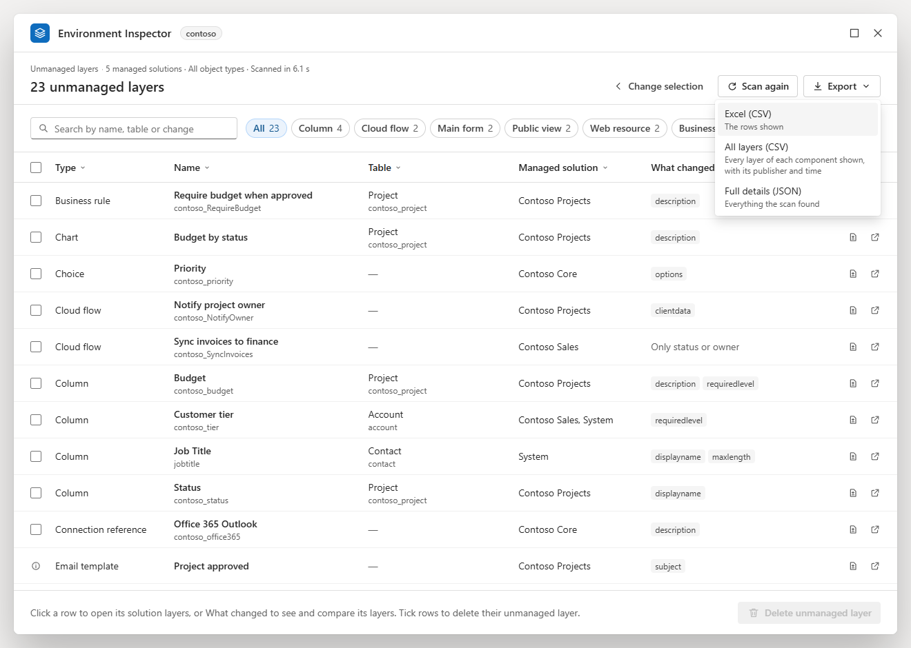

*The **Export** menu before any deletion: **Excel (CSV)** (the rows shown), **All layers (CSV)** (every layer of each
component shown, with its publisher and time) and **Full details (JSON)** (everything the scan found). **Deletion log
(CSV)** is added after the first run of the session. The files are named after the environment and the time in UTC,
for example `unmanaged-layers-contoso-202610151432.csv`.*

| Menu item | Under it | Rows | File name |
| --- | --- | --- | --- |
| Excel (CSV) | The rows shown | The rows the search and filters leave, without deleted ones | `unmanaged-layers-<env>-<stamp>.csv` |
| All layers (CSV) | Every layer of each component shown, with its publisher and time | One per layer of each of those rows | `unmanaged-layers-all-layers-<env>-<stamp>.csv` |
| Full details (JSON) | Everything the scan found | The whole result | `unmanaged-layers-<env>-<stamp>.json` |
| Deletion log (CSV) | Every deletion of this session, with the removed changes | One per component of every run | `unmanaged-layers-deleted-<env>-<stamp>.csv` |

`<env>` is the environment's name (the first part of its address, `ORG`); `<stamp>` is the date and time to the
minute, in UTC, digits only, for example `202610151430` (`stamp`). `download` saves a file through a temporary `blob:`
address and an invisible link, and frees the address a minute later.

**The files of each tool** (besides the details' **Download** of one layer or record, [9.9](#99-copy-and-download)):

| Tool | Files |
| --- | --- |
| *Unmanaged layers* | `unmanaged-layers-<env>-<stamp>.csv`, `unmanaged-layers-all-layers-<env>-<stamp>.csv`, `unmanaged-layers-<env>-<stamp>.json`, `unmanaged-layers-deleted-<env>-<stamp>.csv` (this chapter) |
| *Compare environments* | `compare-<env>-<stamp>.csv`, `compare-<env>-<stamp>.json`, and the snapshot `snapshot-<env>-<stamp>.json.gz` ([11.4](#114-snapshot-files), [11.7](#the-exports-of-a-comparison)) |
| *Compare data* | `data-compare-<env>-<stamp>.csv` (every difference), `data-compare-<env>-<table>-<stamp>.csv` (a table's records), `data-compare-<env>-<stamp>.json`, and the data snapshot `data-snapshot-<env>-<stamp>.jsonl.gz` ([12.7](#127-data-snapshot-files), [12.16](#1216-the-exports-of-a-data-comparison)) |

A snapshot's stamp is the time it was taken, while the environment was read, not the time the file was saved. The
files of a comparison are made from what was read, as the scan's are; the CSV and JSON files of a data comparison are
built in parts, never as one text.

### 13.1 Excel (CSV)

`toCsv` writes the rows of `shown()` that are not deleted: every row that the search and the filters leave, in the
order shown (with the column sort), including rows beyond the 2,000 drawn. When the results have two lists, these are
the rows of the list shown ([8.5](#85-results-search-type-bubbles-and-column-menus)); **All layers (CSV)** takes the same rows.

| Column | Source |
| --- | --- |
| Type | The type as the maker portal names it (`f.type`) |
| Display name, Schema name | `f.display`, `f.schema` |
| Table | Display name and logical name, for example `Project (contoso_project)` |
| Managed solution | The chosen managed solutions the component is in, by name (for a managed layer on top, the covered ones) |
| Managed layers (top first) | The solutions of its managed layers, by name, joined with " > "; empty until its details are read |
| What changed | Every changed property name (not only the first 10), or "Only system values", "Only status or owner", "Layers could not be read"; empty until the details are read. For a managed layer on top, what the layer on top changes |
| Component id | The component's id |
| Solution layers page | The address a row click opens (`layersUrl`) |
| Layer on top | "Active (unmanaged layer)", or for a managed layer on top the name of the solution on top (`onTop.name`). It is the last column, so the others keep their places |

### 13.2 All layers (CSV)

`layersCsv` writes one row per layer of each row of the Excel export, as Solution Layers Explorer's Excel export does,
with the component's own columns in front. It uses `f.layerList`, filled by `readDetails` ([6.8](#68-step-4-confirming-and-reading-the-details)) during the scan or
by **Read N more**. A component whose layers were not read gets one row with "(layers not read)": read them first if you need
them.

| Column | Source |
| --- | --- |
| Type, Display name, Schema name, Table, Managed solution, Component id | As in [13.1](#131-excel-csv) |
| Layer component name | The place's layer name (`Relationship` and `EntityRelationship` for the two places of a relationship) |
| Order | `msdyn_order` (the top layer has the highest) |
| Layer solution (unique name) | `Active` for the unmanaged layer |
| Layer solution | "Active (unmanaged layer)", or the solution's display name |
| Publisher | `msdyn_publishername` |
| Overwrite time | `msdyn_overwritetime` as stored; empty when Dataverse dates it 1900-01-01, as it does the Active layer |
| Changed properties | The number of properties in the layer's `msdyn_changes` |
| Component layer id | `msdyn_componentlayerid` |

### 13.3 Full details (JSON)

`exportJson` writes the scan's whole result object, indented by one space, without two internal parts: the solution
names map and the list of the components step 1 found (`environment`). It is not filtered: deleted findings are
included, with `"deleted": true`. It does not include the version of Environment Inspector.

Its keys are the fields of the result that [6.1](#61-inputs-and-the-result-object) lists: what was chosen, the time and the number of requests, the way
step 1 went (`path`, and `pathWhy` when the rule chose the whole environment because of a Microsoft solution), the parts
that could not be read (`typesFailed`), the types not checked (`noAccess`), the components left out (`outOfScope`,
`cleared`), the notes, `managed`, and the `findings`, each with the fields that [4.5](#45-state-and-globals) lists. `notes` and the details of
`outOfScope` are shown only here. From the chosen solutions, `environmentFindings` is `null` and `outOfScope` holds only
the components step 1 met that belong to other solutions or could not be placed; a note says so. `managed` says
whether the scan looked for managed layers on top, under which chosen solutions (`lower`) and not under which
(`skipped`), and how many candidates it found, turned out not to be covered
(`notOnTop`), did not check (`notChecked`) or could not decide (`notDecided`); each managed layer on top has
`managedTop`, `onTop`, `holderUniques`, `listedIn` and `topKinds` ([6.11](#611-managed-layers-on-top)).

**One layer's data.** The details' *JSON* tab has its own **Copy** and **Download** for the Changes, All properties or
Children of one layer ([9.9](#99-copy-and-download)).

### 13.4 Deletion log (CSV)

The log is described in [10.9](#109-the-deletion-log): one row per component of every run since the page was loaded, with the outcome, the
detail and the unmanaged layer's changes as stored (for a web resource whose content is kept as a file, also that
content, or a note that it could not be read). The final message of each run offers that run's rows alone.

### 13.5 Keeping spreadsheets safe

Every value in the exports comes from the environment, and anyone who can customize it can write text that a
spreadsheet would read as a formula, for example a view named `=HYPERLINK("https://...")`. `csvCell` writes every cell
of every CSV file, the comparisons' too:

`environment-inspector.js`, `csvCell`:

```js
const csvCell = (v) => { let s = String(v == null ? '' : v); if (/^[=+\-@\t\r]/.test(s)) s = "'" + s; return `"${s.replace(/"/g, '""')}"` }   // no spreadsheet formulas
```

* A value that starts with `=`, `+`, `-`, `@`, a tab or a carriage return gets an apostrophe in front, so a spreadsheet
  shows it as text instead of running it. `=HYPERLINK(1)` is written `"'=HYPERLINK(1)"`, and `-1` is written `"'-1"`.
* Every cell is quoted and quotes inside are doubled, so commas and line breaks in values are safe.
* The files start with a byte order mark and use Windows line endings (CR LF), so Excel opens them as UTF-8 with a
  double-click.
* Excel holds at most 32,767 characters in a cell. A long value, such as a form's changes in the deletion log, may be
  cut when the file is opened in Excel; the file itself holds the whole value.

**Reading the files with a script.** Remove the byte order mark, read the cells as quoted CSV, and remove a leading
apostrophe when the character after it is one of `=`, `+`, `-`, `@`, a tab or a carriage return.

**What the exports contain.** Names, ids and values of the environment's components, and in the JSON the
environment's address. They never contain the sign-in: no token, no cookie. Treat them as you treat the environment's
configuration. A data comparison's exports and a data snapshot also hold the values of the records of the tables
chosen, which may include personal data: treat them as you treat exports of your data.

---

## 14. Building and packaging

The product is one source file, `environment-inspector.js`. `build-bookmarklet.mjs` turns it into the three built files that
[2.4](#24-build) lists, all committed to the repository and attached to each release ([18.6](#186-tag-and-publish)): the minified code,
`environment-inspector.min.js`, which can also be pasted into the browser's console ([17.4](#174-running-the-code-without-the-favourite)); the favourite's address,
`environment-inspector.bookmarklet.txt`, a `javascript:` link that carries the minified code compressed; and the install
page, `Install Environment Inspector.html`. This chapter follows the build step by step, then explains the loader in
the link and the size limit, the page's script policy, the version, the environment rules and the install page.

Run the build from the repository's root, after `npm ci` has installed terser and the packages it needs, at the
versions of `package-lock.json` ([2.3](#23-install-the-npm-packages)):

```powershell
npm ci
node build-bookmarklet.mjs
```

`npm run build` does the same as the second line. The last line of the output gives the version and the sizes, for
example `bookmarklet 2.0.0: 297723 characters (697.6 KB unpacked)`.

### 14.1 `build-bookmarklet.mjs` step by step

1. **The version.** It reads `version` from `package.json` and writes it into the code in place of
   `const VERSION = '__VERSION__'` ([14.4](#144-the-version)).
2. **The environment rules.** If `inspector.settings.json` exists next to the script, it checks the file and writes its
   patterns into `CONFIG` ([14.5](#145-environment-rules-inspectorsettingsjson)).

   `build-bookmarklet.mjs`, the replacements and the settings:

   ```js
   let src = fs.readFileSync(path.join(here, 'environment-inspector.js'), 'utf8')
   const put = (from, to) => { if (!src.includes(from)) throw new Error(`environment-inspector.js no longer contains: ${from}`); src = src.replace(from, to) }
   put("const VERSION = '__VERSION__'", `const VERSION = ${JSON.stringify(version)}`)
   const settingsFile = path.join(here, 'inspector.settings.json')
   const settings = fs.existsSync(settingsFile) ? JSON.parse(fs.readFileSync(settingsFile, 'utf8')) : {}
   const RULES = ['developmentEnvironments', 'productionEnvironments']
   if (!settings || typeof settings !== 'object' || Array.isArray(settings)) throw new Error('inspector.settings.json must be a JSON object, as in inspector.settings.example.json')
   // A misspelled name would otherwise be ignored and leave, for example, deleting allowed in a development environment.
   const unknown = Object.keys(settings).filter((k) => !RULES.includes(k))
   if (unknown.length) throw new Error(`inspector.settings.json: unknown setting${unknown.length > 1 ? 's' : ''} ${unknown.join(', ')}. The settings are: ${RULES.join(', ')}.`)
   const applied = []
   for (const key of RULES) {
     const pattern = settings[key]
     if (pattern == null || pattern === '') continue
     if (typeof pattern !== 'string') throw new Error(`inspector.settings.json: ${key} must be a regular expression written as a string`)
     new RegExp(pattern, 'i')   // stops the build on an invalid pattern
     put(`${key}: null,`, `${key}: new RegExp(${JSON.stringify(pattern)}, 'i'),`)
     applied.push(`${key} /${pattern}/i`)
   }
   const local = applied.length > 0
   if (local) console.log(`Built with your environment rules from inspector.settings.json (${applied.join('; ')}): for your organization only, do not publish this build.`)
   else if (fs.existsSync(settingsFile)) console.log('inspector.settings.json names no environment: built without environment rules.')
   ```

   `put` replaces exact text and stops the build when the text is not found, so a reworded line in `environment-inspector.js`
   can never be skipped without notice. The checks stop the build, in this order, on a file that is not valid JSON or not a
   JSON object, on a setting name other than the two rules, on a value that is not a string, and on an invalid regular expression;
   an empty or `null` value is skipped ([2.4](#24-build) gives the messages).
3. **The message.** When at least one rule was applied, the build prints the rules, each as the regular expression it
   built: "Built with your environment rules from inspector.settings.json (developmentEnvironments /^contoso-dev\d*$/i;
   productionEnvironments /^contoso(-preprod)?$/i): for your organization only, do not publish this build." When the
   file exists but sets no rule, it prints "inspector.settings.json names no environment: built without environment
   rules." Without the file it prints neither.
4. **Minify.** terser minifies the code (`ecma: 2020`, two compression passes, names shortened, no comments). The
   short names come from the build's own list (`names`, given to terser as `nth_identifier`): one character, or a
   character and a digit, sometimes more (`a0`, `b7`, `c3x`), so no name terser makes can spell a word by chance.
   Its characters are ordered by how often the code uses them, as in terser's own list.
5. **Spaces in the templates.** The line breaks and indentation kept in the HTML and CSS templates come out of terser
   as `\n` followed by spaces; the build turns each such run into one space (`min.code.replace(/\\n +/g, ' ')`). A
   string that needs a real line break followed by spaces must therefore be built in two parts, as `indentJson` does
   with `'\n' + '  '.repeat(depth)`.
6. **Write `environment-inspector.min.js`.**
7. **Compress.** The minified code is compressed with raw deflate (level 9) and encoded in base64.
8. **Write the link** into `environment-inspector.bookmarklet.txt` ([14.2](#142-the-loader-and-the-size-limit)).
9. **Write the install page** ([14.6](#146-the-install-page)), and print the sizes.

### 14.2 The loader and the size limit

The favourite's address holds a small loader and the compressed code:

`build-bookmarklet.mjs`, the loader:

```js
const loader = `void (async()=>{try{const t=await new Response(new Blob([Uint8Array.from(atob('${packed}'),(c)=>c.charCodeAt(0))]).stream().pipeThrough(new DecompressionStream('deflate-raw'))).text();try{(0,eval)(t)}catch(e){if(!(e instanceof EvalError))throw e;const s=document.createElement('script');s.src=URL.createObjectURL(new Blob([t],{type:'text/javascript'}));s.onerror=()=>alert('This page does not allow Environment Inspector to run.');document.head.appendChild(s)}}catch(e){alert('Environment Inspector could not start: '+e.message)}})()`
```

What it does when the favourite is clicked:

1. `atob` decodes the base64 text into bytes.
2. The browser's own `DecompressionStream('deflate-raw')` unpacks them; `Response(...).text()` reads the result as
   UTF-8 text.
3. The text runs with an indirect `eval` ([14.3](#143-eval-blob-and-the-pages-script-policy)).
4. Any error on the way shows "Environment Inspector could not start: *message*".

`void` makes the whole expression give `undefined`. A `javascript:` address that gives a value would replace the page
with it.

The build then escapes only what a `javascript:` address needs: `%` (so that decoding gives back exactly the code),
`#` and `?` (so that nothing that stores or parses the address can split it there), and characters outside printable
ASCII. The base64 text contains none of them, so the link stays readable.

**The size limit.** Edge accepts a favourite's address of up to about 2 million characters, so the link's size does not
hold back new code. The link is still compressed: it stays short to copy and to keep in a browser's favourites, and
unpacking it takes a few milliseconds when it is clicked, nothing next to the scan's requests. The minified code alone
is about 700 KB; compressed and in base64, the current build is a link of about 297,700 characters. Each kilobyte of
minified code costs about 0.4 KB of link; comments and long names cost nothing (terser removes and shortens them). Check
the size after every build ([18.3](#183-check-the-link-size)).

### 14.3 eval, blob and the page's script policy

Environment Inspector runs inside the page it is started on, so the page's Content Security Policy decides what it may do.

* **Environment pages** (`https://<org>.crm.dynamics.com/...`) have no script policy, and the maker portal's policy
  allows `eval`. The loader runs the code with an indirect `eval`, `(0,eval)(t)`, which runs it in the page's global
  scope rather than inside the loader's function.
* **A page that forbids `eval`** throws an `EvalError`. The loader then puts the code into a `blob:` address and adds a
  `<script>` element that loads it. A policy that allows `blob:` scripts runs it.
* **A page that forbids both** fires the script's error event: "This page does not allow Environment Inspector to
  run."
* **Trusted Types.** The window is drawn with `innerHTML` from escaped text. A page that enforces Trusted Types would
  stop the window from being drawn. Neither the environment's pages nor the maker portal enforce them at the time of
  writing.

The window itself lives in a shadow root, with its styles in a constructed style sheet (or a `<style>` element where
the browser has no constructed style sheets), so the page's styles do not reach it and its styles do not reach the
page.

### 14.4 The version

`package.json` holds the one version number. The build writes it into `VERSION`, and it shows in four places:

| Where | How |
| --- | --- |
| The window | The tooltip of the title "Environment Inspector": "Environment Inspector 2.0.0" |
| The console | `window.__environmentInspector.version` |
| The install page | The footer: "Version 2.0.0 · built 2026-11-21 · 290.7 KB link (697.6 KB unpacked)" |
| The build output | `bookmarklet 2.0.0: ...` |

The exports do not carry it. Code pasted from `environment-inspector.js` without a build shows `__VERSION__` ([17.4](#174-running-the-code-without-the-favourite)).

### 14.5 Environment rules: `inspector.settings.json`

The published build knows no environment names: anyone can delete anywhere they have the rights to, and no
environment is named production. An organization can add two rules at build time, in an optional
`inspector.settings.json` next to `build-bookmarklet.mjs`:

`inspector.settings.example.json`:

```json
{
  "developmentEnvironments": "^contoso-dev\\d*$",
  "productionEnvironments": "^contoso(-preprod)?$"
}
```

Each value is a regular expression, written as a JSON string (so `\d` is written `\\d`), matched without regard to
case against the environment's name: the first part of its Dataverse address, `ORG`. On the maker portal it is the
name of the environment's Dataverse address too, so the rules apply the same way there.

| Rule | In the environments it matches |
| --- | --- |
| `developmentEnvironments` | Deleting is off: `removeLayers` refuses, the Delete buttons are not drawn, every tick box is disabled, an amber *Development* badge sits in the title bar (tooltip "Deleting is turned off in development environments"), and the bottom bar ends with "Deleting is turned off in development environments." |
| `productionEnvironments` | A red *Production* badge in the title bar, and the red note in the confirmation ([10.2](#102-the-confirmation)) |

With the example, `contoso-dev`, `contoso-dev1` and `contoso-dev12` are development environments, `contoso` and
`contoso-preprod` are production, and `contoso-test` is neither. An environment that matches both has deleting turned
off and a *Production* badge.

**Anchor the patterns.** Without `^` and `$`, `contoso` matches `contoso-dev` and `contoso-test` as well.

**What the build checks.** The file must be a JSON object, as in the example, and may hold only these two settings: a
misspelled name would otherwise be ignored and leave deleting allowed in a development environment, so it stops the
build ("inspector.settings.json: unknown setting developmentEnvironment. The settings are: developmentEnvironments,
productionEnvironments."). Each value must be a string that is a valid regular expression; an empty or `null` value
sets no rule. The build then prints the rules it applied, so they can be checked: "Built with your environment rules
from inspector.settings.json (developmentEnvironments /^contoso-dev\d*$/i; productionEnvironments
/^contoso(-preprod)?$/i): for your organization only, do not publish this build." A file that sets no rule prints
"inspector.settings.json names no environment: built without environment rules.", and the build is the same as one
without the file. [2.4](#24-build) lists every message that stops the build.

`IS_DEV` and `IS_PROD` are computed once, when Environment Inspector starts. Changing `CONFIG.developmentEnvironments` from the
console afterwards has no effect.

**Never publish such a build.** The file is not published (`.gitignore` lists only the files that are), but the built
files are, and a build made with the file carries its patterns. Build your organization's copy in a separate folder
([15.1](#151-name-your-development-and-production-environments)), and check every release build ([18.4](#184-check-that-no-local-settings-were-used)).

### 14.6 The install page

`Install Environment Inspector.html` is a small page, written by the build, with:

* a short description of the three tools, *Unmanaged layers*, *Compare environments* and *Compare data*;
* **Install**: "Show the favourites bar (Ctrl+Shift+B)." and "Drag this button onto the favourites bar:", followed by
  the **Environment Inspector** link; for when dragging does not work, the link in a read-only text box with a
  **Copy** button, to paste as the address of a new favourite named *Environment Inspector*;
* **Use**: five steps (open a page of the environment, or its Solutions page in the maker portal; click the
  favourite; *Unmanaged layers*: choose the managed solutions and **Scan**, then filter, open, export, or tick
  components and delete; *Compare environments*: **Save snapshot** in one environment, then in the other open that
  file under **Compare with** and **Compare**; *Compare data*: the same with the tables you choose, **Save snapshot**
  in one environment, then **Compare** with that file in the other);
* a red note: deleting cannot be undone, what it does, that each component is checked before and after, and that a
  log can be downloaded. A build with `developmentEnvironments` adds "Deleting is turned off in development
  environments.";
* the footer: version, build date and sizes.

The page needs no server: open the file from disk. (GitHub shows an HTML file as source text, so download it first.)
A new version replaces the old favourite: drag the new link and remove the old one, or paste the new address into it.

---

## 15. Customization recipes

Each recipe gives the goal, the places to change, and how to check the result. After any change to
`environment-inspector.js`, run `node build-bookmarklet.mjs`, check the link size ([18.3](#183-check-the-link-size)), and install the new link: the old
favourite keeps the old code.

Many limits can also be tried without a build: `window.__environmentInspector.config` is the live `CONFIG` object ([15.2](#152-change-limits-and-timings)).

### 15.1 Name your development and production environments

**Goal:** no deleting in development environments, and a red warning in production ones, for your organization only.

1. Make a copy of the repository folder for your organization's build, so that the files you commit are never built
   with your rules.
2. In the copy, copy `inspector.settings.example.json` to `inspector.settings.json` and write your patterns ([14.5](#145-environment-rules-inspectorsettingsjson)).
3. Try the patterns against your environments' names in `node`, started in that folder:

   ```js
   const s = require('./inspector.settings.json')
   const dev = new RegExp(s.developmentEnvironments, 'i'), prod = new RegExp(s.productionEnvironments, 'i')
   for (const n of ['contoso', 'contoso-preprod', 'contoso-dev', 'contoso-dev2', 'contoso-test']) console.log(n, dev.test(n), prod.test(n))
   ```

   With the example patterns: `contoso false true`, `contoso-preprod false true`, `contoso-dev true false`,
   `contoso-dev2 true false`, `contoso-test false false`.
4. Run `node build-bookmarklet.mjs`. It prints the rules it applied: "Built with your environment rules from
   inspector.settings.json (developmentEnvironments /^contoso-dev\d*$/i; productionEnvironments /^contoso(-preprod)?$/i):
   for your organization only, do not publish this build." Check that both of your rules are listed. An invalid
   pattern stops the build with the regular expression's error, and a misspelled setting name with "inspector.settings.json:
   unknown setting ... The settings are: developmentEnvironments, productionEnvironments." If it prints
   "inspector.settings.json names no environment: built without environment rules.", the file sets no rule (both values
   empty or `null`).
5. Share the install page of that build inside your organization only.

**Check:** in a development environment the title bar shows *Development*, no Delete button is drawn and the tick
boxes are disabled. In a production environment the title bar shows *Production* and the confirmation has the red
note. The install page says "Deleting is turned off in development environments."

### 15.2 Change limits and timings

The limits that are meant to be changed are in `CONFIG`, at the top of `environment-inspector.js`. [Appendix A.1](#a1-config)
lists every key. The ones changed most often:

* **`autoDetails`** (500): *What changed* is read during the scan for this many findings; **Read N more** reads this
  many at a time. Higher means longer scans of environments with many findings.
* **`maxRows`** (2,000): rows drawn in the list. The exports include every row anyway.
* **`maxRemovePerRun`** (100): the most components in one run. A run of 100 takes about 15 minutes.
* **`concurrency`** (8) and **`detailConcurrency`** (6): requests in flight at once, and components whose layers are
  read at once. Dataverse allows 52 concurrent requests per user, shared with every other tab and tool of that user;
  keep these low.
* **`readTimeout`** (5 minutes): a read with no full answer by then is ended and not sent again.
* **Compare data's limits** (`dataMaxRecords`, `dataMaxTotal`, `dataKeepChars`, `dataListCap`, `dataHeapStop`,
  [12.17](#1217-settings-storage-and-test-hooks)): lower them on machines with less memory; raise them only after a
  test with tables as large, watching the page's memory. `dataRate` sets the estimates only. `dataGridMax` and
  `dataSortMax` bound a table's list of records; `listMaxPx` is tied to how Blink lays out, so leave it as it is.

**Trying a value without a build.** In the console of the page (F12 → **Console**, top frame), for example:

```js
window.__environmentInspector.config.autoDetails = 50
```

Every key except the two environment rules is read where it is used, so the change counts from the next scan or run
until the page is reloaded. To keep it, change `CONFIG` and build.

Other limits are written in the code where they are used:

| Limit | Value | Where |
| --- | --- | --- |
| Attempts per request | 6 | `requestOnce` |
| Pause before a read is tried again after a network error, 502 or 503 | 2, 4, 8, 16, 32 seconds | `requestOnce` |
| Retries of a read after 500 or 504 (usually a server timeout) | 1, after 3 seconds | `requestOnce` |
| Pause after 429 | Retry-After, or 2, 4, 8, ... seconds; one pause shared by every request | `requestOnce` |
| Maker portal token: least time left to connect, to send a request | 120 seconds, 30 seconds | `connectMaker`, `requestOnce` |
| Maker portal environment check | 30-second time limit per address | `connectMaker` |
| Confirmation's sign-in warning | Under 60 seconds + 20 seconds per component | `confirmDelete` |
| Customization lock | 10 seconds, up to 5 retries | `removePlace` |
| Ids per solution component request | 50 | `scan` |
| Tables per metadata request, requests at once | 100, 2 | `scan` (`readMeta`) |
| *Managed layers on top*: ids per request, tables per request for forms, views and charts, relationships per request | 50, 20, 25 | `scan` (`look`) |
| Pages per query | 2,000 | `getAll` |
| Names listed in a failure | 20 | `scan` (`someOf`) |
| Places whose full layers are kept for the details | 20 | `fullLayers` |
| Characters of a value compared, lines of a long value drawn | 1,000,000, 3,000 | `lyRowOf`, `sbsLinesHtml` |
| Differing lines compared line by line | 2,000 edits per stretch, then lined up on the lines found once on each side (40 levels deep) | `diffLines` |
| XML laid out | Up to 3,000,000 characters and 200,000 lines | `prettyXml` |
| JSON highlighted | Up to 500,000 characters | `highlightJson` |
| Values listed in a column menu | 300 | `renderPop` |
| Estimate per component before the first is done | 8.5 seconds | `timeLeft` |
| Messages | 5 seconds, 8 seconds with an action | `toast` |
| Smallest window | 720 x 560 pixels | `MIN_W`, `MIN_H` |
| Compare data: tables per count request, requests at once | 100, 2; a failing request split, at most 8 more requests per 100 tables | `dataCounts` |
| Compare data: tables per definition request, requests at once; read access checks at once | 10, 4; 4 | `dataDefinitions`, `dataAccess` |
| Compare data: a page that still fails | Tried twice more, 30 seconds apart | `eachPage` (`DATA_LIMITS`) |
| Compare data: a data snapshot | 4 GB packed, 20 GB unpacked, 16 MB a line, 25,000,000 records, 2,000 tables | `DATA_LIMITS`, `checkDataHead` |
| Compare data: a slice of matching or comparing | About 15 ms | `slicer` |
| Compare data: lines kept for a record's reason, records listed per other value | 1,000 different lines a table; 10 records a side | `pairer`, `recordOthers` |
| Compare data: the searches | 150 ms after the last key | `dvTimer` |
| The comparisons' long lists: rows drawn | Those in view and 15 above and below; a list's lines 44 pixels (56 at 800 px and less), an overview's rows 69 | `vlist`, `d1Height`, `d2Height`, `e2Height` |
| Compare environments: lines per type in a list, then per **Show more** | 100, then 500 | `e2Items`, `e2More` |
| Compare environments: a fold of other solutions drawn | 40 rows at once, then 150 a frame | `e1FoldFill` (`E1_CHUNK`) |
| Compare data: same columns drawn on a record's page at once | 200, then 200 at a time | `d3Html` (`D3_FIRST`) |
| Compare data: a long run | Leaving the page asks after 10 seconds; a gap of 70 seconds is sleep | `longRun`, `napWatch` |
| Compare data: a saved selection | 500 tables, 60 characters, 1,500 columns in `out` and in `add` | `dataSelection` |

**Check:** for page sizes and concurrency, watch the **Network** tab ([17.2](#172-the-network-requests-to-look-at)); for the details' limits, open a large
form's details.

### 15.3 Add a component type

**Goal:** a component type the scan does not read, or reads under the wrong name, is found, named and linked.

**First, check whether it is needed.** Each scan reads `solutioncomponentdefinitions` ([6.2](#62-step-1-from-the-chosen-solutions-or-the-whole-environment)) and adds
every type that has a `primaryentityname` and is not in `CLASSIC`, with the definition's name as the layer name and the
table's display name as the label. Most newer types work that way. Add a type to `CLASSIC` when the definition has no
table, when its name is not the name Dataverse files the layers under (email templates, for example, are filed under
`Template`; the name `EmailTemplate` returns no layers), or for a better label. A definition whose table is already in
`CLASSIC` adds no type: its number is read as the classic one (`same`, `codeOf`).

**How email templates are wired**, as an example: their entries, taken from the four places that name type 36.

```js
36: ['template', 'Template', 'Email template'],   // CLASSIC: table, layer name, label
36: ['title', null],                              // NAMES: display name column, schema name column
36: 'Email templates',                            // CODE_GROUP: the object type group
const undeletable = new Set([36])                 // Dataverse does not delete their unmanaged layer
```

**The maps**, all near the top of `environment-inspector.js` except the last three:

| Map | Entry | Needed when |
| --- | --- | --- |
| `CLASSIC` | `<n>: ['<table>', '<LayerName>', '<Label>']`; table `''` for a type with no component table (found by the solution summary only) | See above |
| `NAMES` | `<n>: ['<display column>', '<schema column>']` | The primary name is not the right display name, or no `uniquename`, `schemaname` or `connectionreferencelogicalname` column holds the schema name |
| `TABLE_COLUMN` | `<n>: '<column>'` | The type belongs to a table: the column that holds the table's logical name |
| `SUBTYPE_COLUMN` | `<n>: '<column>'`, with a label map like `FORM_TYPE` and a line for it in `typeLabel` | The type has kinds, as forms, views and processes do |
| `WANTED_COLUMNS` | Add `'<column>'` | A column named in `NAMES` or `SUBTYPE_COLUMN` is not yet in the list and is not the table's primary name column: the scan looks for these columns only, and leaves out a column it did not find |
| `TYPE_FILTER` | `<n>: '<OData condition>'` | Some rows of the table are not components (as business unit copies of roles) |
| `TABLE_BOUND` | Add `<n>` | The type belongs to a table: it is then read when tables are chosen |
| `TABLE_PARTS` | Add `<n>` | A table held "with all objects" brings the type with it. Step 3b of *Managed layers on top* reads such parts with lists of its own (forms, views, charts, columns, keys, relationships): add the new type there too ([6.11](#611-managed-layers-on-top)) |
| `PART_OF` | `[<n>, <component type>, '<its column for the component>']` | The type has no rows of its own in component lists and belongs to a component, as step images belong to their step: a scan from the chosen solutions then reaches it through the components their lists name ([6.2](#62-step-1-from-the-chosen-solutions-or-the-whole-environment)) |
| `BY_TABLE` | `[<n>, '<its column for the table>']` | The type belongs to a table and may have no rows of its own in component lists: a scan from the chosen solutions then reads it by the tables their lists name |
| `CODE_GROUP` | `<n>: '<group>'` | The type belongs to an object type group other than *Other* ([15.6](#156-change-which-object-types-are-offered)) |
| `PART_SEGMENT` | `<n>: '<segment>'` | A table part whose maker portal page is `.../objects/entities/<table>/<segment>/<id>/layers` |
| `CLASSIC_PAGE` | Add `<n>` | The maker portal has no layers page for the type: links open the classic *Solution layers* page |
| `undeletable` | Add `<n>` | Dataverse refuses to remove the type's unmanaged layer |

`METADATA` holds tables, columns, relationships and keys, whose tables have no `ismanaged` column. Do not add to it.

**Finding the values.** In the address bar of a browser signed in to the environment (a Web API GET shows its JSON),
or in the console:

1. The type number: `https://contoso.crm.dynamics.com/api/data/v9.2/solutioncomponents?$select=componenttype&$filter=objectid eq <component id>`.
2. Its definition: `.../solutioncomponentdefinitions?$select=name,primaryentityname&$filter=solutioncomponenttype eq <n>`.
3. The component table must have `ismanaged` and `solutionid`:
   `.../EntityDefinitions(LogicalName='<table>')/Attributes?$select=LogicalName&$filter=LogicalName eq 'ismanaged' or LogicalName eq 'solutionid'`
   must list both. A table without them cannot be read row by row: its number goes to `typesWithoutColumns` in the JSON
   export, and only the solution summary can find its components.
5. Whether a solution's component list names its components:
   `.../solutioncomponents?$select=objectid&$filter=componenttype eq <n> and _solutionid_value eq <solution id>`, for a
   solution that holds one. When lists don't name them, add the type to `PART_OF` or `BY_TABLE`, or a scan from the
   chosen solutions won't reach them.
4. The layer name: with Environment Inspector open, try names in the console until layers come back, starting with the
   definition's name:

   ```js
   await window.__environmentInspector.getLayers('<component id>', '<LayerName>')
   ```

   An empty list means a wrong name (or no layers).

**Check:** change a component of that type in a test environment, build, scan its solution: the row has the right
type, name, table and object type group; its details show the layers; its link opens its layers page; and, in the test
environment, deleting it gives *Deleted*. Scan it both ways, with `config.scanPath` set to `'solutions'` and then
`'environment'` ([16.2](#162-scan-checks)): the same row both ways.

### 15.4 Change texts

There is no separate file of texts: every text is written where it is used in `environment-inspector.js`, mostly in the
window's HTML template (`app.innerHTML`), in the functions that draw (`renderPickBar`, `syncSelection`,
`renderBanners`, `renderResults`, `titleText`, `rowHtml`, `renderSheetHead`, `lyCompare`, `lyRowOf`, `topNote`, `confirmDelete`,
`runDelete`; for both comparisons `lvHead` and the shared parts' callers; for a comparison `e1Rows`, `e1SolRes`,
`e1OtherRow`, `cvNotes`, `e2Head`, `cvSay`, `e2Items`, `cvDetail`, `e3Head` and `e3What`; for a data comparison
`dataPickBar`, `dataTags`, `dataInfo`, `openTableSettings`, `confirmLarge`, `readProgress`, `d0RowHtml`, `d1Title`,
`d1RowHtml`, `d1Why`, `d1Items`, `d2What`, `dvRefresh`, `d2Notes`, `d3Head`, `d3What` and `dataNotes`) and in `STATUS`, `PROP_LABEL`, `PROP_MORE`, `PROP_KIND` (a new name that names several things also goes in `PLURAL`), `VALUE_LABEL`, `VALUE_MORE`, `SPECIAL_TIPS`, `NO_DELETE`, `noDeleteText`, Compare data's `OPT_COLS`,
`NEVER_COLS`, `TYPE_WORDS`, `TYPE_SENTENCE`, `kindLine`, `notCompared`, `aloneReasons` and the file messages of [12.7](#127-data-snapshot-files), and the alerts
at the top. The install page's texts and the loader's two alerts are in `build-bookmarklet.mjs`. Search for the
text and change it there. Keep the style of the others: plain words, sentence case, Canadian spelling.

**Texts the code looks for.** A few texts are also matched by the code. Change both sides together:

| Text | Written in | Matched in |
| --- | --- | --- |
| "does not allow deleting the unmanaged layer" | `removePlace` | `runDelete`, to add the type to `undeletable` |
| "could not be read" | `readDetails`, `loadDetails` (`f.changed`) | `scan`, to decide that a component could not be placed |
| "you stopped the run" | `removeLayers` | `statusCell` (not shown in the row) and `runDelete` (ticked again) |
| "sign-in" or "session" | The two session-expired messages | `renderResults`, to show "Your sign-in has expired" |
| "Only system values", "Only status or owner" | `readDetails` | `SPECIAL_TIPS` (their tooltips) |
| The outcome names (`Deleted`, `Not attempted`, ...) | `removeLayers` | `STATUS`, `runDelete`'s counts, the log |
| The object type group names | `GROUPS` | Saved selections and the remembered choice keep only names in `GROUPS` |
| "Unmanaged changes, " at the start of a failure | `readSide` | `cvNotes`, which names the part without it |
| "*n* in *environment* and *m* in *environment*" at the start of a reason, and "Not in " | `compareSides` (a component that couldn't be matched for certain; `whyOnly`) | `cvDetail` and `cvSay`, which write what differs with the short names |
| "The solutions that hold " at the start of a failure | `definitions` ("The solutions that hold each component: ...") | `cvNotes`, which gives it a note of its own |
| "about *n* min left", "less than a minute left" in the step line | `readProgress` | `syncMini`, which copies the time left into the pill |
| "Not compared: " at the start of a table's state | `notCompared` | `stateWords`, which writes "Exchange rate wasn't compared: stopped." on its records' page |
| A table's reason ("security role", "busy", "HTTP 503") | `readWhy` | `d1Why`, which gives a table not compared its one sentence on the overview |
| "*column*: " at the start of a kind's line | `kindLine` | `exportNote`, which writes the CSV's *Note* without it |
| ": HTTP *status* *message*", "network error", "the answer was not JSON" in an error | `requestOnce` | `readWhy`, which says why a table couldn't be read in plain words |

Dataverse's own texts are matched too ("Resource not found for the segment", the lock and 0x8004f059 errors in
`removePlace`, `CheckPrivilege` in `scan`, a column refused in `$select`, "attribute with Name = ..." or "property named ...",
in `leaveOut`). Those come from Dataverse and must not be changed.

**Line breaks.** The build turns a line break followed by spaces into one space ([14.1](#141-build-bookmarkletmjs-step-by-step), step 5).

**Check:** build, open the screen that shows the text, and check that no row, button or bar now cuts it off: most
texts sit on one line with an ellipsis.

### 15.5 Change the look

**Where:** `STYLE`, the style sheet of the window, and `P`, the icons. [8.1](#81-shadow-dom-and-styles) describes both: the Fluent 2 design
tokens (custom properties on `.app`) with their values and uses, the colours written directly, the type, the shapes
and depth, the icons and the container query for narrow windows.

* **A colour** of the window: change its custom property on `.app`; every control uses the tokens. The colours written
  directly are found by searching `STYLE` for them. The deleting pill (`.mini`) lies outside `.app` and has its own
  colours. The window has one colour scheme, light, and no dark theme.
* **A status's colour:** `--dif`, `--lay`, `--unk`, `--same` with their `-t`, `-bg` (and `--dif-m`, `--lay-s`,
  `--unk-s`) forms. Each status is told apart by its shape and its word as well as its colour; keep red for deleting and
  errors only, and *Different* the only warm status, so *Different* and *Couldn't compare* never look alike.
* **An icon:** add or change its path data in `P` (a 20 by 20 grid, drawn with a stroke by `icon(name, size)`). A
  status icon is in `ST_SVG` (a 16 by 16 grid, drawn by `stIcon`): draw its parts with the classes `d` (a disc),
  `r` (a ring), `gs` and `gf` (a white glyph, stroked or filled) and `q` (an outline), which the contrast-theme rules
  know.
* **A narrow window:** `@container panel (max-width:1040px)` hides the second count of the results title next to the
  list switch, and blocks of `@container panel (max-width:900px)` hold the choice screen's rules and the search box
  after a scan with *Managed layers on top*. The results grid keeps a minimum width of 1,000 pixels and scrolls sideways
  below it. The comparisons' pages, the page headers and the scan's details have their rules at 1,120, 1,000 and 800
  pixels of panel ([8.1](#81-shadow-dom-and-styles)); the virtual lists read the 800 px switch from the CSS (`--rs-n`), so a list's heights
  and its CSS never disagree. *Compare data*'s choice screen has rules below 900 and 800 pixels of panel
  ([12.2](#122-the-choice-screen)).
* **The comparisons' colours:** `--ea` and `--eb`, with their `-t`, `-bg` and `-s` forms, on `.app`: one colour for
  each environment ([8.10](#810-the-comparisons-pages-levels-the-header-and-shared-parts)), in both comparisons. Keep
  them apart from the statuses' colours, which only *Only in* shares with them.
* **A short window:** `@container rcol (max-height:600px)` keeps only the title rows of the two option cards of the
  choice screen (with tables chosen, the tables card keeps one line, `.tb-short`, and the object types' note is
  hidden). A query without a name applies to the nearest container: a rule about the whole window names
  `panel`, because inside the right column of the choice screen the nearest container is `.rcol` (the Layers tab's
  queries have no name and measure `.ltw`, [9.8](#98-layers-and-json-tabs-children-tables)).
* **Motion:** `@media (prefers-reduced-motion:reduce)` turns the animations off; add any new animation to that rule.
* **No jumps:** nothing is inserted above content once it is drawn, placeholder rows have the size of real rows, and
  texts that change keep a minimum width ([8.2](#82-views-and-rendering)). On the comparisons' pages, the header is 76 px on every level and
  the rows have fixed heights, which the virtual lists know (`d1Height`, `d2Height`, `e2Height`): change both together.
  Keep it that way.

**Check:** build, then go through every state: the choice screen of each tab (wide and narrow), scanning, results, a
column menu, the scan's details (each tab, a layer picker), the confirmation, a run, the pill; a comparison's run (E0),
its overview, a list and a component's page; *Compare data*'s choice screen, a table's settings, the confirmation of a
long read, a data run (D0), the overview, a table's records, a record's page and a record of one environment only;
**Back** from each level; each page at 1,440, 1,280, 1,000, 800, 720 and 640 px wide; and the messages
([A.5](#a5-messages)). Compare screenshots before and after.

### 15.6 Change which object types are offered

**Where:** `GROUPS`, `TYPE_SECTIONS`, `CODE_GROUP`, `groupOf`, `typeWanted` and `TABLE_GROUPS` ([4.4](#44-constant-tables-classic-names-metadata-groups-and-others) and [6.5](#65-object-types-and-tables) show
them).

| Name | What it is |
| --- | --- |
| `GROUPS` | Every object type group. Also the names kept in saved selections and the remembered choice |
| `TYPE_SECTIONS` | How the choice screen arranges the groups, under headings (Data; Forms and views; ...) |
| `CODE_GROUP` | Type number to group |
| `groupOf(f)` | A finding's group: forms split into Forms and Dashboards, processes into Business rules, Cloud flows and Other processes, connection references found by their layer name |
| `typeWanted(code, kind, groups)` | Whether a type must be swept for the chosen groups. Must agree with `groupOf` |
| `TABLE_GROUPS` | The groups still offered when tables are chosen (those that can belong to a table) |

**Example: a group of its own for custom APIs**, found by their layer name as connection references are (new code;
check the definition's name in your environment first, [15.3](#153-add-a-component-type)):

```js
const isCustomApi = (kind) => /^customapi$/i.test(kind || '')
// in groupOf, before the last line:
if (isCustomApi(f.kind)) return 'Custom APIs'
// in typeWanted, before the last line:
if (isCustomApi(kind)) return groups.has('Custom APIs')
```

Then add `'Custom APIs'` to `GROUPS` (before `'Other'`) and to the Automation section of `TYPE_SECTIONS`. Custom APIs
belong to no table, so `TABLE_GROUPS` stays as it is.

A group that is renamed or removed drops out of saved selections and of the remembered choice the next time they are
read. Tell people to save their selections again.

**Check:** the choice screen shows the new group; scanning with only that group ticked lists only its components; the
results' Type column and bubbles are unchanged (they show types, not groups).

---

## 16. Testing your changes

Test every change in a development or test environment, never in production, in Edge with the developer tools open
(F12). The repository holds no automated tests: the harness used during development is not part of the published
project. It has two kinds of tests: offline checks that run the built tool in a headless Edge against made-up Contoso
environments answered inside the browser (774 checks: the scan's, with both ways of its step 1 compared field by
field, the comparisons' rules and windows, and the checks of their redesigned results, [12.19](#1219-how-it-is-tested)), and tests that
drive a signed-in browser against a test environment. [16.9](#169-comparing-environments) and
[12.19](#1219-how-it-is-tested) say what they cover for the comparisons. Its modes (`node docs_screenshots.mjs <mode>`, from `tests/`): `check`
runs all 774 checks; narrower ones run a part while working, each also part of `check`: `scancheck` (the scan's),
`paths` (the scan's two ways), `lyview` (the *Unmanaged layers* tab in the comparisons' look), `lyreaders` (the
test-environment tests' readers of the scan's details, on the made-up screens), `sbsview` (the side-by-side parts),
`cmpcheck` (*Compare environments*'), `cmpdup` (duplicate detection rules listed under the newer numbers 4414 and 4416),
`e1check`, `e2check` and `e3check` (its overview, lists and component pages), `pickhead` (the choice screens'
header), `sbslong` (long values), `a11ycheck` (focus rings, contrast themes, reduced motion), `commentcheck` (the
code's comments), `datacheck`, `datapick`, `dataview`, `hdlayout` and `datacount` ([12.19](#1219-how-it-is-tested));
and `scale` (very large tables, timed, about 4 minutes). Others make files to look at: no mode at all (the docs' images), `shots`, `gif`,
`steps`, `cmpview`, `e2shots`, `mockshots`, `a11yshots` and `pcmpprobe` (screenshots for review, at up to six window
sizes; `a11yshots` in an emulated contrast theme and with the keyboard's focus; `pcmpprobe words` the property names
and values in words of the sample data's `cmpwords` variant), `layout` (the
choice screen's cards measured at five sizes), `scangeo` (the rectangles of the scan's screens, written to a JSON file
to compare with an earlier build's) and `baseline` (the screens, every export and the request counts, taken into a
folder, or compared with an earlier take with `--compare`). What a change has to pass is the build
([chapter 14](#14-building-and-packaging)) and the checklists below.

Prepare:

* a test environment where you may change and delete customizations;
* a managed test solution of your own, with unmanaged layers on its components ([16.1](#161-a-test-solution-of-your-own));
* for *Compare data*, a few tables with records of your own, such as a small custom table of reference data, and a
  second environment or a data snapshot of the same one ([16.10](#1610-comparing-data));
* the **Network** tab of the developer tools, with **Preserve log** on and the filter `api/data/v9.2`;
* the **Console** tab, for `window.__environmentInspector` ([17.1](#171-the-browser-console-and-window__environmentinspector)).

Some checks change how requests behave by wrapping `window.fetch` in the console. Environment Inspector calls the
page's `fetch` for every request, so a wrapper sees them all. Use this only in a test environment, and reload the page
afterwards.

### 16.1 A test solution of your own

1. In a development environment, create a publisher with a prefix of its own (for example `tst`) and an unmanaged
   solution with components of many types: a table with three columns, a 1:N relationship, a main form, two public
   views, a chart, a business rule, a cloud flow, a JavaScript and a PNG web resource, an environment variable, a
   connection reference, a global choice, a security role, an email template, a model-driven app and its site map.
2. Export it as **managed**, and import it into the test environment.
3. In the test environment, change each component there: a column's display name, description and required level; a
   view's columns or filter; a field added to the form; the chart's description; the web resource's content; the
   environment variable's default value; the relationship's cascade delete; the email template's subject; the app's
   description; an area in the site map; the table's display name. Each change puts an unmanaged layer on top.
4. Write the changes down, or script them: after every delete test you put them back.

Some changes create no unmanaged layer: switching a managed cloud flow off, and adding a value to a managed global
choice. A role's privilege changes are not in its layer data: the role's details show only system values.

### 16.2 Scan checks

| Test | How | Expected |
| --- | --- | --- |
| The scan only reads | Scan; Network tab, add the **Method** column | Every request Environment Inspector sends (they carry `Prefer: odata.maxpagesize=5000`; the app sends requests of its own) is a GET, and none goes to `RemoveActiveCustomization` |
| Everything is found | Scan only the test solution | One row per changed component, with type, name, schema name (for the types that have one; email templates have none), table and the solution filled in; the email template without a tick box |
| The same as the maker portal | Click a few rows | Each opens the component's *Solution layers* page in the test solution, with Active on top |
| Only the chosen solution | Scan another managed solution that does not hold the test components | None of them listed |
| Both ways, the same rows | `window.__environmentInspector.config.scanPath = 'environment'`, **Scan again**; then `'solutions'`, **Scan again** (or the console comparison of [4.6](#46-the-test-hooks-on-window__environmentinspector)); then `'auto'` | The same rows and *What changed* both ways; from the solution far fewer requests (`requests` and `path` in Full details JSON) |
| The way the rule picks | Scan the test solution; then the test solution with *System* | Full details (JSON): `"path": "solutions"`, `environmentFindings` `null` and the note that only the chosen solutions were read; then `"path": "environment"` with `"pathWhy": "microsoft"` |
| The step line from the solution | Network throttling **Slow 3G**, scan the test solution | "Reading the component lists of the chosen solutions…", "Checking the components of the chosen solutions (*n* of *N*)…", then the other parts of step 1 as they are still reading, the bar never going back |
| A component list that cannot be read | Network tab → block the test solution's `solutioncomponents?…&$filter=_solutionid_value eq …` request (**Block request URL**), scan it | After about a minute, the amber banner; **Details** names "The component list of *unique name*: … network error …" |
| Object types | Tick only Forms and Views | Only forms and views (dashboards are a group of their own) |
| Tables | Choose the test table | The table and its columns, relationship, form, views and chart; no web resources, roles or apps; those types are not offered while tables are chosen |
| Paging | `window.__environmentInspector.config.pageSize = 50`, **Scan again** | The same rows; more requests (`requests` in Full details JSON) |
| Stop | **Stop scan** during a scan of every solution | Back to the choice screen within about a second, "Scan stopped."; pending reads show as *(canceled)* in the Network tab |
| A part that cannot be read | Network tab → right-click a `msdyn_solutioncomponentsummaries` request → **Block request URL**, scan | After about a minute (the read is tried 6 times), the amber banner "Some parts couldn't be read, so this list might be incomplete."; **Details** names the solution summary with "network error" |
| A read that takes too long | `config.readTimeout = 1000` and network throttling (**Slow 3G**) | "Scan didn't finish", **Details**: "... no answer within ... minutes"; the read is not sent again |
| Details read later | `config.autoDetails = 2`, scan | Only two rows show *What changed*, besides those found by the solution summary alone (always read); the banner "What changed is shown for ... components. ... more aren’t read yet." with **Read 2 more** |
| Drawn rows | `config.maxRows = 5`, scan | The subtitle ends with "the first 5 are drawn"; Excel (CSV) still has every row |

A `config` value set in the console counts from the next scan (**Scan again**). Reset the values you changed, or
reload the page, after each test. For a second opinion on one solution, compare with Solution Layers Explorer
(XrmToolBox); in tests it missed email templates, connection references and relationships' cascade settings, which the
scan finds.

### 16.3 Details checks

| Test | Expected |
| --- | --- |
| What changed of the form | The managed layer under it on the left (grey) and the Active layer on the right (teal, *On top*), each with "Layer *n* of *m*"; `formxml` laid out level by level, an element's several attributes one per line and its `>` or `/>` on a line of its own, its lines level on both sides; unchanged stretches folded ("12 unchanged lines"), unfolded by a click and still open after the same properties are shown or after **Swap** |
| **Swap**, the two pickers | **Swap** puts the other layer on the left, each keeping its colour; with more than two layers each lane's picker lists every layer, the other lane's not to be chosen; with two, the lane heads only say their places |
| *Show the n properties that are the same*, *Show the n system values that also differ* | The same properties and the system values (Modified on, overwrite time) appear and disappear, the focus on the button |
| **Back**, Alt+Left, Esc, *All unmanaged layers* | Back to the list, the focus on the row's **Layers and what changed** button |
| The JavaScript web resource | Its content decoded from base64 and compared line by line |
| The PNG web resource | Both images, each with "image, *n* bytes" under it |
| A web resource whose content Dataverse keeps as a file (its layers hold `contentfileref` in the *JSON* tab) | One GET `webresourceset(<id>)?$select=content,contentfileref` when the details load. One property, `content`, and no `contentfileref` row. With the Active layer's file in effect and the managed layer's file another one: the lead sentence ("The content of *managed layer* can't be read here, ..."); in the managed layer's lane a dashed box, "Its content is kept as a file that Dataverse doesn't give out through the Web API", no content and no Copy; in the Active layer's lane the content (decoded, an XML type laid out, an image shown) with **Copy**; the grey dashed ? between them. Nothing is compared line by line ([9.11](#911-web-resource-content-kept-as-a-file-contentfileref)) |
| A web resource whose Active layer holds its content in the layer while the managed layer keeps it as a file (right after the content is saved through the Web API) | The same `content` row: the managed layer's line gives the reason, the Active layer's content is shown with **Copy**. When both sides can be read (in the layer, or the top layer's file in effect), the row is compared as any other value, and the same base64 kept the two ways is *Same* ([9.11](#911-web-resource-content-kept-as-a-file-contentfileref)) |
| The relationship | **Cascade settings** and **Definition**; the changed cascade on the first |
| Layers tab | Order, solution, publisher, *Managed* or *Unmanaged*, version, overwrite time (in a narrow window, Publisher and Version under the solution's name and no sideways scrolling; for the unmanaged layer, *Last changed* or *Last published* with a date; for a web resource, a view or another component that records it, *Last changed by &lt;name&gt;*, the user also in the tooltip; a form, a column or a relationship without a name), changed properties; **Compare with Active**, **JSON** |
| JSON tab | Changes, All properties and Children of any layer; **Copy**; **Download** gives `<layer>-<id>-<solution>-changes.json` |
| **Copy** a value | The value as stored (pasted into an editor, not laid out); web resource content decoded. Each value's box has **Copy** at its top right, shown on hover and focus, and the toast says "Copied the value in *layer*." ("Copied the content in *layer*." for a web resource's content) |
| Previous and next | Alt+Up and Alt+Down follow the list's order; Escape returns to the row |

The formatting functions can be tried in the console, without a component:

```js
const p = window.__environmentInspector.parts
p.indentJson('{"cascadeMask":9223372036854775807,"b":[],"c":[1,2]}')   // the digits are kept, [] stays on one line
p.prettyXml('<a x="1" y="2"><b>t</b></a>')                            // x and y on lines of their own, <b>t</b> as written
p.scalarText(p.parseJson('[1.0, 1e2, "1.0", 12345678901234567890]'))   // indented; the numbers as written, the text in quotes
```

### 16.4 Deleting checks

Delete only layers of your test solution, and put them back afterwards ([16.1](#161-a-test-solution-of-your-own)).

| Test | Expected |
| --- | --- |
| Tick three rows, sort Name Z to A, **Delete 3 unmanaged layers** | The dialog lists them in the order shown; **Cancel** has the focus; Escape or **Cancel** sends nothing |
| Tick a row, then filter it out | The dialog lists it last, with "hidden by the search or filters" |
| **Delete** | For each component: a GET of its layers, one GET `RemoveActiveCustomizations(...)`, a GET of its layers; for a relationship changed in both places, twice; for a web resource kept as a file, also a GET `webresourceset(<id>)?$select=content,contentfileref` before the removal; no other write. Rows done in the order of the dialog |
| During the run | The row being deleted has a spinner and the list follows it; the bottom bar counts and estimates; Export, Scan again and the filters are disabled |
| At the end | Rows struck through with the green check disc; title and bubbles counted down; "Deleted 3 unmanaged layers." with **Download log** |
| **Stop deleting** after the first | "Stopped: 1 deleted, 2 not tried. The ones not tried are still ticked."; the two rows *Not tried* and ticked |
| A layer already removed (remove one in the maker portal after the scan, then delete it here) | *Skipped*, "It has no unmanaged layer on top of a managed layer any more." |
| The email template | No tick box; an information icon with the explanation |
| Close the window during a run | The pill "Deleting unmanaged layers · *n* of 3 · ..."; selecting it opens the window; at the end "Deleting finished" ("Deleting finished with problems" with a red disc when one wasn't deleted; "Deleting stopped" after **Stop deleting**) |
| Reload during a run | The browser asks whether to leave |
| The log | Download log: this run's rows; Export → Deletion log (CSV): every run; the JSON column holds each place's layer name, result and changes, and for a web resource kept as a file its `content` (base64) or `contentNote` |
| A development environment (build with `inspector.settings.json`, [15.1](#151-name-your-development-and-production-environments)) | No Delete button, tick boxes disabled, *Development* badge |

Two outcomes can be produced with a `fetch` wrapper, pasted into the console before **Delete**:

```js
// Deleted (not checked): the check after the removal cannot read the layers.
const realFetch = window.fetch
let failNext = 0
window.fetch = (url, init) => {
  const u = String(url)
  if (u.includes('RemoveActiveCustomizations')) failNext = 6
  else if (failNext > 0 && u.includes('/msdyn_componentlayers')) { failNext--; return Promise.reject(new TypeError('Failed to fetch')) }
  return realFetch(url, init)
}
```

After about a minute of retries the row shows *Deleted (not checked)*, "The layers could not be read again to check.",
and the message is "Done: 0 deleted, 1 deleted but not checked." The layer is in fact gone: **Scan again** shows it.

```js
// An expired sign-in at the second component (components with one place each, on an environment page).
const realFetch = window.fetch
let reads = 0
window.fetch = (url, init) => (String(url).includes('/msdyn_componentlayers') && ++reads === 3
  ? Promise.resolve(new Response('', { status: 401 }))
  : realFetch(url, init))
```

The first component is deleted, the second is *Not tried* ("The sign-in expired before this component was tried."),
and the message is "Deleted 1. Your sign-in expired, so the rest weren't tried. Reload the page and scan again."
Restore with `window.fetch = realFetch`, or reload.

### 16.5 Window and keyboard checks

| Test | Expected |
| --- | --- |
| Drag the title bar; drag an edge or a corner | The window moves and resizes, never below 720 x 560 pixels (or the page's size) |
| Double-click the title bar, or the maximize button | Maximized; **Restore down** or dragging the title bar restores it; a single click does nothing |
| Reload, click the favourite | The same place and size, the last choice, the column widths |
| Click the page outside the window | The page reacts; the window stays |
| Escape in the window | Clears a search first, then closes a column menu, a menu, a layer picker, the details or a dialog; on a comparison's page below its overview, goes up one level; then hides the window (during a run: the pill); Escape on the page does nothing to it |
| **Back**, Alt+Left, the mouse's back button (the scan's details; a comparison's list, record or component) | Up one level each time, the focus on the row or line you came from; on an overview or the scan's results, nothing; the page under the window never goes back or forward (Alt+Right and the forward button do nothing either; Alt+Left and Alt+Right close an open menu or pop-up, also on the choice screens and the scan's results). Test the mouse's buttons with a real mouse: whether Edge leaves them to the page can't be checked from a script |
| Shift+Tab from a level's title | Reaches **Back** |
| Tab and Shift+Tab | The focus stays in the window (in the dialog while one is open) |
| Solution and table lists | Arrow keys, Home and End move; Space or Enter ticks |
| Menus (Saved selections, Export, More) | Arrow keys, Home, End; Tab or Escape closes and returns to the button |
| Column menus | Escape closes and returns to the header (a first Escape clears the menu's search); Enter in the search keeps only the values found |
| Details | Left and Right move between tabs (the focus on a tab); Alt+Up and Alt+Down move between components; the layer pickers open with Enter, Space or Down and close with Esc or Tab |
| A comparison's overview and lists | One Tab stop each; arrow keys, Page Up, Page Down, Home and End move; Enter opens; Right and Left reach a line's links; a tab or a chip moves with Left and Right and is chosen with Enter or Space |
| A window narrower than 900 pixels | The choice screen's right column narrows and the object types go to one column; the results scroll sideways instead of squeezing a column; type bubbles that do not fit go under **More** |
| Column edges | Drag to resize; double-click, or **Fit to contents**, to fit; **Reset column widths** |
| Windows' animation effects off | No animations; a comparison's spinner is a still ring |
| A Windows contrast theme | Every status icon keeps its shape; the lane buttons have a border; a line one side alone has keeps its edge |
| A screen reader | Hears "Scan finished: 23 unmanaged layers." and "Deleted 3 of 3."; on a comparison's page, each row's sentence, the lane heads as column headers (each name and line once, then only what the tooltip adds, such as the address), "8 records shown", "8 of 10, Portugal", "Copied", "Contoso Test is now on the left" |

### 16.6 The maker portal

| Test | Expected |
| --- | --- |
| Open a managed solution's page in make.powerapps.com, click the favourite | That solution is ticked, with all object types; the bottom bar adds "selected because it's open in the maker portal" |
| The same on an unmanaged solution | "The solution open in the maker portal isn't managed. Select managed solutions to scan." |
| Network tab from the click | `RetrieveCurrentOrganization` to the Dataverse addresses the portal holds a sign-in for, most recently used first, until one has the page's environment id (usually the first); from then on every request goes to that address only. Do not copy the `Authorization` header |
| Click a row | For most types, the *Solution layers* page in the same maker portal (make.powerapps.com or its preview) |
| Change to another environment in the portal, click the favourite | The old window is replaced by one for the new environment (its name in the title bar) |
| Delete from the portal | As [16.4](#164-deleting-checks); with many components ticked late in the sign-in's life, the amber note in the confirmation |
| The portal signed in with two accounts, none active | "This browser holds the maker portal sign-in of more than one account for this environment, ..." and nothing runs |

### 16.7 Large environments and throttling

From the whole environment, the work of a scan follows the number of component types and of components that have an
unmanaged layer, not the size of the environment; from the chosen solutions, it follows what they hold
([6.10](#610-performance-and-scale)). In a test environment with about 950 tables, 37,000 columns and 520 managed
solutions, a full scan took 10 to 16 seconds and about 460 requests; in an earlier test, a page size of 50 found the
same components with about 785 requests.
Dataverse's service protection limits are, per user, 6,000 requests and 20 minutes of execution time in any 5 minutes,
and 52 requests at once. One scan stays far below them, but test runs back to back can reach them: after about a
quarter of an hour of test scans, a scan of over 2,000 requests got 28 answers of 429; the line said "Dataverse asked
to slow down… · going on in *n* s", and the scan finished with the same findings.

| Test | How | Expected |
| --- | --- | --- |
| Paging under load | `config.pageSize = 50`, scan every managed solution | The same findings, more requests, no failed part |
| Throttling | The wrapper below, then scan | The scan pauses about 5 seconds three times (every request waits together), the step line says "Dataverse asked to slow down…" with "· going on in *n* s" in the time's place, then it finishes with the same findings |
| The placement limit | `config.layerCheckLimit = 1` in an environment where several findings have no solution component row | INCOMPLETE, "... there are more than 1, so they were not checked: ..." |
| Delete limit | `config.maxRemovePerRun = 2`, tick 3 | "3 selected · You can delete up to 2 at a time.", Delete disabled |
| Time and requests | Full details (JSON) | `seconds` and `requests` of the scan |

```js
// Three answers of 429 with Retry-After: 5 on the solution summary.
const realFetch = window.fetch
let left = 3
window.fetch = (url, init) => (String(url).includes('/api/data/v9.2/msdyn_solutioncomponentsummaries') && left-- > 0
  ? Promise.resolve(new Response('{}', { status: 429, headers: { 'Retry-After': '5' } }))
  : realFetch(url, init))
```

### 16.8 Managed layers on top

The sample data used to check *Managed layers on top* during development is not part of the published files. Test the
option in a test environment, in one of two ways ([6.11](#611-managed-layers-on-top) explains what it does).

**With Microsoft's solutions.** Microsoft layers its solutions on each other, so every environment already has managed
layers on top among them. In the console, set `window.__environmentInspector.config.managedMicrosoft = true` ([4.6](#46-the-test-hooks-on-window__environmentinspector)). Then
turn on *Show Microsoft and hidden solutions*, choose one of Microsoft's base solutions that others were installed
after, turn *Managed layers on top* on, and scan. Expect many candidates, mostly parts of the tables the solution holds
with all objects: many turn out not to be covered (`managed.notOnTop` in the JSON export), and past 1,000 the amber
banner counts the rest. A few object types keep the scan short. Set `managedMicrosoft` back to `false`, or reload the
page, afterwards.

**With two managed solutions of your own** that ship the same component, the later one installed second:

1. In a development environment, make a solution with a component, for example a JavaScript web resource, and a
   second solution to which you add that same component (**Add existing**). Export both as managed.
2. In the test environment, import the first, then the second. The second's layer of the web resource is now on top
   of the first's.
3. Change the web resource in the first solution, raise its version, export it and import it as an upgrade. The
   second solution's version stays the one in effect: its layer is still on top.

| Test | Expected |
| --- | --- |
| Scan the first solution, option off | The web resource is not listed: it has no unmanaged layer |
| The same, option on | The title adds "1 managed layer on top" ("No unmanaged layers · 1 managed layer on top" when there is nothing else). With unmanaged layers too, the switch shows **Unmanaged** first; under **Managed on top**, the web resource with *Overridden by* and the second solution, and an information icon whose tooltip says why it can't be deleted |
| Deleting it | Impossible: no tick box, no **Delete** in its details, and the **Managed on top** list shows no header tick box |
| Its details | The note above the comparison, naming both solutions; the first solution's layer (left, grey) against the second's (right, teal, *On top*); in the Layers tab, *Managed, on top* on the second solution's layer and **Compare with top layer** on the others |
| A covered form instead of a web resource | The note adds the sentence about layers that merge |
| Scan the second solution, option on | Not listed: the second solution's layer is the one on top |
| Scan both solutions, option on | Listed once: under the first solution, overridden by the second |
| A patch of the first solution, chosen with it or alone | The patch and the first solution are one family. Chosen with the first, the patch is not in `managed.lower` of the JSON; chosen alone, it is, and its rows name the first solution, the family's. A layer of the family on top of another of the same family (the patch's on top of the first's) is never listed |
| A part that cannot be read: in the Network tab, block the `solutioncomponents` request of one solution's component list (**Block request URL**), then scan | The amber banner "Some parts couldn't be read ...", with "Managed layers on top, the component list of *unique name*: ..." under **Details** (for a chosen solution read from its list, also "The component list of *unique name*: ...", as step 1 read the same list); what the other parts found is still listed |
| Persistence | Save a selection with the switch on and apply it again: the switch is on. Scan, reload the page, open Environment Inspector: the last choice has the switch on. **Scan again** looks again |
| `config.topCheckLimit = 1`, with two candidates or more | One is checked; the amber banner counts the others ("... possible managed layer(s) on top weren't checked ...") |
| A Microsoft solution chosen as well, `managedMicrosoft` off | The banner "Managed layers on top weren't looked for under ..." names it |
| Exports | Excel (CSV) of the **Managed on top** list: *Layer on top* is the second solution. Full details (JSON): `managed` with `checked: true`, and the row's `managedTop`, `onTop` and `holderUniques` |
| Network tab | Only GETs: one `solutioncomponents?...&$filter=_solutionid_value eq ...` per chosen solution, patch and pending upgrade (and more pages for a long list), each once, at the start of a scan from the chosen solutions; reads with `Microsoft.Dynamics.CRM.In` and `solutionid` in `$select`, then the candidates' `msdyn_componentlayers` |
| The fix | Remove the web resource from the second solution, raise its version and import it as an upgrade (or uninstall it), then scan again: the row is gone, and the first solution's version is in effect |

When you are done, uninstall the two solutions from **Solutions**, the second one first.

### 16.9 Comparing environments

The comparison only reads, so it can be tested in any environment ([chapter 11](#11-comparing-environments)). Use a
solution of your own first: a small scope keeps each test short. To compare an environment with itself, save a
snapshot there and compare with it at once. During development, the comparison was checked offline, on made-up
Contoso environments answered inside the browser (62 checks of its own: BB for the window, CC for the rules, DD for the
runs, EE for the lists and details, FF for the other solutions; its saved selections are among the HH checks, and the
redesigned results' checks, shared with *Compare data*, are listed in [12.19](#1219-how-it-is-tested)), and in a test
environment, compared with itself and with a snapshot of it; that harness is not published.

| Test | Expected |
| --- | --- |
| *Compare environments* without a snapshot | **Compare** stays off; the strip offers **Open a snapshot…**, and the footer ends with "open a snapshot to compare with" |
| **Save snapshot** with a solution, then **Compare** with that file right away | "No differences"; the lane heads name the two environments (the snapshot's "Snapshot · less than a day old"), the solution at the same version on both sides (=) with "No differences", and *All components* with each side's count and "No differences" |
| *All components*, then **Show them** | The compared solutions' list, "No differences in …", and "*n* components are the same · Show them": the same components under it by type, each with its *Same* icon |
| The same with *Unmanaged changes* on | No differences; the overview adds the row of the unmanaged changes outside the solutions, with the same number on both sides |
| **Change selection**, **Clear**, then **Back to results** and **Compare again** | The same comparison again: **Compare again** repeats the last one |
| A real change: save a snapshot of a test solution, change one of its components in the environment (for example a column's display name), then compare with the snapshot | "1 solution and 1 component differ"; the solution's row "1 component differs" with "1 different"; in its list the column, *Different*, "Display name differs"; its page shows the old label and the new one side by side, ≠ between them, the characters that differ marked. Undo the change and compare again: no differences |
| An unmanaged change made after the snapshot to a component of a managed solution | *Different* with what it changes, and the teal tag *Unmanaged layer in Dev*; with nothing changed in its definition, *Layers differ*, "Only the layer on top differs"; *Unmanaged layer on top* on the overview counts it |
| Two environments: save a snapshot in one, compare in the other | The solutions' versions side by side (*Newer* on the higher one, the latest patches), the components in one of them only (*Only in*, with where they are), and environment variable values as *Same*: "Same, apart from values set per environment: value" |
| **Swap**, between the lane heads of any level | The two lanes change places on every level of both tabs, with "Contoso Test is now on the left"; the focus stays on **Swap**. After a reload, the order stays |
| A component's page | *Where it is* in each environment, **Solution layers in Dev** and **Solution layers in Test** in the lane heads, and **Layers** on its line in the list; the two definitions side by side; a component in one environment only shows its definition there and why it isn't in the other |
| A form, a view, a process and a plug-in step that differ | Each property named in words over Dataverse's name (a form's *Form type* `type`, a view's *Status* `statecode`, a process's *On or off* `statecode`, a step's *Execution mode* `mode`), both whole in the row's tooltip; documented choices in words with "Stored as *n*" in their tooltip, also for a component in one environment only; on the list, one property's verb as its name says ("Runs as differs", "Privileges differ") |
| The overview's lane heads in a narrow window (900 px), and a solution's first sheet at 720 and 640 px | The overview's lane heads cut a long name or line with "…" and their tooltips hold every line; at both widths the first sheet's *Version* row keeps the two versions and the connector level; its "contoso_projects · Contoso" fits on one line at 720 px and wraps between the two parts at 640 px, with no "·" at the start or end of a line |
| **Back**, Alt+Left, the mouse's back button, Esc | From a component to its list (the focus on its line), from a list to the overview (the focus on its row), each as it was left |
| A file that isn't a snapshot (any JSON file) | "This file isn't a snapshot saved by Environment Inspector."; nothing else changes |
| A snapshot whose names hold markup (unpack it, change a `name` to `<b>x</b>`, pack it) | Shown as text, never as markup |
| The Layers tab of a row | This environment's layers, read when the tab opens; for the snapshot, its layer on top and a link to all its layers there |
| Exports | Excel (CSV) of a list: the components it lists (its tab, Filter and search), with both layers on top, both ids and both links; *Excel (CSV), every component*; from the overview, every row that isn't the same; Full details (JSON); *Snapshot of this environment* |
| **Save snapshot** after a scan or a comparison | The file downloads, and **Back to results** returns to the results shown before |
| Untick an object type in *Compare environments*, then switch to *Unmanaged layers* and back | Each tool keeps its own object types |
| **Save selection** in *Compare environments*, then the **Saved selections** menu in each tab | The selection holds the solutions, object types, tables and *Unmanaged changes*; each tab's menu lists its own selections only. Applied with a snapshot open, it ticks only the solutions the snapshot holds, and one warning names the others |
| The overview's *Other solutions* | Every other solution installed in either environment, with its version in each and what differs; Microsoft's that differ, and those that are the same, folded; a solution that holds compared components opens their list |
| A managed solution, not chosen, that holds a compared component in one environment only (add the component to a second managed solution installed in one of them) | *Layers differ*, "In *solution* in Dev only"; the details list every solution that holds it in each environment, the one the other lacks marked *not in Test*; the CSV's *Solutions in* columns name them |
| A component made in the environment itself, with *Unmanaged changes* on | No teal tag, and not counted under *Unmanaged layer on top*; its page says "Unmanaged: made in *environment*" as its layer on top |
| A data snapshot opened under *Compare environments* | "This is a data snapshot. Open it under Compare data.", with **Open it there**, which opens it under *Compare data* |
| The smallest window (720 × 560) | The Compare with strip stays one line, the object types keep a few rows, and the right column scrolls. In the results, each overview row takes two lines (its kinds dropped), a list's lines put what differs under the name, a component's rows put their label above their values, and the header's buttons show their icons only |
| The statuses | Each with its own icon and word: *Different* an orange disc with ≠, *Couldn't compare* a grey dashed ring with ?, *Layers differ* teal; told apart in a contrast theme and without colour vision |
| The step line | The time since the comparison started, counted to its end ("· 0:07") |
| Network tab | Only GETs |

### 16.10 Comparing data

*Compare data* only reads too ([chapter 12](#12-comparing-data)), so it can be tested in any environment. Start with a
few small tables of reference data, such as a custom table of a few hundred records, and the currencies. To compare an
environment with itself, save a data snapshot there and compare with it at once: nothing should differ. To test real
differences without changing any record, change a saved data snapshot instead: unpack it, change values, remove or add
record lines, update the counts that the section's last line and the header give (the header's `records`, the table's
`count`, the section's `n` and the last line's totals), and pack it again. [12.19](#1219-how-it-is-tested) lists what
the offline checks cover.

| Test | Expected |
| --- | --- |
| The *Compare data* tab | Its own two cards; the table list loads with placeholders first; the counts arrive in place, and no row moves. In an environment that keeps no record counts, every table reads "Here: not counted yet" |
| Tick a table without a count (a virtual or an elastic table, or any table where Dataverse keeps no counts) | A grey bar, then its exact count ("Here: 25"), "Here: more than 50,000" (tagged *Large*), "Here: 5,000 or more" or "Here: count not known" with why in the tooltip; the footer says "counting their records…" meanwhile |
| **Compare** or **Save snapshot** right after ticking such a table | "Counting the chosen tables' records…" for a few seconds at most, then the run (or the confirmation) |
| Tick three tables | One block each in the Chosen tables card, in the order ticked, with how its records are matched and how many columns are compared; "Reading its columns…" first |
| A table's **Settings** | The ways to match its records, the lookups, the columns in three groups; **Cancel** and Esc change nothing; **Done** keeps only what differs from the defaults |
| **Save snapshot**, then **Compare** with that file right away | "No differences in the *n* tables"; each table's row "No differences · All *n* records are the same" |
| Change a saved data snapshot as above (a value, a record removed, a record added, two records with the same name) | Exactly those records: *Different* with the column and the kind of difference, *Only in* each environment, *Couldn't compare* with why |
| A value that differs only in letter case, spaces at the ends, line breaks or an invisible character | Its line says which kind ("Name: only letter case differs"); on the record's page, the characters are marked and a note under the pair says it |
| A table whose records were made in each environment separately, matched by *Id only* | Every record *Only in*; a line under the tabs says the ids never meet and what to match by instead |
| The same table with its default, *Automatic: id, then Name* | Pairs by name, the line under the tabs saying how many each step matched, *About this record* "Name *x*, unique in both environments (the ids differ)"; a name two records have: *Couldn't compare* |
| A row of the overview, a line of a table's records, **Open** | The table's records on *All differences*; the record's page, with **Open in** each environment; **Open** the record's form in that environment, in a new tab |
| **Swap** | The two lanes change places on every level of both tabs, the *Only in* tabs too; after a reload, the order stays |
| A table opened while the run goes on | Its records, and a record of it, open as soon as it is compared; a row not compared yet says "opens once it is compared" |
| **Stop** while this environment is read | Back to the choice: "Comparison stopped." |
| A table your role can't read (or a virtual table that can't be read in full), with others | That table under "couldn't be compared", *Can't read* in its lane and one sentence ("Your security role can't read it in *environment*."); its full reason when chosen, and no "Compare again in a moment." for a refusal; the others compared |
| That snapshot taken as another environment's: every record given another id, the root business unit and its default team renamed | The root business unit and its default team are each one pair (*Matched as the root business unit*, *… root business unit's team*), *Different* only by their names; teams without an object id matched by *Team Name* |
| A table with a Power Pages site setting whose name suggests a secret | The data snapshot holds its value as `{"#sha256", "length"}` only; the record's page shows "(a text of *n* characters)" |
| A Very large table, or a long read | The confirmation first, **Go back** focused |
| Close the window during a long run | The pill, with the percentage and the time left; selecting it shows the window; leaving the page asks first |
| Exports | Excel (CSV) on the overview (every difference, one line per value) and on a table's page (the records listed, every compared column, every record); Full details (JSON); *Data snapshot of this environment*, which opened and compared gives no differences |
| A file that isn't a data snapshot, a component snapshot | Each refused with its message when it is opened; a component snapshot with **Open it there** |
| A data snapshot whose last lines were removed (unpacked, cut after a record, packed again) | It opens (only its header is read); **Compare** then fails with "Couldn't read the data snapshot" and "This data snapshot is incomplete: the file ends early. Save it again there." (A packed file cut short says "it couldn't be unpacked" instead) |
| **Save selection**, the menu, applying it | The tables with their settings; a table not here, or too large, named in one warning |
| The smallest window (720 × 560) | The tabs on one line, **Saved selections** an icon; the cards stacked; the overview's rows on two lines, *Find a table* a button; a table's lines on two lines with "Record" over the names; a record's labels above its values |
| Network tab | Only GETs: the table list, the counts, the definitions, the read access, the records page by page (`$orderby` on the primary key, the same page size for every next link) |

---

## 17. Debugging and troubleshooting

When something does not work, start with the browser's developer tools: the console, where the tool's own functions
can be called, and the network log, which shows every request it sends. This chapter says what to look at in each,
lists common problems with their causes, and ends with how to start again and how to report a problem.

### 17.1 The browser console and `window.__environmentInspector`

Environment Inspector writes nothing to the console. Errors that escape it show there as ordinary errors, from a script without
a file name (the code ran through `eval`). Once started, it leaves one object on the page, `window.__environmentInspector`,
whose members [4.6](#46-the-test-hooks-on-window__environmentinspector) lists: the version and the environment key, `environment()`, the live `CONFIG` ([15.2](#152-change-limits-and-timings)), `show` and
`destroy`, the scan's functions, `getLayers`, `layersUrl`, `removeLayers`, the `parts` of the details, the
comparison's engine (`compare`) and Compare data's (`data`, [12.17](#1217-settings-storage-and-test-hooks)).
`removeLayers` arms the write guard itself: called from the console it deletes **without any confirmation**. Use it
only in a test environment.

A scan from the console, with its progress printed:

```js
const s = window.__environmentInspector
const all = await s.listManagedSolutions()
const r = await s.scan(all.filter((x) => x.unique === 'contoso_projects'), (msg, pct) => console.log(Math.round(pct) + '%', msg), { allSolutions: all })
r.findings.length
```

The last progress message is `statusLine` ([6.9](#69-complete-or-incomplete)), for example "Found 17 components with an unmanaged layer in the 1
chosen managed solution(s), in 2.1 s (51 requests)." The window does not keep it on screen. `r.path` says which way
step 1 went ([6.2](#62-step-1-from-the-chosen-solutions-or-the-whole-environment)).

### 17.2 The network requests to look at

Developer tools → **Network**, filter `api/data/v9.2`. The app itself sends requests too; those of
Environment Inspector carry `Prefer: odata.maxpagesize=5000` (or the configured page size; the pages of records of
*Compare data*, a page size of their own). [Appendix A.2](#a2-web-api-requests) lists them all.
The ones to look at first:

| What | Filter on |
| --- | --- |
| Step 1, both ways: every read of rows whose top layer is unmanaged (the Active solution's id) | `fd140aae` |
| From the chosen solutions: their component lists, then the rows of what they list, by id ([6.2](#62-step-1-from-the-chosen-solutions-or-the-whole-environment)) | `_solutionid_value eq`, `Microsoft.Dynamics.CRM.In` |
| The solution summary | `msdyn_solutioncomponentsummaries` |
| Which solutions the findings are in | `solutioncomponents?` |
| With *Managed layers on top*: the chosen solutions' component lists, and the rows read by id ([6.11](#611-managed-layers-on-top)) | `_solutionid_value eq`, `Microsoft.Dynamics.CRM.In` |
| Layers (details, the checks before and after a removal) | `msdyn_componentlayers` |
| The content in effect of a web resource kept as a file (its details, before its removal) | `webresourceset(` |
| Removals | `RemoveActiveCustomization` |
| The maker portal's environment check | `RetrieveCurrentOrganization` |
| A comparison: the definitions of tables, columns, keys and relationships ([11.3](#113-reading-one-side-readside)) | `RetrieveMetadataChanges` |
| A comparison: the rows of the other component types, and the search for the other environment's components | `Microsoft.Dynamics.CRM.In` |
| A comparison: the layer on top of each global choice | `OptionSet` |
| A comparison: what plug-in steps and column mappings belong to | `sdkmessagefilters`, `entitymaps`, `workflows?` |
| A comparison: every solution that holds each component | `_solutionid_value ne` |
| Compare data: the table list and the counts ([12.6](#126-reading-this-environment)) | `IsValidForAdvancedFind`, `RetrieveTotalRecordCount` |
| Compare data: the definitions of the chosen tables, and your read access to them | `RetrieveMetadataChanges`, `WhoAmI`, `RetrieveUserPrivilegeByPrivilegeName` |
| Compare data: the records of a table, page by page (each page's `Prefer` header gives its page size) | `$orderby=`, the table's entity set |

A failed request's **Response** tab holds Dataverse's `error.message`, which Environment Inspector also shows in a banner's
**Details** or in the row.

### 17.3 Common problems and their causes

The [README](../README.md) covers what users meet. For developers and administrators, also:

| Symptom | Cause | Fix |
| --- | --- | --- |
| "Open the environment (https://<org>.crm.dynamics.com) or its Solutions page in the maker portal (make.powerapps.com) first, ..." | The page is not on a `*.dynamics.com` address or on make.powerapps.com (or make.preview.powerapps.com); for example the install page, or an environment of a sovereign cloud | Open the environment. For other addresses, change the two host checks at the top of `environment-inspector.js`, the address pattern in `connectMaker` and `MAKER` |
| "The maker portal has no current sign-in to this environment's data. ..." | No token for the environment in the portal's storage, or one with less than 2 minutes left; or a portal version that stores its sign-in differently | Wait for the Solutions list, or reload. If it persists, start from the environment's own page |
| "This browser holds the maker portal sign-in of more than one account ..." | Two accounts signed in, none marked active | Sign out of one, or use another browser profile |
| "Environment Inspector could not start: ..." | The link was cut when it was saved (base64 decoding fails), or a browser without `DecompressionStream` | Install the favourite again from the install page; use a current Edge |
| "This page does not allow Environment Inspector to run." | The page forbids `eval` and `blob:` scripts ([14.3](#143-eval-blob-and-the-pages-script-policy)) | Start from another page of the environment, or paste `environment-inspector.min.js` into the console ([17.4](#174-running-the-code-without-the-favourite)) |
| Nothing happens on a click | The favourite's address does not start with `javascript:void`, or the browser's policy blocks `javascript:` favourites | Install it again; under such a policy, use the console ([17.4](#174-running-the-code-without-the-favourite)) |
| "An older version of Environment Inspector is open on this page. ..." | An older version is open on the page | Reload the page |
| A change has no effect | The favourite holds the old code; or an older window is still open on the page, and any click on a favourite shows its window | Install the new link and reload the page; check the version in the title's tooltip |
| INCOMPLETE banner | A part could not be read; **Details** names it | Usually passing: scan again. "no answer within 5 minutes" on the summary of a very large environment: try at a quieter time, or raise `readTimeout` |
| "Not checked: ..." banner | The user's role cannot read those types (HTTP 403, `CheckPrivilege`); not for the image configurations refused with 0x80040256. From the chosen solutions, only the types read for them are named | Scan with an account whose role can read them |
| A component you expected is missing | Its solution was not chosen (from the whole environment it is then in `outOfScope` in the JSON; from the chosen solutions, other solutions are not read), its object type or table was not chosen, it is unmanaged only, or it has no unmanaged layer | Check the JSON's `path`, `outOfScope` and `cleared`; choose its solution; choose System and the hidden solutions for standard components. To compare the two ways, set `config.scanPath` ([16.2](#162-scan-checks)) |
| *What changed* says "Layers could not be read (no layers under the name ...)" | A type found only by the solution summary, whose layer name was guessed | Add the type ([15.3](#153-add-a-component-type)) |
| *Not deleted*, "the unmanaged layer is still there" | Dataverse answered but the Active layer stayed, or another process put it back | Open its *Solution layers* page; try once more |
| A removal waits about a minute | An import or publish holds the customization lock; the call is retried every 10 seconds, five times | Wait, or delete after the import |
| *Result unknown* | Another change touched the managed layers at the same time, or the sign-in ended during the component | Open its layers; scan again |
| Odd characters in Excel | The file was opened through an import that ignored the byte order mark | Open it with a double-click, or choose UTF-8 |
| Build: "environment-inspector.js no longer contains: ..." | A line the build replaces was changed ([14.1](#141-build-bookmarkletmjs-step-by-step)) | Put `const VERSION = '__VERSION__'`, `developmentEnvironments: null,` and `productionEnvironments: null,` back as they were |
| Build: "Cannot find module 'terser'" | The packages are not installed | `npm ci` |
| Build: "inspector.settings.json: unknown setting ..." or "inspector.settings.json must be a JSON object, ..." | A misspelled rule name, or a file that is not a JSON object ([14.5](#145-environment-rules-inspectorsettingsjson)) | Use the names `developmentEnvironments` and `productionEnvironments`, in an object as in `inspector.settings.example.json` |
| `npm ci` fails on the lock file | npm 6 or older cannot read `lockfileVersion` 3 | Use npm 7 or later (Node.js 15 and later), or `npm install` |
| The link is longer than about 2 million characters | A build that no longer compresses the code, or far too much new code ([14.2](#142-the-loader-and-the-size-limit)) | Check the packing step of `build-bookmarklet.mjs`; remove unused code |
| "This is a data snapshot. Open it under Compare data." or "This is a snapshot of components. Open it under Compare environments." | The file was opened in the other comparison's tab ([12.1](#121-records-and-a-file-of-their-own)) | **Open it there** in the message |
| "The snapshot file can't be read any more. Open it again under Compare with." | The data snapshot was moved, changed or deleted after it was opened: a comparison reads it again ([12.7](#127-data-snapshot-files)) | Open it again |
| "Stopped to protect the browser: this tab was close to running out of memory. ..." | A data comparison or snapshot passed `dataHeapStop` of the page's memory, by Edge's figure or the run's own count ([12.12](#1212-memory-dataheapcheck)) | Compare fewer or smaller tables at a time, close other heavy tabs, or lower `dataKeepChars` so that more tables are counted rather than kept |
| *Couldn't compare* where *Only in* was expected, the record's line saying it may be there unseen ("You can't read every Contact in Contoso Dev, so it may be there too") | Read access below organization level, here or for whoever saved the data snapshot ([12.8](#128-matching-records-datamatch)) | Compare with an account that can read every record of the table, in both environments |
| Every record of a table *Only in* one environment or the other | Its records were made in each environment separately, with other ids, and it is matched by id only | Match its records by a key, the name or columns in the table's settings ([12.3](#123-a-tables-settings)) |
| A table under "couldn't be compared" with *Can't read* in its lane ("Your security role can't read it in Contoso Dev.", "Dataverse is busy. Compare again in a moment.") | The role can't read the table (HTTP 403, the privilege named), a virtual table can't be read in full, or Dataverse kept failing on a page | Choose the row (Enter) to read its full reason; compare again in a moment, or leave the table out |
| The page under the window went back when the mouse's back button was pressed | The pointer was outside the window: the window takes the mouse's side buttons only over itself, and Alt+Left only while it has the focus | Press it over the window, or use **Back** or Alt+Left ([8.8](#88-keyboard-and-accessibility)) |
| "This tab was asleep for *n* min." under *Good to know* | Edge froze the tab behind others during a long run | Keep the tab in front during long comparisons |

### 17.4 Running the code without the favourite

Open the console of a page of the environment, or of the maker portal with the environment open (F12 → **Console**,
top frame), paste the content of `environment-inspector.min.js` and press Enter. (The first time, the browser may ask you to
type *allow pasting* before it accepts pasted code.) It starts as the favourite does. Code typed into the developer tools' console
is not blocked by the page's script policy, so this also works where the favourite cannot run.

To debug, paste `environment-inspector.js` itself: the names are readable and a `debugger;` statement you add stops in the
**Sources** tab. Code pasted without a build shows the version `__VERSION__` and has no environment rules.

### 17.5 Starting again

* **The window misbehaves:** close it, reload the page, click the favourite.
* **A stale window on the page:** `window.__environmentInspector.destroy()` in the console (when it is not working).
* **What the browser keeps:** ten keys in the site's local storage, all starting with `environmentInspector:`: the
  last choice of each tool (and the tab last used), each tool's saved selections, the column widths, the window's place
  and size, the order of a comparison's two sides, and the mark that the earlier name's keys
  were copied ([8.3](#83-the-choice-screen-and-saved-selections) lists them). Remove a key in the developer tools (**Application**, **Local storage**) to
  forget it. The keys of the tool's earlier name (starting with `unmanagedLayerScanner:`) are copied only once, while
  `environmentInspector:copiedFromEarlierName` is missing: remove that mark too to copy them again.

### 17.6 Reporting a problem

Open an issue on the repository with: the version (the title's tooltip), the browser and its version, where
Environment Inspector ran (environment page or maker portal), the steps, the messages word for word, and, if the scan was involved,
the **Details** text of a banner. Full details (JSON) helps, but it holds your environment's address and component
names: remove them, or send only the parts that matter. It never holds a token.

---

## 18. Releasing a new version

This chapter is about publishing a release of the project, or your own fork. To offer a change instead, open an issue
or a pull request and say what you changed and how you tested it ([chapter 16](#16-testing-your-changes)).

### 18.1 Version numbers

`package.json` holds the version ([14.4](#144-the-version)). Use the third number for fixes, the second for new features, and the first for
changes that alter how the tool is used. Change it by hand before the build.

### 18.2 Build and test

```powershell
npm ci
node build-bookmarklet.mjs
```

Build a release after `npm ci`, not `npm install`: `npm ci` installs exactly the packages of `package-lock.json`
(terser 5.51.2 and the packages it needs) and does not change the lock file, so the release is minified by the same
terser as the one before it, and anyone can build it again with the same packages ([2.3](#23-install-the-npm-packages)). To move to a newer terser,
update it on purpose (`npm install terser@<version> --save-dev`), check the link size, and commit `package.json` and
`package-lock.json` with the build.

The build writes the three built files ([chapter 14](#14-building-and-packaging)). Then:

1. Install the new link from the install page in Edge, and go through [chapter 16](#16-testing-your-changes) in a test environment.
2. Commit `environment-inspector.js`, `package.json` (and `package-lock.json` if it changed), the three built files and
   `CHANGELOG.md` together. The install page carries the build date, so every build changes it.

### 18.3 Check the link size

The build's last line gives the link's length, for example `bookmarklet 2.0.0: 297723 characters (697.6 KB unpacked)`.
The install page's footer gives it in kilobytes. Keep it under about 2 million characters
([14.2](#142-the-loader-and-the-size-limit)). The file has one byte per character:

```powershell
(Get-Item environment-inspector.bookmarklet.txt).Length
```

### 18.4 Check that no local settings were used

A build made with `inspector.settings.json` carries an organization's environment names ([14.5](#145-environment-rules-inspectorsettingsjson)). Before every release:

1. The build's output has no line "Built with your environment rules from inspector.settings.json ...".
2. The minified code holds the empty rules, and the link unpacks to exactly that code:

   ```powershell
   node -e "const fs=require('fs'),z=require('zlib');const l=decodeURIComponent(fs.readFileSync('environment-inspector.bookmarklet.txt','utf8'));const b=/atob\('([^']+)'\)/.exec(l)[1];const c=z.inflateRawSync(Buffer.from(b,'base64')).toString('utf8');console.log(c===fs.readFileSync('environment-inspector.min.js','utf8'),c.includes('developmentEnvironments:null,productionEnvironments:null'))"
   ```

   It must print `true true`.
3. The install page does not contain "Deleting is turned off in development environments."

Building in a folder without `inspector.settings.json` ([15.1](#151-name-your-development-and-production-environments)) avoids the problem in the first place.

### 18.5 The changelog

`CHANGELOG.md` lists each version, newest first, with what changed for the people who use it, in plain words. Each
version is a `##` heading (with the month for a release), and its changes are bullets under bold group names such as
**Scanning**, **Deleting** and **Building and settings**, the most important ones starting with a bold sentence. For
example, shortened from the 1.0.0 entry:

```markdown
## 1.0.0 (October 2026, released as Unmanaged Layer Scanner)

The first public release.

**Scanning**

* **A read that gets no full answer within 5 minutes ends** (it is not sent again, so a heavy query does not load the
  server twice).

**Deleting**

* **The check after each removal compares what the managed layers define**: their solution, order and publisher, and
  the values each one sets. When the unmanaged layer is gone but a managed layer's values changed at the same time,
  the row says "Result unknown" with the reason.

**Building and settings**

* The PowerShell version for pipelines was removed; the bookmarklet is the only tool.
```

### 18.6 Tag and publish

Gather the release files in a `dist` folder (it is not part of the repository: the `.gitignore` allow-list leaves it
out). The install page and the Word documents get names without spaces, because GitHub replaces spaces in the names
of release files with dots:

```powershell
New-Item -ItemType Directory -Force dist | Out-Null
Copy-Item 'Install Environment Inspector.html' dist\Install-Environment-Inspector.html
Copy-Item environment-inspector.bookmarklet.txt, environment-inspector.min.js dist\
Copy-Item 'docs\Environment Inspector - Technical Reference.docx' dist\EnvironmentInspector-Technical-Reference.docx
Copy-Item 'docs\Environment Inspector - Developer Guide.docx' dist\EnvironmentInspector-Developer-Guide.docx
```

Add `dist\README.txt` (the package in short: what each file is, how to install, and the checksums of
[18.7](#187-checksums)), then tag the commit with the version and create the release from the tag on the repository's
**Releases** page, or with the GitHub CLI:

```powershell
git tag v2.0.0
git push origin v2.0.0
gh release create v2.0.0 (Get-ChildItem dist).FullName --title "Environment Inspector 2.0.0" --notes-file release-notes.md
```

| File | Use |
| --- | --- |
| `Install-Environment-Inspector.html` | The install page: most people need only this |
| `environment-inspector.bookmarklet.txt` | The link, to paste as a favourite's address |
| `environment-inspector.min.js` | The code, to paste into the console where favourites are blocked |
| `EnvironmentInspector-Technical-Reference.docx` | The README as a Word document |
| `EnvironmentInspector-Developer-Guide.docx` | This guide as a Word document |
| `README.txt` | The package in short, with the checksums |
| `SHA256SUMS.txt` | The checksums, one line per file ([18.7](#187-checksums)) |

The release notes (`release-notes.md` in the command, a file you write for the release and do not commit) are the
version's changelog entry and the table of files.

### 18.7 Checksums

Publish the SHA-256 checksum of each file, so that people can check what they downloaded. Do it in this order:

1. Compute the checksums of the five program and document files and write them at the end of `dist\README.txt`.
2. Then write `dist\SHA256SUMS.txt` with the checksums of every file in `dist`, `README.txt` included:

```powershell
Get-FileHash dist\* -Algorithm SHA256 | Where-Object { (Split-Path $_.Path -Leaf) -ne 'SHA256SUMS.txt' } |
  ForEach-Object { '{0}  {1}' -f $_.Hash.ToLower(), (Split-Path $_.Path -Leaf) } | Set-Content -Encoding ascii dist\SHA256SUMS.txt
```

On macOS or Linux, from the `dist` folder: `sha256sum $(ls | grep -v SHA256SUMS.txt) > SHA256SUMS.txt`.
People check a file with `Get-FileHash <file> -Algorithm SHA256`, or all of them with `sha256sum -c SHA256SUMS.txt`.

The checksums are those of the files attached to the release, built once. `package-lock.json` pins terser and its
packages, so `npm ci` gives a rebuild the same minifier; the install page still differs (it carries the build date).

---

## Appendix A. Reference tables

The tables below collect, for looking things up, what the chapters describe one piece at a time: the settings, every
Web API request, the component types, the outcomes of a deletion and the messages Environment Inspector shows.

### A.1 `CONFIG`

`CONFIG` is at the top of `environment-inspector.js`. `window.__environmentInspector.config` is the same object at run time ([15.2](#152-change-limits-and-timings)).

| Key | Default | What it does | Used by |
| --- | --- | --- | --- |
| `developmentEnvironments` | `null` | Regular expression, set by the build from `inspector.settings.json`: environments where deleting is off | `IS_DEV`, computed at start |
| `productionEnvironments` | `null` | Regular expression, set by the build: environments named as production, in red | `IS_PROD`, computed at start |
| `maxRemovePerRun` | `100` | The most components in one run | `syncSelection`, `confirmDelete` |
| `autoDetails` | `500` | Findings whose layers are read during the scan (besides those flagged only by the summary); the size of each **Read N more** | `scan`, `renderBanners` |
| `maxRows` | `2000` | Rows drawn in the list | `drawnRows`, `subtitle` |
| `concurrency` | `8` | Requests in flight at once, for everything; also the component types swept at once, and the reads of each part of step 1 from the chosen solutions | `slot`, `scan` |
| `detailConcurrency` | `6` | Components whose layers are read at once | `loadDetails`, `scan` |
| `pageSize` | `5000` | Rows per page (`Prefer: odata.maxpagesize`), the Dataverse maximum; smaller only for tests | `requestOnce` |
| `deleteConcurrency` | `1` | Components deleted at once | `removeLayers` |
| `layerCheckLimit` | `1000` | Components without a solution component row placed by reading their layers; components flagged only by the summary confirmed by reading their layers | `scan` |
| `readTimeout` | `300000` | Milliseconds a read may take; then it ends and is not sent again | `requestOnce` |
| `managedMicrosoft` | `false` | *Managed layers on top* also looks under the chosen solutions published by Microsoft; for tests only ([6.11](#611-managed-layers-on-top)) | `scan` (`findManagedTops`) |
| `topCheckLimit` | `1000` | Candidate managed layers on top confirmed by their layers in one scan; the others are not listed, and an amber banner counts them | `scan`, `renderBanners` |
| `scanPath` | `'auto'` | Where step 1 looks: from the chosen solutions, or from the whole environment when one of them is Microsoft's; `'solutions'` or `'environment'` forces a way, for tests ([6.2](#62-step-1-from-the-chosen-solutions-or-the-whole-environment)) | `scan` |
| `dataConcurrency` | `3` | *Compare data*: tables read at once; each table's pages one after another | `readDataSide`, `dataEstimate` |
| `dataPageValues` | `150000` | Values per page of records: the page size is this ÷ the fields selected (× 2 with annotations), from 500 to 5,000 records | `dataSpec` |
| `dataLarge` | `50000` | Records: the *Large* tag; the tables the confirmation lists | `dataTags`, `dataInfo`, `dataEstimate` |
| `dataVeryLarge` | `1000000` | Records: the *Very large* tag and the confirmation | `dataTags`, `dataInfo`, `dataEstimate`, `dataGo` |
| `dataMaxRecords` | `5000000` | Records per table in either environment: *Too large* above it, and a read that passes it stops | `dataTags`, `dataOff`, `eachPage` |
| `dataMaxTotal` | `5000000` | Records in one comparison (the larger side of each table, added up): **Compare** is off past it | `dataPickBar` |
| `dataConfirmMinutes` | `5` | A read estimated this long or more is confirmed first | `dataGo` |
| `dataRate` | `2500` | Records read per second per table, for the estimates | `dataEstimate`, `dataTags`, `dataInfo` |
| `dataKeepChars` | `400e6` | Characters of records kept whole, both sides (400 million); the largest tables past it are counted | `dataKeepPlan` |
| `dataListCap` | `50000` | Records listed per counted table; the others are counted | `countTable` |
| `dataHeapStop` | `0.7` | The share of the page's memory limit past which a data run stops | `dataHeapCheck` |
| `dataGridMax` | `500000` | Lines a table's records list at once, the same records shown by **Show them** included | `dvList`, `d2Items` |
| `dataSortMax` | `100000` | Records a list sorts by status, then name; past it they are listed by status in the order they were read, and a note says so | `dvSort`, `d2Notes` |
| `listMaxPx` | `30e6` | Device pixels a long list's spacer takes at most; past it the scroll maps to the lines in proportion | `vlist` |

### A.2 Web API requests

Paths are relative to `<environment address>/api/data/v9.2/`. Every request goes through `requestOnce` (except 1;
[chapter 5](#5-the-request-layer)),
with `Accept: application/json`, `Content-Type: application/json; charset=utf-8`, `OData-MaxVersion: 4.0`,
`OData-Version: 4.0` and `Prefer: odata.maxpagesize=<pageSize>`. On an environment page it uses the page's session
(`credentials: same-origin`); on the maker portal it sends `Authorization: Bearer` with the borrowed token and no
cookies. At most `concurrency` requests are in flight. Next pages follow `@odata.nextLink`, checked like any address.
`<Active>` is `fd140aae-4df4-11dd-bd17-0019b9312238`, `<Default>` is `fd140aaf-4df4-11dd-bd17-0019b9312238`.
In the Word copy of this guide, code too long for its table column holds invisible zero-width spaces where it may
wrap: copy an address from `docs/developer-guide.md` instead.

| # | Method and address | When | Function | Read or write |
| --- | --- | --- | --- | --- |
| 1 | GET `https://<host>/api/data/v9.2/RetrieveCurrentOrganization(AccessType=Microsoft.Dynamics.CRM.EndpointAccessType'Default')` | Maker portal, at start: each Dataverse address the portal holds a token for, most recently used first, until one has the page's environment id (30-second limit each) | `connectMaker` | Read |
| 2 | GET `solutions?$select=solutionid,uniquename,friendlyname,version,installedon,isvisible,_parentsolutionid_value&$filter=ismanaged eq true&$expand=publisherid($select=friendlyname,customizationprefix)` | Start, and **Try again** | `listManagedSolutions` | Read |
| 3 | GET `RetrieveCurrentOrganization(AccessType=Microsoft.Dynamics.CRM.EndpointAccessType'Default')` | Environment page, at start: the environment id for the maker portal links | `loadSolutions` | Read |
| 4 | GET `EntityDefinitions?$select=LogicalName,DisplayName,IsPrivate` | After the solutions, for the Tables card; again in **Choose tables** if it failed | `loadTables` | Read |
| 5 | GET `EntityDefinitions?$select=LogicalName,SchemaName,DisplayName,MetadataId,EntitySetName,PrimaryIdAttribute,PrimaryNameAttribute` | Each scan | `scan` | Read |
| 6 | GET `EntityDefinitions?$select=LogicalName&$expand=Attributes($select=LogicalName;$filter=LogicalName eq 'ismanaged' or ...)` (the columns of `WANTED_COLUMNS`) | Each scan | `scan` | Read |
| 7 | GET `solutioncomponentdefinitions?$select=solutioncomponenttype,name,primaryentityname` | Each scan | `scan` | Read |
| 8 | GET `entities`, `attributes`, `relationships` or `entitykeys` `?$select=<id>,<name>&$filter=solutionid eq <Active>` | Each scan from the whole environment, for the metadata types chosen (from the chosen solutions: 63) | `scan` | Read |
| 9 | GET `<entity set>?$select=<id>,<name columns>,<table column>,<kind column>&$filter=solutionid eq <Active> and ismanaged eq true[ and <TYPE_FILTER>]` | Each scan from the whole environment, one per other component type chosen (from the chosen solutions: 58 to 61) | `scan` | Read |
| 10 | GET `EntityDefinitions?$select=LogicalName,MetadataId,IsManaged&$filter=LogicalName eq '...' or ...&$expand=Attributes($select=MetadataId,IsManaged,SchemaName,DisplayName),Keys($select=MetadataId,IsManaged,SchemaName,DisplayName)` | 100 tables per request, 4 at a time, each table once per scan (`tableDefs`). From the whole environment (`readMeta`), every table (only the chosen tables, when tables are chosen), started before the sweeps when tables, columns, relationships or keys are checked, or for *Managed layers on top* (25 and 26). From the chosen solutions, the tables their lists name, and for step 3b the tables held with all objects (`metaFor`) | `scan` | Read |
| 11 | GET `RelationshipDefinitions?$select=MetadataId,SchemaName,IsManaged`, and the `OneToManyRelationshipMetadata` and `ManyToManyRelationshipMetadata` casts with their tables | With 10, once per scan (`relDefs`); from the chosen solutions, when relationships are checked and a list names one or a table | `scan` | Read |
| 12 | GET `msdyn_solutioncomponentsummaries?$filter=(msdyn_solutionid eq <Default>) and (msdyn_hasactivecustomization eq 'true') and (msdyn_ismanaged eq 'true')&$select=...` | Each scan from the whole environment, or of more than 20 chosen solutions: asked for before the first reads, read in step 2 (otherwise one per chosen solution: 64) | `scan` | Read |
| 13 | GET `msdyn_solutioncomponentsummaries?$filter=(msdyn_solutionid eq <Default>) and (msdyn_componenttype eq 1)&$select=msdyn_objectid&$top=1` | When the summary returned nothing: is it working? From the whole environment, when no type it always flags was found either; from the chosen solutions, only when their lists name something and, with more than 20 chosen, the Default solution's summary had no rows at all ([6.4](#64-step-2-the-solution-summary)) | `scan` | Read |
| 14 | GET `systemforms(<id>)?$select=type,objecttypecode` or `workflows(<id>)?$select=category,primaryentity` | For each form or process found only by the summary, to know its kind | `scan` | Read |
| 15 | GET `solutioncomponents?$select=objectid,componenttype,rootcomponentbehavior,_solutionid_value&$filter=Microsoft.Dynamics.CRM.In(PropertyName='objectid',PropertyValues=['<id>',...])` | Each scan: 200 ids per request from the chosen solutions, 50 from the whole environment (the findings and their tables) | `scan` | Read |
| 16 | GET `msdyn_componentlayers?$filter=(msdyn_componentid eq '<id>' and msdyn_solutioncomponentname eq '<layer name>')&$select=msdyn_solutionname,msdyn_order,msdyn_name,msdyn_solutioncomponentname,msdyn_changes,msdyn_componentlayerid,msdyn_publishername,msdyn_overwritetime` | Placing components without a solution component row; confirming summary-only components; confirming candidate managed layers on top (up to `topCheckLimit`); the details of up to `autoDetails` findings; **Read N more**; before and after each removal | `getLayers` | Read |
| 17 | GET `msdyn_componentlayers?$filter=(msdyn_componentid eq '<id>' and msdyn_solutioncomponentname eq '<layer name>')` (every column, with `msdyn_componentjson` and `msdyn_children`) | Opening a component's details, unless one of the last 20 | `fullLayers` | Read |
| 18 | GET `webresourceset(<id>)?$select=content,contentfileref` | A web resource whose content Dataverse keeps as a file ([9.11](#911-web-resource-content-kept-as-a-file-contentfileref)): each time its details load, when a layer's *All properties* hold `contentfileref` (the content in effect, shown for the top layer when its file is that one); and right before the removal of its unmanaged layer, when the Active layer's changes hold `contentfileref` (kept in the log when that file is the one in effect, [10.4](#104-before-each-place)) | `loadSheet`, `removeLayers` | Read |
| 19 | GET `systemusers(<id>)?$select=fullname` | Loading a component's details, when the unmanaged layer's data names the user who saved it last (`modifiedby`); once per user | `loadSheet` | Read |
| 20 | GET `RemoveActiveCustomizations(SolutionComponentName='<layer name>',ComponentId=<id>)` | Each place of a confirmed removal | `removePlace` | **Write** |
| 21 | POST `RemoveActiveCustomization` with `{ "LogicalName": "<layer name in lower case>", "Id": "<id>" }` | Only when 20 answers "Resource not found for the segment" | `removePlace` | **Write** |
| 22 | GET `solutioncomponents?$select=objectid,componenttype,rootcomponentbehavior&$filter=_solutionid_value eq <solution id>` | With *Managed layers on top*: once per chosen solution not published by Microsoft, per patch and per pending upgrade, eight at a time ([6.11](#611-managed-layers-on-top)); from the chosen solutions, asked for at the start with theirs (57) and taken from there | `scan` (`look`, `listOf`) | Read |
| 23 | GET `<entity set>?$select=<id>,<name columns>,<table column>,<kind column>,solutionid&$filter=Microsoft.Dynamics.CRM.In(PropertyName='<id>',PropertyValues=['<id>',...])` | With *Managed layers on top*: per component type in the lists of 22, 50 ids per request | `scan` (`look`) | Read |
| 24 | GET `<entity set>?$select=<id>,<name columns>,<table column>,<kind column>,solutionid&$filter=ismanaged eq true and (<table column> eq '<table>' or ...)` | With *Managed layers on top*: the forms, views and charts of the tables held with all objects, 20 tables per request | `scan` (`look`) | Read |
| 25 | GET `entities`, `attributes` or `entitykeys` `?$select=<id>,logicalname,solutionid&$filter=Microsoft.Dynamics.CRM.In(PropertyName='<id>',PropertyValues=['<id>',...])` | With *Managed layers on top*: the tables, columns and keys of the lists of 22, and the columns and keys of the tables held with all objects, 50 ids per request | `scan` (`look`) | Read |
| 26 | GET `relationships?$select=relationshipid,name,solutionid&$filter=name eq '<schema name>' or ...` | With *Managed layers on top*: the relationships of the lists of 22 and of the tables held with all objects (with tables chosen, only those that touch a chosen table), 25 per request | `scan` (`look`) | Read |
| 27 | GET `solutions?$select=solutionid,uniquename,friendlyname,version,ismanaged,isvisible,installedon&$expand=publisherid($select=friendlyname)` | *Compare environments*, when the mode is first chosen: every solution, managed and unmanaged | `loadEverySolution` | Read |
| 28 | GET `solutions?$select=solutionid,uniquename,friendlyname,version,ismanaged,isvisible,installedon,_parentsolutionid_value&$expand=publisherid($select=uniquename,friendlyname)`, `EntityDefinitions?$select=LogicalName,SchemaName,DisplayName,MetadataId,EntitySetName,PrimaryIdAttribute,PrimaryNameAttribute,ObjectTypeCode`, `EntityDefinitions?$select=LogicalName&$expand=Attributes($select=LogicalName;$filter=LogicalName eq 'solutionid')`, `solutioncomponentdefinitions?$select=solutioncomponenttype,name,primaryentityname`, `RetrieveProvisionedLanguages()` and `RetrieveCurrentOrganization(...)` | Each comparison and each snapshot, at once | `readSide` | Read |
| 29 | GET `solutioncomponents?$select=objectid,componenttype,rootcomponentbehavior&$filter=_solutionid_value eq <solution id>` | Each chosen solution, its patches and its pending upgrade, `concurrency` at a time | `readSide` | Read |
| 30 | GET `entities`, `attributes`, `relationships`, `entitykeys` or `<entity set>` `?$select=<id>[,<name>]&$filter=solutionid eq <Active>[ and <TYPE_FILTER>]` | With *Unmanaged changes*: one per component type chosen | `readSide` | Read |
| 31 | GET `EntityDefinitions?$select=LogicalName&$filter=LogicalName eq '...' or ...&$expand=Attributes($select=MetadataId,LogicalName,AttributeOf),Keys($select=MetadataId,LogicalName)` | When columns or keys are compared: their names, 100 tables per request | `readSide` | Read |
| 32 | GET `RelationshipDefinitions/Microsoft.Dynamics.CRM.OneToManyRelationshipMetadata?$select=MetadataId,SchemaName,ReferencingEntity,ReferencedEntity`, the same for `ManyToManyRelationshipMetadata` (with `Entity1LogicalName,Entity2LogicalName`), and `GlobalOptionSetDefinitions?$select=MetadataId,Name` | The names of relationships and global choices, when needed | `readSide` | Read |
| 33 | GET `RetrieveMetadataChanges(Query=@q)?@q=<query>`: every property of up to 10 tables, with their columns, keys and relationships | The definitions of tables and their parts, 4 requests at a time | `definitions` | Read |
| 34 | GET `entities`, `attributes` or `entitykeys` `?$select=<id>,solutionid&$filter=Microsoft.Dynamics.CRM.In(PropertyName='<id>',PropertyValues=[...])`, and `relationships?$select=relationshipid,name,solutionid&$filter=name eq '...' or ...` | The layer on top of tables, columns and keys (50 per request) and relationships (25 per request) | `definitions` | Read |
| 35 | GET `GlobalOptionSetDefinitions/Microsoft.Dynamics.CRM.OptionSetMetadata` and `GlobalOptionSetDefinitions/Microsoft.Dynamics.CRM.BooleanOptionSetMetadata` | When global choices are compared | `definitions` | Read |
| 36 | GET `msdyn_componentlayers?$select=msdyn_solutionname,msdyn_order&$filter=(msdyn_componentid eq '<id>' and msdyn_solutioncomponentname eq 'OptionSet')` | The layer on top of each global choice compared, one request per choice, `concurrency` at a time | `definitions` | Read |
| 37 | GET `EntityDefinitions?$select=LogicalName,PrimaryIdAttribute,PrimaryNameAttribute,EntitySetName&$filter=...&$expand=Attributes($select=LogicalName,AttributeType,AttributeTypeName,AttributeOf,IsValidForRead,SourceType)` | The columns of each component table, and its primary name column, 40 tables per request | `columnsOf` | Read |
| 38 | GET `<entity set>?$select=<id>&$filter=Microsoft.Dynamics.CRM.In(PropertyName='<id>',PropertyValues=[...])[ and <TYPE_FILTER>]` | The other environment's components that are not among this side's own: whether they are here, 200 ids per request; 39 then reads those found | `definitions` | Read |
| 39 | GET `<entity set>?$select=<id>,<columns>,solutionid&$filter=Microsoft.Dynamics.CRM.In(PropertyName='<id>',PropertyValues=[...])[ and <TYPE_FILTER>]`, with `Prefer: odata.include-annotations="OData.Community.Display.V1.FormattedValue,Microsoft.Dynamics.CRM.lookuplogicalname"` | Every other component's row, 50 per request (fewer for large rows, `PER_REQUEST`), the other environment's components that 38 found included; the forms, views and charts of tables held with all objects by table, 20 tables per request. Sent again without a column Dataverse refuses, which is then named among the columns not compared | `definitions` | Read |
| 40 | GET `sdkmessagefilters?$select=sdkmessagefilterid,primaryobjecttypecode&$filter=Microsoft.Dynamics.CRM.In(PropertyName='sdkmessagefilterid',PropertyValues=[...])` and `entitymaps?$select=entitymapid,sourceentityname,targetentityname&$filter=Microsoft.Dynamics.CRM.In(PropertyName='entitymapid',PropertyValues=[...])` | The tables of the plug-in steps (their message filters') and the two tables of the column mappings (their table mappings'), 200 ids per request | `definitions` | Read |
| 41 | GET `workflows?$select=workflowid,name,_parentworkflowid_value&$filter=Microsoft.Dynamics.CRM.In(PropertyName='workflowid',PropertyValues=[...])` | The workflows behind real-time workflow steps (the activations their `configuration` names), 200 ids per request | `definitions` | Read |
| 42 | GET `solutioncomponents?$select=objectid,_solutionid_value&$filter=Microsoft.Dynamics.CRM.In(PropertyName='objectid',PropertyValues=[...]) and _solutionid_value ne <Default> and _solutionid_value ne <Active>`, and the same with ` and componenttype eq 1 and rootcomponentbehavior eq 0` for their tables | Each comparison and snapshot: every solution, chosen or not, that holds each compared component (`in`), and the other solutions that hold its table with all objects (`inTable`), 200 ids per request, `concurrency` at a time | `definitions` | Read |
| 43 | GET `privileges?$select=privilegeid,name` and `roleprivilegescollection?$select=roleid,privilegeid,privilegedepthmask&$filter=...In(...)`; `appmodules?$select=appmoduleid,appmoduleidunique&$filter=...` and `appmodulecomponents?$select=componenttype,objectid,_appmoduleidunique_value&$filter=...`; `pluginassemblies?$select=pluginassemblyid,content&$filter=...` | Security roles' privileges (25 roles per request), apps' parts, plug-in assemblies' content (two per request, kept as a fingerprint only) | `definitions` | Read |
| 44 | GET `msdyn_componentlayers?...`, as 17 | The Layers tab of a compared component, in this environment | `e3LayersBody` (`fullLayers`) | Read |
| 45 | GET `EntityDefinitions?$select=LogicalName,SchemaName,DisplayName,EntitySetName,PrimaryIdAttribute,PrimaryNameAttribute,OwnershipType,IsActivity,IsIntersect,IsCustomEntity,IsPrivate,IsValidForAdvancedFind,TableType,DataProviderId` | *Compare data*, when the tab is first chosen, and **Try again**: the tables that can be compared (not private, not many-to-many, with an entity set) | `dataTableList` | Read |
| 46 | GET `RetrieveCurrentOrganization(AccessType=Microsoft.Dynamics.CRM.EndpointAccessType'Default')` | *Compare data*, once, after the table list: this environment's name, id and version, for the title and a data snapshot's header | `dataEnv` | Read |
| 47 | GET `RetrieveTotalRecordCount(EntityNames=@p)?@p=['<table>',...]` | After the table list: each standard and activity table's record count as Dataverse keeps it (counted within the last day), 100 tables per request, 2 at a time; a request refused because of a table its message names is sent again without it (at most 20 times per 100 tables), any other that fails is split in halves, with at most 8 more requests per 100 tables | `dataCounts` | Read |
| 48 | GET `RetrieveMetadataChanges(Query=@q)?@q=<query>`: every property of up to 10 tables, with their columns and keys | The definitions of the tables chosen, as they are ticked (several ticked at once in one read), and of a run's tables not read yet; 4 requests at a time | `dataDefinitions` | Read |
| 49 | GET `WhoAmI()` | Once, the first time a table owned by users, teams or business units is chosen: your user id | `dataAccess` | Read |
| 50 | GET `systemusers(<your id>)/Microsoft.Dynamics.CRM.RetrieveUserPrivilegeByPrivilegeName(PrivilegeName='<the table's Read privilege>')` | Each such table: whether your roles, your teams' included, let you read all its records, some or none; 4 at a time | `dataAccess` | Read |
| 51 | GET `transactioncurrencies?$select=transactioncurrencyid,isocurrencycode,currencyprecision` | Each comparison and data snapshot that reads a lookup to currencies | `dataCurrencies` | Read |
| 52 | GET `businessunits?$select=businessunitid&$filter=_parentbusinessunitid_value eq null` | Each comparison and data snapshot that reads a lookup to business units or teams, or reads the Business Unit or Team table: the root business unit | `dataRootBu` | Read |
| 53 | GET `<entity set>?$select=<primary key>,<columns>[,modifiedon]&$orderby=<primary key>` (a lookup as `_<column>_value`, a file column as `<column>_name`), with `Prefer: odata.maxpagesize=<page size>` and, when a lookup is read, the annotations of 39; then each `@odata.nextLink`, with the same page size | Each table compared or saved, `dataConcurrency` tables at a time, each table's pages one after another; the page size from `dataPageValues` (at most 1,000 with a column of multiple lines of text, 500 for an elastic table); no `$orderby` for virtual and elastic tables; never sent when the address would pass 31,000 characters. Sent again without a column Dataverse refuses, before its first record; a page that still fails after the retries is tried twice more, 30 seconds apart, but not again after HTTP 504 or no answer within 5 minutes, and once more only after HTTP 500 | `readDataSide` (`eachPage`) | Read |
| 54 | GET `<entity set>?$select=<primary key>&$count=true&$top=1` | A ticked table Dataverse gave no count of (not one of 47's, or 0): its records counted, exact up to 5,000; 2 tables at a time, once until the window is opened again | `dataExactCount` | Read |
| 55 | GET `<entity set>?fetchXml=<fetch aggregate="true"><entity name="<table>"><attribute name="<primary key>" alias="n" aggregate="count" /></entity></fetch>` | After 54, when it said 5,000 or more: exact up to 50,000 (past that Dataverse refuses, 0x8004e023) | `dataExactCount` | Read |
| 56 | GET `teams?$select=teamid&$filter=isdefault eq true and _businessunitid_value eq <root business unit>` | With 52, once it is known: the root business unit's default team | `dataRootTeam` | Read |
| 57 | GET `solutioncomponents?$select=objectid,componenttype,rootcomponentbehavior&$filter=_solutionid_value eq <solution id>`; with more than 8 lists to read, `solutioncomponents?$select=objectid,componenttype,rootcomponentbehavior,_solutionid_value&$filter=Microsoft.Dynamics.CRM.In(PropertyName='solutionid',PropertyValues=['<id>',...])`, 50 solutions per request | A scan from the chosen solutions, at its start: each chosen solution's component list, and with *Managed layers on top* those of 22, each once ([6.2](#62-step-1-from-the-chosen-solutions-or-the-whole-environment)) | `scan` (`listOf`) | Read |
| 58 | GET `<entity set>?$select=<id>,<name columns>,<table column>,<kind column>&$filter=Microsoft.Dynamics.CRM.In(PropertyName='<id>',PropertyValues=['<id>',...]) and solutionid eq <Active> and ismanaged eq true[ and <TYPE_FILTER>]` | From the chosen solutions: the components their lists name, per type, 200 ids per request | `scan` (`fromSolutions`) | Read |
| 59 | GET as 58, with `In` on the part's column for its component (`sdkmessageprocessingstepid`, `pluginassemblyid`, `fieldsecurityprofileid`, `regardingobjectid`, `slaid`, `routingruleid`, `convertruleid`) | From the chosen solutions: the parts of the components their lists name (`PART_OF`), 200 components per request | `scan` (`fromSolutions`) | Read |
| 60 | GET `customcontrols?$select=customcontrolid,name&$filter=Microsoft.Dynamics.CRM.In(PropertyName='customcontrolid',PropertyValues=[...])`, then `webresourceset?$select=webresourceid,displayname,name&$filter=solutionid eq <Active> and ismanaged eq true and (startswith(name,'cc_<control name>/') or ...)`; `(startswith(name,'cc_'))` when the controls' names can't be read | From the chosen solutions: the files of the custom controls their lists name, 200 controls, then 15 names per request | `scan` (`fromSolutions`) | Read |
| 61 | GET `<entity set>?$select=<id>,<name columns>,<table column>,<kind column>&$filter=solutionid eq <Active> and ismanaged eq true[ and <TYPE_FILTER>] and (<table column> eq '<table>' or ...)` | From the chosen solutions: the forms, views, charts, ribbons, custom control default configurations, hierarchy rules, and table analytics, column image and table image configurations of the tables their lists name (`BY_TABLE`), 20 tables per request | `scan` (`fromSolutions`) | Read |
| 62 | GET `entitymaps?$select=<columns>,sourceentityname,targetentityname,solutionid,ismanaged&$filter=sourceentityname eq '<table>' or targetentityname eq '<table>' or ...`, then `attributemaps?$select=<columns>&$filter=Microsoft.Dynamics.CRM.In(PropertyName='entitymapid',PropertyValues=[...]) and solutionid eq <Active> and ismanaged eq true`; `attributemaps?$select=<columns>&$filter=solutionid eq <Active> and ismanaged eq true` when the table mappings can't be read | From the chosen solutions: the table mappings of the tables their lists name, 20 tables per request, and their column mappings, 200 table mappings per request | `scan` (`fromSolutions`) | Read |
| 63 | GET `EntityDefinitions?$select=LogicalName&$expand=Attributes($select=MetadataId,IsManaged,SchemaName,DisplayName;$filter=MetadataId eq <id> or ...),Keys(...)`; then `entities`, `attributes` or `entitykeys` `?$select=<id>,<name>&$filter=Microsoft.Dynamics.CRM.In(PropertyName='<id>',PropertyValues=[...]) and solutionid eq <Active>`, and `relationships?$select=relationshipid,name&$filter=Microsoft.Dynamics.CRM.In(PropertyName='name',PropertyValues=['<schema name>',...]) and solutionid eq <Active>` | From the chosen solutions: the definitions of the columns and keys a list names on a table whose definition was not read (50 per request, 4 at a time, `idDefs`; step 3b too); then the rows of the tables, columns, keys and relationships the lists name or that are on the tables they name, 200 ids or 100 names per request | `scan` (`fromSolutions`) | Read |
| 64 | GET `msdyn_solutioncomponentsummaries?$filter=(msdyn_solutionid eq <solution id>) and (msdyn_hasactivecustomization eq 'true') and (msdyn_ismanaged eq 'true')&$select=...` | A scan from up to 20 chosen solutions: each one's own summary, asked for before the first reads, 4 at a time, read in step 2 | `scan` | Read |

### A.3 Component types

The classic types, from `CLASSIC`. *Layer name* is what `msdyn_componentlayers` files the layers under; *Group* is the
object type group (`CODE_GROUP`, `groupOf`, [6.5](#65-object-types-and-tables)).

| Type | Table | Layer name | Label | Group | Notes |
| --- | --- | --- | --- | --- | --- |
| 1 | `entity` | `Entity` | Table | Tables | Metadata: read through `entities` |
| 2 | `attribute` | `Attribute` | Column | Columns | Metadata; part of a table |
| 9 | (none) | `OptionSet` | Choice | Choices | Found by the solution summary only |
| 10 | `relationship` | `EntityRelationship` | Relationship | Relationships | Metadata; two places (cascade settings as `Relationship`); part of a table |
| 14 | `entitykey` | `EntityKey` | Key | Keys | Metadata; part of a table |
| 20 | `role` | `Role` | Security role | Security roles | Business unit copies left out |
| 22 | `displaystring` | `DisplayString` | Display string | Display strings | Schema name `displaystringkey`; classic layers page |
| 26 | `savedquery` | `SavedQuery` | View | Views | Kind from `querytype`; part of a table |
| 29 | `workflow` | `Workflow` | Process | Business rules, Cloud flows, Other processes | Kind from `category`; activation copies left out |
| 31 | `report` | `Report` | Report | Reports | |
| 36 | `template` | `Template` | Email template | Email templates | Cannot be deleted ([10.10](#1010-types-dataverse-will-not-delete)) |
| 39 | `mailmergetemplate` | `MailMergeTemplate` | Mail merge template | Other | |
| 44 | `duplicaterule` | `DuplicateRule` | Duplicate detection rule | Other | Also defined as 4414, the number component lists use (in the test environment); read as 44 |
| 45 | `duplicaterulecondition` | `DuplicateRuleCondition` | Duplicate detection rule condition | Other | Also defined as 4416 (in the test environment); read as 45. From the chosen solutions, reached through its rule |
| 46 | `entitymap` | `EntityMap` | Table mapping | Other | From the chosen solutions, reached through its tables |
| 47 | `attributemap` | `AttributeMap` | Column mapping | Other | From the chosen solutions, reached through its table mapping |
| 50 | `ribboncustomization` | `RibbonCustomization` | Ribbon customization | Other | Belongs to a table |
| 59 | `savedqueryvisualization` | `SavedQueryVisualization` | Chart | Charts | Part of a table |
| 60 | `systemform` | `SystemForm` | Form | Forms, Dashboards | Kind from `type`; part of a table |
| 61 | `webresource` | `WebResource` | Web resource | Web resources | |
| 62 | `sitemap` | `SiteMap` | Site map | Site maps | |
| 63 | `connectionrole` | `ConnectionRole` | Connection role | Other | |
| 65 | `hierarchyrule` | `HierarchyRule` | Hierarchy rule | Other | |
| 66 | `customcontrol` | `CustomControl` | Custom control | Other | |
| 68 | `customcontroldefaultconfig` | `CustomControlDefaultConfig` | Custom control default configuration | Other | |
| 70 | `fieldsecurityprofile` | `FieldSecurityProfile` | Field security profile | Column security profiles | |
| 71 | `fieldpermission` | `FieldPermission` | Field permission | Column security profiles | From the chosen solutions, reached through its profile |
| 80 | `appmodule` | `AppModule` | Model-driven app | Apps | |
| 90 | `plugintype` | `PluginType` | Plug-in type | Plug-ins | Classic layers page; from the chosen solutions, reached through its assembly |
| 91 | `pluginassembly` | `PluginAssembly` | Plug-in assembly | Plug-ins | |
| 92 | `sdkmessageprocessingstep` | `SdkMessageProcessingStep` | Plug-in step | Plug-ins | |
| 93 | `sdkmessageprocessingstepimage` | `SdkMessageProcessingStepImage` | Plug-in step image | Plug-ins | Classic layers page; from the chosen solutions, reached through its step |
| 95 | `serviceendpoint` | `ServiceEndpoint` | Service endpoint | Other | |
| 150 | `routingrule` | `RoutingRule` | Routing rule | Other | |
| 151 | `routingruleitem` | `RoutingRuleItem` | Routing rule item | Other | |
| 152 | `sla` | `SLA` | SLA | Other | |
| 153 | `slaitem` | `SLAItem` | SLA item | Other | |
| 154 | `convertrule` | `ConvertRule` | Record creation rule | Other | |
| 155 | `convertruleitem` | `ConvertRuleItem` | Record creation rule item | Other | |
| 161 | `mobileofflineprofile` | `MobileOfflineProfile` | Mobile offline profile | Other | |
| 162 | `mobileofflineprofileitem` | `MobileOfflineProfileItem` | Mobile offline profile item | Other | |
| 208 | `importmap` | `ImportMap` | Import map | Other | |
| 210 | `webwizard` | `WebWizard` | Web wizard | Other | |
| 300 | `canvasapp` | `CanvasApp` | Canvas app | Apps | |
| 380 | `environmentvariabledefinition` | `EnvironmentVariableDefinition` | Environment variable | Environment variables | |
| 381 | `environmentvariablevalue` | `EnvironmentVariableValue` | Environment variable value | Environment variables | |
| 430 | `entityanalyticsconfig` | `EntityAnalyticsConfiguration` | Table analytics configuration | Other | |
| 431 | `attributeimageconfig` | `AttributeImageConfiguration` | Column image configuration | Other | |
| 432 | `entityimageconfig` | `EntityImageConfiguration` | Table image configuration | Other | |

**Newer types.** Every type in `solutioncomponentdefinitions` that has a `primaryentityname` and is not in the table
above is added at each scan: its table is `primaryentityname`, its layer name the definition's `name`, and its label the
table's display name in sentence case ("Connection Reference" becomes "Connection reference"). Its group is *Other*,
except connection references (layer name `connectionreference`), which have their own group. Their display name is the
table's primary name column, and their schema name the first of `uniquename`, `schemaname` and
`connectionreferencelogicalname` that the table has. The code holds none of their numbers, except 72, 73 and 172 in
`CLASSIC_PAGE`. That set (22, 72, 73, 90, 93 and 172) names the types whose links open the classic layers page:
display strings, plug-in types, plug-in step images, record filters and channel access profiles. Each environment numbers the newer
types itself (one table can be type 11658 in one environment and 11684 in another), so a comparison matches them by
their table name (`keyOfType`, [11.3](#113-reading-one-side-readside)). A definition whose table is a classic type's
table adds no type: its number is read as the classic one (`same`, `codeOf`; in the test environment, 4414 for
duplicate detection rules and 4416 for their conditions, the numbers the component lists use,
[6.2](#62-step-1-from-the-chosen-solutions-or-the-whole-environment)).

**Types found only by the solution summary** (types without a component table, such as global choices, and types
whose table cannot be read row by row) get their layer name from the definitions, or else from the summary's type name
(`kindGuessed`), and their label from the known types, else the definition's name, else "Type *n*".

### A.4 Outcomes

| Outcome (in the code and the log) | Row shows | Meaning |
| --- | --- | --- |
| `Deleting` | A spinner in the tick box column | The component is being deleted now (a state, not an outcome) |
| `Deleted` | Struck through, the green check disc | Every place sent for removal has no Active layer any more, and its managed layers and their values are as before |
| `Deleted, not verified` | *Deleted (not checked)*, with the grey dashed question mark | The call returned no error, but the layers could not be read again to check |
| `Partly deleted` | *Partly deleted*, with the red error disc | One place deleted, another not (a relationship's two places) |
| `Unknown` | *Result unknown*, with the grey dashed question mark | The Active layer is gone but a managed layer's values changed at the same time; or the call failed and the layers could not be read again; or the sign-in ended during this component; or an unexpected error ("stopped on an error: ..."); or the run ended before its result came ("not finished") |
| `Failed` | *Not deleted*, with the red error disc | The Active layer is still there, the managed layers changed, or the layers could not be read before the call (nothing was sent) |
| `Skipped` | *Skipped*, grey | It has no unmanaged layer on top of a managed layer any more, or no layers under its layer name; nothing was sent |
| `Not attempted` | *Not tried*, grey | You stopped the run before it, or the sign-in had expired; nothing was sent |

### A.5 Messages

The texts Environment Inspector shows, word for word, with their cause. *Italic* parts are filled in.

**Starting** (browser alerts):

| Message | Cause |
| --- | --- |
| "Open the environment (https://<org>.crm.dynamics.com) or its Solutions page in the maker portal (make.powerapps.com) first, then click the bookmark again." | The page is neither on `*.dynamics.com` nor on the maker portal |
| "Open an environment in the maker portal (for example its Solutions page), then click the bookmark again." | A maker portal page without an environment in its address |
| "The maker portal has no current sign-in to this environment's data. Wait until the Solutions list has loaded (or reload the page), then click the bookmark again." | No usable token matched the environment (`connectMaker`) |
| "This browser holds the maker portal sign-in of more than one account for this environment, and Environment Inspector cannot tell which one you are using. Sign out of the other account (or use a separate browser profile), reload the page, then click the bookmark again." | Several accounts have a token, none is active |
| "The maker portal moved to another environment while Environment Inspector was starting. Click the bookmark again." | The page's environment changed during the start |
| "Environment Inspector is still starting. Wait a moment." | A second click during the start |
| "Environment Inspector is still working. Wait until it has finished, then click the bookmark again." | A click in another environment while a scan or run is going on, or a click while the window is still loading its managed solutions (`ready()` false, and `destroy` refuses while busy) |
| "An older version of Environment Inspector is open on this page. Reload the page, then click the bookmark again." | A version without `destroy` is on the page |
| "Environment Inspector could not start: *message*" | The loader failed ([14.2](#142-the-loader-and-the-size-limit)) |
| "This page does not allow Environment Inspector to run." | The page forbids `eval` and `blob:` scripts ([14.3](#143-eval-blob-and-the-pages-script-policy)) |

**Sign-in and requests** (in banners' Details, the failure screen and rows):

| Message | Cause |
| --- | --- |
| "Your session has expired. Reload the page, sign in again and click the bookmark." | 401, or a redirect to sign in, on an environment page |
| "The maker portal's sign-in to this environment has expired. Reload the page, then click the bookmark again." | The borrowed token has under 30 seconds left, or a 401 after one retry |
| "Blocked: Environment Inspector is read-only outside a confirmed removal." | A write outside a run (a bug) |
| "Blocked: *address* is not this environment's Web API." / "... is not a valid address." | An address outside the environment's `/api/data/v9.2/`, one that cannot be decoded, or one with an empty segment |
| "Not a component id and layer name: *id* *name*" | `placeOk` refused a value |
| "*METHOD* *path*: HTTP *status* *Dataverse's message*" | Dataverse answered with an error |
| "*METHOD* *path*: network error *message*" | No answer after the retries (writes: no retry) |
| "*METHOD* *path*: no answer within 5 minutes" | A read ran past `readTimeout` |
| "*METHOD* *path*: the answer was not JSON (sign-in page?)" | An answer that is not JSON |
| "*METHOD* *path*: no answer after 6 attempts" | The end of the retry loop; a safety net, since the last attempt's own error normally shows instead (for example "HTTP 429" after six throttled answers) |
| "Unexpected answer for *path*" / "Too many pages" | A page without `value`; more than 2,000 pages |

**Scanning:**

| Message | Where | Cause |
| --- | --- | --- |
| From the chosen solutions: "Reading the component lists of the chosen solutions (*n* of *m*)…" (without the count for one solution), "Reading the tables and the component types…", "Checking the components of the chosen solutions (*n* of *m*)…", "Checking the parts of their components (*n* of *m*)…", "Checking the parts of their tables (*n* of *m*)…", "Reading the definitions of tables and columns (*n* of *m*)…", "Reading the definitions of relationships…", "Checking the columns, keys and relationships of their tables (*n* of *m*)…" (each count only when *m* is more than 1). From the whole environment: "Reading the tables and the component types…", "Checking component types (*n* of *m*)…", "Reading the definitions of tables and columns (*n* of *m*)…", "Reading the definitions of relationships…". Then: "Reading the solution summary (this can take a minute)…", "Finding which solutions the components are in…" (then with "(*n* of *m*)"), "Checking the remaining components (*n* of *m*)…", "Checking managed layers on top: *what*…", "Reading what changed (*n* of *m*)…"; after the percentage, "· *m*:*ss*", the time since the scan started (tooltip "Time since it started") | Progress line | The scan's steps ([chapter 6](#6-the-scan-step-by-step); the managed layers on top only with the option on, [6.11](#611-managed-layers-on-top)) |
| "Dataverse asked to slow down…" with "· going on in *n* s" | Progress line | A throttling pause (HTTP 429, [5.4](#54-retries-throttling-and-the-read-time-limit)) |
| "Dataverse is busy (HTTP 503)…", "Dataverse couldn't answer a request (HTTP 500)…", "A request took Dataverse too long (HTTP 504)…", "Couldn't reach Dataverse…", with "· trying again in *n* s" ("· trying it once more in *n* s" after a 500 or 504) | Progress line | A read of the step waits to be tried again, and the step has not moved for 3 seconds ([5.4](#54-retries-throttling-and-the-read-time-limit)) |
| "Scan stopped." | Message | **Stop scan** |
| "Scan didn't finish" with "Your sign-in has expired" or "Couldn't read the environment" ("Dataverse didn't respond to one of the requests. This is usually temporary, so try again in a moment.") | Results | The scan failed as a whole |
| "Some parts couldn't be read, so this list might be incomplete. Scan again in a moment." | Amber banner, with Details | `typesFailed` is not empty: INCOMPLETE |
| "The component list of *unique name*: *error*" | Banner details | From the chosen solutions: a chosen solution's component list could not be read; its components were not read |
| "*layer name*: *error*" | Banner details | A component type could not be read (its sweep, or from the chosen solutions one of its reads) |
| "*n* table, column, relationship or key rows with an unmanaged top layer have no matching definition: ..." | Banner details | Metadata rows without a definition (other than known internal rows) |
| "Tables, columns and relationships: *error*" | Banner details | The metadata step failed |
| "Solution summary: it returned nothing although it should list the customized components, so global option sets and other types without a table were not checked" | Banner details | An empty summary that should not be empty |
| "Solution summary (global option sets and types without a table): *error*" | Banner details | The summary failed |
| "Solutions of the components: *error*" | Banner details | The solution component step failed |
| "Solutions of *n* components with an unmanaged layer that are in no solution's component list: there are more than 1,000, so they were not checked: ..." | Banner details | Over `layerCheckLimit` to place |
| "Solutions of *n* components with an unmanaged layer: they are in no solution's component list and their layers could not be read, so it is not known whether they are in the chosen solutions: ..." | Banner details | Components that could not be placed |
| "*n* components flagged only by the solution summary could not be confirmed, because their layers could not be read: ..." | Banner details | Summary-only components not confirmed |
| "Managed layers on top, *part*: *error*" | Banner details | A part of step 3b could not be read: "the component list of *unique name*", a type in the plural ("web resources", "processes"), "forms of tables held with all objects" (or views, charts), "the definitions of tables, columns, keys and relationships", "tables", "columns", "keys" or "relationships". The candidates of the other parts are still listed |
| "Managed layers on top: *error*" | Banner details | An error in step 3b that no part caught; the candidates found until then are still listed |
| "*n* possible managed layers on top could not be confirmed, because their layers could not be read: ..." | Banner details | Candidate managed layers on top whose layers could not be read; they are not listed |
| "Not checked: *types*. Your security role can't read these types (*privileges*), so they were skipped. Everything else was checked." | Grey banner | HTTP 403 `CheckPrivilege` on a type, except the image configurations refused with 0x80040256; without the last sentence when such a refusal was skipped. From the chosen solutions, only the types read for them |
| "What changed is shown for *n* components. *m* more aren’t read yet." (with "; they were flagged only by the solution summary and might have no unmanaged layer of their own" when so) | Grey banner, **Read *n* more** | Findings past `autoDetails` or `layerCheckLimit`; *n* counts the unmanaged findings read (the managed layers on top are always read) |
| "*n* possible managed layers on top weren't checked, because there were more than 1,000 to check. Choose fewer object types or tables to check them." ("1 possible managed layer on top wasn't checked, ... to check it.") | Amber banner | Candidate managed layers on top over `topCheckLimit` (`managed.notChecked`) and twins whose summary flag could not be settled (`managed.notDecided`), counted together. Without the part from "because" when none was over the limit |
| "Managed layers on top weren't looked for under *solutions*: Microsoft layers its solutions on each other by design." ("under the chosen solutions" when all of them are Microsoft's) | Grey banner | With the option on, chosen solutions published by Microsoft were left out (`managed.skipped`) |
| "Managed layers on top: *n*." (with " (*m* more not checked)" before the period when some were not checked or not decided), or "Managed layers on top: not checked (the chosen solutions are Microsoft's)." | Status line (the last progress message) | With the option on; the count of unmanaged layers before it leaves the managed layers on top out |
| "*n* unmanaged layers · *m* managed layers on top" ("No unmanaged layers", "1 managed layer on top", "no managed layers on top"; "*m* managed layers on top · no unmanaged layers" when only those were found) | Title, on one line, with the whole title as its tooltip | With the option on and at least one chosen solution that is not Microsoft's (`titleParts`). Below 1,040 px with both lists, the second count is hidden: the switch gives it |
| "Unmanaged *n*", "Managed on top *m*" | The list switch | The scan found both kinds |
| "Overridden by *solution*" | Managed solution cell, in teal, under the covered solutions | A managed layer on top: that solution's layer covers theirs |
| "*solutions*", then "A managed layer of *solution* is on top of it." and "Managed layers, top first: *layers*", each on a line of its own | Tooltip of the Managed solution cell | A managed layer on top |
| "Changed by *solution*: *properties*. Select to see the layers and compare them." | Tooltip of *What changed* | A managed layer on top whose layer on top changes properties |
| "Click a row to open its solution layers, or What changed to compare the layer on top with the one it covers." | Bottom bar | Every row of the list shown is a managed layer on top (the **Managed on top** list, or a scan that found only those), and nothing is ticked |
| "Click a row to open its solution layers, or What changed to see and compare its layers." with " Tick rows to delete their unmanaged layer." when a row of the list shown can be ticked (" Deleting is turned off in development environments." in one) | Bottom bar | The list shown has unmanaged layers, and nothing is ticked |
| "*n* components selected · *m* under Unmanaged" | Bottom bar | Rows are ticked in the **Unmanaged** list while **Managed on top** is shown |
| "Not read yet", "Only system values", "Only status or owner", "Layers could not be read", "Layers could not be read (no layers under the name *name*)" | What changed | The state of the component's details |
| "No components match", "Nothing to clean up", "All unmanaged layers deleted" | Results | Nothing to show for the filters; no findings; everything deleted |
| "No components ... have unmanaged customizations, and no other managed solution's layer is on top of theirs." | Results, under "Nothing to clean up" | No findings, with the option on and at least one chosen solution that is not Microsoft's |

**Choosing:**

| Message | Cause |
| --- | --- |
| "Couldn't load the managed solutions" / "The solution list couldn't be loaded." | Request 2 failed |
| "No managed solutions" | The environment has none |
| "Select at least one managed solution to scan." / "Select at least one object type." | Nothing chosen |
| "selected because it's open in the maker portal" | Started on a managed solution's page |
| "The solution open in the maker portal isn't managed. Select managed solutions to scan." | Started on an unmanaged solution's page |
| "Couldn't load the tables" | Request 4 failed |
| "*n* solutions in “*name*” aren't installed here: ..." | A saved selection names solutions this environment does not have |
| "Saved “*name*”. Find it under Saved selections." / "Removed “*name*”." / "This browser didn't allow saving it." | Saved selections |
| "Managed layers on top" (*Optional*), "Also list components where a solution installed later has its managed layer on top of a chosen solution's. They are listed only, not deleted." | The card of the option on the choice screen ([8.3](#83-the-choice-screen-and-saved-selections)) |
| "· Managed layers on top" | The option is on: at the end of the footer's summary, a saved selection's summary, the **Save selection** dialog's summary and the results' subtitle |
| "*n* tables chosen · Check all tables" | The tables card in a short window, with tables chosen (`.tb-short`) |

**The details:**

| Message | Cause |
| --- | --- |
| "Couldn't read the layers" | Request 17 failed |
| "**A managed layer of *T* is on top**, so this component works as that solution sets it. *T* was installed after *S*, and importing *S* again doesn't move its layer up." For a form, a site map or a model-driven app, then: "*A form* (*A site map*, *A model-driven app*) merges its layers, so the parts the solution on top doesn't change still come from the layers underneath." On a line of its own: "For the component to work as *S* sets it, remove the component from *T* (or change it there) and import that solution again as an upgrade, or uninstall it. If it isn't yours to change, make the change in a solution installed after it." | The note above the comparison of a managed layer on top (`topNote`, [9.2](#92-comparing-two-layers)): *T* is the solution on top, *S* the covered one. Not shown when, read again, a covered solution's layer or an unmanaged layer is on top |
| "All unmanaged layers ›" / "All managed layers on top ›"; "Back to all unmanaged layers (Alt+Left)"; "Previous component (Alt+Up)", "Next component (Alt+Down)" | The details' page header: *Where you are*, **Back** and the pager |
| "Unmanaged layer", "Managed layer on top" | The teal tag after the details' title (none for a component deleted in this session), and a lane head's kind; "Managed layer" for another layer |
| "· Overridden by *solution*" | The end of the details' grey text, for a managed layer on top |
| "Layer *n* of *m*", "On top"; "Layer on the left: *name*, layer *n* of *m*. Choose another layer"; "*n* · *solution version*" with "Managed", "Unmanaged" or "On the left" / "On the right" | A lane head's place in the stack and its picker, and the picker's list ([9.2](#92-comparing-two-layers)) |
| "Swap the two layers"; "*layer* is now on the left" | **Swap** in the details, and what a screen reader hears after it |
| "Managed, on top" | Layers tab: the teal tag of the layer on top of a managed layer on top |
| "Compare with top layer" | Layers tab: the link that compares a layer with the layer on top, when the place has no unmanaged layer (in the narrowest window, "Compare") |
| "No layers", "Dataverse has no layers for this component under the name *name*." | Nothing under that layer name |
| "Only one layer" / "Choose two different layers" | Nothing to compare |
| "*n* properties differ" / "No property differs" | The first group of *What changed* |
| A property's name in words over Dataverse's name ("Layout" over `formxml`, a form's "Form type" over `type`), the two in its tooltip on two lines | Each property's row in *What changed*, named as the comparisons name it in that kind of component (`lyName(k, kind)`, [9.2](#92-comparing-two-layers)) |
| "Show the *n* properties that are the same" / "Hide …", then "The same in both layers"; "Show the *n* system values that also differ · such as Modified on, which Dataverse sets itself", then "System values · not counted" | The folded groups of *What changed* |
| "*n* lines differ", "The text is the same", "System value", "XML laid out, several attributes one per line" ("XML laid out, one attribute per line" when `xmlPair` lays out every attribute on its own line), "JSON indented", "decoded from base64" | Under a property's name |
| "*k* lines differ; a part with too many changes isn't lined up (*n* lines in *layer*, *m* in *layer*)" / "A part with too many changes isn't lined up (…)" / "Too many changes to line them up (…)" | Under a long value's name, instead of "*k* lines differ": a stretch of more than about 1,000 changed lines with lines in common has no line found once on each side to line it up on (`diffLines`' `far`); the counts are that part's lines on each side, in the lanes' order (`sbsRows`' `fl`). The first when lines that differ were lined up in the rest of the value (`lined`), the second when the lines lined up are all the same (`some`), the third when no line of the value is lined up. Two stretches with no line in common are counted ("1,500 lines differ") at any size |
| "This value is too large to compare here (*n* characters). Copy it to compare it in another tool." | Over 1,000,000 characters |
| "*n* more lines of this difference aren't shown. Copy the values to compare them in another tool." | Over 3,000 lines drawn |
| "shown as stored: laid out, the two look the same" / "only the line endings differ (CR shows a Windows line ending)" | Two different values that would look the same laid out |
| "This value couldn't be shown (*error*). It is in the JSON tab." | An error while drawing a value |
| "Both layers use the same file, so their content is the same." | A web resource's `content`: both layers name the same file, whose content can't be read here ([9.11](#911-web-resource-content-kept-as-a-file-contentfileref)) |
| "The content of *layer* can't be read here, so the two can't be compared line by line. The content of *layer* is shown below. To see the other, look in the solution file that was imported." (each layer by `lyLayerPhrase`: "the Active layer", or the solution's name as Dataverse gives it) | A web resource's `content`: one layer's content can be read (in the layer, or the file in effect), the other's is another file |
| "Neither layer's content can be read here: Dataverse keeps it in files and gives out only the file in effect now, which is neither of these two." | A web resource's `content`: no layer's content can be read; the last clause only when the content in effect was read and neither layer names its file |
| "The content is the same in both layers; only the way Dataverse keeps it differs (in the layer, or as a file)." | A web resource's `content`: both sides can be read, are stored differently and decode to the same text |
| "its content is kept as a file that Dataverse doesn't give out through the Web API" | A web resource's `content`: the line of a layer whose file can't be read: a lower layer's, or a top layer's that is not the one in effect |
| "its content is kept as a file, and the content in effect couldn't be read (*error*)" | A web resource's `content`: request 18 failed when the details loaded |
| "Not in this layer" | A dashed box: the layer does not have the property |
| "This content is too large to show here (*n* characters). Copy it to read it in another tool." | A web resource's `content` shown alone: more than 1,000,000 characters |
| "Copy the value in *layer*", "Copy the content in *layer*" ("Copy the content of *layer*" for a web resource's file); the Active layer is "the Active layer" ("Copy the value in the Active layer", `lyLayerPhrase`) | The **Copy** button of a value |
| "Copied *what*." (for example "Copied the value in the Active layer.", "Copied the content in the Active layer.") / "The browser didn't allow copying." | **Copy** |
| "*layer* is now on the left" ("The Active layer is now on the left"); "*n* of *m*, *name*" ("13 of 20, Information") | Announced after **Swap**, and after the pager (Alt+Up, Alt+Down, its arrows) |

**Comparing environments** (*Dev* and *Test* stand for the two environments' short names, [11.6](#116-running-a-comparison)):

| Message | Cause |
| --- | --- |
| "Loading the solutions…" / "Couldn't load the solutions" (with the reason and **Try again**) / "The solution list couldn't be loaded." | The comparison's list of every solution (`loadEverySolution`) is being read, or its read failed |
| "Select at least one solution, or turn on Unmanaged changes." / "Select at least one object type." | In the footer, when nothing would be compared |
| "The snapshot of *environment* holds none of the chosen *object types* (*tables*, *object types and tables*)." | In the footer: nothing chosen is in the snapshot (`cmpScope`'s `outside`) |
| "*n* solutions · unmanaged changes · *object types* · with *environment* (snapshot)", or "... · open a snapshot to compare with" | In the footer: what will be compared; first the name of the saved selection applied ("*name* · ..."), until the choice changes |
| "Save one in the other environment first: there, choose Compare environments, then Save snapshot." | In the Compare with strip, before a snapshot is open |
| "*environment* snapshot · saved *time* · *n* solutions · unmanaged changes" | In the Compare with strip: the snapshot open, with **Open another** |
| "Not in the snapshot of *environment*: save a new snapshot there to compare it" | Tooltip of a solution the snapshot doesn't hold (greyed out) |
| "Also compare every component changed in either environment itself (an unmanaged layer) or created there (an unmanaged component), even outside the chosen solutions." | Under *Unmanaged changes* |
| "The snapshot of *environment* doesn't hold them: save it there with Unmanaged changes on." | Under *Unmanaged changes*, when the snapshot was saved without them |
| "Opened the snapshot of *environment*, saved *time*." | A snapshot was opened |
| "*n* solutions in “*name*” aren't in the snapshot of *environment*, so they aren't ticked: ..." | A saved selection applied with a snapshot open: its solutions installed here that the snapshot doesn't hold. In one warning with those neither installed here nor in the snapshot ("*n* solutions in “*name*” aren't installed here: ...") |
| "This file isn't a snapshot: it couldn't be unpacked." / "This file isn't a snapshot: it isn't valid JSON." / "This file isn't a snapshot saved by Environment Inspector." / "This file is too large to be a snapshot." | The file chosen isn't a snapshot (`readSnapshot`), or its saved time (`takenOn`) isn't a date |
| "This snapshot was saved by a newer version of Environment Inspector. Install the new bookmark, then try again." | Its format version is newer than this version's (`SNAP_V`) |
| "This is a data snapshot. Open it under Compare data." with **Open it there** | A data snapshot opened under *Compare environments* (`snapshotKind`); **Open it there** opens it under *Compare data* |
| "Reading this environment: *part*…", "Comparing…", "Saving the file…" | The progress line of a comparison or a snapshot, with the time since it started ([11.3](#113-reading-one-side-readside)) |
| "Saved *file* (*size*, *n* components). In the other environment, choose Compare environments, then open it under Compare with." | **Save snapshot** finished (the size in KB, MB or GB, `fileSize`); with "; *n* parts couldn't be read" (amber) when some reads failed |
| "This snapshot is too large to save. Choose fewer solutions or object types, or turn off Unmanaged changes." | The side read can't be written as one text (`snapshotBlob`) |
| "Comparing environments", "Saving a snapshot…", then "The comparison didn't finish" / "The snapshot wasn't saved" | The title while a comparison or a snapshot runs (E0, [11.6](#116-running-a-comparison)), and when it failed |
| "Stopped: the snapshot wasn't saved." / "Comparison stopped." | **Stop** during a snapshot or a comparison |
| "*n* solutions and *m* components differ" ("*n* solutions differ", "*m* components differ", "1 solution differs", "1 component differs", "No differences") | The title of the overview (`titleParts`): the compared solutions that differ and the components that differ; a component that couldn't be compared is not counted |
| "Compare environments"; "All solutions ›", "All solutions › *list* ›"; "Back to all solutions (Alt+Left)", "Back to *list* (Alt+Left)"; "Previous component (Alt+Up)", "Next component (Alt+Down)", "2 of 4" | The page header on each level: *Where you are*, **Back**, the pager |
| "*n* components differ", "No differences"; with the Filter on, "*n* components differ with this filter" ("with these filters"), "No differences with this filter", "No component matches this filter" ("these filters") | A list's grey text after its title (`lvHead`) |
| "Compared 4 solutions and the unmanaged changes with *environment* (snapshot) in *time*" ("Compared 3 of the 4 solutions chosen with …", "Couldn't compare the 2 solutions chosen with … · 0.0 s"; "Compared the unmanaged changes with …" when no solution was chosen), then "Object types: *types*." | *Good to know*'s first note on the overview, and its first note in full |
| "This environment", "Read today at 10:42 a.m." ("Reading now" during the run); "Snapshot · 1 day old" ("less than a day old", "age not known": `snapAge`), "Saved Nov 16 at 8:42 a.m." ("Saved at an unknown time") | The lane heads of the overview; their tooltips hold the name and these lines whole, then the address and the snapshot file's name (`e1Lanes`); their descriptions only the address and the file's name |
| "Dataverse": "The same", "Another version", "Not known"; "Languages": "*n* languages", "The same", "Labels are compared in the languages both have", "No language in common: labels aren't compared", "Can't read" | The environments' rows of the overview |
| "Solutions you compared" ("Unmanaged changes you compared"), with "all 4 differ", "2 of 4 differ", "both differ", "it differs", "none differ", "it is the same" and "· the newest install first" | The heading of the compared solutions |
| "Not installed", "Newer", "Managed · *date*", "Patch *version*", "*n* unmanaged layers" | A solution's version in one lane |
| "*n* components differ" with "*k* different", "*k* only in *Dev*", "*k* unmanaged only in *Dev*", "*k* layer differs" / "*k* layers differ", "*k* couldn't be compared" (and "+*n* more" when they don't fit); "No differences"; "No component differences"; "No components compared"; "Not installed in *environment*" with "Its *n* components are only in *Test*", "None of its *n* components differ" ("Its one component doesn't differ") or "*k* of its components don't differ" | A compared solution's result |
| "Different: in both, and their definitions differ", "Only in *Dev*: *environment* doesn't have it", "Unmanaged only in *Dev*: changed or made in *environment* itself", "Layers differ: the same, with other layers on top", "Couldn't compare: not read, or not matched for certain" | The tooltips of a result's kinds (`E1_TIP`) |
| "Unmanaged changes" with "outside these solutions" or "changed in the environment itself"; "*n* changes", "None" | The row of the unmanaged changes |
| "Components of these solutions · select a row to list them"; "All components" with "*n* components" and "*k* only in *Dev*" in each lane; "Unmanaged layer on top · changed in the environment itself" with "*n* components" or "None" in each lane, and "*n* components have one", "All in *environment*", "All in both", "*k* only in *Dev*, *k* in both", "No component has one" | The components' group of the overview |
| "Other solutions · not compared: their versions, and their layers on the compared components · *k* of *n* differ" | The heading of the other solutions (`otherSols`) |
| "Not installed in *environment*", "Another version", "Another patch", "Another publisher", "The same version", "The same"; "Its layer is on *n* compared components, in *Dev* only" (", in one environment only"), "holds *n* compared components", "Holds no compared component" | An other solution's row |
| "Show the *n* Microsoft solutions that differ" / "Hide Microsoft's solutions"; "Show the *n* that are the same" / "Hide the ones that are the same" | The folded parts of the other solutions |
| "Different", "Only in *Dev*", "Only in *Test*", "Unmanaged only in *Dev*", "Layers differ", "Couldn't compare", "Same"; "All differences" | The statuses, in the tabs, the kinds, the lines' icons and a component's label (`cvStatus`, `stLabel`) |
| "Every component that differs", "In both, and their definitions differ", "*environment* doesn't have it", "Changed or made in *environment* itself", "The same, with other layers on top", "Not read, or not matched for certain", "The same in both environments" | The tabs' tooltips (`e2Mean`); a line's icon says its status first, then the same words in lower case ("Different: in both, and their definitions differ") |
| "Version": "The same version in both environments.", "The same version in both environments, yet *n* of its *m* components differ." ("yet all *m* of its components differ", "yet its one component differs"), "*environment* has the newer version, *version*." ("the newer patch"; then "None of its *m* components differ.", "Its one component doesn't differ." or how many do, `ofComps`), "Not installed in *environment*: its *n* components are only in *Test*."; "Unmanaged layer on top": "*n* components" or "None" in each lane, read as "*n* of them have an unmanaged layer on top in *environment*", each count a button ("Show these *n* components: sets the Filter to Unmanaged layer on top in *environment*"); "Components" ("of the *n* compared solutions"): "All *n* components differ" ("The one component differs"), "*n* of the *m* components differ", "None of the *m* components differ" ("The one component doesn't differ"), "No components compared."; "Unmanaged changes": "None in either environment."; the snapshot's lane head "Snapshot · less than a day old" | The first sheet of a list (`e2Head`) |
| "Filter"; "Type"; "Unmanaged layer on top": "Any", "In either", "In *Dev*", "In *Test*", "Only in *Dev*", "Only in *Test*", "In both", "None"; "*filter* · Remove this filter"; "Find a component"; "Component", "What differs", "*n* components" | A list's tools and lane heads |
| "Display name differs", "Layout and description differ", "Runs as differs", "Privileges differ", "Columns (JSON) and columns differ", "*A*, *B* and *C* differ", "Its definition differs", "On in *Dev*, off in *Test*", "The same, apart from values set per environment: *properties*", "Only the layer on top differs", "Only the layers differ", "In *solutions* in *Dev* only", "In *solution version* in *Test*", "Made in *Dev* itself, in no solution", "An unmanaged change in *Dev*", "*Test* has no unmanaged change on it", "*n* in *Dev* and *m* in *Test* look the same, so they can't be matched for certain", "The same in both" | What differs on a list's line (`cvSay`) |
| "*environment* has it as an unmanaged component (made there)" / "*environment* has an unmanaged layer on top" | The reason of a *Layers differ* component whose top layer is the Active layer on one side only (`layerDiff`, by `madeIn`: made there when it is unmanaged there, or, when that isn't known, held by a solution developed there). The first is on the list's line, in the CSV's *What differs*, the JSON's `why` and the note on its page; the second only in the JSON's `why` (for such a component the line says "Only the layer on top differs", and the CSV and the note "Unmanaged layer on top in *Test*") |
| "Unmanaged layer in *Dev*", "Unmanaged layer in *Test*", "Unmanaged layer in both" | The teal tag on a line |
| "Layers"; "Solution layers of *name* in *environment* (new tab)"; "Can't be opened from here", "Can't be opened from here: the snapshot doesn't hold its environment's address"; "Not in the snapshot of *environment*" | A line's links in each lane |
| "Nothing matches the search", "None here", "No differences in *list*"; with the Filter on, "No component matches these filters · Clear filters" ("this filter · Clear filter") or "None here with this filter · Clear filter"; "*n* components are the same · Show them" ("Hide them", "· *k* match the search"); "Show *n* more" / "Show 500 more (*n* not shown)"; "8 components shown" | A list's empty states, its same components, a group with more lines, the announcement after a tab, the Filter or a search |
| "Couldn't read in *environment*: *parts*. Their differences may be missing; the components it concerns are under Couldn't compare. Compare again in a moment." | Amber note on the overview, with **Details**: a read of this environment failed |
| "The snapshot of *environment* couldn't read: *parts*. Their differences may be missing. Save a new snapshot there." | Amber note, with **Details**: reads had failed when the snapshot was saved |
| "Couldn't read which solutions hold each component in *environment*. The layers of solutions that aren't compared aren't compared, and an unmanaged change's Solution may be empty. Compare again in a moment." ("The snapshot of *environment* couldn't read which solutions hold its components. ... Save a new snapshot there.") | Amber note, with **Details**: request 42 failed, here or when the snapshot was saved |
| "The snapshot of *environment* is *n* days old. Save a new one there for an up-to-date comparison." | Amber note: a snapshot more than 7 days old |
| "The snapshot of *environment* was saved by an earlier version. It doesn't keep the solutions that hold its components, the layer on top of its global choices, the workflows behind plug-in steps, or some names. Save a new one there for the most complete results." (with ", so *n* components couldn't be matched for certain" before the first period after "names") | *Good to know*: a snapshot without `nameCols` ([11.4](#114-snapshot-files)) |
| "The snapshot of *environment* doesn't say which solutions hold each component. It was saved by an earlier version, so the layers of solutions that aren't compared are compared only on top. Save a new one there to compare them all." | *Good to know*: a snapshot with `nameCols` but without `holders` |
| "*n* components couldn't be matched for certain: their ids differ, and more than one looks the same. They are under Couldn't compare." | *Good to know*: name keys that point to more than one component ([11.6](#116-running-a-comparison)) |
| "Labels are compared in the languages both environments have. Only in one of them: *language codes*." / "The two environments have no language in common, so labels aren't compared." | *Good to know*: the environments' languages differ, or don't overlap |
| "Not compared: *n* columns that Dataverse lists but doesn't return. There is nothing in them to compare." | *Good to know*, with **Details**: "*environment*: *type*: the column *name*, which Dataverse doesn't return" |
| "Not compared: *types*. Your security role can't read these types (*privileges*)." | *Good to know*, as for a scan |
| "*part*: *reason*", for example "Unmanaged changes, web resources: ...", "The layers on top of *n* global choices: ...", "The tables of plug-in steps: ...", "The table mappings of column mappings: ...", "The workflows of plug-in steps: ...", "The solutions that hold each component: ..." (which has a note of its own) | The **Details** of a failed read ([11.3](#113-reading-one-side-readside)) |
| "Changed: *properties*" ("Changed: columns (JSON), columns") and the other words of `cvDetail` | The *What differs* column of the CSV export, with the names a component's page gives (`cmpPropLabel(k, f.kind)`) |
| "What differs", "Layers", "JSON"; "*status*, Main form · Project" | A component's page: its tabs, its title's label and grey text |
| "This environment", "Snapshot · 1 day old" (`snapLine`); the tooltip "*environment*", its address, "Saved today at 3:13 a.m." (`savedLine`) and the file's name; "Solution layers in *Dev*", "Solution layers in *Test*", off with "Not in *environment*" or "Can't be opened from here" | A component's lane heads; their descriptions hold the tooltip's lines after the name |
| "Where it is"; "Solutions": each solution with its version, "unmanaged", "Not in *Test*", "Not known", "Other solutions not known", "No solution: made in *Dev* itself", "None of the compared solutions"; "Layer on top": "Unmanaged layer" over *solution version* (a managed component with the Active layer on top, also changed through an unmanaged solution), "Unmanaged: made in *Dev*" (a component made there: `madeHere`), or the solution on top; "Not in *environment*", "Not in the snapshot, which holds only its solutions and its own unmanaged changes", "Couldn't be read", "Couldn't be read in *environment*", "Not compared: it couldn't be read in *environment*", "Couldn't be matched for certain" | A component's *Where it is* |
| "An unmanaged layer is on top in *environment*: these values were changed in that environment itself. Its solution layers there show the change." ("in both environments", "each environment", "Their solution layers") | The teal note on a component with an unmanaged layer on top |
| "**The same solution is on top in both: *solution version*, with no unmanaged layer.** Two definitions can still differ when another solution's layer underneath differs (forms, site maps, apps and choices combine their layers), when the same version number was imported again with other content, or when something was set once, when the component was first made in each environment (such as how its schema name is capitalized). Its layers in each environment show which layer sets each value." | The note on a component that differs with the same solution and version on top in both and no unmanaged layer |
| "**Layers differ**: *what*", "**Couldn't compare**: *why*", "**The same, apart from values set per environment**: *properties*" | The note on a component of another status |
| "*n* properties differ"; "*k* lines differ · XML laid out, several attributes one per line" (or "*k* lines differ; a part with too many changes isn't lined up (*n* lines in *environment*, *m* in *environment*)", "A part with too many changes isn't lined up (…)", "Too many changes to line them up (…)"); a property's name in words and Dataverse's name ("Form type" over `type`), the two in its tooltip on two lines (`propHead`); a display label as its text ("Customer tier", "(empty)", "English (1033): … · French (1036): …", `labelText`); a choice value in words ("Active", "Main form", "Public", "Post-operation", "English", `cmpValueWord`) with the tooltip "Stored as *n*", also for a component in one environment only; "Show the differences", named "Show the differences in *property*" with the property's name in words; "Too large to compare here (*n* characters). Copy it to compare it in another tool."; "Show the *n* properties that are the same" / "Hide …", "The same in both · *n* properties"; "*n* values are set per environment, so they aren't counted" / "Hide the *n* values set per environment", "Set per environment, not counted" | A component's *What differs* |
| "Its definition in *environment* · *n* properties" | A component in one environment only |
| "Reading the layers in *environment*…"; "The snapshot keeps the layer on top only: *layer*." (*layer*: the teal "Unmanaged layer", "the Active layer (Unmanaged: made in *Test*)" for a component made there, or the solution and version) with "See all its layers in *Test*" / "Not in the snapshot." / "This component's layers can't be read here." / "Not in this environment." | The Layers tab of a component |
| "Environment", "As compared", "As stored" | The JSON tab of a component |
| "Swap the two sides"; "*environment* is now on the left" | **Swap**, between the lane heads of every level, and what a screen reader hears after it |
| "Comparison finished: *title* · *environment* and *environment*." | The announcement at the end of a comparison |

**Comparing data** (*Dev* and *Test* stand for the two environments' short names; [chapter 12](#12-comparing-data)):

| Message | Cause |
| --- | --- |
| "Loading tables…" / "Couldn't load the tables" (with the reason and **Try again**) / "The table list couldn't be loaded." | The table list (request 45) is being read, or its read failed |
| "No tables found", with "Try another search." ("Try another search, or turn on Show every table." without a search while *Show every table* is off) | The Tables card shows no table |
| "Here: about *n*", "Here: not counted yet", "Here: *n*", "Here: more than 50,000", "Here: 5,000 or more", "Here: count not known", "Here: —"; "Snapshot: *n*", "Snapshot: —", "Not in the snapshot" | A table's counts, at the right of its row (`sideHtml`) |
| "Counted by Dataverse within the last day. The comparison reads every record." / "Dataverse gave no count of this table. Ticking it counts its records." / "Counting its records…" / "This table isn't in this environment." / "Counted when it was ticked. The comparison reads every record." / "Counted when it was ticked: Dataverse counts no further than 50,000. The comparison reads every record." / "Counted when it was ticked: Dataverse counted no further. The comparison reads every record." / "Its records couldn't be counted: *reason*. The comparison reads every record." | The tooltip of a table's counts, by how its count was made (`sideTip`, [12.2](#122-the-choice-screen)) |
| "More than 50,000 records here: how many isn't known, so neither is how long reading them takes." | The *Large* tag's tooltip, for a table counted as more than 50,000 |
| "Too large", "Very large", "Large", "Elastic", "Virtual", "Some records only", "Can't read", "Not here" | A table's tags, each with a tooltip that says why ([12.2](#122-the-choice-screen)) |
| "About *n* records: too many to compare in a browser tab (5,000,000 at most)." | Tooltip of a table that can't be ticked: more than `dataMaxRecords` records here or in the snapshot |
| "Not in the snapshot of *environment*: save a new snapshot there with this table." | Tooltip of a table that can't be ticked: the data snapshot open doesn't hold it |
| "*table* is too large to compare here (about *n* records), so it isn't ticked." | A chosen table whose count, arrived since, is over `dataMaxRecords` |
| "Tick the tables to compare on the left. Reference data, such as countries, currencies or product categories, usually has a few hundred records. Each table's records are matched by their id, or by a column you choose." | The Chosen tables card, before a table is ticked |
| "Matched by id, then *column*", "Matched by id only", "Matched by id and partition", "Matched by *columns*", then "· all *n* columns" or "· *k* of *n* columns", and "· lookups by id" or "· lookups by name" | A chosen table's second line: how its records are matched, how many columns are compared, and how its lookups to tables not chosen are compared |
| "Reading its columns…" / "Couldn't read its columns: *reason*." | A chosen table's definition (request 48) is being read, or its read failed |
| "about *n*", "*n*", "more than 50,000", "count not known"; tooltip "About *n* here · *m* in the snapshot", "More than 50,000 here", "Count not known here", "Counting here", "Not here" | A chosen table's size, on its first line |
| "About *n* records: tables this size seldom hold reference data. Comparing it takes *time*."; "Your security role can't read its records here."; "Your security role can read only some of its records here. Those you can't read show as Couldn't compare."; "Not in this environment: its records show as Only in *Test*."; "About *n* records: reading them takes *time*."; "More than 50,000 records: how long reading them takes isn't known."; "Its records come from another system and can be slow to read."; "*n* chosen columns aren't in the snapshot, so they aren't compared."; "*n* columns of the saved selection aren't in this table here: *names*." | A chosen table's third line, the first that applies (a size note known only from the count made when it was ticked, last, and in line 2's icon when it is the only one) |
| "Select at least one table to compare." | In the footer, when no table is chosen |
| "*n* tables · about *r* records · about *m* min to read · *k* tables of unknown size · with *environment* (data snapshot)", or "... · open a data snapshot to compare with" | In the footer: what will be read ("at least *r* records" when a size isn't known, "no records" for tables counted empty; the time from a minute on; the tables of unknown size when there are any); first the name of the saved selection applied |
| "*n* tables · counting their records… · ..." | In the footer, while a chosen table's count is on its way |
| "Counting the chosen tables' records…" | In the footer, with a spinner, while **Compare** or **Save snapshot** waits for counts (10 seconds at most); also announced |
| "About *n* records: more than one comparison can hold (5,000,000). Compare fewer tables at a time." | In the footer, amber: more than `dataMaxTotal` records; **Compare** is off |
| "Open a data snapshot…", with "Save one in the other environment first: there, choose Compare data, tick the tables, then Save snapshot." | The *Compare with* strip, before a data snapshot is open |
| "*environment* data snapshot · saved *time* · *n* tables · *m* records", with **Open another** | The *Compare with* strip: the data snapshot open; its tooltip "*environment* data snapshot, saved *time* · *n* tables · *m* records", then the file's name, its size ("47 KB") and the address |
| "Opened the data snapshot of *environment*, saved *time*. Its tables and settings are chosen." | A data snapshot was opened, and the choice it was saved with taken |
| "This file is too large to be a data snapshot." / "This file isn't a data snapshot: it couldn't be unpacked." / "This file isn't a data snapshot saved by Environment Inspector." / "This file isn't a data snapshot: a table in it isn't valid." / "This file isn't a data snapshot: a line is too long." | The file opened isn't a data snapshot (`openDataSnapshot`, [12.7](#127-data-snapshot-files)); the warning stays |
| "This is a snapshot of components. Open it under Compare environments." with **Open it there** | A snapshot of components opened under *Compare data*; **Open it there** opens it under *Compare environments* |
| "This data snapshot was saved by a newer version of Environment Inspector. Install the new bookmark, then try again." | Its format version is newer than this version's (`DATA_V`) |
| "*n* tables in “*name*” aren't in this environment: ..."; "*n* tables in “*name*” aren't in the snapshot of *environment*, so they aren't ticked: ..."; "*table* in “*name*” is too large to compare here (about *n* records), so it isn't ticked."; "Some settings in “*name*” name columns or keys that aren't here: *table*: *names*. Their defaults are used." | One warning, after a saved selection is applied ("in the snapshot of *environment*" in place of "in “*name*”" after a data snapshot is opened) |
| "*n* tables: *table*, *table*, *table* and *k* more, with how each one is matched and compared." / "A saved selection can hold at most 500 tables." | The **Save selection** dialog's summary; more than 500 tables chosen. In the **Saved selections** menu, a selection's summary is the same list, with "· *k* with their own settings" when some tables have settings of their own |
| "Compare about *n* records?" / "Save a snapshot of about *n* records?" ("at least *n*" when a size isn't known), with "Reading them takes *time* and much of this tab's memory. Tables this size seldom hold reference data." ("Reading them takes *time*." without a Very large table), the sizes not known ("The size of *table* isn't known, so reading it can take longer.", "The size of *table* isn't known: it has more than 50,000 records, so reading it can take longer.", "The sizes of *table* and *table* aren't known, so reading them can take longer."), " The file will be *size*." for a snapshot, the five largest tables over 50,000 records ("about *n*", "more than 50,000"; "and *n* more"), and "It only reads, and you can stop at any time. Keep this tab open until it finishes." | The confirmation of a long read: a Very large table, a table with more than 50,000 records of unknown number, a read estimated at `dataConfirmMinutes` (5) minutes or more, or on the maker portal a sign-in that may end first; **Go back** has the focus |
| "The maker portal's sign-in ends in about *n* minutes: this read may not finish in time. Start Environment Inspector from a page of the environment instead." | In that confirmation, on the maker portal, when the portal's sign-in ends less than 2 minutes after the read is estimated to |
| "On the maker portal, the sign-in can end during a long read. For large tables, start Environment Inspector from a page of the environment." | In that confirmation, on the maker portal, otherwise, for a read estimated at 20 minutes or more |
| "A data snapshot can hold at most 25,000,000 records. Save the largest tables in another snapshot." | **Save snapshot** with more records than `DATA_LIMITS.lines` |
| "Too many tables for one data snapshot. Save them in two or more snapshots." | **Save snapshot** of more than 2,000 tables, or with a header too long; nothing is read |
| "A data snapshot can hold at most 20 GB of records. Save the largest tables in another snapshot." | The reason of a table that would take a data snapshot past 20 GB unpacked; it fails alone |
| "Comparing data" with "*n* of *m* tables done" / "Saving a data snapshot…", then "The comparison didn't finish" / "The snapshot wasn't saved" | The title while a data run lasts (D0), and when it failed |
| "Reading the table definitions…", "Reading the snapshot of *environment*: *table*…", "Reading this environment: *table*, *n* of about *m* records, about *k* min left…" (", less than a minute left"; "*table*, *n* records…" for a table whose size isn't known), "Comparing: *table*…", "Comparing…", "Finding the differences in the snapshot: *table*…", "Writing the file…" | The step line of a data run, with its percentage and "· *m*:*ss*" ([12.13](#1213-running-a-comparison)); the time left once the read has gone on for 15 seconds with more than a minute to go |
| "A page couldn't be read…" with "· trying again in *n* s" | The step line: a page of records that still failed after the request layer's retries waits 30 seconds to be tried again (twice at most, [12.6](#126-reading-this-environment)), and the step has not moved for 3 seconds |
| "This environment", "Reading now", "*n* tables · about *m* records" ("No table to read"); "Data snapshot · 1 day old", "Saved Nov 16 at 8:42 a.m.", "*n* tables · *m* records" | The lane heads while a data run lasts; their tooltips hold the name and the first two lines whole, then the address and the file's name, and last the third line with what it counts ("*n* tables · about *m* records: the tables to read here, and this environment's count of their records", `d0Lanes`); their descriptions only the address, the file's name and that last line |
| "Waiting", "Reading the snapshot", "Reading here: *n* of about *m* records" ("Reading here: *n* records" when the size isn't known), "Read here: *n* records", "Comparing…", "Finding the differences…"; "about *n*" (Dataverse's estimate), "Not read", "Not in *environment*" in a lane; "Opens once it is compared", "Its full reason shows when the comparison ends", "*table* opens once it is compared."; for screen readers only, the connector's words "not read yet", "being read", then "not compared yet" and "being compared" (`D0_CX`) | A table's row on D0 while the run lasts (`d0RowHtml`, `D0_SOON`, `D0_LATER`); "Writing the file…" while a data snapshot is saved (`liveText`) |
| "Comparing data · *n*%" or "Saving a data snapshot · *n*%", with " · about *k* min left" once the step line says it; then "Comparison finished", "Comparison stopped", "The comparison didn't finish", "Snapshot saved" or "The snapshot wasn't saved", with "Select to see the results", "Select to see why" or "Select to open the window" | The pill, with the window closed during a data run (`syncMini`) |
| "Saved *file* (*size*, *n* tables, *m* records). It holds these records' values: keep it as you keep exports of your data. In the other environment, choose Compare data, then open it under Compare with." | **Save snapshot** finished (the size in KB, MB or GB, `fileSize`); before "It holds", amber, " *table* couldn't be read." (" *table* and *table* couldn't be read.", " *n* tables couldn't be read." for more) when some couldn't be read, the reasons in a fold right under that sentence, "Why" (one table) or "Why, for each", each item the table's name in bold and its full reason ("Dataverse refused to read it (HTTP 400):"), Dataverse's message on its own quieter lines (`toast`'s `more`), the rest of the toast after it under a line, and " *table* returned exactly 5,000 records, where some virtual tables stop: the snapshot may not hold them all."; and " *table* was read with *n* records twice; each is saved once." |
| "Couldn't read the chosen tables", then "None of the chosen tables could be read: *table* (*reason*), ...." / "The chosen tables couldn't be found in this environment: ..." | **Save snapshot** read no table, so nothing was saved (title "The snapshot wasn't saved"); no **Details**, and **Try again** only when a reason can pass |
| "Stopped: the snapshot wasn't saved." / "Comparison stopped." | **Stop** during a data snapshot, or during a comparison before any table was compared |
| "Stopped to protect the browser: this tab was close to running out of memory. The snapshot wasn't saved. Save fewer or smaller tables at a time." ("... Compare fewer or smaller tables at a time." for a comparison) | The memory guard stopped a data run before a table was compared (`dataHeapCheck`, [12.12](#1212-memory-dataheapcheck)); the warning stays |
| "Couldn't read the data snapshot", with the file's message, for example "This data snapshot is incomplete: the file ends early. Save it again there." | The results of a comparison whose data snapshot turned out not to be valid when its records were read |
| "*n* records differ in *k* of *m* tables" ("in all 3 tables", "in both tables", "4 records differ in *table*"), "No differences in the *n* tables", "No differences in the *k* tables compared", " · *n* records couldn't be compared" after "No differences", "No table could be compared"; after a stop, "*n* records differ in *k* of the *m* tables compared" | The title of the overview (`d1Title`); no environment names: the lanes name them |
| "Compared *n* tables with *environment* (data snapshot) in *time*" ("Compared *k* of the *n* tables chosen with …", "Couldn't compare the *n* tables chosen with … · 0.0 s") | *Good to know*'s first note (`gtkScope`) |
| "This environment", "Read today at 10:42 a.m.", "*n* tables · *m* records" ("No table read"); "Data snapshot · 1 day old", "Saved Nov 16 at 8:42 a.m.", "*n* tables · *m* records" | The lane heads of the overview: the tables whose read finished here, the chosen tables the snapshot holds in full; their tooltips hold the name and the first two lines whole, then the address and the file's name, and last the third line with what it counts ("*n* tables · *m* records: the chosen tables the snapshot holds in full, and their records", `d1Lanes`); their descriptions only the address, the file's name and that last line |
| "*n* tables differ · the most first" ("No table differs"), "*n* tables have no differences", "*n* tables couldn't be compared", each with "*k* match the search" / "none match the search" while a search filters them; "*n* tables and *m* records couldn't be compared"; "*n* records couldn't be compared in the tables above: *tables*" | The overview's group headings, the link in the first one, and the line under the groups (`d1Items`) |
| "Find a table"; "Nothing matches the search" | The overview's search, and when it finds no table |
| "Different", "Only in *Dev*", "Only in *Test*", "Couldn't compare", "Same"; "All differences" | The statuses of records, in a table's tabs, the lines' icons and a record's label (`dStLabel`, [12.10](#1210-statuses-and-notes)) |
| "Every record that differs: Different, and only in either environment", "In both environments, and a compared column differs", "In *environment* and not in *environment*", "Couldn't be matched for certain, or may be there but unseen", "The same in both environments" | The tabs' tooltips (`dStTip`, `d2Tip`); a line's icon says its status first, then the same words in lower case ("Different: in both environments, and a compared column differs"), and for a record on one side "Only in *Dev*: *Test* has no record that matches it" |
| "Not compared", then "Your security role can't read it in *environment*.", "Dataverse is busy. Compare again in a moment.", "Couldn't read it in *environment*: *reason*.", "The snapshot couldn't read it. Save a new one in *environment*.", "Not in the snapshot of *environment*.", "More than 5,000,000 records in *environment*.", "The data snapshot's records of it aren't valid. Save a new snapshot there.", "The snapshot file can't be read any more. Open it again under Compare with.", "Not compared: stopped"; "Can't read", "Not read", "Not valid", "Not in the snapshot" in a lane; "Select to show why it wasn't compared" | A table that wasn't compared, on the overview (`d1Why`, `d1Side`); its full reason, the engine's words (`notCompared`, with "*n* records were read before it failed."), opens under its row |
| "your security role doesn't allow it (HTTP 403: it lacks *privilege*)" (only when Dataverse names a privilege), "Dataverse refused to read it (HTTP 403)", "Dataverse is busy (HTTP 503)", "a request took Dataverse too long (HTTP 504)", "Dataverse asked to slow down too many times (HTTP 429)", "Dataverse refused to read it (HTTP *status*): *Dataverse's message*" (without the message when it holds an id), "Dataverse couldn't answer (HTTP *status*)", "couldn't reach Dataverse", "Dataverse's answer couldn't be read", "a page of its records was too large for this browser tab: leave its long text columns out in its settings", "it has too many columns to read in one request: leave some out in its settings" | Why a table couldn't be read (`readWhy`, `eachPage`, `dataSpec`), in its row, the notes and a data snapshot's header |
| "*logical name* · elastic", "· very large", "· size not known"; "differences listed up to *n*"; "The table isn't in *environment*"; "*record* isn't in *environment*" | Under a table's name on the overview, and in its line of kinds |
| "Couldn't read in *environment*: *tables*. Their records aren't compared." with " Compare again in a moment." when a reason can pass (`canPass`) (**Details**: "*table*, after *n* records: *reason*") | Under *Good to know* (each table in its row): tables this environment couldn't read |
| "The data snapshot of *environment* couldn't read: *tables*. Save a new snapshot there." / "The data snapshot's records of *table* aren't valid, so *table* couldn't be compared. Save a new snapshot there." | Under *Good to know* (each table in its row): tables the snapshot couldn't read when it was saved, or whose records aren't valid |
| "You can read only some records of *table* in *environment*: those you can't read show as Couldn't compare, not as only in *environment*." / "The snapshot of *environment* was saved by someone who could read only some records of *table*: those they couldn't read show as Couldn't compare, not as only in *environment*." | Under *Good to know* (and in the records' lines): read access to some records only, here or where the snapshot was saved |
| "The data snapshot of *environment* is *n* days old. Save a new one there for an up-to-date comparison." | Amber note: a data snapshot more than 7 days old |
| "Not compared: *table* has more than 5,000,000 records in *environment*." | Under *Good to know* (the table in its row): a read passed `dataMaxRecords` |
| "Stopped after *time*. Compared: *tables*. Not compared: *tables*." / "Stopped to protect the browser: this tab was close to running out of memory. The tables already compared are shown. Compare fewer or smaller tables at a time." (the first sentence in its **Details**) | Amber note: **Stop**, or the memory guard, after some tables were compared |
| "The snapshot file can't be read any more. Open it again under Compare with. Not compared: *tables*." | Amber note: the data snapshot file was moved or changed during the comparison |
| "Matched by *column* where the ids differ: *n* records of *table*." / "Matched by *name* where the ids differ and *key* has no value: *n* records of *table*." | *Good to know*: *Automatic*'s second step paired records, by their key or, without a key, by their name |
| "The root business unit is named after each environment, so its name isn't compared." / "The root business unit's team is named after each environment, so its name isn't compared." | *Good to know*, when `byRoot` paired the roots (`dataNotes`, `root`) |
| "*n* records of *table* couldn't be matched for certain: a *column* is used by more than one record. Match them by another key or by columns in the table's settings." / "*n* records of *table* couldn't be matched for certain: a *name* is used by more than one record that has no *key*. Match them by columns you choose in the table's settings." | *Good to know*: match values that aren't unique |
| "*n* records of *table* couldn't be matched: they have no *key* or *name*. Match them by *columns you choose* in the table's settings." ("it has"; "by *name*" with a key setting, "by other columns" with columns chosen) | *Good to know*: records without a value to match by |
| "*column*'s lookups in *table* point to other records with the same names in *n* records (their ids differ). If the *tables* were made by hand in each environment, add *table* to the comparison, or compare *table*'s lookups by name." ("If the *tables* were made by hand in each environment, compare *table*'s lookups by name." when that table is in the comparison) | *Good to know*: lookups compared by id that point to records with the same names |
| "Not compared: *n* columns only *environment* has: ..."; "Not compared: *n* chosen columns the snapshot of *environment* didn't save: .... Save a new snapshot there with them."; "Not compared: *n* columns that Dataverse lists but doesn't return: .... There is nothing in them to compare."; "Not compared: *column* of *table* is *...* in *environment* and *...* in *environment*." | *Good to know*: columns not compared, and why (each named "*table* · *column* (*logical name*)": the first three, then **Details**; the last for a date's behaviour or a column's type) |
| "*column* of *table* has the same label under another value in *n* records (*a* in *Dev*, *b* in *Test*). The choice's options differ between the environments: compare the column under Compare environments." / "The labels of *n* choices differ between the environments (...): values are compared by number." | *Good to know*: choices whose options differ |
| "*column* of *table* differs only in how line breaks are stored, in *n* records." / "*column* of *table* differs only between no value and *value*, in *n* records." | *Good to know*: differences of one kind only, counted |
| "Left out, as Dataverse sets them or they differ per environment: *columns*. Tick them in a table's settings to compare them." | *Good to know*: columns left out by default and not ticked ([12.4](#124-the-columns-compared-left-out-never-read)) |
| "Lookups to users, teams and business units are compared by name, currencies by their code." / "Secured columns are compared as you can read them: a value you can't read looks empty." | *Good to know*: such columns were compared |
| "*table* is very large: all its records were compared and counted, and the first *n* that differ are listed. Its lookups are compared by record id." ("... and those that differ are listed.", "... by name."; "*table*'s size here wasn't known: ..." for a table counted because its size wasn't known) | *Good to know*: a counted table ([12.11](#1211-kept-and-counted-tables)) |
| "*table* returned exactly 5,000 records in *environment*, where some virtual tables stop: records past them may show as only in one environment." | *Good to know*: a virtual table that gave exactly `PROVIDER_CAP` records, in either environment or both |
| "This environment was read over *n* min: records changed meanwhile may show their old or new values." / "*table* was read with *n* records twice; each is counted once." / "This tab was asleep for *n* min. Keep it in front during long comparisons." | *Good to know*: a read of more than 2 minutes; records read twice; a tab the browser froze |
| "*logical name* · matched by their id, then *column* · *k* columns compared" (", then *name*"; "matched by their id and partition", "matched by *column*"; "; the root business unit as one"); "*logical name* · not in *environment*" | The line beside the column chips of a table's records (`matchWords`); its tooltip gives the counts each way: "*logical name* · *n* records matched by their id, *m* by *column* · *k* columns compared" (`matchTip`) |
| "*name* · id *1a2b3c4d*" (tooltip "Record id *id*"), and ", id *1a2b3c4d*" in the line's sentence | A line of a table's records whose name and match value another line has too (`d2Dups`) |
| "matched by *name*", "matched as the root business unit", "matched as the root business unit's team" | After a record's match value on its line, for those matches only |
| "No record of *table* has the same id in both environments: they were probably made in each one separately. Match them by *column* in the table's settings." | Under the tabs of a table matched by id only, when no id met |
| "Showing the first 500,000 of *n* records. Search or filter to see the others."; "More than 100,000 records: too many to sort by name, so they are listed by status in the order they were read. Filter or search first."; "Showing the first *n* of *m* differing records. The others are counted only."; "*n* records, of the *m* listed" | Under the tabs (`d2Notes`); the last two for a counted table |
| "Columns that differ" with "*column* *n*" chips and "+*n* more" ("None"); "Find a record"; "Record", "What differs", "*n* records"; "Open"; "Open *record* in *environment* (new tab)"; "Can't be opened from here", "Can't be opened from here: the snapshot doesn't hold its environment's address"; "Not in *environment*" | A table's records: the chips, the search, the lane heads and a line's links |
| "No differences in *table*", "Nothing matches the search", "None here", "*table* wasn't compared: *reason*.", "*n* records are the same · Show them" ("Hide them", "· none match the search", "· in the order they were read"), "The *n* same records aren't listed for a table this large.", "The *n* *records* aren't listed: only the first *m* that differ are. They are counted only."; "8 records shown" | A table's empty states, its same records, and the announcement after a tab, a chip or a search |
| "All tables › *table* ›"; "Back to *table* (Alt+Left)"; "*name* *match value* *status*"; "Previous record (Alt+Up)", "Next record (Alt+Down)", "8 of 10"; "What differs", "JSON"; "This environment", "Data snapshot · 1 day old" (its tooltip adds the address, "Saved Nov 16 at 8:42 a.m." and the file's name); "Open in *environment*", off with its reason under it ("Can't be opened from here: …", "Not in *environment*") | A record's page: its header, its tabs, its lane heads |
| "Matched by": "Its id, the same in both environments", "Its id and partition, the same in both environments", "*column* *value*, unique in both environments (the ids differ)", "*name* *value*, unique in both environments (the ids differ)", "The root business unit in both environments" (" (the ids differ)" when they do); "Last changed": "Oct 2, 2026, 9:29 a.m. UTC" | *About this record*, at the end of a record's page |
| "*n* columns differ", "*n* columns couldn't be compared", "Show the *n* columns that are the same" / "Hide …", "The same in both · *n* columns" | The groups of a record's *What differs* |
| "About this record"; "Last changed", "Shown, not compared", "Later"; "Record id", "Another id"; "Matched by"; "Its name isn't compared: each environment names it after itself." | The end of a record's *What differs* |
| "Its values in *environment* · *n* columns"; "The other records with the same *column*", "*n* more records not shown."; "Its *column* is used by more than one record, so it can't be matched for certain." | A record in one environment only, or that couldn't be compared |
| "*column*: only letter case differs", "... only spaces at the ends differ", "... only how line breaks are stored differs", "... only the kind of spaces differs (looks the same)", "... only invisible characters differ (looks the same)", "... only how accented letters are stored differs (looks the same)", "*column*: no value in *Dev*, *value* in *Test*", "*column*: *label* in both, but another option (*a* in *Dev*, *b* in *Test*)", "*column*: points to another record named *name* (its id differs)", "*column* points to *name* in both, but *Test*'s *name* is only in *Test*", "*column* points to *name*, which can't be matched for certain" | The kind of difference (`kindLine`, [12.9](#129-values-and-lookups)): on a record's line when one column differs, and without "*column*: " in the note under the pair on its page |
| "No record in *Test* has its id", "No record in *Test* has its id and partition", "No record in *Test* has its *column*", "No record in *Test* has its id or its *column*", "No record in *Test* has its id, and the only one named *value* is matched by id" | Why a record is *Only in* one environment |
| "It has no *column*, so it can't be matched" ("It has no *key* or *name*, …"), "*n* records in *Dev* and *m* in *Test* are named *value*" ("have the *column* *value*"), "You can't read every *table* in *environment*, so it may be there too", "Whoever saved the snapshot of *environment* couldn't read every *table*, so it may be there too" | Why a record *Couldn't compare* |
| "Marks: · a space at the start or end, ↵ a line break, ␍ a carriage return, ⍽ another kind of space, U+… an invisible character." | Under a record's values, when a value shows marks |
| "*n* lines differ" | Under a long text that differs, with its note |
| "Excel (CSV)" ("Every difference, one line per value" on the overview, "The records listed, with both values of each column that differs among them" on a table's page ("... of the first six columns (none differs among them)"; "The records listed and the same ones shown, ..." while *Show them* is open), ". Excel shows the first 1,048,576 lines only." past that), "Full details (JSON)" ("The whole comparison"), "Data snapshot of this environment" ("As read for this comparison, to compare with later", or, off, "Not for very large tables: use Save snapshot", "Not for tables whose size wasn't known: use Save snapshot"); on a table's records "The records listed and the same ones shown", "Excel (CSV), every compared column" ("The records listed, with both values of every compared column") and "Excel (CSV), every record" ("Every record of the table, the same ones too", ", as the search and the column keep them"; "Every record listed for the table (the same ones are counted only)") | The **Export** menu of a data comparison ([12.16](#1216-the-exports-of-a-data-comparison)) |
| "Exported the *n* differing records listed for *table*; *m* more were counted only." | An export of a counted table that lists only part of its records |
| "Another export is being made: this one follows when it is done." | A data comparison's export asked for while another is being made (`exportOnce`, `info`): it is made next, with what it held when it was asked for |
| "Saved *file* (*size*, *n* tables, *m* records). It holds these records' values: keep it as you keep exports of your data." / "No table was read in full here, so there is nothing to save." | *Data snapshot of this environment* |

**Deleting:**

| Message | Where | Cause |
| --- | --- | --- |
| "*n* selected · You can delete up to 100 at a time." | Bottom bar | Over `maxRemovePerRun` |
| "Deleting *n* of *m*: *name* (*type*) · about ... left · You can close this window; deleting continues." | Bottom bar | A run |
| "You're deleting in the production environment *name*." | Confirmation, red | `productionEnvironments` matches |
| "The maker portal sign-in ends in about *n* minutes, which might not be enough. Reload the page to renew it, or delete fewer at a time." | Confirmation, amber | Short token ([10.2](#102-the-confirmation)) |
| "Deleting unmanaged layers · *n* of *m*", then "Deleting finished · Select to see the results" (green check disc), "Deleting finished with problems · Select to see the results" (red error disc: a component ended other than *Deleted*, *Deleted, not verified* or *Skipped*, or the run stopped on an error or an expired sign-in) or "Deleting stopped · Select to see the results" (after **Stop deleting**) | Pill | Window closed during a run (`runDelete`, `endMini`) |
| The row details of [10.6](#106-after-each-place-the-checks) to [10.8](#108-stop-sign-in-expiry-and-leaving-the-page) | Rows | Each outcome |
| "Dataverse does not allow deleting the unmanaged layer of this component type. Undo the change by hand, or import its managed solution again with "Overwrite unmanaged customizations"." | Row | Error 0x8004f059 |
| "Dataverse does not allow deleting the unmanaged layer of this type. ..." | Tooltip of the information icon | A type in `undeletable` |
| "A managed layer of *solution* is on top. It isn't an unmanaged layer, so it can't be deleted here. Open What changed to see what it changes and how to fix it." | Tooltip of the information icon | A managed layer on top (`noDeleteText`, [10.10](#1010-types-dataverse-will-not-delete)) |
| "Deleting is turned off in development environments." | Bottom bar, badge tooltip | `developmentEnvironments` matches |
| The final messages of [10.7](#107-outcomes) | Message | The end of a run |
| `"contentNote": "the content of the unmanaged layer could not be read before the removal"` | Deletion log, in the place's entry | A web resource kept as a file whose unmanaged layer's content could not be read right before the removal: another file was in effect, or the read failed ([10.4](#104-before-each-place)) |

**Building** (printed by `build-bookmarklet.mjs`, [2.4](#24-build) and [14.1](#141-build-bookmarkletmjs-step-by-step)):

| Message | Cause |
| --- | --- |
| "bookmarklet *version*: *n* characters (*size* KB unpacked)" | Every build that finishes |
| "Built with your environment rules from inspector.settings.json (*rule* /*pattern*/i; ...): for your organization only, do not publish this build." | `inspector.settings.json` set at least one rule; the rules applied are listed |
| "inspector.settings.json names no environment: built without environment rules." | `inspector.settings.json` exists but sets no rule |
| "inspector.settings.json must be a JSON object, as in inspector.settings.example.json" | The file holds JSON that is not an object (a list, a text, a number or `null`); the build stops |
| "inspector.settings.json: unknown setting *name*. The settings are: developmentEnvironments, productionEnvironments." ("unknown settings" and several names when there are more) | A name other than the two rules, for example a misspelled one; the build stops |
| "inspector.settings.json: *rule* must be a regular expression written as a string" | A rule's value is not a string; the build stops |
| "environment-inspector.js no longer contains: *text*" | A line the build replaces was changed ([14.1](#141-build-bookmarkletmjs-step-by-step)); the build stops |

---

## Appendix B. Glossary

The terms of this guide, with the meaning it gives them. Texts of the window, such as *What changed*, are explained
where the window is described (chapters [8](#8-the-window) and [9](#9-details-and-comparison)).

| Term | Meaning |
| --- | --- |
| **Active layer** | The unmanaged layer of a component. Dataverse files it under the solution name `Active` (id `fd140aae-4df4-11dd-bd17-0019b9312238`, the same in every environment) |
| **Alternate key** | Columns whose values Dataverse keeps unique in a table. *Compare data* can match records by one ([12.3](#123-a-tables-settings)) |
| **Armed** | The state, for the length of a confirmed run, in which `requestOnce` lets `write()` requests through ([10.3](#103-removelayers)) |
| **Back** | The button at the left of a comparison's page header below its overview, and of the scan's details: up one level. Alt+Left, the mouse's back button and (below an overview) Esc do the same; the page's history is never touched ([8.10](#810-the-comparisons-pages-levels-the-header-and-shared-parts)) |
| **Banner** | A note above the scan's results: incomplete scan (amber), types not checked, findings not read yet, managed layers on top not checked (amber) or not looked for |
| **Bookmarklet** | A favourite whose address is `javascript:` code. Clicking it runs the code on the open page, with the page's sign-in |
| **Byte order mark** | Three bytes at the start of a UTF-8 file that tell Excel the file is UTF-8 |
| **Cascade settings** | A relationship's delete, assign, share and similar behaviour. Dataverse layers them separately from the relationship's definition ([10.3](#103-removelayers)) |
| **Classic Solution layers page** | The environment's own page `/WebResources/msdyn_/solutionlayers/index.html#/componentlayers/<layer name>/<id>`, used where the maker portal has no layers page |
| **Column chip** | On a table's records, a button for each column that differs, with how many records it differs in; pressed, the list keeps the records that differ in that column ([12.15](#1215-the-results-and-a-records-details)) |
| **Component** | Anything a solution can hold: a table, a column, a form, a flow, a web resource and so on |
| **Component layer** | One row of `msdyn_componentlayers`: what one solution sets for one component, with its order, publisher, changes and all properties |
| **Component list** | A solution's rows in `solutioncomponents`: the components it lists, each with its type and, for a table, whether it brings the table's parts ("with all objects"). A scan from the chosen solutions starts from their lists ([6.2](#62-step-1-from-the-chosen-solutions-or-the-whole-environment)) |
| **Component type** | The number Dataverse gives each kind of component, for example 60 for forms |
| **Content Security Policy** | The rules a page gives the browser about which scripts may run on it ([14.3](#143-eval-blob-and-the-pages-script-policy)) |
| **Connector** | What stands between a row's two sides: a plain line between two counts, = or ≠ between two values, the layers sign, a grey dashed ? for *Couldn't compare*, a dashed line when one side has nothing, dotted or a spinner while a run reads ([8.10](#810-the-comparisons-pages-levels-the-header-and-shared-parts)) |
| **Counted table** | In a data comparison, a table that isn't kept whole because the records of all the tables would pass `dataKeepChars`: its records are compared as they are read, by a fingerprint of each, against an index of the snapshot's, and only the first 50,000 that aren't the same are listed (`countTable`, [12.11](#1211-kept-and-counted-tables)) |
| **Customization lock** | Dataverse's lock while a solution is imported or customizations are published; a removal waits for it ([10.5](#105-the-call-removeplace)) |
| **Data run** | A comparison of data, or the saving of a data snapshot: it can read records for many minutes, and with the window closed the pill shows how far it is ([12.13](#1213-running-a-comparison)) |
| **Data snapshot** | The records of chosen tables in one environment, saved to a file (`data-snapshot-<org>-<stamp>.jsonl.gz`) to compare with under *Compare data* in another environment. It holds the records' values ([12.7](#127-data-snapshot-files)) |
| **Dataverse** | The data platform behind Dynamics 365 and Power Apps |
| **Default solution** | The unmanaged solution that holds every component of the environment (id `fd140aaf-4df4-11dd-bd17-0019b9312238`) |
| **Details** | The scan's panel that shows one component's layers and what changed (the *What changed*, *Layers* and *JSON* tabs). A compared component (E3) and a compared record (D3) have pages of their own, the third level of their comparison, with *What differs* first ([11.7](#117-the-results-and-the-details), [12.15](#1215-the-results-and-a-records-details)) |
| **Development environment** | Here: an environment whose name matches `developmentEnvironments` ([14.5](#145-environment-rules-inspectorsettingsjson)) |
| **Elastic table** | A Dataverse table kept in a separate store made for very many records. *Compare data* matches its records by id and partition, and reads them in pages of 500, in no set order ([12.6](#126-reading-this-environment)) |
| **Finding** | A component that the scan lists: a component of a chosen managed solution with an unmanaged layer on top (with *Managed layers on top*, also one with another managed solution's layer on top) |
| **Fingerprint** | A short value computed from a longer one, so that two can be compared without keeping both: SHA-256 of a text over 1,000,000 characters in either kind of snapshot (of a web resource's content over 500,000 in a snapshot of components); and, for each record of a counted table, two 32-bit MurmurHash3 values, with seeds chosen at random for each comparison ([11.4](#114-snapshot-files), [12.11](#1211-kept-and-counted-tables)) |
| **Fluent 2** | Microsoft's design system, used by the maker portal and by the window |
| **Good to know** | One folded line under a comparison's overview: the run's scope and time, then every note no row carries, shown when opened ([12.10](#1210-statuses-and-notes)) |
| **Kept table** | In a data comparison, a table whose records are kept whole on both sides, each as its record line, for as long as the comparison is shown, so every record can be listed and opened (`keptTable`, [12.11](#1211-kept-and-counted-tables)) |
| **Lane, lane heads** | On a comparison's page, an environment's column, from its head down: its colour and its side, which **Swap** exchanges. The lane heads are the first row of a sheet: each environment's name, what it is, when it was read, and its buttons ([8.10](#810-the-comparisons-pages-levels-the-header-and-shared-parts)) |
| **Level** | One of a comparison's three pages: the overview (1), a list (2), one item side by side (3), each kept in its own container while a deeper one is open ([8.10](#810-the-comparisons-pages-levels-the-header-and-shared-parts)) |
| **List** | A comparison's second level: the components of a solution, or a table's records, one line each, with tabs, a search and links into both environments ([11.7](#117-the-results-and-the-details), [12.15](#1215-the-results-and-a-records-details)) |
| **Layer name** | The name Dataverse files a component's layers under (`msdyn_solutioncomponentname`), for example `SystemForm` or `Template` |
| **Maker portal** | make.powerapps.com, where solutions and their components are built |
| **Managed layer** | A layer of a managed solution. Removing the unmanaged layer never changes one |
| **Managed layer on top** | Another managed solution's layer on top of a chosen solution's layer of the same component, so the later solution's version is the one in effect (for forms, site maps and model-driven apps, in the parts it changes). Listed with the optional *Managed layers on top*, never deleted ([6.11](#611-managed-layers-on-top)) |
| **Managed solution** | A solution imported as managed, as in test and production environments. Its components get a managed layer; changes made on top of them in the environment go into the unmanaged layer |
| **Match value** | What pairs two records whose ids differ: the values of the key, the primary name or the columns that a table's settings name, made comparable. A value pairs two records only when one record on each side has it (`matchValue`, [12.8](#128-matching-records-datamatch)) |
| **Memory guard** | The check that stops a data run before its browser tab runs out of memory: when the page's memory, as Edge gives it or as the run counts what it holds, passes `dataHeapStop` (70%) of its limit (`dataHeapCheck`, [12.12](#1212-memory-dataheapcheck)) |
| **Name key** | In a comparison, what matches a component whose id is not on the other side: its type (for a newer type, its table name), table, kind and unique, schema or primary name; for a component Dataverse makes in each environment, what it is, such as a plug-in step's plug-in type, message, table and settings (`nk`, `named`, [11.6](#116-running-a-comparison)) |
| **Newer component type** | A component type that `solutioncomponentdefinitions` defines, numbered 10000 and up by each environment itself. A comparison finds it in another environment by its table name (`keyOfType`, [11.3](#113-reading-one-side-readside)) |
| **Object type group** | A group of component types on the choice screen, as the maker portal's Objects list groups them ([15.6](#156-change-which-object-types-are-offered)) |
| **Other solutions** | In a comparison of environments, the solutions installed in either environment that aren't compared: the overview gives their versions, and counts the compared components they hold a layer of in one environment only ([11.7](#117-the-results-and-the-details)) |
| **Outcome** | What a deletion did to one component ([A.4](#a4-outcomes)) |
| **Overview** | The first level of a comparison's results: the environments, the compared solutions side by side with their versions and results, the components of those solutions and the other solutions (E1, [11.7](#117-the-results-and-the-details)); in *Compare data*, a row per table in three groups, its records in each lane and how many differ (D1, [12.15](#1215-the-results-and-a-records-details)). E0 and D0 are the same frame while the run lasts |
| **Page header** | The 76 px header of every level of the comparisons, of the scan's results and details and of the choice screens: *Where you are*, **Back**, the title in words and its grey text, the level's buttons ([8.10](#810-the-comparisons-pages-levels-the-header-and-shared-parts)) |
| **Pill** | A small rounded label: a row's outcome (*Not deleted*, *Result unknown*, ...); also the box in the page's corner while a deletion or a data run goes on with the window closed |
| **Place** | A component id with a layer name. A relationship has two places, others one |
| **Production environment** | Here: an environment whose name matches `productionEnvironments` ([14.5](#145-environment-rules-inspectorsettingsjson)) |
| **Record line** | A record as *Compare data* keeps it and a data snapshot saves it: a JSON array of its id, its values in its table's column order and when it last changed (`dataLine`, [12.6](#126-reading-this-environment)) |
| **Reference data** | Records a configuration depends on, such as countries, currencies, codes and rates, which solutions don't carry: what *Compare data* is made for ([chapter 12](#12-comparing-data)) |
| **Remove active customizations** | The maker portal's command that removes a component's unmanaged layer; Environment Inspector does the same through `RemoveActiveCustomizations` |
| **Run** | One confirmed deletion of one or more components. A comparison or a snapshot of data is a data run |
| **Saved selection** | A choice saved in the browser under a name, to apply again: the solutions, object types and tables of a scan or a comparison of environments, with its option (*Managed layers on top*, *Unmanaged changes*), or the tables of a data comparison with their settings. Each tab lists its own ([8.3](#83-the-choice-screen-and-saved-selections), [12.5](#125-saved-selections-and-the-last-choice)) |
| **Scan** | Reading which components of the chosen managed solutions have an unmanaged layer (and, on request, another managed solution's layer on top) |
| **Second pass** | In a data comparison with counted tables, the second reading of the data snapshot file, which takes out only the snapshot's records to be listed; there is none when no such record is wanted ([12.11](#1211-kept-and-counted-tables)) |
| **Service protection limits** | Dataverse's limits per user: requests and execution time in any 5 minutes, and requests at once; past them it answers 429 |
| **Session** | The current window on the page, from the first click to a reload; the deletion log covers a session |
| **Set per environment** | A value that differs between environments by design, such as an environment variable's value or a connection reference's connection. A comparison shows the component as *Same*, "Same, apart from values set per environment", and does not count it as a difference ([11.5](#115-what-counts-as-the-same-norm)) |
| **Shadow root** | A separate part of the page's document whose styles do not mix with the page's |
| **Sheet** | A bordered block of a comparison's page whose rows share one grid, so each lane runs from its head to the bottom ([8.10](#810-the-comparisons-pages-levels-the-header-and-shared-parts)) |
| **Short name** | An environment's name without what it shares with the other's ("Dev" for Contoso Dev compared with Contoso Test), used where room is short in either comparison (`shortNames`, [11.6](#116-running-a-comparison)) |
| **Side** | One environment as a comparison reads it: its solutions and, for each component in scope, its definition, the solution of its top layer and the solutions that hold it (`readSide`, [11.3](#113-reading-one-side-readside)); in *Compare data*, the chosen tables' definitions and records ([12.6](#126-reading-this-environment)) |
| **Side by side** | The third level of a comparison, and the scan's *What changed*: the two sides' values in two lanes, long values level line by line ([8.10](#810-the-comparisons-pages-levels-the-header-and-shared-parts)) |
| **Snapshot** | A side saved to a file, `snapshot-<org>-<stamp>.json.gz`, to compare an environment with later or from another environment ([11.4](#114-snapshot-files)). Records go in a data snapshot of their own |
| **Solution component summary** | `msdyn_solutioncomponentsummaries`, the source of the maker portal's "Customized" flag; the scan uses it for types it cannot read row by row |
| **Solution Layers Explorer** | An XrmToolBox tool that lists and removes unmanaged layers one solution at a time |
| **Status** | In a comparison, what a component or a record is: *Different*, *Only in* an environment, *Unmanaged only in* (components), *Layers differ* (components), *Couldn't compare* or *Same*; each with its own icon, colour and word ([8.10](#810-the-comparisons-pages-levels-the-header-and-shared-parts)) |
| **Step 1, the two ways** | How the scan finds the components whose top layer is unmanaged: from the chosen solutions (1S: their component lists, then the rows of what they hold), or from the whole environment (1E: one sweep per component type), when a chosen solution is Microsoft's. `path` in the result ([6.2](#62-step-1-from-the-chosen-solutions-or-the-whole-environment)) |
| **Summary-only** | A finding found by the solution summary alone; its layers are read to confirm it before it is listed |
| **Sweep** | The read of one component type's table for managed rows whose top layer is unmanaged (`solutionid eq Active`), in the whole environment (1E) |
| **Tab** | On a list, a button that keeps the lines of one status (or *All differences*), with its count ([11.7](#117-the-results-and-the-details), [12.15](#1215-the-results-and-a-records-details)) |
| **Teal tag** | The outline pencil of an unmanaged layer on top (*Unmanaged layer in Dev*), or the outline layers of a managed layer on top: a tag, not a status |
| **Throttling** | Dataverse's answer 429 when a user passes the service protection limits; Environment Inspector pauses for the time given in Retry-After |
| **Unmanaged change** | In a comparison, a component whose top layer is unmanaged (Active): changed or created in the environment itself, not imported in a managed solution. *Unmanaged changes* compares them, inside the chosen solutions or not ([11.2](#112-the-mode-and-the-choice-screen)) |
| **Unmanaged layer** | The layer that a change made in the environment itself creates on top of a managed component |
| **Unmanaged-only component** | A component with no managed layer. The scan never lists it (a comparison of two environments compares it, [chapter 11](#11-comparing-environments)), and deleting never removes its layer, which would delete it. A comparison calls one made in the environment itself an unmanaged component: its Active layer doesn't count as an unmanaged layer ([11.7](#117-the-results-and-the-details)) |
| **Virtual table** | A Dataverse table whose records come from another system through a data provider. *Compare data* reads it in no set order; reading it can be slow, and some can't be read in full ([12.6](#126-reading-this-environment)) |
| **Virtual list** | A long list drawn only where it is on screen (`vlist`, [8.10](#810-the-comparisons-pages-levels-the-header-and-shared-parts)) |
| **Web API** | Dataverse's REST interface, `<environment address>/api/data/v9.2/` |
| **Where you are** | The first line of a comparison's page header: the tab's name on an overview, then a link for each level above ([8.10](#810-the-comparisons-pages-levels-the-header-and-shared-parts)) |
| **"With all objects"** | A solution that holds a table with all its parts (`rootcomponentbehavior` 0) also holds its columns, forms, views, charts, keys and relationships |
